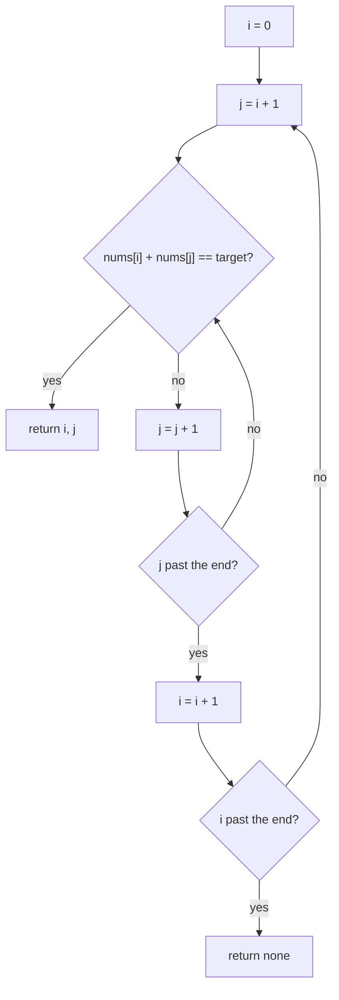

## Intuition

Imagine a table with a few cards. Your friend says "find two cards that add up to 9". The most natural way is to pick the first card and try it with every other card, then pick the second card and try it with the rest, and so on. You check every pair once. That is brute force: simple, obvious and hard to get wrong.

**The rule used in this repo.** When more than one pair works, we return the pair with the smallest first index, and then the smallest second index. Indices are zero-based and printed in ascending order. If no pair exists we print `none`. The loop order of brute force gives this rule for free, so it is the reference for the other two approaches.

## Walkthrough

Input: `nums = [2, 7, 11, 15]`, `target = 9`.

| Step | i | j | nums[i] + nums[j] | Equal to 9? |
| --- | --- | --- | --- | --- |
| 1 | 0 | 1 | 2 + 7 = 9 | yes, return `0 1` |

It stops at once here. For `[1, 2, 3]` with target 7 it has to try every pair and give up:

| Step | i | j | Sum | Equal to 7? |
| --- | --- | --- | --- | --- |
| 1 | 0 | 1 | 3 | no |
| 2 | 0 | 2 | 4 | no |
| 3 | 1 | 2 | 5 | no |

All three pairs fail, so the answer is `none`.

Read it as two loops: the inner loop (`j`) runs fully for each step of the outer loop (`i`).

## Complexity

| | Value | Why |
| --- | --- | --- |
| Time, best | O(1) | The first pair we try already works, for example `[2, 7, ...]` with target 9. |
| Time, average and worst | O(n²) | With n items there are n × (n − 1) / 2 pairs. The worst input has no valid pair, or only the last pair works, so every pair is tested. |
| Space | O(1) | We only keep two loop counters. Nothing grows with the input. |

For 1,000 numbers that is about 500,000 checks, which is fine. For 1,000,000 numbers it is about 500 billion checks, which takes minutes or hours. That jump is why this approach does not scale.

## Code explanation

Numbers in the code comments match the numbers below.

1. **Pick the first number** with the outer loop `i`.
2. **Pick a partner** with the inner loop `j`, starting at `i + 1`. Starting after `i` means we never use the same element twice and never test the same pair in two orders.
3. **Check the sum.** Because we go through `i` in increasing order, and `j` in increasing order for each `i`, the first match is the pair with the smallest first index, then the smallest second index. That is exactly our rule.
4. **Give up** after all loops end: return "no pair" in the way the language does it.

| Language | How "no pair" is returned | Note on numbers |
| --- | --- | --- |
| JavaScript / TypeScript | `null` | Numbers are 64-bit floats and exact for integers up to 2^53, so sums of two 32-bit-sized values are safe. |
| Python | `None` | Integers never overflow. |
| Go | a third `bool` result | `int` is 64-bit on 64-bit systems. |
| Java | `null` array | We use `long`, because `1_500_000_000 + 1_500_000_000` overflows a 32-bit `int` (maximum 2,147,483,647). |
| C# | nullable tuple `(int, int)?` | We use `long` for the same reason. |
| C++ | `std::optional<std::pair<int,int>>` | We use `long long`. Overflow of signed `int` is undefined behaviour in C++. |

We assume every value fits in a 32-bit integer (about ±2.1 billion), so the sum of two of them always fits in a 64-bit integer.

## Edge cases and tests

All three approaches run the same 19 cases. This approach is the reference, so it has the final say on what counts as correct.

| Input | Output | What it checks |
| --- | --- | --- |
| `[2,7,11,15]`, 9 | `0 1` | The classic example. |
| `[3,2,4]`, 6 | `1 2` | The element `3` must not be used twice (3 + 3 = 6). |
| `[3,3]`, 6 | `0 1` | Duplicates that form a pair. |
| `[1,2]`, 3 | `0 1` | The smallest array that can have an answer. |
| `[4,1,9,6,2,5]`, 9 | `0 5` | The pair sits at both ends. |
| `[-3,4,3,90]`, 0 | `0 2` | Negative numbers and a target of zero. |
| `[0,4,3,0]`, 0 | `0 3` | Two zeros. |
| `[2,5,5,11]`, 10 | `1 2` | Duplicates in the middle. |
| `[1,2,3]`, 7 | `none` | No solution. |
| `[]`, 5 | `none` | Empty array. |
| `[5]`, 5 | `none` | One element cannot be used twice. |
| `[1,2,3,4,5]`, 6 | `0 4` | Two pairs exist, (0,4) and (1,3). The rule picks the smaller first index. |
| `[1,4,6,9]`, 10 | `0 3` | Two pairs exist, (0,3) and (1,2). |
| `[2,2,2,2]`, 4 | `0 1` | Many equal pairs. |
| `[1,1,3,3]`, 4 | `0 2` | Duplicates on both sides of the sum. |
| `[1.5e9,1.5e9]`, 3e9 | `0 1` | The sum is larger than the 32-bit limit. |
| `[-2e9,3,2e9]`, 0 | `0 2` | Large negative and positive numbers. |
| a 12-number array, 17 | `0 6` | A longer array with several valid pairs. |
| the same array, 100 | `none` | A longer array with no pair. |

## When to use it (and when not)

**Use it** when the array is tiny (say under a few thousand items), when memory is extremely tight, or when you want a quick correct answer to compare against in a test. It is also a good first step in an interview, because it proves you understand the problem.

**Do not use it** on large inputs or in code that runs often. If you can afford O(n) extra memory, the hash-map approach is far faster.

## Interview notes

- Start with this approach out loud: "The simplest way is two loops, O(n²) time and O(1) space. Let me see if I can do better."
- Say why `j` starts at `i + 1`: no reusing the same element, no duplicate pairs.
- The likely follow-up is "can you make it faster?" The answer is a hash map (O(n) time) or sorting with two pointers (O(n log n)).
- Mistake to avoid: starting `j` at `0` or at `i`. That pairs an element with itself.

## Real-life usage

Pure brute force over pairs is common when the data is small: matching a handful of refunds against a handful of payments in a script, or an admin tool that checks a short list. For large data, real systems build an index first (a hash map or a sorted structure), so this exact approach rarely appears in production. It is still useful as a "reference answer" in tests: you run a fast algorithm and the brute-force version on random small inputs and check that they agree.
