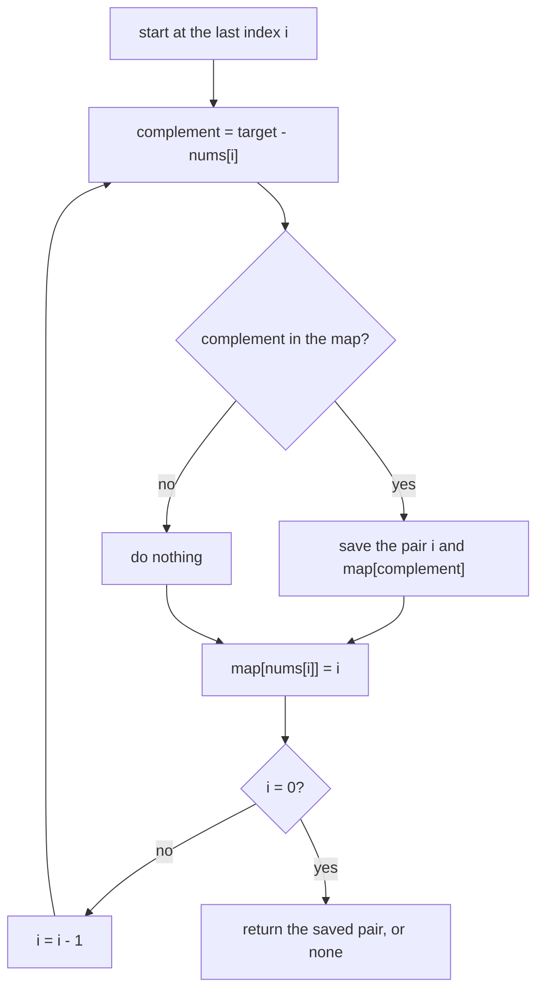

## Intuition

A **hash map** is a collection that stores key-value pairs and finds a key in about one step, no matter how many keys it holds. Think of a coat-check: you hand over a ticket (the key) and the attendant goes straight to your coat (the value) without searching the whole room.

Two sum asks: "for this number, is its partner already somewhere?" The partner is called the **complement**: `target - number`. If we keep every number we have already seen in a hash map (value as key, index as value), then "is the complement there?" is one lookup instead of a whole loop.

The textbook version walks left to right and returns as soon as it finds a match. That is correct, but it returns the pair that *finishes* first, which is not always the pair with the smallest first index. For `[1,2,3,4,5]` with target 6 it returns `1 3`, while the shared rule of this repo (smallest first index, then smallest second index) wants `0 4`.

So this version walks **from right to left** instead. At position `i` the map holds the nearest index of every value to the right of `i`. Each time we find a partner we save the pair. Since `i` only gets smaller, the last pair saved has the smallest first index, and since we overwrite a value with its newer (smaller) index, the partner index is the smallest possible. It is still one pass.

If you only need *any* pair, the textbook left-to-right version with an early return is fine and is what you should write in most interviews. Both are O(n).

## Walkthrough

Input: `nums = [1, 4, 6, 9]`, `target = 10`. Two pairs exist: (1, 2) with 4 + 6, and (0, 3) with 1 + 9. The rule wants `0 3`.

| Step | i | nums[i] | Complement | Map before | Found? | Best | Map after |
| --- | --- | --- | --- | --- | --- | --- | --- |
| 1 | 3 | 9 | 1 | empty | no | none | {9: 3} |
| 2 | 2 | 6 | 4 | {9: 3} | no | none | {9: 3, 6: 2} |
| 3 | 1 | 4 | 6 | {9: 3, 6: 2} | yes, index 2 | (1, 2) | {9: 3, 6: 2, 4: 1} |
| 4 | 0 | 1 | 9 | {9: 3, 6: 2, 4: 1} | yes, index 3 | (0, 3) | {..., 1: 0} |

The last saved pair is `0 3`. A duplicate example: `[3, 3]` with target 6. At `i = 1` the map is empty, so we store `{3: 1}`. At `i = 0` the complement 3 is in the map with index 1, so the answer is `0 1`. The lookup happens before the store, so a value is never matched with itself.

Read it as: look first, store second, then step left.

## Complexity

| | Value | Why |
| --- | --- | --- |
| Time, average | O(n) | One pass. Each lookup and each insert in a hash map takes O(1) on average. |
| Time, worst | O(n²) | If many keys collide in the same bucket, one lookup can take O(n). Good hash functions make this very rare. Java's `HashMap` turns long buckets into balanced trees (since Java 8), so its worst case is O(log n) per lookup. An attacker who knows the hash function can craft keys that collide on purpose. |
| Space | O(n) | In the worst case, all values are stored in the map. |

This is the classic trade: we spend O(n) memory to save a lot of time.

## Code explanation

1. **Find the complement** `target - nums[i]` and look it up in the map.
2. **Look before you store.** If we stored `nums[i]` first, a number like `3` with target `6` could match itself.
3. **Save the pair** when the lookup succeeds. Because `i` goes down, a later find has a smaller first index, so it replaces the older one.
4. **Store the current value** with its index. If the value is already in the map we overwrite it: the new index is smaller, and we want the smallest partner index.
5. **Return** the saved pair, or "no pair".

| Language | Map type | Lookup | Note |
| --- | --- | --- | --- |
| JavaScript / TypeScript | `Map` | `map.get(k)` returns `undefined` when missing | Check `!== undefined`, not truthiness, because index `0` is falsy. |
| Python | `dict` | `d.get(k)` returns `None` when missing | Check `is not None`, for the same reason. |
| Go | `map[int]int` | `v, ok := m[k]` | Always use the `ok` form; a missing key returns `0`, which is a valid index. |
| Java | `HashMap<Long, Integer>` | `get` returns `null` when missing | Keys are boxed `Long`; `target - nums[i]` is a `long` that is boxed automatically. |
| C# | `Dictionary<long, int>` | `TryGetValue` | The indexer `d[k]` throws when the key is missing. |
| C++ | `std::unordered_map<long long, int>` | `find` returns `end()` when missing | Do not use `m[k]` to test for a key: it inserts the key. |

We assume every value fits in a 32-bit integer so that `target - nums[i]` and sums fit into 64-bit integers.

## Edge cases and tests

The same 19 cases as the other approaches (see the brute-force notes for the full table). The ones that stress this approach most:

| Input | Output | What it checks |
| --- | --- | --- |
| `[3,2,4]`, 6 | `1 2` | Look-before-store: `3` must not pair with itself. |
| `[3,3]`, 6 | `0 1` | Duplicates: the complement of the second `3` is the first `3`. |
| `[2,5,5,11]`, 10 | `1 2` | Two equal values form the pair. |
| `[2,2,2,2]`, 4 | `0 1` | The map keeps the smallest index of the duplicate value. |
| `[1,2,3,4,5]`, 6 | `0 4` | The textbook left-to-right version would return `1 3`; the shared rule wants `0 4`. |
| `[5]`, 5 | `none` | A single element cannot pair with itself. |
| `[]`, 5 | `none` | An empty array. |
| `[1.5e9,1.5e9]`, 3e9 | `0 1` | 64-bit arithmetic. |

## When to use it (and when not)

**Use it** as the default answer for unsorted data when you need indices and memory is not a problem. It is simple and linear.

**Do not use it** when memory is tight (then sort and use two pointers, or brute force), when the input is already sorted (two pointers need O(1) space), or when the data is too large for memory (then use external sorting or partition by hash). Also be careful with untrusted input in languages with predictable hashing.

## Interview notes

- Say: "I trade O(n) memory for O(n) time. For each number I check whether its complement was already seen."
- Mention the order: "I look up before I insert so an element can never pair with itself."
- Mention duplicates: "If values repeat, `[3,3]` with target 6 still works because the lookup happens before the insert."
- Likely follow-up: "What is the worst case of a hash map?" Answer: O(n) per operation if everything collides; usually very rare.
- If the interviewer does not care which pair you return, write the classic left-to-right version with an early return.

## Real-life usage

The same idea, "keep what you have seen in a map and look up the partner", is used in hash joins in databases (build a hash table from the smaller table, probe it with the other), in de-duplication, in matching payments with refunds, and in caches and lookup tables. Code written with `Map`, `dict`, `map`, `HashMap` or `unordered_map` is the normal production answer for this problem.
