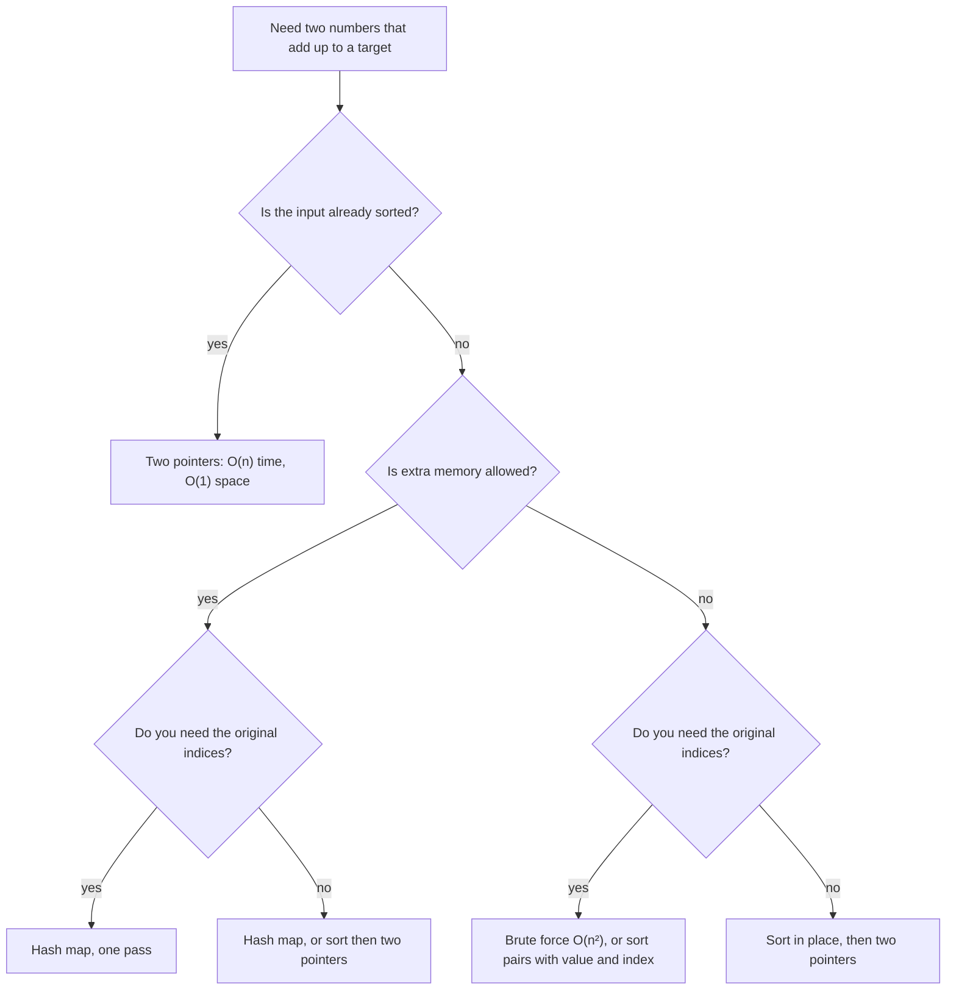

## How interviewers ask it

**The classic wording.** "Given an array of integers `nums` and an integer `target`, return the indices of the two numbers that add up to `target`. Each input has exactly one solution, and you may not use the same element twice." It is often the first question in an interview, so it is a warm-up with traps.

**Common variations:**

- *Sorted input.* "The array is already sorted. Can you use less memory?" (two pointers, O(1) space)
- *Values instead of indices.* "Return the numbers, not the positions." (sorting is now allowed, because positions do not matter)
- *All pairs.* "Return every pair that adds up to the target." (watch out for duplicates in the output)
- *Count pairs.* "How many pairs add up to the target?" (a hash map of counts)
- *Three sum and k-sum.* "Find three numbers that add up to zero."
- *No solution.* "What do you return if there is no pair?"

**What to clarify before you code:**

| Question to ask | Why it matters |
| --- | --- |
| Can the same element be used twice? | Decides whether `[3]` with target 6 has an answer. |
| Is there always exactly one answer? | Decides what to return when none or many exist. |
| Indices or values? | Sorting loses indices. |
| Can there be duplicates and negative numbers? | Duplicates break naive maps; negatives break "skip numbers bigger than the target". |
| How big is the array and how big are the numbers? | Chooses the approach and tells you if the sum can overflow. |
| Is it sorted? Can I use extra memory? | Chooses between the hash map and two pointers. |

A good answer states the brute-force idea and its cost, improves it to a hash map, handles duplicates and the "same element" trap, and gives the time and space cost out loud.

In this repo the programs print the two zero-based indices in ascending order, or `none`. When several pairs exist, they print the one with the smallest first index, then the smallest second index.

## Real-life scenarios

| Scenario | What is actually used | Why |
| --- | --- | --- |
| Matching payments with refunds that cancel out | A hash map from amount to the open transactions | For each new refund, one lookup finds a payment of the opposite amount. |
| Finding two items that together fit a gift budget | Sort by price and use two pointers | Prices are sorted anyway for display, and it needs no extra memory. |
| Joining two datasets by a key (orders and customers) | A hash join in the database, or a `Map` in code | Build a hash table from the smaller side, then look up each row of the other side. |
| De-duplication of events or emails | A `Set` of ids seen so far | "Have I seen this before?" is the same lookup as "have I seen the complement?". |
| Checking membership quickly (is this user banned?) | A hash set loaded into memory | One lookup instead of scanning a list. |
| Caches and lookup tables | `Map`, `dict`, `HashMap`, Redis | Key to value in about one step. |
| Reconciling bank statements | Sorting both lists, then walking them together | Same idea as two pointers; works on files that do not fit in memory. |

The two ideas behind the problem, "look it up in a hash table" and "sort and walk from both ends", are both used all the time in real systems.

## Approaches compared

| Approach | Time | Extra space | Needs sorted input | Keeps original indices | Use when |
| --- | --- | --- | --- | --- | --- |
| Brute force (two loops) | O(n²) | O(1) | no | yes | Tiny arrays; as a test reference. |
| Sort and two pointers | O(n log n), or O(n) if already sorted | O(n) for the indices, O(1) if already sorted | no (it sorts) | only if you sort indices | Sorted input, tight memory, or you need pairs by value and closest sums. |
| Hash map, one pass | O(n) average, O(n²) worst | O(n) | no | yes | Default for unsorted data when memory is fine. |

The hash map is the best on time for unsorted data. Two pointers is the best on space for sorted data. Brute force is only the starting point.

## How to choose

Start at the top and answer each question. In an interview, the hash map is the safe default.

## Built-ins and the standard library

A **hash map** (also called a dictionary or associative array) stores key-value pairs and finds a key in about O(1) on average. A **hash function** turns a key into a number that picks a slot. A **collision** happens when two keys land in the same slot; the map then has to compare keys to find the right one, so heavy collisions slow it down.

| Language | Map / set to use | Iteration order | Pitfall |
| --- | --- | --- | --- |
| JavaScript | `Map`, `Set` | Insertion order is guaranteed. | `Map` uses the "same value" rule (`NaN` equals `NaN`, objects compare by reference). Plain objects `{}` turn keys into strings. |
| Python | `dict`, `set` | `dict` keeps insertion order (guaranteed since 3.7). `set` order is not defined. | `d[k]` raises `KeyError` when missing; use `d.get(k)`. Keys must be hashable. Integer hashes are predictable. |
| Go | `map[K]V` (a set is `map[K]struct{}`) | Deliberately random, so never depend on it. | A missing key gives the zero value, so use `v, ok := m[k]`. Maps are not safe for concurrent writes. |
| Java | `HashMap`, `HashSet` (`LinkedHashMap` keeps insertion order) | `HashMap` has no guaranteed order. | `Map<Integer,Integer>` boxes numbers, which costs memory. If many keys land in one bucket, Java 8 and later turns that bucket into a balanced tree, so the worst case per lookup is O(log n) for comparable keys such as `Integer` and `Long`. |
| C# | `Dictionary<TKey,TValue>`, `HashSet<T>` | Not guaranteed, do not rely on it. | The indexer throws `KeyNotFoundException`; use `TryGetValue`. |
| C++ | `std::unordered_map`, `std::unordered_set` (`std::map` is a sorted tree, O(log n)) | Unspecified. | `m[k]` inserts the key if it is missing. `std::hash<int>` is often the identity, so a crafted input can force collisions. |

**Collisions and attacks.** A hash map is fast on average, but an attacker who knows the hash function can send keys that all collide and turn every lookup into a slow search. This is called hash flooding. Many runtimes randomise the hash seed to prevent it (Go does it per map, Python does it for strings and bytes). In competitive programming, anti-hash tests are a real thing for `unordered_map`. If the input is untrusted, prefer a structure with a worst-case guarantee or use the standard library defaults.

## Common mistakes

- **Using the same element twice.** `[3, 2, 4]` with target 6 must not answer `0 0`. Start the inner loop at `i + 1`, and look up the complement before storing the current number.
- **Overwriting duplicates in the map.** With `[3, 3]` and target 6, storing first and checking second fails or loses information. Check first, then store. If you must keep every index, store a list of indices per value.
- **Checking in the wrong order.** In the one-pass version, storing `nums[i]` before looking up `target - nums[i]` makes a number match itself.
- **Testing a missing key with a falsy check.** `if (map.get(x))` is false for index `0`. Compare with `undefined`, `None` or use `has`, `ok`, `TryGetValue`.
- **Integer overflow.** `1_500_000_000 + 1_500_000_000` is 3,000,000,000, which is larger than the 32-bit `int` limit of 2,147,483,647 in Java, C# and C++ (in C++ signed overflow is undefined behaviour). Use 64-bit types (`long`, `long long`) when values can be large. This repo assumes every value fits in 32 bits and uses 64-bit sums.
- **Sorting loses original indices.** If you sort the array and return positions from the sorted array, they are wrong. Sort pairs of (value, index), or sort the indices.
- **Assuming a unique answer.** Real data can have several pairs or none. Decide a rule (here: smallest first index, then smallest second index) and handle `none`.
- **Skipping numbers larger than the target.** That only works for non-negative numbers; with negatives a big number can be fixed by a negative one.

## How to answer in an interview

1. **Clarify.** "Can I use the same element twice? Is there always exactly one answer? Do you want indices or values? Can there be duplicates or negatives? How large is the input?"
2. **Give an example and edge cases.** "For `[2,7,11,15]` and target 9 the answer is `0 1`. I will also test an empty array, two elements, duplicates like `[3,3]`, and no solution."
3. **Say the simple approach and its cost.** "Two nested loops, O(n²) time, O(1) space."
4. **Improve it.** "For each number I need its complement, `target - x`. A hash map answers 'have I seen this value?' in O(1) on average, so one pass is enough: O(n) time, O(n) space."
5. **Code it.** Look up before you store. Name the variables well (`seen`, `complement`).
6. **Test aloud.** Walk through the classic example, then `[3,3]` and the empty array.
7. **State complexity and trade-offs.** "O(n) time and O(n) space on average; the hash map's worst case is O(n) per operation. If the array were sorted, two pointers would give O(1) space."
8. **Offer follow-ups.** "I can also do three sum with sorting and two pointers in O(n²)."

## Follow-up questions

- **The array is sorted. What changes?** Use two pointers: one at each end, move the left up if the sum is too small and the right down if it is too big. O(n) time, O(1) space.
- **Can you do it in O(1) extra space for an unsorted array?** Only by trading time: brute force is O(n²) time, or sort in place (O(n log n)) if you do not need the indices.
- **What about three sum?** Sort the array, fix one number, run two pointers on the rest. O(n²) time. Skip duplicates to avoid repeated triples.
- **And k-sum?** Recursively reduce to (k−1)-sum until two sum is left; the time is O(n^(k−1)). A hash map of pair sums can speed up four sum to about O(n²).
- **What if the numbers arrive as a stream?** Keep a hash set or map of what you have seen. For each new number, look up its complement before inserting it.
- **What if the data does not fit in memory?** Split the data by hash of the value, so a number and its complement land in the same part (the complement is a function of the value, so you can hash `min(x, target - x)`). Or sort externally and use two pointers over the sorted files.
- **What if there are many answers?** Return all pairs, and keep a set of values already used to avoid duplicates. Or count with a map from value to how often it appears.
- **What is the worst case of the hash map?** O(n) per operation when everything collides. Java treeifies long buckets, so it is O(log n) there.

## Practice

- Two sum II: the input array is sorted (two pointers).
- Three sum: all unique triples that add up to zero (sort plus two pointers).
- Four sum, or k-sum (recursion on top of two sum).
- Subarray sum equals k (prefix sums and a hash map, the same "seen before" idea).
- Contains duplicate and valid anagram (hash set and hash map counts).
- Two sum with a data stream: `add(number)` and `find(value)`.
