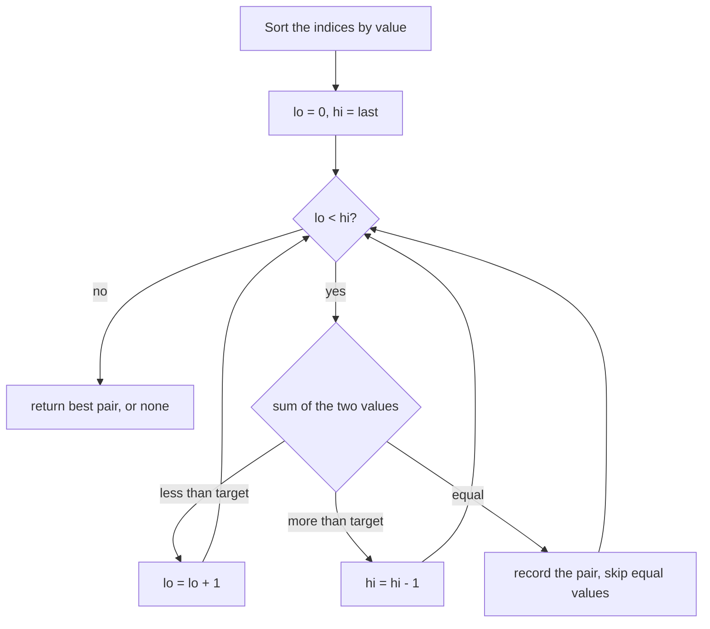

## Intuition

Think of a row of price tags sorted from cheapest to most expensive. You want two tags that add up to your budget. Put one finger on the cheapest and one on the most expensive:

- If the two together cost **too much**, the right finger is too high: even the cheapest partner is too expensive. Move the right finger one step to the left.
- If they cost **too little**, the left finger is too low: even the most expensive partner is not enough. Move the left finger one step to the right.
- If they are **equal to the budget**, you found a pair.

Each step throws away one value that can never be part of the answer, so you only walk through the row once.

**The catch: sorting moves things.** The question asks for the original positions (indices). After sorting the values, the positions are lost. So we do not sort the numbers; we sort the **list of indices**, ordering them by the number each one points to (ties broken by the smaller index). This is the same as sorting pairs of (value, index). The input array stays untouched.

**Keeping the shared rule.** The expected answer is the pair with the smallest first index, then the smallest second index. When values repeat, many pairs of indices can have the same two values. The code handles this: for a match of two different values it takes the smallest index from each group of equal values, and it compares all matches found. For a group of equal values (like `[2,2,2,2]`) it takes the two smallest indices.

## Walkthrough

Input: `nums = [3, 2, 4]`, `target = 6`.

Sorted indices (by value): `[1, 0, 2]`, which point at the values `2, 3, 4`.

| Step | lo | hi | Values (lo, hi) | Sum | Action |
| --- | --- | --- | --- | --- | --- |
| 1 | 0 | 2 | 2 and 4 | 6 | Match. Indices 1 and 2, so the best pair is (1, 2). Then skip the left group and move `hi` left. |
| 2 | 1 | 1 | | | `lo` is no longer smaller than `hi`: stop. |

Answer: `1 2`. Notice that `3 + 3 = 6` never happens, because there is only one `3` and the pointers never sit on the same position.

A second example with duplicates: `nums = [1, 1, 3, 3]`, `target = 4`. Sorted indices: `[0, 1, 2, 3]`.

| Step | lo | hi | Values | Sum | Action |
| --- | --- | --- | --- | --- | --- |
| 1 | 0 | 3 | 1 and 3 | 4 | Match. The group of `3`s starts at position 2, so we take index 0 with index 2: best = (0, 2). Skip both groups. |
| 2 | 2 | 1 | | | The pointers crossed: stop. |

Answer: `0 2`.

Read it as: sort once, then each loop step moves one pointer inwards.

## Complexity

| | Value | Why |
| --- | --- | --- |
| Time | O(n log n) | Sorting is O(n log n). The two-pointer walk is O(n) because each step moves a pointer and the pointers never go back. Sorting is the larger part. |
| Space | O(n) | We build an array of n indices. (If you were allowed to destroy the order of the input, and you only needed the values, you could sort in place with O(1) or O(log n) extra space, but then you lose the indices.) |

The best and worst cases are the same, because sorting always happens.

## Code explanation

1. **Sort the indices**, not the values, by `(value, index)`. The original array is not changed.
2. **Sum too small:** move `lo` to the right to get a bigger left value.
3. **Sum too big:** move `hi` to the left to get a smaller right value.
4. **Match.**
   - 4a. Both pointers see the same value. Everything between them is equal, so the best pair is the two smallest indices in that group, which are neighbours in the sorted order because ties are sorted by index.
   - 4b. The values differ. Find the start of the group of equal right values, pair it with the first index of the left group, save the pair if it is smaller than the best one so far, then skip both groups.
5. **Return the best pair**, or "no pair" if nothing matched.

The helper `smaller` puts the two indices in ascending order and keeps the pair that is smaller by first index, then second index.

| Language | How the indices are sorted | Note |
| --- | --- | --- |
| JavaScript / TypeScript | `sort` with a comparator `nums[a] - nums[b] \|\| a - b` | Always pass a comparator for numbers; the default sort compares strings. |
| Python | `sorted(range(n), key=lambda i: (nums[i], i))` | Tuples compare element by element. |
| Go | `sort.Slice` with a `less` function | `sort.Slice` is not stable, so the index tie-break is needed. `min` and `max` are built in from Go 1.21. |
| Java | `Arrays.sort` on `Integer[]` with `Comparator.comparingLong(...).thenComparingInt(...)` | Needs boxed `Integer`; a primitive `int[]` cannot take a comparator. |
| C# | LINQ `OrderBy(...).ThenBy(...)` | Needs `System.Linq`. |
| C++ | `std::sort` with a lambda over an index vector filled by `std::iota` | `long long` for values avoids overflow. |

We assume every value fits in a 32-bit integer, so sums fit into 64-bit integers.

## Edge cases and tests

The same 19 cases as the other approaches (see the brute-force notes for the full table). The ones that stress this approach most:

| Input | Output | What it checks |
| --- | --- | --- |
| `[3,2,4]`, 6 | `1 2` | Original positions survive the sort. |
| `[3,3]`, 6 | `0 1` | A group of equal values, the 4a branch. |
| `[2,2,2,2]`, 4 | `0 1` | Many equal values: we must pick the two smallest indices. |
| `[1,1,3,3]`, 4 | `0 2` | Two groups of duplicates, the 4b branch. |
| `[1,2,3,4,5]`, 6 | `0 4` | Two value pairs match, we keep the better one. |
| `[]`, 5 and `[5]`, 5 | `none` | Fewer than two elements: the loop never runs. |
| `[1.5e9,1.5e9]`, 3e9 | `0 1` | No overflow with 64-bit sums. |

## When to use it (and when not)

**Use it** when the input is already sorted (then skip the sort and you get O(n) time and O(1) space), when you want to avoid a hash map (for example because of memory or because hashing is not available), or when you want all pairs or the closest sum to the target. It is also the stepping stone to three sum and k-sum.

**Do not use it** when you need the original indices and the array is not sorted, and a hash map is allowed: the hash map is O(n) and simpler. Sorting costs more than it saves.

## Interview notes

- Say: "If the array is sorted, two pointers solve it in O(n) time and O(1) space."
- If the array is not sorted and indices are needed, say: "Sorting loses the positions, so I sort the indices or (value, index) pairs."
- Likely follow-up: "What if the input is already sorted?" Answer: skip the sort.
- Mistake to avoid: sorting the array in place and then returning positions from the sorted array.

## Real-life usage

Two pointers over sorted data is everywhere: merging two sorted lists, finding pairs of prices that fit a gift budget, matching two sorted files by key (a merge join in a database), and range queries on sorted arrays. For the plain "two sum on unsorted data" question, production code almost always picks a hash map instead.
