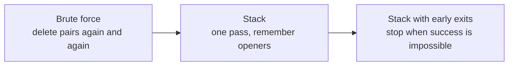
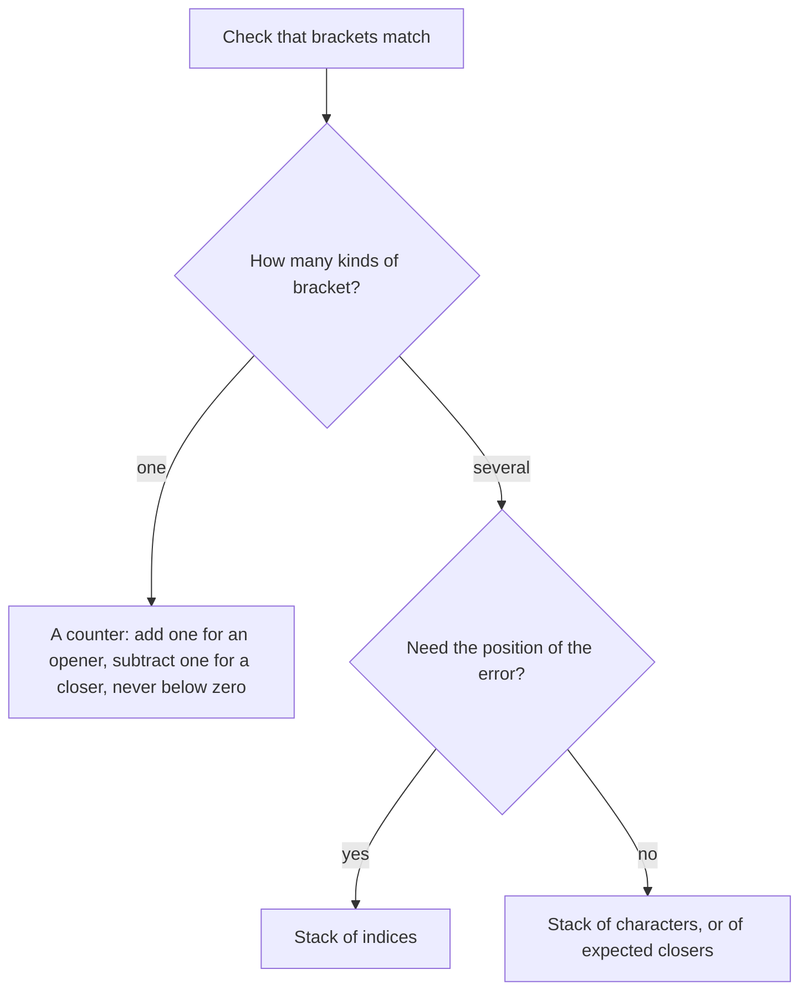
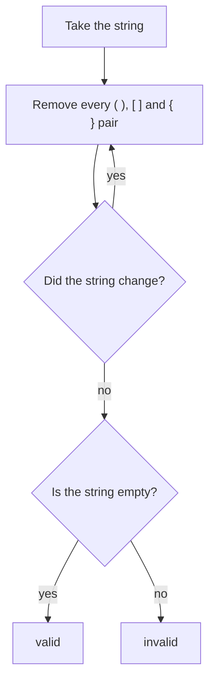
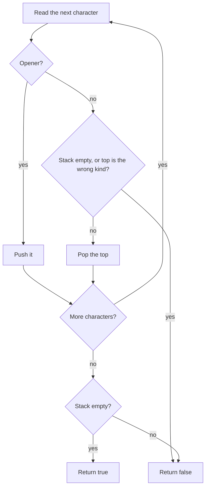
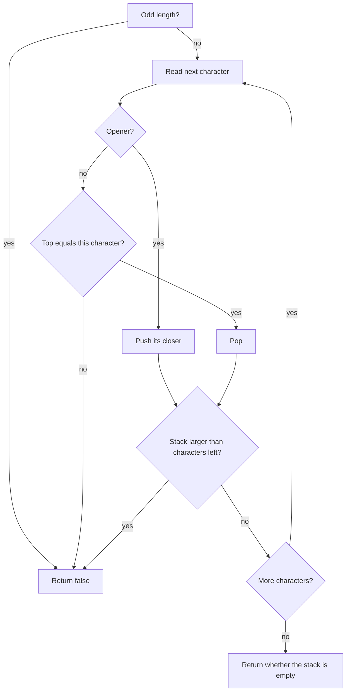

# Valid parentheses

[← All problems](../README.md)

> Check that every bracket is closed in the right order: the classic way to learn why a stack fits "last opened, first closed".

**Level:** basic · **Tags:** stack, strings, parsing, complexity

**Related interview questions:**

- [JavaScript: What is the event loop? How do the call stack, task queue and microtasks work?](../../questions/javascript.md)
- [Golang: What is escape analysis? How does Go decide between stack and heap?](../../questions/golang.md)
- [Golang: Tech Lead How do you read a Go panic stack trace?](../../questions/golang.md)
- [Golang: How are strings, bytes and runes related in Go?](../../questions/golang.md)
- [JavaScript: Which array methods should you know, and which ones mutate the array?](../../questions/javascript.md)
- [Golang: What are arrays and slices? Why are slices used almost everywhere?](../../questions/golang.md)

## How interviewers ask it

**The classic wording.** "Given a string containing only the characters `(`, `)`, `{`, `}`, `[` and `]`, decide whether it is valid. A string is valid when every opening bracket is closed by the same kind of bracket, and brackets are closed in the correct order." It is a warm-up question about stacks, and it is very common.

**Common variations:**

- *Other characters in the string.* "The string also contains letters and digits. Ignore them." (skip anything that is not a bracket)
- *Only one kind of bracket.* "Check only round brackets." (a counter is enough, no stack needed)
- *Minimum removals.* "Return the fewest brackets you must delete to make the string valid."
- *Longest valid substring.* "Find the length of the longest well-formed run." (a stack of indices, or a dynamic programming array)
- *Generate all.* "Write every valid string with n pairs." (backtracking)
- *Min stack.* "Design a stack that also returns its minimum in constant time." (a follow-up on the same data structure, explained below)

**What to clarify before you code:**

| Question to ask | Why it matters |
| --- | --- |
| What characters can appear? | Decides whether you must skip other characters or can assume only brackets. |
| Is the empty string valid? | The usual answer is yes, and a good solution handles it without a special case. |
| How long can the string be? | Tells you whether recursion is safe (it is not for very long input) and whether O(n) memory is fine. |
| Do I return true or false only, or the position of the first error? | Reporting the position needs the index of each opener on the stack. |
| Is it one string, or a stream? | A stream means you cannot look ahead, and the stack is the natural answer. |

A good answer states why a plain counter is not enough for three kinds of brackets, uses a stack, handles the three failure cases (wrong closer, closer with nothing open, openers left over), and gives the time and space cost out loud.

In this repo every program prints `true` or `false` for each test string. The empty string counts as valid.

## Real-life scenarios

| Scenario | What is actually used | Why |
| --- | --- | --- |
| A code editor highlighting a missing closing brace | A stack of open brackets with their positions | The editor needs to point at the exact bracket that has no partner, so it keeps the position of every opener. |
| A compiler or interpreter parsing nested expressions | A parser with an explicit stack, or recursion (which uses the call stack) | Nested structure is last opened, first closed, which is exactly what a stack gives. |
| Validating JSON or XML by hand | A tokenizer plus a stack of open objects and arrays or open tags | Every `{` or `<tag>` must be closed in the right order. Production code uses a real parser library. |
| Checking an HTML or template file for unclosed tags | A linter that keeps a stack of open tags | The error message can name the tag that was left open. |
| The browser back button and the editor undo history | A stack of earlier states | The most recent action is undone first, which is last in, first out. |
| The function call stack in every program | The runtime's own stack of frames | Each call is pushed, and each return pops it. A stack trace is a printout of that stack. |
| Evaluating a formula such as a spreadsheet cell | The shunting-yard method with an operator stack | Brackets in the formula change the order of operations, and a stack tracks the open ones. |
| Matching begin and end events in logs (a request started but never ended) | A stack or map of open spans | Distributed tracing tools do the same to pair a start with its end. |

The idea behind all of them: whenever things must be closed in the reverse order from which they were opened, think of a stack.

## Approaches compared

| Approach | Time | Extra space | Use when |
| --- | --- | --- | --- |
| 1. Brute force: repeated replacement | O(n²) worst case | O(n) for the new strings | Never in production. It is the "no data structure" starting point and a good test reference. |
| 2. Stack | O(n) | O(n) | The default answer. Simple, correct and fast. |
| 3. Stack with early exits | O(n) worst case, O(1) when the length is odd | O(n) | When you want the same answer and fast rejection of obviously bad input. |

All three give the same answer for every input. The second and third are both linear. The third simply stops sooner on bad input. The first one is slow because each round scans the whole string, and a string like many nested openers followed by many closers needs one round per pair.



Read it as the ladder an interview follows: first the idea that works, then the data structure that makes it fast, then the small prunings.

## How to choose



Start at the top and answer each question. With one kind of bracket a counter is enough and uses no extra memory. With several kinds the order matters, so you need a stack. Use the stack of indices when you must report where the problem is.

## Built-ins and the standard library

There is no built-in "balanced brackets" function in any of these languages. What you choose is the stack type. A **stack** is a collection where you add and remove only at one end: the last item added is the first one removed.

| Language | Stack to use | Push and pop | Pitfall |
| --- | --- | --- | --- |
| JavaScript / TypeScript | A plain `Array` | `push` and `pop` | `pop` on an empty array returns `undefined` and does not throw, so a missing partner can sneak through if you do not compare carefully. |
| Python | A `list` (or `collections.deque`) | `append` and `pop` | `pop` on an empty list raises `IndexError`, so check for empty first. Both operations are O(1) at the end of a list. |
| Go | A slice | `append`, and `s = s[:len(s)-1]` | There is no stack type. Indexing an empty slice panics, so check the length first. |
| Java | `ArrayDeque` through the `Deque` interface | `push`, `pop`, `peek` | The old `java.util.Stack` class is synchronised and legacy; prefer `ArrayDeque`. `pop` on an empty deque throws `NoSuchElementException`. |
| C# | `Stack<T>` | `Push`, `Pop`, `Peek`, `TryPop` | `Pop` on an empty stack throws `InvalidOperationException`; `TryPop` avoids the exception. |
| C++ | `std::stack` (or `std::vector` / `std::string` used as a stack) | `push`, `pop`, `top` | `top` and `pop` on an empty stack are undefined behaviour, not an exception. Always check `empty()` first. |

**Hand-write or use a library?** For this question always hand-write it; the point is the stack. In real code, use a proper parser for JSON, XML or source code, because real formats also have strings, comments and escapes that contain brackets.

## Common mistakes

- **Popping from an empty stack.** The string `)` has a closer with nothing open. In Java, C# and Python this throws; in C++ it is undefined behaviour; in JavaScript it quietly gives `undefined`. Check for empty first.
- **Forgetting the leftover openers.** The string `(` never fails a pop, but it is not valid. Return true only if the stack is empty at the end.
- **Only counting brackets.** Counting works for one kind of bracket. For `([)]` the counts are balanced, but the order is wrong, so the string is invalid.
- **Comparing against the wrong thing.** Pushing the opener and then comparing it with the closer needs a lookup table. Pushing the closer you expect makes the comparison a simple equality.
- **Mixing up the table direction.** A table from closer to opener is used when you read a closer; a table from opener to closer is used when you read an opener. Mixing them gives wrong answers on every input.
- **Assuming the input has only brackets.** If other characters can appear, skip them instead of pushing them.
- **Using recursion on long input.** A recursive solution can overflow the call stack on a string of a million brackets. The explicit stack on the heap does not.
- **Brute force with a single replace.** Removing only the first `()` per round, or only one kind of pair, still works but is much slower. Remove all pairs in each round, and repeat until nothing changes.

## How to answer in an interview

1. **Clarify.** "Does the string contain only brackets? Is the empty string valid? How long can it be?"
2. **Give examples and edge cases.** "`()[]{}` is valid. `(]` is invalid because the kinds differ. `([)]` is invalid because the order is wrong. Also the empty string, a single opener, and a single closer."
3. **Say the simple approach.** "I could keep deleting adjacent pairs like `()` until nothing is left. That works, but each round scans the string and a deeply nested string needs about half as many rounds as it has characters, so it is quadratic."
4. **Improve it.** "The last opener must be closed first. That is last in, first out, so I use a stack. I push openers and, for each closer, I check the top of the stack."
5. **Code it.** Use a table from closer to opener. Check for an empty stack before popping. Return whether the stack is empty at the end.
6. **Test aloud.** Walk through `{[]}` and then `([)]`, and finish with the empty string and a lone `)`.
7. **State complexity.** "One pass, so O(n) time. The stack can hold up to n characters, so O(n) space."
8. **Offer improvements.** "If the length is odd I can return false immediately. If the stack is already larger than the number of characters left, I can stop early."
9. **Mention the follow-up.** "If you want the minimum of a stack in constant time, I keep a second stack of minimums."

## Follow-up questions

- **Can you do it in constant extra space?** For one kind of bracket, yes, with a counter. For several kinds you need the stack, because you must remember the order. In general the memory you need grows with how deeply the brackets are nested.
- **How do you return the position of the first error?** Push the index of each opener instead of the character. When a closer does not match, or the stack is empty, report the current index. At the end, report the index left on the stack.
- **How would you find the longest valid substring?** Keep a stack of indices with a base marker. When a pair is matched, the length is the current index minus the index now on top. This is linear time.
- **What is a min stack?** A stack that also answers "what is the smallest element?" in constant time. Keep a second stack. When you push a value, also push the smaller of that value and the current minimum onto the second stack. Pop both together. Every operation is constant time and the extra space is linear.
- **How do you make the minimum of the last k items, or a queue with a minimum?** A queue can be built from two stacks, and a monotonic deque gives the sliding window minimum in linear time.
- **What if the string is a stream and does not fit in memory?** The stack only grows with the nesting depth, not the length. Process one character at a time and keep just the stack.
- **How do you handle brackets inside quotes or comments?** You need a small state machine on top of the stack: a mode for "inside a string" or "inside a comment", where brackets are ignored. This is what real tokenizers do.
- **How would you generate all valid strings with n pairs?** Use backtracking: add an opener while fewer than n are used, add a closer while closers used are fewer than openers used. The count of results is the Catalan number.

## Practice

- Minimum add to make parentheses valid, and minimum remove to make parentheses valid.
- Longest valid parentheses (stack of indices, or dynamic programming).
- Generate parentheses (backtracking with a counter).
- Min stack and max stack (a second stack that tracks the extreme value).
- Evaluate reverse Polish notation and basic calculator (a stack for operands and operators).
- Daily temperatures and next greater element (a monotonic stack).

## Further reading

Where to read more at the source. Official docs and references come first.

**Official docs**

- [MDN: Array.prototype.pop](https://developer.mozilla.org/en-US/docs/Web/JavaScript/Reference/Global_Objects/Array/pop) — JavaScript arrays as stacks: push and pop, and what pop returns on an empty array. _(beginner)_
- [Python: using lists as stacks](https://docs.python.org/3/tutorial/datastructures.html#using-lists-as-stacks) — Why a list is a good stack in Python and when to use collections.deque instead. _(beginner)_
- [Java: ArrayDeque](https://docs.oracle.com/en/java/javase/21/docs/api/java.base/java/util/ArrayDeque.html) — The recommended stack and queue in Java, with push, pop and peek. _(intermediate)_
- [.NET: Stack<T>](https://learn.microsoft.com/dotnet/api/system.collections.generic.stack-1) — The .NET stack, including TryPop and TryPeek. _(beginner)_

**Reference**

- [Stack (abstract data type) (Wikipedia)](https://en.wikipedia.org/wiki/Stack_(abstract_data_type)) — Push, pop, peek and where stacks are used, including the call stack. _(beginner)_
- [Call stack (Wikipedia)](https://en.wikipedia.org/wiki/Call_stack) — How function calls use a stack and why deep recursion overflows it. _(intermediate)_
- [C++: std::stack](https://en.cppreference.com/w/cpp/container/stack) — The stack adaptor and the undefined behaviour of top() on an empty stack. _(intermediate)_

**Tool**

- [LeetCode: Valid Parentheses](https://leetcode.com/problems/valid-parentheses/) — The original problem statement to practise with an online judge. _(beginner)_

## Approaches

| Approach | Best | Average | Worst | Space | Stable | In place | Languages |
| --- | --- | --- | --- | --- | --- | --- | --- |
| [Brute force: repeated replacement](#brute-force-repeated-replacement) | O(n) | O(n²) | O(n²) | O(n) | – | – | JavaScript, TypeScript, Python, Go, Java, C#, C++ |
| [Stack](#stack) | O(n) | O(n) | O(n) | O(n) | – | – | JavaScript, TypeScript, Python, Go, Java, C#, C++ |
| [Stack with early exits](#stack-with-early-exits) | O(1) | O(n) | O(n) | O(n) | – | – | JavaScript, TypeScript, Python, Go, Java, C#, C++ |

## Brute force: repeated replacement

> Keep deleting adjacent pairs like "()" until nothing changes; valid if the string becomes empty.

### Intuition

Look at a valid string such as `{[()]}`. The innermost pair `()` sits right next to each other. If you cross that pair out, you get `{[]}`. Now `[]` is a neighbouring pair, so cross it out too: `{}`. One more round and nothing is left. Every valid string can be shrunk to nothing this way.

Now try an invalid string such as `([)]`. No pair is next to each other, so nothing can be crossed out and the string stays as it is. The same happens for `(` alone, or `)(`.

The idea is like closing nested boxes: you can only close the box that is on the inside first. We do not use any data structure here. We just keep deleting the pairs `()`, `[]` and `{}` until a whole round changes nothing. If the string is empty at the end, it was valid. If something is left, it was not.

This is the simplest correct answer, so it is a good first thing to say in an interview. It is slow, and the next approach fixes that.

### Walkthrough

Input: `{[()]}` (valid). The table shows the string after each round. A round removes every `()`, then every `[]`, then every `{}` that it can find.

| Round | String before | After removing `()` | After removing `[]` | After removing `{}` | Changed? |
| --- | --- | --- | --- | --- | --- |
| 1 | `{[()]}` | `{[]}` | `{}` | empty | yes |
| 2 | empty | empty | empty | empty | no, so stop |

The string is empty, so the answer is `true`. In this example one round was enough because we remove the three kinds in the order inner to outer. In the worst case that order does not help.

Second input: `([)]` (invalid). No pair is adjacent in round 1, so nothing changes, we stop, and the string `([)]` is not empty. The answer is `false`.

Third input, to show many rounds: `((((` followed by `))))`, which is `(((())))`. Each round removes only the one middle pair.

| Round | String before | String after |
| --- | --- | --- |
| 1 | `(((())))` | `((()))` |
| 2 | `((()))` | `(())` |
| 3 | `(())` | `()` |
| 4 | `()` | empty |
| 5 | empty | empty (no change, stop) |

Each round scans the whole current string, and there are about half as many rounds as characters. That is where the quadratic cost comes from.



Read it as: keep shrinking while it helps, then look at what is left.

### Complexity

| | Value | Why |
| --- | --- | --- |
| Time, best | O(n) | If no pair exists, or everything disappears in the first round, only a few scans happen. |
| Time, average and worst | O(n²) | A deeply nested string removes only one pair per round, so there are about n divided by 2 rounds, and each round scans up to n characters. |
| Space | O(n) | Every replace creates a new string. Strings are immutable in JavaScript, Python, Go, Java and C#, so each round allocates a new copy. In C++ the string is edited in place after one copy. |

The worst input is many openers followed by the same number of closers, such as `((((....))))`. The best input has no pair at all, such as a string of only closers.

### Code explanation

1. **Remember the old string.** We need it to see whether this round changed anything.
2. **Remove every adjacent pair.** One replace call per kind of bracket. Removing `()` can create a new `[]` pair next to each other, which is why we repeat.
3. **Stop when nothing changed.** If the string is the same as before, no pair is left to remove, and the process cannot make progress.
4. **Check for empty.** A valid string has been consumed completely.

| Language | How the pair is removed | Note |
| --- | --- | --- |
| JavaScript / TypeScript | `replaceAll('()', '')` | `replaceAll` needs Node 15 or later. The older `replace` with a plain string only changes the first match. |
| Python | `s.replace('()', '')` | Python's `replace` already replaces all matches. |
| Go | `strings.ReplaceAll` | Go strings are immutable, so a new string is built each time. |
| Java | `String.replace(CharSequence, CharSequence)` | Despite the name, this replaces all matches. Do not confuse it with `replaceAll`, which takes a regular expression, where brackets have special meaning. |
| C# | `string.Replace` | Replaces all matches and returns a new string. |
| C++ | `find` and `erase` in a loop | There is no replace-all in the standard library. The function takes the string by value, so the caller's string is not changed. |

### Edge cases and tests

All three approaches run the same 21 strings and print `true` or `false` for each. The expected output is the same for all approaches.

| Input | Output | What it checks |
| --- | --- | --- |
| `()` and `()[]{}` | `true` | The basic cases, one pair and three pairs side by side. |
| `(]` | `false` | Right count, wrong kind. |
| `([)]` | `false` | Right kinds, wrong order. |
| `{[]}` | `true` | Proper nesting of different kinds. |
| empty string | `true` | The empty string is valid (it is in the middle of the list, so the output has no blank line at the start or end). |
| `(`, `((` | `false` | Openers left over. |
| `)`, `))` | `false` | Closers with nothing open. |
| `(((())))` | `true` | Deep nesting, many rounds. |
| `{[()()]}`, `([{}])` | `true` | Mixed nesting. |
| `(()` and `())` | `false` | One bracket too many on either side. |
| `]` | `false` | A single closer. |
| `()()()()` | `true` | Many pairs side by side. |
| `{{{{}}}}[` | `false` | Valid prefix, then one extra opener. |
| `((((((((((` | `false` | Ten openers and no closer. |
| `[({})](` | `false` | A valid part followed by a stray opener. |
| `{[}]` | `false` | Closers in the wrong order. |

### When to use it (and when not)

**Use it** as the first idea in an interview to show you understand what "valid" means, and as a simple reference to compare other solutions against in tests.

**Do not use it** in real code. It allocates a new string for every round and is quadratic. For long input it is far too slow. The stack approach does the same job in one pass.

### Interview notes

- Say: "A valid string can be shrunk to nothing by removing adjacent pairs. I repeat until nothing changes."
- Say the cost right away: "Each round is linear and there can be about n over two rounds, so this is quadratic."
- Then say: "I can do better with a stack, because the last opener must be closed first."
- Likely follow-up: "Why does removing pairs in any order give the same final result?" Because removing a pair never creates a mismatch; it can only bring other characters next to each other.
- Mistake to avoid: using a regular expression with unescaped brackets, or using a replace that only changes the first match.

### Real-life usage

This exact approach does not appear in production code. The same "reduce by rewriting" idea shows up in simplifiers, such as an algebra system that applies rewrite rules until nothing changes, and in text-processing scripts that clean up input by repeated substitution. For bracket checking, real tools use a stack or a parser.

### Code

Every example prints the same output and is tested (`npm run problems:test`).

<details><summary>JavaScript</summary>

```js
// Valid parentheses, approach 1: brute force. Delete matching pairs "()", "[]", "{}" until nothing changes.
// A string is valid exactly when this reduces it to the empty string.
function isValid(s) {
  let previous;
  do {
    previous = s; // 1. remember the string before this round
    s = s.replaceAll('()', '').replaceAll('[]', '').replaceAll('{}', ''); // 2. remove every adjacent pair
  } while (s !== previous); // 3. stop when a round removes nothing
  return s.length === 0; // 4. valid only if everything was removed
}

const cases = [
  "()",
  "()[]{}",
  "(]",
  "([)]",
  "{[]}",
  "",
  "(",
  ")",
  "((",
  "))",
  "(((())))",
  "{[()()]}",
  "([{}])",
  "(()",
  "())",
  "]",
  "()()()()",
  "{{{{}}}}[",
  "((((((((((",
  "[({})](",
  "{[}]",
];

for (const s of cases) console.log(String(isValid(s)));
```

</details>

<details><summary>TypeScript</summary>

```ts
// Valid parentheses, approach 1: brute force. Delete matching pairs "()", "[]", "{}" until nothing changes.
// A string is valid exactly when this reduces it to the empty string.
function isValid(s: string): boolean {
  let previous: string;
  do {
    previous = s; // 1. remember the string before this round
    s = s.replaceAll('()', '').replaceAll('[]', '').replaceAll('{}', ''); // 2. remove every adjacent pair
  } while (s !== previous); // 3. stop when a round removes nothing
  return s.length === 0; // 4. valid only if everything was removed
}

const cases: string[] = [
  "()",
  "()[]{}",
  "(]",
  "([)]",
  "{[]}",
  "",
  "(",
  ")",
  "((",
  "))",
  "(((())))",
  "{[()()]}",
  "([{}])",
  "(()",
  "())",
  "]",
  "()()()()",
  "{{{{}}}}[",
  "((((((((((",
  "[({})](",
  "{[}]",
];

for (const s of cases) console.log(String(isValid(s)));
```

</details>

<details><summary>Python</summary>

```python
"""Valid parentheses, approach 1: brute force. Delete matching pairs "()", "[]", "{}" until nothing changes.

A string is valid exactly when this reduces it to the empty string.
"""


def is_valid(s):
    while True:
        previous = s  # 1. remember the string before this round
        for pair in ("()", "[]", "{}"):
            s = s.replace(pair, "")  # 2. remove every adjacent pair
        if s == previous:  # 3. stop when a round removes nothing
            break
    return s == ""  # 4. valid only if everything was removed

CASES = [
    "()",
    "()[]{}",
    "(]",
    "([)]",
    "{[]}",
    "",
    "(",
    ")",
    "((",
    "))",
    "(((())))",
    "{[()()]}",
    "([{}])",
    "(()",
    "())",
    "]",
    "()()()()",
    "{{{{}}}}[",
    "((((((((((",
    "[({})](",
    "{[}]",
]

for s in CASES:
    print("true" if is_valid(s) else "false")
```

</details>

<details><summary>Go</summary>

```go
// Valid parentheses, approach 1: brute force. Delete matching pairs "()", "[]", "{}" until nothing changes.
// A string is valid exactly when this reduces it to the empty string.
package main

import (
	"fmt"
	"strings"
)

func isValid(s string) bool {
	for {
		previous := s // 1. remember the string before this round
		for _, pair := range []string{"()", "[]", "{}"} {
			s = strings.ReplaceAll(s, pair, "") // 2. remove every adjacent pair
		}
		if s == previous { // 3. stop when a round removes nothing
			break
		}
	}
	return s == "" // 4. valid only if everything was removed
}

func main() {
	cases := []string{
		"()",
		"()[]{}",
		"(]",
		"([)]",
		"{[]}",
		"",
		"(",
		")",
		"((",
		"))",
		"(((())))",
		"{[()()]}",
		"([{}])",
		"(()",
		"())",
		"]",
		"()()()()",
		"{{{{}}}}[",
		"((((((((((",
		"[({})](",
		"{[}]",
	}
	for _, s := range cases {
		fmt.Println(isValid(s))
	}
}
```

</details>

<details><summary>Java</summary>

```java
// Valid parentheses, approach 1: brute force. Delete matching pairs "()", "[]", "{}" until nothing changes.
// A string is valid exactly when this reduces it to the empty string.
public class Main {
    static boolean isValid(String s) {
        String previous;
        do {
            previous = s; // 1. remember the string before this round
            s = s.replace("()", "").replace("[]", "").replace("{}", ""); // 2. remove every adjacent pair
        } while (!s.equals(previous)); // 3. stop when a round removes nothing
        return s.isEmpty(); // 4. valid only if everything was removed
    }

    public static void main(String[] args) {
        String[] cases = {
            "()",
            "()[]{}",
            "(]",
            "([)]",
            "{[]}",
            "",
            "(",
            ")",
            "((",
            "))",
            "(((())))",
            "{[()()]}",
            "([{}])",
            "(()",
            "())",
            "]",
            "()()()()",
            "{{{{}}}}[",
            "((((((((((",
            "[({})](",
            "{[}]",
        };
        for (String s : cases) System.out.println(isValid(s));
    }
}
```

</details>

<details><summary>C#</summary>

```csharp
// Valid parentheses, approach 1: brute force. Delete matching pairs "()", "[]", "{}" until nothing changes.
// A string is valid exactly when this reduces it to the empty string.
static bool IsValid(string s)
{
    string previous;
    do
    {
        previous = s; // 1. remember the string before this round
        s = s.Replace("()", "").Replace("[]", "").Replace("{}", ""); // 2. remove every adjacent pair
    } while (s != previous); // 3. stop when a round removes nothing
    return s.Length == 0; // 4. valid only if everything was removed
}

string[] cases =
{
    "()",
    "()[]{}",
    "(]",
    "([)]",
    "{[]}",
    "",
    "(",
    ")",
    "((",
    "))",
    "(((())))",
    "{[()()]}",
    "([{}])",
    "(()",
    "())",
    "]",
    "()()()()",
    "{{{{}}}}[",
    "((((((((((",
    "[({})](",
    "{[}]",
};

foreach (var s in cases) Console.WriteLine(IsValid(s) ? "true" : "false");
```

</details>

<details><summary>C++</summary>

```cpp
// Valid parentheses, approach 1: brute force. Delete matching pairs "()", "[]", "{}" until nothing changes.
// A string is valid exactly when this reduces it to the empty string.
#include <iostream>
#include <string>
#include <vector>

// C++ has no replace-all in the standard library, so remove one pair at a time.
static bool removeOnePair(std::string& s, const std::string& pair) {
    std::size_t pos = s.find(pair);
    if (pos == std::string::npos) return false;
    s.erase(pos, 2);
    return true;
}

bool isValid(std::string s) { // s is a copy, so the caller's string is not changed
    bool changed = true;
    while (changed) { // 1. repeat until a full round removes nothing
        changed = false;
        for (const char* pair : {"()", "[]", "{}"}) {
            while (removeOnePair(s, pair)) changed = true; // 2. remove every adjacent pair
        }
    }
    return s.empty(); // 3. valid only if everything was removed
}

int main() {
    std::vector<std::string> cases = {
        "()",
        "()[]{}",
        "(]",
        "([)]",
        "{[]}",
        "",
        "(",
        ")",
        "((",
        "))",
        "(((())))",
        "{[()()]}",
        "([{}])",
        "(()",
        "())",
        "]",
        "()()()()",
        "{{{{}}}}[",
        "((((((((((",
        "[({})](",
        "{[}]",
    };
    for (const auto& s : cases) std::cout << (isValid(s) ? "true" : "false") << "\n";
}
```

</details>

### Expected output

```text
true
true
false
false
true
true
false
false
false
false
true
true
true
false
false
false
true
false
false
false
false
```

## Stack

> Push every opener; each closer must match the opener on top of the stack.

### Intuition

A **stack** is a pile where you can only add to the top and remove from the top, like a stack of plates. The last plate you put on is the first one you take off. This is called last in, first out.

Brackets follow the same rule. The last bracket you opened is always the first one you must close. So as you read the string from left to right:

- When you see an opener, put it on the pile. It is waiting for its partner.
- When you see a closer, look at the top of the pile. It must be the matching opener. If it is, take it off. If the pile is empty, or the top is a different kind, the string is invalid.
- When the string ends, the pile must be empty. Anything left over is an opener that was never closed.

Think of walking into nested rooms: each opener is a door you walk through, each closer is a door you walk back out of. You must leave through the doors in the reverse order of how you entered. The stack remembers the doors.

### Walkthrough

Input: `{[()]}` (valid). The table shows the stack after each character. The top of the stack is on the right.

| Step | Character | Action | Stack after |
| --- | --- | --- | --- |
| 1 | `{` | opener, push | `{` |
| 2 | `[` | opener, push | `{ [` |
| 3 | `(` | opener, push | `{ [ (` |
| 4 | `)` | closer, top is `(`, a match, pop | `{ [` |
| 5 | `]` | closer, top is `[`, a match, pop | `{` |
| 6 | `}` | closer, top is `{`, a match, pop | empty |

The string ended and the stack is empty, so the answer is `true`.

Second input: `([)]` (invalid).

| Step | Character | Action | Stack after |
| --- | --- | --- | --- |
| 1 | `(` | push | `(` |
| 2 | `[` | push | `( [` |
| 3 | `)` | closer, top is `[`, not a match, stop | invalid |

The answer is `false` at step 3. A third input is `(`: the stack still holds one opener at the end, so the answer is `false`. A fourth is `)`: the stack is empty when the closer arrives, so the answer is `false` at once.



Read it as: opener goes on, closer must match the top, and at the end nothing may remain.

### Complexity

| | Value | Why |
| --- | --- | --- |
| Time | O(n) | Each character is looked at once. Push, pop and the table lookup each take constant time. |
| Space | O(n) | The stack holds every opener that is still waiting. For a string of only openers that is all n characters. |

The worst case for space is a string of only openers, such as `((((((`. The best case for space is a string like `()()()()`, where the stack never holds more than one item. Time is linear in every case, but you can stop early on the first mismatch.

### Code explanation

1. **A closer needs a partner.** We keep a small table from each closer to the opener it needs. When the character is a key in that table, it is a closer, and we compare it with the top of the stack. We must also handle the empty stack, because a closer with nothing open is invalid.
2. **An opener waits.** Anything that is not a closer is pushed. This assumes the input has only brackets, as in the problem statement. If other characters could appear, skip them here.
3. **Leftovers mean invalid.** After the loop the stack must be empty, otherwise some opener was never closed.

| Language | Stack | Empty-pop behaviour | Note |
| --- | --- | --- | --- |
| JavaScript / TypeScript | `Array` with `push` and `pop` | `pop` returns `undefined` | The comparison with the needed opener fails for `undefined`, so no extra empty check is needed, but it is clearer to know why. |
| Python | `list` with `append` and `pop` | `pop` raises `IndexError` | Check `not stack` first, using short-circuit `or`. |
| Go | A `[]byte` slice | Indexing an empty slice panics | Check `len(stack) == 0` first. Pop by re-slicing. Iterating the string by byte is safe because the brackets are single-byte characters. |
| Java | `ArrayDeque<Character>` | `pop` throws `NoSuchElementException` | `Map.of` is immutable and compact. Comparing a boxed `Character` with a `char` using `!=` unboxes it, which is correct here. |
| C# | `Stack<char>` | `Pop` throws, `TryPop` does not | `TryPop` combines the empty check and the pop in one call. |
| C++ | `std::stack<char>` | `top` and `pop` are undefined behaviour | Always check `empty()` before `top()`. |

### Edge cases and tests

The same 21 strings as every approach in this problem (the full table is in the brute-force notes). The ones that stress the stack most:

| Input | Output | What it checks |
| --- | --- | --- |
| `)` | `false` | A closer arrives with an empty stack. |
| `(` | `false` | The loop ends with the stack not empty. |
| `([)]` | `false` | The top of the stack is the wrong kind. |
| `{[()()]}` | `true` | The stack grows and shrinks several times. |
| empty string | `true` | The loop does not run and the stack is empty. |
| `((((((((((` | `false` | Many leftover openers. |

### When to use it (and when not)

**Use it** whenever things must be closed in the reverse order from which they were opened: brackets, tags, nested calls, undo history.

**Do not use it** when there is only one kind of bracket and you do not need positions: a counter is enough and needs only constant memory. Also, when the input has strings and comments that may contain brackets, you need a real tokenizer on top.

### Interview notes

- Say: "Last opened, first closed, so a stack."
- Name the three failure cases out loud: wrong kind of closer, closer with an empty stack, and openers left at the end.
- Use a table from closer to opener, which keeps the code short and easy to extend.
- Likely follow-up: "Can you return the position of the first error?" Push the index, not the character.
- Mistake to avoid: returning true as soon as the loop ends without checking the stack.

### Real-life usage

Editors use this idea to highlight a matching bracket and to underline the one with no partner. Compilers and parsers keep a stack of open constructs. Template engines and linters track open HTML or XML tags. The call stack of every running program is the same idea at a bigger scale. Real parsers add rules for strings, escapes and comments, but the heart is a stack.

### Code

Every example prints the same output and is tested (`npm run problems:test`).

<details><summary>JavaScript</summary>

```js
// Valid parentheses, approach 2: stack. Push every opener; each closer must match the opener on top.
function isValid(s) {
  const opener = new Map([[')', '('], [']', '['], ['}', '{']]); // closer -> the opener it needs
  const stack = [];
  for (const ch of s) {
    if (opener.has(ch)) {
      // 1. a closer: the most recent opener must be its partner (pop on empty gives undefined)
      if (stack.pop() !== opener.get(ch)) return false;
    } else {
      stack.push(ch); // 2. an opener: wait for its partner
    }
  }
  return stack.length === 0; // 3. leftover openers were never closed
}

const cases = [
  "()",
  "()[]{}",
  "(]",
  "([)]",
  "{[]}",
  "",
  "(",
  ")",
  "((",
  "))",
  "(((())))",
  "{[()()]}",
  "([{}])",
  "(()",
  "())",
  "]",
  "()()()()",
  "{{{{}}}}[",
  "((((((((((",
  "[({})](",
  "{[}]",
];

for (const s of cases) console.log(String(isValid(s)));
```

</details>

<details><summary>TypeScript</summary>

```ts
// Valid parentheses, approach 2: stack. Push every opener; each closer must match the opener on top.
function isValid(s: string): boolean {
  const opener = new Map<string, string>([[')', '('], [']', '['], ['}', '{']]); // closer -> the opener it needs
  const stack: string[] = [];
  for (const ch of s) {
    if (opener.has(ch)) {
      // 1. a closer: the most recent opener must be its partner (pop on empty gives undefined)
      if (stack.pop() !== opener.get(ch)) return false;
    } else {
      stack.push(ch); // 2. an opener: wait for its partner
    }
  }
  return stack.length === 0; // 3. leftover openers were never closed
}

const cases: string[] = [
  "()",
  "()[]{}",
  "(]",
  "([)]",
  "{[]}",
  "",
  "(",
  ")",
  "((",
  "))",
  "(((())))",
  "{[()()]}",
  "([{}])",
  "(()",
  "())",
  "]",
  "()()()()",
  "{{{{}}}}[",
  "((((((((((",
  "[({})](",
  "{[}]",
];

for (const s of cases) console.log(String(isValid(s)));
```

</details>

<details><summary>Python</summary>

```python
"""Valid parentheses, approach 2: stack. Push every opener; each closer must match the opener on top."""

OPENER = {")": "(", "]": "[", "}": "{"}  # closer -> the opener it needs


def is_valid(s):
    stack = []
    for ch in s:
        if ch in OPENER:
            # 1. a closer: the most recent opener must be its partner (pop on an empty list raises)
            if not stack or stack.pop() != OPENER[ch]:
                return False
        else:
            stack.append(ch)  # 2. an opener: wait for its partner
    return not stack  # 3. leftover openers were never closed

CASES = [
    "()",
    "()[]{}",
    "(]",
    "([)]",
    "{[]}",
    "",
    "(",
    ")",
    "((",
    "))",
    "(((())))",
    "{[()()]}",
    "([{}])",
    "(()",
    "())",
    "]",
    "()()()()",
    "{{{{}}}}[",
    "((((((((((",
    "[({})](",
    "{[}]",
]

for s in CASES:
    print("true" if is_valid(s) else "false")
```

</details>

<details><summary>Go</summary>

```go
// Valid parentheses, approach 2: stack. Push every opener; each closer must match the opener on top.
package main

import "fmt"

func isValid(s string) bool {
	opener := map[byte]byte{')': '(', ']': '[', '}': '{'} // closer -> the opener it needs
	var stack []byte
	for i := 0; i < len(s); i++ {
		ch := s[i]
		if want, isCloser := opener[ch]; isCloser {
			// 1. a closer: the most recent opener must be its partner
			if len(stack) == 0 || stack[len(stack)-1] != want {
				return false
			}
			stack = stack[:len(stack)-1] // pop
		} else {
			stack = append(stack, ch) // 2. an opener: wait for its partner
		}
	}
	return len(stack) == 0 // 3. leftover openers were never closed
}

func main() {
	cases := []string{
		"()",
		"()[]{}",
		"(]",
		"([)]",
		"{[]}",
		"",
		"(",
		")",
		"((",
		"))",
		"(((())))",
		"{[()()]}",
		"([{}])",
		"(()",
		"())",
		"]",
		"()()()()",
		"{{{{}}}}[",
		"((((((((((",
		"[({})](",
		"{[}]",
	}
	for _, s := range cases {
		fmt.Println(isValid(s))
	}
}
```

</details>

<details><summary>Java</summary>

```java
// Valid parentheses, approach 2: stack. Push every opener; each closer must match the opener on top.
import java.util.ArrayDeque;
import java.util.Deque;
import java.util.Map;

public class Main {
    static boolean isValid(String s) {
        Map<Character, Character> opener = Map.of(')', '(', ']', '[', '}', '{'); // closer -> the opener it needs
        Deque<Character> stack = new ArrayDeque<>(); // ArrayDeque is the modern stack; java.util.Stack is legacy
        for (char ch : s.toCharArray()) {
            if (opener.containsKey(ch)) {
                // 1. a closer: the most recent opener must be its partner
                if (stack.isEmpty() || stack.pop() != opener.get(ch)) return false;
            } else {
                stack.push(ch); // 2. an opener: wait for its partner
            }
        }
        return stack.isEmpty(); // 3. leftover openers were never closed
    }

    public static void main(String[] args) {
        String[] cases = {
            "()",
            "()[]{}",
            "(]",
            "([)]",
            "{[]}",
            "",
            "(",
            ")",
            "((",
            "))",
            "(((())))",
            "{[()()]}",
            "([{}])",
            "(()",
            "())",
            "]",
            "()()()()",
            "{{{{}}}}[",
            "((((((((((",
            "[({})](",
            "{[}]",
        };
        for (String s : cases) System.out.println(isValid(s));
    }
}
```

</details>

<details><summary>C#</summary>

```csharp
// Valid parentheses, approach 2: stack. Push every opener; each closer must match the opener on top.
static bool IsValid(string s)
{
    var opener = new Dictionary<char, char> { [')'] = '(', [']'] = '[', ['}'] = '{' }; // closer -> the opener it needs
    var stack = new Stack<char>();
    foreach (char ch in s)
    {
        if (opener.TryGetValue(ch, out char want))
        {
            // 1. a closer: the most recent opener must be its partner
            if (!stack.TryPop(out char top) || top != want) return false;
        }
        else
        {
            stack.Push(ch); // 2. an opener: wait for its partner
        }
    }
    return stack.Count == 0; // 3. leftover openers were never closed
}

string[] cases =
{
    "()",
    "()[]{}",
    "(]",
    "([)]",
    "{[]}",
    "",
    "(",
    ")",
    "((",
    "))",
    "(((())))",
    "{[()()]}",
    "([{}])",
    "(()",
    "())",
    "]",
    "()()()()",
    "{{{{}}}}[",
    "((((((((((",
    "[({})](",
    "{[}]",
};

foreach (var s in cases) Console.WriteLine(IsValid(s) ? "true" : "false");
```

</details>

<details><summary>C++</summary>

```cpp
// Valid parentheses, approach 2: stack. Push every opener; each closer must match the opener on top.
#include <iostream>
#include <stack>
#include <string>
#include <unordered_map>
#include <vector>

bool isValid(const std::string& s) {
    const std::unordered_map<char, char> opener = {{')', '('}, {']', '['}, {'}', '{'}}; // closer -> the opener it needs
    std::stack<char> st;
    for (char ch : s) {
        auto it = opener.find(ch);
        if (it != opener.end()) {
            // 1. a closer: the most recent opener must be its partner (top() on an empty stack is undefined)
            if (st.empty() || st.top() != it->second) return false;
            st.pop();
        } else {
            st.push(ch); // 2. an opener: wait for its partner
        }
    }
    return st.empty(); // 3. leftover openers were never closed
}

int main() {
    std::vector<std::string> cases = {
        "()",
        "()[]{}",
        "(]",
        "([)]",
        "{[]}",
        "",
        "(",
        ")",
        "((",
        "))",
        "(((())))",
        "{[()()]}",
        "([{}])",
        "(()",
        "())",
        "]",
        "()()()()",
        "{{{{}}}}[",
        "((((((((((",
        "[({})](",
        "{[}]",
    };
    for (const auto& s : cases) std::cout << (isValid(s) ? "true" : "false") << "\n";
}
```

</details>

### Expected output

```text
true
true
false
false
true
true
false
false
false
false
true
true
true
false
false
false
true
false
false
false
false
```

## Stack with early exits

> The same stack, plus an odd-length check and a "too many open brackets left" check to stop sooner.

### Intuition

This is the same stack idea as the previous approach, with two small improvements that let us say "no" sooner. They do not change the answer for any input. They only save work.

**Improvement one: the length check.** Brackets come in pairs: one opener and one closer. So a valid string must have an even length. If the length is odd, we can answer `false` without looking at a single character.

**Improvement two: push the closer you expect.** When we see `(`, we push `)`, the closer we will need later. When a closer comes, we pop and check that it is equal to the character in hand. This removes the lookup table from the hot loop. A closer is any character that is not an opener, and we only compare for equality.

**Improvement three: stop when it is hopeless.** Suppose the stack holds five waiting openers and only three characters remain. Even if all three are perfect closers, two openers will stay open. So we can return `false` right now. This helps most on strings that start with a long run of openers.

Think of packing a suitcase: if you already know you have more items than space, you stop packing and say it will not fit.

### Walkthrough

Input: `((((((((((` (ten openers, no closer). The length is even, so the first check passes. The table shows the stack, which holds the closers we are waiting for.

| Step | Index i | Character | Stack size after push | Characters left | Stack larger than left? |
| --- | --- | --- | --- | --- | --- |
| 1 | 0 | `(` | 1 | 9 | no |
| 2 | 1 | `(` | 2 | 8 | no |
| 3 | 2 | `(` | 3 | 7 | no |
| 4 | 3 | `(` | 4 | 6 | no |
| 5 | 4 | `(` | 5 | 5 | no |
| 6 | 5 | `(` | 6 | 4 | yes, return `false` |

We stopped after six of ten characters. The plain stack would have read all ten and found the leftovers at the end.

Input `(()`: the length is 3, which is odd, so the answer is `false` before the loop starts. Input `{[()]}` works as in the plain stack: the stack holds `}`, then `} ]`, then `} ] )`, and each closer matches the top. The stack-size check never triggers because there is always enough room left.



Read it as: three places where we can stop early, and the normal stack loop in the middle.

### Complexity

| | Value | Why |
| --- | --- | --- |
| Time, best | O(1) | An odd-length string is rejected immediately. (Getting the length of a string is constant time in all seven languages.) |
| Time, average and worst | O(n) | A valid string must be read completely. |
| Space | O(n) | The stack can hold up to n over two items, because of the size check. |

The size check also improves the space bound by a constant: the stack never holds more than half of the characters, because otherwise we would have stopped. The big-O class stays linear.

### Code explanation

1. **Odd length.** A string with an odd number of characters can never be valid, so we return at once.
2. **Push the expected closer.** For an opener, we look up its closer once and push that. Later the closer check is a simple equality.
3. **Wrong or missing closer.** If the stack is empty, or its top is not the character we just read, the string is invalid.
4. **Too many open brackets.** After each step, the number of characters left is the length minus the index minus one. If the stack is larger than that, no suffix can close everything.

| Language | Note |
| --- | --- |
| JavaScript / TypeScript | `pop` on an empty array returns `undefined`, which never equals a bracket, so the empty case is covered. TypeScript narrows the lookup result with an explicit `undefined` check. |
| Python | The `elif not stack or stack.pop() != ch` line relies on short-circuit evaluation. `enumerate` gives the index and the character together. |
| Go | `make([]byte, 0, len(s)/2)` reserves enough room up front, so the slice does not need to grow. |
| Java | `stack.size()` is constant time for `ArrayDeque`. `pop() != ch` compares a boxed `Character` with a `char`, which unboxes correctly. |
| C# | `Stack<T>.Count` is a constant-time property. `TryPop` merges the empty check and the pop. |
| C++ | A `std::string` works as a stack of characters with `push_back`, `back` and `pop_back`. The index is cast to `int` so that `n - i - 1` cannot underflow as an unsigned number. |

### Edge cases and tests

The same 21 strings and the same expected output as the other approaches. The ones that exercise the early exits:

| Input | Output | What it checks |
| --- | --- | --- |
| `(`, `(()`, `())`, `]`, `{{{{}}}}[`, `[({})](` | `false` | Odd length, rejected before the loop. |
| `((((((((((` | `false` | Even length, rejected by the "too many open" check. |
| `((`, `))` | `false` | Even length; `((` is cut by the size check, `))` by the empty-stack check. |
| `{[}]` | `false` | Even length, rejected by the wrong-closer check. |
| `()[]{}`, `{[()()]}` | `true` | Valid input is never cut short. |
| empty string | `true` | Even length (zero), the loop does not run, and the stack is empty. |

### When to use it (and when not)

**Use it** when you want the plain stack answer with a couple of cheap safeguards, for example when you validate many strings and most of the bad ones are bad in an obvious way.

**Do not bother** with the extra checks if clarity matters more than speed. They are small gains for a linear algorithm. In an interview, write the plain stack first and mention these as improvements.

### Interview notes

- Say: "Brackets come in pairs, so an odd length is invalid right away."
- Say: "If there are more waiting openers than characters left, I can stop."
- Explain why pushing the closer is neat: "I store what I expect, so the closer check is one comparison."
- Likely follow-up: "Does the early exit change the big-O?" The worst case is still linear; the gain is for bad input.
- Mistake to avoid: placing the size check before the push, which gives off-by-one errors. Do it after the push or pop, using the number of characters still unread.

### Real-life usage

Quick pre-checks like these are common in real validators: reject by length or by a cheap rule first, then do the full parse. Network servers do this for message sizes and delimiters, and parsers do it to fail fast on input that cannot possibly be well formed.

### Code

Every example prints the same output and is tested (`npm run problems:test`).

<details><summary>JavaScript</summary>

```js
// Valid parentheses, approach 3: stack with early exits. Same idea as approach 2, but give up as soon as success is impossible.
function isValid(s) {
  if (s.length % 2 === 1) return false; // 1. brackets come in pairs, so an odd length can never be valid
  const closerFor = new Map([['(', ')'], ['[', ']'], ['{', '}']]); // push the closer we expect, so a pop is a plain comparison
  const stack = [];
  for (let i = 0; i < s.length; i++) {
    const ch = s[i];
    if (closerFor.has(ch)) {
      stack.push(closerFor.get(ch)); // 2. an opener: remember which closer must come
    } else if (stack.pop() !== ch) {
      return false; // 3. a wrong closer, or a closer with nothing open
    }
    if (stack.length > s.length - i - 1) return false; // 4. more open brackets than characters left to close them
  }
  return stack.length === 0;
}

const cases = [
  "()",
  "()[]{}",
  "(]",
  "([)]",
  "{[]}",
  "",
  "(",
  ")",
  "((",
  "))",
  "(((())))",
  "{[()()]}",
  "([{}])",
  "(()",
  "())",
  "]",
  "()()()()",
  "{{{{}}}}[",
  "((((((((((",
  "[({})](",
  "{[}]",
];

for (const s of cases) console.log(String(isValid(s)));
```

</details>

<details><summary>TypeScript</summary>

```ts
// Valid parentheses, approach 3: stack with early exits. Same idea as approach 2, but give up as soon as success is impossible.
function isValid(s: string): boolean {
  if (s.length % 2 === 1) return false; // 1. brackets come in pairs, so an odd length can never be valid
  const closerFor = new Map<string, string>([['(', ')'], ['[', ']'], ['{', '}']]); // push the closer we expect, so a pop is a plain comparison
  const stack: string[] = [];
  for (let i = 0; i < s.length; i++) {
    const ch = s[i];
    const closer = closerFor.get(ch);
    if (closer !== undefined) {
      stack.push(closer); // 2. an opener: remember which closer must come
    } else if (stack.pop() !== ch) {
      return false; // 3. a wrong closer, or a closer with nothing open
    }
    if (stack.length > s.length - i - 1) return false; // 4. more open brackets than characters left to close them
  }
  return stack.length === 0;
}

const cases: string[] = [
  "()",
  "()[]{}",
  "(]",
  "([)]",
  "{[]}",
  "",
  "(",
  ")",
  "((",
  "))",
  "(((())))",
  "{[()()]}",
  "([{}])",
  "(()",
  "())",
  "]",
  "()()()()",
  "{{{{}}}}[",
  "((((((((((",
  "[({})](",
  "{[}]",
];

for (const s of cases) console.log(String(isValid(s)));
```

</details>

<details><summary>Python</summary>

```python
"""Valid parentheses, approach 3: stack with early exits. Same idea as approach 2, but give up as soon as success is impossible."""

CLOSER_FOR = {"(": ")", "[": "]", "{": "}"}  # push the closer we expect, so a pop is a plain comparison


def is_valid(s):
    if len(s) % 2 == 1:  # 1. brackets come in pairs, so an odd length can never be valid
        return False
    stack = []
    for i, ch in enumerate(s):
        if ch in CLOSER_FOR:
            stack.append(CLOSER_FOR[ch])  # 2. an opener: remember which closer must come
        elif not stack or stack.pop() != ch:
            return False  # 3. a wrong closer, or a closer with nothing open
        if len(stack) > len(s) - i - 1:  # 4. more open brackets than characters left to close them
            return False
    return not stack

CASES = [
    "()",
    "()[]{}",
    "(]",
    "([)]",
    "{[]}",
    "",
    "(",
    ")",
    "((",
    "))",
    "(((())))",
    "{[()()]}",
    "([{}])",
    "(()",
    "())",
    "]",
    "()()()()",
    "{{{{}}}}[",
    "((((((((((",
    "[({})](",
    "{[}]",
]

for s in CASES:
    print("true" if is_valid(s) else "false")
```

</details>

<details><summary>Go</summary>

```go
// Valid parentheses, approach 3: stack with early exits. Same idea as approach 2, but give up as soon as success is impossible.
package main

import "fmt"

func isValid(s string) bool {
	if len(s)%2 == 1 { // 1. brackets come in pairs, so an odd length can never be valid
		return false
	}
	closerFor := map[byte]byte{'(': ')', '[': ']', '{': '}'} // push the closer we expect, so a pop is a plain comparison
	stack := make([]byte, 0, len(s)/2)
	for i := 0; i < len(s); i++ {
		ch := s[i]
		if closer, ok := closerFor[ch]; ok {
			stack = append(stack, closer) // 2. an opener: remember which closer must come
		} else {
			if len(stack) == 0 || stack[len(stack)-1] != ch {
				return false // 3. a wrong closer, or a closer with nothing open
			}
			stack = stack[:len(stack)-1]
		}
		if len(stack) > len(s)-i-1 { // 4. more open brackets than characters left to close them
			return false
		}
	}
	return len(stack) == 0
}

func main() {
	cases := []string{
		"()",
		"()[]{}",
		"(]",
		"([)]",
		"{[]}",
		"",
		"(",
		")",
		"((",
		"))",
		"(((())))",
		"{[()()]}",
		"([{}])",
		"(()",
		"())",
		"]",
		"()()()()",
		"{{{{}}}}[",
		"((((((((((",
		"[({})](",
		"{[}]",
	}
	for _, s := range cases {
		fmt.Println(isValid(s))
	}
}
```

</details>

<details><summary>Java</summary>

```java
// Valid parentheses, approach 3: stack with early exits. Same idea as approach 2, but give up as soon as success is impossible.
import java.util.ArrayDeque;
import java.util.Deque;
import java.util.Map;

public class Main {
    static boolean isValid(String s) {
        if (s.length() % 2 == 1) return false; // 1. brackets come in pairs, so an odd length can never be valid
        Map<Character, Character> closerFor = Map.of('(', ')', '[', ']', '{', '}'); // push the closer we expect
        Deque<Character> stack = new ArrayDeque<>();
        for (int i = 0; i < s.length(); i++) {
            char ch = s.charAt(i);
            if (closerFor.containsKey(ch)) {
                stack.push(closerFor.get(ch)); // 2. an opener: remember which closer must come
            } else if (stack.isEmpty() || stack.pop() != ch) {
                return false; // 3. a wrong closer, or a closer with nothing open
            }
            if (stack.size() > s.length() - i - 1) return false; // 4. more open brackets than characters left to close them
        }
        return stack.isEmpty();
    }

    public static void main(String[] args) {
        String[] cases = {
            "()",
            "()[]{}",
            "(]",
            "([)]",
            "{[]}",
            "",
            "(",
            ")",
            "((",
            "))",
            "(((())))",
            "{[()()]}",
            "([{}])",
            "(()",
            "())",
            "]",
            "()()()()",
            "{{{{}}}}[",
            "((((((((((",
            "[({})](",
            "{[}]",
        };
        for (String s : cases) System.out.println(isValid(s));
    }
}
```

</details>

<details><summary>C#</summary>

```csharp
// Valid parentheses, approach 3: stack with early exits. Same idea as approach 2, but give up as soon as success is impossible.
static bool IsValid(string s)
{
    if (s.Length % 2 == 1) return false; // 1. brackets come in pairs, so an odd length can never be valid
    var closerFor = new Dictionary<char, char> { ['('] = ')', ['['] = ']', ['{'] = '}' }; // push the closer we expect
    var stack = new Stack<char>();
    for (int i = 0; i < s.Length; i++)
    {
        char ch = s[i];
        if (closerFor.TryGetValue(ch, out char closer))
            stack.Push(closer); // 2. an opener: remember which closer must come
        else if (!stack.TryPop(out char top) || top != ch)
            return false; // 3. a wrong closer, or a closer with nothing open
        if (stack.Count > s.Length - i - 1) return false; // 4. more open brackets than characters left to close them
    }
    return stack.Count == 0;
}

string[] cases =
{
    "()",
    "()[]{}",
    "(]",
    "([)]",
    "{[]}",
    "",
    "(",
    ")",
    "((",
    "))",
    "(((())))",
    "{[()()]}",
    "([{}])",
    "(()",
    "())",
    "]",
    "()()()()",
    "{{{{}}}}[",
    "((((((((((",
    "[({})](",
    "{[}]",
};

foreach (var s in cases) Console.WriteLine(IsValid(s) ? "true" : "false");
```

</details>

<details><summary>C++</summary>

```cpp
// Valid parentheses, approach 3: stack with early exits. Same idea as approach 2, but give up as soon as success is impossible.
#include <iostream>
#include <string>
#include <unordered_map>
#include <vector>

bool isValid(const std::string& s) {
    if (s.size() % 2 == 1) return false; // 1. brackets come in pairs, so an odd length can never be valid
    const std::unordered_map<char, char> closerFor = {{'(', ')'}, {'[', ']'}, {'{', '}'}}; // push the closer we expect
    std::string stack; // a std::string works well as a stack of chars
    const int n = static_cast<int>(s.size());
    for (int i = 0; i < n; i++) {
        auto it = closerFor.find(s[i]);
        if (it != closerFor.end()) {
            stack.push_back(it->second); // 2. an opener: remember which closer must come
        } else {
            if (stack.empty() || stack.back() != s[i]) return false; // 3. a wrong closer, or a closer with nothing open
            stack.pop_back();
        }
        if (static_cast<int>(stack.size()) > n - i - 1) return false; // 4. more open brackets than characters left to close them
    }
    return stack.empty();
}

int main() {
    std::vector<std::string> cases = {
        "()",
        "()[]{}",
        "(]",
        "([)]",
        "{[]}",
        "",
        "(",
        ")",
        "((",
        "))",
        "(((())))",
        "{[()()]}",
        "([{}])",
        "(()",
        "())",
        "]",
        "()()()()",
        "{{{{}}}}[",
        "((((((((((",
        "[({})](",
        "{[}]",
    };
    for (const auto& s : cases) std::cout << (isValid(s) ? "true" : "false") << "\n";
}
```

</details>

### Expected output

```text
true
true
false
false
true
true
false
false
false
false
true
true
true
false
false
false
true
false
false
false
false
```
