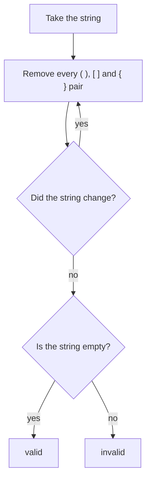

## Intuition

Look at a valid string such as `{[()]}`. The innermost pair `()` sits right next to each other. If you cross that pair out, you get `{[]}`. Now `[]` is a neighbouring pair, so cross it out too: `{}`. One more round and nothing is left. Every valid string can be shrunk to nothing this way.

Now try an invalid string such as `([)]`. No pair is next to each other, so nothing can be crossed out and the string stays as it is. The same happens for `(` alone, or `)(`.

The idea is like closing nested boxes: you can only close the box that is on the inside first. We do not use any data structure here. We just keep deleting the pairs `()`, `[]` and `{}` until a whole round changes nothing. If the string is empty at the end, it was valid. If something is left, it was not.

This is the simplest correct answer, so it is a good first thing to say in an interview. It is slow, and the next approach fixes that.

## Walkthrough

Input: `{[()]}` (valid). The table shows the string after each round. A round removes every `()`, then every `[]`, then every `{}` that it can find.

| Round | String before | After removing `()` | After removing `[]` | After removing `{}` | Changed? |
| --- | --- | --- | --- | --- | --- |
| 1 | `{[()]}` | `{[]}` | `{}` | empty | yes |
| 2 | empty | empty | empty | empty | no, so stop |

The string is empty, so the answer is `true`. In this example one round was enough because we remove the three kinds in the order inner to outer. In the worst case that order does not help.

Second input: `([)]` (invalid). No pair is adjacent in round 1, so nothing changes, we stop, and the string `([)]` is not empty. The answer is `false`.

Third input, to show many rounds: `((((` followed by `))))`, which is `(((())))`. Each round removes only the one middle pair.

| Round | String before | String after |
| --- | --- | --- |
| 1 | `(((())))` | `((()))` |
| 2 | `((()))` | `(())` |
| 3 | `(())` | `()` |
| 4 | `()` | empty |
| 5 | empty | empty (no change, stop) |

Each round scans the whole current string, and there are about half as many rounds as characters. That is where the quadratic cost comes from.

Read it as: keep shrinking while it helps, then look at what is left.

## Complexity

| | Value | Why |
| --- | --- | --- |
| Time, best | O(n) | If no pair exists, or everything disappears in the first round, only a few scans happen. |
| Time, average and worst | O(n²) | A deeply nested string removes only one pair per round, so there are about n divided by 2 rounds, and each round scans up to n characters. |
| Space | O(n) | Every replace creates a new string. Strings are immutable in JavaScript, Python, Go, Java and C#, so each round allocates a new copy. In C++ the string is edited in place after one copy. |

The worst input is many openers followed by the same number of closers, such as `((((....))))`. The best input has no pair at all, such as a string of only closers.

## Code explanation

1. **Remember the old string.** We need it to see whether this round changed anything.
2. **Remove every adjacent pair.** One replace call per kind of bracket. Removing `()` can create a new `[]` pair next to each other, which is why we repeat.
3. **Stop when nothing changed.** If the string is the same as before, no pair is left to remove, and the process cannot make progress.
4. **Check for empty.** A valid string has been consumed completely.

| Language | How the pair is removed | Note |
| --- | --- | --- |
| JavaScript / TypeScript | `replaceAll('()', '')` | `replaceAll` needs Node 15 or later. The older `replace` with a plain string only changes the first match. |
| Python | `s.replace('()', '')` | Python's `replace` already replaces all matches. |
| Go | `strings.ReplaceAll` | Go strings are immutable, so a new string is built each time. |
| Java | `String.replace(CharSequence, CharSequence)` | Despite the name, this replaces all matches. Do not confuse it with `replaceAll`, which takes a regular expression, where brackets have special meaning. |
| C# | `string.Replace` | Replaces all matches and returns a new string. |
| C++ | `find` and `erase` in a loop | There is no replace-all in the standard library. The function takes the string by value, so the caller's string is not changed. |

## Edge cases and tests

All three approaches run the same 21 strings and print `true` or `false` for each. The expected output is the same for all approaches.

| Input | Output | What it checks |
| --- | --- | --- |
| `()` and `()[]{}` | `true` | The basic cases, one pair and three pairs side by side. |
| `(]` | `false` | Right count, wrong kind. |
| `([)]` | `false` | Right kinds, wrong order. |
| `{[]}` | `true` | Proper nesting of different kinds. |
| empty string | `true` | The empty string is valid (it is in the middle of the list, so the output has no blank line at the start or end). |
| `(`, `((` | `false` | Openers left over. |
| `)`, `))` | `false` | Closers with nothing open. |
| `(((())))` | `true` | Deep nesting, many rounds. |
| `{[()()]}`, `([{}])` | `true` | Mixed nesting. |
| `(()` and `())` | `false` | One bracket too many on either side. |
| `]` | `false` | A single closer. |
| `()()()()` | `true` | Many pairs side by side. |
| `{{{{}}}}[` | `false` | Valid prefix, then one extra opener. |
| `((((((((((` | `false` | Ten openers and no closer. |
| `[({})](` | `false` | A valid part followed by a stray opener. |
| `{[}]` | `false` | Closers in the wrong order. |

## When to use it (and when not)

**Use it** as the first idea in an interview to show you understand what "valid" means, and as a simple reference to compare other solutions against in tests.

**Do not use it** in real code. It allocates a new string for every round and is quadratic. For long input it is far too slow. The stack approach does the same job in one pass.

## Interview notes

- Say: "A valid string can be shrunk to nothing by removing adjacent pairs. I repeat until nothing changes."
- Say the cost right away: "Each round is linear and there can be about n over two rounds, so this is quadratic."
- Then say: "I can do better with a stack, because the last opener must be closed first."
- Likely follow-up: "Why does removing pairs in any order give the same final result?" Because removing a pair never creates a mismatch; it can only bring other characters next to each other.
- Mistake to avoid: using a regular expression with unescaped brackets, or using a replace that only changes the first match.

## Real-life usage

This exact approach does not appear in production code. The same "reduce by rewriting" idea shows up in simplifiers, such as an algebra system that applies rewrite rules until nothing changes, and in text-processing scripts that clean up input by repeated substitution. For bracket checking, real tools use a stack or a parser.
