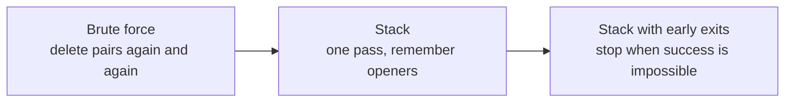
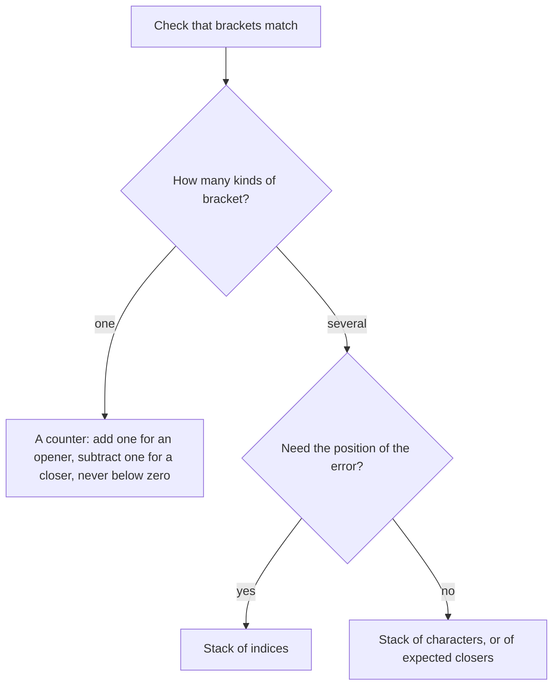

## How interviewers ask it

**The classic wording.** "Given a string containing only the characters `(`, `)`, `{`, `}`, `[` and `]`, decide whether it is valid. A string is valid when every opening bracket is closed by the same kind of bracket, and brackets are closed in the correct order." It is a warm-up question about stacks, and it is very common.

**Common variations:**

- *Other characters in the string.* "The string also contains letters and digits. Ignore them." (skip anything that is not a bracket)
- *Only one kind of bracket.* "Check only round brackets." (a counter is enough, no stack needed)
- *Minimum removals.* "Return the fewest brackets you must delete to make the string valid."
- *Longest valid substring.* "Find the length of the longest well-formed run." (a stack of indices, or a dynamic programming array)
- *Generate all.* "Write every valid string with n pairs." (backtracking)
- *Min stack.* "Design a stack that also returns its minimum in constant time." (a follow-up on the same data structure, explained below)

**What to clarify before you code:**

| Question to ask | Why it matters |
| --- | --- |
| What characters can appear? | Decides whether you must skip other characters or can assume only brackets. |
| Is the empty string valid? | The usual answer is yes, and a good solution handles it without a special case. |
| How long can the string be? | Tells you whether recursion is safe (it is not for very long input) and whether O(n) memory is fine. |
| Do I return true or false only, or the position of the first error? | Reporting the position needs the index of each opener on the stack. |
| Is it one string, or a stream? | A stream means you cannot look ahead, and the stack is the natural answer. |

A good answer states why a plain counter is not enough for three kinds of brackets, uses a stack, handles the three failure cases (wrong closer, closer with nothing open, openers left over), and gives the time and space cost out loud.

In this repo every program prints `true` or `false` for each test string. The empty string counts as valid.

## Real-life scenarios

| Scenario | What is actually used | Why |
| --- | --- | --- |
| A code editor highlighting a missing closing brace | A stack of open brackets with their positions | The editor needs to point at the exact bracket that has no partner, so it keeps the position of every opener. |
| A compiler or interpreter parsing nested expressions | A parser with an explicit stack, or recursion (which uses the call stack) | Nested structure is last opened, first closed, which is exactly what a stack gives. |
| Validating JSON or XML by hand | A tokenizer plus a stack of open objects and arrays or open tags | Every `{` or `<tag>` must be closed in the right order. Production code uses a real parser library. |
| Checking an HTML or template file for unclosed tags | A linter that keeps a stack of open tags | The error message can name the tag that was left open. |
| The browser back button and the editor undo history | A stack of earlier states | The most recent action is undone first, which is last in, first out. |
| The function call stack in every program | The runtime's own stack of frames | Each call is pushed, and each return pops it. A stack trace is a printout of that stack. |
| Evaluating a formula such as a spreadsheet cell | The shunting-yard method with an operator stack | Brackets in the formula change the order of operations, and a stack tracks the open ones. |
| Matching begin and end events in logs (a request started but never ended) | A stack or map of open spans | Distributed tracing tools do the same to pair a start with its end. |

The idea behind all of them: whenever things must be closed in the reverse order from which they were opened, think of a stack.

## Approaches compared

| Approach | Time | Extra space | Use when |
| --- | --- | --- | --- |
| 1. Brute force: repeated replacement | O(n²) worst case | O(n) for the new strings | Never in production. It is the "no data structure" starting point and a good test reference. |
| 2. Stack | O(n) | O(n) | The default answer. Simple, correct and fast. |
| 3. Stack with early exits | O(n) worst case, O(1) when the length is odd | O(n) | When you want the same answer and fast rejection of obviously bad input. |

All three give the same answer for every input. The second and third are both linear. The third simply stops sooner on bad input. The first one is slow because each round scans the whole string, and a string like many nested openers followed by many closers needs one round per pair.

Read it as the ladder an interview follows: first the idea that works, then the data structure that makes it fast, then the small prunings.

## How to choose

Start at the top and answer each question. With one kind of bracket a counter is enough and uses no extra memory. With several kinds the order matters, so you need a stack. Use the stack of indices when you must report where the problem is.

## Built-ins and the standard library

There is no built-in "balanced brackets" function in any of these languages. What you choose is the stack type. A **stack** is a collection where you add and remove only at one end: the last item added is the first one removed.

| Language | Stack to use | Push and pop | Pitfall |
| --- | --- | --- | --- |
| JavaScript / TypeScript | A plain `Array` | `push` and `pop` | `pop` on an empty array returns `undefined` and does not throw, so a missing partner can sneak through if you do not compare carefully. |
| Python | A `list` (or `collections.deque`) | `append` and `pop` | `pop` on an empty list raises `IndexError`, so check for empty first. Both operations are O(1) at the end of a list. |
| Go | A slice | `append`, and `s = s[:len(s)-1]` | There is no stack type. Indexing an empty slice panics, so check the length first. |
| Java | `ArrayDeque` through the `Deque` interface | `push`, `pop`, `peek` | The old `java.util.Stack` class is synchronised and legacy; prefer `ArrayDeque`. `pop` on an empty deque throws `NoSuchElementException`. |
| C# | `Stack<T>` | `Push`, `Pop`, `Peek`, `TryPop` | `Pop` on an empty stack throws `InvalidOperationException`; `TryPop` avoids the exception. |
| C++ | `std::stack` (or `std::vector` / `std::string` used as a stack) | `push`, `pop`, `top` | `top` and `pop` on an empty stack are undefined behaviour, not an exception. Always check `empty()` first. |

**Hand-write or use a library?** For this question always hand-write it; the point is the stack. In real code, use a proper parser for JSON, XML or source code, because real formats also have strings, comments and escapes that contain brackets.

## Common mistakes

- **Popping from an empty stack.** The string `)` has a closer with nothing open. In Java, C# and Python this throws; in C++ it is undefined behaviour; in JavaScript it quietly gives `undefined`. Check for empty first.
- **Forgetting the leftover openers.** The string `(` never fails a pop, but it is not valid. Return true only if the stack is empty at the end.
- **Only counting brackets.** Counting works for one kind of bracket. For `([)]` the counts are balanced, but the order is wrong, so the string is invalid.
- **Comparing against the wrong thing.** Pushing the opener and then comparing it with the closer needs a lookup table. Pushing the closer you expect makes the comparison a simple equality.
- **Mixing up the table direction.** A table from closer to opener is used when you read a closer; a table from opener to closer is used when you read an opener. Mixing them gives wrong answers on every input.
- **Assuming the input has only brackets.** If other characters can appear, skip them instead of pushing them.
- **Using recursion on long input.** A recursive solution can overflow the call stack on a string of a million brackets. The explicit stack on the heap does not.
- **Brute force with a single replace.** Removing only the first `()` per round, or only one kind of pair, still works but is much slower. Remove all pairs in each round, and repeat until nothing changes.

## How to answer in an interview

1. **Clarify.** "Does the string contain only brackets? Is the empty string valid? How long can it be?"
2. **Give examples and edge cases.** "`()[]{}` is valid. `(]` is invalid because the kinds differ. `([)]` is invalid because the order is wrong. Also the empty string, a single opener, and a single closer."
3. **Say the simple approach.** "I could keep deleting adjacent pairs like `()` until nothing is left. That works, but each round scans the string and a deeply nested string needs about half as many rounds as it has characters, so it is quadratic."
4. **Improve it.** "The last opener must be closed first. That is last in, first out, so I use a stack. I push openers and, for each closer, I check the top of the stack."
5. **Code it.** Use a table from closer to opener. Check for an empty stack before popping. Return whether the stack is empty at the end.
6. **Test aloud.** Walk through `{[]}` and then `([)]`, and finish with the empty string and a lone `)`.
7. **State complexity.** "One pass, so O(n) time. The stack can hold up to n characters, so O(n) space."
8. **Offer improvements.** "If the length is odd I can return false immediately. If the stack is already larger than the number of characters left, I can stop early."
9. **Mention the follow-up.** "If you want the minimum of a stack in constant time, I keep a second stack of minimums."

## Follow-up questions

- **Can you do it in constant extra space?** For one kind of bracket, yes, with a counter. For several kinds you need the stack, because you must remember the order. In general the memory you need grows with how deeply the brackets are nested.
- **How do you return the position of the first error?** Push the index of each opener instead of the character. When a closer does not match, or the stack is empty, report the current index. At the end, report the index left on the stack.
- **How would you find the longest valid substring?** Keep a stack of indices with a base marker. When a pair is matched, the length is the current index minus the index now on top. This is linear time.
- **What is a min stack?** A stack that also answers "what is the smallest element?" in constant time. Keep a second stack. When you push a value, also push the smaller of that value and the current minimum onto the second stack. Pop both together. Every operation is constant time and the extra space is linear.
- **How do you make the minimum of the last k items, or a queue with a minimum?** A queue can be built from two stacks, and a monotonic deque gives the sliding window minimum in linear time.
- **What if the string is a stream and does not fit in memory?** The stack only grows with the nesting depth, not the length. Process one character at a time and keep just the stack.
- **How do you handle brackets inside quotes or comments?** You need a small state machine on top of the stack: a mode for "inside a string" or "inside a comment", where brackets are ignored. This is what real tokenizers do.
- **How would you generate all valid strings with n pairs?** Use backtracking: add an opener while fewer than n are used, add a closer while closers used are fewer than openers used. The count of results is the Catalan number.

## Practice

- Minimum add to make parentheses valid, and minimum remove to make parentheses valid.
- Longest valid parentheses (stack of indices, or dynamic programming).
- Generate parentheses (backtracking with a counter).
- Min stack and max stack (a second stack that tracks the extreme value).
- Evaluate reverse Polish notation and basic calculator (a stack for operands and operators).
- Daily temperatures and next greater element (a monotonic stack).
