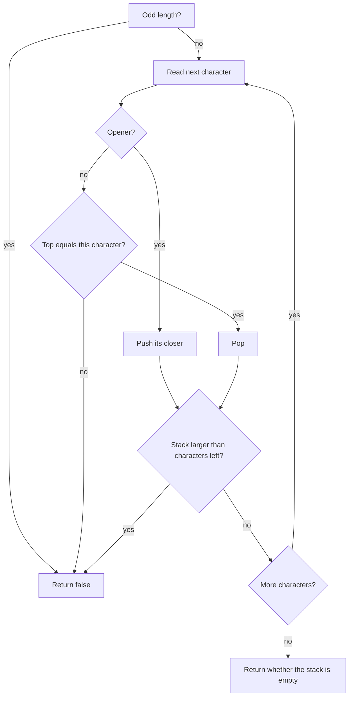

## Intuition

This is the same stack idea as the previous approach, with two small improvements that let us say "no" sooner. They do not change the answer for any input. They only save work.

**Improvement one: the length check.** Brackets come in pairs: one opener and one closer. So a valid string must have an even length. If the length is odd, we can answer `false` without looking at a single character.

**Improvement two: push the closer you expect.** When we see `(`, we push `)`, the closer we will need later. When a closer comes, we pop and check that it is equal to the character in hand. This removes the lookup table from the hot loop. A closer is any character that is not an opener, and we only compare for equality.

**Improvement three: stop when it is hopeless.** Suppose the stack holds five waiting openers and only three characters remain. Even if all three are perfect closers, two openers will stay open. So we can return `false` right now. This helps most on strings that start with a long run of openers.

Think of packing a suitcase: if you already know you have more items than space, you stop packing and say it will not fit.

## Walkthrough

Input: `((((((((((` (ten openers, no closer). The length is even, so the first check passes. The table shows the stack, which holds the closers we are waiting for.

| Step | Index i | Character | Stack size after push | Characters left | Stack larger than left? |
| --- | --- | --- | --- | --- | --- |
| 1 | 0 | `(` | 1 | 9 | no |
| 2 | 1 | `(` | 2 | 8 | no |
| 3 | 2 | `(` | 3 | 7 | no |
| 4 | 3 | `(` | 4 | 6 | no |
| 5 | 4 | `(` | 5 | 5 | no |
| 6 | 5 | `(` | 6 | 4 | yes, return `false` |

We stopped after six of ten characters. The plain stack would have read all ten and found the leftovers at the end.

Input `(()`: the length is 3, which is odd, so the answer is `false` before the loop starts. Input `{[()]}` works as in the plain stack: the stack holds `}`, then `} ]`, then `} ] )`, and each closer matches the top. The stack-size check never triggers because there is always enough room left.

Read it as: three places where we can stop early, and the normal stack loop in the middle.

## Complexity

| | Value | Why |
| --- | --- | --- |
| Time, best | O(1) | An odd-length string is rejected immediately. (Getting the length of a string is constant time in all seven languages.) |
| Time, average and worst | O(n) | A valid string must be read completely. |
| Space | O(n) | The stack can hold up to n over two items, because of the size check. |

The size check also improves the space bound by a constant: the stack never holds more than half of the characters, because otherwise we would have stopped. The big-O class stays linear.

## Code explanation

1. **Odd length.** A string with an odd number of characters can never be valid, so we return at once.
2. **Push the expected closer.** For an opener, we look up its closer once and push that. Later the closer check is a simple equality.
3. **Wrong or missing closer.** If the stack is empty, or its top is not the character we just read, the string is invalid.
4. **Too many open brackets.** After each step, the number of characters left is the length minus the index minus one. If the stack is larger than that, no suffix can close everything.

| Language | Note |
| --- | --- |
| JavaScript / TypeScript | `pop` on an empty array returns `undefined`, which never equals a bracket, so the empty case is covered. TypeScript narrows the lookup result with an explicit `undefined` check. |
| Python | The `elif not stack or stack.pop() != ch` line relies on short-circuit evaluation. `enumerate` gives the index and the character together. |
| Go | `make([]byte, 0, len(s)/2)` reserves enough room up front, so the slice does not need to grow. |
| Java | `stack.size()` is constant time for `ArrayDeque`. `pop() != ch` compares a boxed `Character` with a `char`, which unboxes correctly. |
| C# | `Stack<T>.Count` is a constant-time property. `TryPop` merges the empty check and the pop. |
| C++ | A `std::string` works as a stack of characters with `push_back`, `back` and `pop_back`. The index is cast to `int` so that `n - i - 1` cannot underflow as an unsigned number. |

## Edge cases and tests

The same 21 strings and the same expected output as the other approaches. The ones that exercise the early exits:

| Input | Output | What it checks |
| --- | --- | --- |
| `(`, `(()`, `())`, `]`, `{{{{}}}}[`, `[({})](` | `false` | Odd length, rejected before the loop. |
| `((((((((((` | `false` | Even length, rejected by the "too many open" check. |
| `((`, `))` | `false` | Even length; `((` is cut by the size check, `))` by the empty-stack check. |
| `{[}]` | `false` | Even length, rejected by the wrong-closer check. |
| `()[]{}`, `{[()()]}` | `true` | Valid input is never cut short. |
| empty string | `true` | Even length (zero), the loop does not run, and the stack is empty. |

## When to use it (and when not)

**Use it** when you want the plain stack answer with a couple of cheap safeguards, for example when you validate many strings and most of the bad ones are bad in an obvious way.

**Do not bother** with the extra checks if clarity matters more than speed. They are small gains for a linear algorithm. In an interview, write the plain stack first and mention these as improvements.

## Interview notes

- Say: "Brackets come in pairs, so an odd length is invalid right away."
- Say: "If there are more waiting openers than characters left, I can stop."
- Explain why pushing the closer is neat: "I store what I expect, so the closer check is one comparison."
- Likely follow-up: "Does the early exit change the big-O?" The worst case is still linear; the gain is for bad input.
- Mistake to avoid: placing the size check before the push, which gives off-by-one errors. Do it after the push or pop, using the number of characters still unread.

## Real-life usage

Quick pre-checks like these are common in real validators: reject by length or by a cheap rule first, then do the full parse. Network servers do this for message sizes and delimiters, and parsers do it to fail fast on input that cannot possibly be well formed.
