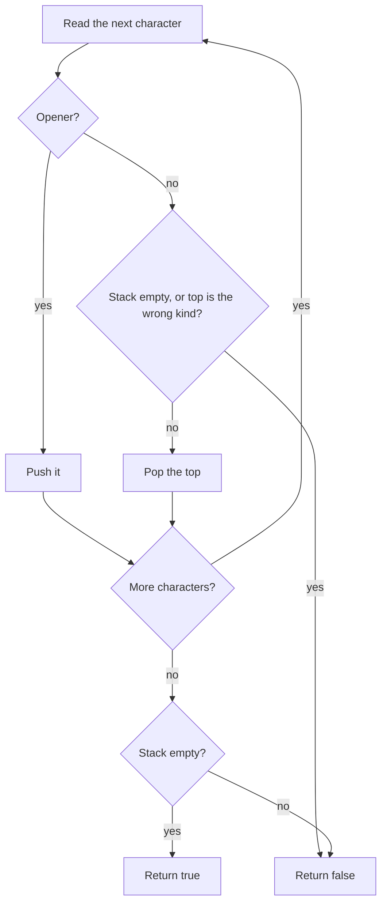

## Intuition

A **stack** is a pile where you can only add to the top and remove from the top, like a stack of plates. The last plate you put on is the first one you take off. This is called last in, first out.

Brackets follow the same rule. The last bracket you opened is always the first one you must close. So as you read the string from left to right:

- When you see an opener, put it on the pile. It is waiting for its partner.
- When you see a closer, look at the top of the pile. It must be the matching opener. If it is, take it off. If the pile is empty, or the top is a different kind, the string is invalid.
- When the string ends, the pile must be empty. Anything left over is an opener that was never closed.

Think of walking into nested rooms: each opener is a door you walk through, each closer is a door you walk back out of. You must leave through the doors in the reverse order of how you entered. The stack remembers the doors.

## Walkthrough

Input: `{[()]}` (valid). The table shows the stack after each character. The top of the stack is on the right.

| Step | Character | Action | Stack after |
| --- | --- | --- | --- |
| 1 | `{` | opener, push | `{` |
| 2 | `[` | opener, push | `{ [` |
| 3 | `(` | opener, push | `{ [ (` |
| 4 | `)` | closer, top is `(`, a match, pop | `{ [` |
| 5 | `]` | closer, top is `[`, a match, pop | `{` |
| 6 | `}` | closer, top is `{`, a match, pop | empty |

The string ended and the stack is empty, so the answer is `true`.

Second input: `([)]` (invalid).

| Step | Character | Action | Stack after |
| --- | --- | --- | --- |
| 1 | `(` | push | `(` |
| 2 | `[` | push | `( [` |
| 3 | `)` | closer, top is `[`, not a match, stop | invalid |

The answer is `false` at step 3. A third input is `(`: the stack still holds one opener at the end, so the answer is `false`. A fourth is `)`: the stack is empty when the closer arrives, so the answer is `false` at once.

Read it as: opener goes on, closer must match the top, and at the end nothing may remain.

## Complexity

| | Value | Why |
| --- | --- | --- |
| Time | O(n) | Each character is looked at once. Push, pop and the table lookup each take constant time. |
| Space | O(n) | The stack holds every opener that is still waiting. For a string of only openers that is all n characters. |

The worst case for space is a string of only openers, such as `((((((`. The best case for space is a string like `()()()()`, where the stack never holds more than one item. Time is linear in every case, but you can stop early on the first mismatch.

## Code explanation

1. **A closer needs a partner.** We keep a small table from each closer to the opener it needs. When the character is a key in that table, it is a closer, and we compare it with the top of the stack. We must also handle the empty stack, because a closer with nothing open is invalid.
2. **An opener waits.** Anything that is not a closer is pushed. This assumes the input has only brackets, as in the problem statement. If other characters could appear, skip them here.
3. **Leftovers mean invalid.** After the loop the stack must be empty, otherwise some opener was never closed.

| Language | Stack | Empty-pop behaviour | Note |
| --- | --- | --- | --- |
| JavaScript / TypeScript | `Array` with `push` and `pop` | `pop` returns `undefined` | The comparison with the needed opener fails for `undefined`, so no extra empty check is needed, but it is clearer to know why. |
| Python | `list` with `append` and `pop` | `pop` raises `IndexError` | Check `not stack` first, using short-circuit `or`. |
| Go | A `[]byte` slice | Indexing an empty slice panics | Check `len(stack) == 0` first. Pop by re-slicing. Iterating the string by byte is safe because the brackets are single-byte characters. |
| Java | `ArrayDeque<Character>` | `pop` throws `NoSuchElementException` | `Map.of` is immutable and compact. Comparing a boxed `Character` with a `char` using `!=` unboxes it, which is correct here. |
| C# | `Stack<char>` | `Pop` throws, `TryPop` does not | `TryPop` combines the empty check and the pop in one call. |
| C++ | `std::stack<char>` | `top` and `pop` are undefined behaviour | Always check `empty()` before `top()`. |

## Edge cases and tests

The same 21 strings as every approach in this problem (the full table is in the brute-force notes). The ones that stress the stack most:

| Input | Output | What it checks |
| --- | --- | --- |
| `)` | `false` | A closer arrives with an empty stack. |
| `(` | `false` | The loop ends with the stack not empty. |
| `([)]` | `false` | The top of the stack is the wrong kind. |
| `{[()()]}` | `true` | The stack grows and shrinks several times. |
| empty string | `true` | The loop does not run and the stack is empty. |
| `((((((((((` | `false` | Many leftover openers. |

## When to use it (and when not)

**Use it** whenever things must be closed in the reverse order from which they were opened: brackets, tags, nested calls, undo history.

**Do not use it** when there is only one kind of bracket and you do not need positions: a counter is enough and needs only constant memory. Also, when the input has strings and comments that may contain brackets, you need a real tokenizer on top.

## Interview notes

- Say: "Last opened, first closed, so a stack."
- Name the three failure cases out loud: wrong kind of closer, closer with an empty stack, and openers left at the end.
- Use a table from closer to opener, which keeps the code short and easy to extend.
- Likely follow-up: "Can you return the position of the first error?" Push the index, not the character.
- Mistake to avoid: returning true as soon as the loop ends without checking the stack.

## Real-life usage

Editors use this idea to highlight a matching bracket and to underline the one with no partner. Compilers and parsers keep a stack of open constructs. Template engines and linters track open HTML or XML tags. The call stack of every running program is the same idea at a bigger scale. Real parsers add rules for strings, escapes and comments, but the heart is a stack.
