# Azure & Cloud

[← Back to index](../README.md) · [⭐ Favorites](favorites.md)

71 questions · 0 favorites · [📚 Resources](#resources)

## Contents

**Basic**

- [1. What is cloud computing and what are its main characteristics?](#1-what-is-cloud-computing-and-what-are-its-main-characteristics)
- [2. What is the difference between IaaS, PaaS, SaaS and serverless?](#2-what-is-the-difference-between-iaas-paas-saas-and-serverless)
- [3. What are public, private, hybrid and multi-cloud, and when would you use each?](#3-what-are-public-private-hybrid-and-multi-cloud-and-when-would-you-use-each)
- [4. What is the shared responsibility model?](#4-what-is-the-shared-responsibility-model)
- [5. What is the difference between CapEx and OpEx, and why does it matter for cloud?](#5-what-is-the-difference-between-capex-and-opex-and-why-does-it-matter-for-cloud)
- [6. What are Azure geographies, regions and region pairs?](#6-what-are-azure-geographies-regions-and-region-pairs)
- [7. What are availability zones and availability sets?](#7-what-are-availability-zones-and-availability-sets)
- [8. How is Azure resource hierarchy organised: management groups, subscriptions, resource groups and resources?](#8-how-is-azure-resource-hierarchy-organised-management-groups-subscriptions-resource-groups-and-resources)
- [9. What is Azure Resource Manager and why do tags, locks and policies matter?](#9-what-is-azure-resource-manager-and-why-do-tags-locks-and-policies-matter)
- [10. What are the core Azure compute options?](#10-what-are-the-core-azure-compute-options)
- [11. What storage services does Azure Storage offer?](#11-what-storage-services-does-azure-storage-offer)
- [12. How do Azure Storage redundancy options and access tiers work?](#12-how-do-azure-storage-redundancy-options-and-access-tiers-work)
- [13. What database services does Azure provide, and how do you choose between them?](#13-what-database-services-does-azure-provide-and-how-do-you-choose-between-them)
- [14. What are the Cosmos DB consistency levels in plain words?](#14-what-are-the-cosmos-db-consistency-levels-in-plain-words)
- [15. What is the difference between relational, non-relational and analytical data?](#15-what-is-the-difference-between-relational-non-relational-and-analytical-data)
- [16. What are the basic Azure networking building blocks: VNet, subnets, NSG and peering?](#16-what-are-the-basic-azure-networking-building-blocks-vnet-subnets-nsg-and-peering)
- [17. What is the difference between VPN Gateway, ExpressRoute, and public versus private endpoints?](#17-what-is-the-difference-between-vpn-gateway-expressroute-and-public-versus-private-endpoints)
- [18. How does identity work in Azure: Entra ID, RBAC and managed identities?](#18-how-does-identity-work-in-azure-entra-id-rbac-and-managed-identities)
- [19. What are Azure Monitor, Log Analytics and Application Insights?](#19-what-are-azure-monitor-log-analytics-and-application-insights)
- [20. What factors affect Azure cost, and which basic cost tools exist?](#20-what-factors-affect-azure-cost-and-which-basic-cost-tools-exist)

**Intermediate**

- [21. \[Tech Lead\] How do you choose between VMs, App Service, Container Apps, AKS and Functions?](#21-tech-lead-how-do-you-choose-between-vms-app-service-container-apps-aks-and-functions)
- [22. \[Tech Lead\] How do you run cloud cost governance and FinOps for a team?](#22-tech-lead-how-do-you-run-cloud-cost-governance-and-finops-for-a-team)
- [23. \[Tech Lead\] How do you handle compliance and data residency in the cloud?](#23-tech-lead-how-do-you-handle-compliance-and-data-residency-in-the-cloud)
- [24. \[Tech Lead\] How do you use the Azure Well-Architected Framework as a review tool?](#24-tech-lead-how-do-you-use-the-azure-well-architected-framework-as-a-review-tool)
- [25. How do App Service, Azure Functions and Container Apps differ in scaling, cold starts and hosting plans?](#25-how-do-app-service-azure-functions-and-container-apps-differ-in-scaling-cold-starts-and-hosting-plans)
- [26. How do node pools work in AKS, and what is the difference between system and user pools?](#26-how-do-node-pools-work-in-aks-and-what-is-the-difference-between-system-and-user-pools)
- [27. What AKS networking options exist: kubenet, Azure CNI and Azure CNI Overlay?](#27-what-aks-networking-options-exist-kubenet-azure-cni-and-azure-cni-overlay)
- [28. How do managed identity and workload identity work for pods in AKS?](#28-how-do-managed-identity-and-workload-identity-work-for-pods-in-aks)
- [29. How do AKS upgrades and autoscaling work?](#29-how-do-aks-upgrades-and-autoscaling-work)
- [30. How do you use Azure Container Registry with AKS and your pipeline?](#30-how-do-you-use-azure-container-registry-with-aks-and-your-pipeline)
- [31. How do you use Azure Key Vault for secrets, keys and certificates?](#31-how-do-you-use-azure-key-vault-for-secrets-keys-and-certificates)
- [32. How do you choose between Service Bus, Event Hubs, Event Grid and Storage Queues?](#32-how-do-you-choose-between-service-bus-event-hubs-event-grid-and-storage-queues)
- [33. How do Service Bus queues, topics, dead-letter queues, sessions and duplicate detection work?](#33-how-do-service-bus-queues-topics-dead-letter-queues-sessions-and-duplicate-detection-work)
- [34. What does Azure API Management do and when should you use it?](#34-what-does-azure-api-management-do-and-when-should-you-use-it)
- [35. How do Application Gateway, Front Door, Load Balancer and Traffic Manager differ?](#35-how-do-application-gateway-front-door-load-balancer-and-traffic-manager-differ)
- [36. How do Azure DNS and private DNS zones work, and why do they matter for private endpoints?](#36-how-do-azure-dns-and-private-dns-zones-work-and-why-do-they-matter-for-private-endpoints)
- [37. How do you design a hub-and-spoke network and choose between NSGs and Azure Firewall?](#37-how-do-you-design-a-hub-and-spoke-network-and-choose-between-nsgs-and-azure-firewall)
- [38. What Azure SQL options exist and how do you choose: single database, elastic pool or managed instance?](#38-what-azure-sql-options-exist-and-how-do-you-choose-single-database-elastic-pool-or-managed-instance)
- [39. How do Azure SQL high availability, geo-replication and backups work?](#39-how-do-azure-sql-high-availability-geo-replication-and-backups-work)
- [40. How does Cosmos DB work: partition keys, request units, and the change feed?](#40-how-does-cosmos-db-work-partition-keys-request-units-and-the-change-feed)
- [41. What are common Blob Storage patterns: SAS tokens, lifecycle management and immutability?](#41-what-are-common-blob-storage-patterns-sas-tokens-lifecycle-management-and-immutability)
- [42. What is the difference between Azure Monitor metrics and logs, and how do you use KQL and alerts?](#42-what-is-the-difference-between-azure-monitor-metrics-and-logs-and-how-do-you-use-kql-and-alerts)
- [43. How do Application Insights distributed tracing and sampling work?](#43-how-do-application-insights-distributed-tracing-and-sampling-work)
- [44. How do Bicep, ARM templates and Terraform compare, and what are state and drift?](#44-how-do-bicep-arm-templates-and-terraform-compare-and-what-are-state-and-drift)
- [45. How do you deploy to Azure from GitLab CI/CD without storing secrets?](#45-how-do-you-deploy-to-azure-from-gitlab-cicd-without-storing-secrets)
- [46. How do Azure Policy, RBAC and resource locks differ?](#46-how-do-azure-policy-rbac-and-resource-locks-differ)
- [47. How does autoscaling work in Azure and what are its limits?](#47-how-does-autoscaling-work-in-azure-and-what-are-its-limits)
- [48. How and when do you use Azure Cache for Redis?](#48-how-and-when-do-you-use-azure-cache-for-redis)
- [49. What is Azure Arc at concept level, and when does a hybrid approach make sense?](#49-what-is-azure-arc-at-concept-level-and-when-does-a-hybrid-approach-make-sense)
- [50. What does the Azure data analytics stack look like at DP-900 level?](#50-what-does-the-azure-data-analytics-stack-look-like-at-dp-900-level)

**Advanced**

- [51. \[Tech Lead\] How do you design for high availability and disaster recovery on Azure?](#51-tech-lead-how-do-you-design-for-high-availability-and-disaster-recovery-on-azure)
- [52. \[Tech Lead\] How do you design landing zones and the subscription and management group structure?](#52-tech-lead-how-do-you-design-landing-zones-and-the-subscription-and-management-group-structure)
- [53. \[Tech Lead\] How do you improve security posture in Azure?](#53-tech-lead-how-do-you-improve-security-posture-in-azure)
- [54. \[Tech Lead\] How do you design identity for workloads: managed identity, workload identity and RBAC scopes?](#54-tech-lead-how-do-you-design-identity-for-workloads-managed-identity-workload-identity-and-rbac-scopes)
- [55. \[Tech Lead\] How do you plan a cloud migration using the 6 Rs?](#55-tech-lead-how-do-you-plan-a-cloud-migration-using-the-6-rs)
- [56. \[Tech Lead\] How do you balance vendor lock-in against speed, and plan an exit?](#56-tech-lead-how-do-you-balance-vendor-lock-in-against-speed-and-plan-an-exit)
- [57. \[Tech Lead\] How do you design observability and alerting across Azure Monitor and Datadog?](#57-tech-lead-how-do-you-design-observability-and-alerting-across-azure-monitor-and-datadog)
- [58. \[Tech Lead\] How do you respond to a cloud incident such as a region outage, throttling or quota limits, and what goes into a postmortem?](#58-tech-lead-how-do-you-respond-to-a-cloud-incident-such-as-a-region-outage-throttling-or-quota-limits-and-what-goes-into-a-postmortem)
- [59. How would you design a multi-region active-active web platform on Azure?](#59-how-would-you-design-a-multi-region-active-active-web-platform-on-azure)
- [60. How would you design a secure landing zone network topology?](#60-how-would-you-design-a-secure-landing-zone-network-topology)
- [61. What does zero trust look like on Azure?](#61-what-does-zero-trust-look-like-on-azure)
- [62. How do you design a large-scale event-driven architecture with Event Hubs and Service Bus?](#62-how-do-you-design-a-large-scale-event-driven-architecture-with-event-hubs-and-service-bus)
- [63. How do you design for throttling and quota limits in Azure?](#63-how-do-you-design-for-throttling-and-quota-limits-in-azure)
- [64. How do you handle data residency and sovereignty patterns on Azure?](#64-how-do-you-handle-data-residency-and-sovereignty-patterns-on-azure)
- [65. Can you walk through a cloud cost optimisation case study?](#65-can-you-walk-through-a-cloud-cost-optimisation-case-study)
- [66. How do you create a disaster recovery runbook and run game days?](#66-how-do-you-create-a-disaster-recovery-runbook-and-run-game-days)
- [67. How do you design identity for service-to-service calls, including managed identity and on-behalf-of?](#67-how-do-you-design-identity-for-service-to-service-calls-including-managed-identity-and-on-behalf-of)
- [68. How do you design cloud-native systems for connectivity-constrained edge scenarios such as aircraft or vehicle fleets?](#68-how-do-you-design-cloud-native-systems-for-connectivity-constrained-edge-scenarios-such-as-aircraft-or-vehicle-fleets)
- [69. What are sovereign and regulated cloud options in Azure, at concept level?](#69-what-are-sovereign-and-regulated-cloud-options-in-azure-at-concept-level)
- [70. How do Azure services map to AWS and GCP, and how do you answer "what if we used AWS"?](#70-how-do-azure-services-map-to-aws-and-gcp-and-how-do-you-answer-what-if-we-used-aws)
- [71. How would you answer "design a cloud architecture for an online ordering platform" using the Well-Architected pillars?](#71-how-would-you-answer-design-a-cloud-architecture-for-an-online-ordering-platform-using-the-well-architected-pillars)

## Browse by module

| Module | Questions |
| --- | --- |
| Architecture & Resilience (10) | [24](#24-tech-lead-how-do-you-use-the-azure-well-architected-framework-as-a-review-tool) · [49](#49-what-is-azure-arc-at-concept-level-and-when-does-a-hybrid-approach-make-sense) · [51](#51-tech-lead-how-do-you-design-for-high-availability-and-disaster-recovery-on-azure) · [55](#55-tech-lead-how-do-you-plan-a-cloud-migration-using-the-6-rs) · [56](#56-tech-lead-how-do-you-balance-vendor-lock-in-against-speed-and-plan-an-exit) · [59](#59-how-would-you-design-a-multi-region-active-active-web-platform-on-azure) · [63](#63-how-do-you-design-for-throttling-and-quota-limits-in-azure) · [64](#64-how-do-you-handle-data-residency-and-sovereignty-patterns-on-azure) · [68](#68-how-do-you-design-cloud-native-systems-for-connectivity-constrained-edge-scenarios-such-as-aircraft-or-vehicle-fleets) · [71](#71-how-would-you-answer-design-a-cloud-architecture-for-an-online-ordering-platform-using-the-well-architected-pillars) |
| Azure Foundations (4) | [6](#6-what-are-azure-geographies-regions-and-region-pairs) · [7](#7-what-are-availability-zones-and-availability-sets) · [8](#8-how-is-azure-resource-hierarchy-organised-management-groups-subscriptions-resource-groups-and-resources) · [9](#9-what-is-azure-resource-manager-and-why-do-tags-locks-and-policies-matter) |
| Cloud Fundamentals (6) | [1](#1-what-is-cloud-computing-and-what-are-its-main-characteristics) · [2](#2-what-is-the-difference-between-iaas-paas-saas-and-serverless) · [3](#3-what-are-public-private-hybrid-and-multi-cloud-and-when-would-you-use-each) · [4](#4-what-is-the-shared-responsibility-model) · [5](#5-what-is-the-difference-between-capex-and-opex-and-why-does-it-matter-for-cloud) · [70](#70-how-do-azure-services-map-to-aws-and-gcp-and-how-do-you-answer-what-if-we-used-aws) |
| Compute & Containers (7) | [10](#10-what-are-the-core-azure-compute-options) · [21](#21-tech-lead-how-do-you-choose-between-vms-app-service-container-apps-aks-and-functions) · [25](#25-how-do-app-service-azure-functions-and-container-apps-differ-in-scaling-cold-starts-and-hosting-plans) · [26](#26-how-do-node-pools-work-in-aks-and-what-is-the-difference-between-system-and-user-pools) · [29](#29-how-do-aks-upgrades-and-autoscaling-work) · [30](#30-how-do-you-use-azure-container-registry-with-aks-and-your-pipeline) · [47](#47-how-does-autoscaling-work-in-azure-and-what-are-its-limits) |
| Cost & Governance (7) | [20](#20-what-factors-affect-azure-cost-and-which-basic-cost-tools-exist) · [22](#22-tech-lead-how-do-you-run-cloud-cost-governance-and-finops-for-a-team) · [23](#23-tech-lead-how-do-you-handle-compliance-and-data-residency-in-the-cloud) · [46](#46-how-do-azure-policy-rbac-and-resource-locks-differ) · [52](#52-tech-lead-how-do-you-design-landing-zones-and-the-subscription-and-management-group-structure) · [65](#65-can-you-walk-through-a-cloud-cost-optimisation-case-study) · [69](#69-what-are-sovereign-and-regulated-cloud-options-in-azure-at-concept-level) |
| Identity & Security (7) | [18](#18-how-does-identity-work-in-azure-entra-id-rbac-and-managed-identities) · [28](#28-how-do-managed-identity-and-workload-identity-work-for-pods-in-aks) · [31](#31-how-do-you-use-azure-key-vault-for-secrets-keys-and-certificates) · [53](#53-tech-lead-how-do-you-improve-security-posture-in-azure) · [54](#54-tech-lead-how-do-you-design-identity-for-workloads-managed-identity-workload-identity-and-rbac-scopes) · [61](#61-what-does-zero-trust-look-like-on-azure) · [67](#67-how-do-you-design-identity-for-service-to-service-calls-including-managed-identity-and-on-behalf-of) |
| Infrastructure as Code & DevOps (2) | [44](#44-how-do-bicep-arm-templates-and-terraform-compare-and-what-are-state-and-drift) · [45](#45-how-do-you-deploy-to-azure-from-gitlab-cicd-without-storing-secrets) |
| Messaging & Integration (4) | [32](#32-how-do-you-choose-between-service-bus-event-hubs-event-grid-and-storage-queues) · [33](#33-how-do-service-bus-queues-topics-dead-letter-queues-sessions-and-duplicate-detection-work) · [34](#34-what-does-azure-api-management-do-and-when-should-you-use-it) · [62](#62-how-do-you-design-a-large-scale-event-driven-architecture-with-event-hubs-and-service-bus) |
| Monitoring & Operations (6) | [19](#19-what-are-azure-monitor-log-analytics-and-application-insights) · [42](#42-what-is-the-difference-between-azure-monitor-metrics-and-logs-and-how-do-you-use-kql-and-alerts) · [43](#43-how-do-application-insights-distributed-tracing-and-sampling-work) · [57](#57-tech-lead-how-do-you-design-observability-and-alerting-across-azure-monitor-and-datadog) · [58](#58-tech-lead-how-do-you-respond-to-a-cloud-incident-such-as-a-region-outage-throttling-or-quota-limits-and-what-goes-into-a-postmortem) · [66](#66-how-do-you-create-a-disaster-recovery-runbook-and-run-game-days) |
| Networking (7) | [16](#16-what-are-the-basic-azure-networking-building-blocks-vnet-subnets-nsg-and-peering) · [17](#17-what-is-the-difference-between-vpn-gateway-expressroute-and-public-versus-private-endpoints) · [27](#27-what-aks-networking-options-exist-kubenet-azure-cni-and-azure-cni-overlay) · [35](#35-how-do-application-gateway-front-door-load-balancer-and-traffic-manager-differ) · [36](#36-how-do-azure-dns-and-private-dns-zones-work-and-why-do-they-matter-for-private-endpoints) · [37](#37-how-do-you-design-a-hub-and-spoke-network-and-choose-between-nsgs-and-azure-firewall) · [60](#60-how-would-you-design-a-secure-landing-zone-network-topology) |
| Storage & Data (11) | [11](#11-what-storage-services-does-azure-storage-offer) · [12](#12-how-do-azure-storage-redundancy-options-and-access-tiers-work) · [13](#13-what-database-services-does-azure-provide-and-how-do-you-choose-between-them) · [14](#14-what-are-the-cosmos-db-consistency-levels-in-plain-words) · [15](#15-what-is-the-difference-between-relational-non-relational-and-analytical-data) · [38](#38-what-azure-sql-options-exist-and-how-do-you-choose-single-database-elastic-pool-or-managed-instance) · [39](#39-how-do-azure-sql-high-availability-geo-replication-and-backups-work) · [40](#40-how-does-cosmos-db-work-partition-keys-request-units-and-the-change-feed) · [41](#41-what-are-common-blob-storage-patterns-sas-tokens-lifecycle-management-and-immutability) · [48](#48-how-and-when-do-you-use-azure-cache-for-redis) · [50](#50-what-does-the-azure-data-analytics-stack-look-like-at-dp-900-level) |

## Basic

### 1. What is cloud computing and what are its main characteristics?

**Short answer:** Cloud computing means renting computing resources (servers, storage, databases, networking, software) over the internet from a provider, and paying only for what you use. The key ideas are on-demand self-service, elasticity, pay-as-you-go pricing, broad network access and shared (pooled) resources.

Think of electricity. You do not build a power plant. You plug in and pay for the units you use. Cloud works the same way for IT.

| Characteristic | Plain meaning | Example |
| --- | --- | --- |
| On-demand self-service | You create resources yourself, in minutes, without a ticket to a hardware team | Create a database from the portal or `az` |
| Elasticity | Capacity grows and shrinks with load | Scale pods and nodes up for a sale, down at night |
| Pay-as-you-go | You are billed for use, often per second, hour or request | A function costs money only when it runs |
| Broad network access | Reachable over the network from many devices | A mobile app calls an API in the cloud |
| Resource pooling | The provider shares hardware between many customers (multi-tenancy) | Your VM may sit next to another customer's VM |
| Measured service | Usage is metered, so you can see and control cost | Cost Management reports per resource group |

Two words are often mixed up. **Scalability** is the ability to handle more load by adding resources. **Elasticity** is doing it automatically, in both directions, as demand changes.

Benefits are speed, global reach, less hardware work and built-in services. The costs are less control, dependence on the provider, and bills that can grow quietly if nobody watches.

**Gotcha:** cloud is not automatically cheaper. A steady, predictable workload that runs 24 hours a day can cost more than owned hardware. The win is speed and flexibility, and cost savings only come when you design and govern for them.

**Interview tip:** define cloud with elasticity and pay-as-you-go, then add one honest drawback such as cost drift or lock-in. It shows you have run real systems, not just read the definition.

_Module: Cloud Fundamentals · Tags: cloud, fundamentals, az-900_

### 2. What is the difference between IaaS, PaaS, SaaS and serverless?

**Short answer:** These are cloud service models. They differ in how much the provider manages for you. With IaaS you manage the operating system and up. With PaaS you manage only your app and data. With SaaS you just use the finished software. Serverless is a PaaS style where you write functions or containers and pay per execution, with no servers to manage.

A pizza analogy helps. IaaS is buying the ingredients and baking at home. PaaS is a take-and-bake pizza. SaaS is eating at the restaurant.

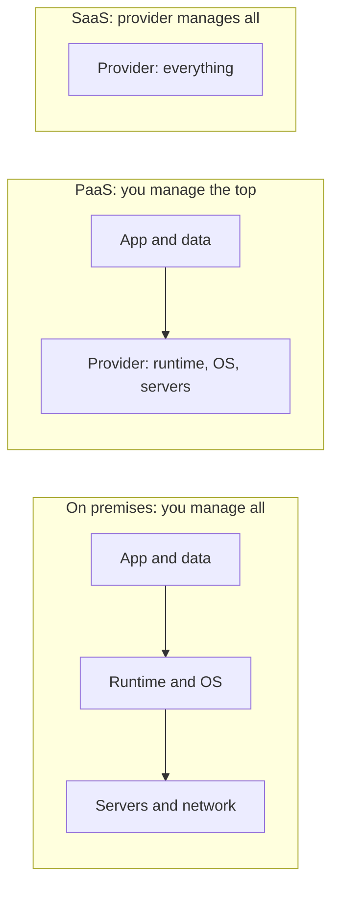

The more you move to the right, the less you manage and the less you can customise.

| Model | You manage | Azure example | Use when |
| --- | --- | --- | --- |
| IaaS | OS, patches, runtime, app | Virtual Machines | You need OS control or lift-and-shift |
| PaaS | App and data | App Service, Azure SQL Database | You want to ship code, not run servers |
| Container platform | Containers and config | AKS, Container Apps | You want portability and many services |
| Serverless | Function code only | Azure Functions | Event driven, spiky, short jobs |
| SaaS | Your users and settings | Microsoft 365, Dynamics 365 | You need a finished product |

**Gotcha:** "serverless" still has servers. You just do not see or patch them. Also, serverless can have cold starts and execution limits.

**Interview tip:** say you choose the highest level of abstraction that still meets your needs, because every layer you manage is a layer your team must patch and monitor.

_Module: Cloud Fundamentals · Tags: iaas, paas, saas, serverless_

### 3. What are public, private, hybrid and multi-cloud, and when would you use each?

**Short answer:** Public cloud means shared provider infrastructure such as Azure. Private cloud means infrastructure used by one organisation, in its own data centre or hosted. Hybrid cloud connects the two. Multi-cloud means using more than one public provider, for example Azure and AWS.

| Model | What it is | Why choose it | Cost of choosing it |
| --- | --- | --- | --- |
| Public | Shared provider data centres | Speed, scale, no hardware | Less control over physical layer |
| Private | Dedicated to one organisation | Strict control, special hardware | You buy and run everything |
| Hybrid | On premises plus public cloud, connected | Keep some data or systems local, move the rest | Two worlds to secure and operate |
| Multi-cloud | Two or more public clouds | Best service per task, regulation, bargaining power | Skills, tooling and networking multiply |

Typical hybrid reasons are old systems that cannot move yet, data that must stay in a country or building, low-latency links to factory or on-board equipment, and a slow, step-by-step migration. Azure helps with ExpressRoute or VPN for connectivity and Azure Arc to manage servers and Kubernetes clusters outside Azure.

Multi-cloud sounds attractive but is expensive. Each cloud has its own identity, networking, security and billing model. Many teams end up "multi-cloud by accident" after an acquisition. A common and sensible pattern is one main cloud and a second one only where it gives clear value.

**Gotcha:** running the same app active-active on two clouds to avoid lock-in usually costs far more than the risk it removes. Lowest common denominator design also loses the best features of each cloud.

**Interview tip:** answer with "hybrid when we must, multi-cloud when it clearly pays, otherwise one cloud done well".

_Module: Cloud Fundamentals · Tags: hybrid, multi-cloud, deployment-models_

### 4. What is the shared responsibility model?

**Short answer:** The shared responsibility model says security work is split between the cloud provider and the customer. The provider secures the cloud itself (buildings, hardware, host layer). The customer secures what they put in the cloud (data, identities, access, configuration). The higher the service model, the more the provider takes on.

Some things are always the customer's job, in every model: your data, your user accounts and access rules, and the devices that connect.

| Layer | On premises | IaaS | PaaS | SaaS |
| --- | --- | --- | --- | --- |
| Data and information | You | You | You | You |
| Identities and access | You | You | You | You |
| Applications | You | You | You | Provider |
| Operating system | You | You | Provider | Provider |
| Network controls | You | Shared | Shared | Provider |
| Physical hosts and datacentre | You | Provider | Provider | Provider |

Practical examples on Azure:
- On a VM, you patch the OS. On App Service, Microsoft patches it.
- Azure SQL Database is backed up and patched by Microsoft, but you decide who can log in and whether the firewall is open to the world.
- A public Blob container is your configuration mistake, not an Azure failure.

Most real cloud breaches come from customer-side misconfiguration: open storage, leaked keys, over-powerful accounts. That is why tools like Azure Policy and Microsoft Defender for Cloud exist.

**Interview tip:** say "the provider is responsible for security of the cloud, we are responsible for security in the cloud", then give one concrete example such as open storage or over-permissive roles.

_Module: Cloud Fundamentals · Tags: security, shared-responsibility, az-900_

### 5. What is the difference between CapEx and OpEx, and why does it matter for cloud?

**Short answer:** CapEx (capital expenditure) is money spent up front on assets such as servers and data centres. OpEx (operational expenditure) is money spent as you go on services. Cloud moves most IT spending from CapEx to OpEx.

On premises you buy hardware for the peak load you expect in three to five years, then depreciate it. In the cloud you rent what you need now and change it next month.

| | CapEx | OpEx |
| --- | --- | --- |
| Payment | Big, up front | Regular, based on use |
| Risk | Over-buying or under-buying capacity | Bills rise with usage |
| Flexibility | Low, hardware is fixed | High, scale any time |
| Finance view | Asset on the balance sheet, depreciated | Expense in the period |
| Example | Buying 20 servers | Paying for AKS nodes by the hour |

Why teams care:
- Less cash is locked up, so projects can start with small budgets.
- Failed experiments are cheap because you can delete resources.
- But costs are now variable, so someone must watch them. This is the reason FinOps exists.

Commitments blur the line. Azure Reservations and savings plans give a discount for promising use over one or three years. You still pay monthly in most cases, but you have made a commitment, which feels like a little CapEx.

**Gotcha:** OpEx is not "free of planning". A forgotten test cluster costs money every hour.

**Interview tip:** show you understand the shift: "cloud trades forecasting hardware for governing consumption".

_Module: Cloud Fundamentals · Tags: capex, opex, cost_

### 6. What are Azure geographies, regions and region pairs?

**Short answer:** A region is a set of data centres in one area, such as West Europe. A geography is a market that holds one or more regions and keeps data inside a compliance boundary, such as Europe or India. A region pair links two regions in the same geography so Azure can plan updates and recovery across them.

When you create a resource you choose a region. That choice affects latency, price, which services exist, legal data location and disaster options.

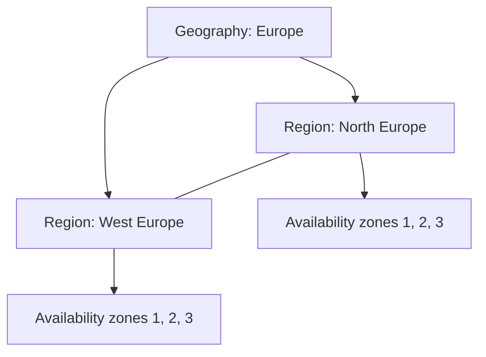

The line between the two regions shows a region pair. Each region may also have availability zones inside it.

Points to know:
- Not every service is available in every region. Always check before you design.
- Prices differ between regions. Look them up in the pricing calculator.
- Paired regions get updates one at a time, and Microsoft prioritises recovery of one region in a pair if both are hit. Newer regions may not have a pair, so check the current documentation.
- Some geo-redundant services replicate to the paired region by default, such as geo-redundant storage.
- Microsoft also has special regions for governments and sovereign clouds.

**Gotcha:** the pair is a Microsoft rule, not your disaster recovery plan. You still choose where to replicate your data and test failover.

**Interview tip:** explain how you pick a region: where the users are, legal data rules, service and capacity availability, and a pair or second region for disaster recovery.

_Module: Azure Foundations · Tags: regions, global-infrastructure, az-900_

### 7. What are availability zones and availability sets?

**Short answer:** An availability zone is a separate data centre group inside a region, with its own power, cooling and network. Spreading your app over zones protects you from one data centre failing. An availability set is an older way to spread VMs over fault domains and update domains inside one data centre, which protects against rack failures and planned updates.

| Feature | Availability set | Availability zones |
| --- | --- | --- |
| Protects against | Rack or host failure, planned maintenance | Whole data centre failure |
| Scope | Inside one data centre | Separate locations in a region |
| How it works | Fault domains and update domains | Resources pinned to zone 1, 2 or 3 |
| Typical use | VMs in regions without zones, older designs | Modern default for critical workloads |

Zone-enabled regions have at least three zones. Services come in two flavours:
- **Zonal**: you pick the zone yourself (a VM in zone 2).
- **Zone redundant**: Azure spreads it for you (zone-redundant storage, zone-redundant Azure SQL, AKS node pools across zones).

Zones are not free of trade-offs. Traffic between zones can add small latency and may have a cost. Zone redundant options can cost more. Zones do not protect against a region-wide problem; for that you need a second region.

Example for AKS: create the node pool with zones 1, 2 and 3 so nodes spread across them, and use pod topology spread constraints so replicas also spread.

**Gotcha:** if you use a zonal disk or zonal resource, a pod or VM that moves to another zone may not reach it. Test failure behaviour.

**Interview tip:** say "zones for data centre failure, regions for regional failure", then mention the cost and latency trade-off.

_Module: Azure Foundations · Tags: availability, zones, high-availability_

### 8. How is Azure resource hierarchy organised: management groups, subscriptions, resource groups and resources?

**Short answer:** Azure organises things in four levels. Management groups hold subscriptions. A subscription is a billing and access boundary. A resource group is a logical container for related resources. A resource is the thing itself, such as a VM or a database. Policies and role assignments set at a higher level are inherited by everything below.

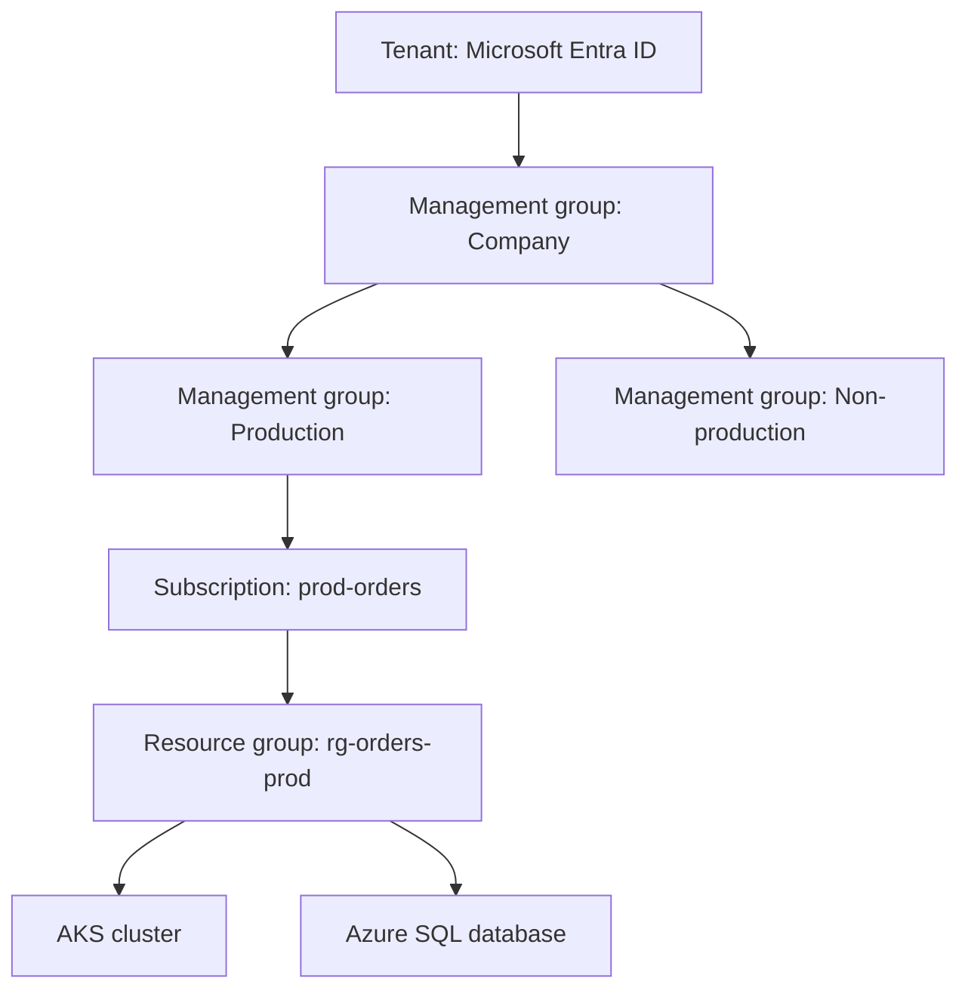

Read it top to bottom. A rule set on Production applies to every subscription, group and resource below.

| Level | What it is for | Typical decision |
| --- | --- | --- |
| Management group | Apply policy and access to many subscriptions | Prod and non-prod, or by business unit |
| Subscription | Billing, quotas, access boundary | One per environment or per team |
| Resource group | Lifecycle container | Things that are created and deleted together |
| Resource | One service instance | A single database |

Rules of thumb:
- A resource lives in exactly one resource group, but can be moved.
- Deleting a resource group deletes everything inside it. This is a handy clean-up and a dangerous mistake.
- Quotas and limits are mostly per subscription and region, so subscriptions are also a blast-radius and quota boundary.
- Group by lifecycle, not by type. Do not make one group for all databases.

**Interview tip:** mention that you separate production and non-production by subscription, because it gives cleaner cost reports, safer access and separate quotas.

_Module: Azure Foundations · Tags: governance, subscriptions, resource-groups, az-900_

### 9. What is Azure Resource Manager and why do tags, locks and policies matter?

**Short answer:** Azure Resource Manager (ARM) is the control layer every Azure request goes through, whether it comes from the portal, the CLI, Bicep or Terraform. It checks who you are, applies policy and locks, and then creates or changes the resource. Tags, locks and Azure Policy are the governance tools that keep a growing subscription tidy, safe and billable.

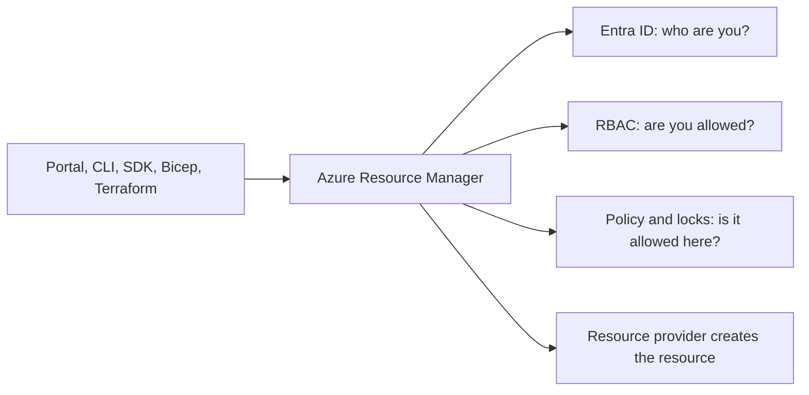

Because every tool uses the same API, the result is consistent and auditable.

| Tool | What it does | Example |
| --- | --- | --- |
| Tags | Name and value labels on resources | `env=prod`, `owner=orders-team`, `cost-center=1234` |
| Locks | Stop delete or change, even for owners | `CanNotDelete` lock on the production database group |
| Azure Policy | Rules that audit or block or fix resources | Only allow West Europe, require the `owner` tag |

Tags power cost reports, ownership and automation. Tags are not inherited by default, so use Policy to add or enforce them.

A lock example:

```bash
# Read only example, not run. Prevent accidental deletion of a resource group
az lock create --name no-delete --lock-type CanNotDelete \
  --resource-group rg-orders-prod
```

**Gotcha:** a `ReadOnly` lock can break things that look like reads but write behind the scenes, for example listing storage keys. Use `CanNotDelete` unless you really need more.

**Interview tip:** say that RBAC controls who can act, Policy controls what is allowed, and locks protect against accidents, so you use all three together.

_Module: Azure Foundations · Tags: arm, tags, policy, locks_

### 10. What are the core Azure compute options?

**Short answer:** The main Azure compute options are Virtual Machines (full OS control), VM Scale Sets (groups of identical VMs that scale), App Service (managed web hosting), Container Instances and Container Apps (run containers without managing a cluster), AKS (managed Kubernetes) and Azure Functions (serverless code).

| Service | Level | Best for | You manage |
| --- | --- | --- | --- |
| Virtual Machines | IaaS | Legacy apps, special OS needs | OS, patches, runtime |
| VM Scale Sets | IaaS | Many identical VMs with autoscale | Image and config |
| App Service | PaaS | Web apps and APIs | Code and settings |
| Container Instances (ACI) | Containers | Quick, short-lived single containers or jobs | The container |
| Container Apps | Serverless containers | Microservices, event driven, scale to zero | Containers and revisions |
| AKS | Managed Kubernetes | Many services, full Kubernetes control | Workloads, node pools, upgrades |
| Azure Functions | Serverless | Small event driven pieces | Function code |

Simple way to read the list: moving down gives you less to run but also less control.

Where each one fits for a typical team:
- A Go or Node API that needs plain hosting can run on App Service or Container Apps.
- Twenty microservices with shared tooling and a platform team fit AKS.
- A nightly job or a queue consumer fits Functions or a Container Apps job.
- A third-party installer for Windows only needs a VM.

Azure also offers specialised options such as Batch for large parallel jobs, Azure Virtual Desktop and Azure VMware Solution. They are outside the usual interview focus.

**Gotcha:** AKS is managed Kubernetes, not "managed everything". You still own upgrades of node pools, workloads, security policies and cost.

**Interview tip:** answer with a decision, not a list: "I start from the simplest service that fits, and move to AKS only when I need its flexibility".

_Module: Compute & Containers · Tags: compute, vm, aks, functions, az-900_

### 11. What storage services does Azure Storage offer?

**Short answer:** An Azure Storage account can hold Blobs (objects and files), Files (managed network file shares), Queues (simple messages), Tables (simple key-value NoSQL) and managed Disks for VMs. All use the same account, security and redundancy options.

| Service | What it stores | Typical use |
| --- | --- | --- |
| Blob Storage | Unstructured objects: images, videos, backups, logs, data lake files | Static content, uploads, backups |
| Azure Files | SMB and NFS file shares | Lift and shift apps that expect a shared drive |
| Queue Storage | Small messages (simple queue) | Basic work queues between components |
| Table Storage | Key-value rows with no fixed schema | Cheap simple lookup data |
| Managed Disks | Block volumes for VMs and AKS persistent volumes | OS and data disks |

Blob types: block blobs (most files), append blobs (logs) and page blobs (disks).

Good habits:
- Use one storage account per purpose and environment, so access and cost stay clear.
- Use Entra ID access with managed identity instead of account keys where possible.
- Turn on soft delete for blobs and containers to recover from accidents.
- Make storage private, using private endpoints, unless the content must be public.

Queue Storage is basic. If you need topics, dead-letter handling or ordering, use Service Bus instead. Table Storage overlaps with Cosmos DB's Table API, which adds global distribution and more performance options.

**Gotcha:** shared keys and long-lived SAS tokens are bearer secrets. Anyone who has them has access until they expire or you rotate the key.

**Interview tip:** mention that Blob is the default answer for files and backups, and that you avoid keys in favour of managed identity.

_Module: Storage & Data · Tags: storage, blob, files, az-900_

### 12. How do Azure Storage redundancy options and access tiers work?

**Short answer:** Redundancy decides how many copies of your data exist and where: LRS keeps three copies in one data centre, ZRS spreads them across three zones in one region, and GRS or GZRS also copy data to a second region. Access tiers (Hot, Cool, Cold, Archive) trade storage price against access price and speed.

| Option | Copies | Survives | Typical use |
| --- | --- | --- | --- |
| LRS | 3 in one data centre | Disk and rack failure | Cheap, reproducible data |
| ZRS | Across 3 zones in a region | Data centre (zone) failure | Production data in one region |
| GRS | LRS in primary, LRS in a paired secondary region | Region loss, after failover | Backups, DR copies |
| GZRS | ZRS in primary, LRS in secondary | Zone and region loss | Critical data |
| RA-GRS, RA-GZRS | Same, plus read access to the secondary | Reads during a primary outage | Read-heavy DR designs |

Geo replication to the secondary is asynchronous, so a failure can lose the most recent writes. That gap is your recovery point.

| Tier | Storage price | Access price | Note |
| --- | --- | --- | --- |
| Hot | Highest | Lowest | Frequently used data |
| Cool | Lower | Higher | Data kept at least about 30 days |
| Cold | Lower again | Higher again | Data kept at least about 90 days |
| Archive | Lowest | Highest | Offline, you must rehydrate before reading, which takes hours |

Check the documentation for current minimum storage durations and prices. Use lifecycle management rules to move data between tiers automatically.

**Gotcha:** moving data to Cool or Archive and then reading it a lot can cost more than leaving it in Hot. Early deletion fees also apply when data leaves a tier before its minimum time.

**Interview tip:** explain redundancy in terms of what failure you survive, and link it to RPO and RTO.

_Module: Storage & Data · Tags: storage, redundancy, lrs, zrs, grs_

### 13. What database services does Azure provide, and how do you choose between them?

**Short answer:** Azure has managed relational databases (Azure SQL Database, Azure SQL Managed Instance, Azure Database for PostgreSQL and MySQL flexible server) and managed non-relational databases (Cosmos DB, plus Redis cache). You choose by data shape, consistency need, scale pattern and how much compatibility you need with existing systems.

| Service | Type | Choose it when |
| --- | --- | --- |
| Azure SQL Database | Relational, SQL Server engine, PaaS | New apps on SQL Server, minimal admin |
| Azure SQL Managed Instance | Relational, almost full SQL Server | Migrating existing SQL Server with agent jobs, cross-database queries |
| SQL Server on a VM | Relational, IaaS | You need full OS and instance control |
| Azure Database for PostgreSQL flexible server | Relational, PostgreSQL | PostgreSQL apps, extensions, open-source stack |
| Azure Database for MySQL flexible server | Relational, MySQL | MySQL apps |
| Azure Cosmos DB | Multi-model NoSQL, global | Very low latency, global scale, flexible schema |
| Azure Cache for Redis | In-memory cache | Speed up reads, sessions |

The default for business data with joins, transactions and reports is a relational database. Cosmos DB is a strong choice when you need predictable single-digit-millisecond reads at scale, multi-region writes or a flexible schema, and you can design around a partition key.

All the managed ones give you backups, patching and built-in high availability. You still own schema design, indexing, query performance, access rules and cost.

**Gotcha:** picking Cosmos DB because it sounds modern, then needing cross-container joins and transactions, leads to pain. Start from the access patterns.

**Interview tip:** say that you match the database to the access pattern first, and that for most line-of-business services a managed relational database is the safe default.

_Module: Storage & Data · Tags: databases, azure-sql, postgresql, cosmos-db, dp-900_

### 14. What are the Cosmos DB consistency levels in plain words?

**Short answer:** Cosmos DB lets you choose how fresh the data you read must be. There are five levels from strongest to weakest: strong, bounded staleness, session, consistent prefix and eventual. Stronger levels give fresher reads but cost more latency and availability. Session is the default and fits most apps.

Think of a group chat where messages are delivered to many phones. Some phones can lag behind. The level says how much lag you accept.

| Level | Plain meaning | Trade-off |
| --- | --- | --- |
| Strong | Everyone always reads the latest committed write | Highest latency, limited with multiple regions |
| Bounded staleness | Reads lag by at most a set number of updates or time | Predictable lag, higher cost |
| Session | Within your own session you read your own writes and see order | Best balance, the default |
| Consistent prefix | You never see writes out of order, but may see old data | Cheap, ordered |
| Eventual | Reads may be old, order not guaranteed, but it converges | Fastest and cheapest |

Examples:
- A user updates a profile and must see it right away: session works, because the same session reads its own writes.
- A bank balance shown to many users at once: strong, or a relational database.
- A like counter or a feed: eventual is fine.

The account has a default level, and a single request can ask for a weaker one, never a stronger one.

**Gotcha:** session consistency is per session token. If requests from one user go through different clients without passing the token, the user may not see their own write.

**Interview tip:** relate it to the CAP idea: more consistency costs latency and availability, so choose the weakest level the business rule allows.

_Module: Storage & Data · Tags: cosmos-db, consistency, dp-900_

### 15. What is the difference between relational, non-relational and analytical data?

**Short answer:** Relational data lives in tables with fixed columns and links between tables, and it is queried with SQL. Non-relational data (documents, key-value, graph, column family) uses flexible shapes for scale and speed. Analytical data is copied into a store built for large reads and reports, away from the busy transactional system.

| Type | Shape | Workload | Azure examples |
| --- | --- | --- | --- |
| Relational | Tables, rows, keys, joins | OLTP: many small reads and writes with transactions | Azure SQL, PostgreSQL |
| Document | JSON documents | Flexible objects, one read per document | Cosmos DB for NoSQL |
| Key-value | Key to value | Fast lookup | Table Storage, Redis |
| Graph | Nodes and edges | Relationships | Cosmos DB Gremlin |
| Column or file based | Columns, Parquet files | OLAP: big scans and aggregations | Synapse, Fabric, Data Lake Storage |

**OLTP** means online transaction processing: the app that takes orders. **OLAP** means online analytical processing: the report that sums a year of orders.

Data also comes in three forms: structured (tables), semi-structured (JSON, XML) and unstructured (images, video, text).

A typical flow: the app writes to a relational database, a pipeline (for example Data Factory) copies data to a data lake, and a warehouse or lakehouse serves reports in tools like Power BI. Do not run heavy reports on the transactional database, because they slow down customers.

**Gotcha:** "NoSQL means no schema" is wrong. The schema moves into your code, and bad design then causes silent data problems.

**Interview tip:** say you keep operational and analytical workloads apart, and you choose the store by the question you ask of the data.

_Module: Storage & Data · Tags: dp-900, data, relational, analytics_

### 16. What are the basic Azure networking building blocks: VNet, subnets, NSG and peering?

**Short answer:** A virtual network (VNet) is your private network in Azure with its own address range. Subnets split it into smaller parts. Network security groups (NSGs) are allow and deny rules on subnets or network interfaces. VNet peering connects two VNets so they talk over the Microsoft backbone using private IP addresses.

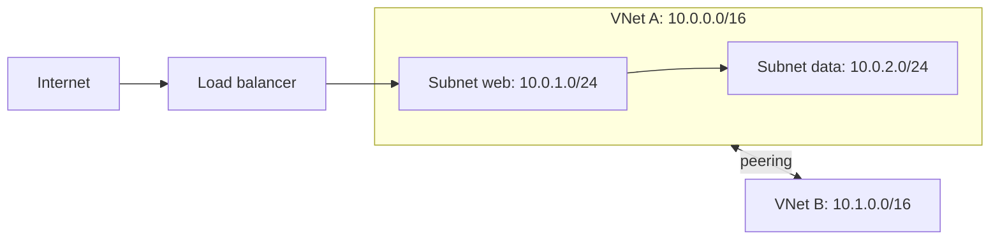

Traffic enters through the load balancer to the web subnet, then to the data subnet. The two VNets are peered, so their address ranges must not overlap.

Key points:
- Plan address ranges (CIDR) early. Changing them later is painful, and peered or on-premises networks must not overlap.
- NSG rules have a priority number, lower is checked first. The first match wins. There are default rules that allow VNet traffic and deny inbound internet.
- Peering is not transitive. If A peers with B and B peers with C, A cannot reach C unless you also peer them or route through a hub appliance.
- Some Azure services reserve addresses or need a dedicated subnet, for example gateways, firewalls and AKS with Azure CNI.

An NSG rule example:

```bash
# Read only example, not run. Allow HTTPS to the web subnet NSG
az network nsg rule create --resource-group rg-net --nsg-name nsg-web \
  --name allow-https --priority 100 --direction Inbound --access Allow \
  --protocol Tcp --destination-port-ranges 443
```

**Gotcha:** a subnet with too small a range runs out of IP addresses. This is common with AKS Azure CNI, where pods take IPs.

**Interview tip:** show planning thinking: "I reserve non-overlapping address space for every network, including on-premises".

_Module: Networking · Tags: vnet, nsg, peering, networking_

### 17. What is the difference between VPN Gateway, ExpressRoute, and public versus private endpoints?

**Short answer:** VPN Gateway and ExpressRoute connect your on-premises network to Azure. A VPN uses encrypted tunnels over the public internet. ExpressRoute is a private, dedicated link through a connectivity provider. Public versus private endpoints decide how clients reach an Azure PaaS service: over its public address, or over a private IP inside your VNet.

| Option | Path | Good for | Trade-off |
| --- | --- | --- | --- |
| Site-to-site VPN | Encrypted tunnel over the internet | Quick, cheaper hybrid link | Variable latency, internet dependent |
| Point-to-site VPN | One client to Azure | Developers, remote admins | Not for service traffic |
| ExpressRoute | Private provider circuit | Stable latency, large data, compliance | Higher cost, lead time |

For PaaS services such as Azure SQL, Storage or Key Vault:

| Option | What it does | Note |
| --- | --- | --- |
| Public endpoint with firewall rules | Service keeps its public address, you allow IP ranges | Traffic still goes to a public address |
| Service endpoint | Subnet identity is sent to the service, and the service allows that subnet | Service still has a public IP; no private IP in your VNet |
| Private endpoint | A network interface with a private IP in your subnet maps to one instance of the service | Needs private DNS; can turn off public access fully |

Private endpoints are the usual choice for regulated or production data because the service can have its public access disabled. They need DNS: the service name must resolve to the private IP, normally with a private DNS zone linked to the VNet.

**Gotcha:** creating a private endpoint without fixing DNS is the classic mistake. The app still resolves the public address and fails when public access is off.

**Interview tip:** say you use private endpoints for data services, plus private DNS zones, and mention the cost per endpoint as a trade-off to check.

_Module: Networking · Tags: vpn, expressroute, private-endpoint, networking_

### 18. How does identity work in Azure: Entra ID, RBAC and managed identities?

**Short answer:** Microsoft Entra ID (formerly Azure Active Directory) is the identity service that authenticates users, groups and applications. Azure RBAC decides what an authenticated identity can do on Azure resources. A managed identity is an identity that Azure creates and rotates for a resource, so your code can call other services without stored passwords.

Two questions are easy to mix up. Authentication asks "who are you?" and is done by Entra ID. Authorisation asks "what may you do?" and on Azure resources is done by RBAC.

| Concept | Meaning |
| --- | --- |
| Tenant | Your organisation's Entra ID directory |
| User, group | People, and collections of people. Assign roles to groups |
| Service principal | An identity for an application or automation in a tenant |
| Managed identity | A service principal whose credentials Azure manages. System-assigned lives with one resource. User-assigned is separate and reusable |
| Role definition | A set of allowed actions, such as Reader, Contributor, Owner, or custom roles |
| Role assignment | Who has which role at which scope |

An RBAC assignment has three parts: who (principal), what (role), and where (scope: management group, subscription, resource group or resource). Assignments are inherited downward.

```bash
# Read only example, not run. Give a managed identity read access to one storage account
az role assignment create \
  --assignee-object-id <principal-id> --assignee-principal-type ServicePrincipal \
  --role "Storage Blob Data Reader" \
  --scope /subscriptions/<sub-id>/resourceGroups/rg-orders/providers/Microsoft.Storage/storageAccounts/stordersprod
```

**Gotcha:** Owner and Contributor on a subscription are very wide. Control-plane roles (manage the resource) differ from data-plane roles (read the data). Being Contributor on a storage account does not by itself let you read blobs through Entra ID.

**Interview tip:** say "no secrets in code: managed identity plus least-privilege role at the smallest sensible scope".

_Module: Identity & Security · Tags: entra-id, rbac, managed-identity, az-900_

### 19. What are Azure Monitor, Log Analytics and Application Insights?

**Short answer:** Azure Monitor is the umbrella platform for collecting metrics, logs and alerts from Azure resources and apps. Log Analytics is the workspace and query engine (KQL) where logs are stored. Application Insights is the application performance monitoring part: requests, dependencies, exceptions and traces from your code.

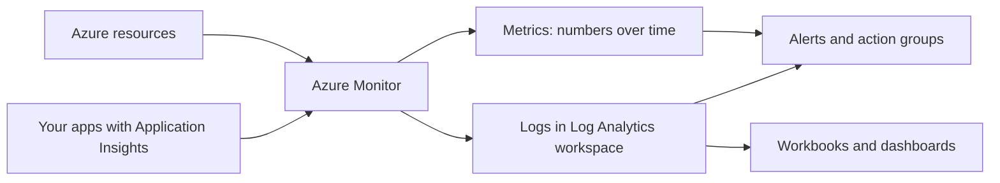

Metrics and logs both feed alerts and dashboards.

| Piece | Holds | Used for |
| --- | --- | --- |
| Metrics | Light numeric values, near real time | CPU, request rate, quick alerts |
| Logs | Rich records queried with KQL | Investigation, correlation, audit |
| Application Insights | Telemetry from the app, now usually stored in a Log Analytics workspace | Slow requests, failures, traces |
| Activity log | Who changed what on the control plane | Audit of Azure operations |
| Diagnostic settings | Switch to send a resource's logs somewhere | Needed to get most resource logs |

Many logs are not collected until you create a diagnostic setting that routes them to a workspace, storage account or Event Hub. Many teams forget this and find no data when they need it.

For AKS, Container Insights and managed Prometheus with Grafana are the Azure-native options. Teams that use Datadog often keep both: Azure Monitor for platform signals and alerts on Azure itself, Datadog for application and cross-cloud views.

**Gotcha:** logs are billed by ingestion volume. Verbose debug logging can become the largest line on a bill.

**Interview tip:** describe the three signals (metrics, logs, traces), and say you set diagnostic settings, retention and sampling on purpose.

_Module: Monitoring & Operations · Tags: azure-monitor, log-analytics, application-insights_

### 20. What factors affect Azure cost, and which basic cost tools exist?

**Short answer:** Azure cost depends on the resource type and size, how long it runs, region, data transfer out, storage amount and tier, and licensing. Basic ways to reduce cost are right-sizing, reservations and savings plans, spot capacity for interruptible work, shutting down what is idle, and watching it all with budgets in Microsoft Cost Management.

| Cost driver | Example |
| --- | --- |
| Compute size and time | A bigger VM, or one that runs all month |
| Region | The same SKU can cost more in another region |
| Storage | Capacity, tier, operations count, redundancy |
| Data transfer | Moving data out of Azure or between regions |
| Licences | Windows Server, SQL Server; Azure Hybrid Benefit can reuse existing licences |
| Service tier | Basic, Standard, Premium features |

| Saving method | How it saves | Watch out |
| --- | --- | --- |
| Reservations | Commit to a specific resource for one or three years for a lower rate | Wrong size or region wastes the commitment |
| Savings plans | Commit to an hourly spend that applies flexibly to compute | Still a commitment |
| Spot VMs | Unused capacity at a big discount, can be evicted | Only for fault-tolerant work |
| Autoscale and shutdown | Pay only when needed | Needs automation and agreement with teams |
| Dev/Test offers | Lower rates for non-production | Check eligibility |

Do not trust numbers from articles. Prices and discounts change. Use the Azure pricing calculator for estimates and Cost Management for real spend.

Cost Management gives cost analysis by tag, resource group and service, budgets with alerts, and exports. A budget alert tells you after money is being spent; it does not stop spending by itself unless you add automation.

**Gotcha:** data egress and cross-zone or cross-region traffic are often forgotten in estimates.

**Interview tip:** say you make cost visible per team through tags and subscriptions first, because you cannot optimise what you cannot attribute.

_Module: Cost & Governance · Tags: cost, reservations, spot, cost-management, az-900_

## Intermediate

### 21. [Tech Lead] How do you choose between VMs, App Service, Container Apps, AKS and Functions?

**Short answer:** I choose the simplest service that meets the requirements, and I move up in complexity only when a real need forces it. The decision depends on workload shape, team skills, control needs, scaling pattern and the cost of operating the platform, not on what is fashionable.

A simple decision flow I use:

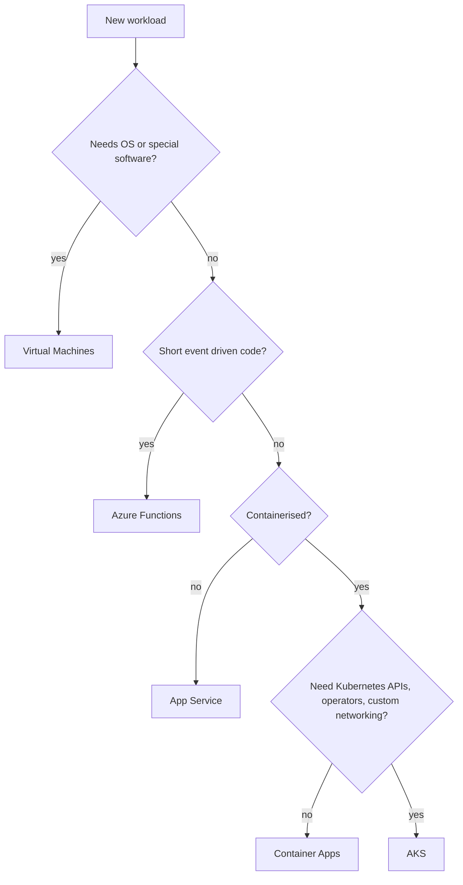

Questions to ask the team:
- How many services will we run? A few services rarely justify a Kubernetes platform. Dozens often do.
- Do we need Kubernetes features such as custom operators, service mesh, GPU pools, daemon sets or strict network policy?
- Do we already have platform engineers to run clusters, upgrades and security?
- Is traffic spiky or idle most of the day? Scale to zero favours Functions and Container Apps.
- What are the portability and exit needs? Containers help on any option.

| Option | Strength | Cost of choosing it |
| --- | --- | --- |
| Virtual Machines | Full control | You patch, scale and secure it |
| App Service | Fastest path for web apps | Less control, plan sizing |
| Functions | Pay per run, event triggers | Time limits, cold starts, harder local reasoning at scale |
| Container Apps | Containers with little platform work | Fewer Kubernetes features |
| AKS | Maximum flexibility and ecosystem | Highest operating load |

Mixed estates are normal. For example, AKS for core services, Functions for small integrations and a VM for one legacy tool.

**Gotcha:** choosing AKS "because we may need it later" adds a standing cost in people time. A move from Container Apps to AKS is possible because both run containers.

**Interview tip:** say "I write the decision and its triggers in a short architecture decision record, so we know what would make us move".

_Module: Compute & Containers · Tags: tech-lead, compute, decision, aks_

### 22. [Tech Lead] How do you run cloud cost governance and FinOps for a team?

**Short answer:** I make spending visible, assign ownership, set budgets and alerts, remove waste, and only then commit to discounts. FinOps is a habit of engineers, finance and product reviewing cloud cost together on a regular rhythm, not a one-time clean-up.

My steps, in order:
1. **Visibility.** Separate subscriptions or resource groups per environment and team. Enforce tags such as `owner`, `env`, `service` and `cost-center` with Azure Policy.
2. **Showback.** Send each team a monthly view of its own cost. Showback means showing the cost, chargeback means billing it. Showback first is easier culturally.
3. **Budgets and alerts.** Budgets in Cost Management at subscription and group level, with alerts at several thresholds and an action group to notify the owner. Also enable anomaly alerts for sudden jumps.
4. **Remove waste.** Unattached disks, idle load balancers, old snapshots, oversized databases, forgotten test clusters, and over-retained logs.
5. **Right-size.** Compare real CPU and memory with what is allocated. Reduce node sizes, requests and database tiers carefully, with a rollback.
6. **Schedule non-production.** Scale dev and test node pools or databases down at night and weekends.
7. **Commitments last.** Buy reservations or savings plans only for the stable baseline you are sure about.

| Lever | Typical saving source | Risk |
| --- | --- | --- |
| Shut down non-prod | Hours not used | Slow morning start, forgotten dependencies |
| Right-sizing | Less spare capacity | Performance regression |
| Reservations, savings plans | Lower unit rate | Commit to the wrong thing |
| Storage tiering | Cooler cheap tiers | Higher read cost |
| Log control | Less ingestion | Missing evidence in incidents |

I track a unit cost such as cost per order or per active user, because total cost rising with growth is fine, but unit cost rising is a problem.

**Gotcha:** untagged resources break everything. Fix tagging first, otherwise every report has a large "unknown" bucket.

**Interview tip:** mention a unit-cost metric and showback. It shows you treat cost as an engineering quality, not only a finance report.

_Module: Cost & Governance · Tags: tech-lead, finops, cost, governance_

### 23. [Tech Lead] How do you handle compliance and data residency in the cloud?

**Short answer:** I begin with the legal and customer requirements: where data must stay, who may access it, how long it is kept, and what proof auditors need. Then I enforce them with technical controls: allowed regions in Azure Policy, encryption, access control, logging and retention. Compliance is evidence, so I make the evidence automatic.

Questions to answer first:
- Which data is personal, regulated or confidential? Classify it.
- Which countries or regions may store and process it? Storage location and processing location can differ.
- Who can access it, including support staff and vendors?
- How long must we keep it, and when must we delete it?

| Need | Control |
| --- | --- |
| Data stays in a region | Policy: allowed locations; deploy only to approved regions; check geo-replication targets and backups |
| Only authorised access | RBAC, conditional access, PIM, private endpoints |
| Encryption | Platform encryption by default; customer-managed keys in Key Vault or managed HSM when required |
| Audit trail | Activity log, resource logs, retention in a central workspace, immutable storage |
| Retention and deletion | Lifecycle rules, legal hold, tested deletion process |
| Evidence | Defender for Cloud regulatory compliance views, Azure Policy compliance, exported reports |

Azure publishes compliance offerings and audit reports (Microsoft Service Trust Portal). A provider's certification covers the provider's part. Your configuration still has to meet your own obligations, which is the shared responsibility model again.

Hidden residency leaks to check: geo-redundant backups, log and monitoring data sent abroad, support tooling, CDN caching, third-party SaaS, and AI or analytics services that process data elsewhere.

**Gotcha:** an allowed-regions policy does not cover global services or data that you export yourself. Review each service's data location notes.

**Interview tip:** say you involve legal and security early and treat compliance rules as code (Policy and tests) so each deploy is checked.

_Module: Cost & Governance · Tags: tech-lead, compliance, data-residency, governance_

### 24. [Tech Lead] How do you use the Azure Well-Architected Framework as a review tool?

**Short answer:** The Well-Architected Framework is a set of five pillars with questions and trade-offs, used to review a workload and find risks. I use it as a regular design and health review: for each pillar I list current state, risks, and actions, then agree priorities with the team and the business.

| Pillar | Main question | Example check |
| --- | --- | --- |
| Reliability | Does it keep working and recover from failure? | Zones, health probes, backups, tested failover, retry and timeout design |
| Security | Is it protected against threats? | Least privilege, private endpoints, Key Vault, patching, Defender |
| Cost optimisation | Do we spend only where it adds value? | Right-sizing, tagging, budgets, reservations, shutdown schedules |
| Operational excellence | Can we deploy, observe and fix it safely? | IaC, CI/CD, monitoring, runbooks, incident process |
| Performance efficiency | Does it meet demand efficiently? | Autoscale, caching, load tests, correct SKUs, data partitioning |

The pillars pull against each other. More redundancy raises reliability and cost. Strong isolation raises security and slows delivery. The skill is to choose the trade-off on purpose and write it down.

How I run a review:
1. Pick a workload and name its goals: SLO, budget, data rules.
2. Walk each pillar with the team in a workshop of about an hour.
3. Record findings with severity and effort.
4. Fix the top few, schedule the rest, and review again in a quarter.

Microsoft offers a Well-Architected Review assessment and an Azure Advisor tool that gives recommendations aligned to the pillars. Treat these as inputs, not as orders. Advisor does not know your business priorities.

**Gotcha:** doing the review once and filing it away. Architecture drifts, so repeat it after major changes.

**Interview tip:** when asked a design question, structure the answer by the five pillars and name one trade-off between two of them.

_Module: Architecture & Resilience · Tags: tech-lead, well-architected, review, architecture_

### 25. How do App Service, Azure Functions and Container Apps differ in scaling, cold starts and hosting plans?

**Short answer:** App Service runs always-on web apps on a plan you size and scale. Functions runs event-triggered code, and depending on the plan it can scale to zero and pay per execution. Container Apps runs containers on a managed Kubernetes-based platform with event-driven scaling (KEDA), including scale to zero. They differ in how they scale, how fast they start from idle, and how you are billed.

| | App Service | Azure Functions | Container Apps |
| --- | --- | --- | --- |
| Unit | Web app on an App Service plan | Function app | Container app with revisions |
| Scale | Manual or autoscale rules by instance count; plan is shared by apps on it | Event driven; plan decides limits | Rules by HTTP concurrency, CPU, queue length and others; zero to many replicas |
| Scale to zero | No (plan runs) | Yes on Consumption and Flex Consumption plans | Yes on the consumption model |
| Cold start | None when always on | Possible after idle on scale-to-zero plans | Possible when scaled to zero; set min replicas to avoid |
| Billing | The plan, whether busy or idle | Per execution and resource time, or reserved instances on Premium | Per resource use; pay for idle only if min replicas above zero |
| Best for | Steady web apps and APIs | Event glue, webhooks, queue handlers | Microservices, background workers, jobs |

Notes on Functions plans: Consumption is the classic pay-per-use plan, Flex Consumption is the newer serverless plan with more control, Premium keeps pre-warmed instances to cut cold starts, and Dedicated runs on an App Service plan. Plan names and limits change, so check the documentation before choosing.

Ways to reduce cold starts: keep a minimum instance count, use a premium or always-ready option, keep the package small, avoid heavy start-up work, and warm dependencies lazily.

Container Apps scale on what the work really is. A queue worker can scale on queue length, an API on concurrent requests. That matches business load better than CPU.

**Gotcha:** several apps on one App Service plan share the same CPU and memory. A noisy app can slow the others.

**Interview tip:** say you pick scale-to-zero for spiky or rare workloads, and a minimum instance count for user-facing APIs where latency matters.

_Module: Compute & Containers · Tags: app-service, functions, container-apps, scaling_

### 26. How do node pools work in AKS, and what is the difference between system and user pools?

**Short answer:** A node pool is a group of identical nodes (same VM size and settings) in an AKS cluster. System node pools run critical cluster components such as CoreDNS and metrics-server. User node pools run your application pods. You separate them so application load cannot starve the cluster's own services, and so each workload gets the right VM size.

| Pool | Purpose | Notes |
| --- | --- | --- |
| System | CoreDNS, konnectivity, metrics-server, other add-ons | Each cluster needs at least one. Keep at least a few nodes for reliability and, in production, spread over zones |
| User | Application workloads | Create many: general, memory heavy, GPU, spot, Windows |

Typical production layout:
- A small system pool, with the taint `CriticalAddonsOnly=true:NoSchedule` so app pods do not land on it.
- A general user pool that autoscaling manages.
- Special pools for heavy jobs, GPUs, or spot nodes for interruptible batch work.
- Zones on every production pool, so nodes spread over zones 1, 2 and 3.

```bash
# Read only example, not run. Add a user pool across zones with the autoscaler
az aks nodepool add --resource-group rg-aks-prod --cluster-name aks-orders \
  --name apps --mode User --node-vm-size Standard_D4s_v5 \
  --zones 1 2 3 --enable-cluster-autoscaler --min-count 3 --max-count 12
```

Use node selectors, taints, tolerations and affinity in pod specs to put the right pods on the right pool. Pool settings such as VM size cannot be changed in place; you add a new pool, move workloads and delete the old one.

**Gotcha:** very small system pools with burstable VM sizes cause strange failures under load. Size the system pool for the add-ons you run, including monitoring agents.

**Interview tip:** say you isolate by pool for three reasons: protect the system, match hardware to workload, and apply different scaling and cost rules.

_Module: Compute & Containers · Tags: aks, node-pools, kubernetes_

### 27. What AKS networking options exist: kubenet, Azure CNI and Azure CNI Overlay?

**Short answer:** AKS can give pods their IP addresses in three main ways. Kubenet uses an overlay on top of the node address and needs route tables. Azure CNI gives each pod a real IP from the VNet subnet. Azure CNI Overlay gives pods private addresses from a separate range while nodes use the VNet, which saves VNet address space. Today Overlay is a common default for new clusters, and Microsoft has signalled kubenet is being phased out, so check current guidance.

| Option | Pod IP source | Strength | Weakness |
| --- | --- | --- | --- |
| Kubenet | Separate pod range, NAT through the node, user-defined routes | Few VNet IPs used | Limited features, route table management, being retired |
| Azure CNI (VNet) | Pods take addresses from the subnet | Pods directly reachable in the VNet | Uses many IPs, so plan subnets large |
| Azure CNI Overlay | Pods use a private overlay range | Scales to many pods, less IP planning | Pods are not directly routable from outside the cluster |
| Azure CNI with Cilium | eBPF dataplane and network policy | Fast policy and observability | Newer, check support matrix |

Other points to decide:
- Network policy (Azure, Calico or Cilium) to control pod-to-pod traffic.
- Private cluster, where the API server has a private IP only.
- Ingress: application gateway, NGINX or the managed application routing add-on, with a load balancer in front.
- Outbound traffic: load balancer SNAT, NAT gateway or Azure Firewall with user-defined routes. SNAT port exhaustion is a real cause of random timeouts.

```bash
# Read only example, not run. Create a cluster with Azure CNI Overlay
az aks create --resource-group rg-aks-prod --name aks-orders \
  --network-plugin azure --network-plugin-mode overlay \
  --pod-cidr 192.168.0.0/16 --zones 1 2 3
```

**Gotcha:** the network plugin is hard to change after creation. Decide early and test connectivity to databases and on-premises networks.

**Interview tip:** explain that plain Azure CNI burns subnet IPs per pod, which is why Overlay was introduced.

_Module: Networking · Tags: aks, cni, networking, kubernetes_

### 28. How do managed identity and workload identity work for pods in AKS?

**Short answer:** Microsoft Entra Workload ID lets a pod prove who it is using its Kubernetes service account token, which the cluster's OIDC issuer signs. Entra ID trusts that token through a federated credential and returns an access token for a user-assigned managed identity. The pod then calls Azure services without any stored secret. It replaces the older pod identity add-on.

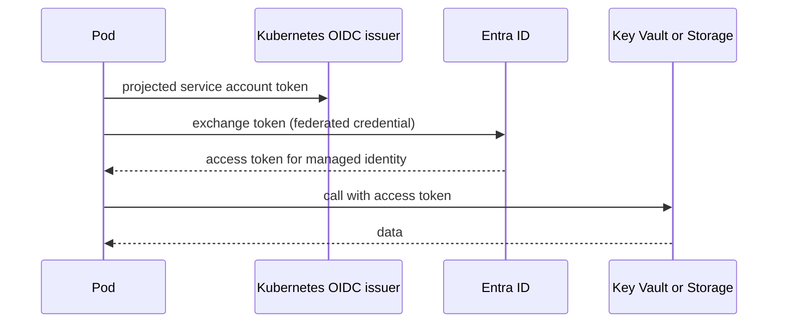

Steps to set it up:
1. Enable the OIDC issuer and workload identity on the cluster.
2. Create a user-assigned managed identity and give it a role at the right scope.
3. Create a federated credential linking the identity to namespace and service account.
4. Annotate the service account and label the pod.

```bash
# Read only example, not run
az aks update -g rg-aks-prod -n aks-orders --enable-oidc-issuer --enable-workload-identity
az identity federated-credential create --name fic-orders-api \
  --identity-name id-orders-api --resource-group rg-aks-prod \
  --issuer "$(az aks show -g rg-aks-prod -n aks-orders --query oidcIssuerProfile.issuerUrl -o tsv)" \
  --subject system:serviceaccount:orders:orders-api \
  --audiences api://AzureADTokenExchange
```

```yaml
apiVersion: v1
kind: ServiceAccount
metadata:
  name: orders-api
  namespace: orders
  annotations:
    azure.workload.identity/client-id: "00000000-0000-0000-0000-000000000000"
---
apiVersion: v1
kind: Pod
metadata:
  name: orders-api
  namespace: orders
  labels:
    azure.workload.identity/use: "true"
spec:
  serviceAccountName: orders-api
  containers:
    - name: app
      image: acrorders.azurecr.io/orders-api:1.0.0
```

In code, use `DefaultAzureCredential` (available in the Azure SDKs for Go, .NET, JavaScript and others). It picks up the workload identity environment automatically.

**Gotcha:** the subject must match the namespace and service account exactly, or token exchange fails with an obscure error.

**Interview tip:** say the point: the trust is between Entra ID and the cluster issuer, so there is no secret to leak or rotate.

_Module: Identity & Security · Tags: aks, workload-identity, managed-identity_

### 29. How do AKS upgrades and autoscaling work?

**Short answer:** AKS upgrades come in two kinds: Kubernetes version upgrades of the control plane and node pools, and node image (OS) updates. Autoscaling also has layers: the Horizontal Pod Autoscaler adds pods, the cluster autoscaler adds nodes when pods cannot be scheduled, and KEDA scales pods on event sources such as queue length.

Upgrade practice:
- Supported Kubernetes versions move quickly. Stay within the supported window; check the AKS release notes.
- The control plane is upgraded first, then each node pool. Nodes are replaced one by one using a surge node, with cordon and drain.
- Pod disruption budgets, readiness probes and enough replicas decide whether users notice.
- Use auto-upgrade channels (for example for patch versions) and set planned maintenance windows.
- Test on a non-production cluster with the same add-ons. Check deprecated APIs before you upgrade.

```bash
# Read only example, not run
az aks get-upgrades -g rg-aks-prod -n aks-orders -o table
az aks upgrade -g rg-aks-prod -n aks-orders --kubernetes-version <target-version>
az aks nodepool upgrade -g rg-aks-prod --cluster-name aks-orders -n apps --node-image-only
```

| Layer | Scales | Trigger | Limit |
| --- | --- | --- | --- |
| HPA | Pods | CPU, memory, custom metrics | Needs resource requests set |
| KEDA | Pods, including to zero | Queue length, events, cron | Needs a scaler per source |
| Cluster autoscaler | Nodes | Pending pods | Min and max per pool, VM quota |
| Node auto provisioning | Nodes of suitable sizes | Pending pods | Newer feature, check status |

Order of events in a spike: more load, HPA adds pods, pods go pending when nodes are full, the cluster autoscaler adds nodes, then pods start. That takes minutes, so keep headroom for fast spikes.

**Gotcha:** an upgrade can stall if a pod disruption budget never allows eviction or if the VM quota has no room for surge nodes.

**Interview tip:** mention that you upgrade often in small steps, because large version jumps and deprecated APIs cause the real outages.

_Module: Compute & Containers · Tags: aks, upgrades, autoscaling, hpa_

### 30. How do you use Azure Container Registry with AKS and your pipeline?

**Short answer:** Azure Container Registry (ACR) is a private, managed registry for container images and OCI artifacts such as Helm charts. The pipeline pushes images with a version tag, and AKS pulls them using its managed identity, which has the AcrPull role. Geo-replication and ACR Tasks help with global pulls and builds.

```bash
# Read only example, not run
az acr create -g rg-shared -n acrorders --sku Premium
az acr build -r acrorders -t orders-api:1.4.2 .       # build in the cloud
az aks update -g rg-aks-prod -n aks-orders --attach-acr acrorders   # grants AcrPull to the kubelet identity
az acr replication create -r acrorders -l northeurope   # Premium: geo-replication
```

| Feature | What it gives | Note |
| --- | --- | --- |
| SKUs: Basic, Standard, Premium | More storage and throughput, Premium adds geo-replication, private link, content trust | Check current limits |
| Geo-replication | One registry name, copies in several regions, pulls use the closest | Premium only |
| ACR Tasks | Build on commit or base image update, multi-step tasks | Useful for patching base images |
| Private endpoint | No public access | Needs private DNS |
| Defender scanning | Vulnerability findings | Extra cost |
| Retention and purge | Remove old untagged images | Controls storage cost |

Good practice:
- Tag images with a version or commit hash. Do not deploy `latest`.
- For security, deploy by digest, or use signed images and admission checks.
- Do not use the admin user. Use Entra ID: managed identity for AKS, OIDC or a service principal for the pipeline with the AcrPush role.
- Keep one registry per environment tier if you need strict separation, or one shared registry with promotion by retagging.

**Gotcha:** a registry in one region and a cluster in another means slow pulls and cross-region traffic cost. Replicate near the cluster.

**Interview tip:** say your pipeline builds once, scans, pushes by commit hash, and promotes the same image through environments.

_Module: Compute & Containers · Tags: acr, containers, aks, ci-cd_

### 31. How do you use Azure Key Vault for secrets, keys and certificates?

**Short answer:** Key Vault is a managed store for secrets (passwords, connection strings), keys (cryptographic keys, optionally in an HSM) and certificates. Applications read from it with a managed identity and an RBAC role, so there are no secrets in code or pipeline variables. Soft delete and purge protection guard against deletion, and rotation keeps secrets fresh.

| Item | Examples | Notes |
| --- | --- | --- |
| Secrets | API keys, DB passwords | Versioned; apps read the latest or a pinned version |
| Keys | Encryption keys, signing keys | Used for encrypt, wrap, sign without exposing the key |
| Certificates | TLS certs | Can auto-renew with supported issuers |

Access model: prefer the Azure RBAC permission model (roles such as Key Vault Secrets User) over the older access policies. It is consistent with the rest of Azure and supports scoping and audit.

Ways to get secrets into apps:
- SDK call at start-up with `DefaultAzureCredential`.
- Key Vault references in App Service and Functions app settings.
- Secrets Store CSI driver in AKS, which mounts secrets as files and can sync to Kubernetes secrets.

```ts
import { DefaultAzureCredential } from "@azure/identity";
import { SecretClient } from "@azure/keyvault-secrets";

// Uses the managed identity or workload identity of the running app
const client = new SecretClient(
  "https://kv-orders-prod.vault.azure.net",
  new DefaultAzureCredential()
);
const secret = await client.getSecret("payments-api-key");
console.log(secret.name); // prints: payments-api-key (never log the value)
```

Rotation: rotate secrets on a schedule and on suspicion of leak. Apps must reload secrets without a restart, or you need a controlled restart. Event Grid can notify you before a secret or certificate expires.

**Gotcha:** one vault for everything and everyone gives a big blast radius. Use a vault per application and environment, and enable soft delete and purge protection. Also remember each vault has request limits, so cache values instead of reading on every request.

**Interview tip:** the best secret is no secret. Prefer managed identity to the target service, and use Key Vault only for secrets that third parties force on you.

_Module: Identity & Security · Tags: key-vault, secrets, rbac, rotation_

### 32. How do you choose between Service Bus, Event Hubs, Event Grid and Storage Queues?

**Short answer:** Use Service Bus for reliable business messages between services (commands, ordered workflows). Use Event Hubs for high-volume event streams that many consumers read and replay. Use Event Grid to react to events, mostly from Azure resources, by pushing them to handlers. Use Storage Queues for simple, cheap queues with no advanced needs.

| Service | Model | Best for | Key traits |
| --- | --- | --- | --- |
| Service Bus | Broker with queues and topics | Orders, payments, commands | Dead-letter, sessions, duplicate detection, transactions, scheduled delivery |
| Event Hubs | Partitioned log stream | Telemetry, logs, clickstream | Huge throughput, consumer groups, replay by offset, Kafka compatible endpoint |
| Event Grid | Push-based event routing | Reacting to a blob created, resource changes, custom events | Filtering, fan-out to webhooks and functions, at least once |
| Storage Queues | Simple queue | Basic background work | Huge size, low cost, few features |

Questions to decide:
- Is it a command ("process this order") or an event ("order was placed")? Commands go to one handler; events go to many.
- Do you need ordering, transactions, or per-message dead letter? Choose Service Bus.
- Do you need millions of events per second or replay? Choose Event Hubs.
- Do you need to react to something in Azure with no polling? Choose Event Grid.
- Is the need tiny and cost sensitive? Storage Queue may be enough.

Common combination: devices send to Event Hubs, a stream job reads and writes results, and Service Bus carries the business commands that follow. Event Grid triggers a function when a file lands in Blob storage.

Comparison to other clouds: Service Bus resembles SQS plus SNS features, Event Hubs resembles Kinesis or Kafka, Event Grid resembles EventBridge.

**Gotcha:** using Event Hubs as a work queue. It has no per-message acknowledgement or dead letter; consumers track an offset.

**Interview tip:** answer "command or event, how much volume, do I need replay?", then name the service.

_Module: Messaging & Integration · Tags: service-bus, event-hubs, event-grid, messaging_

### 33. How do Service Bus queues, topics, dead-letter queues, sessions and duplicate detection work?

**Short answer:** A queue delivers each message to one consumer. A topic copies each message to every subscription, and each subscription behaves like its own queue with optional filters. Messages that fail repeatedly or expire go to the dead-letter queue. Sessions give ordered, grouped processing, and duplicate detection drops messages that repeat the same message id.

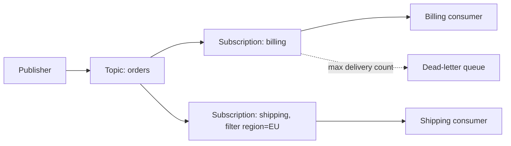

| Feature | What it does | Use for |
| --- | --- | --- |
| Peek-lock | Consumer locks a message, completes it after work, or abandons it | At-least-once processing |
| Max delivery count | After N failed tries the message moves to dead letter | Poison messages |
| Dead-letter queue | A sub-queue holding failed or expired messages | Inspect, fix and resubmit |
| Sessions | Messages with the same session id go to one receiver in order | Per-customer or per-order ordering |
| Duplicate detection | Same `MessageId` within a time window is dropped | Safe sender retries |
| Time to live, scheduling | Expire or delay messages | Reminders, timeouts |

A send example with a stable message id:

```ts
import { DefaultAzureCredential } from "@azure/identity";
import { ServiceBusClient } from "@azure/service-bus";

const client = new ServiceBusClient("sb-orders.servicebus.windows.net", new DefaultAzureCredential());
const sender = client.createSender("order-created");
// messageId lets duplicate detection drop a retried send
await sender.sendMessages({ messageId: "order-1001", body: { orderId: "1001" } });
await sender.close();
await client.close();
```

Delivery is at least once, so receivers must be idempotent. Duplicate detection helps the sender side only.

**Gotcha:** dead-letter queues are not monitored by default. Alert on dead-letter count, or failures sit unnoticed for weeks.

**Interview tip:** say "peek-lock plus idempotent handler plus dead-letter alert" as the safe default.

_Module: Messaging & Integration · Tags: service-bus, dead-letter, sessions, idempotency_

### 34. What does Azure API Management do and when should you use it?

**Short answer:** Azure API Management (APIM) is a managed API gateway and developer portal. It sits in front of your backend APIs and applies common policies: authentication, rate limits, caching, transformation, versioning and analytics. Use it when you expose APIs to many consumers or want one consistent edge for many services.

What it provides:
- **Gateway** that routes requests to backends and enforces policies.
- **Policies** in XML, applied at global, product, API or operation level: validate a JWT, rate-limit per key, rewrite headers, cache a response, call a backend with a managed identity.
- **Products and subscriptions**: group APIs, give consumers keys, set quotas.
- **Developer portal** and OpenAPI import for documentation.
- **Tiers** with different features such as virtual network support and multi-region. Tier choice has large cost and capability impact; check the current comparison.
- **Self-hosted gateway** to run the gateway close to services on premises or in other clouds.

A small policy sketch that validates a token and limits calls:

```text
<inbound>
  <validate-jwt header-name="Authorization" failed-validation-httpcode="401">
    <openid-config url="https://login.microsoftonline.com/<tenant-id>/v2.0/.well-known/openid-configuration" />
  </validate-jwt>
  <rate-limit-by-key calls="100" renewal-period="60" counter-key="@(context.Request.IpAddress)" />
</inbound>
```

When not to use it: for internal east-west traffic between microservices, a service mesh or plain service-to-service calls are usually better. APIM adds cost, latency and one more thing to operate. A simple ingress controller is enough if you only need routing and TLS.

Alternatives: an ingress controller plus WAF in front of AKS, or an application gateway with WAF. APIM is the pick when you need API products, consumer management and policies.

**Gotcha:** putting business logic in APIM policies makes it hard to test and version. Keep policies for cross-cutting concerns.

**Interview tip:** say APIM is for the edge and for external consumers, not for internal service calls.

_Module: Messaging & Integration · Tags: apim, api-gateway, api_

### 35. How do Application Gateway, Front Door, Load Balancer and Traffic Manager differ?

**Short answer:** They differ on two axes: the network layer they work at, and whether they are regional or global. Load Balancer works at layer 4 (TCP and UDP) in one region. Application Gateway works at layer 7 (HTTP) in one region and can include a web application firewall. Front Door is a global layer 7 entry with CDN and WAF. Traffic Manager is a global DNS-based router that works with any protocol.

| Service | Layer | Scope | Main use |
| --- | --- | --- | --- |
| Load Balancer | L4 | Regional (global tier exists for cross-region) | Distribute TCP or UDP traffic inside a region |
| Application Gateway | L7 | Regional | URL routing, TLS termination, WAF, ingress for AKS |
| Front Door | L7 | Global | Global HTTP entry, acceleration, WAF, failover between regions |
| Traffic Manager | DNS | Global | Route by DNS to endpoints, including non-HTTP |

How to choose:
- One region web app that needs path routing and WAF: Application Gateway.
- Users worldwide, or two regions with failover: Front Door in front of regional entry points.
- Internal TCP service such as a database proxy: Load Balancer.
- Non-HTTP service across regions: Traffic Manager (DNS routing, so clients cache answers and failover is slower).

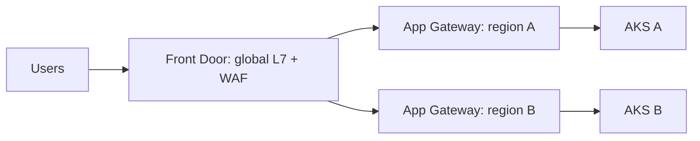

Global entry on top, regional L7 in the middle, clusters at the bottom.

Health probes decide which backend is healthy. Make the probe test something real (a health endpoint that checks dependencies lightly), not just that the port is open.

**Gotcha:** Traffic Manager failover depends on DNS time-to-live and client caches. It is not instant.

**Interview tip:** say the two axes first (layer and scope), then map each product.

_Module: Networking · Tags: load-balancing, front-door, application-gateway, traffic-manager_

### 36. How do Azure DNS and private DNS zones work, and why do they matter for private endpoints?

**Short answer:** Azure DNS hosts public DNS zones for your domains. Azure Private DNS zones hold names that resolve only inside linked virtual networks. Private endpoints depend on private DNS: the service's normal name must resolve to the private IP of the endpoint, otherwise clients keep using the public address.

How a private endpoint name works for a storage account:
1. The client asks for `stordersprod.blob.core.windows.net`.
2. The public DNS answers with an alias to `stordersprod.privatelink.blob.core.windows.net`.
3. A private DNS zone named `privatelink.blob.core.windows.net`, linked to the VNet, answers with the private IP.
4. Traffic stays inside the network.

Outside a linked VNet, step 3 does not exist, so the name resolves to the public address.

| Piece | Role |
| --- | --- |
| Public DNS zone | Internet-facing records for your domain |
| Private DNS zone | Internal records for linked VNets |
| Virtual network link | Makes a private zone visible to a VNet (optional auto-registration for VM names) |
| Private DNS Resolver | Forwards queries between Azure, on premises and other networks |
| `privatelink.*` zones | Standard zone names per service type (blob, database, vault, and so on) |

For hub-and-spoke designs, keep private DNS zones in one central subscription, link them to hub and spokes, and manage them as code. On premises clients need a conditional forwarder to the resolver, otherwise they will not see private records.

Check a name from inside the VNet:

```bash
# Run from a VM or pod in the VNet
nslookup stordersprod.blob.core.windows.net
# expected: a private IP such as 10.0.2.5, not a public address
```

**Gotcha:** custom DNS servers on the VNet that do not forward to Azure's resolver (168.63.129.16) break private zone resolution.

**Interview tip:** if a private endpoint "does not work", say "I check DNS first", because it is the cause most of the time.

_Module: Networking · Tags: dns, private-dns, private-endpoint_

### 37. How do you design a hub-and-spoke network and choose between NSGs and Azure Firewall?

**Short answer:** In hub-and-spoke, a central hub VNet holds shared services (firewall, VPN or ExpressRoute gateway, DNS, bastion), and workload spokes peer to the hub. Traffic between spokes and to the internet flows through the hub for inspection. NSGs give simple allow and deny rules at subnet level. Azure Firewall adds central, stateful, application-aware filtering and logging.

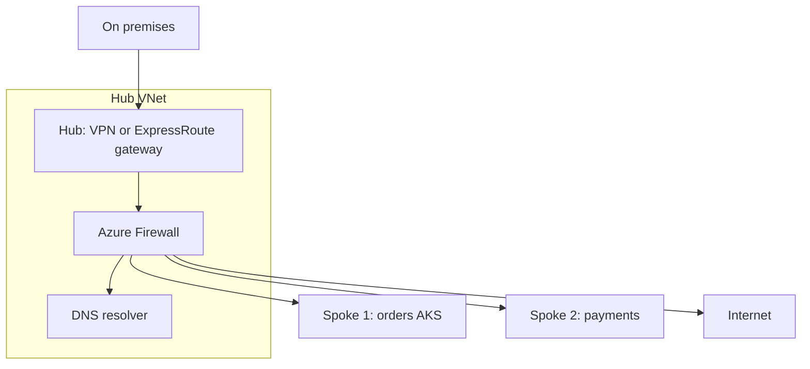

Spokes are connected to the hub by peering, and route tables send spoke traffic to the firewall.

| | NSG | Azure Firewall |
| --- | --- | --- |
| Level | Layer 3 and 4: IP, port, protocol | L3 to L7: FQDN rules, threat intelligence, TLS inspection (premium tier) |
| Placement | Subnet or network interface | Central, in the hub |
| Cost | Free | Hourly plus data processing; check pricing |
| Use for | Basic segmentation inside a spoke | Egress control, east-west inspection, central policy |

Design points:
- Spokes do not talk to each other directly. Peering is not transitive, so route through the hub on purpose, or allow direct peering for chatty pairs.
- User-defined routes send `0.0.0.0/0` to the firewall (forced tunnelling). Test asymmetric routing.
- Plan non-overlapping address space for hub, spokes and on premises.
- Use Azure Virtual WAN when you have many branches and regions, as a managed hub.
- Use NSGs and the firewall together: NSG for micro-segmentation, firewall for central egress rules.

**Gotcha:** a firewall as single egress point is also a cost and a bottleneck. Size it, deploy it zone redundant, and review rules as code.

**Interview tip:** explain the hub as "shared services and control point" and the spokes as "blast-radius boundaries".

_Module: Networking · Tags: hub-spoke, nsg, azure-firewall, network-design_

### 38. What Azure SQL options exist and how do you choose: single database, elastic pool or managed instance?

**Short answer:** Azure SQL Database single database is an isolated PaaS database with its own resources. An elastic pool lets many databases share one pool of resources, which suits many small, bursty databases. Managed Instance is a near-full SQL Server instance in a VNet, built for lift and shift migrations that need instance-level features.

| Option | Isolation | Strength | Choose when |
| --- | --- | --- | --- |
| Single database | One database, own compute | Simple, per-database sizing and scale | A new service with its own database |
| Elastic pool | Many databases share resources | Cost saving when load peaks at different times | SaaS with one database per tenant |
| Managed Instance | A whole instance with many databases | High SQL Server compatibility: SQL Agent, cross-database queries, linked servers, CLR | Migrating existing SQL Server with minimal change |
| SQL Server on VM | Full OS | Total control | Unsupported features, special licensing |

Purchasing and compute choices (concepts; look up current SKUs):
- vCore model: you choose cores, memory and storage; service tiers such as General Purpose, Business Critical and Hyperscale.
- DTU model: a bundled measure of compute and IO, simpler but less flexible.
- Serverless compute: scales and can auto-pause when idle, billed per second. Good for dev and rarely used databases. The first query after a pause is slow.
- Hyperscale: very large databases, fast scale and fast backup/restore.

Operational notes:
- Connection strings should use retry logic. Transient errors happen during failover or scale operations.
- Use Entra ID authentication and managed identity instead of SQL passwords where the driver supports it.
- Watch for query performance with Query Store and Intelligent Insights, not only CPU.

**Gotcha:** an elastic pool helps only if the databases do not peak together. If all tenants peak at 9 am, you pay for the sum.

**Interview tip:** say "single database by default, pool for many small tenants, managed instance for migration compatibility".

_Module: Storage & Data · Tags: azure-sql, elastic-pool, managed-instance_

### 39. How do Azure SQL high availability, geo-replication and backups work?

**Short answer:** Azure SQL has built-in high availability inside a region, optionally zone redundant. For disaster recovery you add active geo-replication or auto-failover groups to a second region. Backups are automatic, give point-in-time restore (PITR) for a retention period you configure, and long-term retention (LTR) keeps copies for years.

| Capability | Protects against | Notes |
| --- | --- | --- |
| Built-in HA | Node and hardware failure | Automatic; replicas managed by the platform |
| Zone redundancy | Data centre (zone) failure | Option per database or pool; check tier support |
| Active geo-replication | Region loss | Readable secondary in another region, manual failover |
| Auto-failover group | Region loss | One listener name for a group of databases, can fail over automatically by policy |
| PITR | Accidental delete or bad deploy | Restore to a time within retention; creates a new database |
| Long-term retention | Compliance, audit | Weekly, monthly, yearly backups kept for years |
| Geo-restore | Region loss with no replica | Restore from geo-redundant backups; slower and larger RPO |

Replication to the secondary region is asynchronous, so a regional failover can lose a small amount of recent data. That is your RPO in practice. Backup storage redundancy can be local, zone or geo; choose it deliberately because it decides what restore options survive a regional outage.

Failover group pattern:
- The app uses the read-write listener name, so after failover the connection string does not change.
- Use the read-only listener for reports on the secondary.
- Run a planned failover test in non-production, and check that logins, firewall rules and private endpoints exist on the secondary too.

**Gotcha:** a restore creates a new database with a new name. The app, permissions and connection strings must be updated, so rehearse the steps.

**Interview tip:** show you know the difference between HA (no data loss, same region) and DR (accept small loss, another region), and that backups are not a replacement for either.

_Module: Storage & Data · Tags: azure-sql, ha, geo-replication, backup_

### 40. How does Cosmos DB work: partition keys, request units, and the change feed?

**Short answer:** Cosmos DB spreads data across physical partitions using the partition key you choose. Cost and throughput are measured in request units per second (RU/s), a normalised cost of reads, writes and queries. The change feed is an ordered log of changes in a container that other services can read to react to updates.

**Partition key.** Items with the same key value live in the same logical partition. A good key has many distinct values, spreads load evenly, and appears in most queries. Queries that include the key stay in one partition and are cheap. Queries without it fan out across partitions and cost more.

| Example container | Good key | Bad key |
| --- | --- | --- |
| Orders by customer | `customerId` | `country` (few values, hot partition) |
| Device telemetry | `deviceId` (or a combination) | `date` (all writes hit today's partition) |
| Multi-tenant app | `tenantId` | A constant value |

**Request units.** A point read of a small item by id and partition key is the cheapest operation, around one RU. Writes, indexing and cross-partition queries cost more. Throughput modes:
- Provisioned throughput: fixed RU/s, with autoscale to a maximum.
- Serverless: pay per request, for low or spiky traffic, with limits.
When a request exceeds the limit, Cosmos returns 429 and a retry-after hint. SDKs retry automatically, but sustained 429 means you must raise RU/s or fix a hot partition.

**Change feed.** A container keeps an ordered record of inserts and updates (not deletes in the default mode). Uses: update a search index, publish events, build read models, sync to analytics. In Azure Functions, a Cosmos DB trigger reads the change feed and keeps its position for you.

Consistency level, global distribution and multi-region writes are also set at account level (see the consistency question).

**Gotcha:** the partition key cannot be changed in place. A wrong choice means a data migration to a new container.

**Interview tip:** begin with the access patterns, derive the partition key, then check that no single value gets too much traffic.

_Module: Storage & Data · Tags: cosmos-db, partition-key, ru, change-feed_

### 41. What are common Blob Storage patterns: SAS tokens, lifecycle management and immutability?

**Short answer:** A shared access signature (SAS) is a signed URL that gives limited, time-bound access to a blob or container. Lifecycle management rules move or delete blobs automatically by age. Immutability policies make blobs write-once, read-many (WORM) for compliance. Together they cover safe sharing, cost and retention.

**SAS types**

| Type | Signed with | Note |
| --- | --- | --- |
| User delegation SAS | Entra ID credentials | Preferred; can be revoked by revoking the delegation key; no account key |
| Service SAS | Storage account key | Scoped to one service |
| Account SAS | Storage account key | Broad; avoid |

Keep a SAS short-lived and minimal: read only, one blob, a few minutes. A common upload pattern is that your API checks the user, creates a user delegation SAS with write permission for one blob name, and the browser uploads straight to Blob. This keeps large files off your API servers.

**Lifecycle management** is a rule set on the account. Example behaviour: after 30 days move to Cool, after 180 days to Archive, after 5 years delete; delete old snapshots and versions. It saves money without code, but check minimum storage durations and rehydration costs of each tier.

**Immutability:** time-based retention or legal hold stops delete and overwrite until the period ends. Use it for audit logs and records under regulation. Versioning and soft delete protect against accidents but do not stop a privileged user from changing policy; immutability can.

```bash
# Read only example, not run. User delegation SAS for one blob, read only, with an expiry
az storage blob generate-sas --account-name stordersprod --container-name invoices \
  --name inv-1001.pdf --permissions r --expiry 2026-12-31T10:00Z \
  --auth-mode login --as-user --full-uri
```

**Gotcha:** a SAS cannot be listed or revoked individually when it is signed by the account key, other than by rotating that key. Prefer user delegation SAS and short expiry.

**Interview tip:** say "browser uploads direct to Blob with a user delegation SAS, and a lifecycle rule handles retention".

_Module: Storage & Data · Tags: blob-storage, sas, lifecycle, immutability_

### 42. What is the difference between Azure Monitor metrics and logs, and how do you use KQL and alerts?

**Short answer:** Metrics are small numeric values sampled over time, cheap and fast, good for dashboards and quick alerts. Logs are rich records stored in a Log Analytics workspace and queried with Kusto Query Language (KQL), good for investigation. Alert rules watch a metric or a log query, and action groups say who or what is notified when an alert fires.

| | Metrics | Logs |
| --- | --- | --- |
| Data | Numbers with dimensions | Records with many fields |
| Latency | Near real time | A few minutes of ingestion delay |
| Retention | Short by default, long-lived platform metrics | Set per workspace or table |
| Query | Metrics explorer | KQL |
| Best for | CPU, request count, queue depth | Errors, traces, audit, cross-resource joins |

KQL reads like a pipeline: start from a table, then filter and shape with `|`.

```text
// Failed requests per 5 minutes for the last day, from Application Insights data
AppRequests
| where TimeGenerated > ago(1d) and Success == false
| summarize failures = count() by bin(TimeGenerated, 5m), Name
| order by failures desc
```

```text
// Slowest operations: 95th percentile duration in milliseconds
AppRequests
| where TimeGenerated > ago(1h)
| summarize p95 = percentile(DurationMs, 95), calls = count() by Name
| top 10 by p95
```

Table names depend on how data is collected (workspace-based Application Insights uses names such as `AppRequests`; the classic Application Insights UI uses `requests`). Look at the schema in the Logs blade first.

Alert types:
- **Metric alert**: threshold or dynamic threshold on a metric.
- **Log search alert**: a KQL query runs on a schedule; it fires on result count or value.
- **Activity log alert**: on control-plane events, such as a resource deletion or service health.

An **action group** holds the targets: email, SMS, webhook, Logic App, Function, ITSM, or a Teams or paging integration. Reuse groups per team.

**Gotcha:** log alerts run on delayed data and cost per evaluation. Alert on metrics when a metric exists, and use logs for rich conditions.

**Interview tip:** say you alert on symptoms (error rate, latency), keep queries saved as code, and use action groups per owning team.

_Module: Monitoring & Operations · Tags: azure-monitor, kql, alerts, logs_

### 43. How do Application Insights distributed tracing and sampling work?

**Short answer:** Application Insights collects requests, dependencies, exceptions, traces and metrics from your app. Distributed tracing links the calls of one user request across services by passing a trace id in headers (W3C Trace Context), so you can see the whole path in one transaction view. Sampling keeps only a percentage of telemetry to control volume and cost.

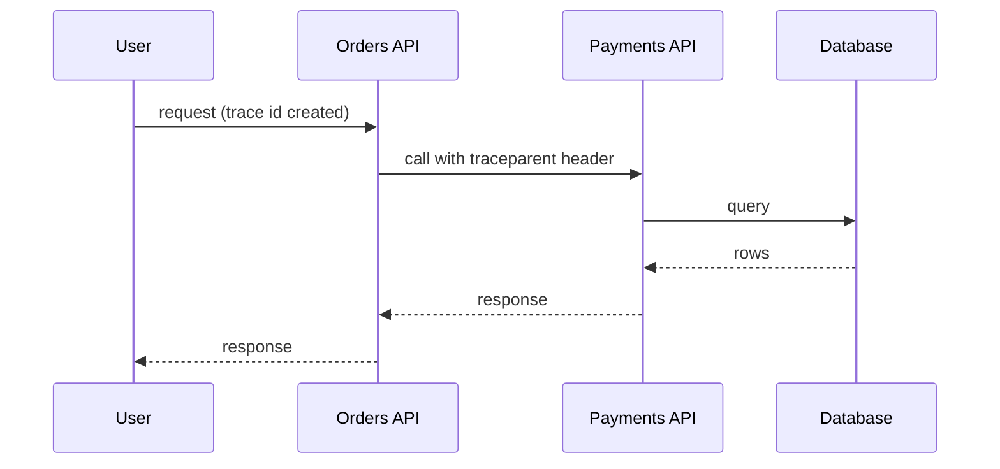

All three services report telemetry with the same trace id, so the Application Map and end-to-end transaction view can join them.

Key points:
- The current direction is OpenTelemetry instrumentation with the Azure Monitor exporter or distro, instead of the older SDKs. Check the documentation for your language.
- Use the same trace id in your log lines. A log without a trace id is hard to connect to a request.
- Dependencies (SQL calls, HTTP calls, queue sends) show where time is spent.
- Application Insights stores data in a Log Analytics workspace (workspace-based), so KQL works across app and platform logs.

**Sampling**

| Type | What it does | Note |
| --- | --- | --- |
| Adaptive or rate-limited (in SDK) | Limits events per second, keeps related items together | Good default for busy services |
| Fixed percentage | Keep for example one in ten traces | Predictable cost |
| Ingestion sampling | Server-side drop | Data is already sent, so you still pay network |
| Tail-based sampling | Decide after seeing the whole trace, to keep errors and slow ones | Needs a collector; common in OpenTelemetry setups |

Sampling counts the results correctly in charts because sampled items carry a weight, but individual rows are missing.

**Gotcha:** sampling out the rare error trace you need. Always keep exceptions and failed requests at a higher rate than successes.

**Interview tip:** if the team also uses Datadog, say you pick one tracing standard (OpenTelemetry) so telemetry can go to either backend.

_Module: Monitoring & Operations · Tags: application-insights, tracing, sampling, opentelemetry_

### 44. How do Bicep, ARM templates and Terraform compare, and what are state and drift?

**Short answer:** ARM templates are Azure's JSON deployment format. Bicep is a cleaner language that compiles to ARM and is Azure-only with day-one support for new resource types. Terraform is a multi-cloud tool with its own language and a state file. All three describe desired infrastructure as code. State is the record of what has been deployed, and drift is when the real environment differs from the code.

| | ARM (JSON) | Bicep | Terraform |
| --- | --- | --- | --- |
| Scope | Azure only | Azure only | Many providers |
| Readability | Verbose | Short and clear | Short and clear |
| State | None stored by you; Azure compares at deployment | None stored by you | State file you must store and protect |
| Preview | `what-if` | `what-if` | `terraform plan` |
| New Azure features | Immediately | Immediately (same API) | Often a delay in the provider |
| Choose when | Rarely, as output of Bicep | Azure-only teams | Multi-cloud, or existing Terraform skills |

A small Bicep file:

```bicep
param location string = resourceGroup().location
param storageName string

resource st 'Microsoft.Storage/storageAccounts@2023-05-01' = {
  name: storageName
  location: location
  kind: 'StorageV2'
  sku: {
    name: 'Standard_ZRS'
  }
  properties: {
    minimumTlsVersion: 'TLS1_2'
    allowBlobPublicAccess: false
  }
}

output storageId string = st.id
```

```bash
# Read only example, not run. Preview, then apply
az deployment group what-if -g rg-orders-dev --template-file main.bicep --parameters storageName=stordersdev
az deployment group create -g rg-orders-dev --template-file main.bicep --parameters storageName=stordersdev
```

**State and drift.** Terraform keeps a state file mapping code to real resources, so store it remotely (for example in a Blob container with locking), restrict access, and never commit it, because it can contain secrets. Bicep has no state file, since Azure Resource Manager is the source of truth. Drift happens when someone changes a resource in the portal. Detect it with `terraform plan` or `what-if` on a schedule, and fix the process (limit portal write access) not only the symptom.

**Gotcha:** Bicep deployments in "incremental" mode do not delete resources removed from the file. "Complete" mode does, which can be dangerous.

**Interview tip:** say you choose by team and scope: Bicep for Azure-only, Terraform when you also manage non-Azure systems, and in both cases you review the plan in a merge request.

_Module: Infrastructure as Code & DevOps · Tags: bicep, arm, terraform, iac, drift_

### 45. How do you deploy to Azure from GitLab CI/CD without storing secrets?

**Short answer:** Use OpenID Connect (OIDC) federation. GitLab issues a short-lived ID token for each job, and a federated credential on an Entra ID app registration trusts tokens from your GitLab project and branch. The job exchanges the token for an Azure access token, so no client secret is stored in GitLab variables. Azure DevOps service connections can do the same with workload identity federation.

Setup in Azure (once): create an app registration or user-assigned managed identity, give it a role at the right scope, and add a federated credential.

```json
{
  "name": "gitlab-orders-main",
  "issuer": "https://gitlab.com",
  "subject": "project_path:my-group/orders-api:ref_type:branch:ref:main",
  "audiences": ["api://AzureADTokenExchange"]
}
```

```bash
# Read only example, not run. Save the JSON above as credential.json
az ad app federated-credential create --id <app-object-id> --parameters credential.json
```

For self-managed GitLab, the issuer is your instance URL. The subject controls which project, branch or environment may sign in, so use separate credentials for production and non-production.

The pipeline job:

```yaml
deploy-dev:
  stage: deploy
  image: mcr.microsoft.com/azure-cli:latest
  id_tokens:
    AZURE_ID_TOKEN:
      aud: api://AzureADTokenExchange
  script:
    - az login --service-principal -u "$AZURE_CLIENT_ID" -t "$AZURE_TENANT_ID" --federated-token "$AZURE_ID_TOKEN"
    - az account set --subscription "$AZURE_SUBSCRIPTION_ID"
    - az deployment group create -g rg-orders-dev --template-file infra/main.bicep
  rules:
    - if: $CI_COMMIT_BRANCH == "main"
```

The client id, tenant id and subscription id are not secrets, so they can be plain CI variables.

| Method | Secret stored? | Lifetime | Note |
| --- | --- | --- | --- |
| Client secret in CI variable | Yes | Months, until rotated | Leak risk, expiry outages |
| Certificate | Yes | Long | Better, still stored |
| OIDC federation | No | Minutes | Preferred |

**Gotcha:** a subject that is too broad (for example any branch) lets a feature branch deploy to production. Keep production roles behind protected branches and environments.

**Interview tip:** say "no long-lived credentials in CI, least-privilege role per environment, and protected branches for production".

_Module: Infrastructure as Code & DevOps · Tags: gitlab, oidc, ci-cd, federated-credentials_

### 46. How do Azure Policy, RBAC and resource locks differ?

**Short answer:** RBAC answers who can do what. Azure Policy answers what is allowed to exist and how resources must be configured, no matter who creates them. Resource locks stop accidental delete or change, even for people who have the permission. You need all three, because each closes a different gap.

| | RBAC | Azure Policy | Lock |
| --- | --- | --- | --- |
| Question | Who may act? | What may be created or must be true? | Can this be deleted or changed now? |
| Applies to | Identities | Resources and their properties | A specific resource or group |
| Effects | Allow actions by role | Audit, deny, modify, deploy if not exists | Block delete (CanNotDelete) or block change (ReadOnly) |
| Example | Team group has Contributor on rg-orders | Deny public network access on storage | Prevent deletion of the production database |
| Inheritance | Down the hierarchy | Down the hierarchy, with exclusions | Down to child resources |

Policy details:
- **Effects:** `Audit` reports non-compliance, `Deny` blocks the deployment, `Modify` adds tags or settings, `DeployIfNotExists` adds a missing piece such as diagnostic settings.
- Start with `Audit`, fix existing resources, then move to `Deny`. Going straight to `Deny` breaks teams' pipelines.
- Group policies into initiatives, and assign them to management groups.
- Policy evaluates on create and update, and on a schedule for existing resources. Existing resources are not changed unless you run remediation.

Example idea in words: "Deny storage accounts that allow public blob access" and "Require tag owner on every resource group".

A typical mistake is to treat RBAC as a guardrail. An Owner can create anything, so only Policy can stop a risky configuration. And a lock does not replace backups: a `ReadOnly` lock may stop some normal operations and surprise services.

**Gotcha:** Policy denies show up as deployment errors in pipelines, so publish the policy list and the reason for each rule to the teams.

**Interview tip:** use the short line "RBAC is who, Policy is what, locks are oops-protection".

_Module: Cost & Governance · Tags: azure-policy, rbac, locks, governance_

### 47. How does autoscaling work in Azure and what are its limits?

**Short answer:** Autoscale adds or removes instances based on rules. Metric-based rules react to load such as CPU or queue length. Schedule-based rules set capacity for known times such as business hours. Good designs combine both, plus minimum and maximum limits, because scaling takes time and is bounded by quotas and by your downstream systems.

| Type | Idea | Example |
| --- | --- | --- |
| Metric based (reactive) | Scale when a measure crosses a threshold for some minutes | Add 1 instance if average CPU is above 70 percent for 10 minutes |
| Schedule based | Fixed capacity at set times | 6 instances on weekdays 08:00 to 18:00, 2 otherwise |
| Predictive | Use past patterns to scale ahead (available for some services) | Check availability for your service |
| Event based | Scale on events or queue length | KEDA scaling pods on Service Bus queue length |

```bash
# Read only example, not run. Autoscale an App Service plan between 2 and 10 instances
az monitor autoscale create -g rg-orders-prod --resource plan-orders \
  --resource-type Microsoft.Web/serverfarms --name as-orders \
  --min-count 2 --max-count 10 --count 2
az monitor autoscale rule create -g rg-orders-prod --autoscale-name as-orders \
  --condition "CpuPercentage > 70 avg 10m" --scale out 1
az monitor autoscale rule create -g rg-orders-prod --autoscale-name as-orders \
  --condition "CpuPercentage < 30 avg 10m" --scale in 1
```

Design rules:
- Keep a gap between scale-out and scale-in thresholds to avoid flapping.
- Scale out fast and scale in slowly.
- Start-up time matters. New VMs take minutes, containers seconds, so keep headroom for sudden spikes.
- Set a sensible maximum. It protects cost and protects your database from a connection storm.
- Instances must be stateless. Session state belongs in Redis or the database.

Limits to remember: subscription and regional vCPU quotas, IP address space, per-service instance limits, and downstream limits such as database connections. Quota increases take time, so ask early. Look up current limits in the documentation, as they change.

**Gotcha:** autoscaling the web tier without the database causes the database to become the bottleneck and fail first.

**Interview tip:** say "scale on the signal that matches the work, set min and max on purpose, and load test the whole chain".

_Module: Compute & Containers · Tags: autoscale, scaling, vmss, capacity_

### 48. How and when do you use Azure Cache for Redis?

**Short answer:** Azure Cache for Redis is a managed in-memory data store used to speed up reads, hold sessions and share state between instances. The standard pattern is cache-aside: the app checks the cache first, reads the database on a miss, then stores the result with an expiry time. Product names in this area are changing (Azure Managed Redis is the newer offering), so check the current documentation before choosing a tier.

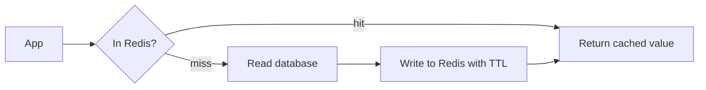

On a hit the database is not touched. On a miss the app fills the cache for the next caller.

A small cache-aside example:

```ts
import Redis from "ioredis";

const redis = new Redis(process.env.REDIS_URL!);

async function getProduct(id: string) {
  const key = `product:${id}`;
  const cached = await redis.get(key);
  if (cached) return JSON.parse(cached);          // hit

  const product = await loadProductFromDb(id);     // miss: read the source of truth
  await redis.set(key, JSON.stringify(product), "EX", 300); // expire after 5 minutes
  return product;
}
declare function loadProductFromDb(id: string): Promise<unknown>;
```

Good uses: read-heavy lookups, session or token cache, rate limiting counters, distributed locks (with care), leaderboards, pub/sub for simple cases.

Decisions:
- **Expiry (TTL):** decide how stale data may be. Invalidate on update when freshness matters.
- **Eviction policy:** what happens when memory is full.
- **Persistence and clustering:** premium tiers offer them; a cache should still be rebuildable.
- **Network:** use a private endpoint and TLS. Use Entra ID authentication where supported.
- **Resilience:** the app must still work, slower, when the cache is down. Add timeouts.

**Gotcha:** cache stampede. When a popular key expires, many requests hit the database together. Use jitter on expiry, locks for rebuild, or refresh ahead.

**Interview tip:** say Redis is a performance tool, not a source of truth, and describe how you handle invalidation.

_Module: Storage & Data · Tags: redis, caching, cache-aside, performance_

### 49. What is Azure Arc at concept level, and when does a hybrid approach make sense?

**Short answer:** Azure Arc extends Azure management to resources outside Azure: servers, Kubernetes clusters, and some data services running on premises, at the edge or in other clouds. Arc projects them into Azure Resource Manager, so you can apply the same RBAC, Policy, tags, monitoring and security tools. It is a management plane, not a way to move the workload.

What Arc can bring:
- **Arc-enabled servers:** Windows and Linux machines appear as Azure resources, with policy, update management and Defender.
- **Arc-enabled Kubernetes:** attach any conformant cluster, deploy with GitOps (Flux) and apply Azure Policy.
- **Arc-enabled data services:** run Azure SQL Managed Instance or PostgreSQL on your own infrastructure, with Azure-style management (check availability).
- **Azure Local** (formerly Azure Stack HCI) is a related product that runs Azure services on your own hardware. Names change, so confirm in the docs.

| Situation | Why hybrid helps |
| --- | --- |
| Data must stay on premises | Keep it local, manage from Azure |
| Factory, ship or aircraft edge needs low latency | Run local compute, central policy and monitoring |
| Multi-cloud or acquired estate | One governance view across clouds |
| Slow migration | Manage old and new in the same way during the move |

Trade-offs:
- Extra agents to install, update and secure.
- Connectivity: Arc agents need outbound access to Azure. Disconnected scenarios have limits.
- Cost per managed server or cluster for some features. Check pricing.
- More moving parts than going all-in on one place.

**Gotcha:** treating Arc as a reason to avoid migration decisions. It manages the estate; it does not remove the work of retiring or moving old systems.

**Interview tip:** describe Arc as "Azure's control plane reaching out to your other places".

_Module: Architecture & Resilience · Tags: azure-arc, hybrid, management_

### 50. What does the Azure data analytics stack look like at DP-900 level?

**Short answer:** A modern analytics flow has four steps: ingest data from sources, store it in a data lake, transform it, and serve it for reporting. Azure Data Factory moves and orchestrates data, Data Lake Storage Gen2 stores it, Synapse, Databricks or Microsoft Fabric process and serve it, and Power BI shows it. Product boundaries are shifting towards Fabric, so check the current guidance.

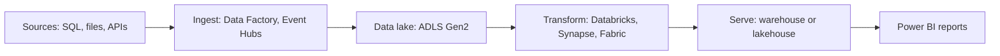

Read it left to right. Raw data is landed first, cleaned and modelled next, and served last.

| Service | Role |
| --- | --- |
| Azure Data Factory | Pipelines that copy and orchestrate data between systems (ETL and ELT) |
| Data Lake Storage Gen2 | Blob storage with hierarchical folders for big data |
| Azure Synapse Analytics | Data warehouse (SQL pools), Spark and pipelines in one workspace |
| Azure Databricks | Spark-based platform for data engineering and machine learning |
| Microsoft Fabric | Unified software-as-a-service analytics platform that includes lakehouse, warehouse, pipelines and Power BI |
| Stream Analytics, Event Hubs | Real-time stream processing |
| Power BI | Dashboards and reports |

Terms that appear on DP-900:
- **ETL** transforms data before loading. **ELT** loads first, then transforms inside the powerful target.
- **Batch** processes data in chunks on a schedule. **Streaming** processes events as they arrive.
- **Data warehouse** has structured, modelled data for reporting. **Data lake** holds raw data in any form. A **lakehouse** combines both ideas.
- **Medallion layers** (bronze raw, silver cleaned, gold business-ready) organise a lake.

As a lead, I keep analytics separate from the transactional systems, control access with Entra ID groups, and watch cost: always-on warehouses and large Spark clusters are common surprises.

**Gotcha:** copying production data to a lake without masking personal data breaks privacy rules.

**Interview tip:** explain the pipeline in the four steps, then name one Azure service per step.

_Module: Storage & Data · Tags: dp-900, analytics, data-factory, synapse, fabric_

## Advanced

### 51. [Tech Lead] How do you design for high availability and disaster recovery on Azure?

**Short answer:** I start from business numbers: RTO (how long we can be down) and RPO (how much data we can lose). Then I choose the cheapest design that meets them: zone redundancy for data centre failure, a second region for region failure, and a tested failover process. HA keeps you running during small failures. DR gets you back after a big one.

| Term | Meaning |
| --- | --- |
| RTO | Recovery time objective: target time to be working again |
| RPO | Recovery point objective: maximum acceptable data loss in time |
| HA | Design to avoid downtime from common failures |
| DR | Plan to recover from a major disaster |

| Pattern | Idea | Cost | Typical RTO and RPO |
| --- | --- | --- | --- |
| Backup and restore | Rebuild from backups in another region | Lowest | Hours to a day |
| Pilot light | Data replicated, minimal services ready | Low | Tens of minutes to hours |
| Warm standby | Smaller full copy running | Medium | Minutes |
| Active-active | Both regions serve traffic | Highest | Seconds to minutes, near zero loss |

Zones protect inside a region. Regions protect from a regional outage. Many services are zone redundant with little extra work, so make that the default for production.

**Composite SLA.** When your app needs several services in a chain, the availability multiplies. Two services at 99.9% in series give about 99.8%. Add a database at 99.95% and the result is lower again. Redundant copies in parallel improve it: the app is down only if both fail, which for independent 99.9% copies is about one in a million, in theory. In practice shared dependencies and failover time reduce that. Always read the current SLA of each service, and remember an SLA is a refund promise, not a guarantee.

Checklist:
- Identify tier-0 dependencies: identity, DNS, secrets, CI/CD, monitoring. If Entra ID or your registry is unavailable, can you still deploy and scale?
- Automate failover or write a clear runbook and decide who can trigger it.
- Test failover on a schedule. An untested plan is a guess.

**Gotcha:** replicating data to a second region does not help if the app, secrets, DNS and images are not also there.

**Interview tip:** ask "what does one hour of downtime cost?" first. It decides how much DR the business should buy.

_Module: Architecture & Resilience · Tags: tech-lead, ha, dr, rpo-rto_

### 52. [Tech Lead] How do you design landing zones and the subscription and management group structure?

**Short answer:** A landing zone is a prepared, governed Azure environment where workloads can be deployed safely: structure, networking, identity, policy, logging and cost controls are set up before the first application arrives. I design it as a management group tree with policies at the top, subscriptions as workload boundaries, and a shared hub for connectivity and security.

A common layout:

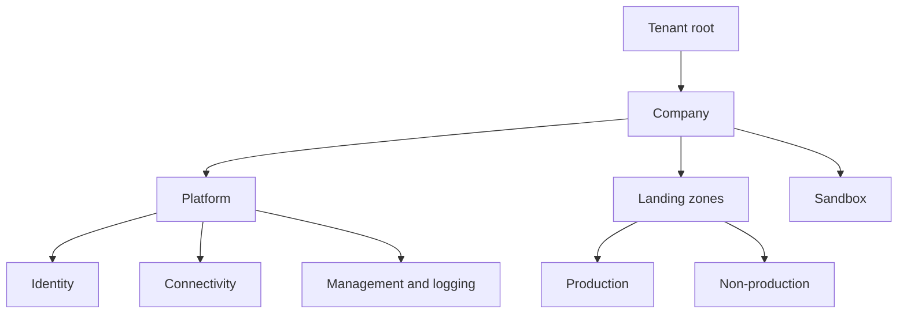

Reading it: shared platform services sit in their own subscriptions. Application teams get subscriptions under production or non-production groups. A sandbox is isolated for experiments, with a budget and no link to company networks.

Design decisions:
- **Subscription per workload and environment.** It limits blast radius, simplifies cost and gives separate quotas. Too many subscriptions create admin work, so automate subscription creation (subscription vending).
- **Policy at management group level.** Allowed regions, required tags, deny public IPs on data services, require diagnostic settings, allowed SKUs.
- **Network.** Hub-and-spoke or virtual WAN with central firewall, DNS and connectivity to on premises.
- **Identity.** Groups with RBAC, privileged access with approval and time limits, break-glass accounts.
- **Central logging and security.** One place for activity logs, security alerts and audit.
- **Everything as code.** Bicep or Terraform in a repository with reviews and pipelines.

Microsoft publishes Azure landing zone reference architectures and accelerators. Use them as a starting point and check the current guidance in the Cloud Adoption Framework. Do not copy them blindly: a small team does not need every layer on day one.

**Gotcha:** changing the structure later is hard because moving subscriptions changes inherited policy and access. Think about the top levels carefully.

**Interview tip:** say you start simple (platform, production, non-production, sandbox) and grow the structure when real needs appear.

_Module: Cost & Governance · Tags: tech-lead, landing-zone, governance, subscriptions_

### 53. [Tech Lead] How do you improve security posture in Azure?

**Short answer:** I use layers: strong identity first, least privilege access, private networking, secrets in Key Vault, policy as guardrails, and continuous assessment with Microsoft Defender for Cloud. Security is checked in the pipeline, in the platform and at runtime, not only in a yearly review.

Layers I walk through:

| Layer | Practice | Azure tools |
| --- | --- | --- |
| Identity | MFA, conditional access, no shared accounts, managed identities for workloads | Entra ID, managed identity |
| Access | Least privilege, groups not individuals, time-limited elevation | RBAC, PIM |
| Network | Private endpoints, no public access to data stores, central egress control | NSG, Azure Firewall, Private Link |
| Data | Encryption at rest and in transit, customer-managed keys when required | Key Vault, TLS, storage encryption |
| Secrets | Never in code or CI variables if avoidable | Key Vault, workload identity |
| Guardrails | Block or audit risky configuration | Azure Policy |
| Detection | Find misconfiguration, threats, vulnerabilities | Defender for Cloud, Defender for Containers |
| Supply chain | Scan images and dependencies, sign images | ACR scanning, pipeline scanners |

Defender for Cloud gives a secure score and recommendations (cloud security posture management) and threat protection plans per resource type (workload protection). Plans have a cost, so enable them where the risk justifies it, and check current pricing.

How I run it as a lead:
1. Baseline with the security score and fix the top findings by risk, not by count.
2. Turn recurring findings into Policy so they cannot return.
3. Review access quarterly and remove stale assignments.
4. Add security checks to the GitLab pipeline: dependency scan, image scan, secret detection, IaC scan.
5. Practise: access review, key rotation drill, and incident exercise.

**Gotcha:** a long list of unprioritised recommendations makes people ignore all of them. Group by owner and risk.

**Interview tip:** say "identity is the new perimeter, so I fix identity and secrets before anything else".

_Module: Identity & Security · Tags: tech-lead, security, defender, key-vault_

### 54. [Tech Lead] How do you design identity for workloads: managed identity, workload identity and RBAC scopes?

**Short answer:** Workloads should never hold passwords or client secrets. They should get a token from Entra ID using an identity that Azure or the platform vouches for: a managed identity on Azure resources, workload identity federation for AKS pods and external CI systems. Then I give each identity the smallest role at the smallest scope.

| Need | Use | Why |
| --- | --- | --- |
| App on VM, App Service, Functions, Container Apps | Managed identity | Credentials never visible, rotated by Azure |
| Pod in AKS | Entra Workload ID (service account federated with an identity) | Pod-level identity, no secret in the cluster |
| GitLab or GitHub pipeline | OIDC federated credential | Short-lived token, no stored secret |
| Software outside Azure | Federation, or service principal with certificate as a last resort | Avoid long-lived secrets |

System-assigned managed identity lives and dies with its resource. User-assigned identity is created separately and can be shared, which suits a set of pods or slots that all need the same access, and survives re-creation of the resource.

RBAC scope decisions:
- Assign roles to groups or identities at resource or resource group level, not at the subscription, unless the identity really needs it.
- Prefer built-in data-plane roles such as Key Vault Secrets User or Storage Blob Data Reader over Contributor.
- Separate identities per service and per environment. One shared identity for everything means one leak exposes everything.

Privileged Identity Management (PIM), at concept level: people hold "eligible" roles and activate them when needed, for a limited time, with approval or justification, and the activation is logged. This is how I keep Owner and Contributor off permanent assignments.

**Gotcha:** role assignments take a few minutes to take effect and tokens are cached, so a new permission may not work immediately. Do not assume a bug right away.

**Interview tip:** say "my target is zero long-lived secrets", then list managed identity, workload identity and OIDC as the three tools.

_Module: Identity & Security · Tags: tech-lead, identity, managed-identity, workload-identity_

### 55. [Tech Lead] How do you plan a cloud migration using the 6 Rs?

**Short answer:** I start with an inventory and a business reason, then choose one of the 6 Rs for each application: rehost, replatform, refactor (or rearchitect), repurchase, retire or retain. I sequence the work from low-risk, high-learning workloads toward the hard ones, and I move data and cutover carefully.

| R | Meaning | Example |
| --- | --- | --- |
| Rehost | Lift and shift unchanged | Move a VM to Azure VMs |
| Replatform | Small changes to use a managed service | Move SQL Server to Azure SQL Managed Instance |
| Refactor or rearchitect | Change the design to use cloud features | Break a monolith into services on AKS |
| Rebuild | Write it again cloud native | Replace an old app with a new one |
| Repurchase | Switch to SaaS | Move a custom CRM to a SaaS product |
| Retire | Switch it off | Duplicate or unused system |
| Retain | Keep as is for now | Hardware-bound, or not worth moving |

Different sources list slightly different Rs (five, six or seven). Know the idea and say which list you use.

Steps:
1. **Discover.** Inventory apps, owners, dependencies, data size, traffic, licences. Azure Migrate helps with discovery and assessment.
2. **Decide the why.** Exit a data centre, cost, speed, resilience. The reason changes the choice of R.
3. **Classify.** Business value against effort and risk. Retire first: it is the cheapest work.
4. **Build the landing zone** before moving anything.
5. **Pilot** with a low-risk app to find problems early.
6. **Wave planning.** Group apps with strong dependencies in the same wave, so that chatty services are not split across a slow link.
7. **Cutover.** Replicate data, rehearse, define rollback, switch DNS, watch, then decommission.
8. **Optimise** after the move: right-size, then refactor where it pays.

**Gotcha:** rehosting everything and calling it finished often brings a bigger bill and no benefit. Plan the optimise phase.

**Interview tip:** stress that dependencies and data gravity, not the app count, decide the wave order.

_Module: Architecture & Resilience · Tags: tech-lead, migration, 6rs, strategy_

### 56. [Tech Lead] How do you balance vendor lock-in against speed, and plan an exit?

**Short answer:** Some lock-in is the price of speed, and avoiding all of it is also costly. I accept lock-in where the service gives clear value, keep my own code and data portable, and write down what an exit would take. The question is not "are we locked in?" but "is the cost of leaving acceptable for the value we gain?".

Where portability is cheap:
- Containers and Kubernetes for compute.
- Open standards: PostgreSQL, OpenTelemetry, OAuth and OIDC, AMQP, S3-like object concepts.
- Infrastructure as code that separates modules, even if they are provider-specific.
- Keeping business logic out of provider-specific glue.

Where lock-in is deeper:
- Cosmos DB, Event Grid, Entra-specific integration, Azure Functions bindings.
- Managed data stores with proprietary features.
- Identity and networking design.
- Operational knowledge in the team.

| Choice | Speed gain | Exit cost |
| --- | --- | --- |
| Managed PostgreSQL | High | Low, standard engine |
| Cosmos DB | High for global scale | High, model and API specific |
| Service Bus with AMQP clients | High | Medium, AMQP helps |
| Custom Kubernetes plus portable tooling | Medium | Low to medium |
| Functions with many Azure bindings | Very high | High |

Method:
1. List each major service with a lock-in rating and the reason it was chosen.
2. For the high-rating ones, record what an exit would take: data export path, rewrite size, time.
3. Keep data exportable on a schedule in an open format.
4. Revisit yearly or when pricing or strategy changes.

An exit plan can also be partial: a second provider for backups, not a full active mirror.

**Gotcha:** a multi-cloud abstraction layer written by your team becomes its own lock-in, with the added cost of maintaining it.

**Interview tip:** say "I buy speed with lock-in knowingly, and I write the exit price next to the decision".

_Module: Architecture & Resilience · Tags: tech-lead, lock-in, portability, strategy_

### 57. [Tech Lead] How do you design observability and alerting across Azure Monitor and Datadog?

**Short answer:** I decide which tool owns which signal, avoid double collection, and use one standard such as OpenTelemetry for application telemetry. Azure Monitor covers the platform and control-plane signals. Datadog usually serves as the daily engineering view of services, traces and on-call alerts. Alerts must be based on user impact and have an owner and a runbook.

| Signal | Source | Good home |
| --- | --- | --- |
| Azure platform health, service health, activity log | Azure | Azure Monitor |
| Resource metrics (SQL DTU or CPU, Service Bus depth) | Azure | Azure Monitor metrics, forwarded to Datadog if needed |
| Application traces, request metrics, errors | Your code | OpenTelemetry to Datadog (or Application Insights) |
| Kubernetes metrics and pod logs | AKS | Datadog agent, or Container Insights |
| Security events | Azure | Defender for Cloud, central SIEM |

Principles:
- **One place per alert.** If both tools alert on the same fault, people get two pages.
- **Alert on symptoms.** High error rate, high latency, queue age. CPU alone rarely needs a page.
- **SLOs.** Define service level objectives and alert on error budget burn rate, not on every blip.
- **Ownership.** Every alert has an owner, severity, runbook link and a clear first action.
- **Correlation.** Put a trace id and service name on every log line. Use consistent tags such as `env`, `service`, `version` in both tools.
- **Cost control.** Sampling for traces, retention by value, drop noisy debug logs. Both tools charge by volume.
- **Platform health.** Subscribe to Azure Service Health alerts so a regional incident is known before customers report it.

Review alerts monthly: delete ones that were never actionable.

**Gotcha:** sending every Azure log to both Application Insights and Datadog doubles the bill with little gain.

**Interview tip:** talk about alert fatigue and error budget burn. It shows you care about people on call, not only dashboards.

_Module: Monitoring & Operations · Tags: tech-lead, observability, datadog, azure-monitor_

### 58. [Tech Lead] How do you respond to a cloud incident such as a region outage, throttling or quota limits, and what goes into a postmortem?

**Short answer:** I follow the usual incident process: detect, triage, mitigate first, then find the cause. For cloud incidents I add three early checks: Azure Service Health (is it the provider?), throttling and quota signals (429 or limit errors), and recent changes. After recovery I run a blameless postmortem with actions that have owners and dates.

First questions in the first ten minutes:
1. What is the user impact and how large? Declare severity and name an incident lead.
2. Did something change? Deployments, config, certificates, scale settings.
3. Is Azure reporting an issue? Check Service Health and the status history for the region and service.
4. Are we throttled? Look for 429 or 503 responses, "quota exceeded" or "SKU not available" errors, SNAT port exhaustion, database limits.
5. Mitigate: roll back, scale out, fail over, shed load, turn off a feature.

| Incident type | Typical signs | Typical mitigation |
| --- | --- | --- |
| Region or zone outage | Many services fail in one location | Fail over to a healthy zone or region by the runbook |
| Throttling | 429 responses, rising retries | Back off, reduce concurrency, raise limits, spread load |
| Quota limit | Deploy or scale fails with a quota error | Request a quota increase early, use another region or SKU |
| Dependency slow | Timeouts | Circuit breaker, cache, degrade gracefully |
| Bad deployment | Errors start after release | Rollback |

Quota increases can take time, so a surge plan must request capacity before the event.

**Postmortem checklist**
- Timeline with timestamps, from first signal to full recovery.
- Impact in numbers: users, requests, money, SLO budget.
- Root cause and contributing factors, using "why" questions, with no blame on people.
- What went well and what was lucky.
- Detection: how long until we knew, and why?
- Actions: prevent, detect faster, mitigate faster, each with owner and date.
- Share it widely and track actions to done.

**Interview tip:** say you mitigate first and investigate second, and that you rehearse failure through game days.

_Module: Monitoring & Operations · Tags: tech-lead, incident-response, postmortem, quotas_

### 59. How would you design a multi-region active-active web platform on Azure?

**Short answer:** Put a global entry point (Azure Front Door) in front of two or more identical regional stamps. Each stamp is a full copy of the app tier: AKS or Container Apps, cache and private networking. The hard part is data. Choose a data store that replicates across regions and define how conflicts and failover work. Then test failover regularly.

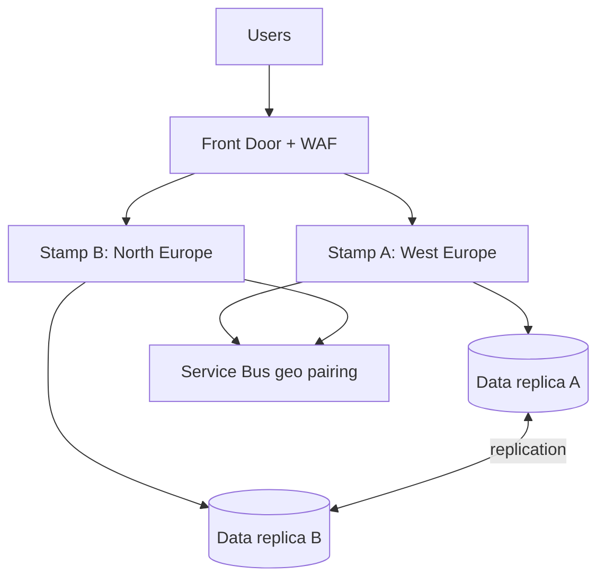

Both stamps serve traffic. Front Door routes by latency and health, and removes a failing region from rotation.

Design decisions:
- **Stamps.** Identical, deployed from the same code. A new region is "run the pipeline with another parameter". Each stamp uses zones.
- **Data.** Options differ in cost and complexity:

| Data choice | Writes | Failover | Trade-off |
| --- | --- | --- | --- |
| Cosmos DB with multi-region writes | Any region | Automatic | Conflict resolution rules, RU cost |
| Azure SQL failover group | One primary region | Switch primary | Simple model, writes cross regions after failover |
| PostgreSQL with cross-region read replica | One primary | Promote replica | Manual or scripted promotion |

- **Sessions and state.** Stateless services; tokens instead of server sessions; Redis per region.
- **Messaging.** Regional queues, or geo-disaster recovery for namespaces (metadata only, not messages). Design consumers to be idempotent.
- **Identity.** Entra ID is global, but secrets in Key Vault are regional, so replicate them with deployment.
- **Config and images.** Container registry with geo-replication.
- **Health probes.** A deep health endpoint that checks critical dependencies lightly.

**Failover testing:** drain one region on a schedule in a game day, watch errors and latency, and measure the real RTO and RPO. Also test failback, which is often harder.

Active-active doubles run cost and adds complexity. Many systems are better with active-passive or warm standby. Choose it only if the business value of seconds-level recovery pays for it.

**Gotcha:** two regions that both depend on one shared component (a single database, a single identity setup, one pipeline) are not independent.

**Interview tip:** say "the app is easy to copy, the data is the design", then walk through the data options.

_Module: Architecture & Resilience · Tags: multi-region, active-active, front-door, design_

### 60. How would you design a secure landing zone network topology?

**Short answer:** I design the network around a hub-and-spoke or Virtual WAN topology with central inspection, private connectivity to data services, controlled egress, and one DNS design. I plan address space for the next several years, separate production from non-production, and manage everything as code with policy checks.

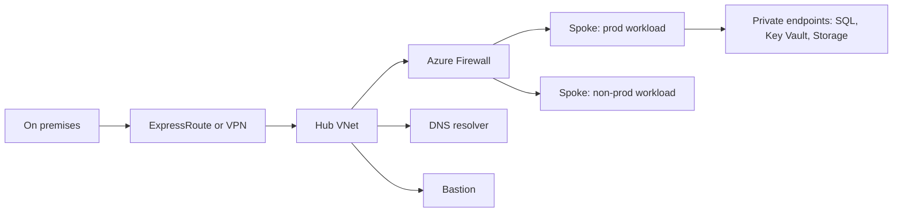

Traffic from outside enters at the hub, is inspected, and reaches workloads in spokes. Data services are reached through private endpoints.

Decisions I write down:
1. **Address plan.** One non-overlapping ranges table for all VNets, on-premises and other clouds. Leave room: running out of addresses is expensive to fix.
2. **Segmentation.** Subnet per tier, NSGs on all subnets, application security groups for readable rules. Separate production spokes from non-production ones.
3. **Ingress.** Front Door or Application Gateway with WAF for web traffic. No public IPs on VMs; use Bastion for admin access.
4. **Egress.** Route `0.0.0.0/0` through Azure Firewall with allow lists by domain name. Use NAT gateway where only simple outbound is needed.
5. **PaaS access.** Private endpoints plus private DNS zones in a central subscription. Disable public network access on data stores through Policy.
6. **Hybrid.** Redundant connections (two VPN tunnels or a pair of ExpressRoute circuits); route advertisements controlled.
7. **Monitoring.** Flow logs, firewall logs and DNS logs sent to a central workspace; alerts on denied traffic spikes.
8. **Automation.** Network as code in a platform repository, with reviews from the security team.

Trade-offs: a central firewall gives control but adds cost, a throughput limit and a shared failure point; private endpoints add cost and DNS complexity; strict segmentation slows teams unless self-service patterns exist.

**Gotcha:** forgetting that the platform's own tools (build agents, monitoring, container pulls, Azure management endpoints) also need outbound access when you lock egress down.

**Interview tip:** talk about the address plan and DNS design first. These are the choices that are hard to undo.

_Module: Networking · Tags: landing-zone, hub-spoke, network-design, security_

### 61. What does zero trust look like on Azure?

**Short answer:** Zero trust means never trusting a request because of where it comes from, and always verifying explicitly. Its three principles are verify explicitly, use least privilege, and assume breach. On Azure this means strong identity for people and workloads, device and context checks, private and segmented networks, encryption everywhere, and constant monitoring.

| Principle | What it looks like on Azure |
| --- | --- |
| Verify explicitly | MFA, conditional access using user, device, location and risk; managed identities for workloads; mutual TLS between services where needed |
| Least privilege | RBAC with narrow scopes, PIM for time-limited admin roles, just-in-time access, separate identities per service |
| Assume breach | Network segmentation, private endpoints, no public data stores, immutable logs, Defender for Cloud alerts, tested incident response |

Pillars to cover in an answer: identities, devices, applications, data, infrastructure and network.

Concrete design moves:
- Remove the idea of a trusted internal network. A request from inside the VNet still needs to authenticate.
- Replace shared secrets and passwords with tokens from Entra ID. Short lifetimes limit damage.
- Segment: namespaces and network policies in AKS, NSGs and firewall rules between spokes, separate subscriptions for different risk levels.
- Encrypt data at rest and in transit; use customer-managed keys where required; classify and label data.
- Use private connectivity to PaaS and disable public access.
- Put an API gateway and WAF at the edge, and validate tokens (audience, issuer, scope) in each service, not only at the gateway.
- Log everything useful to a central place, protect the logs, and alert on abnormal behaviour (impossible travel, unusual role activation, mass downloads).

Zero trust is a direction, not a product. Teams adopt it step by step, starting with identity and conditional access, because those give the largest risk reduction per effort.

**Gotcha:** a gateway that validates the token while internal services trust any caller turns a single stolen network position into full access.

**Interview tip:** list the three principles, then give one Azure action for each. That is usually enough to sound structured.

_Module: Identity & Security · Tags: zero-trust, security, identity, architecture_

### 62. How do you design a large-scale event-driven architecture with Event Hubs and Service Bus?

**Short answer:** Use Event Hubs as the high-volume front door for streams (telemetry, clicks, logs), and Service Bus for the business commands and workflows that need reliable, ordered, per-message handling. Design for partitioning, replay, idempotency and back pressure, and watch consumer lag.

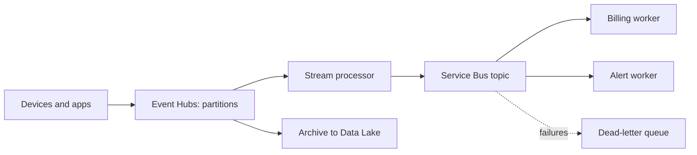

High-volume events enter Event Hubs. A processor turns selected events into business messages on Service Bus, which workers handle one by one.

Design points:
- **Partitions.** Event Hubs orders events only inside a partition. Use a partition key such as `deviceId` to keep one device's events in order. The number of partitions limits parallel consumers per consumer group, so plan it early (check whether it can change for your tier).
- **Consumer groups.** Each independent reader (processor, archiver) uses its own group and its own checkpoint.
- **Checkpointing.** Consumers store their offset in Blob storage. After a crash they continue from the last checkpoint, so some events repeat. Handlers must be idempotent.
- **Capacity.** Throughput is bought in units (throughput units, processing units or capacity units, depending on tier). Plan headroom and autoscale options.
- **Back pressure.** If workers are slower than input, queues grow. Alert on consumer lag and queue age, scale consumers, and in extreme cases shed low-value events.
- **Schema.** Use a versioned schema (Avro, Protobuf or JSON schema with a registry) so producers and consumers can change safely.
- **Poison messages.** Service Bus dead-letter for business messages; for streams, write bad events to a side store rather than blocking the partition.
- **Capture and replay.** Event Hubs Capture writes raw events to storage for reprocessing and audit.

**Gotcha:** one hot partition key (a very busy tenant) caps throughput for that key. Check the key distribution.

**Interview tip:** say "streams in, commands out": Event Hubs for volume, Service Bus for decisions, and idempotent consumers everywhere.

_Module: Messaging & Integration · Tags: event-driven, event-hubs, service-bus, scale_

### 63. How do you design for throttling and quota limits in Azure?

**Short answer:** Every Azure service has limits, and under load it answers with HTTP 429 (too many requests) or 503. Design for it: retry with exponential backoff and jitter, honour the `Retry-After` header, limit your own concurrency, spread load across resources, and request quota and reserved capacity before you need it.

Types of limits to know:

| Limit type | Example | Typical answer |
| --- | --- | --- |
| Request rate | Resource Manager API calls, Key Vault requests, Cosmos RU/s | Cache, batch, back off |
| Throughput units | Event Hubs throughput, Service Bus messaging units | Scale the tier or units |
| Quota per subscription and region | vCPU cores, public IPs | Request an increase early; use another region |
| Capacity | A VM size not available in a zone | Capacity reservations, flexible SKUs |
| Connections and ports | SNAT ports, database connections | Pooling, NAT gateway, private endpoints |

A retry delay in Go that honours `Retry-After` and otherwise uses exponential backoff with jitter:

```go
package main

import (
	"fmt"
	"math/rand"
	"net/http"
	"strconv"
	"time"
)

// delayFor returns how long to wait before the next try.
func delayFor(resp *http.Response, attempt int) time.Duration {
	if s := resp.Header.Get("Retry-After"); s != "" {
		if sec, err := strconv.Atoi(s); err == nil {
			return time.Duration(sec) * time.Second // server knows best
		}
	}
	base := time.Duration(1<<attempt) * 200 * time.Millisecond
	return base + time.Duration(rand.Int63n(int64(base)/2+1)) // jitter
}

func main() {
	resp := &http.Response{Header: http.Header{}}
	for attempt := 0; attempt < 3; attempt++ {
		fmt.Println(attempt, delayFor(resp, attempt) >= 200*time.Millisecond)
	}
	// prints: 0 true, 1 true, 2 true (one per line)
}
```

Rules:
- Use the retry support of the Azure SDKs; configure maximum tries and delays. Do not stack retries in every layer, because 3 layers with 3 tries each make 27 calls.
- Add a circuit breaker and a timeout to protect callers.
- Make retried operations idempotent.
- Set concurrency limits on workers, so a backlog does not hammer the database.
- Capacity reservations guarantee VM capacity in a zone for a price. Quota is not the same as capacity: having quota does not guarantee that a SKU is available.
- Alert at 70 to 80 percent of quota, so you have time to ask for more.

**Gotcha:** retry without jitter makes all clients retry at the same moment and keeps the service overloaded.

**Interview tip:** mention "retry storms" and idempotency. They show real production experience.

_Module: Architecture & Resilience · Tags: throttling, quotas, retry, backoff, 429_

### 64. How do you handle data residency and sovereignty patterns on Azure?

**Short answer:** Data residency means data is stored in a specific place. Data sovereignty adds the laws and control that apply to it, including who can compel access. On Azure I combine region choices, policy, encryption with customer-controlled keys, regional stamps with tenant routing, and careful control of logs, backups and support access.

Patterns:

| Pattern | Idea | Trade-off |
| --- | --- | --- |
| Single regional deployment | All data in one approved region | Simple; no cross-region DR unless the pair is also allowed |
| Regional stamps per jurisdiction | One full stack per country or bloc, tenants routed to their own | Higher cost and operations; clear boundary |
| Global control plane, regional data plane | Shared management, but customer data stays local | Must prove that control plane holds no personal data |
| Customer-managed keys (CMK) | You hold keys in Key Vault or managed HSM; revoke to make data unreadable | Key operations become critical; outages if the key is lost |
| Confidential computing | Data protected while in use in trusted execution environments | Limited SKUs, some code changes |
| Sovereign cloud options | Government or national partner clouds with extra controls | Fewer services, different endpoints and process |

Checklist:
1. Map data flows, including logs, backups, caches, search indexes and analytics copies.
2. Enforce allowed locations with Azure Policy and block global-service patterns that move data.
3. Choose DR targets inside the same legal area.
4. Route tenants at the edge (for example by a tenant id mapping) to the right stamp.
5. Control support and vendor access: customer lockbox where it is available, just-in-time admin access.
6. Keep an evidence pack: policy compliance, architecture diagram, data flow, key management description.

Be honest about what the provider can promise. Residency of stored data is often easy to prove; processing, metadata and support access are harder. Read the data location documentation of each service, and ask legal what the contract requires.

**Gotcha:** monitoring tools. Sending logs with personal data to a global SaaS tool can break a residency promise.

**Interview tip:** say you start from the data flow diagram, not from the region list.

_Module: Architecture & Resilience · Tags: data-residency, sovereignty, regions, compliance_

### 65. Can you walk through a cloud cost optimisation case study?

**Short answer:** I treat it as a project: measure, find the biggest line items, fix waste, right-size, change architecture where it pays, then commit to discounts last. Below is a realistic example of a microservices platform on AKS with SQL and logging, where the bill grew faster than traffic.

**Situation.** Monthly spend grew steadily while user traffic grew less. Nobody could explain which team caused it.

**Step 1: Make it visible.** Enforce `team`, `env` and `service` tags with Policy, group by subscription, and build a Cost Management view by tag. About one fifth of cost was untagged, so we fixed that first.

**Step 2: Find the top items.** The usual shape was: AKS node pools first, then databases, then logging, then data transfer and storage.

| Finding | Cause | Action |
| --- | --- | --- |
| Nodes mostly idle | Pod requests much higher than real use | Right-size requests with measured usage; enable the cluster autoscaler; use smaller node SKUs |
| Non-production runs 24 hours | Nobody switched it off | Scale dev and test pools to zero in the evenings and at weekends |
| Large database tier | Sized for last year's peak | Lower the tier after load tests; use serverless for dev |
| Log ingestion very high | Debug logging and noisy health checks | Drop health-check logs, sample traces, set table retention and cheaper tiers |
| Cross-zone and egress traffic | Chatty services in different zones | Topology-aware routing; cache; compress |
| Old snapshots and disks | No clean-up | Lifecycle rules and a monthly review |

**Step 3: Commitments.** After usage was stable for a few months, buy reservations or a savings plan for the baseline only, not for the peak.

**Step 4: Prevent return.** Budgets and anomaly alerts per team, a monthly review with showback, a unit-cost metric (cost per thousand orders), and cost estimates in merge requests for infrastructure changes.

**Result presentation.** Say in the interview that you measure savings against a baseline and report the percentage, without quoting invented numbers. Always check performance after each cut, with rollback ready.

**Gotcha:** cutting cost that hurts reliability, such as removing zone redundancy, is a trade-off the business must approve.

**Interview tip:** tell it as a story: visibility, top items, quick wins, commitments, prevention.

_Module: Cost & Governance · Tags: cost-optimisation, finops, case-study_

### 66. How do you create a disaster recovery runbook and run game days?

**Short answer:** A DR runbook is a step-by-step document, ideally automated, that says who does what to recover a service, in which order, with checks at each step. A game day is a planned exercise where the team simulates a failure and runs the runbook to measure the real recovery time and data loss. A runbook that has never been tested should be treated as unproven.

**Runbook contents**
1. Scope: which service, RTO and RPO targets, and who can declare a disaster.
2. Triggers: the symptoms and decision rules for failing over (for example region unhealthy for more than N minutes).
3. Roles: incident lead, communicator, database owner, network owner, approver.
4. Prerequisites: access that works during the outage (break-glass account, a pipeline that does not depend on the failed region).
5. Steps with commands, expected output and rollback. Include DNS or Front Door changes, database failover, secret and config checks, queue handling.
6. Verification: smoke tests, key business checks, dashboards to confirm health.
7. Communication: status page text, stakeholder updates.
8. Failback: how to return, which is often harder.

**Game day format**

| Phase | Activity |
| --- | --- |
| Plan | Pick a scenario, set the blast radius, define abort criteria, tell stakeholders |
| Prepare | Check monitoring, backups and access beforehand |
| Run | Inject the failure (disable a region in Front Door, fail over a database, block a dependency) |
| Observe | Record timings, errors, surprises |
| Review | Blameless review, list gaps, assign actions |
| Repeat | Schedule the next one, increase difficulty |

Start in non-production, then move to production in a safe window. Azure Chaos Studio can inject faults such as stopping VMs or adding latency; check which fault types your services support.

Measure: time to detect, time to decide, time to recover, data loss, and number of manual steps. Compare with targets.

**Gotcha:** the runbook lives in a wiki hosted in the region that failed. Keep copies in an independent place.

**Interview tip:** say "recovery is a skill the team practises, not a document", and give the numbers you measure.

_Module: Monitoring & Operations · Tags: disaster-recovery, runbook, game-day, chaos_

### 67. How do you design identity for service-to-service calls, including managed identity and on-behalf-of?

**Short answer:** For service-to-service calls with no user involved, the caller uses its managed identity to get an access token for the target API (the client credentials idea), and the target validates the token and checks roles. When a user's identity must flow through a chain, the middle service uses the on-behalf-of flow to exchange the user's token for a new token for the next API.

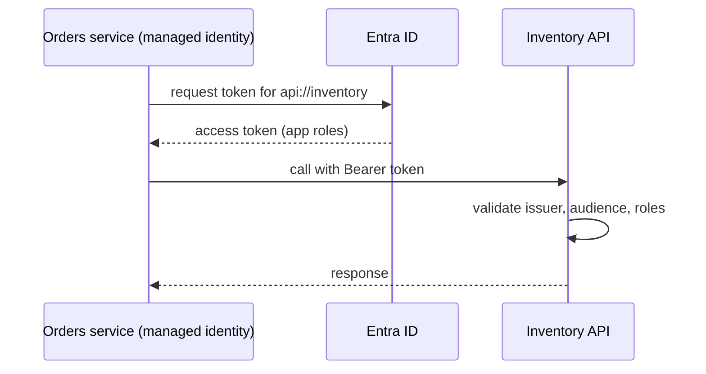

The token carries who the caller is. The target checks the audience (is this token for me), the issuer and the required app role.

Setup:
1. Register the target API in Entra ID and define **app roles** (for example `Inventory.Read`).
2. Assign the caller's managed identity to that app role.
3. In the caller, use an Azure SDK credential and ask for the scope `api://inventory/.default`.
4. In the target, validate tokens with a standard library, and authorise by role.

Under the hood a managed identity gets its token from a local endpoint. On a VM it is the metadata service (the SDK hides this):

```bash
# Read only example, not run. Inside an Azure VM with a managed identity
curl -s -H "Metadata: true" \
  "http://169.254.169.254/metadata/identity/oauth2/token?api-version=2018-02-01&resource=https://vault.azure.net"
```

**Two cases**

| Case | Flow | Use when |
| --- | --- | --- |
| App acts as itself | Managed identity, client credentials, app roles | Background jobs, internal calls |
| App acts for the user | On-behalf-of (OBO), delegated scopes | The downstream API must see the user and apply user permissions |

For OBO the front end sends a user token for service A. Service A calls Entra ID with that token and gets a token for service B, with the user's identity and the delegated scopes.

**Gotcha:** accepting any valid token from the tenant without checking audience and roles. This lets any service in the tenant call yours.

**Interview tip:** say "audience and role checks on every API, managed identity for the caller, OBO only when the user's rights truly matter downstream".

_Module: Identity & Security · Tags: managed-identity, oauth, on-behalf-of, service-to-service_

### 68. How do you design cloud-native systems for connectivity-constrained edge scenarios such as aircraft or vehicle fleets?

**Short answer:** Assume the link is slow, expensive and often absent. Run the important logic at the edge so the device keeps working offline, buffer data locally, sync to the cloud when a link appears, and design the sync to be incremental, idempotent and conflict-aware. Azure IoT Hub and IoT Edge are the usual building blocks, with Event Hubs, Blob and a stream or batch back end in the cloud.

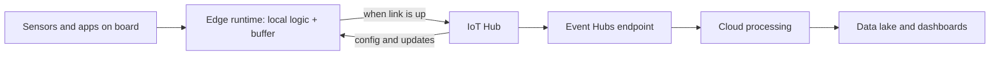

Data flows up when connectivity exists. Configuration, content and software updates flow down.

Design principles:
- **Offline first.** The edge works without the cloud. The cloud is for aggregation, management and heavy analysis.
- **Store and forward.** A local queue or database holds messages with timestamps and a stable id per message. When the link returns, send in order, with retries.
- **Idempotent ingestion.** The same batch may arrive twice. Deduplicate on message id.
- **Delta sync.** Send changes, not full copies; compress; prioritise important data first (alerts before logs).
- **Conflict rules.** If both sides change the same data, decide the rule: last write wins, cloud wins, or merge by field. Use version numbers or vector-like counters, not just clocks, as device clocks drift.
- **Small, safe updates.** Use signed container images, staged rollouts, A/B slots and automatic rollback on the device. A bad update cannot be fixed by hand on a plane.
- **Identity.** Each device has its own identity (certificate or TPM-backed) through the Device Provisioning Service, so one stolen device can be revoked.
- **Device twins.** IoT Hub twins keep desired and reported state, so the cloud can set configuration that devices apply when they connect.
- **Observability.** Collect health metrics at the edge, send a compact summary first, and full logs on demand.

Azure IoT Edge runs containerised modules on the device. Check the current status and support lifecycle of IoT products before committing, since Azure IoT offerings change.

**Gotcha:** designing for average bandwidth. Plan for the worst day: long gaps, then a flood of backlog when the link returns.

**Interview tip:** relate it to fleets you know: say what must work offline, what can wait, and how you prove data arrived exactly once in effect.

_Module: Architecture & Resilience · Tags: edge, iot, offline-first, sync_

### 69. What are sovereign and regulated cloud options in Azure, at concept level?

**Short answer:** Sovereign or regulated clouds are cloud environments built for customers with strict legal, security or national requirements, such as governments and defence. In Azure these include separate government clouds, a nationally operated cloud in China, and features that add more control over keys, data location and operators. Service availability and rules differ, so you always check the current offer for your country and sector.

Ways to get more control, from light to heavy:

| Approach | What you get | Cost of choosing it |
| --- | --- | --- |
| Normal public regions with Policy | Region restriction, encryption, audit | Lowest effort |
| Data boundary commitments | Provider commits to store and process in a region or bloc for covered services | Read the scope carefully |
| Customer-managed keys, managed HSM | You control keys and can cut access | Key operations risk |
| Confidential computing | Protection of data in use | Limited SKUs |
| Sovereign landing zone | Policy set and architecture for a regulated environment | Design and operations effort |
| Separate government cloud | Isolated instance, screened personnel, own endpoints | Fewer services, different onboarding and sometimes eligibility checks |
| Partner-operated cloud | A local company operates the platform | Slower feature arrival |

What changes when you use a separate cloud:
- Different sign-in and management endpoints, and separate tenants.
- Not every service or feature exists, and new ones often arrive later.
- Your tooling, templates and SDK settings must point to the right cloud environment.
- Procurement and compliance reviews take longer.

Questions a lead asks first: Which law or contract applies? What exactly must stay in the country? Who may operate the system? Is the data classified? Can we use the commercial cloud with strong controls, or is a dedicated cloud required?

Regulated industries also care about audit evidence, incident reporting times, supplier risk and exit plans.

I flag this topic as one to verify: product names, regions and offerings in this area change with regulation, so confirm them with Microsoft documentation and your compliance team.

**Gotcha:** designing in the commercial cloud and expecting to copy it unchanged to a government cloud. Check service parity at the start.

**Interview tip:** show a decision path: requirement, risk, lightest control that satisfies it, then escalate only if needed.

_Module: Cost & Governance · Tags: sovereign-cloud, regulated, government, compliance_

### 70. How do Azure services map to AWS and GCP, and how do you answer "what if we used AWS"?

**Short answer:** Most Azure services have close equivalents in AWS and GCP, but they are never identical in features, limits or pricing. I use the mapping to learn faster, then check real differences in identity, networking and managed service behaviour. For the question "what if we used AWS", I compare against requirements and migration cost, not brand preference.

| Need | Azure | AWS | GCP |
| --- | --- | --- | --- |
| Virtual machines | Virtual Machines | EC2 | Compute Engine |
| Managed Kubernetes | AKS | EKS | GKE |
| Serverless containers | Container Apps | Fargate, App Runner | Cloud Run |
| Functions | Azure Functions | Lambda | Cloud Functions |
| Web app PaaS | App Service | Elastic Beanstalk, App Runner | App Engine |
| Object storage | Blob Storage | S3 | Cloud Storage |
| Managed relational (SQL Server) | Azure SQL Database | RDS for SQL Server | Cloud SQL for SQL Server |
| Managed PostgreSQL | PostgreSQL flexible server | RDS and Aurora PostgreSQL | Cloud SQL, AlloyDB |
| Global NoSQL | Cosmos DB | DynamoDB | Firestore, Bigtable, Spanner |
| In-memory cache | Cache for Redis | ElastiCache | Memorystore |
| Message queue and topics | Service Bus | SQS and SNS | Pub/Sub |
| Event streaming | Event Hubs | Kinesis, MSK | Pub/Sub, Managed Kafka |
| Event routing | Event Grid | EventBridge | Eventarc |
| API gateway | API Management | API Gateway | API Gateway, Apigee |
| Secrets and keys | Key Vault | Secrets Manager, KMS | Secret Manager, Cloud KMS |
| Identity | Microsoft Entra ID, RBAC | IAM, IAM Identity Center | Cloud IAM |
| Monitoring | Azure Monitor | CloudWatch | Cloud Monitoring and Logging |
| Infrastructure as code | Bicep, ARM | CloudFormation, CDK | Deployment Manager (older), Terraform common |
| Global load balancing and CDN | Front Door | CloudFront, Global Accelerator | Cloud CDN, global load balancer |
| Private connectivity | ExpressRoute | Direct Connect | Cloud Interconnect |
| Data warehouse | Synapse, Fabric | Redshift | BigQuery |

Treat the mapping as a starting point. Differences that matter: AWS accounts versus Azure subscriptions and management groups, Entra ID integration versus IAM model, networking defaults, and what a "region" and "zone" guarantee.

**How to answer "what if we used AWS?"**
1. Ask what problem we are solving: cost, capability, customer demand, existing contracts.
2. Compare on requirements: services we need, compliance, team skills, ecosystem (for example the Microsoft stack and Entra ID), pricing at our scale, support.
3. Estimate the move: code changes, data transfer, retraining, parallel run, risk.
4. Note what is portable already: containers, PostgreSQL, OpenTelemetry, Terraform modules.
5. Decide: stay unless the gain clearly beats the cost, or use the second cloud for a specific need.

**Gotcha:** claiming one cloud is simply better. Interviewers prefer a reasoned comparison.

**Interview tip:** say "I know the equivalents, but I decide on requirements, cost to move and team skills".

_Module: Cloud Fundamentals · Tags: aws, gcp, multi-cloud, equivalents_

### 71. How would you answer "design a cloud architecture for an online ordering platform" using the Well-Architected pillars?

**Short answer:** I clarify requirements first (users, traffic, availability target, data rules, budget), then draw a simple layered design and walk the five pillars, naming one trade-off in each. Example: an online ordering platform for a few hundred thousand users in Europe, with a 99.9 percent style availability goal.

**Step 1: Requirements.** Peak load during campaigns, order data must stay in the EU, payments through a third party, recovery within an hour, small platform team.

**Step 2: Design.**

```mermaid
flowchart TD
    U["Users"] --> FD["Front Door + WAF"]
    FD --> AKS["AKS in 3 zones: web, orders, catalog"]
    AKS --> SQL[("Azure SQL, zone redundant")]
    AKS --> R["Redis cache"]
    AKS --> SB["Service Bus: order events"]
    SB --> W["Workers: payments, email"]
    AKS --> KV["Key Vault"]
    AKS --> MON["Azure Monitor + Datadog"]
```

**Step 3: Pillars**

| Pillar | Decision | Trade-off |
| --- | --- | --- |
| Reliability | Zones for AKS and SQL; health probes; retries with backoff; queue for payment steps; SQL geo-replica in the paired EU region for DR | Cost of zones and the replica; DR is warm standby, not active-active |
| Security | Entra ID and managed identities; private endpoints for SQL and Key Vault; WAF; Defender for Cloud; secrets only in Key Vault | More DNS and network work |
| Cost optimisation | Autoscale; tags and budgets; reservations only for the baseline; scale dev to zero at night; log sampling | Less headroom for sudden spikes |
| Operational excellence | Bicep for infra; GitLab pipelines with OIDC; progressive rollout; SLO alerts; runbooks and a game day | Time invested in tooling up front |
| Performance efficiency | Cache for catalog reads; CDN for images; load tests before campaigns; right database tier | Cache invalidation complexity |

**Step 4: Evolution.** Start with one region and DR plan. Add active-active only if the business needs near-zero downtime and agrees to pay for it. Revisit after real load data.

**Step 5: Risks and questions back.** Payment provider outage (use queues and clear user messages), data residency of logs, quota for scale-out, skills on the team.

Notice the pattern: requirements, picture, pillars, trade-offs, evolution. It works for any "design a cloud architecture for X" question.

**Gotcha:** jumping to services before asking about scale and availability goals. A design with no numbers cannot be judged.

**Interview tip:** speak the trade-off aloud in each pillar and state what you would measure to know if the design works.

_Module: Architecture & Resilience · Tags: system-design, well-architected, case-study, architecture_

---

## Resources

Where to read more at the source. Official docs and references come first.

**Official docs**

- [Azure documentation](https://learn.microsoft.com/azure/) — The official docs for every Azure service, with quickstarts and tutorials. _(beginner)_
- [Azure Kubernetes Service (AKS)](https://learn.microsoft.com/azure/aks/) — Node pools, networking, identity, upgrades and operations. _(intermediate)_
- [Bicep documentation](https://learn.microsoft.com/azure/azure-resource-manager/bicep/) — Declarative infrastructure as code for Azure. _(intermediate)_
- [Microsoft Entra documentation](https://learn.microsoft.com/entra/identity/) — Identity: users, apps, managed identities, conditional access. _(intermediate)_
- [Azure Key Vault](https://learn.microsoft.com/azure/key-vault/) — Secrets, keys and certificates with access control. _(intermediate)_
- [Azure Virtual Network](https://learn.microsoft.com/azure/virtual-network/) — VNets, subnets, NSGs, peering and private endpoints. _(intermediate)_
- [Azure Service Bus](https://learn.microsoft.com/azure/service-bus-messaging/) — Queues, topics, dead-lettering and sessions. _(intermediate)_
- [Azure Monitor](https://learn.microsoft.com/azure/azure-monitor/) — Metrics, logs, alerts and Application Insights. _(intermediate)_
- [Azure Cosmos DB](https://learn.microsoft.com/azure/cosmos-db/) — Partitioning, consistency levels and request units. _(intermediate)_
- [Azure SQL](https://learn.microsoft.com/azure/azure-sql/) — Azure SQL Database and Managed Instance: HA, backups, scaling. _(intermediate)_

**Reference**

- [Azure Architecture Center](https://learn.microsoft.com/azure/architecture/) — Reference architectures, design patterns and guidance. _(intermediate)_
- [Azure Well-Architected Framework](https://learn.microsoft.com/azure/well-architected/) — Five pillars with checklists: reliability, security, cost, operations, performance. _(intermediate)_
- [Cloud Adoption Framework](https://learn.microsoft.com/azure/cloud-adoption-framework/) — Strategy, landing zones, migration and governance guidance. _(intermediate)_
- [Azure CLI reference](https://learn.microsoft.com/cli/azure/) — Every az command with examples. _(beginner)_
- [Azure and AWS services comparison](https://learn.microsoft.com/azure/architecture/aws-professional/services) — Equivalent services across Azure and AWS. _(intermediate)_

**Course**

- [Azure Fundamentals (AZ-900) certification](https://learn.microsoft.com/credentials/certifications/azure-fundamentals/) — Exam outline and free learning paths for cloud basics on Azure. _(beginner)_
- [Azure Data Fundamentals (DP-900) certification](https://learn.microsoft.com/credentials/certifications/azure-data-fundamentals/) — Exam outline and learning paths for core data concepts on Azure. _(beginner)_

**Tool**

- [Azure pricing calculator](https://azure.microsoft.com/pricing/calculator/) — Estimate monthly cost for a design before building it. _(beginner)_
