# Databases

[← Back to index](../README.md) · [⭐ Favorites](favorites.md)

76 questions · 0 favorites · [📚 Resources](#resources)

## Contents

**Basic**

- [1. What is the relational model, and what do tables, rows, columns and relationships mean?](#1-what-is-the-relational-model-and-what-do-tables-rows-columns-and-relationships-mean)
- [2. What are primary, foreign, unique and composite keys, and how do surrogate keys differ from natural keys?](#2-what-are-primary-foreign-unique-and-composite-keys-and-how-do-surrogate-keys-differ-from-natural-keys)
- [3. How do SELECT, WHERE, ORDER BY and LIMIT work, and in what order does the database run them?](#3-how-do-select-where-order-by-and-limit-work-and-in-what-order-does-the-database-run-them)
- [4. What are the different types of JOIN, and when do you use each?](#4-what-are-the-different-types-of-join-and-when-do-you-use-each)
- [5. How do GROUP BY, HAVING and aggregate functions work?](#5-how-do-group-by-having-and-aggregate-functions-work)
- [6. When do you use a subquery and when a CTE?](#6-when-do-you-use-a-subquery-and-when-a-cte)
- [7. How does NULL work in SQL, and what are the common NULL bugs?](#7-how-does-null-work-in-sql-and-what-are-the-common-null-bugs)
- [8. What is the difference between DISTINCT, UNION and UNION ALL?](#8-what-is-the-difference-between-distinct-union-and-union-all)
- [9. What are window functions, and how do ROW_NUMBER, RANK, LAG, LEAD and running totals work?](#9-what-are-window-functions-and-how-do-row_number-rank-lag-lead-and-running-totals-work)
- [10. What is normalisation (1NF to BCNF), and when should you denormalise?](#10-what-is-normalisation-1nf-to-bcnf-and-when-should-you-denormalise)
- [11. What does ACID mean in plain words?](#11-what-does-acid-mean-in-plain-words)
- [12. How do transactions work: BEGIN, COMMIT, ROLLBACK and savepoints?](#12-how-do-transactions-work-begin-commit-rollback-and-savepoints)
- [13. What is a database index, how does a B-tree work, and what does an index cost?](#13-what-is-a-database-index-how-does-a-b-tree-work-and-what-does-an-index-cost)
- [14. What are views and materialised views, and when do you use them?](#14-what-are-views-and-materialised-views-and-when-do-you-use-them)
- [15. What are stored procedures, functions and triggers, and what are their pros and cons?](#15-what-are-stored-procedures-functions-and-triggers-and-what-are-their-pros-and-cons)
- [16. What are the common data type gotchas: money, floats, dates, time zones and text?](#16-what-are-the-common-data-type-gotchas-money-floats-dates-time-zones-and-text)
- [17. What constraints does SQL provide, and why should the database enforce them?](#17-what-constraints-does-sql-provide-and-why-should-the-database-enforce-them)
- [18. What is SQL injection, and how do parameterised queries prevent it?](#18-what-is-sql-injection-and-how-do-parameterised-queries-prevent-it)
- [19. What is the difference between DELETE, TRUNCATE and DROP?](#19-what-is-the-difference-between-delete-truncate-and-drop)
- [20. What are the trade-offs between auto-increment ids and UUID or ULID primary keys?](#20-what-are-the-trade-offs-between-auto-increment-ids-and-uuid-or-ulid-primary-keys)

**Intermediate**

- [21. \[Tech Lead\] How do you triage a slow query or a slow database in production?](#21-tech-lead-how-do-you-triage-a-slow-query-or-a-slow-database-in-production)
- [22. \[Tech Lead\] How do you decide an index strategy and review indexes on a growing system?](#22-tech-lead-how-do-you-decide-an-index-strategy-and-review-indexes-on-a-growing-system)
- [23. \[Tech Lead\] How do you run zero-downtime schema migrations?](#23-tech-lead-how-do-you-run-zero-downtime-schema-migrations)
- [24. \[Tech Lead\] How do you manage connection pooling and connection limits across many pods?](#24-tech-lead-how-do-you-manage-connection-pooling-and-connection-limits-across-many-pods)
- [25. \[Tech Lead\] How do backups, point-in-time recovery, RPO and RTO work, and how do you prove you can restore?](#25-tech-lead-how-do-backups-point-in-time-recovery-rpo-and-rto-work-and-how-do-you-prove-you-can-restore)
- [26. \[Tech Lead\] How do you choose a database: relational, document, key-value, wide-column, search, time-series or graph?](#26-tech-lead-how-do-you-choose-a-database-relational-document-key-value-wide-column-search-time-series-or-graph)
- [27. \[Tech Lead\] What breaks when you use read replicas, and how do you handle replication lag?](#27-tech-lead-what-breaks-when-you-use-read-replicas-and-how-do-you-handle-replication-lag)
- [28. \[Tech Lead\] How do you design a multi-tenant data model?](#28-tech-lead-how-do-you-design-a-multi-tenant-data-model)
- [29. \[Tech Lead\] What do you check in a data model review?](#29-tech-lead-what-do-you-check-in-a-data-model-review)
- [30. \[Tech Lead\] How do you plan database capacity and control cost?](#30-tech-lead-how-do-you-plan-database-capacity-and-control-cost)
- [31. \[Tech Lead\] ORMs versus raw SQL: how do you avoid N+1 queries and keep migrations disciplined?](#31-tech-lead-orms-versus-raw-sql-how-do-you-avoid-n1-queries-and-keep-migrations-disciplined)
- [32. What are transaction isolation levels, and which anomalies does each allow?](#32-what-are-transaction-isolation-levels-and-which-anomalies-does-each-allow)
- [33. How does MVCC in PostgreSQL differ from locking-based isolation in SQL Server?](#33-how-does-mvcc-in-postgresql-differ-from-locking-based-isolation-in-sql-server)
- [34. What are locks and deadlocks, and how do you avoid and diagnose them?](#34-what-are-locks-and-deadlocks-and-how-do-you-avoid-and-diagnose-them)
- [35. What is the difference between optimistic and pessimistic concurrency, and how do version columns, SELECT FOR UPDATE and SKIP LOCKED fit in?](#35-what-is-the-difference-between-optimistic-and-pessimistic-concurrency-and-how-do-version-columns-select-for-update-and-skip-locked-fit-in)
- [36. How do you read a query plan: EXPLAIN ANALYZE, scan types and join algorithms?](#36-how-do-you-read-a-query-plan-explain-analyze-scan-types-and-join-algorithms)
- [37. What are composite, covering, partial and expression indexes?](#37-what-are-composite-covering-partial-and-expression-indexes)
- [38. What are index selectivity, column order and the leftmost-prefix rule?](#38-what-are-index-selectivity-column-order-and-the-leftmost-prefix-rule)
- [39. Why might the database ignore your index?](#39-why-might-the-database-ignore-your-index)
- [40. How does pagination work: OFFSET versus keyset?](#40-how-does-pagination-work-offset-versus-keyset)
- [41. What is the N+1 query problem, and how do you fix it?](#41-what-is-the-n1-query-problem-and-how-do-you-fix-it)
- [42. How do bulk inserts and upserts work: ON CONFLICT and MERGE?](#42-how-do-bulk-inserts-and-upserts-work-on-conflict-and-merge)
- [43. What are JSON and JSONB columns in PostgreSQL, and when should you use them?](#43-what-are-json-and-jsonb-columns-in-postgresql-and-when-should-you-use-them)
- [44. How does full-text search work in a relational database?](#44-how-does-full-text-search-work-in-a-relational-database)
- [45. What is table partitioning (range, hash, list), and what are its benefits?](#45-what-is-table-partitioning-range-hash-list-and-what-are-its-benefits)
- [46. What are the types of database replication, and how do failover and high availability work?](#46-what-are-the-types-of-database-replication-and-how-do-failover-and-high-availability-work)
- [47. How does PostgreSQL VACUUM work, and what are bloat and autovacuum?](#47-how-does-postgresql-vacuum-work-and-what-are-bloat-and-autovacuum)
- [48. What are PostgreSQL extensions such as pgvector and PostGIS, and when do they fit?](#48-what-are-postgresql-extensions-such-as-pgvector-and-postgis-and-when-do-they-fit)
- [49. What are clustered and non-clustered indexes in SQL Server?](#49-what-are-clustered-and-non-clustered-indexes-in-sql-server)
- [50. What are SQL Server execution plans and parameter sniffing?](#50-what-are-sql-server-execution-plans-and-parameter-sniffing)
- [51. What should you know about tempdb and the key T-SQL differences from standard SQL and PostgreSQL?](#51-what-should-you-know-about-tempdb-and-the-key-t-sql-differences-from-standard-sql-and-postgresql)
- [52. What are Always On availability groups in SQL Server?](#52-what-are-always-on-availability-groups-in-sql-server)
- [53. How do you put Redis in front of a database: cache-aside and invalidation?](#53-how-do-you-put-redis-in-front-of-a-database-cache-aside-and-invalidation)
- [54. What types of NoSQL databases exist, and when does each fit?](#54-what-types-of-nosql-databases-exist-and-when-does-each-fit)

**Advanced**

- [55. \[Tech Lead\] When should you shard or partition a database, and when should you not?](#55-tech-lead-when-should-you-shard-or-partition-a-database-and-when-should-you-not)
- [56. \[Tech Lead\] How do you handle PII, encryption, retention and audit in a database?](#56-tech-lead-how-do-you-handle-pii-encryption-retention-and-audit-in-a-database)
- [57. \[Tech Lead\] How would you run and write up a database outage incident?](#57-tech-lead-how-would-you-run-and-write-up-a-database-outage-incident)
- [58. How do B-tree and LSM-tree storage engines differ, and what is each good at?](#58-how-do-b-tree-and-lsm-tree-storage-engines-differ-and-what-is-each-good-at)
- [59. What is the write-ahead log (WAL), and how does crash recovery work?](#59-what-is-the-write-ahead-log-wal-and-how-does-crash-recovery-work)
- [60. What is the buffer pool, and why does memory matter so much for a database?](#60-what-is-the-buffer-pool-and-why-does-memory-matter-so-much-for-a-database)
- [61. How do planner statistics and cardinality estimates work, and why do plans go bad?](#61-how-do-planner-statistics-and-cardinality-estimates-work-and-why-do-plans-go-bad)
- [62. What do CAP and PACELC mean, and how do they affect choosing a database?](#62-what-do-cap-and-pacelc-mean-and-how-do-they-affect-choosing-a-database)
- [63. What is distributed SQL (NewSQL), such as Spanner and CockroachDB, and when would you use it?](#63-what-is-distributed-sql-newsql-such-as-spanner-and-cockroachdb-and-when-would-you-use-it)
- [64. How does consensus-based replication (Raft) work in plain words?](#64-how-does-consensus-based-replication-raft-work-in-plain-words)
- [65. What is change data capture (CDC), and how does the outbox pattern use it?](#65-what-is-change-data-capture-cdc-and-how-does-the-outbox-pattern-use-it)
- [66. What is event sourcing, and what are its storage trade-offs?](#66-what-is-event-sourcing-and-what-are-its-storage-trade-offs)
- [67. What sharding strategies exist (hash, range, directory), and what are resharding pain and hot keys?](#67-what-sharding-strategies-exist-hash-range-directory-and-what-are-resharding-pain-and-hot-keys)
- [68. How do online schema change tools work?](#68-how-do-online-schema-change-tools-work)
- [69. What are the main consistency models, and how do linearizability and serializability differ?](#69-what-are-the-main-consistency-models-and-how-do-linearizability-and-serializability-differ)
- [70. How do OLTP and OLAP differ, and what are columnar storage, data warehouses and the lakehouse?](#70-how-do-oltp-and-olap-differ-and-what-are-columnar-storage-data-warehouses-and-the-lakehouse)
- [71. How would you design a schema for orders, payments and inventory end to end?](#71-how-would-you-design-a-schema-for-orders-payments-and-inventory-end-to-end)
- [72. Walk through a deadlock scenario: how does it happen, how is it detected, and how do you fix it?](#72-walk-through-a-deadlock-scenario-how-does-it-happen-how-is-it-detected-and-how-do-you-fix-it)
- [73. How do you find the top N rows per group and the second highest salary?](#73-how-do-you-find-the-top-n-rows-per-group-and-the-second-highest-salary)
- [74. How do you find and delete duplicate rows?](#74-how-do-you-find-and-delete-duplicate-rows)
- [75. How do you find consecutive days and solve gaps and islands problems?](#75-how-do-you-find-consecutive-days-and-solve-gaps-and-islands-problems)
- [76. How do you calculate a running total and a percentage of the total?](#76-how-do-you-calculate-a-running-total-and-a-percentage-of-the-total)

## Browse by module

| Module | Questions |
| --- | --- |
| Data Modeling (10) | [1](#1-what-is-the-relational-model-and-what-do-tables-rows-columns-and-relationships-mean) · [2](#2-what-are-primary-foreign-unique-and-composite-keys-and-how-do-surrogate-keys-differ-from-natural-keys) · [10](#10-what-is-normalisation-1nf-to-bcnf-and-when-should-you-denormalise) · [16](#16-what-are-the-common-data-type-gotchas-money-floats-dates-time-zones-and-text) · [17](#17-what-constraints-does-sql-provide-and-why-should-the-database-enforce-them) · [20](#20-what-are-the-trade-offs-between-auto-increment-ids-and-uuid-or-ulid-primary-keys) · [28](#28-tech-lead-how-do-you-design-a-multi-tenant-data-model) · [29](#29-tech-lead-what-do-you-check-in-a-data-model-review) · [66](#66-what-is-event-sourcing-and-what-are-its-storage-trade-offs) · [71](#71-how-would-you-design-a-schema-for-orders-payments-and-inventory-end-to-end) |
| Indexing & Query Performance (11) | [13](#13-what-is-a-database-index-how-does-a-b-tree-work-and-what-does-an-index-cost) · [21](#21-tech-lead-how-do-you-triage-a-slow-query-or-a-slow-database-in-production) · [22](#22-tech-lead-how-do-you-decide-an-index-strategy-and-review-indexes-on-a-growing-system) · [31](#31-tech-lead-orms-versus-raw-sql-how-do-you-avoid-n1-queries-and-keep-migrations-disciplined) · [36](#36-how-do-you-read-a-query-plan-explain-analyze-scan-types-and-join-algorithms) · [37](#37-what-are-composite-covering-partial-and-expression-indexes) · [38](#38-what-are-index-selectivity-column-order-and-the-leftmost-prefix-rule) · [39](#39-why-might-the-database-ignore-your-index) · [40](#40-how-does-pagination-work-offset-versus-keyset) · [41](#41-what-is-the-n1-query-problem-and-how-do-you-fix-it) · [61](#61-how-do-planner-statistics-and-cardinality-estimates-work-and-why-do-plans-go-bad) |
| NoSQL & Caching (3) | [26](#26-tech-lead-how-do-you-choose-a-database-relational-document-key-value-wide-column-search-time-series-or-graph) · [53](#53-how-do-you-put-redis-in-front-of-a-database-cache-aside-and-invalidation) · [54](#54-what-types-of-nosql-databases-exist-and-when-does-each-fit) |
| Operations & Migrations (7) | [23](#23-tech-lead-how-do-you-run-zero-downtime-schema-migrations) · [24](#24-tech-lead-how-do-you-manage-connection-pooling-and-connection-limits-across-many-pods) · [25](#25-tech-lead-how-do-backups-point-in-time-recovery-rpo-and-rto-work-and-how-do-you-prove-you-can-restore) · [30](#30-tech-lead-how-do-you-plan-database-capacity-and-control-cost) · [56](#56-tech-lead-how-do-you-handle-pii-encryption-retention-and-audit-in-a-database) · [57](#57-tech-lead-how-would-you-run-and-write-up-a-database-outage-incident) · [68](#68-how-do-online-schema-change-tools-work) |
| PostgreSQL (4) | [43](#43-what-are-json-and-jsonb-columns-in-postgresql-and-when-should-you-use-them) · [44](#44-how-does-full-text-search-work-in-a-relational-database) · [47](#47-how-does-postgresql-vacuum-work-and-what-are-bloat-and-autovacuum) · [48](#48-what-are-postgresql-extensions-such-as-pgvector-and-postgis-and-when-do-they-fit) |
| Scaling & Replication (9) | [27](#27-tech-lead-what-breaks-when-you-use-read-replicas-and-how-do-you-handle-replication-lag) · [45](#45-what-is-table-partitioning-range-hash-list-and-what-are-its-benefits) · [46](#46-what-are-the-types-of-database-replication-and-how-do-failover-and-high-availability-work) · [55](#55-tech-lead-when-should-you-shard-or-partition-a-database-and-when-should-you-not) · [62](#62-what-do-cap-and-pacelc-mean-and-how-do-they-affect-choosing-a-database) · [63](#63-what-is-distributed-sql-newsql-such-as-spanner-and-cockroachdb-and-when-would-you-use-it) · [64](#64-how-does-consensus-based-replication-raft-work-in-plain-words) · [65](#65-what-is-change-data-capture-cdc-and-how-does-the-outbox-pattern-use-it) · [67](#67-what-sharding-strategies-exist-hash-range-directory-and-what-are-resharding-pain-and-hot-keys) |
| SQL Fundamentals (12) | [3](#3-how-do-select-where-order-by-and-limit-work-and-in-what-order-does-the-database-run-them) · [4](#4-what-are-the-different-types-of-join-and-when-do-you-use-each) · [5](#5-how-do-group-by-having-and-aggregate-functions-work) · [6](#6-when-do-you-use-a-subquery-and-when-a-cte) · [7](#7-how-does-null-work-in-sql-and-what-are-the-common-null-bugs) · [8](#8-what-is-the-difference-between-distinct-union-and-union-all) · [9](#9-what-are-window-functions-and-how-do-row_number-rank-lag-lead-and-running-totals-work) · [14](#14-what-are-views-and-materialised-views-and-when-do-you-use-them) · [15](#15-what-are-stored-procedures-functions-and-triggers-and-what-are-their-pros-and-cons) · [18](#18-what-is-sql-injection-and-how-do-parameterised-queries-prevent-it) · [19](#19-what-is-the-difference-between-delete-truncate-and-drop) · [42](#42-how-do-bulk-inserts-and-upserts-work-on-conflict-and-merge) |
| SQL Interview Problems (4) | [73](#73-how-do-you-find-the-top-n-rows-per-group-and-the-second-highest-salary) · [74](#74-how-do-you-find-and-delete-duplicate-rows) · [75](#75-how-do-you-find-consecutive-days-and-solve-gaps-and-islands-problems) · [76](#76-how-do-you-calculate-a-running-total-and-a-percentage-of-the-total) |
| SQL Server (4) | [49](#49-what-are-clustered-and-non-clustered-indexes-in-sql-server) · [50](#50-what-are-sql-server-execution-plans-and-parameter-sniffing) · [51](#51-what-should-you-know-about-tempdb-and-the-key-t-sql-differences-from-standard-sql-and-postgresql) · [52](#52-what-are-always-on-availability-groups-in-sql-server) |
| Storage Internals (4) | [58](#58-how-do-b-tree-and-lsm-tree-storage-engines-differ-and-what-is-each-good-at) · [59](#59-what-is-the-write-ahead-log-wal-and-how-does-crash-recovery-work) · [60](#60-what-is-the-buffer-pool-and-why-does-memory-matter-so-much-for-a-database) · [70](#70-how-do-oltp-and-olap-differ-and-what-are-columnar-storage-data-warehouses-and-the-lakehouse) |
| Transactions & Concurrency (8) | [11](#11-what-does-acid-mean-in-plain-words) · [12](#12-how-do-transactions-work-begin-commit-rollback-and-savepoints) · [32](#32-what-are-transaction-isolation-levels-and-which-anomalies-does-each-allow) · [33](#33-how-does-mvcc-in-postgresql-differ-from-locking-based-isolation-in-sql-server) · [34](#34-what-are-locks-and-deadlocks-and-how-do-you-avoid-and-diagnose-them) · [35](#35-what-is-the-difference-between-optimistic-and-pessimistic-concurrency-and-how-do-version-columns-select-for-update-and-skip-locked-fit-in) · [69](#69-what-are-the-main-consistency-models-and-how-do-linearizability-and-serializability-differ) · [72](#72-walk-through-a-deadlock-scenario-how-does-it-happen-how-is-it-detected-and-how-do-you-fix-it) |

## Basic

### 1. What is the relational model, and what do tables, rows, columns and relationships mean?

**Short answer:** A relational database stores data as tables. A table is a set of rows, and every row has the same columns with fixed types. Tables are linked by shared values (keys), not by pointers, and you ask questions with SQL, which says what you want, not how to get it.

Think of a spreadsheet with strict rules. Each sheet is about one kind of thing (`customers`, `orders`, `payments`). Each row is one thing. Each column is one fact about it, and every cell must match the column type.

The power comes from relationships. An order does not copy the customer name. It stores `customer_id`, and the database joins the two tables when you ask. The name lives in one place, so you fix it once.

```sql
CREATE TABLE customers (
  id   INTEGER PRIMARY KEY,
  name TEXT NOT NULL
);
CREATE TABLE orders (
  id          INTEGER PRIMARY KEY,
  customer_id INTEGER NOT NULL REFERENCES customers(id), -- relationship
  total_cents INTEGER NOT NULL
);
```

| Idea | What it means |
| --- | --- |
| Table (relation) | A set of rows about one kind of thing |
| Row (tuple) | One record |
| Column (attribute) | One typed fact about the record |
| Key | A value that identifies a row or points to another table |
| Schema | The tables, columns, types and rules |

**What the model gives you**
- A declarative query language: the planner picks the access path.
- Integrity rules (types, keys, constraints) enforced by the database, not by every app.
- Transactions, so many users can change data safely.

**Gotcha:** tables are sets, so row order is not guaranteed unless you write `ORDER BY`. Many bugs come from relying on "it usually comes back in insert order".

**Interview tip:** say that the relational model fits data with clear structure and many relationships, and that you would pick something else only for a specific reason such as huge write volume or flexible documents.

_Module: Data Modeling · Tags: relational, fundamentals_

### 2. What are primary, foreign, unique and composite keys, and how do surrogate keys differ from natural keys?

**Short answer:** A primary key uniquely identifies each row and cannot be NULL. A foreign key points to a primary (or unique) key in another table and keeps the link valid. A unique key stops duplicates but allows NULLs (rules vary by database). A composite key uses two or more columns together. A surrogate key is an invented ID. A natural key is a real-world value such as an email.

```sql
CREATE TABLE order_items (
  order_id   INTEGER NOT NULL REFERENCES orders(id),   -- foreign key
  product_id INTEGER NOT NULL REFERENCES products(id), -- foreign key
  quantity   INTEGER NOT NULL CHECK (quantity > 0),
  PRIMARY KEY (order_id, product_id)                   -- composite key
);
```

Here a product can appear only once per order, and both ids must exist.

| Type | Purpose | Example |
| --- | --- | --- |
| Primary key | Identify one row | `orders.id` |
| Foreign key | Link to another table | `orders.customer_id` |
| Unique key | No duplicates in a column set | `users.email` |
| Composite key | Identity needs several columns | `(order_id, product_id)` |
| Surrogate key | Meaningless generated id | identity, UUID |
| Natural key | Real-world identifier | ISBN, country code |

**Surrogate versus natural**
- Natural keys can change (people change emails) and change is painful when other tables point to them.
- Surrogate keys never change and are small, so joins are cheap.
- A good habit: use a surrogate primary key and add a unique constraint on the natural key.

**Gotcha:** foreign keys are not automatically indexed in PostgreSQL or SQL Server. Deleting a customer or joining orders to customers can scan the whole child table. Index foreign key columns you join or delete on.

**Interview tip:** mention that foreign keys cost a little on writes but catch whole classes of bugs. Teams that drop them for speed usually regret it.

_Module: Data Modeling · Tags: keys, constraints, schema_

### 3. How do SELECT, WHERE, ORDER BY and LIMIT work, and in what order does the database run them?

**Short answer:** `SELECT` picks columns, `WHERE` filters rows, `ORDER BY` sorts, and `LIMIT` (or `TOP` in SQL Server) cuts the count. You write SELECT first, but the database logically runs FROM, then WHERE, GROUP BY, HAVING, SELECT, ORDER BY and finally LIMIT.

That order explains common errors. You cannot use a column alias from `SELECT` inside `WHERE`, because `WHERE` runs before the alias exists. You can use it in `ORDER BY`, which runs after.

```sql
SELECT id, total_cents / 100.0 AS total       -- 4. choose columns
FROM orders                                    -- 1. read the table
WHERE status = 'paid'                          -- 2. filter rows
ORDER BY total DESC                            -- 5. sort (alias works here)
LIMIT 3;                                       -- 6. cut
```

| Task | PostgreSQL / standard | SQL Server |
| --- | --- | --- |
| First 3 rows | `LIMIT 3` or `FETCH FIRST 3 ROWS ONLY` | `SELECT TOP 3 ...` |
| Skip and take | `LIMIT 3 OFFSET 6` | `ORDER BY ... OFFSET 6 ROWS FETCH NEXT 3 ROWS ONLY` |

In SQL Server, `OFFSET ... FETCH` needs an `ORDER BY`. The `TOP` keyword goes right after `SELECT`.

**Rules of thumb**
- Always add `ORDER BY` when you use `LIMIT`, or the rows you get are random.
- Avoid `SELECT *` in application code. It breaks when columns change and sends extra data.
- Use `ORDER BY` on a unique column last, so ties give a stable order.

**Gotcha:** `WHERE status = 'paid' OR status = 'new' AND total > 100` mixes `AND` and `OR`. `AND` binds tighter, so add brackets.

**Interview tip:** being able to say the logical order of clauses shows you understand why aliases and aggregates behave as they do.

_Module: SQL Fundamentals · Tags: sql, select, fundamentals_

### 4. What are the different types of JOIN, and when do you use each?

**Short answer:** A join combines rows from two tables on a condition. `INNER JOIN` keeps only matches. `LEFT JOIN` keeps all left rows, with NULLs where nothing matches. `RIGHT JOIN` is the mirror. `FULL JOIN` keeps all rows from both. `CROSS JOIN` gives every pair. A self join joins a table to itself.

Sample data: customers Asha, Ben, Chen; orders 1 and 2 for Asha, 3 and 4 for Ben, and Chen has none.

```sql
-- INNER: only customers that have orders
SELECT c.name, o.id FROM customers c
INNER JOIN orders o ON o.customer_id = c.id;
-- prints: Asha 1, Asha 2, Ben 3, Ben 4

-- LEFT: all customers, order id is NULL for Chen
SELECT c.name, o.id FROM customers c
LEFT JOIN orders o ON o.customer_id = c.id;
-- prints: Asha 1, Asha 2, Ben 3, Ben 4, Chen NULL

-- Anti-join: customers with no orders
SELECT c.name FROM customers c
LEFT JOIN orders o ON o.customer_id = c.id
WHERE o.id IS NULL;
-- prints: Chen
```

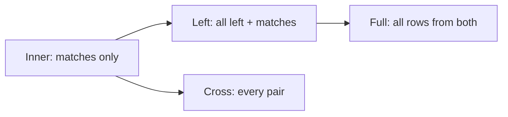

Read it as increasing the rows you keep. Right join is a left join with the tables swapped, so most teams only write left joins.

| Join | Keeps | Typical use |
| --- | --- | --- |
| Inner | matches | orders with their customers |
| Left | all left rows | customers, even without orders |
| Full | all rows both sides | reconcile two systems |
| Cross | every pair | generate a calendar times a product list |
| Self | one table twice | employee and manager in `employees` |

**Gotcha:** putting a filter on the right table in `WHERE` turns a left join into an inner join, because the NULL rows are removed. Put that filter in the `ON` clause instead. Joining on a non-unique column also multiplies rows.

**Interview tip:** be ready to write the "customers with no orders" query and to say why `NOT EXISTS` or the left join anti-pattern beats `NOT IN`.

_Module: SQL Fundamentals · Tags: joins, sql_

### 5. How do GROUP BY, HAVING and aggregate functions work?

**Short answer:** `GROUP BY` collapses rows into groups, and aggregate functions such as `COUNT`, `SUM`, `AVG`, `MIN` and `MAX` calculate one value per group. `WHERE` filters rows before grouping. `HAVING` filters groups after aggregating.

```sql
SELECT customer_id, COUNT(*) AS orders, SUM(total) AS spent
FROM orders
WHERE customer_id IS NOT NULL      -- row filter, before grouping
GROUP BY customer_id
HAVING SUM(total) > 200            -- group filter, after aggregating
ORDER BY customer_id;
-- prints: 1 | 2 | 350
--         2 | 2 | 380
```

Every selected column must be either in `GROUP BY` or inside an aggregate. PostgreSQL and SQL Server enforce this (SQLite and old MySQL do not, which hides bugs).

**Key facts about aggregates**
- `COUNT(*)` counts rows. `COUNT(col)` counts rows where `col` is not NULL. `COUNT(DISTINCT col)` counts unique non-NULL values.
- `SUM` and `AVG` ignore NULLs. `AVG` of 1, NULL, 3 is 2, not 1.33.
- `SUM` over zero rows is NULL, so wrap it: `COALESCE(SUM(x), 0)`.
- Integer division truncates in many databases. `SUM(a) / COUNT(*)` may give a whole number. Cast to decimal first.

**Gotcha:** using `HAVING` for a plain row filter works but is slower, because rows are grouped first. If a condition does not use an aggregate, put it in `WHERE`.

**Interview tip:** a favourite question is "WHERE versus HAVING". Answer with the order: rows are filtered, then grouped, then groups are filtered.

_Module: SQL Fundamentals · Tags: aggregates, group-by_

### 6. When do you use a subquery and when a CTE?

**Short answer:** A subquery is a query inside another query. A CTE (common table expression, `WITH name AS (...)`) gives a subquery a name so the main query reads top to bottom. Most of the time they give the same result. Use a CTE for readability, reuse in the same statement, and recursion.

```sql
-- Subquery: customers whose paid total is above 300
SELECT name FROM customers
WHERE id IN (SELECT customer_id FROM orders
             WHERE status = 'paid'
             GROUP BY customer_id HAVING SUM(total) > 300);

-- Same idea as a CTE: named steps
WITH paid AS (
  SELECT customer_id, SUM(total) AS spent
  FROM orders WHERE status = 'paid'
  GROUP BY customer_id
)
SELECT c.name, paid.spent
FROM paid JOIN customers c ON c.id = paid.customer_id
ORDER BY c.name;
-- prints: Asha 350, Ben 300
```

**Choosing**
- Subquery: short, one-off filters (`IN`, `EXISTS`, scalar value).
- CTE: several steps, or the same intermediate result used twice.
- Recursive CTE: trees such as categories or org charts (`WITH RECURSIVE` in PostgreSQL, plain `WITH` in SQL Server).

**Gotcha:** a CTE is not always a cached temp table. In SQL Server it is inlined like a view. In PostgreSQL 12 and later it is inlined too, unless it is used more than once or you write `AS MATERIALIZED`. Before PostgreSQL 12 it was always materialised and acted as an optimisation fence. Do not assume a CTE speeds a query up.

**Interview tip:** say you choose between them for readability first, then check the plan if performance matters.

_Module: SQL Fundamentals · Tags: cte, subquery_

### 7. How does NULL work in SQL, and what are the common NULL bugs?

**Short answer:** NULL means "unknown", not zero and not an empty string. Any comparison with NULL gives UNKNOWN, not true or false, so `NULL = NULL` is not true. SQL uses three-valued logic: true, false, unknown. A `WHERE` clause keeps only rows that are true.

```sql
-- customers: Asha (Pune), Ben (Delhi), Chen (city is NULL)
SELECT name FROM customers WHERE city <> 'Pune';
-- prints: Ben          (Chen is missing! NULL <> 'Pune' is unknown)

SELECT name FROM customers WHERE city IS NULL;
-- prints: Chen         (use IS NULL, never = NULL)

SELECT COUNT(*), COUNT(city) FROM customers;
-- prints: 3 | 2        (COUNT(col) skips NULLs)
```

**Common NULL bugs**
- `col = NULL` never matches. Use `IS NULL`. PostgreSQL also has `IS NOT DISTINCT FROM` for null-safe equality.
- `NOT IN (subquery)` returns no rows at all if the subquery contains one NULL. Use `NOT EXISTS`.
- `NULL + 5` is NULL. Concatenating NULL with text gives NULL in standard SQL and in SQL Server, but PostgreSQL's `concat()` function ignores NULL.
- `COUNT`, `SUM` and `AVG` skip NULLs, which changes averages.
- `UNIQUE` columns: PostgreSQL allows many NULLs. SQL Server allows only one NULL in a unique index unless you add a filtered index.
- Sorting: PostgreSQL puts NULLs last in ascending order. SQL Server puts them first.

Handle NULL with `COALESCE(x, default)` (standard, works everywhere). SQL Server also has `ISNULL(x, default)`, which takes the type of the first argument.

**Gotcha:** the `NOT IN` trap is the one that reaches production. A single missing `customer_id` silently empties the result.

**Interview tip:** show the `NOT IN` versus `NOT EXISTS` example. Interviewers use it to see if you have been bitten.

_Module: SQL Fundamentals · Tags: null, three-valued-logic_

### 8. What is the difference between DISTINCT, UNION and UNION ALL?

**Short answer:** `DISTINCT` removes duplicate rows from one result. `UNION` stacks two results and removes duplicates. `UNION ALL` stacks them and keeps everything. `UNION ALL` is faster because it skips the duplicate removal, so prefer it when duplicates are impossible or acceptable.

```sql
SELECT status FROM orders UNION SELECT 'x';
-- prints: new, paid, x            (duplicates gone, sorted/hashed internally)

SELECT status FROM orders UNION ALL SELECT 'new';
-- prints 6 rows: paid, paid, new, paid, new, new
```

Removing duplicates means sorting or hashing every row, which can be costly on big results and may spill to disk.

**Rules**
- Both queries must return the same number of columns with compatible types.
- Column names come from the first query.
- `UNION` and `DISTINCT` compare all selected columns, with NULLs treated as equal to each other.
- Related operators: `INTERSECT` (rows in both) and `EXCEPT` (rows in the first only; `MINUS` in Oracle).

| Operator | Duplicates | Cost |
| --- | --- | --- |
| `UNION ALL` | kept | cheapest |
| `UNION` | removed | sort or hash |
| `DISTINCT` | removed within one result | sort or hash |

**Gotcha:** `SELECT DISTINCT` is often used to hide a join that multiplied rows. Fix the join (or use `EXISTS`) instead of covering it up.

**Interview tip:** say "I default to UNION ALL and use UNION only when I need the dedupe", and mention that the sum of the parts can double count if you pick wrongly.

_Module: SQL Fundamentals · Tags: union, distinct_

### 9. What are window functions, and how do ROW_NUMBER, RANK, LAG, LEAD and running totals work?

**Short answer:** A window function calculates a value for each row using a set of related rows (the window), without collapsing rows like `GROUP BY` does. You write `function() OVER (PARTITION BY ... ORDER BY ...)`. They are used for ranking, previous and next row, and running totals.

```sql
SELECT id, customer_id, total,
  ROW_NUMBER() OVER (PARTITION BY customer_id ORDER BY total DESC) AS rn,
  RANK()       OVER (ORDER BY total DESC)                          AS rk,
  SUM(total)   OVER (ORDER BY id)                                  AS running
FROM orders ORDER BY id;
-- id customer_id total rn rk running
-- 1  1           100   2  3  100
-- 2  1           250   1  2  350
-- 3  2           80    2  4  430
-- 4  2           300   1  1  730
-- 5  NULL        50    1  5  780

SELECT id, total, LAG(total) OVER (ORDER BY id) AS prev,
                  LEAD(total) OVER (ORDER BY id) AS next
FROM orders;
-- order 2 has prev 100 and next 80
```

| Function | What it does |
| --- | --- |
| `ROW_NUMBER()` | 1, 2, 3 with no ties |
| `RANK()` | ties share a rank, then a gap (1, 1, 3) |
| `DENSE_RANK()` | ties share a rank, no gap (1, 1, 2) |
| `LAG(x)` / `LEAD(x)` | value from the previous or next row |
| `SUM(x) OVER (ORDER BY ...)` | running total |

`PARTITION BY` splits the rows into independent groups, like `GROUP BY` without collapsing. `ORDER BY` inside `OVER` sets the order for ranking and running calculations.

**Gotcha:** a running `SUM ... OVER (ORDER BY x)` uses a default frame that treats equal `x` values as one group (RANGE mode), so ties get the same running total. Add a unique tie-breaker in the order, or write `ROWS BETWEEN UNBOUNDED PRECEDING AND CURRENT ROW`. Also, you cannot filter on a window function in `WHERE`. Wrap the query in a CTE or subquery.

**Interview tip:** top N per group and "compare to the previous row" are the two classic uses. Know both patterns by heart.

_Module: SQL Fundamentals · Tags: window-functions, analytics_

### 10. What is normalisation (1NF to BCNF), and when should you denormalise?

**Short answer:** Normalisation organises tables so each fact is stored once, which prevents update, insert and delete anomalies. The usual target is third normal form (3NF) or BCNF. You denormalise on purpose, with measured reasons, when joins become too slow or when reads hugely outnumber writes.

**The forms in plain words**
- 1NF: each cell holds one value, no repeating groups (no `phones = '1,2,3'`).
- 2NF: every non-key column depends on the whole key, not just part of a composite key.
- 3NF: non-key columns depend on the key and nothing else. No `customer_city` stored in `orders` when it depends on `customer_id`.
- BCNF: a stricter 3NF. Every determining column must be a candidate key.

A short memory line: every column depends on the key, the whole key, and nothing but the key.

```text
❌ orders(id, customer_id, customer_name, customer_city)
   Change a city and you must update many order rows.

✅ customers(id, name, city)
   orders(id, customer_id)
```

**When to denormalise**
- Heavy read paths where a join across many tables is the bottleneck.
- Reporting tables or read models, built from the normal tables.
- Snapshot data that must not change later, such as the price and address on an order at the time of purchase. That is a real business fact, not duplication.

| Normalised | Denormalised |
| --- | --- |
| Less storage, no anomalies | Faster reads, fewer joins |
| More joins | Copies must be kept in sync |
| Best for OLTP writes | Best for reporting and read models |

**Gotcha:** denormalising without a plan to keep copies in sync (trigger, job, event) creates silent drift.

**Interview tip:** say "normalise first, denormalise with a measurement", and give the order-price-snapshot example.

_Module: Data Modeling · Tags: normalization, schema-design_

### 11. What does ACID mean in plain words?

**Short answer:** ACID is the set of promises a transactional database makes. Atomicity: all of a transaction happens or none of it. Consistency: the data moves from one valid state to another, obeying the rules. Isolation: concurrent transactions do not see each other's half-finished work. Durability: once committed, data survives a crash.

Take a money transfer of 70 from account 1 to account 2.

| Letter | Promise | In the transfer |
| --- | --- | --- |
| Atomicity | all or nothing | both updates apply, or neither does |
| Consistency | rules always hold | the balance never goes below zero (a `CHECK` constraint) |
| Isolation | transactions do not interfere | another reader never sees money removed but not yet added |
| Durability | committed means safe | after `COMMIT`, a power cut cannot lose it |

**How databases deliver it**
- Atomicity and durability: the write-ahead log. Changes are written to a log on disk first.
- Consistency: constraints, plus your application logic. The database enforces only the rules you declare.
- Isolation: locks or multi-version concurrency control, with a choice of isolation levels.

**Gotcha:** "consistency" in ACID is not the same word as consistency in the CAP theorem. In ACID it means rules hold. In CAP it means all nodes agree on the latest value.

Another gotcha: isolation is a dial, not a switch. The default levels of PostgreSQL and SQL Server (read committed) allow some anomalies. Full isolation is `SERIALIZABLE`, which costs throughput.

**Interview tip:** give the bank transfer example, then name one thing that can still go wrong under read committed (a lost update). It shows depth.

_Module: Transactions & Concurrency · Tags: acid, transactions_

### 12. How do transactions work: BEGIN, COMMIT, ROLLBACK and savepoints?

**Short answer:** A transaction groups statements into one unit. `BEGIN` starts it, `COMMIT` makes all changes permanent, and `ROLLBACK` throws them all away. Without an explicit transaction, most databases treat each statement as its own transaction (autocommit).

```sql
BEGIN;
UPDATE accounts SET balance = balance - 70 WHERE id = 1;
UPDATE accounts SET balance = balance + 70 WHERE id = 2;
COMMIT;   -- both changes become visible together and are durable
```

If the second update fails, you run `ROLLBACK` and the first update is undone. In SQL Server the keywords are `BEGIN TRANSACTION`, `COMMIT TRANSACTION`, and you can set `SET XACT_ABORT ON` so any runtime error rolls back the whole transaction.

**Good habits**
- Keep transactions short. Open them, do the writes, commit. Never wait on a user or an HTTP call inside one.
- Do reads that need no protection outside the transaction.
- Always handle errors and roll back. A connection returned to a pool with an open transaction is a classic outage cause.
- Use savepoints (`SAVEPOINT name`, `ROLLBACK TO name`) to undo part of a transaction. SQL Server uses `SAVE TRANSACTION`.

**Gotcha:** in PostgreSQL, after an error inside a transaction, every further statement fails with "current transaction is aborted" until you roll back (or roll back to a savepoint). In SQL Server, locks are held until commit, so a long transaction blocks others.

A Go sketch of the safe shape:

```go
tx, err := db.BeginTx(ctx, nil)
if err != nil { return err }
defer tx.Rollback() // safe no-op after a successful Commit
if _, err = tx.ExecContext(ctx, `UPDATE accounts SET balance = balance - $1 WHERE id = $2`, 70, 1); err != nil {
    return err
}
// ... second update ...
return tx.Commit()
```

**Interview tip:** mention "idle in transaction" sessions. They hold locks, block vacuum in PostgreSQL, and are a common production problem.

_Module: Transactions & Concurrency · Tags: transactions, commit_

### 13. What is a database index, how does a B-tree work, and what does an index cost?

**Short answer:** An index is a separate, sorted structure that lets the database find rows without reading the whole table, like the index at the back of a book. Most indexes are B-trees. They make reads faster but cost extra storage and make every insert, update and delete slower.

A B-tree is a shallow, wide tree of sorted pages. The database starts at the root page, follows pointers down two or three levels, and reaches the leaf page with your key. For millions of rows it takes only a few page reads. The leaves are linked in order, so range queries (`BETWEEN`, `ORDER BY`) are also fast.

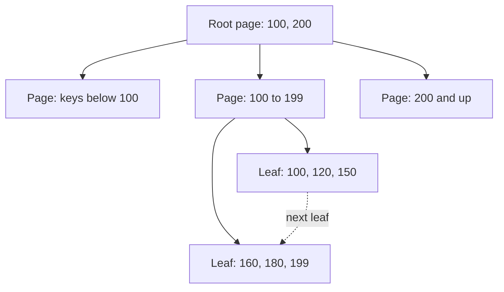

Read it from the root down. Each step narrows the search. Leaves point to the next leaf for ranges.

```sql
CREATE INDEX ix_orders_customer ON orders (customer_id);
-- Fast: WHERE customer_id = 42
-- Fast: WHERE customer_id = 42 ORDER BY id (if the index covers it)
```

| Benefit | Cost |
| --- | --- |
| Fast lookups and range scans | Extra disk and memory |
| Can avoid sorting | Every write updates every index |
| Enforces uniqueness | Slower bulk loads |
| | The planner has more choices to get wrong |

**Rules of thumb**
- Index columns used in `WHERE`, `JOIN` and `ORDER BY` of hot queries.
- Skip tiny tables and columns with very few distinct values (a boolean).
- Measure with `EXPLAIN` before and after.

**Gotcha:** more indexes is not better. A table with ten indexes does ten extra writes per insert.

**Interview tip:** explain it as a few page reads instead of a full scan, then immediately mention the write cost. That balance is what interviewers look for.

_Module: Indexing & Query Performance · Tags: indexes, b-tree_

### 14. What are views and materialised views, and when do you use them?

**Short answer:** A view is a saved query that you use like a table. It stores no data, so it is always current. A materialised view stores the query result on disk, so reads are fast but the data is as old as the last refresh.

```sql
-- Regular view: hides a join, always fresh
CREATE VIEW paid_orders AS
SELECT o.id, c.name, o.total
FROM orders o JOIN customers c ON c.id = o.customer_id
WHERE o.status = 'paid';

-- PostgreSQL materialised view: stored result
CREATE MATERIALIZED VIEW daily_sales AS
SELECT created_on, SUM(total) AS revenue FROM orders GROUP BY created_on;

REFRESH MATERIALIZED VIEW daily_sales;                  -- locks readers while it runs
REFRESH MATERIALIZED VIEW CONCURRENTLY daily_sales;     -- needs a unique index
```

| | View | Materialised view |
| --- | --- | --- |
| Stores data | no | yes |
| Freshness | always current | as of last refresh |
| Read speed | same as the underlying query | fast |
| Good for | simplifying joins, hiding columns, security | dashboards, heavy aggregations |

**SQL Server note:** it has no `CREATE MATERIALIZED VIEW`. The equivalent is an indexed view (a view with `WITH SCHEMABINDING` and a unique clustered index), which the engine keeps up to date on every write. It has many restrictions and adds write cost.

**When to use**
- Views: reuse a hard join, give a stable interface to an app, restrict which columns a role may see.
- Materialised views: expensive reports that tolerate stale data.

**Gotcha:** a view does not make a slow query fast. Stacking views on views hides cost, and the planner may expand them into huge queries. PostgreSQL does not refresh a materialised view by itself, so schedule it.

**Interview tip:** mention that you would use a materialised view or a summary table for dashboards instead of running heavy aggregates on the live tables.

_Module: SQL Fundamentals · Tags: views, materialized-views_

### 15. What are stored procedures, functions and triggers, and what are their pros and cons?

**Short answer:** A stored procedure is a named block of SQL logic saved in the database. A function returns a value and can be used inside queries. A trigger runs automatically when rows change. They keep logic close to the data and can be fast, but they are harder to test, version, review and observe than application code.

| Object | Called how | Typical use |
| --- | --- | --- |
| Stored procedure | `CALL` (PostgreSQL) or `EXEC` (SQL Server) | multi-step batch work, admin tasks |
| Function | inside `SELECT` | calculations, reusable logic |
| Trigger | automatically on `INSERT`, `UPDATE`, `DELETE` | audit trail, keeping `updated_at` current |

```sql
-- PostgreSQL trigger keeping updated_at fresh
CREATE FUNCTION touch_updated_at() RETURNS trigger AS $$
BEGIN
  NEW.updated_at = now();
  RETURN NEW;
END $$ LANGUAGE plpgsql;

CREATE TRIGGER trg_orders_touch BEFORE UPDATE ON orders
FOR EACH ROW EXECUTE FUNCTION touch_updated_at();
```

**Pros**
- Fewer network round trips for multi-step work.
- One place for rules that many apps share.
- Permissions can be granted on a procedure instead of tables.

**Cons**
- Logic is split between app and database, so debugging is harder.
- Hard to unit test, and version control and deployments need extra discipline.
- Vendor-specific languages (PL/pgSQL, T-SQL) lock you in.
- Triggers are invisible side effects. They slow writes, can fire in cascades, and surprise developers.
- Scaling: database CPU is the most expensive CPU you have.

**Gotcha:** a scalar user-defined function in a `WHERE` clause may run once per row and block parallel plans. In SQL Server 2019 and later, some scalar functions are inlined, but do not count on it.

**Interview tip:** a balanced answer is "app logic by default, small triggers for audit and timestamps, procedures for bulk data work or where a team already owns them".

_Module: SQL Fundamentals · Tags: stored-procedures, triggers_

### 16. What are the common data type gotchas: money, floats, dates, time zones and text?

**Short answer:** Never store money in floating point. Store dates and times as UTC instants with a time zone aware type. Pick the string type by what the database really needs, not by habit. Types are a contract, so wrong types cause quiet bugs.

**Money**

Floating point cannot represent 0.1 exactly. In SQLite, `0.1 + 0.2 = 0.3` is false. Use `NUMERIC(12,2)` or `DECIMAL(12,2)`, or store integer minor units (cents) with the currency code in another column. Avoid the `money` type in PostgreSQL (locale dependent) and SQL Server (rounding surprises in division).

```sql
SELECT 0.1 + 0.2 = 0.3;   -- false with floating point (prints 0)
-- ✅ use NUMERIC(12,2) or integer cents
```

**Dates and time zones**
- PostgreSQL `timestamptz` stores an instant (internally UTC) and shows it in the session time zone. `timestamp` has no zone, which is a trap.
- SQL Server: `datetime2` (no zone) or `datetimeoffset` (with an offset). Avoid old `datetime` (about 3 ms precision) for new work.
- Store in UTC, convert in the UI. Keep a separate zone name (such as `Asia/Kolkata`) when the local wall-clock time matters, for example a future appointment.
- Date-only values (birthday, invoice date) need a `date` type, not a timestamp at midnight.

**Text**
- PostgreSQL: `text` and `varchar(n)` perform the same. Use a length limit only when it is a real rule.
- SQL Server: `varchar` is single byte per char in many collations, `nvarchar` is Unicode (2 bytes). Mixing them in a join can cause implicit conversions that kill index use.
- Collation decides case and accent sensitivity. SQL Server defaults are often case-insensitive. PostgreSQL's usually are case-sensitive.

| Data | Use | Avoid |
| --- | --- | --- |
| Money | `NUMERIC` / integer cents | `FLOAT`, `money` |
| Instants | `timestamptz` / `datetimeoffset` | `timestamp` without zone |
| Flags | `boolean` / `bit` | `'Y'/'N'` strings |
| Ids | `bigint`, UUID | `int` for fast-growing tables |

**Interview tip:** tell the story of a 32-bit `int` id running out at about 2.1 billion rows. It happens in real systems.

_Module: Data Modeling · Tags: data-types, money, time_

### 17. What constraints does SQL provide, and why should the database enforce them?

**Short answer:** Constraints are rules the database enforces on every write: `NOT NULL`, `UNIQUE`, `PRIMARY KEY`, `FOREIGN KEY`, `CHECK` and `DEFAULT`. They are the last line of defence for data quality. Application checks can be bypassed by bugs, scripts and other services. Database constraints cannot.

```sql
CREATE TABLE payments (
  id           INTEGER PRIMARY KEY,
  order_id     INTEGER NOT NULL REFERENCES orders(id),
  amount_cents INTEGER NOT NULL CHECK (amount_cents > 0),
  currency     TEXT    NOT NULL DEFAULT 'INR',
  idem_key     TEXT    NOT NULL UNIQUE      -- stops double charges on retry
);
```

| Constraint | Stops |
| --- | --- |
| `NOT NULL` | missing values |
| `UNIQUE` | duplicates (emails, idempotency keys) |
| `PRIMARY KEY` | duplicates and NULL identity |
| `FOREIGN KEY` | orphan rows, and can control deletes (`ON DELETE CASCADE`, `RESTRICT`, `SET NULL`) |
| `CHECK` | impossible values (negative amounts, bad status) |

**Why this matters in production**
- Many services and scripts write to the same tables. Rules in one app do not protect against another.
- A `UNIQUE` constraint is the only reliable way to stop duplicates under concurrency. A "check then insert" in code has a race.
- Constraints document the model for the next developer.

**Gotchas**
- `ON DELETE CASCADE` can delete far more than expected. Prefer `RESTRICT` or soft deletes for important data.
- Adding a constraint to a big existing table can lock it. PostgreSQL lets you add `NOT VALID` first and then `VALIDATE CONSTRAINT` with a lighter lock.
- A `CHECK` on a status list is harder to change than a lookup table with a foreign key.

**Interview tip:** the idempotency key unique constraint is a strong example. It turns a race condition into a clean error you can handle.

_Module: Data Modeling · Tags: constraints, integrity_

### 18. What is SQL injection, and how do parameterised queries prevent it?

**Short answer:** SQL injection happens when user input is glued into SQL text, so the input can change the meaning of the query. The fix is parameterised queries (prepared statements): the SQL text and the values travel separately, so values are never executed as code.

```ts
// ❌ bad: input becomes part of the SQL
const email = req.query.email; // "x' OR '1'='1"
await db.query(`SELECT * FROM users WHERE email = '${email}'`);
// becomes: WHERE email = 'x' OR '1'='1'  -> returns every user

// ✅ good: placeholder, value sent separately (node-postgres style)
await db.query('SELECT * FROM users WHERE email = $1', [email]);
```

The placeholder syntax depends on the driver: `$1` in PostgreSQL drivers, `?` in many others, `@email` in SQL Server and .NET.

**Defence in depth**
- Always use parameters. ORMs do this by default, but raw SQL fragments and string interpolation in them are still dangerous.
- Placeholders cannot be used for table names, column names or `ORDER BY` direction. Allow-list those from fixed values in code.
- Give the app database user the least privilege: no `DROP`, no superuser, read-only users for reports.
- Validate input types. An id should be an integer before it gets near SQL.
- Do not show raw database errors to users.
- Dynamic SQL inside stored procedures (`EXEC(@sql)`) can be injectable too. Use `sp_executesql` with parameters in SQL Server.

**Gotcha:** escaping quotes by hand is not a fix. Encoding tricks and edge cases always find a hole. Also, a parameter is not a cure for `LIKE`: wildcards inside the value still act as wildcards, which is a data leak risk, not code execution.

**Interview tip:** say "parameters for values, allow-lists for identifiers, least privilege for the account". That covers the three layers.

_Module: SQL Fundamentals · Tags: security, sql-injection_

### 19. What is the difference between DELETE, TRUNCATE and DROP?

**Short answer:** `DELETE` removes chosen rows one by one, can use `WHERE`, fires triggers and is fully logged. `TRUNCATE` empties the whole table quickly by deallocating its pages. `DROP` removes the table itself, including its structure and indexes.

| | DELETE | TRUNCATE | DROP |
| --- | --- | --- | --- |
| Removes | rows you select | all rows | the table |
| `WHERE` allowed | yes | no | no |
| Speed on big tables | slow, logs each row | very fast | very fast |
| Triggers fire | yes (row triggers) | no row triggers | no |
| Resets identity | no | SQL Server: yes. PostgreSQL: only with `RESTART IDENTITY` | n/a |
| Rollback inside a transaction | yes | yes in PostgreSQL and SQL Server | yes |
| Needs | delete permission | stronger permission, table lock | owner or stronger |

```sql
DELETE FROM orders WHERE status = 'cancelled' AND created_on < '2023-01-01';
TRUNCATE TABLE staging_orders;               -- clear a staging table
DROP TABLE staging_orders;                   -- remove it entirely
```

**Things to know**
- `DELETE` on millions of rows creates big logs, holds locks a long time and in PostgreSQL leaves dead rows that need vacuum. Delete in batches (for example 10,000 rows at a time), or use partitions and drop old partitions.
- `TRUNCATE` takes a strong table lock. In PostgreSQL it needs `CASCADE` if other tables have foreign keys to it, and in SQL Server it fails when a foreign key references the table.
- `TRUNCATE` does not fire `ON DELETE` triggers, so audit triggers will not see it.

**Gotcha:** `DELETE FROM orders;` without a `WHERE` deletes everything. Many teams require running destructive statements inside a transaction first and checking the row count, or using safe-update settings on the client.

**Interview tip:** for retention jobs say you would partition by month and drop old partitions, because that is instant and leaves no bloat.

_Module: SQL Fundamentals · Tags: delete, truncate, drop_

### 20. What are the trade-offs between auto-increment ids and UUID or ULID primary keys?

**Short answer:** Auto-increment (identity or sequence) ids are small, fast and ordered, but they are guessable, hard to generate across many databases, and leak growth. Random UUIDs can be created anywhere without coordination, but they are larger and random, which fragments indexes. Time-ordered ids (UUIDv7, ULID) give most of both.

| Key | Size | Order | Good | Weak |
| --- | --- | --- | --- | --- |
| `bigint` identity | 8 bytes | increasing | compact, cache friendly, easy to read | guessable, needs one writer, leaks counts |
| UUIDv4 | 16 bytes | random | generate anywhere, unguessable | random inserts split B-tree pages, bigger indexes |
| UUIDv7 / ULID | 16 bytes | roughly by time | generate anywhere, mostly append-only | reveals creation time, library support varies |

**Why random keys hurt**

A B-tree clustered or primary index that receives random keys writes into random pages all over the tree. Pages split, the cache is less effective, and every secondary index (in SQL Server, every non-clustered index stores the clustered key) gets bigger. With time-ordered keys, new rows go to the end of the index, like an auto-increment.

**Practical advice**
- Single database, internal ids: `bigint` identity. In PostgreSQL use `GENERATED ALWAYS AS IDENTITY` rather than the old `serial`.
- Ids exposed in URLs or created by several services: UUIDv7 or ULID. PostgreSQL 18 added a built-in `uuidv7()`. Before that, generate them in the app.
- SQL Server: random `NEWID()` as a clustered key is a known problem. Use `NEWSEQUENTIALID()` or an app-generated ordered id.
- Never expose sequential ids as the only access control. Check ownership on every request.

**Gotcha:** using `int` (32-bit) for a table that grows fast. It stops at about 2.1 billion, and changing the type later on a huge table is painful.

**Interview tip:** show you can pick by context, and mention index fragmentation as the concrete cost of UUIDv4.

_Module: Data Modeling · Tags: primary-key, uuid_

## Intermediate

### 21. [Tech Lead] How do you triage a slow query or a slow database in production?

**Short answer:** Work from the outside in. First decide whether it is one query, one resource or the whole server. Look at metrics, then the top queries by total time, then the plan of the worst one. Change one thing at a time and measure again. Do not start by adding indexes.

**A method I follow**
1. Scope it: since when, which endpoints, which tenants, what changed (deploy, data growth, new traffic, failover).
2. Check the host: CPU, memory, disk latency, IOPS, connections, replication lag. In Datadog or Azure Monitor, line these up with the start time.
3. Check waiting: are sessions blocked on locks, waiting on disk or running on CPU? PostgreSQL: `pg_stat_activity` (`wait_event`, `state`), `pg_locks`. SQL Server: `sys.dm_exec_requests`, wait stats.
4. Find the top queries by total time (not just slowest single run). PostgreSQL: `pg_stat_statements`. SQL Server: Query Store. Also the slow query log (`log_min_duration_statement`).
5. Read the plan: `EXPLAIN (ANALYZE, BUFFERS)` in PostgreSQL or the actual execution plan in SQL Server. Compare estimated rows with actual rows.
6. Fix the cause: index, rewrite, statistics refresh, batch size, missing limit, or a plan regression.
7. Verify with the same metric, then write down what happened.

```sql
-- PostgreSQL: top queries by total time (needs the pg_stat_statements extension)
SELECT calls, round(total_exec_time) AS total_ms,
       round(mean_exec_time::numeric, 1) AS mean_ms, left(query, 80) AS query
FROM pg_stat_statements
ORDER BY total_exec_time DESC
LIMIT 5;
```

(Column names are for PostgreSQL 13 and later; older versions use `total_time`.)

**Common culprits**
- A new query with no supporting index, or a plan that flipped after statistics changed.
- N+1 queries after a code change.
- Long transactions blocking others, or `idle in transaction` sessions.
- Connection storm after a restart or deploy.
- A table that grew past memory, so reads now hit disk.

**Gotcha:** `EXPLAIN ANALYZE` really runs the statement. On an `UPDATE` wrap it in `BEGIN ... ROLLBACK`. On a struggling primary, run it on a replica if the query is a read.

**Interview tip:** narrate the sequence: scope, resource, wait, top query, plan, fix, verify. Interviewers listen for a method more than for a trick.

_Module: Indexing & Query Performance · Tags: tech-lead, performance, troubleshooting_

### 22. [Tech Lead] How do you decide an index strategy and review indexes on a growing system?

**Short answer:** Index for the real queries, not the columns. Start from the slow and frequent queries, add the smallest index that serves them, and remove indexes nobody uses. Every index costs write time, storage, memory and vacuum or maintenance work, so each one needs an owner and a reason.

**How I choose**
- Collect the top queries (pg_stat_statements or Query Store), grouped by shape.
- For each, look at equality columns first, then range columns, then sort columns. That gives a composite index order.
- Check selectivity: does the filter cut the table to a small part?
- Prefer one composite index that serves several queries over many single-column ones.
- Use partial indexes for hot slices (`WHERE status = 'pending'`) and `INCLUDE` columns to avoid table lookups.

**How I find waste and gaps**

```sql
-- PostgreSQL: indexes never used since stats reset (keep unique/PK ones!)
SELECT relname AS table, indexrelname AS index, idx_scan,
       pg_size_pretty(pg_relation_size(indexrelid)) AS size
FROM pg_stat_user_indexes
WHERE idx_scan = 0
ORDER BY pg_relation_size(indexrelid) DESC;
```

- SQL Server: `sys.dm_db_index_usage_stats` shows reads versus updates. `sys.dm_db_missing_index_details` suggests gaps, but treat suggestions as hints. They are often duplicates or too wide.
- Look for duplicates and prefixes: an index on `(a)` is redundant when `(a, b)` exists.
- Check on replicas too. An index unused on the primary may serve reporting on a replica.

**Write cost rule of thumb:** each extra index adds work to every insert and to every update of an indexed column. Hot write tables should have few, narrow indexes.

**Team practice**
- Every index change goes through code review with the query it helps and a plan before and after.
- Create indexes online (`CREATE INDEX CONCURRENTLY` in PostgreSQL, `ONLINE = ON` in SQL Server where the edition supports it).
- Review quarterly: size, usage, bloat.

**Gotcha:** usage stats reset on restart or failover and cover only the observation window. A month-end report index may look unused all month.

**Interview tip:** say "I treat indexes like code: justified by a query, reviewed, and removable".

_Module: Indexing & Query Performance · Tags: tech-lead, indexes, review_

### 23. [Tech Lead] How do you run zero-downtime schema migrations?

**Short answer:** Change the schema in small, backward-compatible steps using expand and contract. Add the new thing, deploy code that works with both old and new, backfill in batches, switch reads, and only then remove the old thing. Each step must be safe with the old code still running.

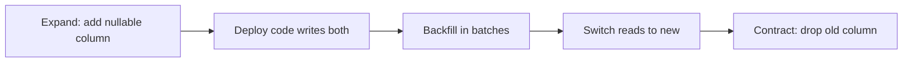

Read it left to right. Nothing breaks at any step, so you can pause or roll back between steps.

**Rules for a safe step**
- Adding a nullable column is cheap. In PostgreSQL 11 and later, adding a column with a constant default is also cheap (no table rewrite). A volatile default (like `random()`) still rewrites.
- Never rename or drop a column in the same release as the code change. Rename means add new, copy, switch, drop later.
- Backfill in small batches with pauses, not one giant `UPDATE`, to avoid long locks, replication lag and huge logs.
- Build indexes online: `CREATE INDEX CONCURRENTLY` (PostgreSQL; cannot run in a transaction and can leave an invalid index to drop on failure) or `WITH (ONLINE = ON)` (SQL Server Enterprise and Azure SQL).
- Add constraints in two steps. PostgreSQL: `ADD CONSTRAINT ... NOT VALID`, then `VALIDATE CONSTRAINT`. `SET NOT NULL` on a large table scans it, so add a `CHECK (col IS NOT NULL) NOT VALID` first.
- Set `lock_timeout` so a migration that cannot get its lock fails fast instead of queueing behind a long query and blocking everyone.

```sql
-- PostgreSQL: fail fast instead of blocking the app
SET lock_timeout = '3s';
ALTER TABLE orders ADD COLUMN currency text;   -- nullable, cheap
CREATE INDEX CONCURRENTLY ix_orders_currency ON orders (currency);
```

**Gotcha:** an `ALTER TABLE` waiting for a lock blocks every query behind it, even simple reads. That queue is how a "tiny" migration causes an outage.

**Process:** run migrations as a separate step before the app rollout, test them on a production-sized copy, keep each migration idempotent, and have a rollback or forward-fix plan.

**Interview tip:** name expand and contract, batched backfills, online indexes and `lock_timeout`. That is the full answer.

_Module: Operations & Migrations · Tags: tech-lead, migrations, zero-downtime_

### 24. [Tech Lead] How do you manage connection pooling and connection limits across many pods?

**Short answer:** Total connections equal the number of pods times the pool size per pod, and the database has a fixed maximum. Size pools small, cap the total, and put a pooler such as PgBouncer in front when you have many pods. More connections do not mean more throughput.

PostgreSQL runs one process per connection, with real memory and context-switch cost. SQL Server uses worker threads and also degrades under thousands of sessions. A database with 8 cores usually gives best throughput with a few dozen active connections, not hundreds.

**The arithmetic**

```text
pods x pool_max  <=  max_connections - reserved (admin, replicas, migrations, cron)
20 pods x 10 = 200 connections, and HPA can scale to 60 pods = 600
```

Autoscaling is the trap: pods grow under load, exactly when the database is already busy, and the extra connections make it worse.

**Options**

| Option | What it does | Watch for |
| --- | --- | --- |
| Small per-pod pool | Each pod holds 3 to 10 connections | still multiplies with pod count |
| PgBouncer transaction mode | Many client connections share few server connections, a connection is held only during a transaction | session features break: `SET`, advisory locks, `LISTEN`, and older versions lack prepared statement support |
| Managed pooler | Azure Database for PostgreSQL Flexible Server has built-in PgBouncer; Azure SQL manages sessions for you | still set client pool limits |
| Queue the work | Put a concurrency limit in front (semaphore, queue) | latency under load |

```ts
// node-postgres: pool per pod, small and with timeouts
const pool = new Pool({
  max: 10,                       // per pod
  idleTimeoutMillis: 30_000,
  connectionTimeoutMillis: 2_000 // fail fast instead of piling up
});
```

**Operational checks:** alert on connections in use versus max, on pool wait time and on `idle in transaction` sessions. Always return connections (`release()`, `defer rows.Close()` in Go) or the pool leaks and the service hangs.

**Gotcha:** a rolling deploy briefly runs old and new pods together, so peak connections can double.

**Interview tip:** show the multiplication, mention autoscaling and PgBouncer, and say you size pools from database capacity, not from app thread count.

_Module: Operations & Migrations · Tags: tech-lead, connection-pool, kubernetes_

### 25. [Tech Lead] How do backups, point-in-time recovery, RPO and RTO work, and how do you prove you can restore?

**Short answer:** RPO (recovery point objective) is how much data you can afford to lose, measured in time. RTO (recovery time objective) is how long you can be down. Backups only count if you have restored from them. Point-in-time recovery combines a full backup with a continuous log of changes so you can restore to a chosen second.

**How PITR works**
- PostgreSQL: a base backup plus archived WAL files. You restore the base backup and replay WAL up to a target time (`recovery_target_time`). Tools: pgBackRest, Barman, WAL-G, or the managed service.
- SQL Server: full backups, differential backups and transaction log backups, in the full recovery model. Restore the full, the latest differential, then the log chain `WITH STOPAT`.
- Azure managed databases take automatic backups with point-in-time restore. The retention period is configurable, so check the default and set it to match policy.

| Term | Question it answers | Driven by |
| --- | --- | --- |
| RPO | How much data can we lose? | backup and log frequency, replication mode |
| RTO | How long until we are back? | database size, restore speed, runbook, automation |

A replica is not a backup. A bad `DELETE` or `DROP` replicates in seconds. Backups protect against human error and corruption. Replicas protect against hardware failure.

**What a lead should insist on**
- Written RPO and RTO per system, agreed with the business.
- Backups stored outside the failure domain (another region or account), encrypted, and protected from deletion.
- Regular restore drills, automated: restore into a scratch server, run integrity checks and a few row counts, record the time taken. That time is your real RTO.
- Monitoring that alerts when a backup or WAL archive is late.
- A runbook for "restore to just before 14:03".

**Gotcha:** an unmonitored WAL archive that fails silently fills the disk in PostgreSQL, or the log chain breaks in SQL Server, and you discover it during the disaster.

**Interview tip:** say "an untested backup is a hope, not a backup" and describe your restore drill.

_Module: Operations & Migrations · Tags: tech-lead, backup, disaster-recovery_

### 26. [Tech Lead] How do you choose a database: relational, document, key-value, wide-column, search, time-series or graph?

**Short answer:** Start from the access patterns and the guarantees you need, not from the technology. For most business systems with relationships and transactions, a relational database (PostgreSQL or SQL Server) is the right default. Add a specialised store only when a clear requirement cannot be met well by it.

**Questions to ask first**
- What are the top reads and writes, and what are their rates and latency targets?
- Do I need transactions across several records, joins, or ad hoc queries?
- How big will the data get, and how fast does it grow?
- What consistency can I accept? Can a read be slightly stale?
- Who operates it, and does the team know it?

| Need | Fits | Example products |
| --- | --- | --- |
| Transactions, relations, ad hoc queries | Relational | PostgreSQL, SQL Server |
| Flexible nested documents read as a whole | Document | MongoDB, Cosmos DB, or PostgreSQL JSONB |
| Very fast lookup by key, caching, sessions | Key-value | Redis, DynamoDB |
| Huge write volume, known query paths, many nodes | Wide-column | Cassandra, ScyllaDB |
| Free text, relevance ranking, facets | Search | Elasticsearch, OpenSearch |
| Metrics and events over time | Time-series | TimescaleDB, InfluxDB, Prometheus |
| Deep relationship traversal | Graph | Neo4j, Neptune |

**Decision habits**
- Default to the boring option. A single PostgreSQL covers JSON, full text, queues, geo and vectors for many products.
- Each extra database adds backups, monitoring, security, skills and data sync. Count that cost.
- Keep one source of truth. Search indexes and caches are derived copies that you can rebuild.
- Prove the need with a number: "we need 200k writes per second", not "NoSQL scales better".

**Gotcha:** choosing a store for the resume, then discovering you need joins and transactions and rebuilding them in application code.

**Interview tip:** answer with the framework (access patterns, consistency, scale, operations) and give one example of where you would add a second store, such as Elasticsearch for product search fed from the main database.

_Module: NoSQL & Caching · Tags: tech-lead, architecture, decision_

### 27. [Tech Lead] What breaks when you use read replicas, and how do you handle replication lag?

**Short answer:** Read replicas spread read load, but they are usually asynchronous, so they lag behind the primary. Users can write something and then not see it. You handle this by routing reads that need fresh data to the primary, measuring lag, and designing screens and APIs to tolerate stale reads.

**Typical failures**
- Read-your-writes: a user places an order and the next page, served from a replica, says there is no order.
- Monotonic reads: two requests hit different replicas, so data appears to go back in time.
- Reports and exports that read a replica during heavy write load and fall far behind.
- A long query on a PostgreSQL replica gets cancelled because it conflicts with replay (recovery conflicts), unless you tune `hot_standby_feedback` or the max standby delay, which brings its own trade-offs such as bloat on the primary.

**Techniques**
- Route by intent: transactional paths and "read after write" go to the primary. Dashboards, search pages and exports go to replicas.
- Sticky reads: after a write, send that user's reads to the primary for a short window (a few seconds), or until the replica's position passes the write's position.
- Use a version or timestamp token from the write and wait for the replica to reach it.
- Monitor lag in bytes and in seconds. PostgreSQL: `pg_stat_replication` (`replay_lag`) on the primary, or `now() - pg_last_xact_replay_timestamp()` on the replica. SQL Server: availability group dashboards and DMVs. Alert on a threshold and remove a lagging replica from the pool automatically.
- Use synchronous replication only for data you cannot lose, accepting higher write latency and the risk that a dead standby blocks commits.

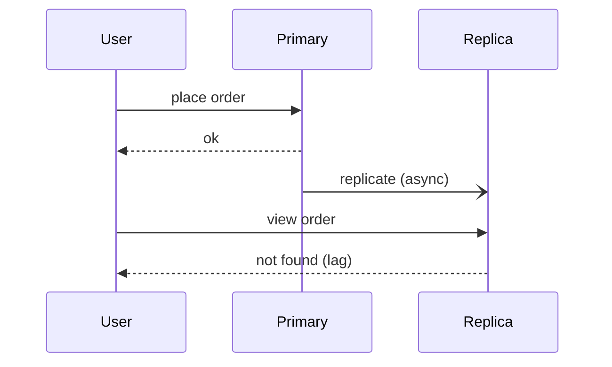

The final read arrives before the change has reached the replica.

**Gotcha:** replicas do not help write scaling, and a replica that is too far behind is a bad failover target.

**Interview tip:** name "read your own writes" and explain how you would route traffic for it.

_Module: Scaling & Replication · Tags: tech-lead, replication, read-replicas_

### 28. [Tech Lead] How do you design a multi-tenant data model?

**Short answer:** There are three main models: all tenants share tables with a `tenant_id` column, each tenant gets its own schema, or each tenant gets its own database. Shared tables are cheapest and simplest to operate. Separate databases give the strongest isolation and the highest cost. Choose by tenant count, size variation, isolation needs and compliance.

| Model | Isolation | Cost per tenant | Operations | Good for |
| --- | --- | --- | --- | --- |
| Shared tables with `tenant_id` | logical | lowest | one schema to migrate | thousands of small tenants |
| Schema per tenant | medium | medium | migrations run N times | tens to hundreds of tenants |
| Database per tenant | strongest | highest | N backups, N pools | few large or regulated tenants |

**Shared tables: the rules**
- Put `tenant_id` on every table, include it in every index that serves tenant queries, and put it first in composite keys.
- Make the foreign keys composite too, `(tenant_id, customer_id)`, so a row can never point at another tenant's data.
- Enforce isolation in the database, not only in the app. PostgreSQL has row level security (`CREATE POLICY ... USING (tenant_id = current_setting('app.tenant_id')::int)`). SQL Server has row-level security with security policies (since 2016).
- Watch for the noisy neighbour: one large tenant slows everyone. Use rate limits, per-tenant metrics and the ability to move a big tenant to its own database.

```sql
CREATE TABLE orders (
  tenant_id INT NOT NULL,
  id        BIGINT NOT NULL,
  total     INT NOT NULL,
  PRIMARY KEY (tenant_id, id)
);
CREATE INDEX ix_orders_tenant_created ON orders (tenant_id, id);
```

**Gotchas**
- A forgotten `WHERE tenant_id = ...` leaks data. A shared ORM filter, row level security and tests that try cross-tenant access all reduce the risk.
- Per-tenant restore is hard with shared tables. Decide early how you would restore one customer.
- Connection pooling and row level security need care: set the tenant context per transaction, not per connection.

**Interview tip:** recommend a hybrid: shared tables by default, with a path to move big or regulated tenants to dedicated databases.

_Module: Data Modeling · Tags: tech-lead, multi-tenancy, saas_

### 29. [Tech Lead] What do you check in a data model review?

**Short answer:** I review the model against real queries and real failure modes: correct keys and constraints, sensible types, indexes for the top queries, safe growth, evolution without downtime, and data protection. A schema is the hardest thing to change later, so the review is cheap compared with a migration.

**Checklist**
- Entities and keys: every table has a primary key, natural unique keys are enforced, foreign keys exist and have indexes.
- Integrity: `NOT NULL` by default, `CHECK` for ranges and states, no "magic" values like `-1` for unknown.
- Types: money as decimal or integer cents, timestamps in UTC with zone, `bigint` for growing ids, UUID choices justified.
- Normalisation: no repeated facts, and any denormalised copy has a named owner and a sync mechanism.
- History: what must be remembered (price at purchase, address on the order)? Soft delete versus real delete; audit needs.
- Queries: the top five reads and writes are written down, with the index that serves each.
- Volume: rows per day, total in a year, largest tenant. Plan for partitioning or archiving if the table will reach hundreds of millions of rows.
- Concurrency: where can two requests write the same row? Version column, unique constraint, or lock?
- Evolution: can columns be added without a rewrite? Are enums changeable? Is there a migration plan?
- Security: where is PII, is it encrypted or tokenised, and who can read it?
- Naming: consistent names, no reserved words, no abbreviations nobody knows.

**Smells**
- JSON blob holding fields you filter on.
- A status column with no list of valid values.
- Many-to-many data in a comma separated column.
- One huge "generic" table with a type column and mostly NULL columns.
- A table with no way to tell which row is current.

**Interview tip:** say you bring the top queries and a volume estimate to the review. Without them the review is just opinions.

_Module: Data Modeling · Tags: tech-lead, schema-design, review_

### 30. [Tech Lead] How do you plan database capacity and control cost?

**Short answer:** Measure current usage and growth, forecast with headroom, and review the biggest cost drivers regularly. Most database cost is oversized instances, unused storage and IOPS, copies of data nobody needs and inefficient queries. Fixing queries is usually cheaper than buying hardware.

**What I track**
- Compute: CPU, active connections, queue depth. Keep average CPU well below saturation (for example 40 to 60 percent at peak) so spikes and failovers have room.
- Memory: cache hit ratio and whether the working set fits in memory. When it stops fitting, latency jumps.
- Storage: size, daily growth, index share, bloat, and how fast you will fill the disk. Alert at a growth-based time-to-full, not only at 80 percent.
- IO: IOPS and latency against the limit of the disk tier. Cloud disks have caps.
- Growth drivers: rows per day, per tenant, per table.

**Forecasting:** take 90 days of data, find the trend, add the business plan (new customers, features), and plan the next upgrade date with a margin. Load test with production-sized data before big launches.

**Levers to save money and risk**
- Fix the top queries first. One missing index can cut CPU by half.
- Archive or drop cold data (partitions). Move old events to cheap storage or a warehouse.
- Right-size: use Query Store or pg_stat_statements and metrics before changing instance size. Use reserved capacity for steady loads, and autoscaling or serverless tiers for spiky ones.
- Remove unused indexes and unused replicas. Run non-production databases smaller or switch them off outside working hours.
- Control backup retention and log volume.
- Prefer a cache for repeated reads of hot data.

**Gotchas**
- Scaling up hides a bad query for a month, then the bill and the problem return.
- Cross-region replication and data transfer fees are easy to overlook.

**Interview tip:** talk about unit costs, for example cost per 1,000 orders, so the business sees the trend, not just the invoice.

_Module: Operations & Migrations · Tags: tech-lead, capacity, cost_

### 31. [Tech Lead] ORMs versus raw SQL: how do you avoid N+1 queries and keep migrations disciplined?

**Short answer:** Use an ORM for everyday CRUD and for productivity, and drop to hand-written SQL for reports, bulk work and hot paths. The risks are hidden queries (N+1), badly generated SQL and sloppy migrations. Reduce them with query logging in tests, eager loading, code review of generated SQL and versioned, reviewed migrations.

**Where each wins**

| Use case | Better with |
| --- | --- |
| Simple CRUD, forms, admin screens | ORM |
| Complex joins, window functions, reports | SQL (query builder or raw) |
| Bulk insert and update | SQL, or the ORM's bulk API |
| Hot path with strict latency | hand-tuned SQL |

**Team rules**
- Log SQL in development and in test runs. A test that asserts "this endpoint runs at most 5 queries" catches N+1 early.
- Fetch related data deliberately: join or `include` (eager loading), or one batched `WHERE id IN (...)`. Avoid lazy loading inside loops.
- Select only needed columns for list views. Avoid loading whole entity graphs.
- Review the SQL the ORM produces for new endpoints. Datadog APM traces show repeated identical queries.
- Keep transactions explicit and short. Do not let a request hold one open across an HTTP call.
- Migrations are code: generated or hand-written files in version control, applied by the pipeline, forward-only in production, one change per file, reviewed for locks (see the zero-downtime question). Never edit an applied migration. Never let the app auto-migrate on startup in a multi-pod deployment, because pods race.
- Keep the ORM schema, the migration history and the real database in sync with a check in CI.

**Gotcha:** the ORM can hide that a `findAll()` loads a million rows or that a `save()` in a loop issues a million statements. The abstraction is leaky when scale arrives.

**Interview tip:** say you are not for or against ORMs. You set guardrails: query counts in tests, observability on SQL, and an agreed escape hatch to SQL.

_Module: Indexing & Query Performance · Tags: tech-lead, orm, migrations_

### 32. What are transaction isolation levels, and which anomalies does each allow?

**Short answer:** Isolation levels decide how much one transaction can see of another's work. Lower levels are faster but allow anomalies: dirty reads, non-repeatable reads, phantom reads, lost updates and write skew. `SERIALIZABLE` prevents all of them, as if transactions ran one after another, at a cost.

**The anomalies**
- Dirty read: you read data another transaction has not committed yet. It may be rolled back.
- Non-repeatable read: you read a row twice and it changed in between, because someone committed.
- Phantom read: you run the same query twice and new rows appear that match.
- Lost update: two transactions read the same value, both write, and one overwrites the other.
- Write skew: two transactions read overlapping data, each writes a different row, and together they break a rule. Example: two doctors are on call, both see "2 on call", both go off call, now none is on call.

| Level | Dirty read | Non-repeatable | Phantom | Notes |
| --- | --- | --- | --- | --- |
| Read uncommitted | possible | possible | possible | PostgreSQL treats it as read committed |
| Read committed | no | possible | possible | default in PostgreSQL and SQL Server |
| Repeatable read | no | no | standard allows; PostgreSQL does not show them | PostgreSQL uses snapshot isolation; write skew still possible |
| Serializable | no | no | no | PostgreSQL uses SSI and may abort with a serialisation error |

SQL Server also has `SNAPSHOT` isolation and the option `READ_COMMITTED_SNAPSHOT` (RCSI), which changes read committed to use row versions instead of shared locks.

```sql
-- Lost update at read committed
-- T1: SELECT balance FROM accounts WHERE id = 1;   -- 100
-- T2: SELECT balance FROM accounts WHERE id = 1;   -- 100
-- T1: UPDATE accounts SET balance = 100 + 50 WHERE id = 1;  COMMIT;
-- T2: UPDATE accounts SET balance = 100 - 30 WHERE id = 1;  COMMIT; -- T1's +50 is lost
-- ✅ fix: UPDATE accounts SET balance = balance - 30 WHERE id = 1;  (atomic)
```

**How to cope with a weaker level**
- Make the change atomic in SQL (`balance = balance - 30`).
- Lock the row you read: `SELECT ... FOR UPDATE`.
- Use a version column and check it on update.
- Choose `SERIALIZABLE` for rules that span rows, and retry on serialisation failure (SQLSTATE 40001 in PostgreSQL, error 1205 for a deadlock in SQL Server).

**Gotcha:** higher isolation is not free. In PostgreSQL, serialisable and repeatable read transactions may fail with an error that your code must retry.

**Interview tip:** explain write skew with the on-call doctors story. It is the anomaly most candidates have not seen.

_Module: Transactions & Concurrency · Tags: isolation, anomalies, concurrency_

### 33. How does MVCC in PostgreSQL differ from locking-based isolation in SQL Server?

**Short answer:** MVCC keeps several versions of a row, so readers see a consistent snapshot and do not block writers. PostgreSQL always works this way. SQL Server's default read committed uses locks, so readers can block writers, unless you turn on read committed snapshot isolation (RCSI) or snapshot isolation, which use row versions.

**PostgreSQL**
- An `UPDATE` writes a new row version and marks the old one as dead. Each transaction sees the versions that were committed when its statement (read committed) or transaction (repeatable read) began.
- Readers never block writers, and writers never block readers. Writers still block other writers on the same row.
- The price is dead rows, which `VACUUM` must clean. Long transactions keep old versions alive and cause bloat.

**SQL Server**
- Default read committed takes short shared locks on reads. A reader waits for an uncommitted writer on the same row, and a writer waits for readers.
- With `ALTER DATABASE ... SET READ_COMMITTED_SNAPSHOT ON`, reads use row versions kept in tempdb. Azure SQL Database enables RCSI by default.
- `SNAPSHOT` isolation gives repeatable snapshot reads for a whole transaction, and needs `ALLOW_SNAPSHOT_ISOLATION ON`.
- The version store grows with long transactions, so watch tempdb (with Accelerated Database Recovery in SQL Server 2019 and later, versions live in the user database).

| | PostgreSQL | SQL Server default | SQL Server with RCSI |
| --- | --- | --- | --- |
| Reader blocks writer | no | yes (short locks) | no |
| Writer blocks reader | no | yes | no |
| Old versions kept | in the table, cleaned by vacuum | none | in the version store |
| Main risk | bloat, long transactions | blocking, deadlocks | tempdb or version store growth |

**Gotcha:** switching an old SQL Server application to RCSI can change behaviour. Code that relied on a reader waiting for a writer now reads the older committed value.

**Interview tip:** the line "readers do not block writers under MVCC, but dead versions have to be cleaned up" captures both the benefit and the cost.

_Module: Transactions & Concurrency · Tags: mvcc, postgresql, sql-server_

### 34. What are locks and deadlocks, and how do you avoid and diagnose them?

**Short answer:** Locks protect rows and tables while a transaction changes them. A deadlock happens when two transactions each hold a lock the other needs, so neither can continue. The database detects it, aborts one transaction (the victim) and the app must retry. Avoid deadlocks by locking in a consistent order and keeping transactions short.

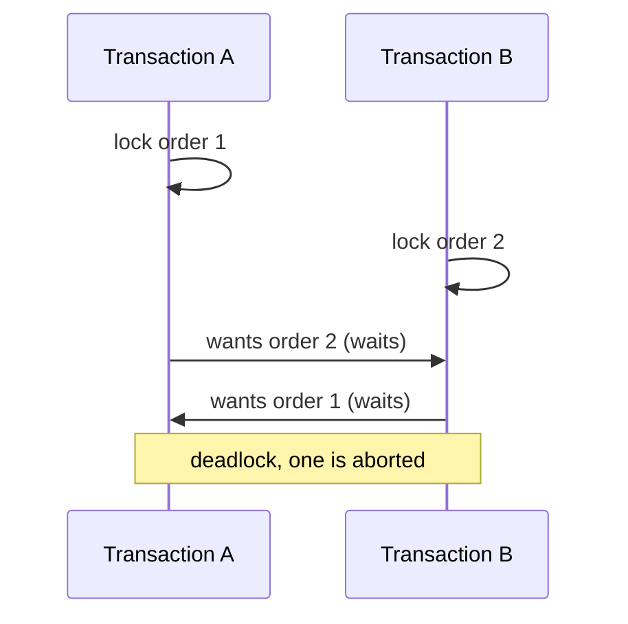

Each transaction waits for the lock the other holds. The cycle never ends by itself.

**Avoid**
- Touch tables and rows in the same order everywhere. If you update many rows, sort the ids first.
- Keep transactions short, with no user input or network calls inside.
- Index the columns you filter on in `UPDATE` and `DELETE`, so the database locks fewer rows (in SQL Server, a missing index can cause a scan that takes many locks).
- Lock early with `SELECT ... FOR UPDATE` if you will update the rows anyway.
- Use a lower lock level when safe, or row versioning (RCSI) so reads do not lock.

**Diagnose**
- PostgreSQL: set `log_lock_waits = on`. Deadlocks are logged with both statements (error 40P01). Use `pg_locks` joined to `pg_stat_activity` and `pg_blocking_pids(pid)` for live blocking.
- SQL Server: error 1205. Read the deadlock graph from the `system_health` Extended Events session or a trace. `sys.dm_tran_locks` and `sys.dm_exec_requests` (`blocking_session_id`) show live blocking.

**Handle in code:** treat deadlock and serialisation errors as retryable. Retry the whole transaction a few times with a small random delay.

**Gotcha:** blocking is not a deadlock. A long transaction that holds a lock can stall dozens of requests without any deadlock. The fix there is to find the head blocker.

**Interview tip:** describe the consistent ordering rule and the retry. Those two answers cover most follow-ups.

_Module: Transactions & Concurrency · Tags: locks, deadlocks_

### 35. What is the difference between optimistic and pessimistic concurrency, and how do version columns, SELECT FOR UPDATE and SKIP LOCKED fit in?

**Short answer:** Pessimistic concurrency locks the row up front so nobody else can change it while you work. Optimistic concurrency does not lock. It checks at write time that nobody changed the row since you read it, using a version column, and retries or fails if someone did. Use optimistic for low conflict, pessimistic for high conflict.

**Optimistic: version column**

```sql
-- read: id=7, version=3
UPDATE orders
SET status = 'shipped', version = version + 1
WHERE id = 7 AND version = 3;
-- rows affected = 1: success
-- rows affected = 0: someone else changed it, reload and retry or tell the user
```

This catches lost updates without holding locks during a user's think time. SQL Server's `rowversion` column type or an ETag in an API do the same job.

**Pessimistic: SELECT FOR UPDATE**

```sql
BEGIN;
SELECT * FROM inventory WHERE sku = 'A1' FOR UPDATE;  -- others wait here
UPDATE inventory SET qty = qty - 1 WHERE sku = 'A1';
COMMIT;
```

SQL Server uses table hints, for example `WITH (UPDLOCK, ROWLOCK)`.

**Job queue: SKIP LOCKED**

Many workers can take different rows without waiting for each other:

```sql
-- PostgreSQL (9.5+); SQL Server uses WITH (UPDLOCK, READPAST)
UPDATE jobs SET status = 'running'
WHERE id = (
  SELECT id FROM jobs WHERE status = 'pending'
  ORDER BY id LIMIT 1
  FOR UPDATE SKIP LOCKED
)
RETURNING id;
```

| Style | Good when | Cost |
| --- | --- | --- |
| Optimistic | conflicts are rare, long user think time | retries on conflict |
| Pessimistic | conflicts are common, short critical section | waiting, deadlock risk |
| SKIP LOCKED | a table used as a work queue | no strict ordering across workers |

**Gotcha:** locks are held until the transaction ends. Never keep a pessimistic lock while waiting for a human or a remote call.

**Interview tip:** for a "reserve the last item" problem, a single atomic `UPDATE ... SET qty = qty - 1 WHERE qty > 0` and checking the row count is often the simplest and best answer.

_Module: Transactions & Concurrency · Tags: optimistic-locking, concurrency, queues_

### 36. How do you read a query plan: EXPLAIN ANALYZE, scan types and join algorithms?

**Short answer:** A query plan is the tree of steps the database chose. `EXPLAIN` shows the estimated plan. `EXPLAIN ANALYZE` (PostgreSQL) also runs the query and shows real rows and time. Read it from the innermost step outward, compare estimated rows with actual rows, and look for the node where most time is spent.

```sql
EXPLAIN (ANALYZE, BUFFERS)
SELECT * FROM orders WHERE customer_id = 42 AND status = 'paid';
-- Index Scan using ix_orders_customer on orders  (cost=0.43..8.45 rows=3 width=40)
--   (actual time=0.03..0.05 rows=2 loops=1)
--   Index Cond: (customer_id = 42)
--   Filter: (status = 'paid')
```

(The numbers above are an illustration of the shape, not output from a real run.)

SQL Server shows the same ideas in the graphical actual execution plan, or with `SET STATISTICS IO, TIME ON`.

**Access methods**
- Sequential (table) scan: reads everything. Fine for small tables or when most rows are needed.
- Index scan or seek: walks the index to matching rows, then fetches the table rows.
- Index-only scan (PostgreSQL) or covering index (SQL Server): all needed columns are in the index, no table fetch. PostgreSQL also needs the visibility map to be up to date.
- Bitmap scan (PostgreSQL): collects many matching row locations, then reads table pages in order.

**Join algorithms**

| Algorithm | How | Best when |
| --- | --- | --- |
| Nested loop | for each outer row, look up the inner | few outer rows and an index on the inner side |
| Hash join | build a hash table of one side, probe with the other | larger, unsorted inputs, equality joins |
| Merge join | walk two sorted inputs together | both sides already sorted (or sorted cheaply) |

**What to look for**
- Estimated rows far from actual rows: stale statistics or correlated columns. This is the root of most bad plans.
- A scan that returns few rows out of many: a missing index.
- Sorts and hashes that spill to disk (`external merge`, `Batches > 1`, tempdb spills).
- A nested loop with a large `loops` count.
- Many shared buffer reads (`Buffers: shared read`): IO bound.

**Gotcha:** `EXPLAIN ANALYZE` executes data-changing statements. Wrap them in `BEGIN; ... ROLLBACK;`.

**Interview tip:** say "I compare estimated and actual rows first". It signals real experience.

_Module: Indexing & Query Performance · Tags: explain, query-plan, performance_

### 37. What are composite, covering, partial and expression indexes?

**Short answer:** A composite index covers several columns in a set order. A covering index holds every column a query needs, so the table is never touched. A partial (filtered) index covers only some rows. An expression index is built on a computed value, such as `lower(email)`.

```sql
-- Composite: serves WHERE customer_id = ? AND created_on > ?  ORDER BY created_on
CREATE INDEX ix_orders_cust_date ON orders (customer_id, created_on);

-- Covering (PostgreSQL 11+ INCLUDE; SQL Server INCLUDE too)
CREATE INDEX ix_orders_cust_cover ON orders (customer_id) INCLUDE (total);

-- Partial: tiny index for the hot slice (PostgreSQL syntax; SQL Server calls it a filtered index)
CREATE INDEX ix_orders_pending ON orders (created_on) WHERE status = 'pending';

-- Expression (PostgreSQL): case-insensitive lookup
CREATE INDEX ix_users_email_lower ON users (lower(email));
-- WHERE lower(email) = 'a@x.com' can now use the index
```

| Type | Helps with | Trade-off |
| --- | --- | --- |
| Composite | multi-column filters and sort | order matters, wide indexes cost more |
| Covering | read-heavy queries needing a few columns | larger index, more write cost |
| Partial | queues, "active" rows, soft-deleted tables | only helps queries that include the same condition |
| Expression | queries that filter on a function | query must use the exact same expression |
| Unique (any of the above) | enforce rules and speed up lookups | write cost |

**Notes**
- In SQL Server, computed columns can be indexed for the same effect as expression indexes. Filtered indexes have limits on which predicates the optimiser can match.
- A covering index removes the "key lookup" (SQL Server) or heap fetch (PostgreSQL). With included columns, they are stored in the leaf only and are not part of the sort order.
- Partial indexes for `status = 'pending'` stay small even if the table has billions of finished rows.

**Gotcha:** a covering index that includes many columns starts to duplicate the table and slows writes. Include only what the hot query selects.

**Interview tip:** the "pending jobs" partial index is a good concrete example to quote.

_Module: Indexing & Query Performance · Tags: indexes, composite, covering_

### 38. What are index selectivity, column order and the leftmost-prefix rule?

**Short answer:** Selectivity is how few rows a condition matches. A highly selective column (like `email`) narrows quickly. A low selectivity one (like `is_active`) does not. In a composite index, the leftmost-prefix rule says the index helps queries that use the first column, or the first two, and so on, but usually not a query that skips the first column.

For an index on `(customer_id, status, created_on)`:

| Query filters on | Uses the index well? |
| --- | --- |
| `customer_id` | yes |
| `customer_id` and `status` | yes |
| `customer_id`, `status`, `created_on` | yes, fully |
| `customer_id` and `created_on` (skips `status`) | partly: seeks on `customer_id`, filters the rest |
| `status` only | no (or a slow full index scan) |
| `created_on` only | no |

It works like a phone book sorted by last name, then first name. You can find "Singh, Anu" or all the Singhs, but you cannot find everyone called Anu without reading the whole book.

**Choosing the order**
- Put columns used with equality first, then the range column, then sort columns. Equality then range lets the index walk one contiguous slice.
- Among equality columns, put the more selective one first if queries sometimes use only one. If all queries use all of them, the order matters less for lookup but still affects what other queries it can serve.
- A range column stops the prefix: after a `>` condition, later columns cannot narrow the seek.
- Match the `ORDER BY` direction to avoid a sort.

```sql
-- Index (customer_id, created_on) serves both:
SELECT * FROM orders WHERE customer_id = 7 ORDER BY created_on DESC LIMIT 10;
-- one seek, reads 10 entries from the end, no sort step
```

**Gotcha:** low-selectivity columns on their own (booleans, status) make poor indexes, but they can be fine as the second column or in a partial index. Selectivity depends on the data distribution. A rare status value is selective, a common one is not, which is why statistics matter.

**Interview tip:** use the phone book analogy, then state the equality, range, sort order rule.

_Module: Indexing & Query Performance · Tags: indexes, selectivity, composite_

### 39. Why might the database ignore your index?

**Short answer:** The index may not match the query, the query may hide the column from the index, or the planner may judge that a scan is cheaper. Common causes are a function on the column, a type mismatch, a leading wildcard, `OR` conditions, low selectivity and stale statistics.

| Cause | Example | Fix |
| --- | --- | --- |
| Function on the column | `WHERE date(created_at) = '2024-05-01'` | range: `created_at >= '2024-05-01' AND created_at < '2024-05-02'` |
| Implicit cast | column `varchar`, parameter `nvarchar` (SQL Server) or text vs int | match the types in the query and the schema |
| Leading wildcard | `LIKE '%shirt'` | full text search, trigram index (PostgreSQL `pg_trgm`) |
| Leftmost prefix broken | index `(a, b)` and `WHERE b = 1` | new index or reorder |
| `OR` across columns | `WHERE a = 1 OR b = 2` | `UNION` of two queries, or separate indexes the planner can combine |
| Low selectivity | `WHERE is_active = true` on 95 percent of rows | partial index or accept the scan |
| Stale statistics | row counts changed a lot | `ANALYZE` (PostgreSQL), update statistics (SQL Server) |
| Small table | a few hundred rows | the scan really is faster |
| Wrong collation or case | `lower(email)` vs plain index | expression index |

```sql
-- ❌ bad: function on the column, index on created_at is skipped
SELECT * FROM orders WHERE date(created_at) = '2024-05-01';

-- ✅ good: index friendly range
SELECT * FROM orders
WHERE created_at >= '2024-05-01' AND created_at < '2024-05-02';
```

A condition the index can use is called sargable (search ARGument ABLE).

**Implicit conversion in SQL Server**

If a `varchar` column is compared with an `nvarchar` parameter, SQL Server converts the column side, which turns a seek into a scan. .NET and ORMs send strings as `nvarchar` by default, so set the column type on the parameter.

**Gotcha:** the planner is not broken when it ignores an index. Check the plan first. In PostgreSQL you can test with `SET enable_seqscan = off` to see whether the index could work, but never leave it like that in production.

**Interview tip:** name three causes without hesitation (function on column, type mismatch, leading wildcard) and say how you prove it with the plan.

_Module: Indexing & Query Performance · Tags: indexes, troubleshooting, sargable_

### 40. How does pagination work: OFFSET versus keyset?

**Short answer:** `OFFSET` pagination skips N rows and gets slower as N grows, because the database still reads and throws away the skipped rows. Keyset (cursor, seek) pagination remembers the last seen key and asks for rows after it, so each page costs the same. Use keyset for large or infinite lists.

Table with ids 1 to 6, two rows per page:

```sql
-- OFFSET: page 2
SELECT id FROM o ORDER BY id LIMIT 2 OFFSET 2;
-- prints: 3, 4

-- Keyset: page 2, given that the last id on page 1 was 2
SELECT id FROM o WHERE id > 2 ORDER BY id LIMIT 2;
-- prints: 3, 4
```

Both give the same page, but the second one jumps straight to id 3 using the index.

| | OFFSET | Keyset |
| --- | --- | --- |
| Deep pages | slow (reads skipped rows) | constant time |
| Rows inserted while paging | duplicates or skipped rows | stable |
| Jump to page 50 | easy | not possible, only next and previous |
| Needs | any ORDER BY | an index on a unique ordering |

**Sorting by a non-unique column**

Use a tie-breaker so the order is total, and compare both columns:

```sql
-- sort by created_on DESC, id DESC; last row seen: ('2024-05-01', 120)
SELECT id, created_on FROM orders
WHERE (created_on, id) < ('2024-05-01', 120)   -- row-value comparison (PostgreSQL)
ORDER BY created_on DESC, id DESC
LIMIT 20;
-- index: (created_on DESC, id DESC)
```

SQL Server has no row-value comparison, so write it out: `created_on < @d OR (created_on = @d AND id < @id)`.

**API design:** return an opaque cursor (encoded last key) with each page, not a page number.

**Gotcha:** `COUNT(*)` for "page 1 of 500" is also expensive on big tables. Show "next" and "previous" or an approximate count.

**Interview tip:** explain the cost of OFFSET in words, "to show page 1,000 it reads 20,000 rows to throw away 19,980", and offer keyset as the fix.

_Module: Indexing & Query Performance · Tags: pagination, keyset, performance_

### 41. What is the N+1 query problem, and how do you fix it?

**Short answer:** N+1 means you run one query to get N parent rows, then one more query for each parent to get its children, so 1 + N queries instead of 1 or 2. It looks fine with 10 rows in development and kills performance with 1,000 rows in production, because each query pays network latency.

```ts
// ❌ bad: 1 query for orders + one per order
const orders = await db.query('SELECT id, customer_id FROM orders LIMIT 100');
for (const o of orders.rows) {
  const c = await db.query('SELECT name FROM customers WHERE id = $1', [o.customer_id]);
  // 100 extra round trips
}

// ✅ good option 1: a join, one query
const rows = await db.query(
  `SELECT o.id, c.name FROM orders o JOIN customers c ON c.id = o.customer_id LIMIT 100`);

// ✅ good option 2: batch the children, two queries total
const ids = orders.rows.map(o => o.customer_id);
const customers = await db.query('SELECT id, name FROM customers WHERE id = ANY($1)', [ids]);
```

(`ANY($1)` with an array is PostgreSQL. In SQL Server use a table-valued parameter or `IN (...)`.)

**Where it hides**
- ORMs with lazy loading: `order.customer.name` inside a loop. Fix with eager loading (`include`, `Include()`, `joinedload`, `preload`).
- GraphQL resolvers that load one child per parent. Fix with a batching layer such as DataLoader.
- Microservices calling another service once per item.

**Detect**
- Log SQL in tests and assert query counts per endpoint.
- Datadog APM or similar: look for the same query shape repeated many times in one trace.
- `pg_stat_statements`: a tiny query with a huge call count.

**Trade-off:** a join can multiply rows when loading a one-to-many (an order with 50 items repeats the order columns 50 times). For wide parents, two queries with `IN` are often better than one big join.

**Gotcha:** the loop is not always visible. Serialisers, templates and permission checks can trigger lazy loads.

**Interview tip:** give the numbers: "100 queries at 2 ms of network each is 200 ms before the database even works".

_Module: Indexing & Query Performance · Tags: n-plus-one, orm, performance_

### 42. How do bulk inserts and upserts work: ON CONFLICT and MERGE?

**Short answer:** For bulk loads, send many rows per statement or use the bulk copy API, inside one transaction. An upsert inserts a row, or updates it if the key already exists, in one atomic statement. PostgreSQL and SQLite use `INSERT ... ON CONFLICT`. SQL Server uses `MERGE`, which has pitfalls.

**Upsert (PostgreSQL / SQLite syntax; verified in SQLite)**

```sql
CREATE TABLE stock (sku TEXT PRIMARY KEY, qty INT);
INSERT INTO stock VALUES ('A', 5);

INSERT INTO stock VALUES ('A', 3), ('B', 7)
ON CONFLICT (sku) DO UPDATE SET qty = stock.qty + excluded.qty;

SELECT * FROM stock ORDER BY sku;
-- prints: A | 8
--         B | 7
```

`excluded` means the row you tried to insert. `DO NOTHING` skips duplicates instead (useful for idempotent consumers).

**SQL Server MERGE**

```sql
MERGE stock WITH (HOLDLOCK) AS t
USING (VALUES ('A', 3), ('B', 7)) AS s (sku, qty) ON t.sku = s.sku
WHEN MATCHED THEN UPDATE SET t.qty = t.qty + s.qty
WHEN NOT MATCHED THEN INSERT (sku, qty) VALUES (s.sku, s.qty);
```

Caveats: without `HOLDLOCK`, two sessions can both decide "not matched" and one hits a duplicate key error. `MERGE` has had several bugs over the years, and many teams prefer separate `UPDATE` then `INSERT` inside a transaction with proper locking. PostgreSQL 15 added a standard `MERGE` too, but `ON CONFLICT` remains the safer upsert there.

**Fast bulk loading**

| Method | Notes |
| --- | --- |
| Multi-row `INSERT ... VALUES (...), (...)` | batch of hundreds to a few thousand rows |
| PostgreSQL `COPY` | fastest way to load files or streams |
| SQL Server `BULK INSERT`, `bcp`, `SqlBulkCopy` | bulk path with minimal logging options |
| Drop or defer indexes for huge initial loads | rebuild after, check constraints first |

**Rules of thumb**
- Batch in chunks (for example 1,000 rows) inside a transaction. One row per round trip is the slow way.
- Make writes idempotent so retries are safe.
- Large single statements make long locks and replication lag, so pause between batches.

**Gotcha:** upsert with a trigger or serial id can burn sequence numbers even when the row is not inserted. That is normal.

**Interview tip:** the point to make is that "check then insert" in application code has a race, while an upsert is atomic.

_Module: SQL Fundamentals · Tags: upsert, bulk-insert, merge_

### 43. What are JSON and JSONB columns in PostgreSQL, and when should you use them?

**Short answer:** PostgreSQL can store JSON in a `jsonb` column, which is a binary format you can index and query. Use it for flexible, sparse or rarely filtered attributes, such as extra metadata or webhook payloads. Do not use it to hide a proper schema for data you join, filter and constrain often.

```sql
CREATE TABLE events (
  id      BIGINT GENERATED ALWAYS AS IDENTITY PRIMARY KEY,
  payload JSONB NOT NULL
);

-- Read fields
SELECT payload->>'type' AS type,                -- ->> returns text
       payload->'customer'->>'id' AS customer   -- -> returns JSON, so you can keep drilling
FROM events;

-- Containment test, can use a GIN index
SELECT id FROM events WHERE payload @> '{"type": "refund"}';

CREATE INDEX ix_events_payload ON events USING GIN (payload);
-- Or index one field only
CREATE INDEX ix_events_type ON events ((payload->>'type'));
```

(PostgreSQL syntax; not runnable in SQLite.)

| | `json` | `jsonb` |
| --- | --- | --- |
| Storage | exact text copy | parsed binary |
| Key order and duplicates kept | yes | no |
| Indexable | no | yes (GIN, expression indexes) |
| Use | keep exact input | almost always |

**Good uses:** audit payloads, third-party responses, user preferences, per-tenant custom fields, a short time before you know the final columns.

**Costs and limits**
- No type safety or foreign keys on values inside. Constraints must use `CHECK` on expressions.
- Updating one key rewrites the whole value.
- Big values are stored out of line (TOAST), so reading a small field can still read a lot.
- Statistics on JSON fields are weak, so plans can be worse than with real columns.
- Reporting is harder.

**Hybrid pattern:** real columns for what you filter, join and constrain, and one `jsonb` column for the rest. When a JSON field becomes important, promote it to a real column.

SQL Server stores JSON as text in `nvarchar(max)`, with functions such as `JSON_VALUE` and `OPENJSON`, and you index it through computed columns.

**Gotcha:** "schemaless" moves the schema into the code and the data, where it is harder to see.

**Interview tip:** say "JSONB for flexible edges, columns for the core".

_Module: PostgreSQL · Tags: postgresql, jsonb, semi-structured_

### 44. How does full-text search work in a relational database?

**Short answer:** Full-text search breaks text into normalised words (tokens), stores them in an inverted index (word to list of rows), and ranks matches. It handles stemming ("running" matches "run"), stop words and relevance. It is much better than `LIKE '%word%'`, which cannot use a normal index.

**PostgreSQL**

```sql
ALTER TABLE products ADD COLUMN search tsvector
  GENERATED ALWAYS AS (to_tsvector('english', name || ' ' || coalesce(description, ''))) STORED;

CREATE INDEX ix_products_search ON products USING GIN (search);

SELECT id, name
FROM products
WHERE search @@ websearch_to_tsquery('english', 'red running shoes -sandals')
ORDER BY ts_rank(search, websearch_to_tsquery('english', 'red running shoes -sandals')) DESC
LIMIT 20;
```

`tsvector` is the prepared document. `tsquery` is the prepared query. `@@` is the match operator. A GIN index makes it fast. For typo-tolerant or substring matching, the `pg_trgm` extension indexes three-letter pieces and supports `LIKE '%word%'` and similarity.

**SQL Server**

```sql
CREATE FULLTEXT CATALOG ft_catalog;
CREATE FULLTEXT INDEX ON dbo.products (name, description)
  KEY INDEX pk_products ON ft_catalog;

SELECT id, name FROM dbo.products WHERE CONTAINS((name, description), '"running" AND "shoes"');
```

**When the database is enough, and when to add a search engine**

| Need | Database full-text | Elasticsearch or OpenSearch |
| --- | --- | --- |
| Simple keyword search on one table | enough | overkill |
| Same transaction as the data | yes | no, it is a copy that lags |
| Facets, fuzzy matching, many languages, relevance tuning | limited | built for it |
| Millions of searches per day, heavy analytics | strained | scales out |

**Gotcha:** keeping a separate search engine in sync needs a pipeline (CDC or outbox) and handling of lag and re-indexing. Start with the database, and move when you can name the missing feature.

**Interview tip:** show the three words tokenise, index, rank, and then say when you would graduate to Elasticsearch.

_Module: PostgreSQL · Tags: full-text-search, postgresql, sql-server_

### 45. What is table partitioning (range, hash, list), and what are its benefits?

**Short answer:** Partitioning splits one logical table into smaller physical pieces by a key. Range partitions split by value ranges (usually dates), list partitions by explicit values (region), and hash partitions by a hash of the key to spread rows evenly. The main benefits are fast data removal, smaller indexes, partition pruning and easier maintenance.

```sql
-- PostgreSQL declarative partitioning (version 10 and later)
CREATE TABLE payments (
  id         BIGINT NOT NULL,
  created_on DATE   NOT NULL,
  amount     INT    NOT NULL,
  PRIMARY KEY (id, created_on)          -- the key must include the partition column
) PARTITION BY RANGE (created_on);

CREATE TABLE payments_2024_05 PARTITION OF payments
  FOR VALUES FROM ('2024-05-01') TO ('2024-06-01');

-- Retention: instant, no big delete, no bloat
ALTER TABLE payments DETACH PARTITION payments_2024_05;
DROP TABLE payments_2024_05;
```

SQL Server uses a partition function and partition scheme, and `SWITCH` moves a partition in or out in a metadata operation. Partitioning in SQL Server is available in Standard edition from SQL Server 2016 SP1.

| Type | Splits by | Good for |
| --- | --- | --- |
| Range | date or number ranges | time series, logs, retention |
| List | fixed values | region, tenant group |
| Hash | hash of a key | spreading load evenly, no natural range |

**Benefits**
- Partition pruning: a query with a filter on the key reads only the matching partitions.
- Dropping or archiving old data is a metadata step.
- Vacuum or index maintenance runs per partition.
- Hot recent data stays in cache.

**Costs and limits**
- Queries without the partition key scan all partitions.
- Unique constraints must include the partition key.
- Too many partitions (thousands) slow down planning.
- You must create future partitions ahead of time (a job or `pg_partman`).
- It does not make a badly indexed query fast, and it is not sharding because all partitions live on the same server.

**Gotcha:** partitioning by a column nobody filters on gives all the cost and none of the pruning.

**Interview tip:** say time-range partitioning for retention is the best-known reason, and that you check the query plan shows pruning.

_Module: Scaling & Replication · Tags: partitioning, postgresql, retention_

### 46. What are the types of database replication, and how do failover and high availability work?

**Short answer:** Replication copies changes from a primary to other servers. It can be synchronous (the commit waits for the copy) or asynchronous (it does not), and physical (copies storage-level log records, so the replica is an exact byte-level copy) or logical (copies row-level changes, so you can replicate part of the data or to a different version). High availability means a replica can take over quickly when the primary fails.

| Choice | Option A | Option B |
| --- | --- | --- |
| Timing | Synchronous: no committed data lost on failover, slower commits, a down standby can stall writes | Asynchronous: fast commits, a failover can lose the last few transactions |
| Format | Physical (streaming WAL in PostgreSQL): whole cluster, same major version, replica read-only | Logical (publication and subscription): selected tables, cross-version, can feed other systems, schema changes are not replicated automatically |

**Failover steps**
1. Detect the failure with health checks, with a timeout long enough to avoid false alarms.
2. Pick the most up-to-date replica.
3. Promote it to primary.
4. Move traffic: a virtual IP, DNS change, proxy or a connection listener.
5. Rebuild the old primary as a replica. If it has data that never reached the new primary, you must rewind or re-clone it.

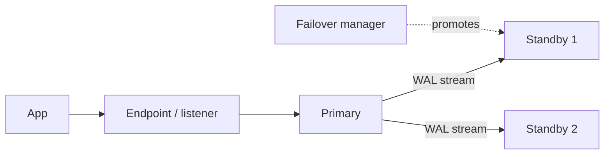

The app talks to one stable endpoint. The manager promotes a standby and moves the endpoint.

**Tools:** PostgreSQL commonly uses Patroni (with a consensus store like etcd) or the managed service's built-in HA. SQL Server uses Always On availability groups or failover cluster instances. Azure managed services offer zone-redundant HA.

**Gotchas**
- Split brain: two nodes both think they are primary. Fencing and consensus prevent it.
- Applications must reconnect and retry. Test with real failovers (game days), including how long connections stay broken.
- Failover is not backup. A bad delete replicates.
- Synchronous commit to a standby in another region adds that round trip to every write.

**Interview tip:** state the RPO difference: synchronous gives zero data loss in theory, asynchronous gives a small loss window. Then mention fencing.

_Module: Scaling & Replication · Tags: replication, failover, high-availability_

### 47. How does PostgreSQL VACUUM work, and what are bloat and autovacuum?

**Short answer:** Because of MVCC, an `UPDATE` or `DELETE` in PostgreSQL leaves the old row version behind as a dead row. `VACUUM` marks that space reusable and keeps visibility information up to date. Autovacuum runs it automatically. If it falls behind, tables and indexes bloat, queries slow down and in the worst case the database must stop to avoid transaction id wraparound.

**What vacuum does**
- Removes dead rows from view so their space can be reused (it does not normally shrink the file).
- Updates the visibility map, which enables index-only scans.
- Freezes old row versions so transaction ids can be reused safely (this prevents wraparound).
- `ANALYZE` (often run together) refreshes planner statistics.

```sql
-- Which tables have the most dead rows?
SELECT relname, n_live_tup, n_dead_tup, last_autovacuum
FROM pg_stat_user_tables
ORDER BY n_dead_tup DESC
LIMIT 5;
```

**Autovacuum triggers** when dead rows exceed a threshold plus a fraction of the table (by default 50 rows plus 20 percent of the table). For a 100-million-row table, 20 percent is far too late, so lower `autovacuum_vacuum_scale_factor` for large, busy tables:

```sql
ALTER TABLE payments SET (autovacuum_vacuum_scale_factor = 0.02);
```

**Why vacuum may not keep up**
- A long-running transaction, an `idle in transaction` session, or a stuck replication slot or hot standby feedback holds back cleanup. Dead rows still visible to them cannot be removed.
- Very high update rates with default settings.
- Too few autovacuum workers or too low a cost limit.

**Bloat and fixes**
- `VACUUM FULL` rewrites the table and shrinks it but takes an exclusive lock. Use `pg_repack` for online compaction.
- Reduce churn: avoid updating rows when nothing changed, and keep rows small. A `fillfactor` below 100 lets updates stay on the same page (HOT updates) if the changed columns are not indexed.

| Symptom | Likely cause |
| --- | --- |
| Table much bigger than the data | bloat, vacuum behind |
| Index-only scans still read the table | visibility map out of date |
| Warnings about wraparound | freeze not finishing, a blocker holds the horizon |

**Gotcha:** disabling autovacuum "for performance" is a classic mistake that ends in an outage.

**Interview tip:** link it to MVCC: "dead row versions are the price of non-blocking reads, and vacuum pays the bill".

_Module: PostgreSQL · Tags: postgresql, vacuum, bloat_

### 48. What are PostgreSQL extensions such as pgvector and PostGIS, and when do they fit?

**Short answer:** Extensions add types, functions, index methods and sometimes background features to PostgreSQL. Popular ones include PostGIS for geographic data, pgvector for embeddings and similarity search, pg_stat_statements for query statistics, pg_trgm for fuzzy text and TimescaleDB for time series. They let one database cover needs that would otherwise need a separate system.

```sql
CREATE EXTENSION IF NOT EXISTS vector;

CREATE TABLE docs (
  id        BIGINT GENERATED ALWAYS AS IDENTITY PRIMARY KEY,
  body      TEXT,
  embedding vector(3)          -- real models use hundreds or thousands of dimensions
);

CREATE INDEX ix_docs_embedding ON docs USING hnsw (embedding vector_cosine_ops);

-- nearest neighbours by cosine distance
SELECT id FROM docs ORDER BY embedding <=> '[0.1, 0.2, 0.3]' LIMIT 5;
```

(PostgreSQL with pgvector; shown to explain the concept, not run here.)

| Extension | Adds | Typical use |
| --- | --- | --- |
| PostGIS | geometry types, spatial indexes and functions | "find stores within 5 km" |
| pgvector | vector type, similarity operators, HNSW and IVFFlat indexes | semantic search, retrieval for AI |
| pg_stat_statements | per-query statistics | finding slow queries |
| pg_trgm | trigram similarity and indexes | fuzzy and `LIKE '%x%'` search |
| pgcrypto | hashing and encryption functions | careful, small uses |

**Why use them**
- Same transactions, backups, permissions and joins as the rest of your data.
- No sync pipeline to a second system.
- Often enough for moderate scale.

**Limits to check**
- Managed services allow only an approved list of extensions, so verify yours is available on Azure Database for PostgreSQL.
- Approximate vector indexes trade recall for speed and use a lot of memory. Dedicated vector databases scale better at very large sizes.
- Extension upgrades must match the PostgreSQL major version plan.

**Gotcha:** an extension is one more thing to test during major upgrades.

**Interview tip:** the decision is "stay in PostgreSQL until a measured limit forces a separate store".

_Module: PostgreSQL · Tags: postgresql, extensions, pgvector_

### 49. What are clustered and non-clustered indexes in SQL Server?

**Short answer:** In SQL Server, a clustered index is the table itself, stored in the order of the index key. There can be only one per table. A non-clustered index is a separate structure whose entries point back to the rows, using the clustered key as the row locator. A table with no clustered index is a heap.

```sql
CREATE TABLE dbo.Orders (
  OrderId    BIGINT IDENTITY(1,1) NOT NULL,
  CustomerId INT NOT NULL,
  Total      DECIMAL(12,2) NOT NULL,
  CONSTRAINT PK_Orders PRIMARY KEY CLUSTERED (OrderId)
);

CREATE NONCLUSTERED INDEX IX_Orders_Customer
  ON dbo.Orders (CustomerId)
  INCLUDE (Total);       -- covers queries that need CustomerId and Total
```

(SQL Server syntax; not run here.)

| | Clustered | Non-clustered |
| --- | --- | --- |
| Count per table | one | many (up to 999) |
| Holds | the full rows in key order | key columns, included columns and the clustered key |
| Lookup cost | direct | may need a key lookup into the clustered index |
| Range scans on the key | very fast | fast if covering |

**Design advice**
- The clustered key is copied into every non-clustered index. Keep it narrow, unique, ever-increasing and stable (an identity `BIGINT` is the usual pick). A random `NEWID()` clustered key causes page splits and bloats every other index.
- The primary key is clustered by default, but you can choose otherwise.
- A key lookup per row is cheap for a few rows and costly for thousands. Add `INCLUDE` columns for hot queries or let the optimiser scan.
- Columnstore indexes (clustered or non-clustered) suit analytics and large scans.

**PostgreSQL comparison:** PostgreSQL tables are heaps and every index is secondary and points to a physical row location. `CLUSTER` reorders a table once but does not keep it ordered afterwards.

**Gotcha:** the clustered key decides the physical order, so an update that changes it moves the row.

**Interview tip:** mention that the clustered key choice affects every other index, which is why a narrow sequential key is the default advice.

_Module: SQL Server · Tags: sql-server, clustered-index, indexes_

### 50. What are SQL Server execution plans and parameter sniffing?

**Short answer:** SQL Server compiles a query into an execution plan and caches it for reuse. With parameter sniffing, the first call's parameter values are used to choose the plan. That is good when values are typical and bad when the data is skewed: a plan built for a rare value can be terrible for a common one.

Example: `WHERE CustomerId = @id`. For a customer with 3 orders the best plan is an index seek plus lookups. For a customer with 2 million orders a scan is better. If the plan for the small customer is cached, the big customer's call runs a slow plan, and the reverse.

**How to spot it**
- The same procedure is fast in Management Studio but slow from the app (different SET options give a different cached plan), or fast for some inputs and slow for others.
- Query Store shows multiple plans for one query with very different durations.
- In the actual plan, compare "Parameter Compiled Value" with "Parameter Runtime Value", and estimated rows with actual rows.

**Fixes, from least to most invasive**
| Fix | Effect |
| --- | --- |
| Update statistics | better estimates |
| `OPTION (RECOMPILE)` | new plan each call, costs CPU, fine for rare heavy queries |
| `OPTION (OPTIMIZE FOR (@id UNKNOWN))` | plan based on average density |
| Query Store plan forcing | pin a known good plan (SQL Server 2016 and later) |
| Split the code path | a separate query or procedure for large customers |
| Parameter Sensitive Plan optimisation | built in to SQL Server 2022 at compatibility level 160, keeps several plans per query |

```sql
SELECT OrderId, Total
FROM dbo.Orders
WHERE CustomerId = @CustomerId
OPTION (RECOMPILE);
```

**Reading plans:** start at the top right, follow the thickest arrows (rows), look for key lookups, scans on big tables, sort or hash spills and warnings about implicit conversion.

**Gotcha:** clearing the whole plan cache in production to "fix" it causes a compile storm. Target the single plan instead.

**Interview tip:** explain it with the small customer versus big customer story, then list three fixes and why `OPTION (RECOMPILE)` is not free.

_Module: SQL Server · Tags: sql-server, execution-plan, parameter-sniffing_

### 51. What should you know about tempdb and the key T-SQL differences from standard SQL and PostgreSQL?

**Short answer:** tempdb is SQL Server's shared scratch database. It holds temp tables, table variables, sort and hash spills, and row versions for snapshot isolation. Because every database uses it, a heavy workload there slows everyone. T-SQL also differs from other dialects in syntax details that matter when you port queries.

**tempdb**
- Used for: `#temp` tables, `@table` variables, worktables, spills when a sort or hash does not get enough memory, version store for RCSI and snapshot isolation, index builds with `SORT_IN_TEMPDB`.
- Recreated at every restart. Use several equally sized data files (commonly up to 8) to reduce allocation contention, and put it on fast storage.
- Watch: file growth, version store size, long open transactions, and queries with spill warnings.

**T-SQL differences**

| Task | Standard / PostgreSQL | T-SQL |
| --- | --- | --- |
| Limit rows | `LIMIT n` | `SELECT TOP (n)` or `OFFSET ... FETCH` |
| Null fallback | `COALESCE(a, b)` | `ISNULL(a, b)` also works, but returns the type of the first argument, so a short column can truncate the result |
| Auto id | `GENERATED ... AS IDENTITY` | `IDENTITY(1,1)` |
| Concatenate | `a \|\| b` | `a + b` or `CONCAT(a, b)` |
| Current time | `now()` | `SYSUTCDATETIME()`, `GETDATE()` |
| Boolean type | `boolean` | no boolean column, use `BIT` |
| String aggregate | `string_agg(x, ',')` | `STRING_AGG(x, ',')` (2017 and later) |
| Upsert | `ON CONFLICT` | `MERGE` (with caveats) |
| Variables | `:name` or `$1` | `@name`, `DECLARE @x INT` |

Other points: identifiers can be quoted with `[brackets]`, `SET NOCOUNT ON` in procedures stops "rows affected" chatter, and `TRY ... CATCH` with `THROW` handles errors. `SET XACT_ABORT ON` makes runtime errors roll back the transaction.

```sql
-- T-SQL: top 3 biggest orders
SELECT TOP (3) OrderId, Total
FROM dbo.Orders
ORDER BY Total DESC;
```

**Gotcha:** table variables had poor row estimates for years (fixed in part by deferred compilation in SQL Server 2019). A temp table with statistics is often better for large intermediate sets.

**Interview tip:** show you can move between dialects: name TOP, ISNULL, IDENTITY and MERGE as the first four differences.

_Module: SQL Server · Tags: sql-server, tempdb, t-sql_

### 52. What are Always On availability groups in SQL Server?

**Short answer:** An Always On availability group (AG) keeps one or more databases synchronised from a primary replica to up to several secondary replicas. Secondaries can take over after a failure and can serve read-only queries or backups. A listener gives clients one stable name that always points to the current primary.

**Concepts**
- Replicas: one primary accepts writes. Secondaries receive the transaction log.
- Synchronous commit: the primary waits for the secondary to harden the log. No data loss, supports automatic failover, adds latency. Used within a data centre or zone.
- Asynchronous commit: no wait. Possible data loss on failover. Used across regions for disaster recovery.
- Listener: a virtual network name. Clients connect to it, ideally with `MultiSubnetFailover=True` for fast reconnect.
- Cluster manager: Windows Server Failover Clustering on Windows, Pacemaker on Linux, decides failover and prevents split brain through quorum.
- Readable secondaries: offload reports and backups. Read-only routing sends `ApplicationIntent=ReadOnly` connections to a secondary.

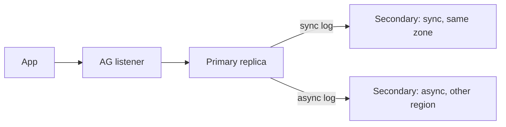

The listener always points at the primary. A synchronous secondary gives safe failover. An asynchronous one gives disaster recovery.

**Compared with other options**

| Option | Level | Notes |
| --- | --- | --- |
| Failover cluster instance | whole instance, shared storage | no readable copy |
| Availability group | database level | readable secondaries, several copies |
| Log shipping | database level, manual failover | simple, higher RPO |
| Azure SQL Database | managed | HA built in, no setup |

**Edition note:** Standard edition supports only Basic availability groups (limited: one database, no readable secondary). Full AGs need Enterprise. Check the current licensing docs before you plan.

**Gotchas**
- Logins, jobs and linked servers are not replicated with the database. Keep them in sync yourself.
- Long-running transactions on the primary slow log truncation, and a slow secondary can build a large send queue.
- Readable secondaries use snapshot isolation, which adds version store load.

**Interview tip:** say sync for HA within a region and async for DR across regions, and mention the listener and quorum.

_Module: SQL Server · Tags: sql-server, always-on, high-availability_

### 53. How do you put Redis in front of a database: cache-aside and invalidation?

**Short answer:** In the cache-aside pattern the app checks Redis first. On a miss it reads the database, stores the result in Redis with a time to live (TTL), and returns it. On writes the app updates the database and deletes the cached key. It is simple and safe, but the cache can be briefly stale.

```ts
async function getProduct(id: string) {
  const key = `product:${id}`;
  const cached = await redis.get(key);
  if (cached) return JSON.parse(cached);              // hit

  const row = await db.query('SELECT * FROM products WHERE id = $1', [id]);
  if (row.rows[0]) {
    // TTL with a little random jitter so keys do not all expire together
    const ttl = 300 + Math.floor(Math.random() * 60);
    await redis.set(key, JSON.stringify(row.rows[0]), { EX: ttl });
  }
  return row.rows[0];
}

async function updateProduct(id: string, data: object) {
  await db.query('UPDATE products SET name = $2 WHERE id = $1', [id, (data as any).name]);
  await redis.del(`product:${id}`);                   // invalidate, do not update the cache
}
```

**Why delete instead of update on write:** two concurrent writers could write the cache in the wrong order. Deleting makes the next read reload the latest committed value.

| Pattern | How | Risk |
| --- | --- | --- |
| Cache-aside | app manages cache | stale reads, cold cache |
| Read-through | cache library loads on miss | same, simpler code |
| Write-through | write cache and DB together | slower writes, double-write consistency |
| Write-behind | write cache, DB later | data loss if the cache dies |

**Problems to plan for**
- Cache stampede: a hot key expires and 1,000 requests hit the database. Use a lock or single flight, stale-while-revalidate, and TTL jitter.
- Stale data: pick the TTL by how wrong the data may be. Invalidate on writes where it matters.
- Negative caching: also cache "not found" briefly to stop repeated misses.
- Cold start after a restart: the database takes the full load, so warm hot keys or protect it with rate limits.
- The race: a reader loads old data, a writer updates and deletes the key, then the reader stores the old data. A short TTL limits the damage.

**Gotcha:** caching hides a bad query. Fix the query first when it is cheap to do so.

**Interview tip:** the sentence "there are only two hard problems, and one is cache invalidation" gets a smile, but follow it with TTL plus delete on write plus stampede protection.

_Module: NoSQL & Caching · Tags: redis, caching, cache-aside_

### 54. What types of NoSQL databases exist, and when does each fit?

**Short answer:** NoSQL covers several different designs: document stores, key-value stores, wide-column stores, graph databases, search engines and time-series databases. Each trades some relational features (joins, strict schema, multi-row transactions) for scale, flexibility or speed in one access pattern.

| Type | Data shape | Strength | Weakness | Examples |
| --- | --- | --- | --- | --- |
| Document | JSON-like documents | flexible schema, one read gets a whole aggregate | joins and cross-document transactions are limited or costly | MongoDB, Cosmos DB |
| Key-value | key to value | microsecond lookup, simple | query only by key | Redis, DynamoDB |
| Wide-column | rows with sparse columns grouped by partition key | huge write throughput, linear scale | you must design tables per query, limited ad hoc queries | Cassandra, ScyllaDB |
| Graph | nodes and edges | deep relationship queries (friends of friends) | not for bulk analytics | Neo4j, Neptune |
| Search | inverted index | full text, facets, relevance | not a source of truth, eventual consistency | Elasticsearch, OpenSearch |
| Time-series | timestamped points | compression, rollups, retention | narrow use | TimescaleDB, InfluxDB |

**Fit examples**
- Product catalogue with varied attributes read as one unit: document.
- Sessions, rate limits, leaderboards, locks: key-value (Redis).
- Messages or sensor events at very high write rates with a known read path: wide-column.
- Recommendation or fraud rings: graph.
- Site search: search engine fed from the main database.
- Metrics: time-series.

**The honest comparison with a relational database**
- PostgreSQL covers documents (JSONB), search, vectors, queues and time-series (with an extension) at moderate scale, with transactions.
- NoSQL "scale" often means giving up consistency or flexibility of queries. In wide-column stores you decide your queries before the schema.
- Many NoSQL systems are eventually consistent by default, with tunable levels.

**Gotchas**
- Modelling relational data in a document store and then needing joins everywhere.
- Treating a cache or search index as the source of truth.
- Hot partitions on a skewed key.

**Interview tip:** give a one-line "choose it when" for each type, and say you start with a relational database and add a specialist for a measured need.

_Module: NoSQL & Caching · Tags: nosql, mongodb, cassandra_

## Advanced

### 55. [Tech Lead] When should you shard or partition a database, and when should you not?

**Short answer:** Partitioning splits one big table inside one database. Sharding splits data across several database servers. Both add complexity, so first exhaust simpler options: better queries and indexes, caching, read replicas, archiving old data and a bigger machine. Shard only when a single node truly cannot handle the writes or the data size.

| Technique | Where data lives | Solves | Cost |
| --- | --- | --- | --- |
| Partitioning | same server | maintenance, retention, pruning scans | design of the key |
| Read replicas | copies of all data | read throughput | lag |
| Sharding | different servers | write throughput, storage beyond one node | large: routing, cross-shard queries, resharding |

**What sharding takes away**
- Cross-shard joins and transactions become hard or impossible.
- Unique constraints across shards need extra design.
- Reporting needs a separate path (a warehouse).
- Rebalancing when a shard gets full is painful.
- Hot shards: one big tenant or a celebrity key.
- Operations multiply: backups, migrations, monitoring per shard.

**My checklist before agreeing to shard**
1. Show the evidence: CPU or IO saturated on the largest instance, after tuning.
2. Archive or drop cold data. Often 80 percent of rows are never read.
3. Try partitioning by time with a retention policy.
4. Consider a managed distributed option (Citus, CockroachDB, Cosmos DB, Azure SQL Hyperscale) that hides the routing.
5. If sharding is still needed, choose a key that groups data accessed together, usually the tenant or customer id, with many more logical shards than servers so they can be moved.

**Gotcha:** sharding by something like `created_at` sends every new write to one shard. A good shard key spreads writes and keeps queries on one shard.

**Interview tip:** say "I would not shard until measurements force it", and then show that you know the key choice and the lost features.

_Module: Scaling & Replication · Tags: tech-lead, sharding, partitioning_

### 56. [Tech Lead] How do you handle PII, encryption, retention and audit in a database?

**Short answer:** Know where personal data lives, collect less of it, protect it in transit and at rest, limit who can read it, delete it on a schedule, and keep a trustworthy record of access and changes. Treat these as design requirements from the start, not as a later patch.

**Layers**
- Inventory and minimise: list columns that hold PII (name, email, phone, address, ids). Do not store what you do not need. Keep it out of logs and analytics copies.
- In transit: TLS between app and database. Require it in the connection settings.
- At rest: disk or transparent data encryption (TDE in SQL Server, managed disk encryption on Azure). This protects stolen disks and backups, not a rogue query.
- Column level: encrypt or tokenise very sensitive fields (national ids, card data). SQL Server has Always Encrypted. In PostgreSQL use application-side encryption or `pgcrypto` with care for keys. Do not store raw card numbers. Use a payment provider's token.
- Keys: keep them in a key vault (Azure Key Vault), rotate them, and never put them in the same place as the data.
- Access control: least privilege roles, no shared admin logins, short-lived credentials, separate read-only roles. Use views or column permissions, masking (SQL Server dynamic data masking, which is a convenience and not strong security) for support tools.
- Audit: record who read or changed sensitive data and when. Options: audit tables and triggers, PostgreSQL `pgaudit`, SQL Server Audit, plus append-only storage for the logs.
- Retention and deletion: define how long each data type is kept. Delete or anonymise on schedule. Partitioning by time makes this fast. Right-to-erasure requests need a path that also reaches backups, replicas and search indexes (often by expiring backups and keeping a deletion list to replay after restore).

**Gotchas**
- Production data copied to staging or laptops is the most common leak. Mask or generate test data.
- Soft delete is not erasure.
- Backups and logs also contain PII, so apply the same controls.

**Interview tip:** structure the answer as find, minimise, protect, control access, audit, delete. Mention that legal requirements (GDPR, local rules) come from your compliance team, and you build the mechanisms.

_Module: Operations & Migrations · Tags: tech-lead, security, privacy_

### 57. [Tech Lead] How would you run and write up a database outage incident?

**Short answer:** Stabilise first, understand later. Assign roles, restore service with the safest action, communicate clearly, preserve evidence, and then write a blameless review with a timeline, root causes, and follow-up actions that have owners and dates.

**During the incident**
1. Declare it, name an incident commander, and keep one channel for the timeline.
2. Check recent changes first: deploy, migration, config, traffic, failover. Rolling back a change is often the fastest fix.
3. Protect the database: shed load (feature flags, rate limits), stop runaway queries (`pg_cancel_backend`, `KILL` in SQL Server), pause batch jobs, and cap connections.
4. Avoid risky moves under pressure, such as a restore over the live database or dropping indexes, unless the plan is clear.
5. Communicate every 15 to 30 minutes: what we know, what we do, when the next update comes.

**Write-up template (blameless)**

| Section | Content |
| --- | --- |
| Summary | one paragraph: impact, duration, customers affected |
| Impact | error rates, lost orders, SLA effects, data loss yes or no |
| Timeline | detection, escalation, mitigation, recovery, with timestamps |
| Root cause | the chain of causes, using "five whys" down to the process level |
| Detection | how we found out, and why the alert was late or missing |
| What went well | what helped |
| Action items | each with owner, priority and date |

**Example root cause chain:** a migration added an index without `CONCURRENTLY`, it blocked writes for 8 minutes, the connection pool filled, health checks failed and pods restarted, making a connection storm. Actions: lint migrations for blocking statements, set `lock_timeout`, cap pool size, add a pool wait alert.

**Gotchas**
- Fixing only the trigger (the index) and not the amplifier (no limits on connections).
- Action items that nobody tracks.
- Blaming a person instead of the gap that allowed the mistake.

**Interview tip:** have one real story ready in this shape. Say what you changed in the system afterwards, not only what you fixed that night.

_Module: Operations & Migrations · Tags: tech-lead, incident-response, postmortem_

### 58. How do B-tree and LSM-tree storage engines differ, and what is each good at?

**Short answer:** A B-tree updates data in place in sorted pages on disk, which gives fast reads and predictable latency. An LSM-tree (log-structured merge-tree) buffers writes in memory, flushes them as immutable sorted files, and merges those files in the background. It gives very high write throughput, but reads may check several files and compaction uses extra disk work.

**B-tree (PostgreSQL, SQL Server, MySQL InnoDB)**
- Find a key in a few page reads. Update the page in place, protected by the write-ahead log.
- Random writes mean random IO. Page splits can fragment the tree.
- Read cost is stable: height of the tree.

**LSM-tree (Cassandra, RocksDB, LevelDB, many embedded stores)**
1. A write goes to the log (for safety) and an in-memory sorted table (memtable).
2. When full, the memtable is written as an immutable sorted file (SSTable).
3. A read checks the memtable, then files from newest to oldest. Bloom filters skip files that cannot contain the key.
4. Compaction merges files, drops overwritten and deleted entries, and keeps the file count low.

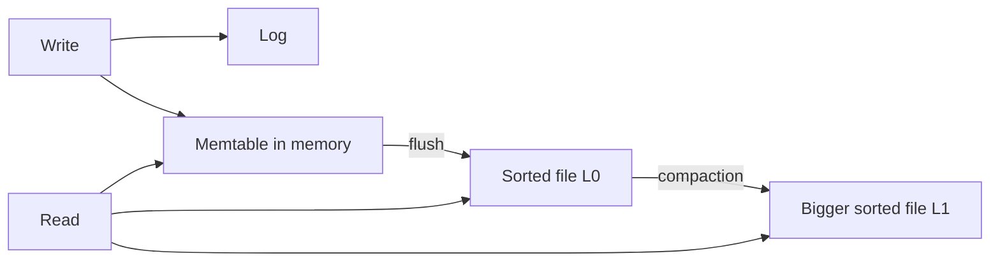

Writes are appended and sorted in memory. Background merges keep reads from touching too many files.

| | B-tree | LSM-tree |
| --- | --- | --- |
| Write pattern | random in-place updates | sequential appends |
| Write throughput | good | very high |
| Read latency | steady, one lookup path | can be higher, several files, bloom filters help |
| Write amplification | moderate (page rewrites, log) | can be high from repeated compaction |
| Space | fragmentation inside pages | old versions until compaction |
| Deletes | in place | tombstones that linger until compaction |
| Good for | OLTP with mixed reads and writes, range queries | ingest-heavy workloads, logs, time-series, key-value |

**Gotchas**
- LSM stores can stall writes when compaction cannot keep up.
- Tombstones from many deletes slow reads (a known Cassandra issue).
- B-trees with random keys (UUIDv4) have poor locality.

**Interview tip:** relate it to cost. B-trees pay at write time with random IO. LSM-trees pay later with compaction and on reads with multiple lookups.

_Module: Storage Internals · Tags: storage-engine, b-tree, lsm-tree_

### 59. What is the write-ahead log (WAL), and how does crash recovery work?

**Short answer:** The write-ahead log is a sequential file where the database records every change before it changes the data pages. A commit is durable once its log record is flushed to disk. After a crash, the database replays the log to redo committed work and undo unfinished work, so it returns to a consistent state.

**Why a log:** writing a data page in place is random IO, slow and not atomic if power fails halfway. Appending a small record to a log is sequential and fast. So the rule is: log first, then change pages later (in memory first, written to disk lazily at a checkpoint).

**How it fits together**
1. A transaction changes a page in the buffer pool and writes a log record.
2. On `COMMIT`, the log is flushed (fsync). Then the client gets "ok". The data pages may still be only in memory.
3. A checkpoint periodically writes dirty pages to disk and records how far the log has been applied.
4. After a crash, recovery starts from the last checkpoint: redo the logged changes, then roll back transactions that never committed.

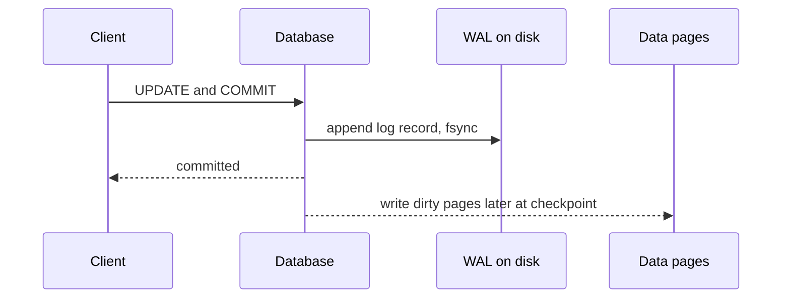

The client waits only for the log flush. Data pages catch up later.

**Where else the WAL is used**
- Replication: PostgreSQL streams WAL to standbys. SQL Server sends log blocks to AG secondaries.
- Point-in-time recovery: keep the log and replay it up to a chosen time.
- Logical decoding and CDC read the log to see changes.

**Tuning trade-offs**
- Flush on every commit (default) is safest. PostgreSQL's `synchronous_commit = off` lowers commit latency but can lose the last fraction of a second of commits after a crash (it does not corrupt data).
- Frequent checkpoints shorten recovery but cause more IO. Rare ones do the opposite.
- Fast disks for the log matter more than for data in write-heavy systems.

**Gotcha:** a full WAL disk stops the database. Causes are a stuck replication slot, a failing archive command or long transactions that prevent log truncation.

**Interview tip:** the phrase "log first, pages later, replay on recovery" is the whole story. Add that replication and PITR reuse the same log.

_Module: Storage Internals · Tags: wal, durability, crash-recovery_

### 60. What is the buffer pool, and why does memory matter so much for a database?

**Short answer:** Databases read and write fixed-size pages (usually 8 KB in PostgreSQL and SQL Server). The buffer pool is the memory area that caches those pages. A read from memory takes microseconds, from SSD around a hundred microseconds, from network storage a millisecond or more. When your working set fits in memory, queries are fast. When it does not, they become IO bound.

**How it works**
- A query needs a page. If it is in the pool, that is a hit. If not, the page is read from disk (a miss) and an old page is evicted, usually the least recently used.
- Writes change pages in memory first (marked dirty). They are flushed later by a background writer or at checkpoints. The WAL protects them meanwhile.
- A big scan can push hot pages out of the cache. Databases use special rules (ring buffers for large scans) to limit that.

**Settings and sizing**
- PostgreSQL: `shared_buffers` is the database's own cache, commonly around 25 percent of RAM as a starting point, and the operating system page cache holds much of the rest. `effective_cache_size` tells the planner how much total cache to assume. `work_mem` is per sort or hash operation, so many connections times several operations can use a lot of memory.
- SQL Server: it uses most of the memory it is allowed by `max server memory`. Set that so the OS and other processes keep some room.

**What to measure**
- Cache hit ratio (aim for very high on OLTP, but treat it as a hint).
- Page life expectancy or buffer reads in SQL Server, `blks_read` versus `blks_hit` in PostgreSQL.
- Read latency on the disks.

```sql
-- PostgreSQL: hit ratio per database (rough guide)
SELECT datname, round(100.0 * blks_hit / nullif(blks_hit + blks_read, 0), 2) AS hit_pct
FROM pg_stat_database ORDER BY blks_read DESC LIMIT 3;
```

**Practical effects**
- Adding RAM is often the cheapest fix for a database that grew beyond memory.
- Indexes that fit in memory beat huge ones. Remove unused indexes to free cache.
- Random UUID keys touch pages all over the index and need more cache than ordered keys.
- After a restart or failover the cache is cold, so latency is higher for a while. Some systems can pre-warm it.

**Gotcha:** giving all RAM to the database cache starves the OS and the per-query memory, causing swapping, which is far worse.

**Interview tip:** connect it to a symptom: "latency jumped when the table outgrew memory".

_Module: Storage Internals · Tags: buffer-pool, memory, performance_

### 61. How do planner statistics and cardinality estimates work, and why do plans go bad?

**Short answer:** The planner chooses a plan by estimating how many rows each step returns (cardinality) using statistics: row counts, distinct counts, most common values and histograms. If the estimates are wrong, it picks a wrong join method or access path, and a query that was fast suddenly becomes slow.

**What statistics hold**
- Number of rows and pages.
- Number of distinct values per column.
- Most common values and their frequency.
- A histogram of the rest.
- PostgreSQL: `pg_stats`, updated by `ANALYZE` (also autovacuum). SQL Server: statistics objects per index or column, updated automatically when enough rows change, or with `UPDATE STATISTICS`.

**Why estimates go wrong**
- Stale statistics after a large load or delete.
- Correlated columns. If `city = 'Pune'` and `state = 'MH'` are related, the planner multiplies the two selectivities as if they were independent and under-estimates. PostgreSQL has extended statistics (`CREATE STATISTICS ... (dependencies)`), SQL Server has multi-column statistics.
- Skewed data: one value has 90 percent of rows.
- Estimates through functions, expressions, `OR`, table variables or complex joins.
- Parameter values the plan was not built for (see parameter sniffing).
- Sampling: statistics are based on a sample, so rare values can be missed.

```sql
-- PostgreSQL: look for a big gap between "rows=" (estimate) and "actual ... rows="
EXPLAIN (ANALYZE) SELECT * FROM orders WHERE status = 'new' AND region = 'EU';

-- Fix ideas
ANALYZE orders;
ALTER TABLE orders ALTER COLUMN status SET STATISTICS 500;       -- finer histogram
CREATE STATISTICS st_orders (dependencies) ON status, region FROM orders;
ANALYZE orders;
```

**How a bad estimate hurts:** the planner thinks 10 rows will match, picks a nested loop with an index lookup per row, and then 2 million rows arrive. A hash join would have been 100 times faster.

**Operational habits**
- Compare estimated and actual rows in every plan review.
- Run `ANALYZE` after bulk loads and big migrations.
- Use Query Store or `auto_explain` to catch plan regressions after deployments or upgrades.
- Do not force plans with hints as a first reaction. Fix the statistics or the query shape.

**Gotcha:** a plan flip can happen without any code change, just because data crossed a threshold. That is why "it worked yesterday" is normal.

**Interview tip:** say "bad plans come from bad estimates" and name stale stats, correlation and skew.

_Module: Indexing & Query Performance · Tags: statistics, query-planner, cardinality_

### 62. What do CAP and PACELC mean, and how do they affect choosing a database?

**Short answer:** CAP says that when a network partition happens, a distributed system must choose between consistency (every read sees the latest write) and availability (every request gets an answer). Partitions cannot be ruled out, so the real choice is C or A during a partition. PACELC adds the everyday case: even with no partition, you trade latency against consistency.

**CAP in plain words:** two replicas lose contact with each other. A client writes to one of them. If the other keeps answering reads, it may return old data (available, not consistent). If it refuses to answer until it can sync, it stays consistent but is unavailable.

**PACELC:** if there is a Partition, choose Availability or Consistency; Else (normal operation), choose Latency or Consistency. Even without failures, waiting for replicas to confirm a write costs time.

| System style | During a partition | Normal operation | Examples (typical configuration) |
| --- | --- | --- | --- |
| PC/EC | consistent, may reject requests | consistent, higher latency | Spanner, CockroachDB, ZooKeeper-style stores |
| PA/EL | stays available, may be stale | low latency, eventually consistent | Cassandra and DynamoDB with weak read settings |
| PA/EC or PC/EL | mixed, depends on settings | depends | many databases with tunable options |

Many systems are tunable per operation, for example Cassandra quorum reads and writes, or DynamoDB strongly consistent reads.

**What it means for you**
- A single-node PostgreSQL has no partition problem inside the node, but async replicas show the same trade-off: reading a replica favours latency and availability over consistency.
- Money, inventory and uniqueness rules need strong consistency, so accept higher latency and possible unavailability in a partition.
- Feeds, counters, likes and caches can accept stale data for lower latency.

**Gotchas**
- CAP "consistency" means linearizability, not the C in ACID.
- "CA" systems do not exist in a real network. Single-node systems skip the question.
- The labels are simplifications. Check each product's actual behaviour and settings.

**Interview tip:** say you start from the business rule ("can two users book the same seat?") and then pick the consistency level, not the other way round.

_Module: Scaling & Replication · Tags: cap-theorem, pacelc, distributed-systems_

### 63. What is distributed SQL (NewSQL), such as Spanner and CockroachDB, and when would you use it?

**Short answer:** Distributed SQL databases give you SQL, transactions and strong consistency, while spreading data across many nodes and regions automatically. They split tables into ranges, replicate each range with consensus (Raft or Paxos), and coordinate transactions across ranges. They fit when you need relational semantics and scale beyond one primary, or survival of a region failure.

**How they work, simply**
- Data is cut into ranges by primary key. Each range has several replicas on different nodes.
- A consensus group per range picks a leader. Writes go through the leader and commit once a majority of replicas have them.
- Transactions that touch several ranges use a commit protocol (such as two-phase commit) on top of this.
- Clock handling gives a global order. Spanner uses TrueTime with atomic clocks and GPS. CockroachDB uses hybrid logical clocks and, by default, serializable isolation.
- Nodes can be added or removed and ranges rebalance automatically.

| Aspect | Single-node PostgreSQL | Distributed SQL |
| --- | --- | --- |
| Write scale | one primary | many leaders, one per range |
| Region failure | failover with possible data loss (async) | survives with no loss (quorum) |
| Single-row latency | low | higher: network and quorum |
| Cross-range transaction | cheap | costly: extra round trips |
| Operational model | simple | more nodes, more moving parts |
| Compatibility | full | often PostgreSQL wire compatible, but not every feature |

**When it fits**
- Global applications needing low read latency near users and strong correctness.
- Regulatory data residency by region (pin rows to locations).
- Workloads that outgrew one primary but you do not want to hand-shard.

**When it does not**
- Most applications. A single well-tuned PostgreSQL or SQL Server with replicas handles a lot.
- Latency-sensitive transactions that touch many keys.
- Teams that cannot operate the extra complexity or pay the licence or cloud bill.

**Design tips:** avoid monotonically increasing primary keys that create a hot range (use hashed or UUID keys, or hash-sharded indexes), keep related rows close in the key space, and keep transactions small.

**Gotcha:** "distributed" does not remove the speed of light. A cross-continent quorum write costs at least that round trip.

**Interview tip:** explain Raft per range plus a transaction layer, and say you would choose it for a concrete requirement such as multi-region writes, not for fashion.

_Module: Scaling & Replication · Tags: distributed-sql, newsql, cockroachdb_

### 64. How does consensus-based replication (Raft) work in plain words?

**Short answer:** Raft keeps several servers in agreement on an ordered log of commands. One server is the leader. It accepts writes, copies them to followers, and counts a write as committed once a majority has it. If the leader dies, the followers hold an election and a new leader with an up-to-date log takes over. No committed write is lost as long as a majority survives.

**Parts**
- Roles: leader, follower, candidate.
- Term: a number that increases with each election. Stale leaders from older terms are ignored.
- Log: ordered entries. Each follower copies the leader's log.
- Majority (quorum): with 3 nodes, 2 must agree. With 5 nodes, 3 must agree, so 2 can fail.

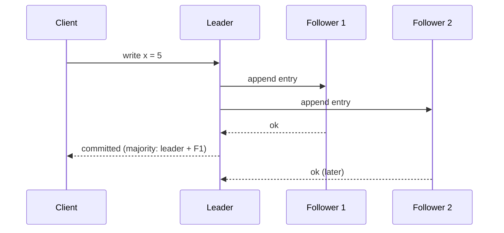

The leader replies as soon as a majority has the entry. The slow follower catches up later.

**Leader election:** a follower that stops hearing heartbeats waits a random timeout, becomes a candidate, asks for votes, and wins with a majority. Followers vote only for a candidate whose log is at least as up to date as their own, which protects committed entries.

**Why odd numbers:** 4 nodes tolerate only 1 failure, the same as 3 nodes, and cost more. Use 3 or 5.

**Where you meet it:** etcd (the Kubernetes datastore), Consul, CockroachDB, TiKV, and the replication layer of many NewSQL systems and message brokers (Kafka KRaft mode). Patroni uses etcd for leader election in PostgreSQL clusters.

**Trade-offs**
- Writes need a network round trip to a majority, so latency grows with distance.
- Loss of majority stops writes. That is the CP choice.
- One leader handles the writes for its group, so big systems run many groups.

**Gotcha:** two nodes in a cluster give no fault tolerance for writes. If one dies, the other has no majority.

**Interview tip:** be able to say "leader, followers, majority commit, election with terms" in one breath, and why quorums stop split brain.

_Module: Scaling & Replication · Tags: raft, consensus, replication_

### 65. What is change data capture (CDC), and how does the outbox pattern use it?

**Short answer:** CDC reads the database's change log and turns inserts, updates and deletes into a stream of events, without changing application code. The outbox pattern solves the "dual write" problem: the service writes its business data and an event row in the same transaction, and a CDC tool or relay publishes the outbox rows to a message broker.

**The dual write problem:** writing to the database and then publishing to Kafka are two systems. If the app crashes between them, you either lose the event or publish one for a change that rolled back. No retry logic fully fixes this.

**Outbox solution**

```sql
BEGIN;
INSERT INTO orders (id, customer_id, total) VALUES (42, 7, 1000);
INSERT INTO outbox (id, aggregate_id, type, payload)
VALUES (gen_random_uuid(), 42, 'OrderCreated', '{"orderId":42}');
COMMIT;      -- both rows commit together, or neither does
-- A relay (polling, or Debezium reading the WAL) publishes outbox rows to the broker
```

(`gen_random_uuid()` is built in from PostgreSQL 13.)

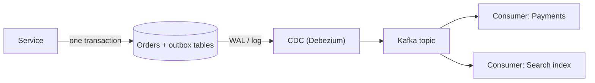

The event is saved with the data, so it cannot be lost. The relay delivers it at least once.

**Ways to do CDC**
| Method | How | Notes |
| --- | --- | --- |
| Log-based | read WAL (PostgreSQL logical decoding) or SQL Server CDC | low impact, captures everything, needs setup |
| Trigger-based | triggers copy changes | simple, adds write cost |
| Polling | query by timestamp or id | misses deletes, adds load |

**Rules and gotchas**
- Delivery is at least once, so consumers must be idempotent (dedupe by event id).
- Ordering is guaranteed per key if you partition the topic by aggregate id.
- A PostgreSQL replication slot that nobody reads keeps WAL forever and can fill the disk. Monitor slot lag.
- Schema changes need care. Consumers should tolerate new fields.
- Clean the outbox table regularly.

**Uses:** cache invalidation, search indexing, feeding a warehouse, syncing microservices.

**Interview tip:** name the dual-write problem first. It shows you know why the pattern exists.

_Module: Scaling & Replication · Tags: cdc, outbox, event-driven_

### 66. What is event sourcing, and what are its storage trade-offs?

**Short answer:** Event sourcing stores every change as an immutable event (`OrderPlaced`, `ItemAdded`, `PaymentCaptured`) in an append-only log, and the current state is computed by replaying events. You get a full audit trail and the ability to rebuild views, at the price of more complexity.

**How it works**
- The event store has a table such as `events(stream_id, version, type, data, created_at)` with a unique key on `(stream_id, version)`. That key gives optimistic concurrency: two writers cannot both append version 5.
- To load an aggregate, read its events and fold them into state. For long streams, save snapshots every N events.
- Read models (projections) are built from the events into normal tables, search indexes or caches. This is often paired with CQRS.

```sql
CREATE TABLE events (
  stream_id  TEXT    NOT NULL,
  version    INTEGER NOT NULL,
  type       TEXT    NOT NULL,
  data       TEXT    NOT NULL,
  created_at TEXT    NOT NULL,
  PRIMARY KEY (stream_id, version)   -- append at version n+1 or fail
);
```

| Benefit | Cost |
| --- | --- |
| Complete history and audit | Querying "current state" needs projections |
| Rebuild or add read models any time | Eventual consistency between events and views |
| Debug by replaying | Event schema versioning is hard (events live forever) |
| Natural fit for domain events | Corrections need compensating events, not edits |
| | GDPR deletion conflicts with immutability (use encryption keys per subject, crypto-shredding) |

**When it fits:** domains where history is the business (ledgers, bookings, inventory movements), or with strong audit needs.

**When it does not:** simple CRUD, reporting-first systems, small teams new to the idea. Audit needs alone can be met with an audit table or temporal tables (SQL Server system-versioned tables, PostgreSQL triggers).

**Gotchas**
- Changing the meaning of old events. Version them and write upcasters.
- Projection lag surprises users. Show "processing" states.
- Replays can take hours for big stores. Plan for parallel and incremental rebuilds.

**Interview tip:** say you use it selectively for one bounded context where history matters, not for the whole system.

_Module: Data Modeling · Tags: event-sourcing, cqrs, storage_

### 67. What sharding strategies exist (hash, range, directory), and what are resharding pain and hot keys?

**Short answer:** Sharding assigns each row to a shard using a shard key. Range sharding keeps neighbours together, hash sharding spreads rows evenly, and directory (lookup) sharding keeps a map from key to shard. The hardest parts are choosing the key, moving data when you add shards (resharding) and handling hot keys.

| Strategy | How | Strength | Weakness |
| --- | --- | --- | --- |
| Range | key ranges (A to F, dates) | range scans stay on one shard | hot spots (newest range gets all writes) |
| Hash | hash(key) mod N or consistent hashing | even spread | range queries hit all shards |
| Directory | lookup table: tenant to shard | flexible, move one tenant at a time | the directory is a critical component |

**Resharding**
- `hash(key) mod N` forces most rows to move when N changes. Use consistent hashing or a large fixed number of logical shards (for example 1,024) mapped to a smaller number of servers. Then adding a server means moving whole logical shards.
- Moving live data needs dual writes or CDC, a backfill, verification, and a cut-over with a rollback plan.

**Hot keys**
- One tenant, one celebrity user or one popular product gets far more traffic than the rest, so its shard melts while others idle.
- Mitigations: split big tenants onto their own shard, add a salt suffix to spread one key over several (and merge on read), cache reads, queue and batch writes, or move counters to a separate system.

**Choosing a key**
- It should appear in nearly all queries, so a query touches one shard.
- High cardinality, spreads load, and rarely changes.
- Often tenant id or customer id. Sharding by time puts all current writes on one shard.

**What you lose**
- Cross-shard joins, global unique constraints and transactions. Replace them with application-level joins, globally unique ids (UUID, ULID, snowflake) and sagas.
- Simple reporting: send data to a warehouse.

**Gotcha:** choosing a shard key you later need to change is the most expensive mistake. It means a full data migration.

**Interview tip:** mention logical shards over physical servers, and the hot tenant mitigation. Those two details show experience.

_Module: Scaling & Replication · Tags: sharding, hot-keys, resharding_

### 68. How do online schema change tools work?

**Short answer:** Online schema change tools alter a big table without long locks. The common method creates a shadow copy of the table with the new structure, copies rows in small batches, keeps the copy in sync with ongoing changes, then swaps the tables in a very short step. Some databases do parts of this natively.

**The shadow table method**
1. Create `orders_new` with the new schema.
2. Install a capture of changes on the old table (triggers, or reading the binary log).
3. Copy existing rows in chunks, throttled so load and replication lag stay low.
4. Apply captured changes to the new table.
5. Verify counts or checksums.
6. Swap the names with a brief lock and drop the old table later.

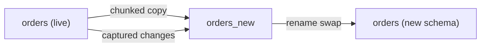

Rows are copied while the live table keeps serving traffic. Only the final rename needs a short lock.

**Tools and native options**
| Database | Options |
| --- | --- |
| MySQL | gh-ost, pt-online-schema-change (the origin of this method) |
| PostgreSQL | mostly native: `CREATE INDEX CONCURRENTLY`, adding nullable columns, `NOT VALID` constraints; `pg_repack` rebuilds tables and indexes online; pgroll and similar tools help expand and contract |
| SQL Server | `ONLINE = ON` for many index operations (Enterprise and Azure SQL), schema-only metadata changes are fast; for big column type changes you often build a shadow table by hand |

**Considerations**
- Needs spare disk (a second copy) and extra write load.
- Foreign keys, triggers and unusual primary keys complicate the swap.
- Throttle on replica lag and CPU, and keep a way to pause or abort.
- It does not replace backward-compatible, staged application changes (expand and contract).

**Gotcha:** a trigger-based copy doubles write cost on a hot table. Test on a production-sized copy and pick a quiet time.

**Interview tip:** describe the copy, sync, verify, swap sequence, and say PostgreSQL gets most of the way with built-in concurrent operations.

_Module: Operations & Migrations · Tags: schema-change, pt-osc, zero-downtime_

### 69. What are the main consistency models, and how do linearizability and serializability differ?

**Short answer:** Serializability is about transactions: the result equals some one-at-a-time order of whole transactions. Linearizability is about single objects: once a write completes, every later read sees it, as if there is one copy. They solve different problems. A system with both is called strictly serializable.

| Model | Scope | Promise | Example |
| --- | --- | --- | --- |
| Linearizability | one object | real-time order: a read after a finished write sees it | a lock service, a leader election register |
| Serializability | multi-object transactions | equivalent to some serial order, not necessarily the real-time one | database `SERIALIZABLE` |
| Strict serializability | both | serial order that respects real time | Spanner, some CockroachDB modes |
| Snapshot isolation | transactions | each sees a consistent snapshot, write skew possible | PostgreSQL repeatable read, SQL Server snapshot |
| Causal consistency | related operations | effects follow causes in order | some document databases |
| Read your writes | one client | you see your own writes | session guarantees on replicas |
| Eventual consistency | replicas | they converge if writes stop | async replicas, DynamoDB default reads |

**Why the difference matters**
- A serializable database could, in theory, order two non-overlapping transactions in the opposite order of real time, as long as the final state matches some serial order. For most applications you never notice. With strict serializability you never see that either.
- Linearizability alone says nothing about two different rows. You can read row A and row B at different logical times.
- Replica reads are neither: they can be stale.

**In practice**
- On a single primary, `SERIALIZABLE` gives you serializability, and reads on the primary are up to date. Reads on replicas can be stale, which breaks the real-time part.
- Many distributed databases offer weaker levels by default for speed. Read the documentation for the level each operation uses.
- Write skew and the on-call doctors example show why snapshot isolation is not serializable.

**Gotcha:** "ACID" databases are not all serializable by default. Defaults are usually read committed.

**Interview tip:** a clean one-liner: "linearizability is recency for one object, serializability is a safe order for many".

_Module: Transactions & Concurrency · Tags: consistency, linearizability, serializability_

### 70. How do OLTP and OLAP differ, and what are columnar storage, data warehouses and the lakehouse?

**Short answer:** OLTP systems handle many small, fast reads and writes on current data, such as placing an order. OLAP systems run big analytical queries that scan lots of rows and a few columns, such as monthly revenue by region. Columnar storage keeps each column together, which suits OLAP. A data warehouse collects data from many sources for analysis. A lakehouse puts warehouse-style tables on cheap open file storage.

| | OLTP | OLAP |
| --- | --- | --- |
| Query | point lookups, short transactions | scans, aggregates, joins over millions of rows |
| Storage | row-oriented | column-oriented |
| Data | current, normalised | historical, often denormalised (star schema) |
| Concurrency | thousands of small users | few heavy queries |
| Examples | PostgreSQL, SQL Server | Snowflake, BigQuery, Synapse, ClickHouse, Redshift |

**Why columns:** to sum `amount` over 100 million rows, a row store reads every column of every row. A column store reads only the `amount` file, compressed (similar values compress well) and processed in vectors. Writes of single rows are slower, so columnar systems batch inserts.

**Pipeline**
1. Extract changes from OLTP databases (CDC) or files.
2. Load into a warehouse or lake, then transform (ELT) with SQL tools such as dbt.
3. Model as a star schema: a fact table (orders) surrounded by dimensions (customer, product, date).
4. Serve BI dashboards and data science.

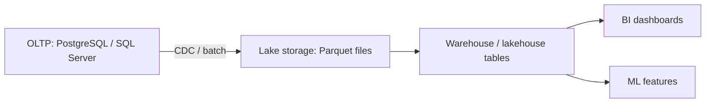

Operational data flows out to analytics storage, so heavy reports never touch the production database.

**Lakehouse idea:** data sits in open file formats (Parquet) on object storage, with a table layer (Delta Lake, Iceberg, Hudi) that adds transactions, schema and time travel. One copy of the data serves both BI and machine learning, instead of separate lake and warehouse copies.

**Gotchas**
- Running heavy reports on the OLTP primary hurts customers. Use a replica at least, a warehouse ideally.
- SQL Server and PostgreSQL can do some analytics (columnstore indexes, partitioning), enough for modest volumes.

**Interview tip:** explain row versus column with the "sum one column over many rows" example.

_Module: Storage Internals · Tags: olap, columnar, data-warehouse_

### 71. How would you design a schema for orders, payments and inventory end to end?

**Short answer:** Start from the business rules: a customer places an order with items, pays once or more, and stock must not go negative. Model each fact once, enforce rules with constraints, make payments idempotent, snapshot prices on the order, and index for the top queries. The DDL below ran in SQLite with foreign keys on, so the constraints work as shown.

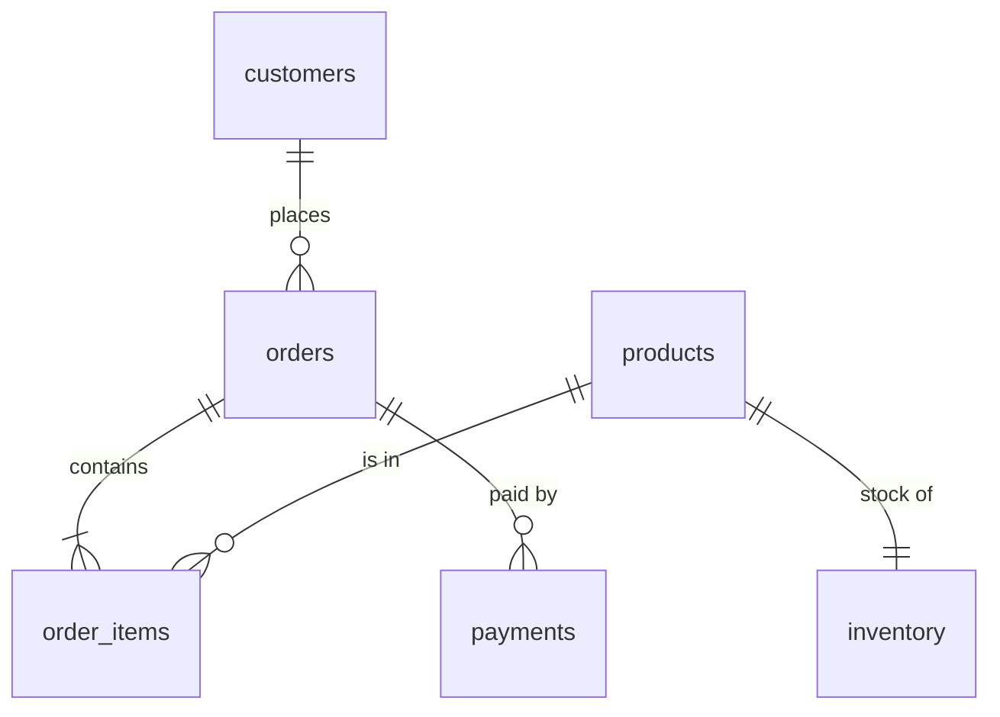

One customer has many orders, an order has items, a product has one stock row, and an order can have several payment attempts.

```sql
CREATE TABLE customers (id INTEGER PRIMARY KEY, email TEXT NOT NULL UNIQUE, name TEXT NOT NULL);
CREATE TABLE products  (id INTEGER PRIMARY KEY, sku TEXT NOT NULL UNIQUE, name TEXT NOT NULL,
                        price_cents INTEGER NOT NULL CHECK (price_cents >= 0));
CREATE TABLE inventory (product_id INTEGER PRIMARY KEY REFERENCES products(id),
                        on_hand  INTEGER NOT NULL CHECK (on_hand >= 0),
                        reserved INTEGER NOT NULL DEFAULT 0 CHECK (reserved >= 0 AND reserved <= on_hand));
CREATE TABLE orders (
  id INTEGER PRIMARY KEY,
  customer_id INTEGER NOT NULL REFERENCES customers(id),
  status TEXT NOT NULL CHECK (status IN ('pending','paid','shipped','cancelled')),
  total_cents INTEGER NOT NULL CHECK (total_cents >= 0),
  created_at TEXT NOT NULL);
CREATE TABLE order_items (
  order_id INTEGER NOT NULL REFERENCES orders(id),
  product_id INTEGER NOT NULL REFERENCES products(id),
  quantity INTEGER NOT NULL CHECK (quantity > 0),
  unit_price_cents INTEGER NOT NULL,            -- price snapshot at purchase time
  PRIMARY KEY (order_id, product_id));
CREATE TABLE payments (
  id INTEGER PRIMARY KEY,
  order_id INTEGER NOT NULL REFERENCES orders(id),
  amount_cents INTEGER NOT NULL CHECK (amount_cents > 0),
  status TEXT NOT NULL CHECK (status IN ('authorized','captured','refunded','failed')),
  idempotency_key TEXT NOT NULL UNIQUE,         -- a retried charge cannot duplicate
  created_at TEXT NOT NULL);
CREATE INDEX ix_orders_customer_created ON orders (customer_id, created_at DESC);
CREATE INDEX ix_payments_order ON payments (order_id);
CREATE INDEX ix_items_product ON order_items (product_id);
```

**Reserving stock safely** is one atomic statement:

```sql
UPDATE inventory SET reserved = reserved + 2
WHERE product_id = 1 AND on_hand - reserved >= 2;
-- 1 row changed: reserved. 0 rows: not enough stock, tell the user.
```

Tested in SQLite: reserving 2 of 10 changed one row, asking for 9 more changed zero rows, and a second payment with the same idempotency key failed with a unique constraint error.

**Design choices to explain**
- Money in integer cents, with a currency column added if you sell in several currencies.
- Price copied onto `order_items`, because the product price changes later.
- Foreign key columns indexed for joins and deletes. The composite primary key of `order_items` already covers `order_id`.
- On PostgreSQL use `bigint GENERATED ... AS IDENTITY` and `timestamptz`. On SQL Server use `BIGINT IDENTITY` and `datetimeoffset`.
- Status transitions are validated in code, and the table could carry a history table for audits.
- Later growth: partition `orders` and `payments` by month, add an outbox table for events.

**Gotcha:** in a multi-service system, inventory and payments often live in different services, so the single transaction becomes a saga with compensations.

**Interview tip:** walk through one failure each: double click on pay (idempotency key), two buyers for the last item (conditional update), price change (snapshot).

_Module: Data Modeling · Tags: schema-design, orders, payments_

### 72. Walk through a deadlock scenario: how does it happen, how is it detected, and how do you fix it?

**Short answer:** Two transactions update the same two rows in opposite order. Each holds one lock and waits for the other, so neither can proceed. The database finds the cycle (PostgreSQL after `deadlock_timeout`, one second by default; SQL Server within a few seconds), kills one transaction as the victim, and the other continues. The fix is a consistent lock order plus retry.

**The scenario:** a transfer between accounts 1 and 2, run twice in opposite directions at the same moment.

```sql
-- Session A: transfer 1 -> 2            -- Session B: transfer 2 -> 1
BEGIN;                                    BEGIN;
UPDATE accounts SET balance = balance - 10 WHERE id = 1;   -- A locks row 1
                                          UPDATE accounts SET balance = balance - 5 WHERE id = 2;  -- B locks row 2
UPDATE accounts SET balance = balance + 10 WHERE id = 2;   -- A waits for B
                                          UPDATE accounts SET balance = balance + 5 WHERE id = 1;  -- B waits for A: deadlock
-- PostgreSQL error: deadlock detected (SQLSTATE 40P01). One session is rolled back.
-- SQL Server error 1205: chosen as the deadlock victim.
```

**What the logs show**
- PostgreSQL logs both processes, the statements and the lock each waited for.
- SQL Server's deadlock graph (from the `system_health` session) shows two processes, two resources, and the victim.

**Fixes**

```sql
-- ✅ lock rows in a fixed order (lowest id first) in every transfer
BEGIN;
SELECT id FROM accounts WHERE id IN (1, 2) ORDER BY id FOR UPDATE;
UPDATE accounts SET balance = balance - 10 WHERE id = 1;
UPDATE accounts SET balance = balance + 10 WHERE id = 2;
COMMIT;
```

1. Consistent order across all code paths: sort ids before locking.
2. Shorter transactions, fewer rows locked.
3. Proper indexes, so statements do not lock extra rows or take table scans.
4. Lower isolation or row versioning where correctness allows.
5. Retry on the deadlock error, with a small random pause. Make the operation idempotent so a retry is safe.

**Other common deadlock sources:** foreign key checks locking parent rows, a trigger touching another table, two batch jobs updating overlapping ranges, and SQL Server key lookups where one session reads through the non-clustered index while another updates through the clustered one.

**Gotcha:** do not "fix" deadlocks by only raising the timeout. That just makes people wait longer.

**Interview tip:** tell the transfer story in four sentences and finish with "sort the ids, keep it short, retry".

_Module: Transactions & Concurrency · Tags: deadlocks, locking, troubleshooting_

### 73. How do you find the top N rows per group and the second highest salary?

**Short answer:** For top N per group, rank rows inside each group with a window function and keep rank N or lower. For the second highest value, use a subquery on the maximum, or `DENSE_RANK`, or `DISTINCT` with `OFFSET`. Decide how you treat ties, and what to return when no second value exists.

Data: `employees(id, name, dept, salary)` with eng: Asha 200, Ben 300, Chen 300, Dev 100 and ops: Esha 150, Farid 120.

```sql
-- Top 2 salaries per department, ties included (DENSE_RANK)
SELECT dept, name, salary
FROM (
  SELECT *, DENSE_RANK() OVER (PARTITION BY dept ORDER BY salary DESC) AS r
  FROM employees
) AS ranked
WHERE r <= 2
ORDER BY dept, salary DESC, name;
-- prints: eng Ben 300, eng Chen 300, eng Asha 200, ops Esha 150, ops Farid 120
```

Ben and Chen tie at 300 and both are rank 1, so Asha is rank 2. `ROW_NUMBER()` would drop one of the tied people and arbitrarily pick between them. `RANK()` would give Asha rank 3 and exclude her from the top 2.

**Second highest salary**

```sql
-- Option 1: portable, returns NULL when there is no second value
SELECT MAX(salary) AS second_highest
FROM employees
WHERE salary < (SELECT MAX(salary) FROM employees);
-- prints: 200

-- Option 2: distinct values, skip one (PostgreSQL / SQLite syntax)
SELECT DISTINCT salary FROM employees ORDER BY salary DESC LIMIT 1 OFFSET 1;
-- prints: 200
-- wrap it as a scalar subquery to get NULL instead of no rows:
-- SELECT (SELECT DISTINCT salary FROM employees ORDER BY salary DESC LIMIT 1 OFFSET 1) AS s;
```

In SQL Server, replace `LIMIT 1 OFFSET 1` with `OFFSET 1 ROWS FETCH NEXT 1 ROWS ONLY`.

| Need | Use |
| --- | --- |
| Exactly N rows per group, ties broken arbitrarily or by a rule | `ROW_NUMBER()` |
| All tied rows, no gaps in ranks | `DENSE_RANK()` |
| Competition style ranking | `RANK()` |
| The Nth highest overall | `DENSE_RANK()` or `OFFSET` on `DISTINCT` |

**Gotchas**
- Filtering on a window function in `WHERE` is not allowed. Use a subquery or CTE.
- With a tie for first place, "second highest" can mean 300 (second row) or 200 (second value). Ask the interviewer.
- On big tables, an index on `(dept, salary DESC)` lets the database avoid a full sort.
- PostgreSQL also offers `LATERAL` joins for top N per group, and SQL Server has `CROSS APPLY` with `TOP`. These can be faster when there are few groups and an index.

**Interview tip:** state your tie rule before you write the query. It is the first thing a good interviewer is checking.

_Module: SQL Interview Problems · Tags: window-functions, top-n, interview-coding_

### 74. How do you find and delete duplicate rows?

**Short answer:** To find duplicates, group by the columns that should be unique and keep groups with a count above one. To delete them, keep one row per group (usually the lowest id) and remove the rest. Afterwards add a unique constraint so it cannot happen again.

Data: `users(id, email)` with (1, a@x.com), (2, b@x.com), (3, a@x.com), (4, a@x.com).

```sql
-- Find
SELECT email, COUNT(*) AS n
FROM users
GROUP BY email
HAVING COUNT(*) > 1;
-- prints: a@x.com | 3

-- Delete all but the lowest id per email
DELETE FROM users
WHERE id NOT IN (SELECT MIN(id) FROM users GROUP BY email);

SELECT * FROM users;
-- prints: 1 a@x.com
--         2 b@x.com
```

The subquery returns the id to keep for each email. Everything not in that list is a duplicate. `MIN(id)` is never NULL here, so the `NOT IN` NULL trap does not apply, but if the key column could be NULL, use `NOT EXISTS`.

**Variant with a window function** (works in PostgreSQL and SQL Server for the select part):

```sql
SELECT id, email FROM (
  SELECT id, email,
         ROW_NUMBER() OVER (PARTITION BY email ORDER BY id) AS rn
  FROM users
) AS t
WHERE rn > 1;           -- the rows to remove
-- prints ids 3 and 4
```

In SQL Server you can delete straight through a CTE: `WITH d AS (SELECT ROW_NUMBER() OVER (PARTITION BY email ORDER BY id) rn FROM users) DELETE FROM d WHERE rn > 1;`. This syntax is SQL Server specific.

**Safe process for production**
1. Back up or copy the rows first (`CREATE TABLE users_dupes AS ...`).
2. Run the `SELECT` and check the count.
3. Delete inside a transaction, in batches if there are millions of rows.
4. Decide which row wins. Lowest id, newest `updated_at`, or the row with more filled columns. Merge data if needed.
5. Add `UNIQUE (email)`, or a unique index on `lower(email)` if case should not matter.

**Gotcha:** exact string duplicates miss `A@x.com` versus `a@x.com` and trailing spaces. Normalise before comparing. And the duplicates may already be referenced by foreign keys, so re-point those first.

**Interview tip:** after the query, mention the unique constraint. It shows you fix the cause, not only the symptom.

_Module: SQL Interview Problems · Tags: duplicates, group-by, interview-coding_

### 75. How do you find consecutive days and solve gaps and islands problems?

**Short answer:** Gaps and islands asks for streaks of consecutive values, or for the breaks between them. The classic trick: number the rows in order, subtract that number from the date. Within one streak the result is the same constant, so you can group by it. For gaps, compare each row to the next with `LEAD`.

Data: `logins(user_id, day)`. User 1 logged in on Jan 1, 2, 3, 7 and 8. User 2 on Jan 1 and 3.

```sql
-- Islands: each streak of consecutive days (SQLite date arithmetic with julianday)
WITH x AS (
  SELECT user_id, day,
         julianday(day) - ROW_NUMBER() OVER (PARTITION BY user_id ORDER BY day) AS grp
  FROM logins
)
SELECT user_id, MIN(day) AS start_day, MAX(day) AS end_day, COUNT(*) AS days
FROM x
GROUP BY user_id, grp
ORDER BY user_id, start_day;
-- prints:
-- 1 | 2024-01-01 | 2024-01-03 | 3
-- 1 | 2024-01-07 | 2024-01-08 | 2
-- 2 | 2024-01-01 | 2024-01-01 | 1
-- 2 | 2024-01-03 | 2024-01-03 | 1
```

Why it works: for days 1, 2, 3 with row numbers 1, 2, 3 the difference is 0, 0, 0. After the gap, day 7 has row number 4, so the difference is 3. A new constant means a new streak.

**Users with a streak of at least 3 days:** add `HAVING COUNT(*) >= 3` to the grouped query. In this data only user 1 qualifies.

**Gaps** with `LEAD`:

```sql
SELECT user_id, day, next_day FROM (
  SELECT user_id, day,
         LEAD(day) OVER (PARTITION BY user_id ORDER BY day) AS next_day
  FROM logins
) AS t
WHERE julianday(next_day) - julianday(day) > 1;
-- prints: 1 | 2024-01-03 | 2024-01-07
--         2 | 2024-01-01 | 2024-01-03
```

**Dialect notes for the date subtraction**
- PostgreSQL: `day - (ROW_NUMBER() OVER (...))::int` works when `day` is a `date`, because date minus integer gives a date.
- SQL Server: `DATEADD(day, -ROW_NUMBER() OVER (PARTITION BY user_id ORDER BY day), day)`.
- Remove duplicates per day first (`SELECT DISTINCT user_id, day`), or the numbering breaks.

**Real uses:** login streaks, uptime periods, missing invoice numbers, continuous employment spans, finding sessions in event logs.

**Gotcha:** if there are several rows per day, use `DENSE_RANK` over the day, or deduplicate first.

**Interview tip:** explain the "date minus row number" idea out loud with three numbers. Interviewers like that you can teach it.

_Module: SQL Interview Problems · Tags: gaps-and-islands, window-functions, interview-coding_

### 76. How do you calculate a running total and a percentage of the total?

**Short answer:** Use `SUM(...) OVER (ORDER BY ...)` for a running total, add `PARTITION BY` to restart per group, and `SUM(...) OVER ()` with no order to get the grand total for percentages. Aggregate by day first if you want one row per day.

Data: `orders(id, customer_id, total, created_on)` with totals 100, 250, 80, 300, 50 on ids 1 to 5.

```sql
SELECT id, total,
       ROUND(total * 100.0 / SUM(total) OVER (), 1)        AS pct_of_all,
       SUM(total) OVER (PARTITION BY customer_id ORDER BY id) AS customer_running
FROM orders ORDER BY id;
-- id total pct  customer_running
-- 1  100   12.8 100
-- 2  250   32.1 350
-- 3  80    10.3 80
-- 4  300   38.5 380
-- 5  50    6.4  50
```

Orders 1 and 2 belong to one customer, so the running total restarts for the next customer. The row with a NULL customer forms its own group.

**Running total per day** (aggregate first, then window):

```sql
WITH d AS (
  SELECT created_on, SUM(total) AS day_total FROM orders GROUP BY created_on
)
SELECT created_on, day_total,
       SUM(day_total) OVER (ORDER BY created_on) AS running
FROM d;
-- 2024-01-01 | 100 | 100
-- 2024-01-02 | 330 | 430
-- 2024-01-04 | 300 | 730
-- 2024-01-05 | 50  | 780
```

**Details that matter**
- Without a unique sort key, rows with equal `ORDER BY` values are treated as peers in the default frame, so they share a running total. Add the id as a tie-breaker, or state `ROWS BETWEEN UNBOUNDED PRECEDING AND CURRENT ROW`. SQL Server's default frame without an explicit one is also `RANGE`, and `ROWS` is faster there because it avoids a spool to tempdb.
- Use `100.0` or a cast, or integer division will truncate the percentage to zero in many databases.
- Moving averages use a bounded frame: `AVG(x) OVER (ORDER BY d ROWS BETWEEN 6 PRECEDING AND CURRENT ROW)` for seven rows.
- Old code used self joins or correlated subqueries for running totals. They are quadratic on big data. Window functions are the better tool.

**Gotcha:** window functions run after `WHERE` and `GROUP BY`, so the total in `SUM(total) OVER ()` only covers rows that survived your filter.

**Interview tip:** say whether you want rows or ranges in the frame and why. That small detail separates people who memorised the syntax from people who understand it.

_Module: SQL Interview Problems · Tags: running-total, window-functions, interview-coding_

---

## Resources

Where to read more at the source. Official docs and references come first.

**Official docs**

- [PostgreSQL documentation](https://www.postgresql.org/docs/current/) — The official, thorough manual for PostgreSQL. _(beginner)_
- [Using EXPLAIN (PostgreSQL)](https://www.postgresql.org/docs/current/using-explain.html) — How to read query plans and costs. _(intermediate)_
- [Indexes (PostgreSQL)](https://www.postgresql.org/docs/current/indexes.html) — Index types, multicolumn, partial and expression indexes. _(intermediate)_
- [Concurrency control and MVCC (PostgreSQL)](https://www.postgresql.org/docs/current/mvcc.html) — Isolation levels, locks and how MVCC works. _(intermediate)_
- [SQL Server documentation](https://learn.microsoft.com/sql/sql-server/) — Official docs for SQL Server: engine, security, performance. _(beginner)_
- [SQLite documentation](https://www.sqlite.org/docs.html) — A small SQL engine that is perfect for trying standard SQL. _(beginner)_
- [Redis documentation](https://redis.io/docs/) — Data types, persistence, caching patterns and clustering. _(intermediate)_
- [MongoDB manual](https://www.mongodb.com/docs/manual/) — Documents, indexes, aggregation and replication. _(intermediate)_
- [PgBouncer](https://www.pgbouncer.org) — Connection pooling for PostgreSQL. _(intermediate)_

**Reference**

- [Transact-SQL reference](https://learn.microsoft.com/sql/t-sql/) — T-SQL statements, functions and data types. _(intermediate)_

**Tutorial**

- [PostgreSQL tutorial](https://www.postgresql.org/docs/current/tutorial.html) — Official introduction: SQL, joins, aggregates, transactions. _(beginner)_
- [SQLBolt](https://sqlbolt.com) — Interactive lessons: select, joins, aggregates, subqueries. _(beginner)_
- [Mode SQL Tutorial](https://mode.com/sql-tutorial/) — From basic queries to window functions, with real datasets. _(beginner)_

**Book**

- [Use The Index, Luke](https://use-the-index-luke.com) — Free guide to SQL indexing and performance for developers. _(intermediate)_
- [Designing Data-Intensive Applications](https://dataintensive.net/) — Storage engines, replication, partitioning and transactions in depth. _(advanced)_

**Article**

- [Jepsen](https://jepsen.io) — Independent analyses of database consistency claims. _(advanced)_
- [Evolutionary database design (Martin Fowler)](https://martinfowler.com/articles/evodb.html) — How to change schemas continuously and safely. _(intermediate)_
