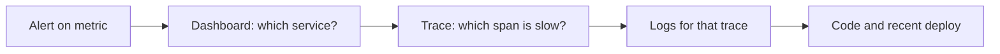
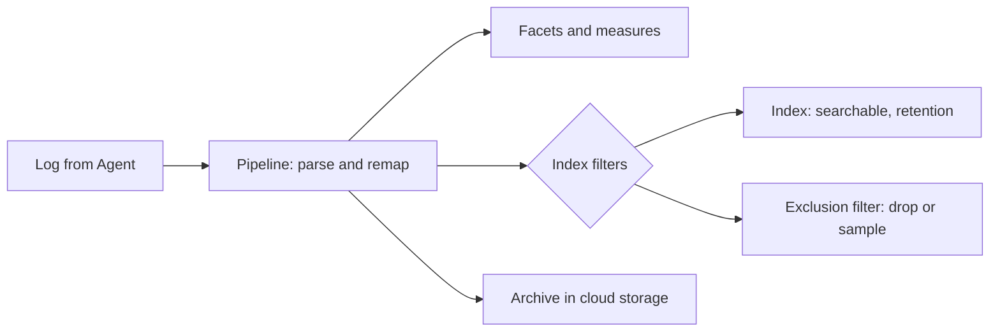
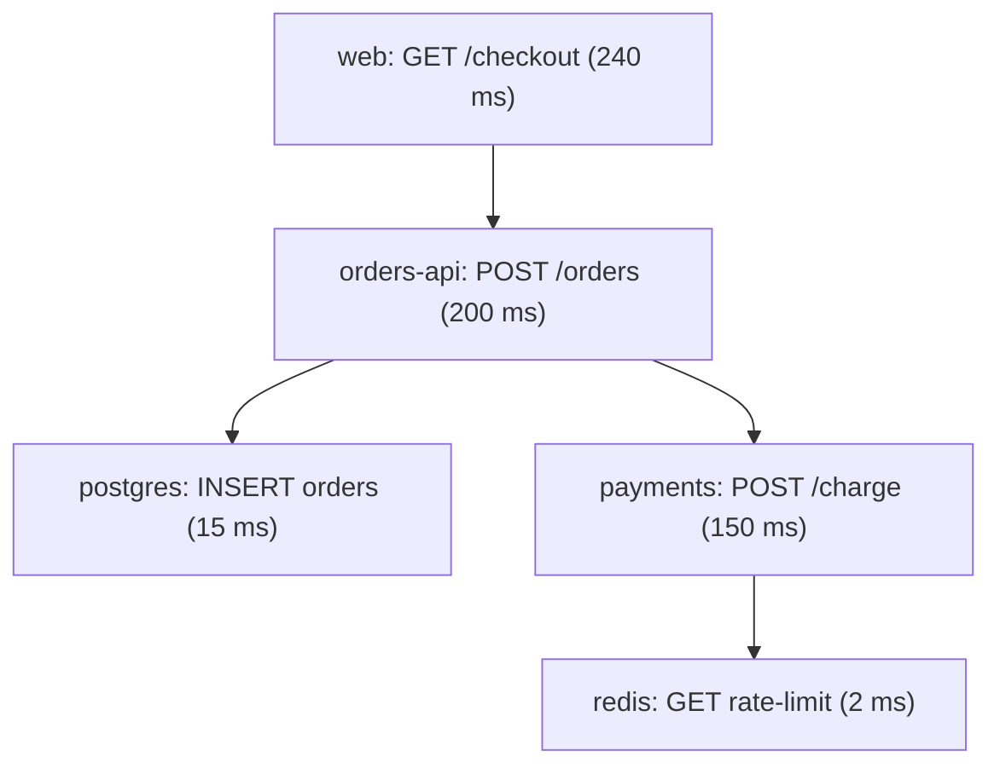
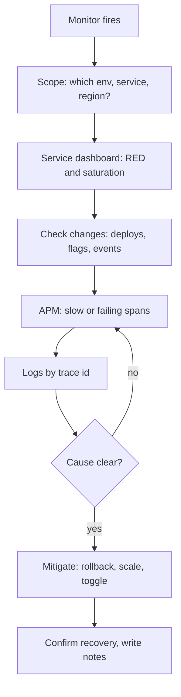
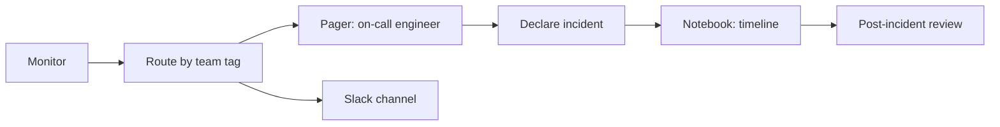
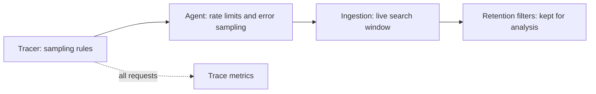
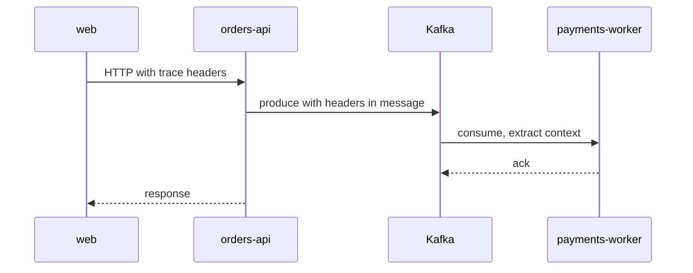
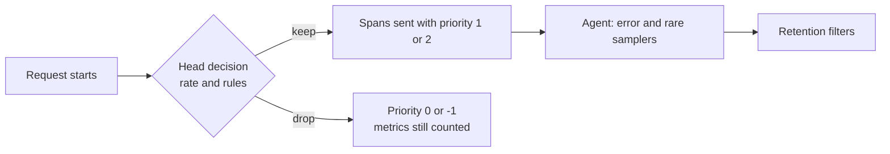
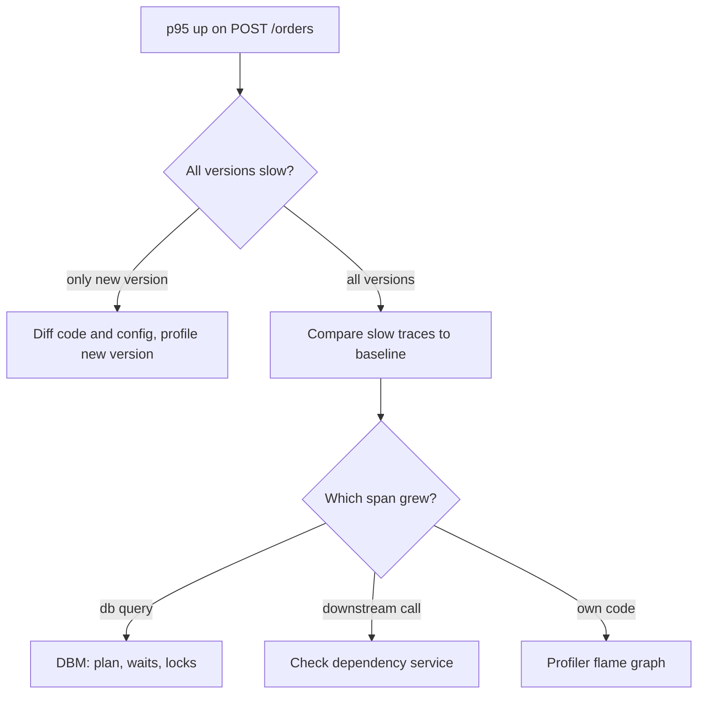
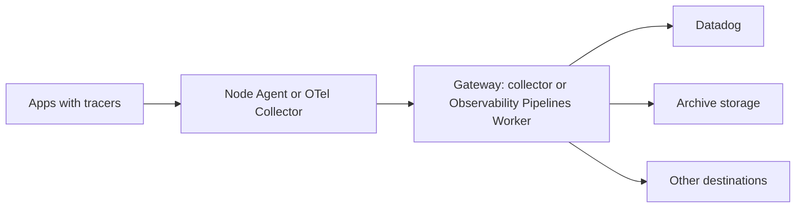

# Datadog

[← Back to index](../README.md) · [⭐ Favorites](favorites.md)

73 questions · 0 favorites · [📚 Resources](#resources)

## Contents

**Basic**

- [1. What is observability, and how is it different from monitoring?](#1-what-is-observability-and-how-is-it-different-from-monitoring)
- [2. What is Datadog and what are its main products?](#2-what-is-datadog-and-what-are-its-main-products)
- [3. What does the Datadog Agent do and how does it run?](#3-what-does-the-datadog-agent-do-and-how-does-it-run)
- [4. What are integrations and Autodiscovery in Datadog?](#4-what-are-integrations-and-autodiscovery-in-datadog)
- [5. What is unified service tagging and why does it matter?](#5-what-is-unified-service-tagging-and-why-does-it-matter)
- [6. What are tags in Datadog, and what is the difference between host tags and metric tags?](#6-what-are-tags-in-datadog-and-what-is-the-difference-between-host-tags-and-metric-tags)
- [7. What metric types does Datadog support?](#7-what-metric-types-does-datadog-support)
- [8. What are custom metrics and how does DogStatsD work?](#8-what-are-custom-metrics-and-how-does-dogstatsd-work)
- [9. How does Datadog collect logs?](#9-how-does-datadog-collect-logs)
- [10. How do log pipelines, facets and indexes work?](#10-how-do-log-pipelines-facets-and-indexes-work)
- [11. What are traces, spans and services in Datadog APM?](#11-what-are-traces-spans-and-services-in-datadog-apm)
- [12. What are resource names and the service map?](#12-what-are-resource-names-and-the-service-map)
- [13. What are dashboards in Datadog, and how do widgets and template variables work?](#13-what-are-dashboards-in-datadog-and-how-do-widgets-and-template-variables-work)
- [14. What types of monitors does Datadog offer?](#14-what-types-of-monitors-does-datadog-offer)
- [15. How do monitor thresholds, evaluation windows and notifications work?](#15-how-do-monitor-thresholds-evaluation-windows-and-notifications-work)
- [16. What are the golden signals, RED and USE, and how do you apply them with Datadog?](#16-what-are-the-golden-signals-red-and-use-and-how-do-you-apply-them-with-datadog)
- [17. What are the host map, infrastructure list and events used for?](#17-what-are-the-host-map-infrastructure-list-and-events-used-for)
- [18. How do you correlate logs, traces and metrics in Datadog?](#18-how-do-you-correlate-logs-traces-and-metrics-in-datadog)
- [19. What is trace sampling and why do we need it?](#19-what-is-trace-sampling-and-why-do-we-need-it)

**Intermediate**

- [20. \[Tech Lead\] What is your incident investigation workflow in Datadog?](#20-tech-lead-what-is-your-incident-investigation-workflow-in-datadog)
- [21. \[Tech Lead\] How do you design alerts that are actionable and avoid alert fatigue?](#21-tech-lead-how-do-you-design-alerts-that-are-actionable-and-avoid-alert-fatigue)
- [22. \[Tech Lead\] How do you define SLIs, SLOs and error budgets in Datadog?](#22-tech-lead-how-do-you-define-slis-slos-and-error-budgets-in-datadog)
- [23. \[Tech Lead\] How do you govern tagging and metric cardinality across teams?](#23-tech-lead-how-do-you-govern-tagging-and-metric-cardinality-across-teams)
- [24. \[Tech Lead\] What is your checklist for onboarding a new service into Datadog?](#24-tech-lead-what-is-your-checklist-for-onboarding-a-new-service-into-datadog)
- [25. \[Tech Lead\] How do you build dashboards that work, and avoid dashboard sprawl?](#25-tech-lead-how-do-you-build-dashboards-that-work-and-avoid-dashboard-sprawl)
- [26. \[Tech Lead\] How do you manage monitors and dashboards as code?](#26-tech-lead-how-do-you-manage-monitors-and-dashboards-as-code)
- [27. \[Tech Lead\] How do you use Datadog for release safety?](#27-tech-lead-how-do-you-use-datadog-for-release-safety)
- [28. \[Tech Lead\] How do you connect Datadog to on-call and runbooks?](#28-tech-lead-how-do-you-connect-datadog-to-on-call-and-runbooks)
- [29. \[Tech Lead\] How would you use RUM and front-end monitoring, and what is its business value?](#29-tech-lead-how-would-you-use-rum-and-front-end-monitoring-and-what-is-its-business-value)
- [30. How do you install and configure the Datadog Agent on Kubernetes with Helm?](#30-how-do-you-install-and-configure-the-datadog-agent-on-kubernetes-with-helm)
- [31. How do pods send traces and custom metrics to the node Agent in Kubernetes?](#31-how-do-pods-send-traces-and-custom-metrics-to-the-node-agent-in-kubernetes)
- [32. How do you instrument a Go service with dd-trace-go?](#32-how-do-you-instrument-a-go-service-with-dd-trace-go)
- [33. How do you instrument Node.js services with dd-trace-js?](#33-how-do-you-instrument-nodejs-services-with-dd-trace-js)
- [34. How do you set up the Datadog browser RUM SDK, session replay and user actions in a React app?](#34-how-do-you-set-up-the-datadog-browser-rum-sdk-session-replay-and-user-actions-in-a-react-app)
- [35. How do you instrument Python services with ddtrace?](#35-how-do-you-instrument-python-services-with-ddtrace)
- [36. How do log pipelines and processors work, including the grok parser?](#36-how-do-log-pipelines-and-processors-work-including-the-grok-parser)
- [37. How do you write JSON logs with correlation ids in a Go service?](#37-how-do-you-write-json-logs-with-correlation-ids-in-a-go-service)
- [38. What are log-based metrics, archives and rehydration, and when do you use them?](#38-what-are-log-based-metrics-archives-and-rehydration-and-when-do-you-use-them)
- [39. How do you scrub sensitive data from logs in Datadog?](#39-how-do-you-scrub-sensitive-data-from-logs-in-datadog)
- [40. How do metric queries work in depth: aggregation, grouping, rollup and formulas?](#40-how-do-metric-queries-work-in-depth-aggregation-grouping-rollup-and-formulas)
- [41. What is the difference between as_count, as_rate, rollup and fill?](#41-what-is-the-difference-between-as_count-as_rate-rollup-and-fill)
- [42. How do you get accurate percentiles with distribution metrics and APM?](#42-how-do-you-get-accurate-percentiles-with-distribution-metrics-and-apm)
- [43. How do you configure monitors well: no data, recovery, renotify and downtime?](#43-how-do-you-configure-monitors-well-no-data-recovery-renotify-and-downtime)
- [44. What are multi-alert monitors, composite monitors and templated messages?](#44-what-are-multi-alert-monitors-composite-monitors-and-templated-messages)
- [45. When do you use anomaly, outlier and forecast monitors?](#45-when-do-you-use-anomaly-outlier-and-forecast-monitors)
- [46. How do you use Synthetic Monitoring: API tests, browser tests and CI?](#46-how-do-you-use-synthetic-monitoring-api-tests-browser-tests-and-ci)
- [47. What do Network Performance Monitoring and DNS monitoring give you?](#47-what-do-network-performance-monitoring-and-dns-monitoring-give-you)
- [48. What does Database Monitoring add beyond APM spans?](#48-what-does-database-monitoring-add-beyond-apm-spans)
- [49. How do you use the Continuous Profiler?](#49-how-do-you-use-the-continuous-profiler)
- [50. How does Error Tracking group errors, and how do you use it?](#50-how-does-error-tracking-group-errors-and-how-do-you-use-it)
- [51. How do trace ingestion controls, retention filters and trace metrics work?](#51-how-do-trace-ingestion-controls-retention-filters-and-trace-metrics-work)
- [52. What is the Service Catalog and how do you use ownership metadata?](#52-what-is-the-service-catalog-and-how-do-you-use-ownership-metadata)
- [53. How do you use Datadog metrics for Kubernetes autoscaling, and how does it connect to Azure?](#53-how-do-you-use-datadog-metrics-for-kubernetes-autoscaling-and-how-does-it-connect-to-azure)
- [54. What security products does Datadog offer, in short?](#54-what-security-products-does-datadog-offer-in-short)
- [55. How do you work with the Datadog API, Terraform provider and dashboards as code?](#55-how-do-you-work-with-the-datadog-api-terraform-provider-and-dashboards-as-code)

**Advanced**

- [56. \[Tech Lead\] How would you design an observability strategy for a microservices platform?](#56-tech-lead-how-would-you-design-an-observability-strategy-for-a-microservices-platform)
- [57. \[Tech Lead\] How do you control Datadog cost?](#57-tech-lead-how-do-you-control-datadog-cost)
- [58. \[Tech Lead\] How do you approach OpenTelemetry alongside Datadog, and what about vendor neutrality?](#58-tech-lead-how-do-you-approach-opentelemetry-alongside-datadog-and-what-about-vendor-neutrality)
- [59. How do traces propagate across services and queues, and what breaks them?](#59-how-do-traces-propagate-across-services-and-queues-and-what-breaks-them)
- [60. How do you design tagging and metric naming conventions at scale?](#60-how-do-you-design-tagging-and-metric-naming-conventions-at-scale)
- [61. How do you find and fix high-cardinality metrics?](#61-how-do-you-find-and-fix-high-cardinality-metrics)
- [62. Explain trace sampling in depth: head-based, tail-based and priority sampling.](#62-explain-trace-sampling-in-depth-head-based-tail-based-and-priority-sampling)
- [63. How would you build a golden-signals dashboard and SLO monitors for a Go service end to end?](#63-how-would-you-build-a-golden-signals-dashboard-and-slo-monitors-for-a-go-service-end-to-end)
- [64. How would you find the cause of a latency regression: a deploy, a dependency or the database?](#64-how-would-you-find-the-cause-of-a-latency-regression-a-deploy-a-dependency-or-the-database)
- [65. How do the Agent, the OpenTelemetry Collector and Observability Pipelines fit together, and how do you handle privacy and data residency?](#65-how-do-the-agent-the-opentelemetry-collector-and-observability-pipelines-fit-together-and-how-do-you-handle-privacy-and-data-residency)
- [66. How do you reduce MTTD and MTTR in practice?](#66-how-do-you-reduce-mttd-and-mttr-in-practice)
- [67. Walk me through a Datadog cost optimisation case study.](#67-walk-me-through-a-datadog-cost-optimisation-case-study)
- [68. How do you set up Datadog across multiple clusters, clouds and teams?](#68-how-do-you-set-up-datadog-across-multiple-clusters-clouds-and-teams)
- [69. How do you use Synthetic tests to gate releases in CI/CD?](#69-how-do-you-use-synthetic-tests-to-gate-releases-in-cicd)
- [70. How does Datadog compare with Prometheus and Grafana, New Relic, Dynatrace and Azure Monitor?](#70-how-does-datadog-compare-with-prometheus-and-grafana-new-relic-dynatrace-and-azure-monitor)
- [71. Interview scenario: "The API got slow after a deploy." Walk me through it.](#71-interview-scenario-the-api-got-slow-after-a-deploy-walk-me-through-it)
- [72. How would you design alerting for the checkout flow in an interview scenario?](#72-how-would-you-design-alerting-for-the-checkout-flow-in-an-interview-scenario)
- [73. How do you investigate a Datadog bill spike in an interview scenario?](#73-how-do-you-investigate-a-datadog-bill-spike-in-an-interview-scenario)

## Browse by module

| Module | Questions |
| --- | --- |
| Agent & Setup (7) | [3](#3-what-does-the-datadog-agent-do-and-how-does-it-run) · [4](#4-what-are-integrations-and-autodiscovery-in-datadog) · [17](#17-what-are-the-host-map-infrastructure-list-and-events-used-for) · [30](#30-how-do-you-install-and-configure-the-datadog-agent-on-kubernetes-with-helm) · [31](#31-how-do-pods-send-traces-and-custom-metrics-to-the-node-agent-in-kubernetes) · [53](#53-how-do-you-use-datadog-metrics-for-kubernetes-autoscaling-and-how-does-it-connect-to-azure) · [68](#68-how-do-you-set-up-datadog-across-multiple-clusters-clouds-and-teams) |
| APM & Tracing (11) | [11](#11-what-are-traces-spans-and-services-in-datadog-apm) · [12](#12-what-are-resource-names-and-the-service-map) · [19](#19-what-is-trace-sampling-and-why-do-we-need-it) · [32](#32-how-do-you-instrument-a-go-service-with-dd-trace-go) · [33](#33-how-do-you-instrument-nodejs-services-with-dd-trace-js) · [35](#35-how-do-you-instrument-python-services-with-ddtrace) · [49](#49-how-do-you-use-the-continuous-profiler) · [50](#50-how-does-error-tracking-group-errors-and-how-do-you-use-it) · [51](#51-how-do-trace-ingestion-controls-retention-filters-and-trace-metrics-work) · [59](#59-how-do-traces-propagate-across-services-and-queues-and-what-breaks-them) · [62](#62-explain-trace-sampling-in-depth-head-based-tail-based-and-priority-sampling) |
| Cost & Governance (6) | [23](#23-tech-lead-how-do-you-govern-tagging-and-metric-cardinality-across-teams) · [57](#57-tech-lead-how-do-you-control-datadog-cost) · [60](#60-how-do-you-design-tagging-and-metric-naming-conventions-at-scale) · [61](#61-how-do-you-find-and-fix-high-cardinality-metrics) · [67](#67-walk-me-through-a-datadog-cost-optimisation-case-study) · [73](#73-how-do-you-investigate-a-datadog-bill-spike-in-an-interview-scenario) |
| Dashboards & Monitors (7) | [13](#13-what-are-dashboards-in-datadog-and-how-do-widgets-and-template-variables-work) · [14](#14-what-types-of-monitors-does-datadog-offer) · [15](#15-how-do-monitor-thresholds-evaluation-windows-and-notifications-work) · [25](#25-tech-lead-how-do-you-build-dashboards-that-work-and-avoid-dashboard-sprawl) · [43](#43-how-do-you-configure-monitors-well-no-data-recovery-renotify-and-downtime) · [44](#44-what-are-multi-alert-monitors-composite-monitors-and-templated-messages) · [45](#45-when-do-you-use-anomaly-outlier-and-forecast-monitors) |
| Incident Investigation (8) | [20](#20-tech-lead-what-is-your-incident-investigation-workflow-in-datadog) · [27](#27-tech-lead-how-do-you-use-datadog-for-release-safety) · [28](#28-tech-lead-how-do-you-connect-datadog-to-on-call-and-runbooks) · [47](#47-what-do-network-performance-monitoring-and-dns-monitoring-give-you) · [48](#48-what-does-database-monitoring-add-beyond-apm-spans) · [64](#64-how-would-you-find-the-cause-of-a-latency-regression-a-deploy-a-dependency-or-the-database) · [66](#66-how-do-you-reduce-mttd-and-mttr-in-practice) · [71](#71-interview-scenario-the-api-got-slow-after-a-deploy-walk-me-through-it) |
| Logs (6) | [9](#9-how-does-datadog-collect-logs) · [10](#10-how-do-log-pipelines-facets-and-indexes-work) · [36](#36-how-do-log-pipelines-and-processors-work-including-the-grok-parser) · [37](#37-how-do-you-write-json-logs-with-correlation-ids-in-a-go-service) · [38](#38-what-are-log-based-metrics-archives-and-rehydration-and-when-do-you-use-them) · [39](#39-how-do-you-scrub-sensitive-data-from-logs-in-datadog) |
| Metrics (5) | [7](#7-what-metric-types-does-datadog-support) · [8](#8-what-are-custom-metrics-and-how-does-dogstatsd-work) · [40](#40-how-do-metric-queries-work-in-depth-aggregation-grouping-rollup-and-formulas) · [41](#41-what-is-the-difference-between-as_count-as_rate-rollup-and-fill) · [42](#42-how-do-you-get-accurate-percentiles-with-distribution-metrics-and-apm) |
| Observability Basics (5) | [1](#1-what-is-observability-and-how-is-it-different-from-monitoring) · [2](#2-what-is-datadog-and-what-are-its-main-products) · [5](#5-what-is-unified-service-tagging-and-why-does-it-matter) · [6](#6-what-are-tags-in-datadog-and-what-is-the-difference-between-host-tags-and-metric-tags) · [18](#18-how-do-you-correlate-logs-traces-and-metrics-in-datadog) |
| Platform & Leadership (9) | [24](#24-tech-lead-what-is-your-checklist-for-onboarding-a-new-service-into-datadog) · [26](#26-tech-lead-how-do-you-manage-monitors-and-dashboards-as-code) · [52](#52-what-is-the-service-catalog-and-how-do-you-use-ownership-metadata) · [54](#54-what-security-products-does-datadog-offer-in-short) · [55](#55-how-do-you-work-with-the-datadog-api-terraform-provider-and-dashboards-as-code) · [56](#56-tech-lead-how-would-you-design-an-observability-strategy-for-a-microservices-platform) · [58](#58-tech-lead-how-do-you-approach-opentelemetry-alongside-datadog-and-what-about-vendor-neutrality) · [65](#65-how-do-the-agent-the-opentelemetry-collector-and-observability-pipelines-fit-together-and-how-do-you-handle-privacy-and-data-residency) · [70](#70-how-does-datadog-compare-with-prometheus-and-grafana-new-relic-dynatrace-and-azure-monitor) |
| RUM & Synthetics (4) | [29](#29-tech-lead-how-would-you-use-rum-and-front-end-monitoring-and-what-is-its-business-value) · [34](#34-how-do-you-set-up-the-datadog-browser-rum-sdk-session-replay-and-user-actions-in-a-react-app) · [46](#46-how-do-you-use-synthetic-monitoring-api-tests-browser-tests-and-ci) · [69](#69-how-do-you-use-synthetic-tests-to-gate-releases-in-cicd) |
| SLOs & Alerting (5) | [16](#16-what-are-the-golden-signals-red-and-use-and-how-do-you-apply-them-with-datadog) · [21](#21-tech-lead-how-do-you-design-alerts-that-are-actionable-and-avoid-alert-fatigue) · [22](#22-tech-lead-how-do-you-define-slis-slos-and-error-budgets-in-datadog) · [63](#63-how-would-you-build-a-golden-signals-dashboard-and-slo-monitors-for-a-go-service-end-to-end) · [72](#72-how-would-you-design-alerting-for-the-checkout-flow-in-an-interview-scenario) |

## Basic

### 1. What is observability, and how is it different from monitoring?

**Short answer:** Monitoring tells you that something is wrong, using checks you defined in advance. Observability means your system emits enough data (metrics, logs, traces) that you can ask new questions and find out why it is wrong, even for a failure nobody predicted.

Monitoring is a smoke alarm. It watches known signals and rings when a threshold is crossed. Observability is having cameras in every room: after the alarm rings, you can look back and see what happened.

The three classic signals are:

| Signal | What it is | Good at |
| --- | --- | --- |
| Metrics | Numbers over time (request count, CPU, latency) | Cheap trends, alerts, dashboards |
| Logs | Timestamped events with detail | The exact error and its context |
| Traces | One request followed across services | Where time was spent, which dependency failed |

Each signal alone is weak. Metrics say the error rate is up but not which request. Logs have the detail but are hard to search without a hint. Traces show the path but only for sampled requests. The skill is moving between them with shared tags and ids.



Read it left to right: you start wide with a metric and narrow down to a log line and a code change.

**Gotcha:** Having Datadog installed is not observability. If services do not share tags, do not log trace ids and do not emit useful custom metrics, you only have three separate silos.

**Interview tip:** Say "monitoring answers known questions, observability lets me answer unknown ones". Then give one example: an alert fired on error rate, and you used a trace and its logs to find a bad dependency.

_Module: Observability Basics · Tags: observability, monitoring, fundamentals_

### 2. What is Datadog and what are its main products?

**Short answer:** Datadog is a SaaS observability and security platform. An Agent and language libraries send metrics, logs, traces and user data to Datadog, where you build dashboards, monitors and investigations on top of one shared tag system.

The value is that everything lives in one place and is linked by tags such as `env`, `service` and `version`. You can go from a monitor to a trace to a log line without switching tools.

| Product | What it does |
| --- | --- |
| Infrastructure Monitoring | Hosts, containers, Kubernetes, cloud integrations, host map |
| APM | Distributed traces, service map, latency and error stats |
| Log Management | Collect, parse, index, search and archive logs |
| RUM | Real user sessions, page loads, errors in browser and mobile apps |
| Synthetic Monitoring | Scripted API and browser checks from outside |
| Monitors | Alerts on metrics, logs, traces, tests and more |
| Dashboards and Notebooks | Live views, and shareable investigations |
| SLOs | Service level objectives and error budgets |
| Network Performance Monitoring | Traffic between hosts, services and zones |
| Database Monitoring | Query samples, plans and waits for databases |
| Continuous Profiler | Always-on CPU and memory profiles |
| Error Tracking | Groups similar errors into issues |
| Incident Management | Declare, track and review incidents |
| Security products | Cloud security, application protection, SIEM |

Product names change over time, so check the current product list when you prepare.

**Gotcha:** Each product is usually billed on a different unit (hosts, indexed log events, ingested spans, sessions). Turning everything on has a cost. See the cost questions later.

**Interview tip:** Do not recite the list. Say which three you use daily (for example APM, logs and monitors) and describe one workflow that connects them.

_Module: Observability Basics · Tags: datadog, products, overview_

### 3. What does the Datadog Agent do and how does it run?

**Short answer:** The Datadog Agent is a small program that runs next to your workloads. It collects system metrics, runs integration checks, tails logs, receives traces from tracing libraries and custom metrics over DogStatsD, and forwards everything to Datadog over HTTPS.

It has several parts in one process family:
- The collector runs checks (CPU, memory, disk, Postgres, Redis, and so on) on a schedule, usually every 15 seconds.
- The log collector tails files or container output.
- The trace agent listens on port 8126 for spans from `dd-trace` libraries.
- DogStatsD listens on UDP port 8125 (or a Unix socket) for custom metrics.
- The forwarder batches data and sends it out.

How it runs depends on the platform:

| Platform | Typical setup |
| --- | --- |
| Virtual machine | OS package or install script, one Agent per host |
| Docker | Agent container with the Docker socket mounted |
| Kubernetes | A DaemonSet, so one Agent pod per node, plus a Cluster Agent |
| Serverless and PaaS | Libraries or extensions instead of a full Agent |

In Kubernetes the node Agent sees all pods on its node. The Cluster Agent is a separate deployment that talks to the API server once, so you do not overload it with one watch per node.

```yaml
# datadog.yaml (host Agent, read-only example)
api_key: ENC[dd_api_key]   # use secrets, never a plain key in git
site: datadoghq.com        # your Datadog site
logs_enabled: true
apm_config:
  enabled: true
```

**Gotcha:** The API key is a secret. Store it in a Kubernetes Secret or a secret manager, and never in an image or a repo.

**Interview tip:** Mention that the Agent pushes data out over HTTPS, so you only need outbound access. That is a common security question.

_Module: Agent & Setup · Tags: agent, setup, kubernetes_

### 4. What are integrations and Autodiscovery in Datadog?

**Short answer:** An integration is a prepared check (and often a dashboard) for a technology such as Postgres, NGINX, Redis or Kubernetes. Autodiscovery lets the Agent find containers as they start and apply the right integration to them automatically.

On a fixed host you would write a file such as `conf.d/redisdb.d/conf.yaml` with the address of Redis. In Kubernetes pods come and go and their IPs change, so static files do not work. Autodiscovery solves this with templates. The template says "when a container with this image or annotation appears, run this check against its IP".

You attach the template to the pod with annotations:

```yaml
# Pod annotations (read-only example)
metadata:
  annotations:
    ad.datadoghq.com/redis.checks: |
      {
        "redisdb": {
          "init_config": {},
          "instances": [{"host": "%%host%%", "port": "6379"}]
        }
      }
```

The part after `ad.datadoghq.com/` is the container name, then `.checks` for metric checks or `.logs` for log settings. `%%host%%` is a template variable filled in at runtime.

Many popular images are recognised by default, so you may get basic checks with no annotations at all.

**Gotcha:** The container name in the annotation must match the container name in the pod spec exactly, or the annotation is silently ignored. Use `agent configcheck` and `agent status` inside the Agent pod to see what was loaded.

**Interview tip:** Say that you treat annotations as part of the service's deployment manifest. The team that owns the pod owns how it is monitored.

_Module: Agent & Setup · Tags: integrations, autodiscovery, agent_

### 5. What is unified service tagging and why does it matter?

**Short answer:** Unified service tagging means every metric, log, trace and RUM event carries the same three tags: `env`, `service` and `version`. That one convention lets you pivot from any signal to any other, and see which release caused a change.

Without it, the metric says `app:orders`, the log says `svc=orders-api` and the trace says `orders-service`. Nobody can connect them. With it, a single filter `service:orders env:prod` works in every product.

| Tag | Meaning | Example |
| --- | --- | --- |
| `env` | Environment | `prod`, `staging` |
| `service` | One deployable unit | `orders-api` |
| `version` | Release of the code | `1.14.2` or a git SHA |

In Kubernetes you set it once as labels and environment variables on the pod:

```yaml
# Deployment pod template (read-only example)
metadata:
  labels:
    tags.datadoghq.com/env: prod
    tags.datadoghq.com/service: orders-api
    tags.datadoghq.com/version: "1.14.2"
spec:
  containers:
    - name: orders-api
      env:
        - name: DD_ENV
          valueFrom: {fieldRef: {fieldPath: "metadata.labels['tags.datadoghq.com/env']"}}
        - name: DD_SERVICE
          valueFrom: {fieldRef: {fieldPath: "metadata.labels['tags.datadoghq.com/service']"}}
        - name: DD_VERSION
          valueFrom: {fieldRef: {fieldPath: "metadata.labels['tags.datadoghq.com/version']"}}
```

The labels tag the container metrics and logs. The `DD_*` variables tell the tracing library what to put on traces.

**Gotcha:** If `version` is missing, deployment tracking and comparing versions will not work. If `service` differs between logs and traces, correlation breaks.

**Interview tip:** Call this "the single most valuable thing to standardise first" and say you enforce it in the Helm chart template, not by asking each team.

_Module: Observability Basics · Tags: tagging, env, service, version_

### 6. What are tags in Datadog, and what is the difference between host tags and metric tags?

**Short answer:** Tags are `key:value` labels you use to filter, group and aggregate data. Some tags describe the host or container (host tags), and some are added by your code to a specific metric (metric tags). Every unique combination of tag values creates a separate time series.

Examples: `env:prod`, `team:payments`, `region:westeurope`, `endpoint:/orders`. In a query you filter with braces and group with `by`:

```text
avg:system.cpu.user{env:prod,team:payments} by {host}
```

Where tags come from:
- The Agent adds host tags from config, cloud integrations (such as the Azure subscription or resource group) and Kubernetes labels.
- Your code adds metric tags when it emits a custom metric.
- Pipelines can add tags to logs.

The important cost point is **cardinality**. Cardinality is the number of distinct tag value combinations. A metric with `endpoint` (50 values) and `status` (5 values) makes at most 250 series. If you add `user_id` with a million values, you make millions of series. Custom metrics are billed by series count.

**Rules of thumb**
- Tag with things you will filter or group by in a dashboard or monitor.
- Keep values bounded: environment, region, endpoint template, status class.
- Never use user ids, request ids, emails or full URLs as metric tags. Put them in logs or traces.

**Interview tip:** Mention that tags are the join key between products and also the main cost driver, so tagging standards are an engineering decision and not just naming.

_Module: Observability Basics · Tags: tags, cardinality, metrics_

### 7. What metric types does Datadog support?

**Short answer:** The main types are count, rate, gauge, histogram and distribution (plus set). The type decides how values are aggregated on the Agent and how you should query them: a count adds up, a gauge is a snapshot, and a distribution keeps data so you can get global percentiles.

| Type | What it records | Example |
| --- | --- | --- |
| Count | Events in an interval, which adds up | Number of orders placed |
| Rate | Count divided by seconds | Requests per second |
| Gauge | A value at a point in time | Queue length, memory in use |
| Histogram | Agent-side stats on values: count, average, median, 95th percentile, max | Request size per host |
| Distribution | Raw values aggregated at Datadog, so percentiles are global | Latency across all pods |
| Set | Number of unique values | Unique users in a window |

Pick the type by the question:
- "How many?" use count.
- "How much right now?" use gauge.
- "How slow is the 99th percentile across the fleet?" use distribution.

The difference between histogram and distribution matters. A histogram computes percentiles on each Agent, per host. You cannot average 95th percentiles from ten pods and get the real 95th percentile. A distribution sends the values to Datadog, which can compute a true percentile over all pods, and also by any tag.

**Gotcha:** Averaging a gauge of p95 across hosts is mathematically wrong for fleet latency. Use a distribution.

**Interview tip:** If asked "how do you measure p99 latency across 30 pods", answer distribution, and mention the extra cost of percentile aggregations on distributions.

_Module: Metrics · Tags: metrics, count, gauge, distribution_

### 8. What are custom metrics and how does DogStatsD work?

**Short answer:** Custom metrics are metrics your application defines, such as `orders.placed`. DogStatsD is the Agent's StatsD-compatible server: your app sends small UDP packets to it, and the Agent aggregates and forwards them.

The flow is fire and forget. Your code sends a packet to the local Agent on port 8125 (or a Unix socket). It does not wait for a reply, so a slow Datadog never slows your request.

```go
// Go example (read-only): github.com/DataDog/datadog-go/v5/statsd
client, err := statsd.New("127.0.0.1:8125",
    statsd.WithTags([]string{"env:prod", "service:orders-api"}))
if err != nil {
    log.Fatal(err)
}
defer client.Close()

// count: one more order, tagged by payment method
_ = client.Incr("orders.placed", []string{"method:card"}, 1)
// gauge: current queue depth
_ = client.Gauge("orders.queue.depth", float64(depth), nil, 1)
// distribution: latency in ms for global percentiles
_ = client.Distribution("orders.checkout.duration", elapsedMs, []string{"region:we"}, 1)
```

Python uses the `datadog` or `datadog-api-client` packages with a similar `statsd.increment(...)`. Node uses `hot-shots`.

In Kubernetes, point your app at the node Agent. Options are a host port, a Unix socket on a hostPath volume, or the host IP from the downward API. Do not point at `localhost` inside the pod, because the Agent is not in your pod.

**Gotchas**
- UDP can drop packets under heavy load. For critical business counts, also keep a durable source such as the database.
- Every unique tag combination is a billable custom metric series.

**Interview tip:** Say you add business metrics (orders, payment failures) next to technical ones, because they show user impact first.

_Module: Metrics · Tags: dogstatsd, custom-metrics, metrics_

### 9. How does Datadog collect logs?

**Short answer:** The Agent tails log files or container output, adds tags and metadata, and sends the lines to Datadog Log Management. On Kubernetes you usually write to stdout and let the Agent read container logs from the node.

Common paths:

| Source | How |
| --- | --- |
| Containers | Agent reads container stdout and stderr; set `DD_LOGS_ENABLED` and container collection |
| Files | A `logs` section in a check config with `type: file` and a `path` |
| Cloud services | Forwarders such as Azure Event Hub functions or Datadog's Azure integration |
| Direct HTTP | Send to the logs intake API, mostly for edge cases |

Each log gets reserved attributes: `host`, `service`, `source`, `status`, `message` and `timestamp`. The `source` tells Datadog which pipeline to run (for example `go`, `nginx`, `postgresql`). The `service` should match the APM service name.

On Kubernetes you set per-container values through an annotation:

```yaml
# Pod annotation (read-only example)
ad.datadoghq.com/orders-api.logs: '[{"source":"go","service":"orders-api"}]'
```

**Gotchas**
- If logs are plain text, Datadog must parse them with grok rules. If they are JSON, Datadog parses them automatically. Prefer JSON.
- Multi-line stack traces need a multi-line rule or one JSON line per event, or each line becomes its own event and costs more.
- Collecting every container's logs by default can surprise you on the bill.

**Interview tip:** Say "JSON to stdout, one event per line, with service, env and trace id". It is the simplest setup that scales.

_Module: Logs · Tags: logs, agent, collection_

### 10. How do log pipelines, facets and indexes work?

**Short answer:** A pipeline parses and enriches logs as they arrive. Facets make chosen attributes searchable and groupable. Indexes decide which logs are stored for search and for how long, and they are what you pay for.

The flow of a log line:



Logs are processed first, then routed. Archives get logs regardless of whether they were indexed.

- **Pipeline**: a list of processors (grok parser, date remapper, status remapper, service remapper, attribute remapper, and others). Datadog has built-in pipelines for common sources.
- **Facet**: an attribute you promoted so you can filter on it in the side panel and use it in dashboards. A numeric facet is called a measure.
- **Index**: a named bucket with a filter query, a retention period and optional daily quota. You can have one index for `env:prod status:error` with long retention, and another for noisy info logs with short retention.
- **Exclusion filter**: inside an index, drops or samples matching logs so you do not pay to index them.

You can still keep excluded logs in an archive and search them later by rehydrating them.

**Gotcha:** Facets are not retroactive in the way people hope. Searching on a non-faceted attribute works with `@attribute:value`, but dashboards and group-by need facets.

**Interview tip:** Mention that you think of logs as three tiers: indexed (hot, searchable), generated metrics (cheap numbers from logs) and archives (cold, cheap).

_Module: Logs · Tags: logs, pipelines, facets, indexes_

### 11. What are traces, spans and services in Datadog APM?

**Short answer:** A trace is the journey of one request through your system. It is made of spans. A span is one timed operation, such as an HTTP handler, a SQL query or a call to another service. A service is a group of spans that belong to the same application.

Every span has a name (operation), a resource, a start time, a duration, tags, and a parent. The first span is the root. Child spans show what the root waited for.



Read it top down: the 200 ms in orders-api is mostly the payments call, so that is where to look.

The fields you meet daily:

| Field | Meaning | Example |
| --- | --- | --- |
| Service | Application name from `DD_SERVICE` | `orders-api` |
| Operation name | Kind of work | `http.request`, `postgres.query` |
| Resource | The specific thing | `GET /orders/{id}`, a normalised SQL |
| Duration | Time taken | 150 ms |
| Tags | Attributes | `http.status_code:500`, `env:prod` |

Datadog also computes trace metrics (hits, errors, latency) for every service and resource. These come from all traced requests, even if some traces are later dropped by sampling.

**Gotcha:** A trace with a missing branch usually means one service did not propagate headers, or does not have the library installed.

**Interview tip:** Walk through a slow request by reading the flame graph from the root, find the widest child span, then open its tags and logs.

_Module: APM & Tracing · Tags: apm, traces, spans_

### 12. What are resource names and the service map?

**Short answer:** A resource is the specific endpoint or query a span handled, such as `GET /orders/{id}` or a normalised SQL statement. The service map is an auto-built graph of which services call which others, drawn from trace data.

Resources are how Datadog groups traces for statistics. For HTTP, the resource should be the route template, not the real URL. `GET /orders/{id}` is one resource. `GET /orders/8841` and `GET /orders/8842` would be thousands of resources and make stats useless.

```text
# ✅ good resource name (low cardinality)
GET /orders/{id}
# ❌ bad resource name (one per order)
GET /orders/8841
```

Most router integrations (chi, gorilla, Express, Flask, FastAPI) set the route template automatically. If you wrap handlers yourself, set the resource name by hand.

The **service map** shows services as nodes and calls as edges, with error and latency colouring. It helps in three ways:
- New engineers see how the system really connects.
- During an incident you spot the unhealthy node.
- You find unexpected dependencies, such as a service calling the database of another team.

Databases, caches and queues appear as nodes too, named after the span's `peer.service` or the integration.

**Gotcha:** If your service map shows "unnamed-service" or duplicates like `orders` and `orders-api`, your `DD_SERVICE` values are inconsistent.

**Interview tip:** Say that high-cardinality resource names are a classic first-week mistake and show you know the fix: route templates and SQL normalisation.

_Module: APM & Tracing · Tags: apm, resources, service-map_

### 13. What are dashboards in Datadog, and how do widgets and template variables work?

**Short answer:** A dashboard is a page of widgets (graphs, tables, lists, maps and notes) that query live data. Template variables are dropdown filters at the top, such as `$env` and `$service`, that change every widget at once.

Common widgets: timeseries, query value (one big number), top list, table, heatmap, host map, log stream, SLO widget, and notes. Each graph widget holds one or more queries, optional formulas and display settings.

A widget query that uses a template variable:

```text
sum:trace.http.request.hits{env:$env,service:$service}.as_count()
```

Pick `env = prod` and `service = orders-api` at the top, and every widget updates.

Layouts:

| Layout | What it is | Use |
| --- | --- | --- |
| Grid (timeboard style) | Widgets in an automatic grid, shared time range | Troubleshooting and service overviews |
| Free (screenboard style) | Place widgets anywhere, mixed time ranges | Status walls and TV displays |

The older names timeboard and screenboard still appear in docs and APIs, but the product now just calls them dashboards with different layouts.

Notebooks are a related feature. They mix text and live graphs, and are better for investigations, post-incident reviews and runbooks, since you can freeze the time range.

**Gotcha:** A dashboard with 60 widgets is slow and no one reads it. Aim for one question per dashboard.

**Interview tip:** Mention template variables with saved views, so on-call can open "prod, my service" with one click.

_Module: Dashboards & Monitors · Tags: dashboards, widgets, template-variables_

### 14. What types of monitors does Datadog offer?

**Short answer:** A monitor watches data and notifies when a condition is met. The main types are metric, anomaly, outlier, forecast, composite, log, APM, and synthetic monitors, plus many more specialised ones (host, process, integration, SLO, RUM, and so on).

| Type | Fires when | Example |
| --- | --- | --- |
| Metric (threshold) | A metric crosses a fixed value | Error rate above 5 percent for 5 minutes |
| Change | Value changes by a percent or amount | Traffic dropped 50 percent vs an hour ago |
| Anomaly | Metric differs from its learned pattern | Order volume far below a normal Tuesday |
| Outlier | One member of a group differs from peers | One pod with high CPU while others are quiet |
| Forecast | A metric is predicted to cross a limit | Disk full in 3 days |
| Composite | Several monitors are true together | High latency and high error rate |
| Log | Count or measure from logs crosses a limit | More than 50 payment errors in 5 minutes |
| APM | Traces stats for a service or resource | p95 latency of `POST /orders` |
| Synthetic | A test fails from some locations | Login test failing |

Choose by the question. A fixed threshold is easy to understand but breaks on seasonal data. Anomaly detection handles daily and weekly patterns but is harder to explain and tune.

**Gotcha:** An anomaly monitor on a brand-new or very noisy metric produces false alerts, because the model has too little history to learn from.

**Interview tip:** Explain that you start with simple threshold monitors on symptoms (errors, latency) and add anomaly or forecast only where a fixed number does not fit.

_Module: Dashboards & Monitors · Tags: monitors, alerting, anomaly_

### 15. How do monitor thresholds, evaluation windows and notifications work?

**Short answer:** A monitor query runs on a schedule over a window, such as the last 5 minutes. You set a critical threshold (and optionally a warning), and the notification message routes to people or tools with `@` handles.

A metric monitor query has this shape:

```text
avg(last_5m):sum:trace.http.request.errors{env:prod,service:orders-api}.as_count() > 20
```

Read it as: average over the last 5 minutes of the error count, alert above 20.

Key settings:
- **Evaluation window** (`last_5m`, `last_1h`): longer is calmer, shorter reacts faster.
- **Aggregation** (`avg`, `min`, `max`, `sum`): `min` means "above the threshold for the whole window", which is a good way to avoid blips.
- **Thresholds**: alert and warning, and optional recovery thresholds so it does not flap.
- **No data**: notify, or stay quiet.

The message can use Markdown and variables:

```text
{{#is_alert}}
Error count is {{value}} (limit {{threshold}}) on {{service.name}}.
Runbook: https://wiki.example.com/runbooks/orders-errors
@slack-orders-alerts @pagerduty-orders
{{/is_alert}}
{{#is_recovery}}Recovered.{{/is_recovery}}
```

`@slack-...`, `@pagerduty-...` and `@someone@example.com` are notification handles. You route warnings to chat and critical alerts to the pager.

**Gotcha:** An alert without a link to a dashboard and a runbook wastes the first ten minutes of the incident.

**Interview tip:** Say that every monitor message answers three things: what is broken, how bad, and what to do first.

_Module: Dashboards & Monitors · Tags: monitors, thresholds, notifications_

### 16. What are the golden signals, RED and USE, and how do you apply them with Datadog?

**Short answer:** The four golden signals are latency, traffic, errors and saturation. RED (rate, errors, duration) applies to services. USE (utilisation, saturation, errors) applies to resources such as CPU, disk and pools. Together they give a small, standard set of things to watch.

| Method | For | Signals | Datadog source |
| --- | --- | --- | --- |
| RED | Request-driven services | Rate, Errors, Duration | APM trace metrics: `hits`, `errors`, latency |
| USE | Resources | Utilisation, Saturation, Errors | Infrastructure, Kubernetes, DB and pool metrics |
| Golden signals | Any user-facing system | Latency, traffic, errors, saturation | Both |

For a Go HTTP service the trace metrics already exist once APM is on:

```text
sum:trace.http.request.hits{service:orders-api,env:prod}.as_rate()
sum:trace.http.request.errors{service:orders-api,env:prod}.as_count()
/ sum:trace.http.request.hits{service:orders-api,env:prod}.as_count()
```

The first line is traffic, the second and third give the error ratio. Latency comes from the same trace metric as a percentile.

Saturation is the one people forget: CPU throttling, memory near the limit, DB connection pool waits, goroutine count, queue depth and consumer lag.

**Rules of thumb**
- Page on symptoms users feel (errors, latency), not on causes (CPU 85 percent).
- Use USE metrics on dashboards to explain a symptom, not to page.

**Interview tip:** Name one saturation signal specific to your stack, for example CPU throttling in a Kubernetes pod with a low CPU limit. It shows real experience.

_Module: SLOs & Alerting · Tags: golden-signals, red, use_

### 17. What are the host map, infrastructure list and events used for?

**Short answer:** The infrastructure list shows every host or container reporting, with tags and installed integrations. The host map is a coloured visual of the fleet, grouped by tag. Events are timestamped happenings, such as deploys, restarts and alerts, that you overlay on graphs.

**Infrastructure list** answers: is the Agent reporting, which host has which tags, what version of the Agent runs where. It is the first place to check when "my data is missing".

**Host map** and **container map** colour each box by a metric (for example CPU) and group by a tag (for example `availability_zone` or `kube_cluster_name`). You spot the one hot node in a sea of green.

**Events** include:
- Monitor state changes.
- Kubernetes events such as `OOMKilled`, `BackOff` and failed scheduling.
- Your own events, such as deployments, posted through the API.

```bash
# Post a deployment event (read-only example)
curl -X POST "https://api.datadoghq.com/api/v1/events" \
  -H "Content-Type: application/json" \
  -H "DD-API-KEY: ${DD_API_KEY}" \
  -d '{"title":"Deploy orders-api 1.14.2","text":"Pipeline 5521",
       "tags":["env:prod","service:orders-api","version:1.14.2"]}'
```

You can then overlay events on any timeseries as vertical markers. "The error rate rose at the exact line of the deploy" becomes visible.

**Gotcha:** Use the API site that matches your account (for example `api.datadoghq.eu` for the EU site).

**Interview tip:** Say that you add deploy events from the CI pipeline, so every graph tells you what changed.

_Module: Agent & Setup · Tags: infrastructure, host-map, events_

### 18. How do you correlate logs, traces and metrics in Datadog?

**Short answer:** Put the trace id and span id into every log line, and use the same `service`, `env` and `version` tags everywhere. Datadog then shows "Logs" on a trace and "Trace" on a log, and metric graphs can be opened as the matching traces or logs.

The link is the trace id. The tracing library knows the current trace and span while handling a request. Your logger reads them and writes them as fields:

```json
{"timestamp":"2026-03-02T10:15:30Z","level":"error","message":"payment declined",
 "service":"orders-api","env":"prod","version":"1.14.2",
 "dd":{"trace_id":"5435980842358723456","span_id":"7432887236843215021"}}
```

The nested `dd.trace_id` and `dd.span_id` names are the ones Datadog's trace id remapper reads by default. Many tracing libraries can inject them automatically (for Python set `DD_LOGS_INJECTION=true`). In Go you add them with a small helper in your logger.

After that you get:
- On a trace, the **Logs** tab with the lines from that request.
- On a log, a link to the trace.
- From a metric graph, a context menu to view related traces or logs.

**Gotchas**
- If the log is plain text, Datadog needs a grok rule to extract the ids.
- Trace ids in 128-bit form may be shown differently across languages. Use the library helpers instead of formatting them yourself.
- The log `service` must match the APM `service`.

**Interview tip:** Say that this single feature cuts incident time the most, and that you made it part of the service template.

_Module: Observability Basics · Tags: correlation, logs, traces_

### 19. What is trace sampling and why do we need it?

**Short answer:** Sampling means keeping only a portion of traces. A busy service can produce millions of traces, and storing all of them costs too much and adds little value. Sampling keeps enough, especially errors and slow requests, to debug problems.

There are two places where traces can be dropped:
- **Ingestion**: how many spans the tracer and Agent send to Datadog. Controlled by sampling rules and Agent limits.
- **Retention**: how many ingested traces are kept for search and analysis. Controlled by retention filters.

By default, the tracing library decides at the start of a request whether to keep the trace (this is called head-based sampling), and the decision is passed to all downstream services so a trace is kept whole or dropped whole. The Agent also keeps a share of errors and rare traces so you still see them.

An important point: trace metrics (request counts, error counts, latency percentiles) are computed from the traffic the tracer reports, before sampling. So dashboards and monitors based on trace metrics stay accurate even when you keep only a small share of the traces.

```bash
# Example: sample 20 percent of traces in a service (read-only example)
DD_TRACE_SAMPLE_RATE=0.2
```

**Gotcha:** Sampling hurts when you search for a specific user's slow request: it may not have been kept. Use error and latency based retention, and log ids for those cases.

**Interview tip:** Say the key idea: sample the traces, not the metrics. Metrics stay complete, traces are examples.

_Module: APM & Tracing · Tags: sampling, apm, cost_

## Intermediate

### 20. [Tech Lead] What is your incident investigation workflow in Datadog?

**Short answer:** Alert, scope, find the unhealthy service on a dashboard, open a trace to find the slow or failing span, read the logs for that trace, check what changed (deploy, config, dependency), mitigate first, and then investigate the root cause.



Follow the arrows from the alert to a mitigation, and loop back to traces when the cause is not clear.

Practical steps:
- **Scope.** Is it all users or one region, one version, one tenant? Group the error graph by `version`, `region` and `resource_name`.
- **Compare.** Use "compare to previous day" or `timeshift` to see what is unusual.
- **Change check.** Look for a deploy marker or event on the graph. Most incidents follow a change.
- **Trace.** Filter traces by `status:error` or high duration for the affected resource. Read the flame graph for the widest child span.
- **Logs.** Open the logs for a failing trace. The error message and stack are usually there.
- **Dependencies.** Look at the service map and downstream latency (database, cache, third-party API).
- **Mitigate.** Roll back or toggle off before you fully understand. Understanding comes after the users are safe.
- **Record.** Put findings in a Datadog Incident or Notebook as you go.

**Gotcha:** Jumping into logs first is slow. Start from the shape of the problem, then go deeper.

**Interview tip:** Stress "mitigate first, root cause second", and mention you keep a timeline in the incident channel.

_Module: Incident Investigation · Tags: tech-lead, incidents, troubleshooting_

### 21. [Tech Lead] How do you design alerts that are actionable and avoid alert fatigue?

**Short answer:** Page on symptoms that users feel and that someone must act on now. Everything else is a ticket, a chat message or a dashboard. Every alert needs an owner, a runbook and a clear first action, and noisy alerts are fixed or deleted.

A good rule: if you would not wake someone up and they could do nothing, it is not a page.

| Question | If yes | If no |
| --- | --- | --- |
| Are users affected now (errors, latency, outage)? | Page | Next |
| Will users be affected soon (disk full in 4 hours)? | Page or urgent ticket | Next |
| Is it a cause, not a symptom (CPU high)? | Dashboard or warning | Ticket |
| Can an engineer do something right now? | Keep | Remove |

Techniques that cut noise in Datadog:
- Alert on **ratios** (error percent) and not raw counts, so traffic dips do not break thresholds.
- Use a **window and aggregation** that need the condition to hold, for example `min(last_10m)`.
- Add a **recovery threshold** to stop flapping.
- Use **composite monitors**: high latency and high traffic.
- Use **multi-alert by group** (`by {service}`) so one monitor covers many services, with clear grouping.
- Use **downtimes** for planned work.
- Review: every month list the monitors with the most notifications and decide: tune, ticket, or delete.

Measure the quality of your alerting: percentage of pages that needed action, pages per on-call week, and time to acknowledge.

**Gotcha:** CPU 80 percent pages train people to ignore the pager. SLO burn-rate alerts replace most of these.

**Interview tip:** Say you treat noisy alerts as bugs with an owner and a deadline.

_Module: SLOs & Alerting · Tags: tech-lead, alerting, on-call_

### 22. [Tech Lead] How do you define SLIs, SLOs and error budgets in Datadog?

**Short answer:** An SLI is a measured ratio of good events to total events. An SLO is a target for that ratio over a time window, such as 99.9 percent over 30 days. The error budget is the allowed bad share. Datadog SLOs track this, and burn-rate alerts warn you before the budget is gone.

Steps:
1. **Pick the user journey.** For checkout: "a checkout request succeeds fast".
2. **Define the SLI.** Good events are requests with a status below 500 and a duration under 800 ms. Total events are all requests.
3. **Set the target.** Agree with product. 99.9 percent over 30 days leaves about 43 minutes of full outage budget.
4. **Create the SLO.** Datadog supports metric-based SLOs (good and total event queries), monitor-based SLOs, and time-slice SLOs (percent of time a condition holds).
5. **Alert on burn rate.** Burn rate is how fast you spend the budget relative to the plan. A rate of 1 uses the budget exactly over the window.

Example burn rate monitor query (read-only):

```text
burn_rate("abcd1234abcd1234abcd1234abcd1234").over("30d").long_window("1h").short_window("5m") > 14.4
```

A burn rate of 14.4 for one hour spends about 2 percent of a 30-day budget, which is a typical fast-burn page. A slower burn (for example 6 over 6 hours) can be a ticket. Using two windows avoids paging for a spike that has already ended.

| Burn | Meaning | Action |
| --- | --- | --- |
| Fast | Budget gone in hours | Page |
| Slow | Budget gone in days | Ticket |
| Budget exhausted | No room for risk | Freeze risky releases, focus on reliability |

**Gotcha:** An SLO nobody uses for decisions is decoration. Tie it to release policy.

**Interview tip:** Mention the conversation with product: the SLO is a business agreement on how much failure is acceptable, not a technical number.

_Module: SLOs & Alerting · Tags: tech-lead, slo, error-budget_

### 23. [Tech Lead] How do you govern tagging and metric cardinality across teams?

**Short answer:** Write a short tagging standard, provide the compliant defaults in templates, check them in code review and CI, and monitor cardinality with Datadog's usage tools. Make the right tags automatic and the dangerous ones hard to add.

A practical standard:

| Tag | Required | Rule |
| --- | --- | --- |
| `env` | yes | `prod`, `staging`, `dev` only |
| `service` | yes | Matches the Kubernetes deployment name |
| `version` | yes | Release number or git SHA |
| `team` | yes | A team in the Service Catalog |
| `region` | if multi-region | Cloud region name |
| Custom metric tags | max about 5 | Bounded values, no ids |

Enforcement:
- **Templates.** The Helm chart sets the labels and `DD_*` variables for every service.
- **Review.** Code review rule: no unbounded values (user id, order id, email, raw URL) as metric tags.
- **Monitoring.** Use the Metrics Summary page to see the number of tag combinations per metric, and alert on growth of estimated custom metrics.
- **Tag configuration.** For existing metrics, use Metrics without Limits to keep only the tags people query, which reduces indexed series.
- **Lint.** Terraform or script checks that monitors and dashboards use approved tags.

**Gotchas**
- Renaming a tag breaks old dashboards and monitors. Plan a migration with both tags for a while.
- Free-form `team` values (`payments`, `Payments`, `payment-team`) split reports.

**Interview tip:** Say that cardinality problems are found in review or by dashboards, not by invoices, and that is the goal of the governance.

_Module: Cost & Governance · Tags: tech-lead, tagging, cardinality_

### 24. [Tech Lead] What is your checklist for onboarding a new service into Datadog?

**Short answer:** A new service should reach production already emitting unified tags, traces, JSON logs with trace ids, RED metrics, a default dashboard, a handful of monitors, an SLO, a Service Catalog entry and a runbook. The service template should do most of this.

Checklist:

- [ ] `DD_ENV`, `DD_SERVICE`, `DD_VERSION` set from pod labels.
- [ ] Tracing library installed, with router, HTTP client and database integrations.
- [ ] Logs are JSON on stdout with `dd.trace_id`, `dd.span_id`, `service`, `env`.
- [ ] Log source and service annotation set, so the right pipeline runs.
- [ ] Custom business metrics defined with bounded tags.
- [ ] Runtime and profiling enabled (Continuous Profiler) where the cost is acceptable.
- [ ] Service Catalog definition: team, Slack channel, on-call, runbook, tier, dependencies.
- [ ] Dashboard created from the shared template.
- [ ] Monitors: error ratio, p95 latency, saturation, pod restarts, SLO burn rate.
- [ ] Synthetic check for the critical endpoint.
- [ ] Deploy events and version tag sent from CI.
- [ ] Alert routing tested with a test notification.
- [ ] Load or game-day test shows that alerts fire and the dashboard answers questions.

You can keep the definition of done in the service template repo, and add a short CI check that fails when labels or the catalog file are missing.

**Gotcha:** Monitors that were never tested often do not work when needed. Test the full path from alert to pager.

**Interview tip:** Say that the checklist is a Definition of Done item for new services, and that you automate it.

_Module: Platform & Leadership · Tags: tech-lead, onboarding, checklist_

### 25. [Tech Lead] How do you build dashboards that work, and avoid dashboard sprawl?

**Short answer:** Build few, purposeful dashboards: a service overview with golden signals, a dependency view, and a business view. Use templates and template variables, one question per dashboard, and review and delete unused ones.

Useful dashboards for a service:

| Dashboard | Question it answers | Content |
| --- | --- | --- |
| Service overview | Is it healthy? | RED, saturation, SLO status, deploy markers |
| Dependencies | Is a downstream hurting us? | Latency and errors per DB, cache, API |
| Kubernetes view | Are pods healthy? | Restarts, CPU throttling, memory, HPA |
| Business KPIs | Is the product working? | Orders, payment success, conversion |

Design rules:
- **Top row = answer.** The first row tells healthy or not in five seconds: a few big numbers and the SLO.
- **Same layout everywhere.** On-call learns one layout and reads any service.
- **Template variables** for env, service and region.
- **Units and thresholds.** Label axes, use markers for SLO lines, and avoid dual axes that confuse.
- **Link out.** Each widget links to traces, logs or a runbook.

To avoid sprawl:
- Create dashboards from a template in code (Terraform), so changes go through review.
- Use tags (`team`, `tier`) and naming (`[team] service - purpose`).
- Review quarterly. Delete dashboards with no views.
- Use Notebooks for one-off investigations instead of leaving a dashboard behind.

**Gotcha:** A dashboard with 80 graphs is a data dump. If nobody can state what decision it supports, remove it.

**Interview tip:** Say you test a dashboard by giving it to someone new on call and asking them to find a problem in two minutes.

_Module: Dashboards & Monitors · Tags: tech-lead, dashboards, governance_

### 26. [Tech Lead] How do you manage monitors and dashboards as code?

**Short answer:** Use the Datadog Terraform provider (or the API) to define monitors, dashboards, SLOs and synthetics in git. Changes go through pull requests, get reviewed and applied by CI. This gives history, reuse, consistency and easy recovery.

Click-ops monitors drift, have no review and are hard to copy across services. Code solves this. A reusable module can create the same set of monitors for every service.

```hcl
# Terraform (read-only example)
resource "datadog_monitor" "orders_error_rate" {
  name    = "[orders-api] Error rate high"
  type    = "query alert"
  message = <<-EOT
    Error ratio is {{value}} on {{service.name}}.
    Runbook: https://wiki.example.com/runbooks/orders-errors
    @slack-orders-alerts
  EOT

  query = "sum(last_10m):sum:trace.http.request.errors{env:prod,service:orders-api}.as_count() / sum:trace.http.request.hits{env:prod,service:orders-api}.as_count() * 100 > 5"

  monitor_thresholds {
    warning  = 2
    critical = 5
  }

  notify_no_data      = false
  require_full_window = false
  tags                = ["team:orders", "service:orders-api", "managed-by:terraform"]
}
```

Practices:
- Review monitors like code: query, threshold, message, runbook link, owner tag.
- Tag with `managed-by:terraform` so humans know not to edit in the UI.
- Prototype in the UI, then export the JSON or query and codify it.
- Use `terraform plan` in CI to show the diff.
- Keep API and app keys in a secret store.

**Gotcha:** If people also edit in the UI, the next apply reverts their change. Agree one source of truth.

**Interview tip:** Mention a module with sensible defaults, so a new service gets six standard monitors with three lines of code.

_Module: Platform & Leadership · Tags: tech-lead, terraform, iac_

### 27. [Tech Lead] How do you use Datadog for release safety?

**Short answer:** Tag everything with `version`, send deploy events, compare the new version with the old one during rollout, and set automatic or manual rollback signals on error ratio and latency. Datadog's Deployment Tracking and version comparison make this visible.

How it fits into a release:
1. **Tag versions.** `DD_VERSION` on every pod, so metrics, traces and logs carry `version`.
2. **Mark the deploy.** Post an event from CI, so graphs show a vertical marker.
3. **Canary or progressive rollout.** Send a small percentage to the new version.
4. **Compare.** In APM, the Deployments view compares error rate and latency between versions. In a dashboard, group by `version`:

```text
sum:trace.http.request.errors{service:orders-api,env:prod} by {version}.as_count()
```

5. **Decide.** If the new version has more errors or slower p95 than the baseline for N minutes, stop and roll back.
6. **Gate in CI.** A pipeline job can call the Datadog API to read a monitor status or run Synthetic tests before promoting.

| Signal | Rollback rule example |
| --- | --- |
| Error ratio of canary | Higher than baseline by a set margin for 10 minutes |
| p95 latency | Higher than baseline by a set percent |
| SLO burn rate | Fast burn after deploy |
| Synthetic smoke test | Any failure |

Datadog also has automatic detection of faulty deployments in some APM features (Watchdog). Treat it as a hint, not the only gate.

**Gotcha:** A canary with too little traffic gives no statistical signal. Make sure the sample is large enough.

**Interview tip:** Say that rollback criteria are decided before the deploy, not during the panic.

_Module: Incident Investigation · Tags: tech-lead, deployments, release_

### 28. [Tech Lead] How do you connect Datadog to on-call and runbooks?

**Short answer:** Route monitors to the right team with tags and `@` handles, send pages to the paging tool, put a runbook link and a dashboard link in every alert, and use Datadog Incident Management to track the response and review.

The chain looks like this:



An alert becomes a page, then maybe an incident, with notes in a notebook and a review at the end.

Practices:
- **Ownership.** The Service Catalog holds team, contacts and on-call links. Monitors point to the owner.
- **Runbook per alert.** What the alert means, 3 checks, how to mitigate, who to escalate to. Keep it short and tested.
- **Message template.** Include current value, graph snapshot, dashboard, runbook, and the `{{service.name}}` variable.
- **Severity.** Define severity levels (SEV1 to SEV3) with clear criteria.
- **After the incident.** Use Incident Management to record timeline and action items, and track follow-ups to completion.
- **On-call health.** Review pages per shift, night pages and unactioned alerts.

**Gotcha:** A runbook that nobody updates is worse than none. Make updating it part of closing an incident.

**Interview tip:** Say you test the runbook during a game day with someone who has never seen the service.

_Module: Incident Investigation · Tags: tech-lead, on-call, runbooks_

### 29. [Tech Lead] How would you use RUM and front-end monitoring, and what is its business value?

**Short answer:** Real User Monitoring measures what real users experience in the browser: page load, Core Web Vitals, errors, slow resources and user actions. The value is linking technical performance to business outcomes such as conversion, and finding problems that backend metrics cannot see.

Backend dashboards can be green while users see a blank screen, because of a broken bundle, a slow third-party script or a bad CDN. RUM sees that.

What I use it for:
- **Core Web Vitals**: Largest Contentful Paint, Interaction to Next Paint and Cumulative Layout Shift by page and by browser.
- **Errors**: JavaScript errors grouped into issues, with source maps to read the original code.
- **User journeys**: where users drop off in checkout.
- **Frustration signals**: rage clicks and dead clicks show UI problems with no error.
- **Backend link**: RUM requests are connected to APM traces, so a slow click leads to the slow service call.
- **Release comparison**: errors per `version` after a front-end deploy.

Business value, stated in numbers the business understands: "p75 LCP on checkout rose from 2.1 to 3.4 seconds after release 4.12, and conversion on mobile fell". Then you prioritise the fix with evidence.

| Concern | Control |
| --- | --- |
| Privacy | Mask user input and text; do not record sensitive pages |
| Cost | Session sampling rate; replay sampling rate lower |
| Noise | Ignore known third-party errors |

**Gotcha:** Session Replay can capture sensitive content if privacy settings are loose. Set the privacy level and test it.

**Interview tip:** Say you report front-end performance by percentiles and by segment (device, country), not by averages.

_Module: RUM & Synthetics · Tags: tech-lead, rum, frontend_

### 30. How do you install and configure the Datadog Agent on Kubernetes with Helm?

**Short answer:** Install the official Helm chart (or the Datadog Operator), which deploys the node Agent as a DaemonSet and the Cluster Agent as a Deployment. You set the API key from a Secret, your Datadog site, the cluster name, and turn on the features you need in `values.yaml`.

Install steps:

```bash
helm repo add datadog https://helm.datadoghq.com
helm repo update
kubectl create secret generic datadog-secret --from-literal api-key="$DD_API_KEY" -n datadog
helm upgrade --install datadog datadog/datadog -n datadog -f values.yaml
```

```yaml
# values.yaml (read-only example, check the chart docs for your chart version)
datadog:
  site: datadoghq.eu
  apiKeyExistingSecret: datadog-secret
  clusterName: aks-prod-we
  tags: ["team:platform"]
  logs:
    enabled: true
    containerCollectAll: false   # opt in per pod to control cost
  apm:
    portEnabled: false
    socketEnabled: true
  dogstatsd:
    useHostPort: true
  orchestratorExplorer:
    enabled: true
  kubeStateMetricsCore:
    enabled: true
clusterAgent:
  enabled: true
  admissionController:
    enabled: true
agents:
  tolerations:
    - operator: Exists          # run on all nodes, including tainted ones
  containers:
    agent:
      resources:
        requests: {cpu: 200m, memory: 256Mi}
        limits: {cpu: 500m, memory: 512Mi}
```

What the pieces do:
- **Node Agent (DaemonSet)**: host and container metrics, logs, traces and DogStatsD for pods on that node.
- **Cluster Agent**: talks to the API server, runs cluster-level checks, provides external metrics for the HPA, and runs the admission controller that can inject tags and tracing settings into pods.
- **kube-state-metrics core check**: object state (deployments, pod status) without running a separate kube-state-metrics pod.
- **Orchestrator Explorer**: a live view of Kubernetes resources in Datadog.

Alternatively the **Datadog Operator** manages the same setup through a `DatadogAgent` custom resource, which is neat for GitOps.

**Gotchas**
- Tolerations: if you forget them, the Agent will not run on tainted nodes, and you will have blind spots.
- Resource limits that are too low cause the Agent to be OOM killed on busy nodes.
- Key names change between chart versions; read the chart's own `values.yaml`.

**Interview tip:** Mention that you pin the chart version and roll the Agent out like any other component, node pool by node pool.

_Module: Agent & Setup · Tags: kubernetes, helm, agent_

### 31. How do pods send traces and custom metrics to the node Agent in Kubernetes?

**Short answer:** Your app talks to the Agent on its own node, not to localhost. You can use a Unix domain socket on a hostPath volume, a host port with the node IP from the downward API, or let the Cluster Agent admission controller inject the settings automatically.

Why not localhost: the Agent runs in a separate pod. Inside your pod, `localhost` is your own container.

| Method | How | Notes |
| --- | --- | --- |
| Unix socket | Mount `/var/run/datadog` from the host, set `DD_TRACE_AGENT_URL=unix:///var/run/datadog/apm.socket` | Efficient, no network hop, needs a hostPath volume |
| Host port | Agent exposes 8126 and 8125 on the host; app uses the node IP | Simple, needs hostPort allowed by policy |
| Admission controller | Injects env vars and volumes via a pod label | Least manual work |
| Cluster-local service | Agent exposed via a Service | Not node-local, so avoid for high volume |

The node IP approach, in the pod spec:

```yaml
# Container env (read-only example)
env:
  - name: DD_AGENT_HOST
    valueFrom:
      fieldRef:
        fieldPath: status.hostIP
  - name: DD_TRACE_AGENT_PORT
    value: "8126"
  - name: DD_DOGSTATSD_PORT
    value: "8125"
```

With the admission controller you add one label, `admission.datadoghq.com/enabled: "true"`, and it injects the right variables (and with the right config, even the tracing library for some languages).

**Gotchas**
- Network policies and Pod Security settings may block hostPort or hostPath. Check with your platform team.
- If traces are missing, check from inside the app pod that the Agent address responds, and check `agent status` for the APM section.

**Interview tip:** Say you prefer the socket for performance and fewer ports, and that you debug missing data from the application side first.

_Module: Agent & Setup · Tags: kubernetes, apm, dogstatsd_

### 32. How do you instrument a Go service with dd-trace-go?

**Short answer:** Start the tracer in `main` with service, env and version, wrap your HTTP server, client, gRPC and database drivers with the contrib packages, and create manual spans for important business steps using the request context. Always pass `ctx` along, because that is how parent and child spans connect.

The example uses `dd-trace-go` v1 import paths. Version 2 exists with changed import paths, so check which one you use.

```go
// read-only example
package main

import (
	"context"
	"log"
	"net/http"

	httptrace "gopkg.in/DataDog/dd-trace-go.v1/contrib/net/http"
	"gopkg.in/DataDog/dd-trace-go.v1/ddtrace/tracer"
)

func main() {
	// 1. start once; reads DD_AGENT_HOST, DD_ENV, DD_SERVICE, DD_VERSION too
	tracer.Start(tracer.WithService("orders-api"), tracer.WithEnv("prod"),
		tracer.WithServiceVersion("1.14.2"))
	defer tracer.Stop() // flushes pending spans on shutdown

	// 2. automatic span per request, resource = "METHOD pattern"
	mux := httptrace.NewServeMux()
	mux.HandleFunc("/orders", createOrder)
	log.Fatal(http.ListenAndServe(":8080", mux))
}

func createOrder(w http.ResponseWriter, r *http.Request) {
	// 3. manual child span for a business step
	span, ctx := tracer.StartSpanFromContext(r.Context(), "orders.validate",
		tracer.ResourceName("validate-cart"))
	err := validate(ctx)
	span.Finish(tracer.WithError(err)) // marks the span as an error if err != nil
	if err != nil {
		http.Error(w, "invalid", http.StatusBadRequest)
		return
	}
	w.WriteHeader(http.StatusCreated)
}

func validate(ctx context.Context) error { return nil }
```

Contrib packages you will use: `contrib/net/http`, `contrib/go-chi/chi.v5` or `gorilla/mux`, `contrib/google.golang.org/grpc` (client and server interceptors), `contrib/database/sql` (register the driver with `sqltrace.Register` and open with `sqltrace.Open`), `contrib/go-redis/redis`, and Kafka wrappers.

Rules:
- Use the ctx returned by the contrib server span for every outgoing call, so downstream spans attach correctly.
- Outgoing HTTP: use `httptrace.WrapClient` so headers are injected.
- Do not add user ids or other unbounded values as the span resource name. Use tags.

**Gotcha:** Forgetting `defer tracer.Stop()` loses the last spans on a short-lived job.

**Interview tip:** Mention that Datadog also offers compile-time automatic instrumentation for Go (Orchestrion), but you should verify its current status before relying on it.

_Module: APM & Tracing · Tags: go, dd-trace-go, apm_

### 33. How do you instrument Node.js services with dd-trace-js?

**Short answer:** Install `dd-trace` and initialise it before any other import, or start Node with `--require dd-trace/init`. It automatically patches Express, HTTP, database drivers and many other libraries, so you get traces without code changes. Add manual spans where you need business detail.

Order matters. The library must patch modules before your code loads them.

```js
// tracer.js - load first (read-only example)
const tracer = require('dd-trace').init({
  service: 'web-bff',
  env: process.env.DD_ENV || 'dev',
  version: process.env.DD_VERSION,
  logInjection: true, // adds dd.trace_id and dd.span_id to supported loggers
});
module.exports = tracer;
```

```bash
# start script
node --require ./tracer.js server.js
```

A manual span around a business step:

```js
const tracer = require('dd-trace');

async function priceCart(cart) {
  return tracer.trace('cart.price', { resource: 'priceCart' }, async (span) => {
    span.setTag('cart.items', cart.items.length); // bounded values only
    return await pricingClient.price(cart);
  });
}
```

NestJS and Express work through the Express integration. TypeScript with ES modules needs the loader flags described in the library docs; check the version notes.

**Gotchas**
- `import 'dd-trace'` in an ES module is hoisted, but may run after other imports. Use the `--require` or `--import` route from the docs for ESM.
- Bundling the app (webpack, esbuild) can break auto-patching. Mark `dd-trace` as external.
- Set `service` per deployable. A BFF and a worker should have different names.

**Interview tip:** Say that you validate the instrumentation by checking the service map and one trace per route on a staging environment before production.

_Module: APM & Tracing · Tags: nodejs, dd-trace-js, apm_

### 34. How do you set up the Datadog browser RUM SDK, session replay and user actions in a React app?

**Short answer:** Install `@datadog/browser-rum`, call `datadogRum.init` once at app start with application id, client token, service, env, version and sampling rates, and enable user interaction and resource tracking. Add replay sampling and privacy options carefully, and upload source maps so errors are readable.

```ts
// src/rum.ts (read-only example)
import { datadogRum } from '@datadog/browser-rum';

datadogRum.init({
  applicationId: import.meta.env.VITE_DD_APP_ID,
  clientToken: import.meta.env.VITE_DD_CLIENT_TOKEN, // public by design, rate-limited
  site: 'datadoghq.eu',
  service: 'web-shop',
  env: import.meta.env.MODE,
  version: import.meta.env.VITE_APP_VERSION,
  sessionSampleRate: 100,        // percent of sessions tracked
  sessionReplaySampleRate: 10,   // percent of those with replay
  trackUserInteractions: true,   // clicks become user actions
  trackResources: true,
  trackLongTasks: true,
  defaultPrivacyLevel: 'mask-user-input',
  // link browser requests to backend traces:
  allowedTracingUrls: ['https://api.example.com'],
});

// once the user is known (do not send sensitive data)
datadogRum.setUser({ id: 'u-123', plan: 'pro' });
```

What you get:
- **Views** (page loads and route changes), **resources**, **long tasks**, **errors** and **user actions**.
- **Core Web Vitals** on each view: Largest Contentful Paint, Interaction to Next Paint, Cumulative Layout Shift.
- **Frustration signals**: rage clicks, dead clicks and error clicks, to find UI pain with no error message.
- **Custom actions** with `datadogRum.addAction('checkout_submit', {...})`.
- **Session Replay**, a recording of the DOM that you can watch like a video.

For single-page apps, call the RUM router integration (or manual view tracking) so route changes create views.

**Gotchas**
- The client token is public. Do not put an API key in the browser.
- Replay and privacy: mask inputs and text by default. Review what your pages show.
- Upload source maps with `datadog-ci sourcemaps upload`, using the same `service` and `version` as `init`.
- Ad blockers can block RUM requests; use a proxy if coverage matters.

**Interview tip:** Say that you start with a low replay rate and increase it only where you need it, because sessions drive cost and privacy risk.

_Module: RUM & Synthetics · Tags: rum, react, browser_

### 35. How do you instrument Python services with ddtrace?

**Short answer:** Install `ddtrace` and run your app with `ddtrace-run`, which patches Flask, Django, FastAPI, requests, database drivers and more automatically. Set `DD_SERVICE`, `DD_ENV` and `DD_VERSION`, and turn on log injection so logs carry trace ids.

```bash
# Dockerfile CMD or container command (read-only example)
DD_SERVICE=pricing-api DD_ENV=prod DD_VERSION=2.3.0 \
DD_LOGS_INJECTION=true DD_TRACE_SAMPLE_RATE=1.0 \
ddtrace-run uvicorn app.main:app --host 0.0.0.0 --port 8000
```

Manual spans use the global tracer:

```python
from ddtrace import tracer

@tracer.wrap(name="pricing.compute", resource="compute_price")
def compute_price(cart):
    with tracer.trace("pricing.rules") as span:
        span.set_tag("cart.items", len(cart.items))
        return apply_rules(cart)
```

Notes:
- Under Gunicorn or uWSGI with several workers, use `ddtrace-run gunicorn ...`, and be careful with pre-fork settings described in the docs.
- Async code (FastAPI, asyncio) keeps context across `await`, as long as you stay inside the same task context.
- Celery, Kafka and Redis have integrations. Trace context passes in message headers when supported.
- `DD_PROFILING_ENABLED=true` turns on the Continuous Profiler.

**Gotchas**
- Do not set a very high-cardinality resource name, like a raw URL with ids. Frameworks set the route pattern for you.
- A missing `DD_SERVICE` makes the service name come from the process name, which creates confusing duplicates.

**Interview tip:** Mention that you test auto-instrumentation with a small script that calls each route and then check the trace in Datadog, rather than trusting that it works.

_Module: APM & Tracing · Tags: python, ddtrace, apm_

### 36. How do log pipelines and processors work, including the grok parser?

**Short answer:** A pipeline runs a chain of processors on each matching log. The grok parser extracts fields from text with patterns. Remappers then move those fields to the standard places: date, status, service, message and trace id. JSON logs skip most of the parsing.

Common processors:

| Processor | What it does |
| --- | --- |
| Grok parser | Extracts attributes from a text line using patterns |
| Date remapper | Uses a field as the official log timestamp |
| Status remapper | Sets log level from a field such as `severity` |
| Service remapper | Sets the `service` attribute |
| Message remapper | Chooses the text shown in the list |
| Trace id remapper | Links the log to a trace |
| Attribute remapper | Renames or moves an attribute |
| Category processor | Adds a category from a query (for example by status code range) |
| Lookup processor | Enriches from a table |

A grok rule for a legacy line like `2026-03-02 10:15:30 ERROR orders-api payment declined order=8841`:

```text
orders_rule %{date("yyyy-MM-dd HH:mm:ss"):timestamp} %{word:level} %{notSpace:service} %{data:msg} order=%{integer:order_id}
```

After parsing, you add a date remapper on `timestamp` and a status remapper on `level`. The `order_id` can become a facet for searching.

Tips:
- Pipelines apply in order. Use filter queries so a pipeline only sees its source (`source:orders-api`).
- Use the pipeline's **parsing test** with real sample lines before saving.
- Use Datadog's built-in pipeline for popular sources and extend only where you need to.

**Gotchas**
- A grok rule that fails leaves the log unparsed, with only the raw message. Watch for this.
- Heavy grok rules on high volume are slow to maintain. Fix the format at the source and log JSON.

**Interview tip:** Say that your rule is "parse in the app, not in the pipeline": structured logs are cheaper to run and to debug.

_Module: Logs · Tags: logs, pipelines, grok_

### 37. How do you write JSON logs with correlation ids in a Go service?

**Short answer:** Use `log/slog` with a JSON handler, and add `dd.trace_id`, `dd.span_id`, `service`, `env` and `version` from the current span in the request context. Datadog will then parse the JSON and link each log to its trace.

```go
// read-only example, dd-trace-go v1 API
package logging

import (
	"context"
	"log/slog"
	"os"
	"strconv"

	"gopkg.in/DataDog/dd-trace-go.v1/ddtrace/tracer"
)

func New() *slog.Logger {
	base := slog.NewJSONHandler(os.Stdout, &slog.HandlerOptions{Level: slog.LevelInfo})
	return slog.New(base).With(
		slog.String("service", "orders-api"),
		slog.String("env", os.Getenv("DD_ENV")),
		slog.String("version", os.Getenv("DD_VERSION")),
	)
}

// WithTrace returns a logger carrying the ids of the span in ctx.
func WithTrace(ctx context.Context, l *slog.Logger) *slog.Logger {
	span, ok := tracer.SpanFromContext(ctx)
	if !ok {
		return l
	}
	sc := span.Context()
	return l.With(slog.Group("dd",
		slog.String("trace_id", strconv.FormatUint(sc.TraceID(), 10)),
		slog.String("span_id", strconv.FormatUint(sc.SpanID(), 10)),
	))
}
```

Use it in a handler as `WithTrace(r.Context(), logger).Error("payment declined", "order_id", id)`.

The output is one JSON object per line on stdout, with a nested `dd` object. The Agent picks it up from the container logs.

Rules:
- Log to stdout, one event per line, no multi-line stack traces.
- Use a `level` field Datadog understands (`info`, `warn`, `error`).
- Keep personal data out of logs, or mask it.
- Use the same `service` value as in the tracer.

**Gotcha:** If you log from a goroutine without the request context, you lose the trace id. Pass the context along.

**Interview tip:** Mention that the trace-log link is checked by a test or a staging smoke run, because it quietly breaks when a logger is replaced.

_Module: Logs · Tags: go, logging, correlation_

### 38. What are log-based metrics, archives and rehydration, and when do you use them?

**Short answer:** Log-based metrics turn log events into cheap numeric metrics, such as errors per endpoint. Archives store all logs, indexed or not, in your own cloud storage. Rehydration brings archived logs back into Datadog for search when you need old data.

This gives a three-tier approach:

| Tier | Cost | Use |
| --- | --- | --- |
| Indexed logs | Highest | Recent, searchable logs you use for debugging and alerts |
| Generated metrics from logs | Low | Counts and distributions for dashboards and monitors, kept for a long time |
| Archive | Lowest | Compliance, rare investigations |

**Generate metrics from logs**: define a query (`service:orders-api status:error`), a group-by (for example `@http.route`), and the metric name. The metric counts events even if the logs were excluded from indexing. Group-by fields count toward custom metric series, so keep them bounded.

**Archives**: configure a destination such as an Azure Storage container, with role-based access that Datadog uses to write. Logs are stored as compressed JSON files by time. You can set a retention policy on the container using the cloud's lifecycle rules.

**Rehydration**: pick a time range, a query and an archive, then Datadog loads the matching logs into a temporary index so you can search them. The product page may call this historical views; check the current name. It takes time and has a usage cost, so use narrow filters.

Typical pattern: exclude 90 percent of info logs from the index, keep a log-based metric for their count, and keep everything in the archive.

**Gotcha:** Archive buckets in a region that you do not want data to leave will break compliance. Choose the storage region on purpose.

**Interview tip:** Say that you decide per log type: "do I need to search it, count it, or just keep it?"

_Module: Logs · Tags: logs, archives, cost_

### 39. How do you scrub sensitive data from logs in Datadog?

**Short answer:** Protect data in layers: do not log secrets in the first place, mask patterns in the Agent before logs leave your network, and use Datadog's Sensitive Data Scanner or pipeline rules for what remains. Restrict who can see logs with roles.

Layers:

1. **In the application.** Never log passwords, tokens, card numbers or full personal data. Use a logging wrapper that redacts known fields.
2. **In the Agent.** Log processing rules can mask or drop lines before they leave the node:

```yaml
# Pod annotation value for logs (read-only example)
ad.datadoghq.com/orders-api.logs: |
  [{
    "source": "go",
    "service": "orders-api",
    "log_processing_rules": [
      {"type": "mask_sequences", "name": "mask_card",
       "replace_placeholder": "[card]", "pattern": "\\b\\d{13,16}\\b"},
      {"type": "exclude_at_match", "name": "drop_health",
       "pattern": "GET /healthz"}
    ]
  }]
```

3. **In Datadog.** Sensitive Data Scanner applies rules for common patterns (emails, credit cards, keys) on ingested logs, spans and RUM. It can redact or hash.
4. **Access control.** Use roles and restriction queries, so only some teams can see sensitive indexes. Set short retention for sensitive sources.
5. **Audit.** Review who queries sensitive logs.

Also scrub in traces and RUM: avoid putting emails or tokens into span tags or user attributes.

**Gotchas**
- Masking in the pipeline happens after the data reached Datadog. For strict rules, scrub in the Agent or before.
- Regexes cause false positives and misses. Test on real samples.

**Interview tip:** Say you treat PII in telemetry as a design topic with security and legal, and that "do not log it" beats "mask it".

_Module: Logs · Tags: logs, privacy, security_

### 40. How do metric queries work in depth: aggregation, grouping, rollup and formulas?

**Short answer:** A query has a space aggregator, a metric, a filter in braces, an optional `by {tag}` grouping, and functions at the end. Time aggregation (rollup) squeezes points into intervals, and formulas combine named queries with arithmetic.

Anatomy:

```text
sum:trace.http.request.hits{env:prod,service:orders-api} by {resource_name}.as_count()
 |   |                       |                              |                  |
 |   metric                  filter (scope)                 group by           function
 space aggregator across series
```

- **Space aggregation** (`sum`, `avg`, `min`, `max`) combines different series (hosts, pods) at the same time.
- **Time aggregation (rollup)** combines points in time inside one series. The graph picks an interval from the time range. Override it with `.rollup(sum, 60)`.
- **Scope**: `{env:prod}`, `{*}` for all, `{env:prod,!region:us}` to exclude, and `{service:orders-*}` with wildcards.
- **Functions**: `.as_count()`, `.as_rate()`, `.fill(zero)`, `diff()`, `derivative()`, `per_second()`, `timeshift(-1w)`, `abs()`, `top(...)`.

Formulas use letters for queries. Query a is errors, query b is hits, and the formula is:

```text
a / b * 100
```

This gives an error percentage. Both queries must have the same grouping to align.

Other useful patterns:
- Compare with last week: `timeshift(-7d)` or the "week before" function.
- Top 5 slowest endpoints: apply `top(5, 'mean', 'desc')` to a grouped query.
- Ratio across metrics: two metrics from different sources divided in a formula.

**Gotchas**
- Averaging averages across series hides outliers. Check what the aggregator does.
- A rollup that is longer than the data resolution can hide spikes. Zoom in.

**Interview tip:** Say you write the query for the question, then check it by grouping with `by {host}` to confirm the numbers add up.

_Module: Metrics · Tags: queries, metrics, formulas_

### 41. What is the difference between as_count, as_rate, rollup and fill?

**Short answer:** `as_count()` shows how many events happened in each interval, `as_rate()` shows events per second, `rollup()` sets the time bucket and how points are combined, and `fill()` decides what to show where there are no points.

Counts and rates confuse many people. A count metric submitted from the Agent is stored as a rate per second internally. Graphs then show it depending on the function.

| Function | Result | Use |
| --- | --- | --- |
| `.as_count()` | Total events in each rollup interval | Totals, error counts, ratios |
| `.as_rate()` | Events per second | Throughput comparison across different windows |
| `.rollup(sum, 300)` | One point per 5 minutes, summed | Stable graphs for alerts |
| `.fill(zero)` | Missing points become 0 | Sparse metrics such as errors |
| `.fill(last, 600)` | Carry the last value for up to 10 min | Gauges that report rarely |
| `default_zero()` | Same as zero fill for monitors on sparse series | Error counters that are absent when no error |

Example with the three together:

```text
sum:orders.failed{env:prod}.as_count().rollup(sum, 300).fill(zero)
```

Read it as: failed orders per 5 minutes, with zeros where nothing happened.

Why it matters in monitors: if the error metric only exists when an error occurs, the series is missing in quiet minutes. The monitor can go to "no data" instead of "OK". Use `default_zero()` or the monitor's no-data setting properly.

**Gotchas**
- A ratio of two `as_rate` queries works, but mixing `as_count` of one with `as_rate` of the other gives wrong numbers.
- A `rollup` in a monitor replaces its evaluation granularity, which changes alert behaviour.

**Interview tip:** If asked "how do you compute error percent", give the exact formula with `as_count` on both queries.

_Module: Metrics · Tags: queries, rollup, as-count_

### 42. How do you get accurate percentiles with distribution metrics and APM?

**Short answer:** For fleet-wide percentiles, send the metric as a distribution (or use the latency distributions that APM computes) and query the percentile aggregation. Never average per-host percentiles, since an average of p95 values is not the p95 of all requests.

Why averages of percentiles are wrong: imagine pod A with 10 slow requests and pod B with 1 000 fast ones. The average of their p95s is a poor guess. The real p95 over 1 010 requests needs the raw distribution.

A distribution metric keeps a compact sketch of all values on the Datadog side. You can then ask for any percentile, by any tag.

```go
// Go (read-only example): send latency as a distribution
_ = client.Distribution("orders.checkout.duration_ms", float64(elapsed.Milliseconds()),
	[]string{"region:we", "payment:card"}, 1)
```

Query percentile aggregations in the metric explorer or a dashboard (after you enable percentiles on that metric in its settings, which is an explicit step with its own cost):

```text
p95:orders.checkout.duration_ms{env:prod} by {region}
p99:orders.checkout.duration_ms{env:prod}
```

For service latency, APM already provides latency distributions per service and resource. You can use APM monitors or dashboards widgets to show p50, p95 and p99 without creating your own metric.

| Source | When to use |
| --- | --- |
| APM trace latency | Request latency of a traced service |
| Distribution metric | Business timings (checkout, queue wait), non-HTTP work |
| Histogram metric | Per-host stats where global percentiles are not needed |

**Gotchas**
- Percentile aggregations on distributions add cost, per metric and tag set. Turn them on only where needed.
- Alerting on p99 of low-traffic endpoints is noisy. Use a minimum request count in a composite monitor.

**Interview tip:** Say "average hides the pain; I look at p95 and p99, and I look at them from a distribution".

_Module: Metrics · Tags: percentiles, distribution, latency_

### 43. How do you configure monitors well: no data, recovery, renotify and downtime?

**Short answer:** Good monitors decide what happens in four special situations: when data is missing, when the value recovers, when the problem continues, and when you expect noise. These are the no-data setting, recovery thresholds, renotification and downtimes.

| Setting | What it controls | Good default |
| --- | --- | --- |
| Notify on no data | Alert when the series stops reporting | On for always-on services, off for sparse metrics |
| No data timeframe | How long without data before the no-data state | At least 2x the window |
| Recovery threshold | Value at which the alert clears | A bit below the alert threshold, to stop flapping |
| Renotify | Re-send while still alerting | 30 to 60 minutes for pages, off for tickets |
| Evaluation delay | Wait before evaluating, for delayed data | 300 seconds or more for cloud metrics |
| Require full window | Only evaluate when the whole window has data | Off for sparse metrics, on for steady ones |
| New group delay | Grace for new hosts or pods | 5 to 10 minutes in Kubernetes |

**No data** is the tricky one. If a service dies, its metrics stop. A threshold monitor sees nothing and stays quiet, unless you notify on no data. For error counters that exist only when errors occur, "no data" is normal. Use `default_zero()` in the query, or turn no-data notifications off.

**Downtime** mutes notifications for a scope and schedule, for example during a planned migration. Scope it narrowly with tags, and give it an end time. A downtime on `env:prod` forever is a hidden outage.

**Tags and scope**: the `{env:prod,service:orders-api}` part of the query is the scope. Use `by {pod_name}` carefully, since each group is evaluated separately and can alert separately.

**Gotchas**
- Cloud metrics (such as Azure Monitor) arrive late. Without an evaluation delay, you alert on partial data.
- Pods that autoscale up and down create short-lived groups that trigger no-data alerts. Use the new group delay and group retention settings.

**Interview tip:** Say that your review of any noisy monitor starts with these four settings, because most noise is configuration, not reality.

_Module: Dashboards & Monitors · Tags: monitors, no-data, downtime_

### 44. What are multi-alert monitors, composite monitors and templated messages?

**Short answer:** A multi-alert monitor evaluates each group (service, pod, region) separately and sends one alert per group. A composite monitor combines other monitors with AND, OR and NOT. Templated messages use variables and conditions to send the right text to the right channel.

**Multi-alert**: add `by {service}` to the query. One monitor definition covers all services, and each service alerts on its own. Group names are available in the message, for example `{{service.name}}`.

```text
sum(last_10m):sum:trace.http.request.errors{env:prod} by {service}.as_count()
/ sum:trace.http.request.hits{env:prod} by {service}.as_count() * 100 > 5
```

**Composite**: combine monitor ids with boolean logic. For example, page only when the error ratio is high and traffic is above a minimum:

```text
12345678 && 87654321
```

Each number is the id of an existing monitor. The composite alerts only when both are alerting for the same group. This is a good tool for removing low-traffic noise.

**Templated messages** use conditional blocks and variables:

```text
{{#is_alert}}
:red_circle: {{service.name}} error ratio {{value}} percent
Dashboard: https://app.datadoghq.eu/dashboard/abc-123
@pagerduty-orders-prod
{{/is_alert}}

{{#is_warning}}
:warning: {{service.name}} warning @slack-orders-alerts
{{/is_warning}}

{{#is_no_data}}No data from {{service.name}}{{/is_no_data}}
{{#is_recovery}}Recovered{{/is_recovery}}
```

You can route by group value with `{{#is_match "env.name" "prod"}}@pagerduty-prod{{/is_match}}`, so staging never pages.

**Gotchas**
- Too many groups means too many alerts in a storm. Group by a bounded tag, and use notification grouping options when available.
- Composite monitors hide their parts. Document them in the message.

**Interview tip:** Mention that you route severity through the message template, so one monitor can warn in chat and page the pager at critical.

_Module: Dashboards & Monitors · Tags: monitors, composite, notifications_

### 45. When do you use anomaly, outlier and forecast monitors?

**Short answer:** Use anomaly monitors for metrics with daily or weekly patterns where a fixed number does not fit, outlier monitors to find the odd one among similar things, and forecast monitors to warn before a limit is reached, such as disk space or quota.

| Monitor | Question | Example |
| --- | --- | --- |
| Anomaly | Is this unusual for this time? | Orders per minute far below a normal Monday 10:00 |
| Outlier | Does one member behave differently from peers? | One pod with high latency, others fine |
| Forecast | Will it cross a limit soon? | Persistent volume full in 4 days |

Query shapes (read-only examples; the arguments differ by algorithm and version):

```text
avg(last_4h):anomalies(avg:orders.placed{env:prod}.as_count(), 'agile', 2, direction='below', seasonality='weekly') >= 1
avg(last_30m):outliers(avg:trace.http.request.duration{env:prod} by {pod_name}, 'dbscan', 2) > 0
max(next_1w):forecast(avg:kubernetes.kubelet.volume.stats.used_bytes{env:prod} by {persistentvolumeclaim}, 'linear', 1) >= 50000000000
```

Practical guidance:
- Anomaly detection needs enough history. Weekly seasonality needs a few weeks of data.
- Pick the direction. Many metrics matter only on one side (a drop in orders, not a rise).
- Pods being replaced often give weak signals for outlier monitors. Use stable groups.
- Forecast is good for slow trends (disk, certificate counts, queue growth). It is not for sudden failures.

**Gotchas**
- Anomaly alerts are hard to explain to others. Add a graph link and the expected range in the message.
- After a campaign, a holiday or a migration, the model needs time to adapt.

**Interview tip:** Say that you use anomaly detection as a secondary signal. The page comes from SLO burn or a clear symptom.

_Module: Dashboards & Monitors · Tags: monitors, anomaly, forecast_

### 46. How do you use Synthetic Monitoring: API tests, browser tests and CI?

**Short answer:** Synthetic tests run scripted checks against your app from outside, on a schedule and from many locations. API tests check endpoints, multistep API tests check a flow, and browser tests drive a real browser through a user journey. You can also run them in CI.

| Test type | What it does | Example |
| --- | --- | --- |
| API test | One HTTP, gRPC, TCP, DNS or SSL check with assertions | `GET /health` returns 200 under 500 ms |
| Multistep API test | Several calls, passing values between them | Login, create order, read order |
| Browser test | Records clicks in a real browser | Search, add to cart, check out |
| Mobile app test | Runs on real or emulated devices | Login on Android |

Locations can be managed (public regions run by Datadog) or **private locations**, a worker container you run inside your network or cluster to test internal endpoints.

Use cases:
- Catch outages before users, in the quiet hours.
- Measure availability and latency from the user's side, including DNS, TLS and CDN.
- Check certificates and domain expiry.
- Smoke test after each deploy.

Run tests from a pipeline with the `datadog-ci` tool:

```bash
# GitLab CI job script (read-only example)
npx @datadog/datadog-ci synthetics run-tests \
  --search 'tag:smoke env:staging' \
  --failOnTimeout
```

The `DATADOG_API_KEY` and `DATADOG_APP_KEY` are read from the environment. Results show in the pipeline and in Datadog.

**Gotchas**
- Browser tests are brittle when selectors change. Use stable test ids, and keep them few and focused.
- Do not run Synthetic tests with real customer accounts or real payments. Use test accounts.
- A test that runs every minute from 10 locations is a lot of runs. Check what you need.

**Interview tip:** Say that Synthetics tell you a flow is broken, while RUM tells you how real users experience it. You want both.

_Module: RUM & Synthetics · Tags: synthetics, testing, ci_

### 47. What do Network Performance Monitoring and DNS monitoring give you?

**Short answer:** Network Performance Monitoring shows traffic between services, hosts, containers and zones: volume, retransmits, latency and failed connections. It helps you find network problems that look like application problems, such as DNS failures or a blocked path.

Concept-level view:
- The Agent uses eBPF on the host to see connections at the network level, without changing your application.
- You get a map of who talks to whom, tagged with service, pod, namespace or availability zone.
- Metrics include bytes, packets, TCP retransmits and round-trip time, per flow.
- **DNS monitoring** shows slow or failing DNS queries per client and per domain.

Typical questions it answers:

| Symptom | What you check |
| --- | --- |
| Intermittent timeouts to a service | TCP retransmits and RTT on that flow |
| Random slow first request | DNS resolution time and failures |
| Unexpected cross-zone traffic | Flows between availability zones (also a cost topic) |
| New dependency appears | Flow map shows an unplanned connection |
| Blocked connection after a policy change | Failed connections on the path |

In Kubernetes, the classic DNS issue is the `ndots:5` default, which makes a lookup try several search domains before the real one, adding latency and load on CoreDNS. NPM and DNS monitoring make this visible.

**Gotchas**
- It needs a recent Linux kernel and extra Agent permissions (system-probe). Security teams will ask why.
- Flow data is large. Check the cost model before enabling it on every node.

**Interview tip:** Say that you reach for network tools only after traces show time spent in connect or DNS, not before.

_Module: Incident Investigation · Tags: network, npm, dns_

### 48. What does Database Monitoring add beyond APM spans?

**Short answer:** Database Monitoring (DBM) looks inside the database. It collects query metrics, normalised query samples, execution plans, waits and blocking sessions. APM shows that the database call was slow. DBM shows why.

How it works at concept level: the Agent connects to the database with a read-only monitoring user, and collects statistics (for Postgres, from `pg_stat_statements` and activity views), samples running queries and gets explain plans. It supports common engines such as PostgreSQL, MySQL, SQL Server and others; check the current list, including managed services on Azure.

A sketch of a Postgres check configuration:

```yaml
# conf.d/postgres.d/conf.yaml (read-only example)
init_config:
instances:
  - host: orders-db.example.internal
    port: 5432
    username: datadog
    password: ENC[pg_monitor_password]
    dbm: true
    tags:
      - env:prod
      - service:orders-db
```

What you do with it:
- Find the **top queries by total time**, and see the p95 per query.
- Open an **explain plan** and spot a sequential scan, or a plan that changed.
- See **waits and locks**: which session blocks which.
- Jump from an APM span to the exact query and its plan.
- Detect missing indexes and sudden plan regressions after a deploy or a statistics change.

**Gotchas**
- Plans and samples can contain query values. Use obfuscation settings so literals are masked.
- The monitoring user needs careful permissions and should not be a superuser.
- `pg_stat_statements` must be enabled on the server.

**Interview tip:** Walk through one story: "APM showed 300 ms in a SELECT, DBM showed a sequential scan after statistics changed, we added an index".

_Module: Incident Investigation · Tags: database, dbm, performance_

### 49. How do you use the Continuous Profiler?

**Short answer:** The Continuous Profiler samples CPU, memory and other resources of your running service all the time, at low overhead, and shows flame graphs by version and endpoint. It finds the code that costs CPU or allocates memory in production, where load tests fail to reproduce problems.

Enable it per language:

```go
// Go (read-only example)
import "gopkg.in/DataDog/dd-trace-go.v1/profiler"

err := profiler.Start(
	profiler.WithService("orders-api"),
	profiler.WithEnv("prod"),
	profiler.WithVersion("1.14.2"),
	profiler.WithProfileTypes(
		profiler.CPUProfile,
		profiler.HeapProfile,
		profiler.GoroutineProfile,
	),
)
if err != nil {
	log.Printf("profiler: %v", err)
}
defer profiler.Stop()
```

In Python set `DD_PROFILING_ENABLED=true` with `ddtrace-run`. In Node use `DD_PROFILING_ENABLED=true` with the tracer.

What you see:
- **CPU flame graph**: wide boxes mean functions that use the most CPU.
- **Heap and allocation profiles**: which code holds or allocates memory.
- **Goroutine and lock profiles** (Go): leaks, blocking, contention.
- **Compare by version**: a flame graph before and after a deploy, so regressions are visible.
- **Code hotspots in traces**: for a slow span, see the CPU time within it.

Typical wins: a JSON encoder in a hot path, regex compiled in a loop, large allocations causing GC pressure, and goroutines piling up.

**Gotchas**
- Overhead is small but not zero, and profile types differ in cost. Start with CPU and heap.
- A flame graph shows where time goes, not why it is called so often. Combine with traces.

**Interview tip:** Say that you use the profiler after a metric shows high CPU or GC time, and you compare versions before blaming the infrastructure.

_Module: APM & Tracing · Tags: profiling, go, performance_

### 50. How does Error Tracking group errors, and how do you use it?

**Short answer:** Error Tracking groups similar errors from APM, logs and RUM into issues using the stack trace and message. Instead of thousands of events you see a short list of issues with counts, first seen and last seen, affected versions and users.

How grouping works: Datadog creates a fingerprint from the error type, message pattern and the main frames of the stack trace. Same fingerprint, same issue. Different values in the message (ids, numbers) should not split the issue, but they sometimes do.

What an issue gives you:
- First seen and last seen, and the **version** where it appeared.
- Trend graph, to see if a deploy caused it.
- Number of impacted users or sessions (for RUM).
- Sample events with a link to the trace, the logs and the replay.
- States such as for review, ongoing and resolved, and regression detection if a resolved issue returns.

For front-end errors you must upload **source maps**, or stack traces point to minified code:

```bash
# CI step after the build (read-only example)
npx @datadog/datadog-ci sourcemaps upload ./build/static/js \
  --service web-shop \
  --release-version "$APP_VERSION" \
  --minified-path-prefix https://app.example.com/static/js
```

The `service` and `release-version` must match the RUM init, or Datadog cannot find the map.

Good practice for a team: review new issues after each release, assign owners, and link issues to tickets. Use it as a triage inbox.

**Gotchas**
- Logging errors without a stack trace (or as plain strings) gives poor grouping. Log the error type and stack in structured fields.
- Do not catch and hide errors only to avoid noise. Fix or filter them deliberately.

**Interview tip:** Say that "new issue after this version" is one of your release checks.

_Module: APM & Tracing · Tags: error-tracking, errors, frontend_

### 51. How do trace ingestion controls, retention filters and trace metrics work?

**Short answer:** Ingestion controls decide how many spans are sent to Datadog. Retention filters decide which ingested spans stay searchable for the retention period. Trace metrics (hits, errors, latency) are computed from all traced traffic and are not affected by sampling.

Think of three layers:



Read it left to right: the tracer decides, the Agent limits, Datadog ingests, and retention filters keep a subset. Metrics are computed from all requests before sampling.

Controls you set:
- **Tracer sampling rate** per service and per resource, with `DD_TRACE_SAMPLE_RATE` or `DD_TRACE_SAMPLING_RULES`.
- **Agent limits**: by default the Agent also limits the number of traces per second it keeps, and still tries to keep error and rare traces. Check the current defaults in the docs.
- **Ingestion Control page**: shows ingested volume by service and why traces were kept or dropped.
- **Retention filters**: for example keep all traces with errors, keep all traces for the `checkout` resource, and keep a small random share of everything. Datadog also offers an intelligent default filter that keeps a diverse set.
- **Custom metrics from spans**: create metrics from span tags before spans are dropped by retention.

```bash
# Per-resource sampling rules (read-only example)
DD_TRACE_SAMPLING_RULES='[{"service":"orders-api","resource":"GET /healthz","sample_rate":0},
                          {"service":"orders-api","sample_rate":0.2}]'
```

This drops health checks entirely and keeps 20 percent of other traces.

**Gotchas**
- Dropping health check traces is a classic easy saving.
- Retention is billed separately from ingestion, so check both.

**Interview tip:** Say "metrics from everything, traces from a smart sample, errors and slow ones always".

_Module: APM & Tracing · Tags: apm, sampling, retention_

### 52. What is the Service Catalog and how do you use ownership metadata?

**Short answer:** The Service Catalog is Datadog's inventory of services with their owners, links, tiers and dependencies. You define metadata in a file in each service's repo, and Datadog shows who owns it and how healthy it is. During an incident this answers "who do I call?"

Product names change: it may appear as Software Catalog in current UIs. The idea stays the same.

A service definition file kept next to the code:

```yaml
# service.datadog.yaml (read-only example)
schema-version: v2.2
dd-service: orders-api
team: orders
application: shop
tier: "1"
lifecycle: production
description: Creates and reads customer orders.
contacts:
  - type: slack
    contact: https://example.slack.com/archives/C0ORDERS
  - type: email
    contact: orders-team@example.com
links:
  - name: Runbook
    type: runbook
    url: https://wiki.example.com/runbooks/orders-api
  - name: Repository
    type: repo
    url: https://git.example.com/shop/orders-api
tags:
  - team:orders
```

What you gain:
- **Ownership** for alert routing, tags and reports.
- **Scorecards**: checks such as "has an on-call", "has a runbook", "has an SLO". They create a gentle push toward standards.
- **Dependencies** from traces, visible with the service map.
- **Cost by team**, when metrics and logs carry the same `team` tag.

Automate it: CI validates the file and registers it with the API, or use the Terraform resource or a GitHub/GitLab integration.

**Gotchas**
- Stale metadata is worse than none. Add the catalog check to your service template and review it in incident follow-ups.
- Services in traces that are not defined appear as unowned. Make an effort to clear that list.

**Interview tip:** Say that ownership metadata is the base for good routing, and that you track the share of services with owner, runbook and SLO as a team metric.

_Module: Platform & Leadership · Tags: service-catalog, ownership, metadata_

### 53. How do you use Datadog metrics for Kubernetes autoscaling, and how does it connect to Azure?

**Short answer:** The Cluster Agent can act as an external metrics provider, so a Horizontal Pod Autoscaler can scale on any Datadog query, such as queue depth or requests per second. For Azure, the Datadog Azure integration reads Azure Monitor metrics, while the Agent in the cluster gives deeper AKS data.

**HPA with Datadog metrics.** You enable the metrics provider in the Helm values and define a `DatadogMetric` resource with a query. The HPA references it as an external metric.

```yaml
# DatadogMetric and HPA (read-only example)
apiVersion: datadoghq.com/v1alpha1
kind: DatadogMetric
metadata:
  name: orders-queue-depth
  namespace: shop
spec:
  query: avg:orders.queue.depth{env:prod,service:orders-worker}.rollup(avg, 60)
---
apiVersion: autoscaling/v2
kind: HorizontalPodAutoscaler
metadata:
  name: orders-worker
  namespace: shop
spec:
  scaleTargetRef: {apiVersion: apps/v1, kind: Deployment, name: orders-worker}
  minReplicas: 2
  maxReplicas: 20
  metrics:
    - type: External
      external:
        metric:
          name: datadogmetric@shop:orders-queue-depth
        target: {type: AverageValue, averageValue: "100"}
```

Points to remember: the metric has delay of a minute or more, so scale on a smoothed value. Autoscaling that depends on a SaaS metric has a dependency on Datadog; consider KEDA or CPU as a fallback for critical paths.

**Azure.** There are two data paths:

| Path | What it provides |
| --- | --- |
| Azure integration (App Registration with a Monitoring Reader role, or the Azure native Datadog resource) | `azure.*` platform metrics, tags and logs from Azure resources such as SQL, Service Bus, Storage |
| Agent in AKS | Node, pod and container metrics, logs, APM, Kubernetes object state |

Azure metrics are polled, so they arrive later than Agent metrics. Tags such as subscription, resource group and region help in grouping.

**Gotcha:** Scaling on a metric with gaps (no data) can cause the HPA to hold or behave unexpectedly. Test the "no data" case.

**Interview tip:** Say you would use Datadog metrics for HPA only when the metric is business-relevant and you can tolerate the delay.

_Module: Agent & Setup · Tags: hpa, azure, kubernetes_

### 54. What security products does Datadog offer, in short?

**Short answer:** Datadog has security products that reuse its agent and tracing data: Cloud Security (misconfigurations and threats in cloud and Kubernetes), application and API protection (formerly ASM), runtime workload protection, Cloud SIEM, and Sensitive Data Scanner. Names change, so check the current list.

| Area | What it does |
| --- | --- |
| Cloud security (posture) | Finds misconfigurations in cloud accounts and Kubernetes against benchmarks |
| Vulnerability management | Finds vulnerable libraries and images in running services |
| Application and API protection | Detects attacks like injection in traced services, using the tracing library |
| Workload protection | Detects suspicious runtime behaviour on hosts and containers |
| Cloud SIEM | Detection rules over logs for security events |
| Sensitive Data Scanner | Finds and redacts sensitive data in telemetry |

Why a tech lead cares:
- The same tracing library can provide application protection, so enabling is often an environment variable and a rollout, not a new agent.
- Findings carry service, env and team tags, so you can route them like alerts.
- Security data adds to cost and to the permissions the Agent needs, so review with your security team.

**Gotchas**
- Do not treat these tools as a replacement for secure code and a dependency policy. They detect, they do not prevent mistakes.
- Check licensing and data residency before enabling.

**Interview tip:** Keep it short and honest: "we use Datadog for security signals alongside our scanner, and I would involve security before enabling more".

_Module: Platform & Leadership · Tags: security, asm, cloud-security_

### 55. How do you work with the Datadog API, Terraform provider and dashboards as code?

**Short answer:** Everything in the UI is also available through the REST API and the Terraform provider. Authenticate with an API key and an application key (scoped to a service account where possible), keep definitions in git, and apply them from CI.

**API.** Two keys: the API key identifies your org for sending data, and the application key authorises reading and managing resources.

```bash
# List monitors for a team (read-only example)
curl -s "https://api.datadoghq.com/api/v1/monitor?monitor_tags=team:orders" \
  -H "DD-API-KEY: ${DD_API_KEY}" \
  -H "DD-APPLICATION-KEY: ${DD_APP_KEY}"
```

**Terraform provider.** Configure once, then declare resources. Dashboards can be written with the typed resource or as JSON.

```hcl
terraform {
  required_providers {
    datadog = { source = "DataDog/datadog" }
  }
}

provider "datadog" {
  api_key = var.datadog_api_key
  app_key = var.datadog_app_key
  api_url = "https://api.datadoghq.eu/"
}

resource "datadog_dashboard_json" "orders_overview" {
  # Export JSON from the UI, then keep the file in git
  dashboard = file("${path.module}/dashboards/orders-overview.json")
}
```

Workflow that works:
1. Design the dashboard in the UI.
2. Export its JSON (or use the Terraform export option).
3. Replace environment-specific values with template variables or Terraform variables.
4. Commit, review, and apply in CI.

Other resources worth managing as code: SLOs, synthetic tests, log pipelines and indexes, metric tag configurations, service definitions and downtimes.

**Gotchas**
- Keys in state files are sensitive. Use remote state with access control.
- Dashboard JSON from the UI contains ids that change. Clean it before storing.
- Rate limits exist on the API. Do not poll it in a tight loop.

**Interview tip:** Say that you read from the API for reports, for example monitors without owners or without a runbook link, and use that as a quality metric.

_Module: Platform & Leadership · Tags: api, terraform, dashboards_

## Advanced

### 56. [Tech Lead] How would you design an observability strategy for a microservices platform?

**Short answer:** Start from the questions you need to answer during an incident, not from the tools. Define a small standard (tags, log format, golden signals, trace propagation), make it the default in a service template, assign ownership, and review cost and usefulness every quarter.

My approach, in order:

1. **Decide what you must answer.** Is the service up? Are users hurt? Where is the time spent? What changed? Which team owns it?
2. **Set standards once.** Unified tags (`env`, `service`, `version`, plus `team`), JSON logs with trace ids, one naming convention for custom metrics, W3C trace context across all languages.
3. **Collect the minimum per service.** RED metrics from APM, saturation metrics from infrastructure, structured logs, traces, and two or three business metrics.
4. **Bake it in.** A Helm chart or service template with the Agent annotations, tracing library and default dashboard and monitors. A new service gets observability without a ticket.
5. **Assign ownership.** Each service has a team, a Slack channel, an on-call rotation and a runbook link, recorded in the Service Catalog.
6. **Alert on symptoms with SLOs.** Few pages, many dashboards.
7. **Govern cost.** Budgets per team, a monthly review of top custom metrics, log volume and span ingestion.
8. **Practise.** Game days and post-incident reviews feed back improvements.

| Layer | Standard | Owner |
| --- | --- | --- |
| Tags and naming | Written convention, enforced in templates | Platform team |
| Service dashboards and monitors | Generated from templates, tuned by teams | Service team |
| SLOs and paging policy | Agreed with product | Service team and product |
| Cost and retention | Budgets and reviews | Platform team with finance |

**Gotcha:** A strategy that depends on each team doing it correctly by hand will drift. Automate the defaults.

**Interview tip:** Say "paved road": the easy path is the compliant path, so adoption does not need policing.

_Module: Platform & Leadership · Tags: tech-lead, strategy, observability_

### 57. [Tech Lead] How do you control Datadog cost?

**Short answer:** Understand the cost model, find the top drivers with Datadog's own usage metrics, then cut waste at the source: custom metric cardinality, noisy logs, unneeded trace ingestion and unused products. Set budgets per team and review monthly.

Cost drivers (do not trust old price numbers; check your contract and the current pricing page):

| Product | What usually drives cost | Lever |
| --- | --- | --- |
| Infrastructure | Number of hosts, containers, plan | Right-size fleet, remove stale hosts |
| Custom metrics | Unique series (metric name times tag combinations) | Drop high-cardinality tags, Metrics without Limits |
| Logs | Ingested volume, indexed events, retention | Exclusion filters, sampling, archives, log-based metrics |
| APM | Hosts or containers, ingested span volume, retained spans | Sampling rules, retention filters |
| RUM | Sessions, replay sessions | Session sampling rates |
| Synthetics | Test runs | Frequency, locations |

The workflow:
1. Open the **Plan and Usage** page and the estimated usage metrics (for example `datadog.estimated_usage.*`) to see what grows.
2. Attribute usage to teams with tags, so each team sees its part.
3. Fix top items first. Usually 20 percent of metrics or log sources cause 80 percent of cost.
4. Add guardrails: daily quotas on indexes, monitors on estimated usage, tagging rules in review.
5. Report to teams monthly. Cost visibility changes behaviour.

**Gotchas**
- Cutting data blindly can remove what you need in an incident. Ask which question each log or metric answers.
- Archive is cheap, so excluded logs can still be kept for compliance and rehydrated.

**Interview tip:** Give a real example, such as removing a `user_id` tag from a metric, and say the savings and the result you saw (without quoting prices).

_Module: Cost & Governance · Tags: tech-lead, cost, governance_

### 58. [Tech Lead] How do you approach OpenTelemetry alongside Datadog, and what about vendor neutrality?

**Short answer:** Instrument with open standards where it is practical (OpenTelemetry APIs and W3C trace context), send data to Datadog through the Agent or the OpenTelemetry Collector, and keep Datadog-specific features at the edges. This lowers lock-in without giving up Datadog's analysis features.

Options:

| Option | What it means | Trade-off |
| --- | --- | --- |
| Datadog libraries (`dd-trace-*`) | Native, richest features (profiling, ASM, tuning) | Tied to Datadog |
| OpenTelemetry SDK to Datadog Agent | Standard instrumentation, Agent accepts OTLP | Some Datadog-only features unavailable or different |
| OpenTelemetry SDK to Collector to Datadog exporter | Full control, vendor-neutral pipeline | You run and upgrade the Collector |

Decision factors:
- Do you have many languages and teams? A single standard helps.
- Do you want the option to move vendor or to dual-send data?
- Do you depend on Datadog-only features such as the Continuous Profiler or runtime security in the tracer?
- Who will operate the Collector?

A common mix: use `dd-trace-go` where deep Datadog features matter, and OpenTelemetry in new services or libraries. Make sure trace context interoperates by enabling both `datadog` and `tracecontext` propagation styles.

**Gotchas**
- Mixed metric naming: OpenTelemetry names differ from Datadog's built-in names. Dashboards need mapping.
- Treat the semantic conventions as the contract. Custom attribute names are where lock-in sneaks back.

**Interview tip:** Be balanced: neutrality has a cost in effort. Say you choose it where the exit option is worth that cost, and explain why.

_Module: Platform & Leadership · Tags: tech-lead, opentelemetry, vendor-neutrality_

### 59. How do traces propagate across services and queues, and what breaks them?

**Short answer:** The caller injects the trace context into the request headers (or message headers), and the callee extracts it and creates its spans as children. Datadog uses its own headers and the W3C `traceparent` standard. Traces break when a hop does not inject, extract, or pass the context object.



Read it top down: the same trace id travels in HTTP headers and then in Kafka message headers, so the worker's spans join the original trace.

Headers in use:

| Style | Headers |
| --- | --- |
| Datadog | `x-datadog-trace-id`, `x-datadog-parent-id`, `x-datadog-sampling-priority`, `x-datadog-tags` |
| W3C Trace Context | `traceparent`, `tracestate` |
| B3 (Zipkin) | `b3` or `X-B3-*` |

Choose styles with `DD_TRACE_PROPAGATION_STYLE`, for example `datadog,tracecontext`, so you work with both Datadog and OpenTelemetry services. Baggage (key/value data that travels with the request) is supported by newer libraries; check the version.

Why traces break:
- A service without a tracer, or a proxy that strips unknown headers.
- Code that starts a new context (`context.Background()` in Go) instead of using the request one.
- Async work: goroutines, thread pools, and background jobs that lose the context object.
- Message queues where headers are not injected. Use the integration for Kafka, RabbitMQ or SQS, or inject and extract manually.
- Different sampling decisions: the priority flag travels with the context so all services agree.

For queues, a consumer span is usually linked to the producer by a parent relationship or by a span link, and long delays in the queue show as a gap.

**Gotchas**
- Mixed propagation formats between teams give two half traces instead of one.
- A trace id logged in decimal in one language and hex in another confuses searches. Use library helpers.

**Interview tip:** When a trace has a hole, ask "which hop did not carry the context?" and check the headers at that hop first.

_Module: APM & Tracing · Tags: tracing, propagation, w3c_

### 60. How do you design tagging and metric naming conventions at scale?

**Short answer:** Define a small, written convention for metric names and tags, make it machine-checkable, and give teams templates that follow it. Names should say what is measured and the unit. Tags should be bounded, lowercase and shared across all signals.

Metric naming rules:
- Dot-separated, lowercase, hierarchical: `<domain>.<component>.<measure>`. Example: `orders.checkout.duration`.
- Include the unit in the name or metadata for non-obvious units: `.bytes`, `.seconds`, `.ms`. Pick one unit for time across the company.
- Counters are nouns of events (`orders.placed`), gauges are states (`orders.queue.depth`).
- No tag values in the name. Do not create `orders.region.we.placed`; use a `region` tag.
- Prefix business metrics with the domain, not the team, because teams change.

Tag rules:

| Rule | Example |
| --- | --- |
| Lowercase keys, snake_case or kebab-case, one choice | `payment_method` |
| Reserved tags stay consistent | `env`, `service`, `version`, `team` |
| Bounded values only | `status_class:5xx`, not `status:503` for every code if not needed |
| Avoid free-text and ids | No `user_id`, `order_id`, `url` |
| Same key, same meaning everywhere | `region` is always the cloud region |

Make it enforceable:
- A shared metrics wrapper library in each language that adds standard tags and rejects unknown ones.
- A CI check or review checklist.
- Metadata for each custom metric (description, unit) filled in, so the metric explorer is self-explanatory.
- Allowlist for tags via tag configuration, so unexpected tags do not become series.

**Gotchas**
- Changing a name later breaks every dashboard and monitor. Treat names as an API.
- Different teams using `env:production` and `env:prod` split data and silently break monitors.

**Interview tip:** Say that the convention is short on purpose (one page), because a long standard is not followed.

_Module: Cost & Governance · Tags: naming, tagging, governance_

### 61. How do you find and fix high-cardinality metrics?

**Short answer:** Look at the Metrics Summary and usage pages to find the metrics with the most unique tag combinations, check which tag explodes, and then remove it from the code, move it to logs and traces, or limit which tags are indexed with Metrics without Limits.

Diagnosis steps:
1. **Find the biggest metrics.** In Plan and Usage, check custom metrics by name. The metrics summary shows for each metric its tags and the number of distinct values.
2. **Find the exploding tag.** Open the metric and view the tag list. A tag with thousands of values is the culprit, for example `pod_name` with restarts, `customer_id` or `path`.
3. **Trace to code.** Search the repo for the metric name and the place that adds the tag.
4. **Estimate.** Series count is roughly the product of the number of values of each tag. Three tags with 100 values each can make a million series.
5. **Fix at the source.** Replace the value with a bounded one:

```go
// ❌ bad: one series per URL path, including ids
_ = client.Incr("http.requests", []string{"path:" + r.URL.Path}, 1)

// ✅ good: the route template, a bounded set
_ = client.Incr("http.requests", []string{"route:" + routePattern}, 1)
```

6. **Reduce without code changes.** Use tag configuration (Metrics without Limits) to keep only the tags you really query. You still send the data, but Datadog indexes fewer combinations for querying.
7. **Prevent.** Add a monitor on estimated custom metric usage, and a review rule.

| Common source | Fix |
| --- | --- |
| Ids as tags (user, order, session) | Put them in logs or span tags |
| Raw URLs | Use route templates |
| Pod name on a metric | Use `deployment` and `namespace`; keep pod only where needed |
| Timestamps or versions as tags on many metrics | Remove or limit |

**Gotcha:** Percentile aggregations and distributions multiply the cost per tag set. Be strict there.

**Interview tip:** Tell a short story: "one tag change cut custom metrics by a large share and dashboards still worked".

_Module: Cost & Governance · Tags: cardinality, metrics, cost_

### 62. Explain trace sampling in depth: head-based, tail-based and priority sampling.

**Short answer:** Head-based sampling decides at the start of a trace, which is cheap but blind to the outcome. Tail-based sampling decides after the trace is complete, so it can keep all errors and slow traces, but needs a place that holds spans until the decision. Datadog uses priority sampling, a head decision that travels with the trace, and adds Agent-side rules to keep rare and error traces.

| Approach | Decision point | Strength | Weakness |
| --- | --- | --- | --- |
| Head-based | Root span start | Cheap, simple, consistent across services | May drop the one trace with the bug |
| Tail-based | After the trace completes | Keeps errors and slow traces | Needs buffering, memory, and all spans in one place |
| Rule-based head | Start, by service/resource rules | Control per endpoint | Still blind to outcome |

**Priority sampling.** The tracer sets a priority on the trace and sends it in the `x-datadog-sampling-priority` header, so all downstream services follow. Values: -1 (user reject), 0 (auto reject), 1 (auto keep), 2 (user keep). A rule or code can force "keep" (for example when an error occurs, a service can mark the trace as keep).

**What Datadog does around it.**
- Trace metrics come from all requests, so they are accurate.
- The Agent has additional samplers for errors and rare traces, and limits per second.
- Retention filters then select what is stored for search.
- Some setups use the OpenTelemetry Collector with a tail sampling processor in front of Datadog. That gives true tail-based decisions, at the cost of running and scaling it. All spans of a trace must reach the same collector instance.

Statistical note: when you sample at rate p, each kept trace represents 1/p traces. Counts from retained traces must be scaled; trace metrics already are.



**Gotchas**
- Partial traces if one service decides differently. Keep the propagation consistent.
- Tail sampling with several collectors needs load balancing by trace id.

**Interview tip:** Say that you accept head-based sampling for volume, then protect the important traces: errors, high latency and key business flows.

_Module: APM & Tracing · Tags: sampling, tail-based, priority_

### 63. How would you build a golden-signals dashboard and SLO monitors for a Go service end to end?

**Short answer:** Instrument with `dd-trace-go` and unified tags, build a dashboard from trace metrics for traffic, errors and latency plus saturation metrics from the runtime and Kubernetes, define an SLO on request success and latency, and alert on burn rate.

Setup for `orders-api` in `env:prod`:

1. **Tracing and tags**: tracer started with service, env and version; HTTP router wrapped.
2. **Dashboard widgets**, with template variables `$env` and `$service`:

| Widget | Query |
| --- | --- |
| Traffic | `sum:trace.http.request.hits{env:$env,service:$service}.as_rate()` |
| Error ratio | `a / b * 100`, where a is `sum:trace.http.request.errors{env:$env,service:$service}.as_count()` and b is `sum:trace.http.request.hits{env:$env,service:$service}.as_count()` |
| Latency p95 | APM latency widget for the service, or `p95:trace.http.request{env:$env,service:$service}` |
| Top slow resources | Top list of latency by `resource_name` |
| CPU throttling | `avg:kubernetes.cpu.cfs.throttled.seconds{kube_deployment:$service}` (check the exact metric name in your setup) |
| Memory vs limit | `avg:kubernetes.memory.usage{...}` / `avg:kubernetes.memory.limits{...}` |
| Go runtime | goroutines and GC pause from the runtime metrics integration |
| DB pool | `avg:orders.db.pool.in_use{...}` (custom gauge) |
| Deploy markers | Overlay of deployment events |

3. **SLO**: metric-based. Good events: `sum:trace.http.request.hits{service:orders-api,env:prod}.as_count() - sum:trace.http.request.errors{service:orders-api,env:prod}.as_count()`. Total events: the hits query. Target 99.9 percent over 30 days. A second latency SLO can use a time slice or a monitor on p95 under a threshold.

4. **Alerts**: fast burn (page) and slow burn (ticket):

```text
burn_rate("<slo-id>").over("30d").long_window("1h").short_window("5m") > 14.4
burn_rate("<slo-id>").over("30d").long_window("6h").short_window("30m") > 6
```

5. **Link everything**: dashboard link and runbook link in the monitor message; the SLO widget on the dashboard top row.

6. **Codify** in Terraform: a module that takes the service name and creates dashboard, SLO and monitors.

**Gotchas**
- Trace metric names depend on the integration. For `net/http` the operation is `http.request`, but a chi or gRPC integration has other names. Check in the metrics explorer.
- Health check traffic inflates success rate. Exclude it from the SLO scope or drop those traces.

**Interview tip:** Walk the list in order and end with "I would run a game day to see if the alert fires when I break the service on purpose".

_Module: SLOs & Alerting · Tags: go, slo, dashboards_

### 64. How would you find the cause of a latency regression: a deploy, a dependency or the database?

**Short answer:** Scope the regression, line it up with changes, then use traces to see which span grew. The widest growing span tells you whether the time is in your code, in a dependency, or in the database. Confirm with a version comparison, DBM and profiles, then act.

A worked example: p95 of `POST /orders` rose from 300 ms to 1.2 s at 14:05.

1. **Scope.** Graph p95 `by {resource_name}`. Only `POST /orders` is slow, other routes are fine, so it is not a global problem like CPU or the network.
2. **Time alignment.** Overlay deployment events and feature flag changes. A deploy of `orders-api 1.14.2` happened at 14:03. Suspect, not proof.
3. **Version split.** Group p95 `by {version}`:

```text
p95:trace.http.request{service:orders-api,env:prod,resource_name:post_/orders} by {version}
```

   Both old and new pods are serving, and both are slow. So it is probably not the code in the new version.

4. **Trace compare.** In APM, compare slow traces with typical ones before 14:05. The new slow part is one `postgres.query` span: `SELECT ... FROM orders WHERE customer_id = ?`, now 900 ms.
5. **Database.** Open Database Monitoring for that query. The plan changed to a sequential scan, and calls per minute are normal. A table grew past a size where the planner switched plan after a statistics update.
6. **Rule out others.** Check dependency spans (payments API) are unchanged and that pod CPU throttling is not up.
7. **Mitigate.** Add the missing index (or run an analyze) after review, with a plan ready for rollback.
8. **Verify.** p95 returns, and the SLO burn rate falls.
9. **Follow-up.** Add a monitor on query duration, and a test with production-sized data.



**Gotcha:** A deploy near the start time is a correlation. Prove it by splitting by version.

**Interview tip:** Narrate the elimination out loud: scope, change, split, compare, confirm. Interviewers want the method more than the answer.

_Module: Incident Investigation · Tags: latency, investigation, troubleshooting_

### 65. How do the Agent, the OpenTelemetry Collector and Observability Pipelines fit together, and how do you handle privacy and data residency?

**Short answer:** The Agent collects and forwards data from each node. The OpenTelemetry Collector is a vendor-neutral pipeline you can run as an agent or a gateway. Datadog Observability Pipelines (built on Vector) is a managed-config pipeline you run in your network to route, filter and redact data before it leaves. Choose a central step when you need control before the data goes out.



Read it left to right: apps send to a local agent, then optionally to a gateway that filters, redacts and fans out, and finally to Datadog and other targets.

| Component | Role | Use when |
| --- | --- | --- |
| Datadog Agent | Collect and send, with deep Datadog integrations | Default choice |
| OpenTelemetry Collector (`datadog` exporter) | Receive OTLP, process, export | OTel-first, multi-backend |
| Observability Pipelines Worker | Route, sample, redact logs and metrics before egress | Control cost and compliance centrally |

Privacy and residency:
- **Site choice.** Datadog runs in several regions (sites such as US and EU). Pick the site that satisfies your data residency needs, and set `DD_SITE` consistently.
- **Redaction before egress.** Scrub personal data in the Agent, in a gateway, or both. Do not rely only on cloud-side scrubbing.
- **Least data.** Do not tag with personal data; avoid request bodies in spans.
- **Access control.** Roles, restricted indexes, audit trail, and short retention for sensitive sources.
- **Archives in your region.** Keep archive storage in the region you control.
- **Legal.** Check DPA and subprocessors with your legal team. I am not giving legal advice here.

**Gotchas**
- Adding a gateway adds a component that can fail and needs scaling and buffering. It must not become a single point of failure.
- Two systems sampling differently (collector and Agent) can make traces incomplete.

**Interview tip:** Say that you add the central pipeline only when a requirement (cost control, redaction, multi-destination) justifies the extra moving part.

_Module: Platform & Leadership · Tags: opentelemetry, pipelines, privacy_

### 66. How do you reduce MTTD and MTTR in practice?

**Short answer:** Reduce time to detect with good symptom alerts and SLO burn rate. Reduce time to repair with linked dashboards, runbooks, easy rollbacks and practice. Learn from every incident with blameless reviews that produce tracked actions.

**Detect faster (MTTD)**
- Alerts on user-visible symptoms: error ratio, latency, synthetic checks, RUM errors.
- Burn-rate alerts that fire early on fast burns.
- Coverage checks: every tier-1 service has an SLO and a synthetic test.
- Watch the alert quality: missed incidents found by customers are the signal to fix.

**Repair faster (MTTR)**
- Alert message links to dashboard, trace search and runbook.
- Deploy markers and version tags to see what changed.
- Fast, safe rollback or feature flag, practised often.
- Clear ownership and escalation, in the Service Catalog.
- Incident roles: incident commander, communications, and investigators.

**Practise**
- **Game days:** break something on purpose in staging (kill a dependency, add latency) and check that alerts fire and people find the cause. Measure the time.
- **Runbook drills:** have a new teammate follow a runbook.
- **Post-incident review:** timeline from Datadog, contributing factors, what went well, and actions with owners and dates. Blameless.

| Metric | How to measure |
| --- | --- |
| MTTD | Time from start of impact to first alert (use SLO data) |
| MTTR | Time from alert to recovery, from incident records |
| Alert quality | Pages that needed action divided by all pages |
| Action completion | Share of review actions finished on time |

**Gotchas**
- Averages hide long incidents. Look at the median and the worst few.
- Improving MTTR by hiding incidents (not declaring them) is a bad trap.

**Interview tip:** Mention one concrete improvement you would measure, for example "alert includes a trace search link, so first-ten-minutes time dropped".

_Module: Incident Investigation · Tags: mttr, mttd, incidents_

### 67. Walk me through a Datadog cost optimisation case study.

**Short answer:** Find the top cost drivers with usage data, change the largest sources at their origin, protect the signals you need for incidents, verify nothing important broke, and put guardrails in place so the savings last. Numbers below are illustrative, not real prices.

Scenario: usage grew faster than traffic for three months. You are asked to reduce cost without losing debuggability.

1. **Measure.** In Plan and Usage and the estimated usage metrics, rank by product. Suppose logs and custom metrics dominate. Break down by `team` and `service` tags.
2. **Logs.**
   - One chatty service logs every request at info level and prints full request bodies. Move to sampled info logs, drop bodies.
   - Add exclusion filters for health checks and debug logs, with 100 percent kept for errors.
   - Create log-based metrics for counts people actually graph.
   - Send all logs to the archive for compliance.
   - Shorten retention for low-value indexes.
3. **Custom metrics.**
   - Find a metric with a `path` tag containing raw URLs. Switch to the route template.
   - Use Metrics without Limits to index only the tags used in dashboards and monitors.
   - Delete unused metrics (check dashboards and monitors that reference them first).
4. **APM.**
   - Drop health check traces by sampling rule.
   - Keep the intelligent retention for errors and slow traces. Reduce the custom retention filters that were created "just in case".
5. **Infrastructure.** Remove stale hosts and containers, decide which clusters need which products.
6. **RUM and Synthetics.** Lower replay sample rate, reduce synthetic frequency off-hours where acceptable.
7. **Verify.** Run a game day or review the last three incidents: could we still diagnose them?
8. **Guardrails.** Daily index quotas, monitors on estimated usage, a monthly cost review per team, and tagging rules in templates.

Report the result as share reduced per area and what trade-off you accepted.

**Gotchas**
- Savings from a one-off clean-up come back as the system grows. The guardrails are what make it last.
- Cutting telemetry before an audit or a big launch is risky. Plan timing.

**Interview tip:** Always end with how you checked that diagnosability was still intact.

_Module: Cost & Governance · Tags: cost, case-study, optimisation_

### 68. How do you set up Datadog across multiple clusters, clouds and teams?

**Short answer:** Give every cluster a unique name and the same tagging standard, deploy the Agent the same way everywhere with GitOps, keep one Datadog organisation where cross-service tracing matters, and use roles, teams and tag-based access for separation. Use extra organisations only for hard isolation needs.

Practical points:

| Topic | Approach |
| --- | --- |
| Cluster identity | `datadog.clusterName` unique, plus tags `cloud`, `region`, `env` |
| Consistency | Same Helm chart and values layout, differences only in overlay files |
| Cross-cloud tracing | Same propagation styles everywhere, same `env` and `service` naming |
| Cloud integrations | Azure and other cloud integrations at subscription level, tagged with the owner |
| Teams | Datadog Teams plus a `team` tag; dashboards, monitors and cost reports per team |
| Access | Roles with least privilege; restrict sensitive log indexes by query |
| Keys | One API key per environment or cluster, rotated, stored in a secret manager |
| Org structure | One org for most cases. Separate orgs for strict tenant isolation or separate legal entities |
| Network | Outbound HTTPS to the right site, proxy settings where needed |

Operational patterns:
- A central platform team owns the Agent chart and the standards. Product teams own their dashboards and monitors.
- Fleet-wide upgrades roll out by cluster: dev, then staging, then prod, watching the Agent's own health metrics.
- Use a "fleet" dashboard showing Agent versions, hosts not reporting, and clusters missing Cluster Agent.

**Gotchas**
- Two clusters named `prod` mix their data. Names must be unique.
- Multiple orgs make cross-service traces and shared dashboards impossible. Choose carefully.
- Different Datadog sites for different regions split your view.

**Interview tip:** Say what you would standardise first: cluster name, `env` values and propagation style.

_Module: Agent & Setup · Tags: multi-cluster, multi-cloud, organisation_

### 69. How do you use Synthetic tests to gate releases in CI/CD?

**Short answer:** After deploying to a staging or canary environment, the pipeline runs selected Synthetic tests with `datadog-ci`. If critical tests fail, the pipeline stops or rolls back. Use a small, stable set of smoke tests for gating, and the bigger set for scheduled monitoring.

Pipeline shape:

```yaml
# .gitlab-ci.yml (read-only example)
stages: [deploy, verify, promote]

verify-staging:
  stage: verify
  image: node:20
  script:
    - npx @datadog/datadog-ci synthetics run-tests
        --search 'tag:release-gate env:staging'
        --failOnCriticalErrors
        --failOnTimeout
  variables:
    DATADOG_SITE: datadoghq.eu
  # DATADOG_API_KEY and DATADOG_APP_KEY come from masked CI variables

promote-prod:
  stage: promote
  needs: [verify-staging]
  script: ["./promote.sh"]
  when: on_success
```

Design rules:
- **Tag tests** with `release-gate` and run only those.
- **Local or tunnelled targets.** The `datadog-ci` tunnel lets cloud locations reach a private or ephemeral environment. Alternatively use a private location.
- **Override variables** such as the base URL per run, so the same test works for review apps, staging and production.
- **Stability.** A flaky gate gets ignored or bypassed. Keep tests short, retry only once, and fix flakes quickly.
- **Time budget.** Gate tests should finish in a few minutes.
- **After production deploy**, run the same tests against production with a read-only user, and tie the result to an automatic rollback if you have one.

| Gate | Tests |
| --- | --- |
| Pre-promote | API smoke tests, login, one core browser flow |
| Post-deploy | Same, in production, plus certificate and DNS checks |
| Scheduled | Wider coverage, many locations |

**Gotchas**
- Tests that write data in production need cleanup. Use dedicated test accounts and tenants.
- The gate checks happy paths. It does not replace canary metrics.

**Interview tip:** Say that gating tests are owned like production code, with someone responsible for their health.

_Module: RUM & Synthetics · Tags: synthetics, ci-cd, release_

### 70. How does Datadog compare with Prometheus and Grafana, New Relic, Dynatrace and Azure Monitor?

**Short answer:** Datadog is a hosted, all-in-one platform with strong integrations and fast onboarding, at a usage-based price that needs management. Open-source stacks give control and lower licence cost but need people to run them. Other commercial tools overlap, and the best choice depends on team skills, scale, compliance and budget.

| Option | Strengths | Trade-offs | Often chosen when |
| --- | --- | --- | --- |
| Datadog | Single UI for metrics, logs, traces, RUM, security; many integrations; fast to start | Cost grows with cardinality and volume; vendor lock-in; SaaS data residency questions | You want speed and breadth, small platform team |
| Prometheus + Grafana + Loki + Tempo | Open source, flexible, no per-unit fee, Kubernetes native | You operate storage, scaling, upgrades and long-term retention; fewer built-in product features | Strong platform team, cost sensitivity, open standards |
| New Relic | Full-stack platform with usage-based pricing and query language | Different pricing model and tooling to learn; migration effort | Existing investment or pricing fit |
| Dynatrace | Automatic discovery and AI-assisted root cause analysis | Heavier agent model, enterprise orientation, different concepts | Large enterprises with complex estates |
| Azure Monitor and Application Insights | Native to Azure, easy for Azure PaaS, good cost control for Azure-only | Less cross-cloud, UI and correlation less smooth across stacks | Mostly Azure, wants minimal extra vendors |
| Grafana Cloud | Managed open source stack | Still assembling pieces | You want OSS compatibility without hosting |

How I would decide:
1. List the questions you need to answer in an incident and who answers them.
2. Count the people who can run an observability stack well.
3. Estimate volume (series, log GB, spans) and ask each vendor for a quote on that shape.
4. Check compliance, residency and exit plan (OpenTelemetry helps).
5. Run a time-boxed pilot on one real service and measure time-to-diagnose.

Prices and features change often, so verify current plans before a decision.

**Gotchas**
- "Free" open source has a people cost, and often a pager cost.
- Mixed tools mean mixed alerting and no single trace-to-log flow. Keep the number of tools low.

**Interview tip:** Give a balanced answer and avoid vendor tribalism. Say what you would pick for a small team and for a large platform team.

_Module: Platform & Leadership · Tags: comparison, prometheus, alternatives_

### 71. Interview scenario: "The API got slow after a deploy." Walk me through it.

**Short answer:** Confirm the impact, compare before and after the deploy, split by version, find the span that grew in traces, check the database and dependencies, and roll back if impact is serious while you investigate. Speak in steps and explain what each tells you.

A good spoken answer:

1. **Confirm and size it.** "First I check the monitor and the SLO burn rate. How many users, which endpoints, which regions?" Graph p95 and error ratio `by {resource_name}`.
2. **Check the change.** "I look for the deploy marker and any flag or config change near the start time." Compare `by {version}`.
3. **Decide on mitigation early.** If the new version is clearly worse and impact is high, roll back first. "Mitigate first, analyse after."
4. **Find the slow span.** Open slow traces for the affected route and compare with a healthy baseline from before the deploy. Which child span is wider?
5. **Branch by finding.**
   - A database span: look at Database Monitoring for plans, locks and calls per request (an N+1 shows as many small queries).
   - A downstream service: check its own dashboard and dependency latency.
   - Own code: use the profiler flame graph for the new version.
   - Infrastructure: pod restarts, CPU throttling, HPA, node pressure.
6. **Read the logs** for the trace ids of the slow requests.
7. **Fix and verify.** Confirm that p95 and the SLO recover. Keep the monitor for the new failure mode.
8. **Review.** Why did the staging checks and the canary not catch it? Add a test or a canary rule.

What the interviewer listens for: structure, rollback before root cause, use of version splits, and a follow-up that prevents a repeat.

**Gotchas**
- Blaming the deploy without proof. Another change (a dependency, a data growth) may have the same timing.
- Fixing in production without recording a timeline.

**Interview tip:** Start with "mitigate, then understand", and name the three tools by purpose: dashboards to scope, traces to locate, logs to explain.

_Module: Incident Investigation · Tags: scenario, incidents, interview_

### 72. How would you design alerting for the checkout flow in an interview scenario?

**Short answer:** Define what a successful checkout means for the user, set an SLO on it, page on fast SLO burn and on synthetic failures, add cause-oriented warnings as tickets, and make every alert point to a dashboard and a runbook.

Design:

**1. Define success.** A checkout is good if the order is created, the payment is authorised, and the response takes under a set time. Emit a business metric for attempts and successes, plus trace-based request metrics.

**2. SLOs.**
- Availability: ratio of successful checkouts to attempts, 99.9 percent over 30 days.
- Latency: share of checkouts under 2 seconds, for example 95 percent.

**3. Pages (symptoms).**
- Fast burn on the availability SLO.
- Synthetic multistep test (login, add to cart, pay with test card) failing from two or more locations.
- Payment provider error ratio above a threshold, with a minimum volume (composite monitor).
- Sudden drop in successful checkouts versus the same time last week (anomaly or change monitor), because a silent failure gives no errors.

**4. Tickets or chat (causes).**
- Slow burn on the SLO.
- Database connection pool saturation, queue lag, pod restarts and CPU throttling.
- Certificate expiry in 14 days, using forecast or a synthetic SSL check.
- RUM: checkout page JavaScript error rate and Largest Contentful Paint regressions.

**5. Message content.** Impact in words, the current value, a dashboard link, a link to a trace search for failures, the runbook, owner and escalation.

**6. Dependencies.** Alert separately on third-party payment latency, so on-call can say "provider issue" fast. Add a status page process.

**7. Testing.** Fire test alerts, and run a game day by blocking the payment provider in staging.

| Layer | Signal | Route |
| --- | --- | --- |
| User outcome | SLO burn, synthetic | Page |
| Service symptom | Error ratio, p95 | Page or ticket by severity |
| Cause | Pool, lag, restarts | Ticket |
| Business | Drop in orders | Page during business hours rules |

**Gotchas**
- Alerting only on errors misses a checkout that silently stops (for example a broken button). The business metric and RUM cover that.
- Night pages for a small traffic drop at 3 am. Use the volume minimum.

**Interview tip:** Start with the user outcome, then list the layers. Finish with how you test and tune the alerts.

_Module: SLOs & Alerting · Tags: scenario, alerting, slo_

### 73. How do you investigate a Datadog bill spike in an interview scenario?

**Short answer:** Find which product and which team grew, look for a change that matches the date (a new tag, a log level change, a new service, a sampling change), fix the source, and add guardrails so it is caught early next time.

Investigation, step by step:

1. **Which product?** Open Plan and Usage and compare this month with last month: infrastructure hosts, custom metrics, indexed logs, ingested spans, RUM sessions, synthetic runs. Usually one line explains most of the jump.
2. **When?** Use the usage graphs and `datadog.estimated_usage.*` metrics to find the day the slope changed.
3. **Who?** Break down by `team`, `service` or `env` tags. For metrics, use the Metrics Summary sorted by number of series. For logs, use the Log Explorer top services by volume. For APM, the Ingestion Control page.
4. **What changed that day?** Look at deploys, config changes and feature flags: a debug log level left on, a new metric with an id tag, autoscaling that created many short-lived hosts or pods, a newly enabled product, a traffic event, a retry storm creating huge error logs.
5. **Confirm** by testing the suspect: query the metric's tag values, or the log source count.
6. **Fix.**
   - Logs: exclusion filter or sampling now, then change the log level in code.
   - Metrics: remove the tag, or limit tags in the metric configuration.
   - APM: sampling rule for the noisy route.
   - Infrastructure: clean stale hosts, review autoscaling.
7. **Talk to the owner.** Share the data and the cost effect.
8. **Guardrails.** Monitors on estimated usage with thresholds per team, daily quotas on indexes, review checklist for new metrics and log sources.

| Symptom | Likely cause |
| --- | --- |
| Custom metrics jump | New high-cardinality tag |
| Indexed logs jump | Level change, retry loop, new verbose service |
| Ingested spans jump | New service without sampling, health checks traced |
| Hosts jump | Autoscaling, ephemeral nodes, duplicated Agents |
| RUM sessions jump | Campaign traffic, bots, higher sampling rate |

**Gotchas**
- Do not respond only by cutting the big line item without knowing why it grew.
- A short spike can be billed on peak or percentile rules for some products. Check how each product is measured in your contract.

**Interview tip:** Say the order: product, date, owner, cause, fix, guardrail. Interviewers want a calm method, not a blame.

_Module: Cost & Governance · Tags: scenario, cost, interview_

---

## Resources

Where to read more at the source. Official docs and references come first.

**Official docs**

- [Datadog documentation](https://docs.datadoghq.com/) — Start here for every product: Agent, metrics, logs, APM, RUM. _(beginner)_
- [Unified service tagging](https://docs.datadoghq.com/getting_started/tagging/unified_service_tagging/) — env, service and version tags and why they connect everything. _(beginner)_
- [Datadog on Kubernetes](https://docs.datadoghq.com/containers/kubernetes/) — Helm chart, Operator, Cluster Agent and Autodiscovery. _(intermediate)_
- [Metric types](https://docs.datadoghq.com/metrics/types/) — Count, rate, gauge, histogram and distribution. _(beginner)_
- [DogStatsD](https://docs.datadoghq.com/developers/dogstatsd/) — Send custom metrics, events and service checks. _(intermediate)_
- [Log pipelines](https://docs.datadoghq.com/logs/log_configuration/pipelines/) — Parsing, processors, remappers and facets. _(intermediate)_
- [APM: tracing](https://docs.datadoghq.com/tracing/) — Instrumentation, services, resources, ingestion and retention. _(intermediate)_
- [Connect logs and traces](https://docs.datadoghq.com/tracing/other_telemetry/connect_logs_and_traces/) — Inject trace ids into logs per language. _(intermediate)_
- [Monitors](https://docs.datadoghq.com/monitors/) — Monitor types, notifications, downtimes and templates. _(intermediate)_
- [Service Level Objectives](https://docs.datadoghq.com/service_management/service_level_objectives/) — SLO types and burn-rate alerts. _(intermediate)_
- [RUM browser monitoring](https://docs.datadoghq.com/real_user_monitoring/browser/) — Browser SDK, session replay and user actions. _(intermediate)_
- [Synthetic Monitoring](https://docs.datadoghq.com/synthetics/) — API and browser tests, private locations and CI. _(intermediate)_
- [OpenTelemetry documentation](https://opentelemetry.io/docs/) — Vendor-neutral traces, metrics and logs. _(advanced)_

**Reference**

- [Terraform Datadog provider](https://registry.terraform.io/providers/DataDog/datadog/latest/docs) — Monitors, dashboards and SLOs as code. _(advanced)_

**Tutorial**

- [Getting started with the Agent](https://docs.datadoghq.com/getting_started/agent/) — What the Agent collects and how it runs. _(beginner)_

**Book**

- [Google SRE book: Monitoring distributed systems](https://sre.google/sre-book/monitoring-distributed-systems/) — The four golden signals and what makes a good alert. _(intermediate)_
- [Google SRE workbook: Alerting on SLOs](https://sre.google/workbook/alerting-on-slos/) — Multi-window, multi-burn-rate alerting explained. _(advanced)_
