# Design Principles

[← Back to index](../README.md) · [⭐ Favorites](favorites.md)

83 questions · 0 favorites · [📚 Resources](#resources)

## Contents

**Basic**

- [1. What is the KISS principle and how does it show up in everyday code?](#1-what-is-the-kiss-principle-and-how-does-it-show-up-in-everyday-code)
- [2. What is YAGNI and why does it matter?](#2-what-is-yagni-and-why-does-it-matter)
- [3. What does DRY really mean? Is it just about copy-pasted code?](#3-what-does-dry-really-mean-is-it-just-about-copy-pasted-code)
- [4. What is WET code, and why can duplication be cheaper than the wrong abstraction?](#4-what-is-wet-code-and-why-can-duplication-be-cheaper-than-the-wrong-abstraction)
- [5. What is AHA (Avoid Hasty Abstractions) and what is the Rule of Three?](#5-what-is-aha-avoid-hasty-abstractions-and-what-is-the-rule-of-three)
- [6. What is premature optimisation, and when should you optimise?](#6-what-is-premature-optimisation-and-when-should-you-optimise)
- [7. What is the Boy Scout Rule in programming?](#7-what-is-the-boy-scout-rule-in-programming)
- [8. What makes a software design good?](#8-what-makes-a-software-design-good)
- [9. What are the SOLID principles, and why do they matter?](#9-what-are-the-solid-principles-and-why-do-they-matter)
- [10. What is the Single Responsibility Principle with a real example?](#10-what-is-the-single-responsibility-principle-with-a-real-example)
- [11. What is the Open/Closed Principle? Show a before and after.](#11-what-is-the-openclosed-principle-show-a-before-and-after)
- [12. What is the Liskov Substitution Principle? Give a realistic example.](#12-what-is-the-liskov-substitution-principle-give-a-realistic-example)
- [13. What is the Interface Segregation Principle?](#13-what-is-the-interface-segregation-principle)
- [14. What is the Dependency Inversion Principle, and how is it different from dependency injection and inversion of control?](#14-what-is-the-dependency-inversion-principle-and-how-is-it-different-from-dependency-injection-and-inversion-of-control)
- [15. What do high cohesion and low coupling mean?](#15-what-do-high-cohesion-and-low-coupling-mean)
- [16. What is Separation of Concerns?](#16-what-is-separation-of-concerns)
- [17. What are encapsulation and information hiding, and why do they matter?](#17-what-are-encapsulation-and-information-hiding-and-why-do-they-matter)
- [18. What is abstraction in software design, and how is it different from encapsulation?](#18-what-is-abstraction-in-software-design-and-how-is-it-different-from-encapsulation)
- [19. What are the four pillars of object-oriented programming?](#19-what-are-the-four-pillars-of-object-oriented-programming)
- [20. Why do people say "favour composition over inheritance"?](#20-why-do-people-say-favour-composition-over-inheritance)
- [21. What is polymorphism and how does it remove conditionals?](#21-what-is-polymorphism-and-how-does-it-remove-conditionals)
- [22. Why is immutability a good design principle?](#22-why-is-immutability-a-good-design-principle)

**Intermediate**

- [23. \[Tech Lead\] How do you balance KISS, YAGNI and future-proofing when the roadmap is uncertain?](#23-tech-lead-how-do-you-balance-kiss-yagni-and-future-proofing-when-the-roadmap-is-uncertain)
- [24. \[Tech Lead\] How do you handle DRY versus AHA in code review?](#24-tech-lead-how-do-you-handle-dry-versus-aha-in-code-review)
- [25. \[Tech Lead\] How do you detect and prevent over-engineering in a team?](#25-tech-lead-how-do-you-detect-and-prevent-over-engineering-in-a-team)
- [26. \[Tech Lead\] How do you teach SOLID and other design principles to a team without being dogmatic?](#26-tech-lead-how-do-you-teach-solid-and-other-design-principles-to-a-team-without-being-dogmatic)
- [27. \[Tech Lead\] When design principles conflict, how do you decide?](#27-tech-lead-when-design-principles-conflict-how-do-you-decide)
- [28. \[Tech Lead\] How do you manage technical debt: types, interest, prioritising and communicating it?](#28-tech-lead-how-do-you-manage-technical-debt-types-interest-prioritising-and-communicating-it)
- [29. \[Tech Lead\] What are Architecture Decision Records and how do you use them?](#29-tech-lead-what-are-architecture-decision-records-and-how-do-you-use-them)
- [30. \[Tech Lead\] What is on your design review checklist for pull requests?](#30-tech-lead-what-is-on-your-design-review-checklist-for-pull-requests)
- [31. What is the Law of Demeter ("don't talk to strangers")?](#31-what-is-the-law-of-demeter-dont-talk-to-strangers)
- [32. What is "Tell, Don't Ask"?](#32-what-is-tell-dont-ask)
- [33. What is Command-Query Separation, and how is it different from CQRS?](#33-what-is-command-query-separation-and-how-is-it-different-from-cqrs)
- [34. What is the Principle of Least Astonishment?](#34-what-is-the-principle-of-least-astonishment)
- [35. What does "fail fast" mean in design, and when should you not fail fast?](#35-what-does-fail-fast-mean-in-design-and-when-should-you-not-fail-fast)
- [36. What is Design by Contract: preconditions, postconditions and invariants?](#36-what-is-design-by-contract-preconditions-postconditions-and-invariants)
- [37. What is Postel's Law (the robustness principle), and what are the criticisms of it?](#37-what-is-postels-law-the-robustness-principle-and-what-are-the-criticisms-of-it)
- [38. What are the principle of least privilege and defence in depth, from a design point of view?](#38-what-are-the-principle-of-least-privilege-and-defence-in-depth-from-a-design-point-of-view)
- [39. What is Convention over Configuration, and when does it backfire?](#39-what-is-convention-over-configuration-and-when-does-it-backfire)
- [40. What does "single source of truth" mean in design?](#40-what-does-single-source-of-truth-mean-in-design)
- [41. Why is idempotency an important design principle?](#41-why-is-idempotency-an-important-design-principle)
- [42. What are the package (component) principles REP, CCP, CRP, ADP, SDP and SAP in plain words?](#42-what-are-the-package-component-principles-rep-ccp-crp-adp-sdp-and-sap-in-plain-words)
- [43. How do you apply dependency injection in practice? Constructor injection and the composition root in TypeScript and Go.](#43-how-do-you-apply-dependency-injection-in-practice-constructor-injection-and-the-composition-root-in-typescript-and-go)
- [44. How do you model with interfaces in Go: accept interfaces, return structs?](#44-how-do-you-model-with-interfaces-in-go-accept-interfaces-return-structs)
- [45. What are the Null Object and Special Case patterns?](#45-what-are-the-null-object-and-special-case-patterns)
- [46. What is the difference between a value object and an entity?](#46-what-is-the-difference-between-a-value-object-and-an-entity)
- [47. What is the difference between an anemic and a rich domain model?](#47-what-is-the-difference-between-an-anemic-and-a-rich-domain-model)
- [48. How does testability act as a design signal?](#48-how-does-testability-act-as-a-design-signal)
- [49. What are the most common code smells and what do they tell you?](#49-what-are-the-most-common-code-smells-and-what-do-they-tell-you)
- [50. How do you refactor safely? Show extract function, introduce parameter object and replace conditional with polymorphism.](#50-how-do-you-refactor-safely-show-extract-function-introduce-parameter-object-and-replace-conditional-with-polymorphism)
- [51. What are design patterns, what are the three categories, and when do they help or hurt?](#51-what-are-design-patterns-what-are-the-three-categories-and-when-do-they-help-or-hurt)
- [52. Why is the Singleton pattern often called an anti-pattern, and what do you use instead?](#52-why-is-the-singleton-pattern-often-called-an-anti-pattern-and-what-do-you-use-instead)
- [53. What is the difference between Factory Method and Abstract Factory?](#53-what-is-the-difference-between-factory-method-and-abstract-factory)
- [54. When do you use the Builder pattern?](#54-when-do-you-use-the-builder-pattern)
- [55. What is the Adapter pattern and where do you use it?](#55-what-is-the-adapter-pattern-and-where-do-you-use-it)
- [56. How does the Decorator pattern work, and how is it related to middleware?](#56-how-does-the-decorator-pattern-work-and-how-is-it-related-to-middleware)
- [57. What is the difference between Facade, Adapter and Proxy?](#57-what-is-the-difference-between-facade-adapter-and-proxy)
- [58. What is the Observer pattern, and how does it relate to pub/sub and event emitters?](#58-what-is-the-observer-pattern-and-how-does-it-relate-to-pubsub-and-event-emitters)
- [59. What is the difference between the Strategy and State patterns?](#59-what-is-the-difference-between-the-strategy-and-state-patterns)
- [60. What is the Command pattern and what is it useful for?](#60-what-is-the-command-pattern-and-what-is-it-useful-for)
- [61. What is the Template Method pattern, and what is its alternative?](#61-what-is-the-template-method-pattern-and-what-is-its-alternative)
- [62. What is the Chain of Responsibility pattern?](#62-what-is-the-chain-of-responsibility-pattern)
- [63. What are the Repository and Unit of Work patterns?](#63-what-are-the-repository-and-unit-of-work-patterns)
- [64. How do you approach a Low-Level Design or machine-coding interview step by step?](#64-how-do-you-approach-a-low-level-design-or-machine-coding-interview-step-by-step)
- [65. How would you design a parking lot in an LLD interview?](#65-how-would-you-design-a-parking-lot-in-an-lld-interview)

**Advanced**

- [66. \[Tech Lead\] When is a refactor worth it, and when should you rewrite instead?](#66-tech-lead-when-is-a-refactor-worth-it-and-when-should-you-rewrite-instead)
- [67. \[Tech Lead\] How do you measure design quality?](#67-tech-lead-how-do-you-measure-design-quality)
- [68. \[Tech Lead\] How do you apply design principles at service level in a microservices system?](#68-tech-lead-how-do-you-apply-design-principles-at-service-level-in-a-microservices-system)
- [69. \[Tech Lead\] How do you work with legacy code that has no tests? Explain characterisation tests, seams and the strangler fig.](#69-tech-lead-how-do-you-work-with-legacy-code-that-has-no-tests-explain-characterisation-tests-seams-and-the-strangler-fig)
- [70. How would you design a vending machine or an elevator using the State pattern?](#70-how-would-you-design-a-vending-machine-or-an-elevator-using-the-state-pattern)
- [71. How would you design a notification service with Strategy and Observer?](#71-how-would-you-design-a-notification-service-with-strategy-and-observer)
- [72. How would you design a logging library and a rate limiter as class models?](#72-how-would-you-design-a-logging-library-and-a-rate-limiter-as-class-models)
- [73. How do you read and draw UML class and sequence diagrams with Mermaid?](#73-how-do-you-read-and-draw-uml-class-and-sequence-diagrams-with-mermaid)
- [74. What are Clean Architecture, Hexagonal (ports and adapters) and Onion architecture, and what is the dependency rule?](#74-what-are-clean-architecture-hexagonal-ports-and-adapters-and-onion-architecture-and-what-is-the-dependency-rule)
- [75. What are the basics of Domain-Driven Design: entities, value objects, aggregates, bounded contexts and ubiquitous language?](#75-what-are-the-basics-of-domain-driven-design-entities-value-objects-aggregates-bounded-contexts-and-ubiquitous-language)
- [76. What are the trade-offs of layered architecture, and what is a modular monolith?](#76-what-are-the-trade-offs-of-layered-architecture-and-what-is-a-modular-monolith)
- [77. What is evolutionary architecture and what are fitness functions?](#77-what-is-evolutionary-architecture-and-what-are-fitness-functions)
- [78. What are the common anti-patterns, and how do teams fall into them?](#78-what-are-the-common-anti-patterns-and-how-do-teams-fall-into-them)
- [79. What are the costs of abstraction: the wrong abstraction and the Law of Leaky Abstractions?](#79-what-are-the-costs-of-abstraction-the-wrong-abstraction-and-the-law-of-leaky-abstractions)
- [80. How do composition and inheritance compare in depth: fragile base class, the diamond problem, mixins, traits and embedding?](#80-how-do-composition-and-inheritance-compare-in-depth-fragile-base-class-the-diamond-problem-mixins-traits-and-embedding)
- [81. How do immutability, sharing and ownership shape concurrent design?](#81-how-do-immutability-sharing-and-ownership-shape-concurrent-design)
- [82. What are the main principles of good API design?](#82-what-are-the-main-principles-of-good-api-design)
- [83. What is Conway's Law, and how does it affect software design?](#83-what-is-conways-law-and-how-does-it-affect-software-design)

## Browse by module

| Module | Questions |
| --- | --- |
| Architecture (7) | [68](#68-tech-lead-how-do-you-apply-design-principles-at-service-level-in-a-microservices-system) · [74](#74-what-are-clean-architecture-hexagonal-ports-and-adapters-and-onion-architecture-and-what-is-the-dependency-rule) · [75](#75-what-are-the-basics-of-domain-driven-design-entities-value-objects-aggregates-bounded-contexts-and-ubiquitous-language) · [76](#76-what-are-the-trade-offs-of-layered-architecture-and-what-is-a-modular-monolith) · [77](#77-what-is-evolutionary-architecture-and-what-are-fitness-functions) · [79](#79-what-are-the-costs-of-abstraction-the-wrong-abstraction-and-the-law-of-leaky-abstractions) · [81](#81-how-do-immutability-sharing-and-ownership-shape-concurrent-design) |
| Code Smells & Refactoring (5) | [49](#49-what-are-the-most-common-code-smells-and-what-do-they-tell-you) · [50](#50-how-do-you-refactor-safely-show-extract-function-introduce-parameter-object-and-replace-conditional-with-polymorphism) · [66](#66-tech-lead-when-is-a-refactor-worth-it-and-when-should-you-rewrite-instead) · [69](#69-tech-lead-how-do-you-work-with-legacy-code-that-has-no-tests-explain-characterisation-tests-seams-and-the-strangler-fig) · [78](#78-what-are-the-common-anti-patterns-and-how-do-teams-fall-into-them) |
| Coupling & Cohesion (8) | [15](#15-what-do-high-cohesion-and-low-coupling-mean) · [16](#16-what-is-separation-of-concerns) · [17](#17-what-are-encapsulation-and-information-hiding-and-why-do-they-matter) · [18](#18-what-is-abstraction-in-software-design-and-how-is-it-different-from-encapsulation) · [31](#31-what-is-the-law-of-demeter-dont-talk-to-strangers) · [32](#32-what-is-tell-dont-ask) · [42](#42-what-are-the-package-component-principles-rep-ccp-crp-adp-sdp-and-sap-in-plain-words) · [48](#48-how-does-testability-act-as-a-design-signal) |
| Design Patterns (14) | [45](#45-what-are-the-null-object-and-special-case-patterns) · [51](#51-what-are-design-patterns-what-are-the-three-categories-and-when-do-they-help-or-hurt) · [52](#52-why-is-the-singleton-pattern-often-called-an-anti-pattern-and-what-do-you-use-instead) · [53](#53-what-is-the-difference-between-factory-method-and-abstract-factory) · [54](#54-when-do-you-use-the-builder-pattern) · [55](#55-what-is-the-adapter-pattern-and-where-do-you-use-it) · [56](#56-how-does-the-decorator-pattern-work-and-how-is-it-related-to-middleware) · [57](#57-what-is-the-difference-between-facade-adapter-and-proxy) · [58](#58-what-is-the-observer-pattern-and-how-does-it-relate-to-pubsub-and-event-emitters) · [59](#59-what-is-the-difference-between-the-strategy-and-state-patterns) · [60](#60-what-is-the-command-pattern-and-what-is-it-useful-for) · [61](#61-what-is-the-template-method-pattern-and-what-is-its-alternative) · [62](#62-what-is-the-chain-of-responsibility-pattern) · [63](#63-what-are-the-repository-and-unit-of-work-patterns) |
| Low-Level Design (6) | [64](#64-how-do-you-approach-a-low-level-design-or-machine-coding-interview-step-by-step) · [65](#65-how-would-you-design-a-parking-lot-in-an-lld-interview) · [70](#70-how-would-you-design-a-vending-machine-or-an-elevator-using-the-state-pattern) · [71](#71-how-would-you-design-a-notification-service-with-strategy-and-observer) · [72](#72-how-would-you-design-a-logging-library-and-a-rate-limiter-as-class-models) · [73](#73-how-do-you-read-and-draw-uml-class-and-sequence-diagrams-with-mermaid) |
| OOP Fundamentals (7) | [19](#19-what-are-the-four-pillars-of-object-oriented-programming) · [20](#20-why-do-people-say-favour-composition-over-inheritance) · [21](#21-what-is-polymorphism-and-how-does-it-remove-conditionals) · [22](#22-why-is-immutability-a-good-design-principle) · [46](#46-what-is-the-difference-between-a-value-object-and-an-entity) · [47](#47-what-is-the-difference-between-an-anemic-and-a-rich-domain-model) · [80](#80-how-do-composition-and-inheritance-compare-in-depth-fragile-base-class-the-diamond-problem-mixins-traits-and-embedding) |
| Robust Design (10) | [33](#33-what-is-command-query-separation-and-how-is-it-different-from-cqrs) · [34](#34-what-is-the-principle-of-least-astonishment) · [35](#35-what-does-fail-fast-mean-in-design-and-when-should-you-not-fail-fast) · [36](#36-what-is-design-by-contract-preconditions-postconditions-and-invariants) · [37](#37-what-is-postels-law-the-robustness-principle-and-what-are-the-criticisms-of-it) · [38](#38-what-are-the-principle-of-least-privilege-and-defence-in-depth-from-a-design-point-of-view) · [39](#39-what-is-convention-over-configuration-and-when-does-it-backfire) · [40](#40-what-does-single-source-of-truth-mean-in-design) · [41](#41-why-is-idempotency-an-important-design-principle) · [82](#82-what-are-the-main-principles-of-good-api-design) |
| Simplicity & Pragmatism (12) | [1](#1-what-is-the-kiss-principle-and-how-does-it-show-up-in-everyday-code) · [2](#2-what-is-yagni-and-why-does-it-matter) · [3](#3-what-does-dry-really-mean-is-it-just-about-copy-pasted-code) · [4](#4-what-is-wet-code-and-why-can-duplication-be-cheaper-than-the-wrong-abstraction) · [5](#5-what-is-aha-avoid-hasty-abstractions-and-what-is-the-rule-of-three) · [6](#6-what-is-premature-optimisation-and-when-should-you-optimise) · [7](#7-what-is-the-boy-scout-rule-in-programming) · [8](#8-what-makes-a-software-design-good) · [23](#23-tech-lead-how-do-you-balance-kiss-yagni-and-future-proofing-when-the-roadmap-is-uncertain) · [24](#24-tech-lead-how-do-you-handle-dry-versus-aha-in-code-review) · [25](#25-tech-lead-how-do-you-detect-and-prevent-over-engineering-in-a-team) · [27](#27-tech-lead-when-design-principles-conflict-how-do-you-decide) |
| SOLID (9) | [9](#9-what-are-the-solid-principles-and-why-do-they-matter) · [10](#10-what-is-the-single-responsibility-principle-with-a-real-example) · [11](#11-what-is-the-openclosed-principle-show-a-before-and-after) · [12](#12-what-is-the-liskov-substitution-principle-give-a-realistic-example) · [13](#13-what-is-the-interface-segregation-principle) · [14](#14-what-is-the-dependency-inversion-principle-and-how-is-it-different-from-dependency-injection-and-inversion-of-control) · [26](#26-tech-lead-how-do-you-teach-solid-and-other-design-principles-to-a-team-without-being-dogmatic) · [43](#43-how-do-you-apply-dependency-injection-in-practice-constructor-injection-and-the-composition-root-in-typescript-and-go) · [44](#44-how-do-you-model-with-interfaces-in-go-accept-interfaces-return-structs) |
| Technical Debt & Leadership (5) | [28](#28-tech-lead-how-do-you-manage-technical-debt-types-interest-prioritising-and-communicating-it) · [29](#29-tech-lead-what-are-architecture-decision-records-and-how-do-you-use-them) · [30](#30-tech-lead-what-is-on-your-design-review-checklist-for-pull-requests) · [67](#67-tech-lead-how-do-you-measure-design-quality) · [83](#83-what-is-conways-law-and-how-does-it-affect-software-design) |

## Basic

### 1. What is the KISS principle and how does it show up in everyday code?

**Short answer:** KISS means "Keep It Simple, Stupid". Choose the simplest design that solves today's problem and that a teammate can read without help. Simple does not mean easy to write. It means few moving parts and easy to understand.

Think of a door. A handle is enough. You do not need a fingerprint reader to let people into a broom cupboard. Every extra part can break, needs a test and needs someone to explain it.

Here is a typical violation. A team needs to format a price for an invoice and builds a small framework.

```ts
// ❌ bad: three classes and a registry to format one number
class FormatterRegistry {
  #map = new Map<string, { format(n: number): string }>();
  register(key: string, f: { format(n: number): string }) { this.#map.set(key, f); }
  get(key: string) { return this.#map.get(key)!; }
}
const registry = new FormatterRegistry();
registry.register("inr", { format: (n) => "Rs " + n.toFixed(2) });
console.log(registry.get("inr").format(1500)); // prints: Rs 1500.00

// ✅ good: a plain function says the same thing
const formatInr = (n: number) => "Rs " + n.toFixed(2);
console.log(formatInr(1500)); // prints: Rs 1500.00
```

Both versions print the same text. The second has one concept instead of four.

**Rules of thumb**
- Prefer a function over a class, and a class over a framework, until you have a real reason.
- Prefer boring, well-known tools over clever ones.
- If you must explain a trick in a comment, try to remove the trick.
- Short code is not always simple. A one-line regex that nobody can read is not KISS.

**Gotcha:** KISS is not an excuse for bad structure. Putting everything in one 800-line function is not simple. It is just easy to write. Simple means each part is small and clear.

**Interview tip:** Give an example where you deleted code or chose a plain function over an abstraction, and say what it saved the team (review time, bugs, onboarding).

_Module: Simplicity & Pragmatism · Tags: kiss, simplicity_

### 2. What is YAGNI and why does it matter?

**Short answer:** YAGNI means "You Aren't Gonna Need It". Do not build a feature or an abstraction until you actually need it now. It comes from Extreme Programming, and Kent Beck and Ron Jeffries are linked with it. Guesses about the future are often wrong, and the extra code still has a cost.

Imagine you run a pizza shop. You are asked to take card payments. You do not buy a machine that also does crypto, loyalty points and currency exchange "just in case".

The cost of a guessed feature is more than the time to write it. It must be read, tested, kept working through every change, and it often points in the wrong direction when the real need arrives.

```ts
// ❌ bad: only one email provider exists, yet we build for many
interface MailProvider { send(to: string, body: string): void }
class ProviderFactory {
  create(kind: "smtp" | "ses" | "sendgrid"): MailProvider {
    throw new Error("not implemented: " + kind);
  }
}

// ✅ good: one function now; extract an interface when provider two arrives
function sendWelcomeEmail(to: string): string {
  return `sent welcome mail to ${to}`;
}
console.log(sendWelcomeEmail("asha@example.com")); // prints: sent welcome mail to asha@example.com
```

**What YAGNI does not mean**
- It does not mean "skip tests" or "write messy code". Beck paired YAGNI with refactoring and tests, so changing code later is cheap.
- It does not forbid planning. It forbids building for needs you cannot yet prove.
- It does not apply to decisions that are expensive to change later, such as a public API shape or a database key. Think about those early.

| Build now | Wait |
| --- | --- |
| The story in this sprint | "We might support 5 payment gateways" |
| A clear name and clean seams | A plugin system with no plugins |
| Logging and tests for current features | Config flags nobody asked for |

**Interview tip:** Link YAGNI to the cost of change. If your code is tidy and tested, waiting is cheap. That is why YAGNI and refactoring go together.

_Module: Simplicity & Pragmatism · Tags: yagni, extreme-programming_

### 3. What does DRY really mean? Is it just about copy-pasted code?

**Short answer:** DRY means "Don't Repeat Yourself". Dave Thomas and Andy Hunt defined it in *The Pragmatic Programmer*: every piece of knowledge should have one clear home in the system. It is about repeated knowledge and rules, not about repeated lines of text.

Two blocks of code can look the same and be unrelated. They will change for different reasons. Merging them creates a false link. On the other side, two blocks that look different can encode the same business rule, and that is real duplication.

Here the rule "free shipping above 500" lives in two places.

```ts
// ❌ bad: the same rule in the cart and in the invoice
const cartShowsFreeShipping = (total: number) => total >= 500;
const invoiceShipping = (total: number) => (total > 500 ? 0 : 49); // drifted: > vs >=

// ✅ good: one home for the rule
const FREE_SHIPPING_FROM = 500;
const shippingFee = (total: number) => (total >= FREE_SHIPPING_FROM ? 0 : 49);
console.log(shippingFee(500), shippingFee(499)); // prints: 0 49
```

In the bad version the two copies already disagree at exactly 500. That is how duplicated knowledge causes real bugs.

**Examples of knowledge that must not be duplicated**
- Business rules (tax, discounts, validation limits).
- Data shapes. Generate TypeScript types from the OpenAPI or database schema instead of retyping them.
- Configuration values, error codes and constants.

**Gotcha:** DRY is often over-applied. Reusing code across two services by sharing a library can couple them tightly. Sometimes a little duplication is cheaper than the coupling.

**Interview tip:** Say "DRY is about knowledge, not text". Then name the trap: merging code that only looks alike. That leads naturally to AHA and the Rule of Three.

_Module: Simplicity & Pragmatism · Tags: dry, duplication_

### 4. What is WET code, and why can duplication be cheaper than the wrong abstraction?

**Short answer:** WET is a joke meaning "Write Everything Twice" or "We Enjoy Typing". It is the opposite of DRY. Sandi Metz argued that duplication is far cheaper than the wrong abstraction. A wrong abstraction ties unrelated code together, and then every change needs flags and special cases.

Here is how it usually goes. Two screens show a list of users and a list of admins. Someone extracts one `renderList` function. Then a new need arrives that only applies to admins. A flag is added. Then another. After six months the shared function has seven boolean parameters and nobody dares touch it.

```ts
// ❌ bad: one function pulled in different directions by flags
function describeUser(u: { name: string; role: string }, admin: boolean, short: boolean, mask: boolean) {
  const name = mask ? u.name[0] + "***" : u.name;
  if (short) return name;
  return admin ? `${name} (${u.role}, can delete)` : `${name} (${u.role})`;
}
console.log(describeUser({ name: "Ravi", role: "viewer" }, false, false, true)); // prints: R*** (viewer)
```

Two small functions, one for each purpose, would be easier to read and change. The copy cost is a few lines. The coupling cost is paid on every future change.

**How to recover from a wrong abstraction**
1. Inline the shared function back into each caller.
2. Delete the parameters each caller does not use.
3. Look again. Maybe a better shared piece appears, or maybe none is needed.

**Common mistakes**
- Treating every repeated line as a bug.
- Adding a parameter to make a shared function "just work" for one more caller.
- Believing that old shared code must be kept because it already exists. This is the sunk cost trap.

**Interview tip:** Quote the idea, give credit to Sandi Metz, and describe a time when you inlined a shared helper and the code got easier.

_Module: Simplicity & Pragmatism · Tags: wet, abstraction, duplication_

### 5. What is AHA (Avoid Hasty Abstractions) and what is the Rule of Three?

**Short answer:** AHA means "Avoid Hasty Abstractions". Kent C. Dodds popularised it as a balance to DRY: wait until you understand the pattern before you extract it. The Rule of Three is a handy guide. Copy once, tolerate twice, and refactor on the third time you see the same thing.

With two examples you cannot tell what is truly shared and what is just a coincidence. With three you see which parts stay the same and which parts vary. That tells you what the function arguments should be.

```ts
// Three similar report exports exist. Now we can see the real pattern:
// same steps (fetch, map to rows, join), only the columns differ.
type Row = Record<string, string | number>;
const toCsv = (rows: Row[], columns: string[]) =>
  [columns.join(","), ...rows.map((r) => columns.map((c) => r[c]).join(","))].join("\n");

const orders = [{ id: 1, total: 900 }, { id: 2, total: 450 }];
console.log(toCsv(orders, ["id", "total"]));
// prints: id,total
// prints: 1,900
// prints: 2,450
```

**How the three principles fit together**

| Principle | Says | Danger if followed blindly |
| --- | --- | --- |
| DRY | one home for each piece of knowledge | merging unrelated code |
| AHA | wait for the pattern | duplicated bugs |
| YAGNI | do not build it before you need it | no seams when change comes |

**Gotchas**
- "Three" is a guide, not a law. If the copies encode the same business rule, merge them at two.
- If the copies are likely to change for different reasons, leave them even at three.
- Waiting is not ignoring. Keep copies close together and add a short note so the next person can find them.

**Interview tip:** Say that AHA is not anti-DRY. It simply asks you to prefer a good abstraction later over a bad one now.

_Module: Simplicity & Pragmatism · Tags: aha, rule-of-three_

### 6. What is premature optimisation, and when should you optimise?

**Short answer:** Premature optimisation means making code faster, or more complex, before you know it is slow or that the speed matters. Donald Knuth wrote that it is the root of much evil. Measure first, and optimise only the hot spots that the measurement shows.

Knuth's full remark is about small efficiencies in the wrong places. He also said we should not pass up the critical 3 percent. The point is to be sure where the 3 percent is.

Kent Beck's order is easy to remember: make it work, make it right, make it fast. Working code comes first. Then clean it. Then speed it up if a measurement says so.

**A sensible loop**
1. Set a goal, for example "the orders page loads in under 300 ms at the 95th percentile".
2. Measure with a profiler, traces or logs, not a guess.
3. Fix the biggest cost first.
4. Measure again and stop when the goal is met.

```ts
// ❌ bad: a hand-rolled cache added with no measurement; stale prices will follow
const cache = new Map<number, number>();
function priceOf(id: number): number {
  if (!cache.has(id)) cache.set(id, lookup(id));
  return cache.get(id)!;
}
const lookup = (id: number) => id * 10; // a cheap in-memory lookup, nothing to cache
console.log(priceOf(7)); // prints: 70
```

The cache adds invalidation bugs to protect a call that was never slow.

**What is NOT premature**
- Picking a sensible data structure (a map for lookups, not a list scan).
- Avoiding an obvious N+1 database query.
- Designing for known scale, such as an upload service that must handle large files.

**Interview tip:** Mention that architecture-level performance (network calls, queries, payload size) matters early, while micro-tuning loops does not.

_Module: Simplicity & Pragmatism · Tags: performance, knuth_

### 7. What is the Boy Scout Rule in programming?

**Short answer:** The Boy Scout Rule says: leave the code a little cleaner than you found it. Robert C. Martin brought it into programming from the scouts' rule about campsites. You do not fix the whole file. You make one small improvement each time you touch it.

If every change improves one small thing, such as a clear name, a removed dead branch or a small extracted function, the codebase gets healthier over time without a big cleanup project.

```ts
// before: you were asked to change the tax rate only
function t(a: number) { return a * 1.18; }

// after: same change, plus a name that explains it
const GST_MULTIPLIER = 1.18;
function totalWithGst(amount: number) { return amount * GST_MULTIPLIER; }
console.log(totalWithGst(100)); // prints: 118
```

**Rules of thumb**
- Keep cleanups small and related to the code you are already changing.
- Put big refactors in their own commit or pull request, so reviewers can check behaviour is unchanged.
- Cover the area with a test before you tidy it.
- Do not mix a formatting change of 40 files with a bug fix. Reviewers will miss the real change.

**Gotcha:** Cleaning code that has no tests, or code you do not understand, can create bugs. Learn what it does first.

**Interview tip:** Say how you make it a team habit: a line in the pull request template, and a rule that cleanups are welcome but should be small and separate commits.

_Module: Simplicity & Pragmatism · Tags: boy-scout-rule, refactoring, code-quality_

### 8. What makes a software design good?

**Short answer:** A good design is easy to read, easy to change and easy to test, and it does these things without being more complex than the problem needs. Most principles (SOLID, DRY, KISS) are tools to reach those three goals. They are not goals themselves.

Software spends most of its life being changed, not written. So the real test of a design is: how hard is the next change?

| Quality | A good sign | A bad sign |
| --- | --- | --- |
| Readable | names explain intent, small functions | you must run the code to understand it |
| Changeable | a new payment method touches one place | one change touches ten files |
| Testable | pure logic, dependencies passed in | tests need a real database and clock |
| Right-sized | matches the problem | frameworks for a simple task |

**A quick way to judge a design**
- Pick a likely change, for example "add a new discount type".
- Count how many files and how many tests it touches.
- If the answer is "one file, one new test", the design is doing its job.

**Gotchas**
- Designs are good for a context. A weekend script and an airline system need different amounts of structure.
- A design can be clean and still wrong if it solves a problem nobody has.
- Cleverness is not quality. Readers matter more than writers.

**Interview tip:** When asked "what is good design", do not list acronyms. Start with the three goals, then say which principles help each goal.

_Module: Simplicity & Pragmatism · Tags: design, maintainability, fundamentals_

### 9. What are the SOLID principles, and why do they matter?

**Short answer:** SOLID is five object-oriented design rules popularised by Robert C. Martin. They are Single Responsibility, Open/Closed, Liskov Substitution, Interface Segregation and Dependency Inversion. Together they aim for code that is easy to change, with small parts that depend on each other as little as possible.

| Letter | Rule in one line | Warning sign |
| --- | --- | --- |
| S | A class has one reason to change | a class that handles HTTP, rules and SQL |
| O | Add behaviour by adding code, not by editing old code | a growing `switch` on type |
| L | A subtype must work wherever its parent is expected | a subclass that throws "not supported" |
| I | Clients should not depend on methods they do not use | a fat interface with empty methods |
| D | Depend on abstractions, not on concrete details | `new` of infrastructure inside business logic |

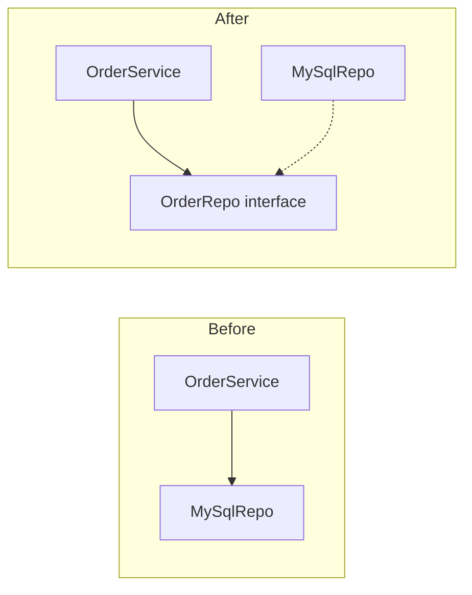

Before, the business class depends on the database class. After, both depend on an interface that the business side owns.

**Why they matter:** teams change code all the time. SOLID keeps a change local, so you can add a feature without re-testing everything.

**Gotchas**
- SOLID is a set of guidelines, not laws. Applying all five everywhere gives a maze of tiny classes.
- They come from class-based languages. In Go or functional code the ideas still help, but the tools are different (small interfaces, functions as values).
- The five are connected. Dependency inversion makes open/closed practical, and small interfaces make substitution safe.

**Interview tip:** Give one real example per letter in your own stack, not textbook shapes. Then say when you would not apply it.

_Module: SOLID · Tags: solid, oop, overview_

### 10. What is the Single Responsibility Principle with a real example?

**Short answer:** The Single Responsibility Principle says a module should have one reason to change. Robert C. Martin later clarified it as: a module should answer to one actor, meaning one group of people who ask for changes. It is not "a class should do one thing".

Take a report class that loads orders, calculates totals and renders HTML. Finance asks for a new total rule. Design asks for a new layout. The same class changes for two different groups, and each change can break the other.

```ts
type Order = { id: number; amount: number };

// ❌ bad: rules, data access and presentation in one place
class OrderReport {
  total(orders: Order[]) { return orders.reduce((s, o) => s + o.amount, 0); }
  toHtml(orders: Order[]) { return `<p>Total: ${this.total(orders)}</p>`; }
}

// ✅ good: each piece answers to one group
const totalOf = (orders: Order[]) => orders.reduce((s, o) => s + o.amount, 0); // finance rules
const renderHtml = (total: number) => `<p>Total: ${total}</p>`; // presentation
console.log(renderHtml(totalOf([{ id: 1, amount: 40 }, { id: 2, amount: 60 }])));
// prints: <p>Total: 100</p>
```

**How to spot a violation**
- The class name has "And" or "Manager" or "Util" in it.
- A change request from one department touches code that another department owns.
- Tests for one rule need setup for unrelated things such as email or database.
- Imports show a mix of HTTP, SQL and formatting libraries.

**Gotcha:** do not split too far. A class with two methods that always change together is fine. Splitting every method into its own class makes code hard to follow, and that breaks KISS.

**Interview tip:** Use the phrase "reason to change" and "who asks for the change". It shows you know the real meaning and not the myth of "does one thing".

_Module: SOLID · Tags: solid, srp_

### 11. What is the Open/Closed Principle? Show a before and after.

**Short answer:** The Open/Closed Principle says code should be open for extension but closed for modification. Bertrand Meyer coined it. In practice, you add a new behaviour by adding new code, such as a new class or function, and you do not edit tested code every time a new case appears.

The typical sign of a violation is a `switch` or long `if` chain on a type, which grows with each new case.

```ts
// ❌ bad: every new payment method edits this function
function fee(method: string, amount: number): number {
  if (method === "card") return amount * 0.02;
  if (method === "upi") return 0;
  throw new Error("unknown method");
}

// ✅ good: new methods are new entries; fee() never changes
type FeeRule = (amount: number) => number;
const rules: Record<string, FeeRule> = {
  card: (a) => a * 0.02,
  upi: () => 0,
};
rules.wallet = (a) => a * 0.01; // extension: added without touching fee code
const feeOf = (method: string, amount: number) => rules[method](amount);
console.log(feeOf("card", 1000), feeOf("wallet", 1000)); // prints: 20 10
```

The second version is "closed" because the calculating code is untouched. The set of rules is "open".

**Gotchas**
- You cannot be closed against every change. Choose the kinds of change that are likely, based on real history, and leave the rest alone. This is where YAGNI applies.
- Do not add abstractions for a switch that has two cases and will stay that way.
- Modern view: the extension point is usually an interface or a function value (Strategy pattern). Inheritance is only one way.

**Interview tip:** Say you introduce the extension point the second or third time a new case appears, not on day one.

_Module: SOLID · Tags: solid, ocp, polymorphism_

### 12. What is the Liskov Substitution Principle? Give a realistic example.

**Short answer:** The Liskov Substitution Principle, from Barbara Liskov, says that code written for a base type must keep working if you give it any subtype. A subtype must keep the promises of its parent: accept the same inputs, return the same kind of results and not break the rules the caller relies on.

The textbook case is Square extending Rectangle. A caller sets width to 5 and height to 4 and expects an area of 20. A square that forces both sides equal returns 16. The subclass broke the caller's expectation.

A more realistic example is a payment gateway where one subclass cannot do what the parent promises.

```ts
interface Refundable { refund(orderId: string, amount: number): string }

class CardGateway implements Refundable {
  refund(orderId: string, amount: number) { return `card refund ${amount} for ${orderId}`; }
}
// ❌ bad: it claims to be Refundable but breaks the promise
class CashOnDelivery implements Refundable {
  refund(): string { throw new Error("cash cannot be refunded"); }
}

function processReturn(g: Refundable) { return g.refund("A1", 50); }
console.log(processReturn(new CardGateway())); // prints: card refund 50 for A1
```

`processReturn` now blows up for cash payments. The fix is to not put cash under `Refundable`. Split the interface so that only types that can refund claim it.

**Signs of a violation**
- A subclass throws "not supported" or does nothing for an inherited method.
- A caller checks `instanceof` to decide what to do.
- A subclass tightens input rules (rejects values the parent accepted) or weakens results.

**Rules in simple words:** a subtype may accept more and promise more, but never accept less or promise less.

**Interview tip:** Say that Liskov is about behaviour, not about whether the code compiles. Mention "prefer composition" as the usual repair.

_Module: SOLID · Tags: solid, lsp, inheritance_

### 13. What is the Interface Segregation Principle?

**Short answer:** The Interface Segregation Principle says no client should be forced to depend on methods it does not use. Prefer several small, focused interfaces over one big one. Robert C. Martin described it from a printer example with many unrelated jobs in one interface.

A fat interface forces each implementer to write methods it does not need, often as empty or throwing stubs. It also means that a change to an unrelated method forces every client to recompile and retest.

```ts
// ❌ bad: a read-only reports module must depend on write methods
interface UserStore { get(id: number): string; save(id: number, name: string): void; delete(id: number): void }

// ✅ good: small interfaces, each for one kind of client
interface UserReader { get(id: number): string }
interface UserWriter { save(id: number, name: string): void }

class MemoryUsers implements UserReader, UserWriter {
  #m = new Map<number, string>();
  get(id: number) { return this.#m.get(id) ?? "unknown"; }
  save(id: number, name: string) { this.#m.set(id, name); }
}
const showName = (r: UserReader, id: number) => r.get(id); // cannot save or delete
const users = new MemoryUsers();
users.save(1, "Meera");
console.log(showName(users, 1)); // prints: Meera
```

`showName` can only read. A test can pass a tiny fake with one method.

**Go proverb:** "The bigger the interface, the weaker the abstraction." Go interfaces are often one or two methods, such as `io.Reader`, and are defined by the consumer.

**Gotchas**
- Do not make an interface per method by reflex. Group methods that clients use together.
- Splitting too early adds noise. Split when two kinds of clients need different parts.

**Interview tip:** Connect ISP to testing: small interfaces make fakes and mocks cheap to write.

_Module: SOLID · Tags: solid, isp, interfaces_

### 14. What is the Dependency Inversion Principle, and how is it different from dependency injection and inversion of control?

**Short answer:** Dependency Inversion is a design rule: high-level business code and low-level details should both depend on an abstraction, and the abstraction is owned by the high-level side. Dependency injection is a technique that passes dependencies in from outside. Inversion of control is the wider idea that a framework or caller decides when your code runs.

| Term | What it is | Example |
| --- | --- | --- |
| Dependency Inversion (DIP) | a rule about the direction of source-code dependencies | `OrderService` owns a `PaymentPort` interface |
| Dependency Injection (DI) | a way to give an object its collaborators | passing the gateway into the constructor |
| Inversion of Control (IoC) | the framework calls you, not the other way round | NestJS calls your controller |
| DI container | a tool that does the injection | NestJS or .NET service provider |

```go
package main

import "fmt"

// The business side owns the interface (DIP).
type PaymentPort interface{ Charge(amount int) string }

type OrderService struct{ pay PaymentPort }

func (s OrderService) Place(amount int) string { return s.pay.Charge(amount) }

// A detail that depends on the abstraction.
type StripeAdapter struct{}

func (StripeAdapter) Charge(amount int) string { return fmt.Sprintf("charged %d via stripe", amount) }

func main() {
	svc := OrderService{pay: StripeAdapter{}} // DI: passed in from outside
	fmt.Println(svc.Place(250))               // prints: charged 250 via stripe
}
```

The import arrow points from the detail towards the business rule. The business code does not know Stripe exists.

**Common mistakes**
- Saying "DIP means using a DI container". You can follow DIP with plain constructor arguments.
- Creating an interface for every class with no second implementation. DIP matters at the boundaries: database, network, clock, queue.

**Interview tip:** Say it in this order: DIP is the rule, DI is the tool, IoC is the broad idea. Then give a testing benefit: you can pass a fake gateway.

_Module: SOLID · Tags: solid, dip, dependency-injection, ioc_

### 15. What do high cohesion and low coupling mean?

**Short answer:** Cohesion is how strongly the parts inside one module belong together. Coupling is how much one module depends on others. Good design aims for high cohesion and low coupling, so that a change stays inside one module.

Picture a kitchen. A well-organised kitchen keeps cooking tools together (high cohesion). A restaurant where the chef cannot cook unless the cashier moves a certain table has too much coupling.

| | High | Low |
| --- | --- | --- |
| Cohesion | all functions work on the same idea (good) | a `utils` file of unrelated helpers (bad) |
| Coupling | modules know each other's internals (bad) | modules talk through small contracts (good) |

```ts
// ❌ low cohesion + tight coupling: reaches into another module's data
function printInvoice(order: { customer: { address: { city: string } } }) {
  return order.customer.address.city;
}

// ✅ the module that owns the data exposes what is needed
class Customer {
  #city: string;
  constructor(city: string) { this.#city = city; }
  shipsTo(city: string) { return this.#city === city; }
}
```

**Kinds of coupling, from worst to best**
- Content coupling: one module changes another's internals.
- Shared global state.
- Data structure coupling: both depend on a large shared shape.
- Plain data or an interface only.

**Gotchas**
- Zero coupling is impossible. Modules must cooperate. The goal is to make dependencies few, visible and stable.
- Splitting too much lowers cohesion and raises the number of connections.

**Interview tip:** Say how you notice it: "if one feature change touches many modules, coupling is high; if one module changes for many unrelated reasons, cohesion is low".

_Module: Coupling & Cohesion · Tags: cohesion, coupling, modularity_

### 16. What is Separation of Concerns?

**Short answer:** Separation of Concerns means splitting a program into parts, each handling one area of interest, such as the user interface, business rules, data access or logging. Edsger Dijkstra named the idea. It makes each part easier to understand, test and replace.

A concern is a topic you can think about on its own. When "how a price is calculated" lives in a React component next to "how it is styled" and "how it is fetched", changing one risks the others.

```ts
// Each concern has a home
const priceWithTax = (net: number) => Math.round(net * 1.18);          // business rule
const toLabel = (n: number) => `Rs ${n}`;                               // presentation
const fetchNet = async (id: string) => ({ id, net: 1000 });             // data access (stubbed)

async function main() {
  const p = await fetchNet("sku-1");
  console.log(toLabel(priceWithTax(p.net))); // prints: Rs 1180
}
main();
```

**Common ways to separate**
- Layers: UI, application, domain, infrastructure.
- Frontend: components for display, hooks for state and data, plain functions for rules.
- Cross-cutting concerns (logging, auth, retries) handled with middleware or decorators so they do not leak into every function.

**Gotchas**
- Separation is not the same as many layers. A layer that only forwards calls adds cost with no benefit.
- Do not split at a line the team cannot explain. Separate where the reason to change differs.
- SoC is wider than SRP. SRP is about one class and actors. SoC is about the structure of the whole program.

**Interview tip:** Use your React/Node experience: show how pulling business rules out of components made them unit-testable without rendering.

_Module: Coupling & Cohesion · Tags: separation-of-concerns, layering_

### 17. What are encapsulation and information hiding, and why do they matter?

**Short answer:** Encapsulation bundles data with the code that works on it. Information hiding, a term from David Parnas, means hiding design decisions behind a small interface so they can change without breaking users. Together they protect the rules of an object and reduce coupling.

A bank account does not let you set the balance directly. You call `deposit` and `withdraw`, and those methods guard the rules (no negative amounts, no overdraft).

```ts
class Account {
  #balance = 0; // hidden: only this class can touch it
  deposit(n: number) {
    if (n <= 0) throw new Error("amount must be positive");
    this.#balance += n;
  }
  withdraw(n: number) {
    if (n > this.#balance) throw new Error("insufficient funds");
    this.#balance -= n;
  }
  get balance() { return this.#balance; }
}
const a = new Account();
a.deposit(100);
a.withdraw(30);
console.log(a.balance); // prints: 70
```

Later, you can store balance in cents or in a ledger. Callers do not change, because they never saw the field.

**Gotcha: getters and setters for everything is not encapsulation.** A class with a getter and setter for every field is just a struct with extra typing. It exposes the same data. Prefer methods named after behaviour (`withdraw`, `markShipped`).

**Language notes**
- TypeScript `private` is compile-time only. The `#field` syntax is truly private at runtime.
- Go hides names that start with a lowercase letter at the package level.
- Python uses naming conventions (`_name`).

**Interview tip:** Say the benefit in terms of change: hiding means you can change the insides without a ripple through the codebase.

_Module: Coupling & Cohesion · Tags: encapsulation, information-hiding_

### 18. What is abstraction in software design, and how is it different from encapsulation?

**Short answer:** Abstraction means showing only what matters to the caller and leaving out the details. Encapsulation means protecting the details and the rules by controlling access. Abstraction is about what you present. Encapsulation is about what you hide and guard.

You drive a car using a steering wheel, pedals and a gear stick. That is the abstraction. You do not need to know how fuel injection works. The engine bay being closed under a bonnet is encapsulation.

| | Abstraction | Encapsulation |
| --- | --- | --- |
| Question it answers | "What can I do?" | "How do I keep the rules safe?" |
| Tool | interfaces, function names, modules | access modifiers, private state |
| Level | design | implementation |

```ts
// The caller sees "send a message". It does not see SMTP or SMS details.
interface Notifier { send(to: string, text: string): string }
const emailNotifier: Notifier = { send: (to, text) => `email to ${to}: ${text}` };
console.log(emailNotifier.send("a@x.com", "Order shipped")); // prints: email to a@x.com: Order shipped
```

**Gotchas**
- A good abstraction is hard to find. A bad one leaks details and makes callers work around it. Joel Spolsky's "Law of Leaky Abstractions" says all non-trivial abstractions leak a little.
- Abstractions have a cost: one more concept to learn and one more indirection to debug.
- Name an abstraction by what it means to the business (`PaymentGateway`), not by how it works (`HttpPostWrapper`).

**Interview tip:** Mention that you create an abstraction when you see a stable idea, not just to hide one class.

_Module: Coupling & Cohesion · Tags: abstraction, encapsulation_

### 19. What are the four pillars of object-oriented programming?

**Short answer:** The four pillars are encapsulation, abstraction, inheritance and polymorphism. Encapsulation protects data. Abstraction exposes only what matters. Inheritance reuses and specialises a type. Polymorphism lets the same call behave differently depending on the object.

| Pillar | In one line | Order-system example |
| --- | --- | --- |
| Encapsulation | data and rules together, access controlled | `Order` guards its own status changes |
| Abstraction | simple view of a complex thing | `PaymentGateway.charge()` |
| Inheritance | a type builds on another | `ExpressShipment` extends `Shipment` |
| Polymorphism | one interface, many behaviours | `notifier.send()` works for email or SMS |

```ts
abstract class Shipment {
  weightKg: number;
  constructor(weightKg: number) { this.weightKg = weightKg; }
  abstract cost(): number;
}
class StandardShipment extends Shipment { cost() { return this.weightKg * 10; } }
class ExpressShipment extends Shipment { cost() { return this.weightKg * 25; } }

const list: Shipment[] = [new StandardShipment(2), new ExpressShipment(2)];
console.log(list.map((s) => s.cost())); // prints: [ 20, 50 ]
```

**Remember:** modern advice treats inheritance as the weakest pillar. Many teams prefer composition and interfaces. Languages such as Go have no inheritance at all, yet still have encapsulation, abstraction and polymorphism.

**Gotchas**
- Do not describe inheritance as "reuse code". Its real value is substitutability. If the subclass is not a true kind of the parent, do not use it.
- Polymorphism is not only inheritance. Interfaces, function values and generics also give it.

**Interview tip:** After listing the four, add one sentence on when you avoid inheritance. That shows seniority.

_Module: OOP Fundamentals · Tags: oop, fundamentals_

### 20. Why do people say "favour composition over inheritance"?

**Short answer:** Inheritance ties a subclass tightly to its parent. Composition builds behaviour by holding other objects and delegating to them, which is more flexible and easier to change. The Gang of Four book gave this advice: favour object composition over class inheritance.

Inheritance says "is a". Composition says "has a" or "uses a". A `Car` has an `Engine`. It is not a kind of engine.

Problems with inheritance: the subclass depends on the parent's internal details (the fragile base class problem), you cannot change the parent type at runtime, and deep trees are hard to follow.

```ts
// ❌ bad: inheritance just to reuse a logger
class Logger { log(m: string) { console.log("LOG", m); } }
class OrderService extends Logger { place() { this.log("placed"); } }

// ✅ good: composition, the logger can be swapped or faked
interface Log { log(m: string): void }
class OrderService2 {
  logger: Log;
  constructor(logger: Log) { this.logger = logger; }
  place() { this.logger.log("placed"); }
}
```

In the first version, `OrderService` is not a logger, yet it exposes `log` publicly. In the second, you can pass a no-op or fake logger in tests.

| | Inheritance | Composition |
| --- | --- | --- |
| Relationship | is-a | has-a |
| Coupling | tight | loose |
| Change at runtime | no | yes (swap the part) |
| Good for | true subtypes, small hierarchies | most reuse |

**Gotcha:** the rule says "favour", not "never". A small, stable `is-a` hierarchy, or a framework base class like a NestJS exception, is fine.

**Interview tip:** Mention Go: it has no inheritance, and struct embedding is composition with convenient method promotion.

_Module: OOP Fundamentals · Tags: composition, inheritance, gof_

### 21. What is polymorphism and how does it remove conditionals?

**Short answer:** Polymorphism means "many forms": code calls one method name, and the actual behaviour depends on the object that receives the call. It lets you replace `if` and `switch` chains on type with objects that each know how to do their own part.

There are a few kinds. Subtype polymorphism uses inheritance or interfaces. Parametric polymorphism uses generics. Ad-hoc polymorphism uses overloading. Interview questions usually mean the first.

```ts
interface Discount { apply(total: number): number }
class NoDiscount implements Discount { apply(t: number) { return t; } }
class PercentOff implements Discount {
  pct: number;
  constructor(pct: number) { this.pct = pct; }
  apply(t: number) { return t - (t * this.pct) / 100; }
}
class FlatOff implements Discount {
  amount: number;
  constructor(amount: number) { this.amount = amount; }
  apply(t: number) { return Math.max(0, t - this.amount); }
}

// the checkout does not know or care which discount it holds
const checkout = (total: number, d: Discount) => d.apply(total);
console.log(checkout(1000, new PercentOff(10)), checkout(1000, new FlatOff(150))); // prints: 900 850
```

Adding a new discount means adding a class. The checkout code stays the same, which is the Open/Closed Principle at work.

**Gotchas**
- Not every `switch` needs removing. For a small, closed set of values (days of the week) a `switch` is simpler. Do not build a class family for two cases.
- Runtime dispatch is slightly slower than a direct call. It rarely matters for business code.
- In Go, polymorphism comes from interfaces satisfied implicitly. In TypeScript, a union type with a discriminant field (`kind`) gives a safe `switch` alternative.

**Interview tip:** Say when you prefer a discriminated union over classes: when the set of cases is closed and you add new operations more often than new cases.

_Module: OOP Fundamentals · Tags: polymorphism, oop_

### 22. Why is immutability a good design principle?

**Short answer:** An immutable object cannot change after it is created. To "change" it you create a new copy. Immutability removes a whole class of bugs: surprise changes by other code, shared-state races between threads and hard-to-trace state. It makes code easier to reason about and test.

If an `Order` can be changed from ten places, a bug in any one place can corrupt it. If it is immutable, you know its values never change after creation.

```ts
type Money = Readonly<{ amount: number; currency: string }>;

const add = (a: Money, b: Money): Money => {
  if (a.currency !== b.currency) throw new Error("currency mismatch");
  return { amount: a.amount + b.amount, currency: a.currency }; // a new value, a and b untouched
};

const price: Money = { amount: 500, currency: "INR" };
const total = add(price, { amount: 120, currency: "INR" });
console.log(price.amount, total.amount); // prints: 500 620
```

**Benefits**
- Safe to share and cache, with no defensive copies.
- Thread-safe by construction. No locks needed to read.
- React relies on it: state updates must create new objects so changes are detected.
- Easy to compare, log and replay (audit trails, event sourcing).

**Gotchas**
- `readonly` and `const` in TypeScript are shallow and compile-time only. `Object.freeze` is also shallow.
- Copying large structures for every change can cost memory. Persistent data structures or targeted copying help when profiling shows a problem.
- Not everything should be immutable. Local variables in a tight loop are fine to change. The goal is to limit shared, long-lived mutable state.

**Interview tip:** Link immutability to value objects (Money, Email) in domain design and to React state updates, both from your own experience.

_Module: OOP Fundamentals · Tags: immutability, state, concurrency_

## Intermediate

### 23. [Tech Lead] How do you balance KISS, YAGNI and future-proofing when the roadmap is uncertain?

**Short answer:** I build the simplest thing that solves the committed work, and I keep the code easy to change instead of trying to predict the change. I only invest early where a wrong choice is expensive to undo, such as public APIs, data models and service boundaries. Everything else waits for evidence.

Uncertainty is the reason to avoid guessing. If the roadmap may change in two months, every speculative feature has a good chance of being wrong. What helps is cheap change: tests, small modules and clear boundaries.

**How I decide**
1. Ask: how costly is it to change this later? Cheap (an internal function) means do the simple thing. Expensive (a public endpoint, a database key, an event schema) means think now.
2. Ask: do we have evidence? A signed customer need is evidence. "Maybe a partner will want it" is not.
3. Prefer reversible choices. Pick the option that is easy to undo.
4. Leave a seam, not a framework. A narrow interface at the boundary costs little and keeps options open.

| Decision | Treat as | Approach |
| --- | --- | --- |
| Internal helper, one caller | cheap to change | simplest code, no abstraction |
| Public REST field names | expensive | review carefully, version |
| Choice of database | expensive | decide with data, isolate behind a repository |
| Multi-tenant support "someday" | speculative | do not build; avoid hard-coding assumptions that make it impossible |

**Gotchas**
- "Future-proof" often means "complex now". Ask the team: what exact future change are we protecting against, and how likely is it?
- YAGNI does not mean ignoring known requirements. If legal says audit logs are due next quarter, plan for them.
- Writing down a decision with an ADR keeps the reasoning for later, so you can revisit when the facts change.

**Interview tip:** Use the phrase "two-way door vs one-way door". Spend design time only on one-way doors. It shows you can move fast without being careless.

_Module: Simplicity & Pragmatism · Tags: tech-lead, yagni, kiss, decision-making_

### 24. [Tech Lead] How do you handle DRY versus AHA in code review?

**Short answer:** I look at why the code is shared or repeated, not just whether it looks alike. If two pieces encode the same business rule, I ask for one home. If they only look similar and may change separately, I leave them apart. I give feedback as questions about change, not as rules.

A review comment such as "this is duplicated, please extract" can push someone into a bad abstraction. A comment such as "this one is only used twice; I'd wait for a third use" can leave a real bug source in place. Both need judgement.

**Questions I ask in review**
- Do these copies share a reason to change? If the tax rule changes, must both change?
- If I extract, how many parameters or flags does the helper need? More than two or three flags is a warning.
- What happens to the next caller? Will it fit, or will it need one more flag?
- Is the duplication within one module (cheap to fix later) or across services (expensive)?

| Situation | My feedback |
| --- | --- |
| Same validation rule copied in API and UI | "Please share it: one source of truth." |
| Two similar mappers with different fields | "Leave it for now. Revisit at the third." |
| New helper with four boolean flags | "Looks like two functions hiding in one. Can we split?" |
| Same constant in three files | "Move to one place." |

```ts
// Reviewer's concern: one helper, three modes chosen by flags
function formatRow(r: { id: number; name: string }, forExport: boolean, forAdmin: boolean) {
  return forExport ? `${r.id},${r.name}` : forAdmin ? `#${r.id} ${r.name}` : r.name;
}
console.log(formatRow({ id: 1, name: "Asha" }, true, false)); // prints: 1,Asha
```

**How I phrase it:** "Can we keep these separate until we see what really varies?" is easier to accept than "this abstraction is wrong". I also link the Sandi Metz idea so the team has shared language.

**Interview tip:** Say that you review for change, not for looks, and that the author stays the owner. Offer a way back: inlining a helper later is always possible.

_Module: Simplicity & Pragmatism · Tags: tech-lead, dry, aha, code-review_

### 25. [Tech Lead] How do you detect and prevent over-engineering in a team?

**Short answer:** I watch for code that solves problems we do not have: abstractions with one implementation, config that nobody changes, extension points with no extensions. I prevent it by asking for the concrete requirement behind each design choice and by keeping designs small and reviewed early.

Over-engineering often comes from good motives: pride, fear of rewrites or interest in a new pattern. The damage is real: slower onboarding, more code to test, and harder debugging.

**Signs in code and in meetings**
- An interface with one implementation and no test fake.
- A "generic" engine with a plugin system and zero plugins.
- Many layers that just pass data along (controller, service, manager, helper, repository).
- Words like "in case", "someday", "for flexibility".
- A design doc longer than the problem.
- A feature flag or setting that every environment sets the same.

**Prevention habits**
- Ask for the use case. "Which ticket needs this?"
- Start with the plain solution. Introduce an abstraction on the second or third real case.
- Do a short design review before coding for anything bigger than a few days.
- Compare the cost: lines of code, new concepts, new dependencies against the problem size.
- Celebrate deleted code in team updates.
- Use a spike or prototype to learn first, then throw it away.

| Healthy | Over-engineered |
| --- | --- |
| a function and a test | factory, builder and registry |
| one config file | feature flag per class |
| a library you know | a new framework for one screen |

**Gotcha:** under-engineering is also real. Skipping tests, boundaries and logging to "stay simple" creates debt. The aim is right-sized design, not minimum design.

**Interview tip:** Tell a short story: "We had a rules engine for three rules. We replaced it with a function and a table, and code dropped by 600 lines."

_Module: Simplicity & Pragmatism · Tags: tech-lead, over-engineering, kiss, yagni_

### 26. [Tech Lead] How do you teach SOLID and other design principles to a team without being dogmatic?

**Short answer:** I teach principles as tools with trade-offs, using the team's own code. I show a real pain first (a change that touched six files), then the principle that would have helped, and I always say when it is not worth it. I avoid quoting rules in reviews. I talk about the effect on change and testing.

Dogma looks like "this violates SRP, rejected". It makes people hide the problem or add needless classes just to pass. Understanding looks like "this class changes for two reasons; what would we split?".

**What works**
1. **Start with pain.** Pick a recent bug or slow change and trace why it was hard.
2. **Use refactoring sessions.** Take a real class, refactor it together, and name the principle after the improvement, not before.
3. **Teach in pairs and reviews.** Short comments with a reason and an example beat a long presentation.
4. **Show the opposite.** Show an over-applied example, such as 12 tiny classes for a three-step flow.
5. **Keep a short team guide.** One page with 5 to 8 agreed practices and examples from your codebase.
6. **Use a code kata or dojo** for safe practice, such as refactoring a messy order-pricing function.

| Avoid | Prefer |
| --- | --- |
| "This breaks Liskov." | "If a caller passes this subclass, what does it expect?" |
| Rules without context | Examples from our service |
| Reviews that only criticise | Reviews that show the improved version |

**Gotcha:** juniors may copy patterns without the reasoning, and seniors may reject principles as academic. Both are solved by tying every principle to a concrete outcome: fewer files touched, simpler tests, fewer incidents.

**Interview tip:** Say that you measure whether teaching works by outcomes (smaller pull requests, fewer review arguments), not by how many people can recite SOLID.

_Module: SOLID · Tags: tech-lead, mentoring, solid, team-practices_

### 27. [Tech Lead] When design principles conflict, how do you decide?

**Short answer:** Principles are heuristics, so they do disagree. I decide by the cost and likelihood of change, the size of the team and the risk of being wrong. I choose the option that keeps code simple today and is cheap to change tomorrow, and I write down why.

**Common conflicts**

| Conflict | Lean toward | Because |
| --- | --- | --- |
| DRY vs AHA | wait for the pattern, unless it is one business rule | a wrong abstraction costs more than copies |
| OCP vs YAGNI | add the extension point at the second case | early abstraction guesses wrong |
| DIP (interfaces) vs KISS | use interfaces at real boundaries only | an interface per class is noise |
| SRP vs cohesion | keep together what changes together | too many small classes hide the flow |
| Performance vs readability | readability, until measured | premature optimisation |
| Consistency vs best tool | consistency, unless the gain is large | fewer things to learn |

**A decision method**
1. Name the goal: speed of change, safety, performance or cost.
2. Ask which option is easier to reverse.
3. Check the team: can people maintain it six months from now?
4. Prototype or timebox if unsure.
5. Record the choice in a short ADR and set a point to revisit.

```ts
// Conflict in miniature: DRY says merge; AHA says wait. The two rules are the same knowledge,
// so we share the constant but keep the two different formatting functions.
const GST = 0.18;
const invoiceTax = (net: number) => net * GST;
const quoteLabel = (net: number) => `Quote incl. GST: ${net + net * GST}`;
console.log(invoiceTax(100), quoteLabel(100)); // prints: 18 Quote incl. GST: 118
```

**Gotcha:** "It depends" is a good start but a poor ending. Always say what it depends on.

**Interview tip:** Pick two conflicting principles from your own work, say which you chose and why, and say what would make you change your mind.

_Module: Simplicity & Pragmatism · Tags: tech-lead, trade-offs, decision-making_

### 28. [Tech Lead] How do you manage technical debt: types, interest, prioritising and communicating it?

**Short answer:** Technical debt is the extra cost we pay later because of shortcuts or aging design. Ward Cunningham used the debt metaphor. I make it visible, rank it by the interest we pay (how much it slows us or risks us), and fix it in small steps alongside feature work. I explain it to business people in time, risk and money.

**Types** (the first three follow Martin Fowler's debt quadrant)
- Deliberate and prudent: "we ship now and clean up next sprint". Fine, if recorded.
- Deliberate and reckless: "no time for design". Harmful.
- Accidental: we learned a better way later. Normal.
- Environmental: old libraries, runtimes and tools going out of support.

**Interest** is the recurring cost: slower features, repeated bugs, onboarding time, outages. The principal is the effort to fix it.

**How to prioritise:** score each item by interest and by risk.

| Item | Interest (pain/month) | Fix cost | Decision |
| --- | --- | --- | --- |
| Flaky payment tests block deploys daily | high | small | do now |
| Ugly but stable report module | low | large | leave it |
| Unsupported runtime version | rising, security | medium | schedule with a deadline |

**Practices**
- Keep a visible debt register (labels in the tracker) with a short impact line.
- Reserve a steady share of capacity (many teams use 10 to 20 percent) instead of a "big cleanup" that never happens.
- Fix debt near the code you are already changing (Boy Scout Rule).
- Track evidence: lead time, bug rate, build time, incidents.
- Talk to the business with outcomes: "this module adds two days to every pricing change".

**Gotchas**
- Not every ugly code is debt. Code that is ugly but never changes costs nothing.
- Do not say "we need a refactoring sprint". Tie work to a goal.

**Interview tip:** Bring one number, such as "build time dropped from 25 to 9 minutes", to show that you managed debt as a measurable investment.

_Module: Technical Debt & Leadership · Tags: tech-lead, technical-debt, prioritisation_

### 29. [Tech Lead] What are Architecture Decision Records and how do you use them?

**Short answer:** An Architecture Decision Record (ADR) is a short document that captures one important decision: the context, the options, the choice and the consequences. Michael Nygard popularised the format. ADRs give new people the reason behind the design and stop the team repeating old debates.

Code shows what we did, but not why. Six months later someone asks "why did we pick Kafka over a queue?" and nobody remembers. An ADR answers that in one page.

**A small template**

```text
# ADR 012: Use a transactional outbox for order events
Status: accepted (2026-03-04)
Context: Orders must publish events without losing them when the broker is down.
Options: 1) publish after commit, 2) outbox table + relay, 3) distributed transaction
Decision: Outbox table with a relay worker.
Consequences: + no lost events; - extra table, relay to run, events can be duplicated
(consumers must be idempotent). Revisit if we move to a broker with transactions.
```

**How to run them**
- Store them in the repo (for example `docs/adr/0012-...md`) so they go through pull requests.
- Number them, never edit history: if a decision changes, add a new ADR that supersedes the old one.
- Write one for decisions that are costly to reverse: data stores, service boundaries, auth, major libraries.
- Keep them short. Half a page is fine.
- Discuss the ADR as a pull request. The review is the decision meeting.

| Status | Meaning |
| --- | --- |
| proposed | being discussed |
| accepted | the team agreed |
| superseded | replaced by a newer ADR |
| rejected | considered and declined (keep for history) |

**Gotchas**
- ADRs for trivial choices create noise.
- An ADR without the rejected options is not useful. The alternatives are the value.

**Interview tip:** Say that ADRs also help in disagreements: the argument is about facts and consequences, not about who is louder.

_Module: Technical Debt & Leadership · Tags: tech-lead, adr, documentation, decision-making_

### 30. [Tech Lead] What is on your design review checklist for pull requests?

**Short answer:** I review the change in layers: does it solve the right problem, is the design simple and easy to change, is it safe in production, and is it tested. I focus on design and risk. Style and formatting I leave to automated tools.

**Checklist**

| Area | Questions |
| --- | --- |
| Purpose | Does this match the ticket? Is there anything unneeded in it (YAGNI)? |
| Simplicity | Could this be simpler? Is every new abstraction used by at least two callers? |
| Responsibility | Does each class or function have one reason to change? Is logic in the right layer? |
| Coupling | New dependencies or imports across modules? Does it depend on details instead of a contract? |
| Naming | Do names say what things mean in the business? |
| Duplication | Same rule in two places? Or a premature merge of code that only looks alike? |
| Errors | Are failures handled and visible? Fail fast on bad input? |
| Testing | Is behaviour tested, not just lines? Can it be tested without a real database or clock? |
| Operations | Logs, metrics, timeouts, retries, idempotency for repeat calls? |
| Compatibility | Does it break an API, event or database contract? Is there a migration plan? |
| Security | Input validation, permission checks, secrets? |
| Size | Can the review be done in 20 minutes? If not, can it be split? |

**How I give feedback**
- Mark comments: must fix, suggestion, question or nit.
- Explain the effect, for example "this makes the retry unsafe for double charges".
- Offer a code sketch for design suggestions.
- Praise good changes. Reviews build culture.

**Gotchas**
- A checklist is a prompt, not a gate. Do not paste 30 items into every pull request.
- Do not bike-shed names while missing a missing-timeout bug.
- Large pull requests get shallow reviews. Ask authors to split them.

**Interview tip:** Say what you check first: "Is this change safe to deploy and easy to roll back?" Design purity comes after safety.

_Module: Technical Debt & Leadership · Tags: tech-lead, code-review, checklist, team-practices_

### 31. What is the Law of Demeter ("don't talk to strangers")?

**Short answer:** The Law of Demeter says a method should only talk to its close friends: itself, its parameters, objects it creates and its direct parts. It should not reach through one object to get to another (`order.customer.address.city`). Chains like that couple your code to the whole structure behind it.

The idea came from the Demeter project at Northeastern University in the late 1980s. The simple version is "use only one dot". Think of paying a shop assistant: you hand over money to the assistant. You do not reach into their pocket to take the change.

```ts
type Address = { city: string };
type Customer = { address: Address };

// ❌ bad: the caller knows the full path; if address moves, this breaks
const cityBad = (o: { customer: Customer }) => o.customer.address.city;

// ✅ good: the order answers the question itself
class Order {
  customer: Customer;
  constructor(customer: Customer) { this.customer = customer; }
  shippingCity(): string { return this.customer.address.city; }
}
console.log(new Order({ address: { city: "Pune" } }).shippingCity()); // prints: Pune
```

If the address structure changes, only `Order` changes. Callers are not touched.

**Gotchas**
- Fluent builders and chains such as `array.filter(...).map(...)` are fine. They return the same kind of thing, not deeper internals.
- Plain data objects (DTOs, JSON) are structures, not behaviour. Reading `response.data.items` is normal.
- Do not create a wrapper for every field. That is a "middle man" smell. Add a method only when the caller really needs that answer.

**Signs of a violation**
- Long chains of property access across domain objects.
- Tests that need to build a deep object graph for one small check.
- A change to one class causing many compile errors elsewhere.

**Interview tip:** Say that the law is a guide to reduce coupling, and that you apply it to domain objects, not to data transfer objects.

_Module: Coupling & Cohesion · Tags: law-of-demeter, coupling, encapsulation_

### 32. What is "Tell, Don't Ask"?

**Short answer:** Tell, Don't Ask says you should tell an object what to do, instead of asking for its data and making the decision outside. The rule that belongs to an object should live inside it. This keeps behaviour next to the data it uses.

Think of a waiter. You do not ask the kitchen for the list of ingredients and cook yourself. You say "one margherita" and the kitchen does it.

```ts
// ❌ bad: the caller asks for state and applies the rule
class Wallet { balance = 100; }
const w1 = new Wallet();
if (w1.balance >= 30) w1.balance -= 30;

// ✅ good: tell the wallet to pay; it protects its own rule
class SafeWallet {
  #balance: number;
  constructor(balance: number) { this.#balance = balance; }
  pay(amount: number): boolean {
    if (amount > this.#balance) return false;
    this.#balance -= amount;
    return true;
  }
  get balance() { return this.#balance; }
}
const w2 = new SafeWallet(100);
console.log(w2.pay(30), w2.pay(100), w2.balance); // prints: true false 70
```

In the bad version, every caller must remember the overdraft rule. In the good version it is in one place.

**Why it helps**
- The rule lives once (DRY) and callers cannot forget it.
- The internal state can change without breaking callers.
- Tests check behaviour, not field values.

**Gotchas**
- It does not mean objects can never have getters. Display code and reports often need to read data. The aim is to avoid logic that decides based on someone else's state.
- Too strict a reading leads to bloated domain objects that know about UI or persistence. Keep them focused on business rules.
- It is about the same idea as the "anemic domain model" problem: data classes with all logic in services.

**Interview tip:** Pair it with the Law of Demeter. Both push behaviour to the object that owns the data.

_Module: Coupling & Cohesion · Tags: tell-dont-ask, encapsulation, oop_

### 33. What is Command-Query Separation, and how is it different from CQRS?

**Short answer:** Command-Query Separation (CQS), from Bertrand Meyer, says a method should either change state (a command) or return information (a query), but not both. CQRS is a larger architecture idea that uses separate models, and sometimes separate databases, for writing and reading.

A query should be safe to call many times with no side effects. That makes code easier to reason about and to test.

```ts
class Cart {
  #items: string[] = [];
  add(item: string): void { this.#items.push(item); } // command: changes state, returns nothing
  count(): number { return this.#items.length; }      // query: returns data, no change
}
const c = new Cart();
c.add("book");
console.log(c.count(), c.count()); // prints: 1 1
```

A classic violation is `stack.pop()`, which both removes and returns the item. Meyer allowed such cases when a pair of calls would be awkward or unsafe in concurrent code. Atomic operations such as "get and increment" are a good reason to break the rule.

| | CQS | CQRS |
| --- | --- | --- |
| Level | method or class | architecture, often service level |
| Idea | a method either acts or answers | separate write model and read model |
| Cost | none | two models, more code, often eventual consistency |
| Use when | always, as a habit | reads and writes have very different needs or scale |

**Gotchas**
- CQRS is not required for CQS. Do not adopt CQRS because it sounds modern. A plain CRUD service is simpler and often enough.
- A "command" in CQRS is a message that asks for a change (`PlaceOrder`). It is a related word but a different thing from a CQS command method.
- Returning an ID from a create method is a common, practical exception.

**Interview tip:** Say that CQS is a small habit and CQRS is an architecture choice with real costs, and that you would justify CQRS with load or reporting needs.

_Module: Robust Design · Tags: cqs, cqrs, bertrand-meyer_

### 34. What is the Principle of Least Astonishment?

**Short answer:** The Principle of Least Astonishment says code and APIs should behave the way a reasonable user expects. If a function name suggests one thing and it does another, people will use it wrongly and bugs follow.

If you press the light switch and the garage door opens, that is astonishing. A function called `getUser` should not create a user when none exists. A function called `validate` should not save data.

```ts
// ❌ astonishing: "sort" returns nothing but changes the caller's array
const prices = [30, 10, 20];
const sorted = prices.sort((a, b) => a - b);
console.log(sorted === prices); // prints: true (same array, mutated)

// ✅ calmer: a copy; the name and behaviour match
const sortedCopy = [...prices].sort((a, b) => a - b);
console.log(sortedCopy === prices); // prints: false
```

JavaScript `Array.prototype.sort` mutates the original, which surprises many people. Newer runtimes added `toSorted` (ES2023) as the non-mutating version.

**Ways to avoid surprises**
- Names tell the truth: `findUser` may return nothing, `getUser` suggests it always returns a user, `isActive` returns a boolean.
- No hidden side effects in queries.
- Same patterns for similar operations across the API (`create`, `update`, `delete` in the same shape).
- Defaults that are safe: a delete operation should require explicit confirmation or an ID.
- Errors that say what to do: "currency must be INR, got USD".
- Consistent units and formats (milliseconds everywhere, ISO dates).

**Gotchas**
- What is astonishing depends on the audience. Use the conventions of the language and team.
- Documentation does not excuse a surprising design. People do not read it at the moment they need it.

**Interview tip:** Give an example from an API you designed or reviewed, and the rename or default you changed to remove the surprise.

_Module: Robust Design · Tags: least-astonishment, api-design, naming_

### 35. What does "fail fast" mean in design, and when should you not fail fast?

**Short answer:** Fail fast means detect a problem as early as possible and stop loudly, instead of carrying bad data deeper into the system. An error at the boundary, with a clear message, is much easier to fix than a mysterious crash three layers later or silent corruption.

Imagine a cook who tastes the milk before using it. Bad milk found early costs one cup. Found after the cake is baked, it costs the whole cake.

```ts
function createOrder(items: string[], currency: string) {
  // fail fast: check inputs at the edge
  if (items.length === 0) throw new Error("order needs at least one item");
  if (currency !== "INR") throw new Error(`unsupported currency: ${currency}`);
  return { items, currency };
}
try {
  createOrder([], "INR");
} catch (e) {
  console.log((e as Error).message); // prints: order needs at least one item
}
```

**Where to fail fast**
- At service start-up: missing configuration or secret, so the pod fails its readiness check instead of failing on the first request.
- At the API boundary: validate input once, then trust the typed value inside.
- In constructors: an object should never exist in an invalid state.
- In tests and development with assertions.

**When NOT to fail fast**
- Long-running user-facing systems where one bad record should not stop everything. Skip or quarantine the record (dead-letter queue) and keep going.
- Optional features. If the recommendation service is down, show the page without it.
- Retries for transient errors, such as a short network failure.

| Situation | Behaviour |
| --- | --- |
| Invalid request | reject with 400 and a clear reason |
| Missing required config | crash at start |
| One bad message in a queue | send to dead-letter, continue |
| Optional dependency down | degrade gracefully |

**Gotcha:** failing fast is not the same as crashing production. It means making the failure visible and early, in a controlled way.

**Interview tip:** Say that "crash early" applies to programmer errors and invalid state, while "degrade gracefully" applies to expected runtime failures.

_Module: Robust Design · Tags: fail-fast, validation, error-handling_

### 36. What is Design by Contract: preconditions, postconditions and invariants?

**Short answer:** Design by Contract, from Bertrand Meyer, treats each method as an agreement. The caller must meet the preconditions. In return, the method guarantees the postconditions. The class keeps its invariants, rules that are always true between method calls. It makes responsibilities clear and bugs easy to locate.

| Part | Meaning | Who is at fault if broken |
| --- | --- | --- |
| Precondition | what must be true before the call | the caller |
| Postcondition | what is true after the call | the method |
| Invariant | what is true for the object at all times between calls | the class |

```ts
class Inventory {
  #stock = new Map<string, number>();
  add(sku: string, qty: number): void {
    if (qty <= 0) throw new Error("precondition: qty must be positive"); // caller's duty
    this.#stock.set(sku, (this.#stock.get(sku) ?? 0) + qty);
  }
  remove(sku: string, qty: number): void {
    const have = this.#stock.get(sku) ?? 0;
    if (qty > have) throw new Error("precondition: not enough stock");
    this.#stock.set(sku, have - qty);
    // invariant: stock never goes below zero
  }
  quantity(sku: string): number { return this.#stock.get(sku) ?? 0; }
}
const inv = new Inventory();
inv.add("pen", 5);
inv.remove("pen", 2);
console.log(inv.quantity("pen")); // prints: 3
```

**Link to Liskov:** a subtype may weaken preconditions (accept more) and strengthen postconditions (promise more). It must never do the opposite. That is the formal heart of LSP.

**In practice**
- Eiffel has contracts built in. Most languages use assertions, guard clauses, types and validation libraries.
- TypeScript types can encode preconditions (a `PositiveInt` branded type, a non-empty array type).
- At public boundaries, validate. Inside private code, trust and keep the invariant.

**Gotchas**
- Contracts are not error handling for the outside world. User input errors are expected, and you handle them as normal results.
- Do not check the same precondition at every layer. It creates duplicated knowledge.

**Interview tip:** Explain that clear contracts decide who validates, which removes the "both sides check everything" noise.

_Module: Robust Design · Tags: design-by-contract, bertrand-meyer, invariants_

### 37. What is Postel's Law (the robustness principle), and what are the criticisms of it?

**Short answer:** Postel's Law, from Jon Postel in early internet protocols, says "be conservative in what you send, be liberal in what you accept". Send clean, strict output, and tolerate small differences in the input you receive. It helps systems evolve, but being too liberal causes long-term problems.

A practical example is a service that ignores unknown fields in a JSON message. A newer sender can add a field and the older receiver still works. This is the "tolerant reader" idea.

```ts
// tolerant reader: pick what we need, ignore the rest
type OrderEvent = { id: string; total: number };
function readOrder(raw: Record<string, unknown>): OrderEvent {
  return { id: String(raw.id), total: Number(raw.total) };
}
console.log(readOrder({ id: "A9", total: "250", newField: true })); // prints: { id: 'A9', total: 250 }
```

**Criticisms**
- If receivers accept sloppy input, senders never learn to fix it. The sloppy behaviour becomes the unofficial standard, and nobody can tighten it later. Browsers and HTML parsing are the classic example.
- It hides bugs and invites security problems, because different systems interpret strange input in different ways.
- It makes protocols harder to specify and test.

| Be liberal about | Be strict about |
| --- | --- |
| extra unknown fields (forward compatibility) | required fields and types |
| harmless formatting (case, spaces) | security-relevant input (auth, paths, SQL) |
| a newer minor version of a message | amounts, currencies and identifiers |

**Gotchas**
- Combine it with fail fast. Be tolerant of harmless variation, but reject what is ambiguous or dangerous.
- Document the rules you accept, so tolerance is a decision and not an accident.

**Interview tip:** Say you use the tolerant reader for event and API evolution, but validate strictly at trust boundaries.

_Module: Robust Design · Tags: postels-law, robustness-principle, api-design_

### 38. What are the principle of least privilege and defence in depth, from a design point of view?

**Short answer:** Least privilege means every user, service and piece of code gets only the access it needs for its job, and no more. Defence in depth means you use several independent layers of protection, so one failure does not give an attacker everything. Both are design choices, not add-ons.

A hotel gives each guest a key to one room, not the master key. And the building also has a front desk, cameras and locked floors. If one layer fails, others still hold.

**In design**
- A reporting service gets a read-only database user. If it is attacked, data cannot be changed.
- A module exposes a small interface, so a bug in a caller cannot reach internal state (encapsulation is least privilege for code).
- A container runs as a non-root user with a read-only file system.
- A token carries only the scopes the call needs, and expires quickly.
- Secrets are given only to the services that use them.

```ts
// Least privilege in code: give the function a narrow capability, not the whole database
interface OrderReader { findById(id: string): { id: string; total: number } | undefined }

function printTotal(reader: OrderReader, id: string): string {
  const o = reader.findById(id);
  return o ? `total ${o.total}` : "not found";
}
const fake: OrderReader = { findById: (id) => (id === "1" ? { id, total: 90 } : undefined) };
console.log(printTotal(fake, "1")); // prints: total 90
```

`printTotal` cannot delete or update anything, because the type offers no such method. It is also easy to test.

| Layer | Example |
| --- | --- |
| Network | private subnets, network policies |
| Identity | service accounts with narrow roles |
| Application | input validation, authorisation checks in the domain |
| Data | encryption, row-level rules |
| Operations | audit logs, alerts |

**Gotchas**
- Too many layers with unclear ownership give a false feeling of safety. Each layer should be tested.
- Granting wide permissions "to make it work" is common and hard to undo. Start narrow.

**Interview tip:** Connect it to Interface Segregation: a narrow interface is least privilege inside the code.

_Module: Robust Design · Tags: security, least-privilege, defence-in-depth_

### 39. What is Convention over Configuration, and when does it backfire?

**Short answer:** Convention over Configuration means a framework chooses sensible defaults and standard names, so you only configure what is different. Ruby on Rails made it famous. It reduces boilerplate and makes projects look alike, so new team members find their way quickly.

In NestJS or Spring, a class called `OrdersController` in a standard folder is picked up with little setup. In Rails, a model called `Order` maps to a table called `orders` without a config line.

```text
src/
  orders/
    orders.controller.ts   -> routes under /orders
    orders.service.ts      -> business rules
    orders.module.ts       -> wiring
    orders.controller.spec.ts -> test sits next to the code
```

A team convention, such as "tests next to the code" and "one module per feature", works the same way. No one needs to ask where a file goes.

**Benefits**
- Less code and fewer config files.
- A predictable layout, quick onboarding.
- Fewer decisions, so fewer arguments.

**When it backfires**
- The convention is invisible, so newcomers see "magic" and cannot tell why something works. Good documentation and tooling help.
- Your case does not fit the convention, and overriding it is hard.
- Behaviour changes when a file is renamed, because names carry meaning.
- Debugging is harder when the framework connects things behind the scenes.

| Prefer convention | Prefer explicit configuration |
| --- | --- |
| Common cases, many similar modules | Rare cases, security-sensitive choices |
| Layout and naming | Environment values, limits, URLs |

**Gotcha:** conventions work only if everyone knows them. Write them down in a short contributor guide and enforce them with lint rules and templates.

**Interview tip:** Say that convention gives speed and consistency, while explicit config is better where a mistake would be costly, such as security and money.

_Module: Robust Design · Tags: convention-over-configuration, frameworks, defaults_

### 40. What does "single source of truth" mean in design?

**Short answer:** A single source of truth means each fact is stored and owned in exactly one place. Everything else reads it or derives from it. This avoids two copies that disagree, which is the data version of the DRY principle.

If a customer's email is saved in the profile service, the order service, and a CRM, which one is right after an update? Without one owner, you get bugs that depend on which copy a screen reads.

**Examples**
- A database table is the owner of an order. A search index and a cache are copies, rebuilt from the owner.
- A schema file (OpenAPI, protobuf, JSON Schema) generates types and validators, so the contract exists once.
- A feature flag service holds flag values. Services do not hard-code them.
- In React, one piece of state lives in a parent and flows down. Copying props into local state creates two truths.

```tsx
// ❌ bad: the draft name is copied from props and goes stale when the prop changes
function Profile({ name }: { name: string }) {
  const [shown] = useState(name);
  return <h1>{shown}</h1>;
}
// ✅ good: derive from the single source
function ProfileOk({ name }: { name: string }) {
  return <h1>{name}</h1>;
}
```

**Rules of thumb**
- Name the owner of every important piece of data. Others store only an ID or a read-only copy.
- Mark copies as copies: a cache has an expiry and a refresh rule.
- Prefer derived values (compute them) over stored duplicates (sync them).
- In microservices, share data through events or APIs, and let the owner publish changes.

**Gotchas**
- Copies are sometimes needed for speed or independence (a read model, a local cache). That is fine if you know the owner and accept the delay.
- A single source of truth can be a single point of failure. Plan for availability, for example a replica or a fallback.

**Interview tip:** Mention one bug you saw caused by two copies, and how naming an owner removed it.

_Module: Robust Design · Tags: single-source-of-truth, data, dry_

### 41. Why is idempotency an important design principle?

**Short answer:** An operation is idempotent when doing it once or many times gives the same final result. Networks fail and clients retry, so without idempotency a retry can charge a customer twice. Designing for it makes retries safe and the system more reliable.

Pressing a lift button five times still calls one lift. That is idempotent. Pressing "add one to the cart" five times gives five items. That is not.

| Method or action | Idempotent by nature? |
| --- | --- |
| `GET`, `PUT`, `DELETE` in HTTP | yes, by the HTTP definition |
| `POST` create order | no, needs a key |
| "set status to shipped" | yes |
| "increase stock by 1" | no |

**Technique: an idempotency key.** The client sends a unique key with the request. The server remembers the result for that key.

```ts
const results = new Map<string, string>(); // in production: a database with a unique constraint
let charges = 0;

function charge(key: string, amount: number): string {
  const seen = results.get(key);
  if (seen) return seen; // a retry gets the same answer, no second charge
  charges++;
  const receipt = `receipt-${charges} for ${amount}`;
  results.set(key, receipt);
  return receipt;
}
console.log(charge("k1", 500)); // prints: receipt-1 for 500
console.log(charge("k1", 500)); // prints: receipt-1 for 500
console.log(charges);           // prints: 1
```

**Other techniques**
- Use natural idempotence: "set" instead of "increment".
- A unique constraint in the database on the business key.
- Deduplicate messages by message ID in consumers, because brokers deliver "at least once".
- A version number or compare-and-set to ignore stale updates.

**Gotchas**
- Check and store the key in the same transaction as the action. If not, two parallel retries can both pass the check.
- Keep keys long enough to cover the retry window, and decide what to return if the same key comes with a different body (usually an error).

**Interview tip:** Tie it to sagas and queues: with at-least-once delivery, idempotent consumers are not optional.

_Module: Robust Design · Tags: idempotency, reliability, apis_

### 42. What are the package (component) principles REP, CCP, CRP, ADP, SDP and SAP in plain words?

**Short answer:** These six rules from Robert C. Martin guide how to group classes into packages or modules. Three are about what belongs together (REP, CCP, CRP) and three are about how packages depend on each other (ADP, SDP, SAP). They apply to npm packages, Go modules and .NET assemblies.

| Rule | Plain meaning | Check |
| --- | --- | --- |
| REP (Reuse/Release Equivalence) | what you release together should be reusable together | does a package have a clear version and purpose? |
| CCP (Common Closure) | classes that change for the same reason live together | one feature change touches one package |
| CRP (Common Reuse) | do not force users to depend on things they do not use | importing a package for one function pulls in ten unrelated ones |
| ADP (Acyclic Dependencies) | no cycles between packages | package A imports B and B imports A is a smell |
| SDP (Stable Dependencies) | depend on packages that change less than you | volatile code points at stable code |
| SAP (Stable Abstractions) | stable packages should be abstract | a stable core made only of concrete classes is hard to extend |

"Stable" here means hard to change because many others depend on it. A package that many others import is stable, because changing it hurts everyone.

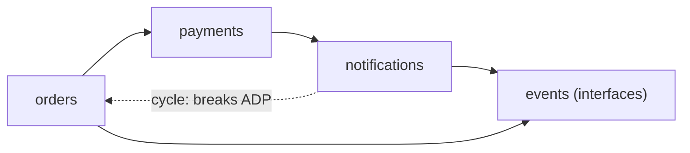

The dotted edge creates a cycle. A fix is to move shared contracts into a small `events` package that both sides depend on.

**How to break a cycle**
- Extract the shared part into a third package (as above).
- Apply Dependency Inversion: one side owns an interface and the other implements it.
- Merge the two packages if they always change together (CCP says they are one thing).

**Gotchas**
- Go forbids import cycles at compile time, which forces ADP. In TypeScript and Python cycles compile and fail strangely at runtime, so use a lint rule such as `eslint-plugin-import` `no-cycle` or `madge`.
- These rules are about big units. Do not apply them to a three-file project.

**Interview tip:** If you can only remember three, say ADP, CCP and SDP, with the example "a cycle between two services' internal packages".

_Module: Coupling & Cohesion · Tags: package-principles, robert-martin, modularity_

### 43. How do you apply dependency injection in practice? Constructor injection and the composition root in TypeScript and Go.

**Short answer:** Dependency injection means a class receives its collaborators from outside, usually through its constructor, and does not create them itself. The place where all objects are created and wired together is the composition root, usually `main`. Business classes stay free of `new` for infrastructure, so tests can pass fakes.

**Rules of thumb**
- Prefer constructor injection. The dependencies are visible and the object is complete once built.
- Wire everything in one place near the entry point (the composition root).
- Inject things that are slow, random or outside: database, clock, HTTP client, ID generator.
- Do not pass the container around and ask it for services (the service locator). It hides dependencies.

```ts
interface Clock { now(): number }
interface Mailer { send(to: string, text: string): string }

class WelcomeService {
  clock: Clock;
  mailer: Mailer;
  constructor(clock: Clock, mailer: Mailer) { this.clock = clock; this.mailer = mailer; }
  greet(email: string): string {
    return this.mailer.send(email, `welcome at ${this.clock.now()}`);
  }
}

// composition root: real parts in production, fakes in tests
const fakeClock: Clock = { now: () => 1000 };
const fakeMailer: Mailer = { send: (to, text) => `${to}: ${text}` };
console.log(new WelcomeService(fakeClock, fakeMailer).greet("a@x.com")); // prints: a@x.com: welcome at 1000
```

The service never calls `Date.now()` itself, so the test result is predictable.

Go does the same with plain structs and no container.

```go
package main

import "fmt"

type Mailer interface{ Send(to, text string) string }

type Welcome struct{ mailer Mailer }

func NewWelcome(m Mailer) *Welcome { return &Welcome{mailer: m} }

func (w *Welcome) Greet(email string) string { return w.mailer.Send(email, "welcome") }

type consoleMailer struct{}

func (consoleMailer) Send(to, text string) string { return to + ": " + text }

func main() { // composition root
	fmt.Println(NewWelcome(consoleMailer{}).Greet("a@x.com")) // prints: a@x.com: welcome
}
```

**Containers.** NestJS, Spring and .NET have built-in containers that read constructor types and supply instances. They save boilerplate in big apps. Small Go and Node services often wire by hand, which is simpler to read.

**Gotchas**
- Too many constructor parameters (more than four or five) means the class does too much (SRP).
- Inject a `Clock` instead of calling the time function inside logic. It is a small change with a large testing benefit.
- Do not inject simple values or pure functions that never change.

**Interview tip:** Say "the composition root is the only place that knows concrete classes". It shows you understand DIP, not just a framework.

_Module: SOLID · Tags: dependency-injection, composition-root, testing_

### 44. How do you model with interfaces in Go: accept interfaces, return structs?

**Short answer:** In Go, an interface is satisfied implicitly, so the consumer defines the small interface it needs. The common advice is "accept interfaces, return structs": a function takes the narrowest interface it needs as a parameter, and returns a concrete type so callers get all its features and the code stays easy to follow.

This is Interface Segregation and Dependency Inversion in Go's style. The interface lives with the code that uses it, not with the code that implements it. An interface with one or two methods is typical.

```go
package main

import "fmt"

// Defined by the consumer: only what ReportService needs.
type OrderFinder interface {
	Total(customerID string) int
}

type ReportService struct{ orders OrderFinder }

func (r ReportService) Summary(id string) string {
	return fmt.Sprintf("customer %s spent %d", id, r.orders.Total(id))
}

// A concrete type with more methods than the interface requires.
type PostgresOrders struct{}

func (PostgresOrders) Total(id string) int { return 420 }
func (PostgresOrders) Cancel(orderID string) {}

// Constructor returns the concrete struct, not an interface.
func NewPostgresOrders() *PostgresOrders { return &PostgresOrders{} }

func main() {
	svc := ReportService{orders: NewPostgresOrders()}
	fmt.Println(svc.Summary("c1")) // prints: customer c1 spent 420
}
```

A test passes a tiny fake that implements only `Total`.

**Why return structs**
- Callers can use every method and field without a type assertion.
- You can add methods later without breaking callers. Returning an interface limits what callers can do.
- Fewer interfaces to keep in sync.

**Common mistakes**
- Defining an interface next to the implementation "in case it is needed". Define it where it is used.
- A big `Repository` interface with ten methods. Split by what each caller needs.
- Returning an interface that hides a `nil` pointer. This causes the well-known "interface holding a nil pointer is not nil" bug.
- Using interfaces for everything. A plain function or struct is often enough.

**Remember:** the standard library shows the style: `io.Reader` and `io.Writer` have one method each, and many types satisfy them.

**Interview tip:** Say that Go's implicit interfaces let you decouple after the fact, which is why you wait until you have a second user before creating one.

_Module: SOLID · Tags: go, interfaces, design_

### 45. What are the Null Object and Special Case patterns?

**Short answer:** A Null Object is a real object that does nothing, used in place of `null`, so callers do not need null checks. The Special Case pattern (Martin Fowler) is the wider idea: return a special object with sensible behaviour for an unusual case, such as a "guest customer" or "unknown plan".

Without it, every caller must remember `if (x !== null)`. One forgotten check causes a crash. With a null object, the caller just calls the method.

```ts
interface Logger { info(msg: string): void }

class ConsoleLogger implements Logger {
  info(msg: string) { console.log("INFO", msg); }
}
// Null object: same interface, does nothing
const silentLogger: Logger = { info() {} };

function handle(logger: Logger) {
  logger.info("processing"); // no null check needed
}
handle(new ConsoleLogger()); // prints: INFO processing
handle(silentLogger);         // prints nothing
```

**A special-case example**

```ts
type Customer = { name: string; discountPct: number };
const guest: Customer = { name: "Guest", discountPct: 0 }; // special case instead of null
const findCustomer = (id: string): Customer =>
  id === "42" ? { name: "Asha", discountPct: 10 } : guest;
console.log(findCustomer("42").discountPct, findCustomer("x").discountPct); // prints: 10 0
```

**When it fits**
- Optional collaborators such as a logger, a cache or a metrics client.
- A missing record where "do nothing" or a default is a valid business outcome.

**When it does not**
- When absence is an error. If a payment method is missing, doing nothing hides a real problem. Fail fast instead.
- When callers must behave differently. Then an explicit type such as `Optional` or a union (`Customer | undefined`) is clearer.

**Gotcha:** a null object can hide bugs. If logging silently turns off in production by a mistake, nobody notices. Use it only where "nothing" is the right behaviour.

**Interview tip:** Mention the cost of null: Tony Hoare called it his billion-dollar mistake. Modern options are optional types, unions and strict null checks.

_Module: Design Patterns · Tags: null-object, special-case, patterns_

### 46. What is the difference between a value object and an entity?

**Short answer:** An entity has an identity that stays the same over time, even when its data changes. A value object has no identity and is defined only by its values. Two value objects with the same values are interchangeable. Value objects are normally immutable.

A customer is an entity. If Asha changes her email, she is still the same customer, tracked by an ID. A price of 500 INR is a value. Any 500 INR is the same as another 500 INR.

| | Entity | Value object |
| --- | --- | --- |
| Identity | has an ID | none |
| Equality | by ID | by all values |
| Mutable? | yes, in controlled ways | no, create a new one |
| Examples | `Order`, `Customer`, `Account` | `Money`, `Email`, `DateRange`, `Address` |

```ts
class Money {
  readonly amount: number;
  readonly currency: string;
  constructor(amount: number, currency: string) {
    if (!Number.isInteger(amount)) throw new Error("amount must be in minor units");
    this.amount = amount;
    this.currency = currency;
  }
  plus(o: Money): Money {
    if (o.currency !== this.currency) throw new Error("currency mismatch");
    return new Money(this.amount + o.amount, this.currency);
  }
  equals(o: Money): boolean { return o.amount === this.amount && o.currency === this.currency; }
}
const a = new Money(500, "INR");
console.log(a.plus(new Money(250, "INR")).amount, a.equals(new Money(500, "INR"))); // prints: 750 true
```

**Why value objects help**
- They fix primitive obsession: `Money` and `Email` carry rules, instead of loose `number` and `string`.
- Validation happens once, in the constructor, so every instance is valid.
- They are safe to share because they never change.

**Gotchas**
- The same concept can be an entity in one context and a value in another. An address is a value in an order, but an entity in a postal service.
- Do not make everything an entity with an ID. Extra identity brings extra storage and comparison work.
- In JavaScript, `===` compares references, so write an `equals` method.

**Interview tip:** Mention money as integers in minor units to avoid floating point errors, as a practical reason to use a `Money` type.

_Module: OOP Fundamentals · Tags: ddd, value-object, entity_

### 47. What is the difference between an anemic and a rich domain model?

**Short answer:** In an anemic domain model, classes hold only data and services hold all the logic. In a rich domain model, objects hold both their data and the business rules that protect it. Martin Fowler called the anemic style an anti-pattern because it gives up the benefits of objects, though it can be fine for simple CRUD.

```ts
// Anemic: Order is only a bag of fields; any service can put it in a bad state
type AnemicOrder = { status: string; items: string[] };
const order: AnemicOrder = { status: "shipped", items: [] };
order.status = "new"; // nothing stops this

// Rich: the order protects its own rules
class Order {
  #status: "new" | "paid" | "shipped" = "new";
  pay() {
    if (this.#status !== "new") throw new Error("only a new order can be paid");
    this.#status = "paid";
  }
  ship() {
    if (this.#status !== "paid") throw new Error("pay before shipping");
    this.#status = "shipped";
  }
  get status() { return this.#status; }
}
const o = new Order();
o.pay();
o.ship();
console.log(o.status); // prints: shipped
```

| | Anemic | Rich |
| --- | --- | --- |
| Where rules live | services | inside the entities |
| Risk | rules duplicated and invalid states possible | bigger classes, more thought needed |
| Good for | simple CRUD, reports, data pipelines | complex business rules |
| Testing | mock repositories for services | test objects directly, no mocks |

**Gotchas**
- Rich does not mean the entity talks to the database or sends email. Keep it free of infrastructure.
- Not every project needs a rich model. A form-over-data admin screen does not.
- Functional style (data plus pure functions) can also protect rules. The key is that rules sit in one place and invalid states cannot be built.

**Interview tip:** Link it to Tell, Don't Ask and encapsulation. Say you use a rich model in the parts of the system where rules are complex, such as pricing or order life cycle.

_Module: OOP Fundamentals · Tags: ddd, anemic-domain-model, rich-domain-model_

### 48. How does testability act as a design signal?

**Short answer:** If code is hard to test, the design is usually the problem: too much coupling, hidden dependencies or mixed responsibilities. Treat the pain of writing a test as feedback. Good designs test easily because dependencies are passed in, logic is separate from input and output, and each unit has a clear job.

| Pain while testing | What it often means | Likely fix |
| --- | --- | --- |
| Need a real database to test a rule | business logic mixed with data access | extract a pure function or an interface |
| Many mocks for one test | too many dependencies, SRP issue | split the class |
| Test depends on the current time or random values | hidden dependency | inject a clock or random source |
| Cannot test a private method | the method is a separate idea | move it to its own unit |
| Test breaks on small refactors | tests know internals | test behaviour through the public API |
| Huge setup | tight coupling | reduce what the unit needs to know |

```ts
// ❌ hard to test: reads the clock and calls the network inside
async function isOfferValidBad(id: string) {
  const res = await fetch(`https://offers.example.com/${id}`);
  const offer = await res.json();
  return Date.now() < offer.expiresAt;
}

// ✅ easy to test: the rule is a pure function
const isOfferValid = (expiresAt: number, now: number) => now < expiresAt;
console.log(isOfferValid(2000, 1500), isOfferValid(2000, 2500)); // prints: true false
```

The rule is now one line with no mocks. A thin wrapper still does the fetch and passes the values in.

**Rules of thumb**
- Push decisions into pure functions, and keep I/O at the edges (functional core, imperative shell).
- If a test needs more than about three mocks, look at the class design.
- Prefer fakes (a small in-memory version) over mocks of every call.

**Gotchas**
- Do not change production design only to chase coverage numbers, for example making everything public.
- Mock-heavy tests that repeat the implementation make refactoring harder.

**Interview tip:** Say that you listen to the tests. When a test is awkward, you ask what the design is telling you before you reach for a mocking trick.

_Module: Coupling & Cohesion · Tags: testing, testability, design-feedback_

### 49. What are the most common code smells and what do they tell you?

**Short answer:** A code smell is a surface sign that the design may have a deeper problem. The word comes from Kent Beck and Martin Fowler. A smell is not a bug. It is a hint to look closer. Knowing the main ones lets you spot trouble in code review and choose the right refactoring.

| Smell | What you see | Usual fix |
| --- | --- | --- |
| Long method | a function that scrolls for pages | extract function |
| Large class | many fields and unrelated methods (a God object) | extract class, split by responsibility |
| Feature envy | a method uses another class's data more than its own | move the method to that class |
| Shotgun surgery | one change needs edits in many places | gather the scattered logic in one module |
| Divergent change | one class changes for many different reasons | split by reason (SRP) |
| Primitive obsession | strings and numbers for money, email, IDs | value objects |
| Data clumps | the same group of parameters appears together | introduce a parameter object or class |
| Long parameter list | five or more arguments | parameter object |
| Duplicated code | the same rule in many places | extract, if it is the same knowledge |
| Switch on type | repeated `switch` on a kind field | replace conditional with polymorphism |
| Speculative generality | hooks and abstractions nobody uses | delete (YAGNI) |
| Dead code, comments that explain bad code | | delete, rename |

```ts
// Feature envy: this function mostly reads Customer data
type Customer = { street: string; city: string; pin: string };
const labelBad = (c: Customer) => `${c.street}, ${c.city} ${c.pin}`;

// Better: the data and the behaviour live together
const customer = {
  street: "12 MG Road", city: "Pune", pin: "411001",
  label() { return `${this.street}, ${this.city} ${this.pin}`; },
};
console.log(labelBad(customer), "|", customer.label()); // prints: 12 MG Road, Pune 411001 | 12 MG Road, Pune 411001
```

**Gotchas**
- Smells are heuristics, not rules. A long function that is a simple list of steps may be fine.
- Fix smells in code you are changing, with tests, instead of mass cleanups.
- Some smells are the cost of a framework or generated code. Do not fight them.

**Interview tip:** Name three smells from your own review experience and the refactoring you used for each. It is more convincing than a long list.

_Module: Code Smells & Refactoring · Tags: code-smells, refactoring, fowler_

### 50. How do you refactor safely? Show extract function, introduce parameter object and replace conditional with polymorphism.

**Short answer:** Refactoring means changing the structure of code without changing its behaviour, in small steps, with tests passing after each step. Three very common moves are extract function (name a block), introduce parameter object (group arguments) and replace conditional with polymorphism (let objects decide).

**1. Extract function.** Give a block of code a name that says what it does.

```ts
// before
function invoiceTotal(items: { price: number; qty: number }[]) {
  let sum = 0;
  for (const i of items) sum += i.price * i.qty;
  return sum + sum * 0.18;
}
// after: each step has a name
const subtotal = (items: { price: number; qty: number }[]) => items.reduce((s, i) => s + i.price * i.qty, 0);
const withGst = (net: number) => net + net * 0.18;
const invoiceTotal2 = (items: { price: number; qty: number }[]) => withGst(subtotal(items));
console.log(invoiceTotal([{ price: 100, qty: 2 }]), invoiceTotal2([{ price: 100, qty: 2 }])); // prints: 236 236
```

**2. Introduce parameter object.** Replace a long list of related arguments with one object.

```ts
// before: createReport(from, to, region, format, includeTax)
type ReportOptions = { from: string; to: string; region: string; format: "csv" | "pdf"; includeTax: boolean };
const createReport = (o: ReportOptions) => `${o.region} ${o.from}..${o.to} as ${o.format}`;
console.log(createReport({ from: "2026-01-01", to: "2026-03-31", region: "EU", format: "csv", includeTax: true }));
// prints: EU 2026-01-01..2026-03-31 as csv
```

**3. Replace conditional with polymorphism.** See the Open/Closed question: the `switch` on payment type becomes one object per type, each with its own `fee()`.

**The safe loop**
1. Make sure tests cover the behaviour (or write characterisation tests).
2. Make one small change, such as a rename or an extraction. Use the IDE refactoring tools, which are safer than hand edits.
3. Run the tests. If they fail, undo and take a smaller step.
4. Commit. Repeat.

**Gotchas**
- Do not change behaviour and structure in the same commit. Reviewers cannot tell what changed.
- Parameter objects can become a bag of unrelated options. If the object keeps growing, the function may be doing too much.
- Polymorphism is not worth it for two cases that never grow.

**Interview tip:** Say "red-green-refactor" for tests, and that refactoring is a habit in daily work, not a separate project.

_Module: Code Smells & Refactoring · Tags: refactoring, extract-function, polymorphism_

### 51. What are design patterns, what are the three categories, and when do they help or hurt?

**Short answer:** A design pattern is a named, reusable solution to a common design problem. The book *Design Patterns* by the Gang of Four (Gamma, Helm, Johnson, Vlissides, 1994) described 23 of them in three groups: creational, structural and behavioural. Patterns give the team a shared vocabulary, but forcing them where they are not needed makes code worse.

| Category | Concern | Examples |
| --- | --- | --- |
| Creational | how objects are created | Singleton, Factory Method, Abstract Factory, Builder, Prototype |
| Structural | how objects are put together | Adapter, Decorator, Facade, Proxy, Composite, Bridge |
| Behavioural | how objects share work and talk | Strategy, Observer, Command, State, Template Method, Chain of Responsibility, Iterator |

Many patterns exist because of limits in older languages. A Strategy is just a function value in TypeScript or Go. An Iterator is built into `for...of`. Learn the idea, not only the class diagram.

**When patterns help**
- They name a solution, so "use a decorator here" is a whole discussion in four words.
- They show proven ways to keep code open to extension.
- They make code reviews faster when everyone knows the vocabulary.

**When patterns hurt**
- Pattern-first design: starting with "which pattern?" instead of "what is the problem?".
- Complexity for no gain: a Factory that wraps a single `new`.
- Naming everything `FooFactory`, `FooManager`, `FooHandler` and hiding simple logic in layers.
- Copying a Java-style pattern into a language that has a simpler built-in tool.

**Remember:** a pattern is a trade-off. It buys flexibility in one direction and costs simplicity. Use it when you feel the pain it solves.

**Interview tip:** Pick patterns by problem: "I need to swap algorithms (Strategy), add behaviour without editing a class (Decorator), or notify many listeners (Observer)". Always add one sentence about when you would not use them.

_Module: Design Patterns · Tags: design-patterns, gof, overview_

### 52. Why is the Singleton pattern often called an anti-pattern, and what do you use instead?

**Short answer:** A Singleton ensures that only one instance of a class exists and gives global access to it. The one-instance part is sometimes useful, but the global access acts like a hidden global variable. It makes dependencies invisible, hurts testing and creates coupling. Create one instance in the composition root and inject it instead.

Typical uses are a configuration object, a connection pool or a logger. They really do need only one instance per process. The problem is how callers get it.

```ts
// ❌ bad: callers reach for the global; tests cannot replace it
class ConfigSingleton {
  static #instance: ConfigSingleton | undefined;
  static get(): ConfigSingleton { return (this.#instance ??= new ConfigSingleton()); }
  currency = "INR";
}
const price = (n: number) => `${ConfigSingleton.get().currency} ${n}`;

// ✅ good: one instance, but passed in; a test can pass another
type Config = { currency: string };
const priceWith = (cfg: Config, n: number) => `${cfg.currency} ${n}`;
const config: Config = { currency: "INR" }; // created once in main
console.log(price(5), priceWith(config, 5), priceWith({ currency: "USD" }, 5));
// prints: INR 5 INR 5 USD 5
```

**Problems with the classic Singleton**
- Hidden dependency: the function signature does not show that it needs config.
- Shared mutable state between tests, so tests affect each other.
- Hard to replace with a fake.
- Thread-safety issues in languages with threads (in Node, a module is already a cached singleton).
- It breaks the Single Responsibility Principle by managing its own life cycle.

**Alternatives**
- Dependency injection: create once, pass in. DI containers have a "singleton scope" for this.
- A module-level object in Node or a package-level variable in Go, used with care.
- Pass configuration as a parameter.

**When it is fine:** a truly process-wide resource with no state that matters, such as a logger, behind an interface so it can be faked.

**Interview tip:** Say "one instance is a life-cycle choice, so it belongs in the composition root, not inside the class".

_Module: Design Patterns · Tags: singleton, dependency-injection, global-state_

### 53. What is the difference between Factory Method and Abstract Factory?

**Short answer:** A Factory Method is one method that decides which concrete type to create and returns it through a common interface. An Abstract Factory is an object with several such methods that creates a whole family of related objects that belong together. Both keep callers from depending on concrete classes.

**Factory Method:** choose a notifier by channel.

```ts
interface Notifier { send(to: string, msg: string): string }
const email: Notifier = { send: (to, msg) => `EMAIL ${to}: ${msg}` };
const sms: Notifier = { send: (to, msg) => `SMS ${to}: ${msg}` };

function createNotifier(channel: "email" | "sms"): Notifier {
  return channel === "email" ? email : sms; // creation logic in one place
}
console.log(createNotifier("sms").send("98765", "Order shipped")); // prints: SMS 98765: Order shipped
```

**Abstract Factory:** one factory makes the whole kit for one environment, such as a payment gateway and its receipt printer.

```ts
interface Gateway { charge(a: number): string }
interface Receipt { print(a: number): string }
interface PaymentKit { gateway(): Gateway; receipt(): Receipt }

const testKit: PaymentKit = {
  gateway: () => ({ charge: (a) => `fake charge ${a}` }),
  receipt: () => ({ print: (a) => `fake receipt ${a}` }),
};
const kit: PaymentKit = testKit; // the production kit would be picked here, once
console.log(kit.gateway().charge(10), "|", kit.receipt().print(10)); // prints: fake charge 10 | fake receipt 10
```

| | Factory Method | Abstract Factory |
| --- | --- | --- |
| Creates | one product | a family of related products |
| Typical form | a function or a method | an object with several create methods |
| Use when | the type depends on input or config | products must be used together and be consistent |

**Gotchas**
- A factory that always returns the same class is noise. Use `new` directly until a second type appears.
- In dynamic languages, a map of names to functions is a light factory.
- The `switch` inside a factory is acceptable. It is the one place where it is allowed, instead of being copied around the code base.

**Interview tip:** Say that DI containers do much of this work today, but factories remain useful when the choice depends on runtime data such as a request value.

_Module: Design Patterns · Tags: factory-method, abstract-factory, creational-patterns_

### 54. When do you use the Builder pattern?

**Short answer:** The Builder pattern builds a complex object step by step and creates it at the end, with a final `build()` call. Use it when a constructor would have many optional parameters, or when the object must be valid before it is used. It gives readable code and a single place for validation.

Compare `new Email("a@x.com", "b@x.com", undefined, undefined, "Hi", "Body", true)` with a call chain that names every part.

```ts
type Email = { to: string[]; subject: string; body: string; cc: string[] };

class EmailBuilder {
  #to: string[] = [];
  #cc: string[] = [];
  #subject = "";
  #body = "";
  to(a: string) { this.#to.push(a); return this; }
  cc(a: string) { this.#cc.push(a); return this; }
  subject(s: string) { this.#subject = s; return this; }
  body(b: string) { this.#body = b; return this; }
  build(): Email {
    if (this.#to.length === 0) throw new Error("at least one recipient");
    if (!this.#subject) throw new Error("subject required");
    return { to: this.#to, cc: this.#cc, subject: this.#subject, body: this.#body };
  }
}
const mail = new EmailBuilder().to("a@x.com").subject("Invoice").body("Attached").build();
console.log(mail.subject, mail.to.length, mail.cc.length); // prints: Invoice 1 0
```

**Alternatives that are simpler**
- In TypeScript, an options object with named fields: `createEmail({ to, subject })`. This is often enough.
- In Go, functional options: `NewServer(addr, WithTimeout(5*time.Second))`.
- In Java and C#, builders are common because of long constructors and no named arguments (C# now has named arguments and records).

| Use a builder | Use an options object |
| --- | --- |
| Validation across steps, or an immutable result | Simple optional settings |
| Steps may need an order or a repeat (`addItem` many times) | Mostly flat data |

**Gotchas**
- A builder for a three-field object is over-engineering.
- Make the result immutable, and validate in `build()`. A half-built object should never escape.

**Interview tip:** Name the Go form, functional options, to show that you know the idiom of each language.

_Module: Design Patterns · Tags: builder, creational-patterns, fluent-api_

### 55. What is the Adapter pattern and where do you use it?

**Short answer:** An Adapter wraps one interface so that it matches another interface your code expects. Use it to connect to a third-party library or legacy service without letting its shape leak into your business code. It is like a travel plug adapter: the device stays the same, the plug shape changes.

This is the main tool for Dependency Inversion in practice. Your domain defines a `PaymentGateway` interface. An adapter implements it by calling Stripe or Razorpay in their own format.

```ts
// What our domain expects
interface PaymentGateway { charge(amountInRupees: number): string }

// A third-party SDK with a different shape (amounts in paise, different names)
const vendorSdk = { createPayment(opts: { amountPaise: number }) { return `vendor-pay-${opts.amountPaise}`; } };

// The adapter translates
class VendorAdapter implements PaymentGateway {
  charge(amountInRupees: number): string {
    return vendorSdk.createPayment({ amountPaise: amountInRupees * 100 });
  }
}
const gateway: PaymentGateway = new VendorAdapter();
console.log(gateway.charge(25)); // prints: vendor-pay-2500
```

If you change the vendor, you write another adapter. The business code does not change.

**Where adapters appear**
- Payment, email, SMS and storage providers.
- Wrapping a legacy SOAP service behind a clean interface.
- An anti-corruption layer between bounded contexts or between your model and a partner's model.
- Hexagonal architecture: every outside system sits behind an adapter.

**Gotchas**
- Keep adapters thin: translate and call. Business rules should not hide inside.
- Do not adapt what you own. If you can change the interface, change it.
- Convert errors too. Map vendor error codes to your own error types.

**Interview tip:** Say that the adapter is the first thing you write around an external API, because it also gives you a seam for tests.

_Module: Design Patterns · Tags: adapter, structural-patterns, integration_

### 56. How does the Decorator pattern work, and how is it related to middleware?

**Short answer:** A Decorator wraps an object that has the same interface and adds behaviour before or after calling it. You can stack decorators to combine features such as logging, caching and retries without changing the original class. Middleware in Express, NestJS and ASP.NET is the same idea applied to request handling.

It follows the Open/Closed Principle: you extend behaviour by adding a wrapper. It also beats inheritance, which would need a subclass for every combination (`LoggedCachedRepo`, `CachedRetryRepo`).

```ts
interface PriceSource { priceOf(sku: string): number }

const database: PriceSource = { priceOf: (sku) => (console.log("db hit", sku), 100) };

class CachedPrices implements PriceSource {
  inner: PriceSource;
  cache = new Map<string, number>();
  constructor(inner: PriceSource) { this.inner = inner; }
  priceOf(sku: string): number {
    if (!this.cache.has(sku)) this.cache.set(sku, this.inner.priceOf(sku));
    return this.cache.get(sku)!;
  }
}
const prices = new CachedPrices(database);
prices.priceOf("pen");
prices.priceOf("pen");
// prints: db hit pen  (only once)
```

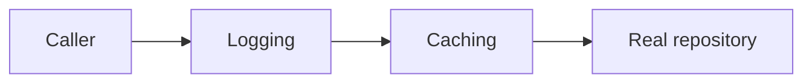

Each box has the same interface as the real repository. The caller does not know how many wrappers there are.

**Middleware view.** In Express, each middleware gets a request, may act, and calls `next()`. This is a chain of decorators around the final handler. In Go, an HTTP middleware is a function `func(http.Handler) http.Handler`.

**Gotchas**
- Order matters: caching outside of auth would serve cached data to the wrong user.
- Many small wrappers make stack traces and debugging harder.
- Not the same as TypeScript or Python `@decorator` syntax, though that syntax is often used to implement the idea.

**Interview tip:** Use caching, logging and retry as the three standard examples, and say that the benefit is combining them in any order at composition time.

_Module: Design Patterns · Tags: decorator, middleware, structural-patterns_

### 57. What is the difference between Facade, Adapter and Proxy?

**Short answer:** All three wrap something, but for different reasons. A Facade gives a simpler interface to a complex subsystem. An Adapter changes one interface into another that a client expects. A Proxy has the same interface as the real object and controls access to it, for example by lazy loading, caching or permission checks.

| Pattern | Interface of the wrapper | Goal | Example |
| --- | --- | --- | --- |
| Facade | new and simpler | hide complexity | `checkout.placeOrder()` calls stock, payment and shipping |
| Adapter | converts to the one the client expects | make incompatible things work together | wrapping a vendor SDK |
| Proxy | the same as the real object | control access | lazy loading, access check, remote call |
| Decorator | the same | add behaviour | logging, caching |

```ts
// Facade: one call hides three subsystems
const stock = { reserve: (sku: string) => `reserved ${sku}` };
const payment = { charge: (amt: number) => `charged ${amt}` };
const shipping = { book: (sku: string) => `booked ${sku}` };

const checkout = {
  placeOrder(sku: string, amt: number) {
    return [stock.reserve(sku), payment.charge(amt), shipping.book(sku)].join(", ");
  },
};
console.log(checkout.placeOrder("pen", 20)); // prints: reserved pen, charged 20, booked pen
```

**Proxy in a sentence:** a `LazyReport` object that has the same methods as `Report` but loads the data only when first used. Remote proxies (a gRPC client stub) and protection proxies (permission checks) are other common kinds.

**Gotchas**
- A Facade should not become a God object that knows everything. Keep it a thin entry point.
- A Decorator and a Proxy have the same shape. The difference is intent: add a feature versus control access.
- The Facade does not forbid direct access to the subsystem. It is a convenience.

**Interview tip:** Answer by intent: simplify (facade), convert (adapter), control (proxy), add (decorator). The structure is nearly the same, which is why interviewers ask this.

_Module: Design Patterns · Tags: facade, proxy, adapter, structural-patterns_

### 58. What is the Observer pattern, and how does it relate to pub/sub and event emitters?

**Short answer:** In the Observer pattern, a subject keeps a list of observers and notifies them when something changes, so the subject does not need to know what the observers do. Event emitters are a common form. Pub/sub adds a broker between publishers and subscribers, so they do not know each other at all.

It supports the Open/Closed Principle: you add a new reaction by adding a subscriber. `OrderService` does not change when someone wants to send an email after an order is placed.

```ts
type Handler = (orderId: string) => void;

class OrderEvents {
  #handlers: Handler[] = [];
  onPlaced(h: Handler) { this.#handlers.push(h); }
  placed(orderId: string) { for (const h of this.#handlers) h(orderId); }
}
const events = new OrderEvents();
events.onPlaced((id) => console.log("email customer for", id));
events.onPlaced((id) => console.log("update stock for", id));
events.placed("A7");
// prints: email customer for A7
// prints: update stock for A7
```

| | Observer / event emitter | Pub/sub with a broker |
| --- | --- | --- |
| Coupling | subject knows its observers list | publisher and subscriber unaware of each other |
| Scope | inside one process | across processes and services (Kafka, RabbitMQ, Azure Service Bus) |
| Delivery | synchronous call, in order | usually asynchronous, may be at least once |
| Failure | an exception can stop later observers | the broker retries, dead-letters |

**Gotchas**
- Memory leaks: always provide a way to unsubscribe (`removeListener`). Forgotten listeners keep objects alive.
- One failing observer can break the rest in a synchronous loop. Catch errors per observer.
- Hidden flow: "what happens after an order is placed?" is hard to answer by reading code. Document the events.
- Order of notifications should not matter. If it does, use an explicit workflow.
- Node's `EventEmitter` calls listeners synchronously, and an unhandled `error` event throws.

**Interview tip:** Link it to React (state subscriptions), and to microservices (domain events), to show it is one idea at different scales.

_Module: Design Patterns · Tags: observer, pub-sub, events, behavioural-patterns_

### 59. What is the difference between the Strategy and State patterns?

**Short answer:** Both use an object that delegates work to another object behind an interface. Strategy lets the client choose one of several interchangeable algorithms, and the choice usually stays the same. State lets an object change its behaviour when its internal state changes, and the states themselves switch from one to another.

**Strategy** is the practical form of the Open/Closed Principle. A shipping calculator can take any pricing algorithm without edits.

```ts
type ShippingStrategy = (weightKg: number) => number;
const standard: ShippingStrategy = (w) => 40 + w * 5;
const express: ShippingStrategy = (w) => 100 + w * 12;

const quote = (w: number, strategy: ShippingStrategy) => strategy(w);
console.log(quote(2, standard), quote(2, express)); // prints: 50 124
```

In languages with first-class functions, a strategy is just a function. In Java or C# you would write an interface with one method.

**State** moves the "what can I do now?" logic out of `if (status === ...)` chains.

```ts
interface OrderState { next(): OrderState; label: string }
const delivered: OrderState = { label: "delivered", next: () => delivered };
const shipped: OrderState = { label: "shipped", next: () => delivered };
const paid: OrderState = { label: "paid", next: () => shipped };

let s: OrderState = paid;
s = s.next();
console.log(s.label); // prints: shipped
```

| | Strategy | State |
| --- | --- | --- |
| Who picks | the client, from outside | the object itself moves between states |
| Changes during life? | rarely | often |
| Objects know each other? | no, they are independent | yes, a state knows which comes next |
| Example | tax rules, sorting order, pricing | order life cycle, traffic light, vending machine |

**Gotchas**
- For simple states, an enum or a union type with a transition table is easier than a class per state. Use the State pattern when behaviour differs a lot per state.
- A strategy chosen by a `switch` in one factory is fine. Do not repeat that `switch`.

**Interview tip:** Say "Strategy: how do I do it. State: what can I do right now". The next question is usually a vending machine or order workflow.

_Module: Design Patterns · Tags: strategy, state, behavioural-patterns, open-closed_

### 60. What is the Command pattern and what is it useful for?

**Short answer:** The Command pattern turns a request into an object that holds everything needed to run it later: the action and its data. Because the request is an object, you can queue it, log it, retry it or undo it. It separates who asks for something from who does it.

Examples include undo in an editor, a job queue, a CLI with sub-commands, and a "place order" message in a CQRS system. Think of a restaurant order slip. The waiter writes the order. The kitchen executes it later. The slip can be cancelled before cooking.

```ts
interface Command { run(): void; undo(): void }

class AddItem implements Command {
  cart: string[]; item: string;
  constructor(cart: string[], item: string) { this.cart = cart; this.item = item; }
  run() { this.cart.push(this.item); }
  undo() { this.cart.pop(); }
}

const cart: string[] = [];
const history: Command[] = [];
const exec = (c: Command) => { c.run(); history.push(c); };

exec(new AddItem(cart, "book"));
exec(new AddItem(cart, "pen"));
history.pop()!.undo();
console.log(cart); // prints: [ 'book' ]
```

**Where it shows up**
- Undo and redo stacks.
- Background jobs: a job is a serialised command with arguments.
- Audit logs and event sourcing, which store what was asked.
- Transactions and sagas: each step is a command with a compensating command.
- Macros: run a list of commands in order.

| Benefit | Cost |
| --- | --- |
| Queue, log, retry and undo | one extra class or object per action |
| Decouples sender from receiver | easy to over-use for a simple function call |

**Gotchas**
- Undo is hard when the action had external effects (an email was sent). Use compensation for those.
- Commands in a queue must be safe to run twice, so make them idempotent.
- In many languages, a plain closure or function is enough. Use a class when you need data to store or show.

**Interview tip:** Mention that in a message-driven system, a command names an intent ("PlaceOrder") while an event states a fact ("OrderPlaced").

_Module: Design Patterns · Tags: command, undo, behavioural-patterns_

### 61. What is the Template Method pattern, and what is its alternative?

**Short answer:** Template Method defines the fixed steps of an algorithm in a base class method and lets subclasses fill in some of the steps. The overall order stays under control, and the details vary. Today, passing the varying steps as functions (composition) is often simpler than inheritance.

Report exports are a good case: every export loads data, formats it and delivers it. Only the format step differs.

```java
// Java: the classic form
abstract class ReportExporter {
    public final String export() {          // the template: fixed order
        String data = load();
        return format(data) + " -> " + deliver();
    }
    protected String load() { return "orders"; }
    protected abstract String format(String data);   // subclass step
    protected String deliver() { return "email"; }   // optional hook
}
class CsvExporter extends ReportExporter {
    protected String format(String data) { return "csv:" + data; }
}
// new CsvExporter().export() returns "csv:orders -> email"
```

The same idea with functions (TypeScript), which avoids inheritance:

```ts
const exportReport = (format: (d: string) => string, deliver = () => "email") =>
  `${format("orders")} -> ${deliver()}`;
console.log(exportReport((d) => "csv:" + d)); // prints: csv:orders -> email
```

| | Template Method | Strategy / functions |
| --- | --- | --- |
| Mechanism | inheritance | composition |
| Flexibility | fixed at class definition | can change at runtime |
| Risk | fragile base class | more objects or parameters |

**Gotchas**
- Subclasses depend on the base class details, so changes to the base can break them. Mark the template method `final` and keep the steps few.
- A deep hierarchy of templates is hard to read.
- Frameworks use it a lot (a base `Controller` or test case class with `setUp`). That is the "Hollywood principle": do not call us, we will call you.

**Interview tip:** Say that you start with Template Method when a framework gives you one, and you prefer passing functions for your own code.

_Module: Design Patterns · Tags: template-method, inheritance, behavioural-patterns_

### 62. What is the Chain of Responsibility pattern?

**Short answer:** In Chain of Responsibility, a request passes along a list of handlers. Each handler either deals with it or passes it on to the next. The sender does not know which handler will act. Middleware pipelines and approval workflows are examples.

Think of a customer support escalation: level 1 handles small refunds, level 2 handles larger ones, and a manager handles the rest.

```ts
type Handler = (amount: number) => string | undefined; // undefined means "not mine, pass on"

const agent: Handler = (a) => (a <= 1000 ? "agent approved" : undefined);
const supervisor: Handler = (a) => (a <= 10000 ? "supervisor approved" : undefined);
const manager: Handler = () => "manager approved";

function approveRefund(amount: number, chain: Handler[]): string {
  for (const h of chain) {
    const r = h(amount);
    if (r) return r;
  }
  return "rejected";
}
const chain = [agent, supervisor, manager];
console.log(approveRefund(500, chain), "|", approveRefund(5000, chain), "|", approveRefund(50000, chain));
// prints: agent approved | supervisor approved | manager approved
```

**Where it is used**
- HTTP middleware: authentication, rate limit, logging, then the handler.
- Validation rules run one after another.
- Event bubbling in the DOM.
- Exception handling: `catch` blocks are tried in order.

| | Chain of Responsibility | Decorator |
| --- | --- | --- |
| Idea | one handler takes the request, or passes on | every wrapper adds behaviour and calls the inner one |
| Stops early? | yes, usually | normally not |

**Gotchas**
- A request may fall off the end with no handler. Always decide what happens then (default handler or error).
- Order is part of the logic and easy to get wrong, for example rate limit before auth.
- Long chains are hard to debug. Log which handler acted.

**Interview tip:** Say that Express middleware is a chain where each function decides to stop or call `next()`.

_Module: Design Patterns · Tags: chain-of-responsibility, middleware, behavioural-patterns_

### 63. What are the Repository and Unit of Work patterns?

**Short answer:** A Repository gives the domain a collection-like interface for loading and saving aggregates, such as `orders.findById(id)` and `orders.save(order)`, and hides the database details. A Unit of Work tracks changes made during one business operation and writes them together in a single transaction.

The repository keeps business code free of SQL and ORM details. The unit of work keeps related changes consistent: if saving the stock fails, the order is not saved either.

```ts
type Order = { id: string; total: number };

// Defined by the domain side (Dependency Inversion)
interface OrderRepository {
  findById(id: string): Order | undefined;
  save(o: Order): void;
}

class InMemoryOrders implements OrderRepository {
  #rows = new Map<string, Order>();
  findById(id: string) { return this.#rows.get(id); }
  save(o: Order) { this.#rows.set(o.id, o); }
}

const repo: OrderRepository = new InMemoryOrders();
repo.save({ id: "A1", total: 300 });
console.log(repo.findById("A1")?.total); // prints: 300
```

An in-memory version also works as a fast fake in tests.

**Unit of Work in short:** `begin`, change several things, `commit` or `rollback`. EF Core's `DbContext` and many ORMs already are a unit of work, and often their sets of entities are already repositories.

**Gotchas**
- Do not wrap an ORM with a generic `Repository<T>` that only forwards calls. It adds a layer with no value. Wrap it when you want a domain-shaped interface and a test seam.
- One repository per aggregate root, not one per table.
- Avoid leaking query objects or `IQueryable` out of the repository. That brings the database back into business code.
- Repositories should not hold business rules. Put them in the domain.

| Use | Skip |
| --- | --- |
| Complex domain, tests without a database, change of storage likely | simple CRUD service where the ORM is already enough |

**Interview tip:** Say that you define the repository interface in the domain layer and implement it in the infrastructure layer, so the dependency points inward.

_Module: Design Patterns · Tags: repository, unit-of-work, persistence, ddd_

### 64. How do you approach a Low-Level Design or machine-coding interview step by step?

**Short answer:** Follow a fixed script: clarify the requirements, list the entities and their relationships, choose the few patterns that fit, define the public API, write the core code, handle edge cases and finally show how it would be extended. Talk while you do it. Interviewers watch your thinking and your clean structure more than your speed.

**The script**
1. **Clarify (3 to 5 minutes).** Ask about scope, users, scale and what is out of scope. Write the functional requirements as a short list. Confirm them.
2. **Find the entities.** Underline the nouns in the requirements: `Vehicle`, `Spot`, `Ticket`. Verbs become methods: `park`, `unpark`.
3. **Draw relationships.** Who owns whom, what is one-to-many, what is an interface. A small class diagram is enough.
4. **Pick patterns only where they solve a real problem.** Strategy for pricing rules, State for a life cycle, Observer for notifications, Factory for creation by type. Say why.
5. **Define the API.** The few public methods, with inputs and outputs. Keep internals private.
6. **Code the core.** Start with the main flow, with clean names and small methods. Use the interfaces you named.
7. **Edge cases.** Full lot, invalid ticket, parallel access, repeated calls, bad input.
8. **Extend.** "How would you add a new vehicle type? A new payment method? Thread safety? Persistence?" Show where the change goes.

| Do | Avoid |
| --- | --- |
| Name classes after business words | `Manager`, `Helper`, `Util` |
| Keep a few classes with clear jobs | 20 classes for a simple flow |
| Make dependencies injectable | `new` of everything inside methods |
| Say what you would leave out | silently skipping requirements |

**What interviewers score**
- Requirements gathering and assumptions.
- Object modelling, and use of SOLID without dogma.
- Working code for the main path, even if small.
- Awareness of concurrency, extensibility and testing.

**Gotchas**
- Do not start coding before you agree on requirements. You may solve the wrong problem.
- Do not add patterns to look clever. One well-chosen pattern beats five forced ones.
- Keep data in memory unless asked. A machine-coding round rarely wants a real database.

**Interview tip:** Practise with a timer: 5 minutes to clarify, 10 to model, 30 to code, 10 to extend. Say your assumptions out loud, such as "I assume one entry and one exit".

_Module: Low-Level Design · Tags: lld, interview-approach, object-design_

### 65. How would you design a parking lot in an LLD interview?

**Short answer:** Model the lot with a few entities: `ParkingLot`, `Spot`, `Ticket`, and a `FeePolicy`. The lot finds a free spot of the right size, issues a ticket, and on exit frees the spot and computes the fee. Pricing is a Strategy, so rules can change without touching the lot.

**Requirements I would confirm:** vehicle types (bike, car), spot sizes, entry and exit flow, fee by hours, a full lot returns an error, single building (not multi-level at first).

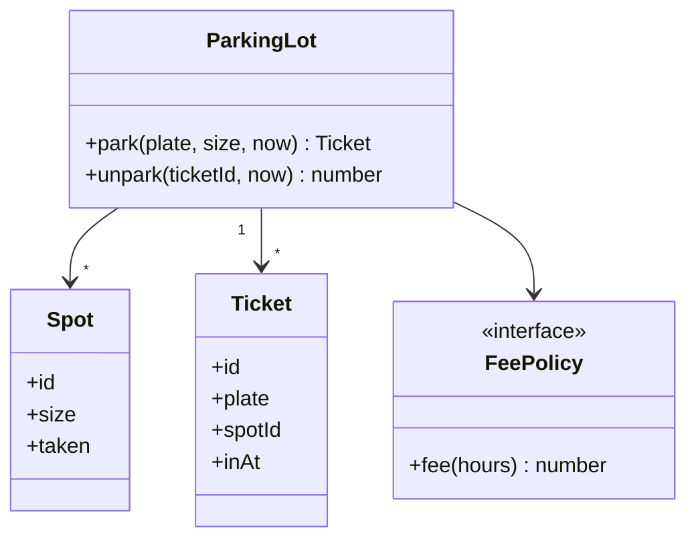

The lot holds many spots and tickets and uses a fee policy through an interface.

```ts
type Size = "small" | "large";
type Ticket = { id: number; plate: string; spotId: string; inAt: number };
type FeePolicy = (hours: number) => number;

class Spot {
  id: string; size: Size; taken = false;
  constructor(id: string, size: Size) { this.id = id; this.size = size; }
}
class ParkingLot {
  #spots: Spot[]; #fee: FeePolicy; #tickets = new Map<number, Ticket>(); #next = 1;
  constructor(spots: Spot[], fee: FeePolicy) { this.#spots = spots; this.#fee = fee; }
  park(plate: string, size: Size, now: number): Ticket {
    const spot = this.#spots.find((s) => !s.taken && s.size === size);
    if (!spot) throw new Error("lot full");
    spot.taken = true;
    const t = { id: this.#next++, plate, spotId: spot.id, inAt: now };
    this.#tickets.set(t.id, t);
    return t;
  }
  unpark(ticketId: number, now: number): number {
    const t = this.#tickets.get(ticketId);
    if (!t) throw new Error("invalid ticket");
    this.#tickets.delete(ticketId);
    this.#spots.find((s) => s.id === t.spotId)!.taken = false;
    return this.#fee(Math.ceil(now - t.inAt)); // time in hours
  }
}
const lot = new ParkingLot([new Spot("S1", "small"), new Spot("L1", "large")], (h) => h * 20);
const ticket = lot.park("MH12AB1234", "large", 0);
console.log(lot.unpark(ticket.id, 2.5)); // prints: 60
```

**Extensions to discuss**
- New vehicle type: add to `Size` mapping or a `Vehicle` class with `requiredSize()`. No change to the fee code.
- Different fee rules (weekend, EV discount): another `FeePolicy`.
- Multi-level lot: a `Level` class that owns spots, and the lot asks levels.
- Concurrency: two cars must not get the same spot. In Node, one thread makes this safe. In Go or Java, guard spot assignment with a lock or an atomic operation, or do it in a database transaction.
- Finding the nearest spot: keep free spots in a heap or a set per size, instead of a linear scan.

**Gotchas**
- Do not model `Car extends Vehicle extends Object` with deep inheritance if you only need a size.
- Inject the clock (`now`) so tests do not depend on real time.

**Interview tip:** Finish by saying what you would add next (payment, entrance gates, reservation) and which class it would touch.

_Module: Low-Level Design · Tags: lld, parking-lot, strategy, object-design_

## Advanced

### 66. [Tech Lead] When is a refactor worth it, and when should you rewrite instead?

**Short answer:** Refactor when the system works and the structure is the problem. You improve it in small, safe steps with tests. Rewrite only when the foundation cannot be fixed (unsupported platform, wrong core model, impossible to test) and even then prefer to replace piece by piece rather than in one big bang.

Big rewrites fail often. The old system keeps changing during the rewrite, the new one lacks hidden fixes that the old one gained over years, and the team ships nothing for months.

| Situation | Choice | Why |
| --- | --- | --- |
| Messy module, behaviour correct, has tests or can get them | refactor | small steps, always shippable |
| Tangled legacy app serving customers | strangler fig | replace one route at a time |
| Platform end of life, no vendor support | rewrite in slices | there is no choice, reduce risk |
| Code is unclear but stable and rarely touched | leave it | no payoff |

**A refactor is worth it when**
- you change this area often (churn is high);
- bugs cluster there;
- a planned feature will touch it;
- you can protect it with tests.

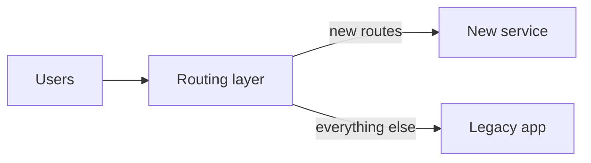

Strangler fig: a thin routing layer sends one feature at a time to the new code. The legacy part shrinks until it can be switched off.

**Rules of thumb**
- Write tests around current behaviour first.
- Keep each step small and deployable.
- Do not mix behaviour changes with a refactor.
- Set a stop rule: what do we measure to say "done"?

**Interview tip:** Say that a rewrite is a business decision, not just a technical taste. You ask what it buys in revenue, risk or speed, and what it delays.

_Module: Code Smells & Refactoring · Tags: tech-lead, refactoring, rewrite, strangler-fig_

### 67. [Tech Lead] How do you measure design quality?

**Short answer:** No single number proves good design. I combine a few signals: how hard changes are (lead time, change failure rate), where the code hurts (churn and complexity hot spots) and how tangled it is (coupling and dependency cycles). I use metrics to start conversations, not to rate people.

**Useful signals**

| Signal | What it tells you | Watch out |
| --- | --- | --- |
| Cyclomatic complexity | number of paths through a function; high means hard to test | long but flat code can score low |
| Coupling (imports between modules, cycles) | how far a change spreads | tools differ in definitions |
| Code churn plus complexity (hot spots) | files changed often and hard to read are the best refactor targets | churn alone may be normal |
| Change failure rate and lead time | DORA measures of delivery health | influenced by process too |
| Files touched per feature | real coupling in practice | needs consistent tracking |
| Test speed and flakiness | testability of the design | |
| Review time and size | unclear design slows review | |

**How I use them**
1. Pick a small set, three to five.
2. Track trends over months, not single values.
3. Look at hot spots: sort files by change count and complexity, and read the top ten.
4. Pair numbers with stories: "pricing changes touch eight files".
5. Set team goals on outcomes (shorter lead time) not on the metric itself.

**Gotchas**
- Goodhart's law: when a measure becomes a target, it stops being a good measure. Teams will game coverage and complexity numbers.
- Test coverage shows what ran, not whether tests are good.
- Metrics cannot see a wrong abstraction. Code review and experience still matter.

**Interview tip:** Mention one hot-spot analysis you did, and what you changed because of it.

_Module: Technical Debt & Leadership · Tags: tech-lead, metrics, code-quality, dora_

### 68. [Tech Lead] How do you apply design principles at service level in a microservices system?

**Short answer:** The same ideas scale up: one service owns one business capability (SRP), services talk through stable contracts (low coupling), and each service owns its data. The main trap is a shared library that couples services together and forces them to deploy in step.

| Principle | At class level | At service level |
| --- | --- | --- |
| SRP | one reason to change | one business capability, one owning team |
| Low coupling | depend on an interface | depend on an API or event schema, never the other team's database |
| High cohesion | related methods together | one bounded context per service |
| OCP | add a class, not edit old ones | add a new event consumer without changing the publisher |
| ISP | small interfaces | small, focused APIs per client (BFF pattern) |
| DRY | one home for knowledge | one owner of each business rule, not copies in five services |

**Signs of bad service design**
- Two services always deploy together (a distributed monolith).
- A request needs six synchronous calls.
- Several services write to the same table.
- A change to a field forces a coordinated release.

**The shared library trap.** A shared "common" library with domain models seems DRY. In practice, every change needs every service to upgrade, and one bad release breaks all. Better options:
- Share only stable, generic things (logging, tracing, auth helpers), versioned with care.
- Share contracts, not code: publish an OpenAPI or protobuf schema and generate clients.
- Accept a little duplication of simple DTOs between services. This is AHA at service level.

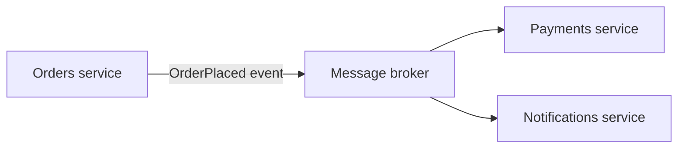

Orders does not know who listens. Adding a consumer needs no change in Orders.

**Gotcha:** a service split too small (nano-services) hurts cohesion. Cut by business capability, not by technical layer.

**Interview tip:** Say "I would rather duplicate a DTO than couple two release cycles", and explain the reason in terms of deployment independence.

_Module: Architecture · Tags: tech-lead, microservices, coupling, shared-libraries_

### 69. [Tech Lead] How do you work with legacy code that has no tests? Explain characterisation tests, seams and the strangler fig.

**Short answer:** First protect the current behaviour with characterisation tests, which record what the code does today. Then find seams, places where you can change behaviour without editing the code around it, so you can test in isolation. Then refactor in small steps, or replace parts gradually with the strangler fig pattern.

Michael Feathers defined legacy code as code without tests. You cannot safely change what you cannot check.

**The steps**
1. **Characterisation tests.** Call the code with real inputs, and write down the actual output as the expected output. You do not judge whether it is right yet. You only pin down current behaviour.
2. **Find seams.** A seam is a spot where you can swap a dependency: a parameter, an interface, a module import. It lets a test replace the clock, the database or the network.
3. **Break dependencies carefully.** Use small, mechanical changes: extract a function, pass the dependency in as an argument.
4. **Refactor under the tests.** Now improve the structure.
5. **Replace gradually.** Route one feature at a time to new code (strangler fig).

```ts
// Legacy: hard-wired to the clock, hard to test
function legacyDiscount(total: number): number {
  const hour = new Date().getHours();
  return hour >= 22 ? total * 0.8 : total;
}

// Seam: the clock becomes a parameter with the old default, so behaviour is unchanged
function discount(total: number, hour: number = new Date().getHours()): number {
  return hour >= 22 ? total * 0.8 : total;
}

// Characterisation tests: record what it does today
console.log(discount(100, 23), discount(100, 10)); // prints: 80 100
```

**Tips**
- Test the riskiest or most changed paths first. Do not aim for 100 percent coverage on day one.
- Use snapshot or golden-file tests for big outputs such as reports.
- Add a test with each bug fix.
- Keep refactor commits separate from behaviour changes.

**Gotcha:** characterisation tests lock in bugs too. That is fine. They are a safety net, and you fix bugs deliberately afterwards.

**Interview tip:** Mention that you earn trust by shipping small, safe improvements first, not by announcing a rewrite.

_Module: Code Smells & Refactoring · Tags: tech-lead, legacy-code, testing, refactoring_

### 70. How would you design a vending machine or an elevator using the State pattern?

**Short answer:** Model the machine as a context object that holds a current state object. Each state decides what each action does and which state comes next. This removes long `if (state === ...)` chains and makes illegal actions explicit, such as "select an item before paying".

**Vending machine states:** `Idle` (waiting), `HasMoney` (credit inserted). An elevator has `Idle`, `MovingUp`, `MovingDown` and `DoorsOpen`.

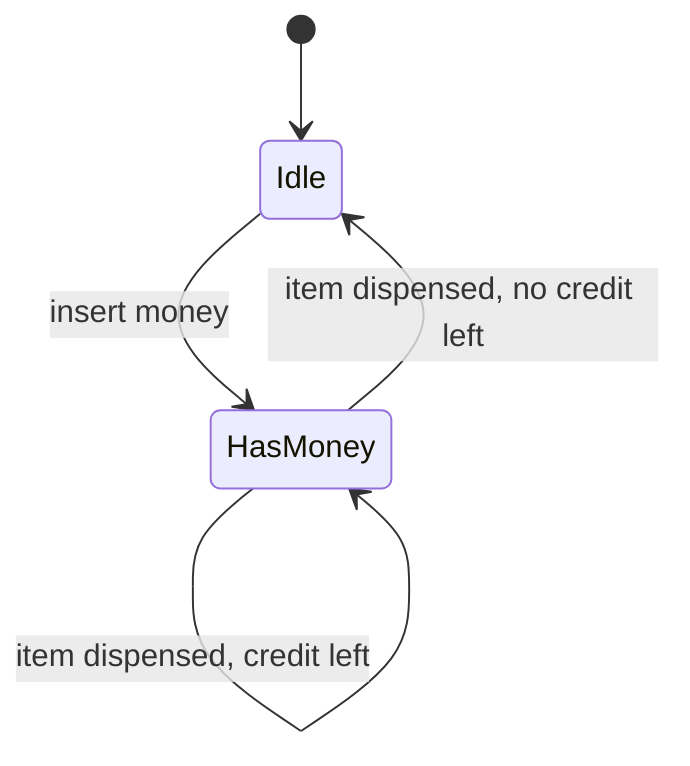

Each arrow is an action. The state diagram is also a good test list: every arrow needs a test.

```ts
interface State {
  insert(m: Machine, coins: number): void;
  select(m: Machine, item: string): string;
}
class Machine {
  state: State = idle;
  credit = 0;
  prices: Record<string, number> = { cola: 40, chips: 25 };
}
const idle: State = {
  insert(m, c) { m.credit = c; m.state = hasMoney; },
  select() { return "insert money first"; },
};
const hasMoney: State = {
  insert(m, c) { m.credit += c; },
  select(m, item) {
    const price = m.prices[item];
    if (price === undefined) return "unknown item";
    if (m.credit < price) return `need ${price - m.credit} more`;
    m.credit -= price;
    if (m.credit === 0) m.state = idle;
    return `dispensed ${item}`;
  },
};
const m = new Machine();
console.log(m.state.select(m, "cola")); // prints: insert money first
m.state.insert(m, 30);
console.log(m.state.select(m, "cola")); // prints: need 10 more
m.state.insert(m, 10);
console.log(m.state.select(m, "cola")); // prints: dispensed cola
```

**Elevator notes:** the elevator is a state machine plus a scheduling problem. Keep them separate: states decide what happens now. A `SchedulingStrategy` (nearest request first, or direction-based like the SCAN algorithm) decides which request is next.

| Part | Pattern |
| --- | --- |
| Behaviour that depends on the state | State |
| Which request to serve next | Strategy |
| Button presses | Command |
| Display and sensors reacting to changes | Observer |

**Gotchas**
- For two or three states with few actions, a transition table or a simple `switch` is easier. The pattern pays off when behaviour per state is rich.
- Decide who owns transitions. A state that sets the next state (as above) is simple. A central table is easier to see and test.
- Real machines need money handling in integer units and a refund action.

**Interview tip:** Draw the state diagram first. It shows the requirements and gives the interviewer a map of the code.

_Module: Low-Level Design · Tags: lld, state-pattern, vending-machine, elevator_

### 71. How would you design a notification service with Strategy and Observer?

**Short answer:** Treat each delivery method (email, SMS, push) as a strategy behind one `Channel` interface. Let business events such as "order shipped" trigger the service through an observer or event subscription. Store user preferences to choose channels. The core code stays the same when you add a channel.

**Requirements to confirm:** channels, per-user preferences, templates, retries, rate limits, delivery status, whether sending is synchronous.

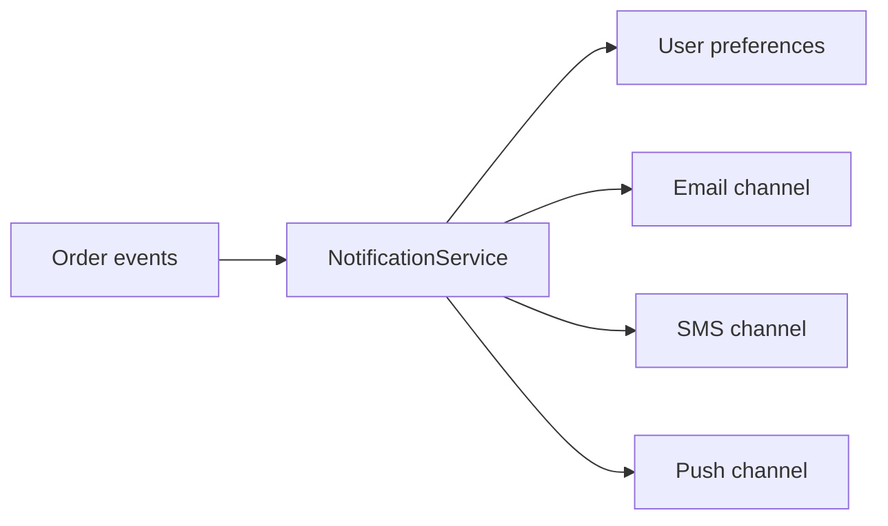

The service reads the preferences and calls the chosen channels. It never knows how each channel sends.

```ts
interface Channel { send(user: string, msg: string): string }
const channels: Record<string, Channel> = {
  email: { send: (u, m) => `email to ${u}: ${m}` },
  sms: { send: (u, m) => `sms to ${u}: ${m}` },
  push: { send: (u, m) => `push to ${u}: ${m}` },
};

class NotificationService {
  #prefs = new Map<string, string[]>();
  setPrefs(user: string, chans: string[]) { this.#prefs.set(user, chans); }
  notify(user: string, msg: string): string[] {
    const chans = this.#prefs.get(user) ?? ["email"]; // sensible default
    return chans.map((c) => channels[c].send(user, msg));
  }
}
const svc = new NotificationService();
svc.setPrefs("asha", ["sms", "push"]);
console.log(svc.notify("asha", "Order shipped"));
// prints: [ 'sms to asha: Order shipped', 'push to asha: Order shipped' ]
console.log(svc.notify("ravi", "Order shipped")); // prints: [ 'email to ravi: Order shipped' ]
```

**Design choices**
- **Observer:** `OrderService` publishes `OrderShipped`. The notification service subscribes. Orders does not know about notifications.
- **Decorator:** wrap a channel with retry, rate limit or logging without editing it.
- **Factory:** create the channel from config.
- **Template:** a message template with placeholders per event, kept outside the code.
- **Reliability:** use a queue between the event and the send, retries with backoff, a dead-letter queue, and idempotency keys so users do not receive duplicates.

**Gotchas**
- Sending inside the order request path makes order placement slow and fragile. Make it asynchronous.
- Quiet hours and opt-out are business rules. Keep them in the service, not in channels.
- Do not log full message bodies if they hold personal data.

**Interview tip:** Say that the first version is a `Record` of channels, and that you add a queue and retries when asked about reliability.

_Module: Low-Level Design · Tags: lld, notification-service, strategy, observer_

### 72. How would you design a logging library and a rate limiter as class models?

**Short answer:** For a logger, use a `Logger` with a minimum level and a list of appenders (console, file, remote). Each appender is a strategy. For a rate limiter, define a `RateLimiter` interface with an `allow(key, now)` method and implement algorithms such as token bucket behind it. In both cases the core stays small and the variation is behind an interface.

**Logger model**

```ts
type Level = "debug" | "info" | "error";
const rank: Record<Level, number> = { debug: 0, info: 1, error: 2 };
interface Appender { write(line: string): void }

class Logger {
  minLevel: Level; appenders: Appender[];
  constructor(minLevel: Level, appenders: Appender[]) { this.minLevel = minLevel; this.appenders = appenders; }
  log(level: Level, msg: string) {
    if (rank[level] < rank[this.minLevel]) return; // filter early
    for (const a of this.appenders) a.write(`[${level}] ${msg}`);
  }
}
const lines: string[] = [];
const logger = new Logger("info", [{ write: (l) => lines.push(l) }]);
logger.log("debug", "cache miss");
logger.log("error", "payment failed");
console.log(lines); // prints: [ '[error] payment failed' ]
```

Extras to mention: a formatter strategy (text or JSON), a chain of appenders, async buffering so logging does not block, and a context (request ID) added to each line.

**Rate limiter model (token bucket)**

```ts
interface RateLimiter { allow(key: string, nowMs: number): boolean }

class TokenBucket implements RateLimiter {
  capacity: number; refillPerSec: number;
  buckets = new Map<string, { tokens: number; last: number }>();
  constructor(capacity: number, refillPerSec: number) { this.capacity = capacity; this.refillPerSec = refillPerSec; }
  allow(key: string, nowMs: number): boolean {
    const b = this.buckets.get(key) ?? { tokens: this.capacity, last: nowMs };
    b.tokens = Math.min(this.capacity, b.tokens + ((nowMs - b.last) / 1000) * this.refillPerSec);
    b.last = nowMs;
    const ok = b.tokens >= 1;
    if (ok) b.tokens -= 1;
    this.buckets.set(key, b);
    return ok;
  }
}
const rl = new TokenBucket(2, 1);
console.log(rl.allow("u1", 0), rl.allow("u1", 0), rl.allow("u1", 0), rl.allow("u1", 1000));
// prints: true true false true
```

| Algorithm | Idea | Note |
| --- | --- | --- |
| Token bucket | tokens refill at a steady rate; each call uses one | allows short bursts |
| Fixed window | count per time window | simple, but a burst at a window edge |
| Sliding window | count over the last N seconds | smoother, more memory |
| Leaky bucket | requests drain at a fixed rate | smooths traffic |

**Gotchas**
- Pass the time in. A hidden `Date.now()` makes tests flaky.
- Across many servers, the state must be shared (for example in Redis) and updated atomically.
- Per-key buckets grow forever. Evict idle keys.

**Interview tip:** Name the interface first, then the algorithm. Interviewers then ask for a second algorithm, and you add a class without changing callers.

_Module: Low-Level Design · Tags: lld, logger, rate-limiter, token-bucket_

### 73. How do you read and draw UML class and sequence diagrams with Mermaid?

**Short answer:** A class diagram shows the types in a design and the relationships between them. A sequence diagram shows how objects call each other over time for one scenario. Together they explain structure and behaviour. In interviews, a few boxes and arrows with correct relationship types are enough.

**Relationships in a class diagram**

| Relationship | Meaning | Mermaid arrow | Example |
| --- | --- | --- | --- |
| Inheritance | is a | `<\|--` | `Shape <\|-- Circle` |
| Implementation | implements an interface | `<\|..` | `Notifier <\|.. EmailNotifier` |
| Association | knows and uses | `-->` | `Order --> Customer` |
| Aggregation | has, parts can live alone | `o--` | `Team o-- Player` |
| Composition | owns, parts die with the whole | `*--` | `Order *-- OrderLine` |
| Dependency | uses briefly | `..>` | `OrderService ..> Mailer` |

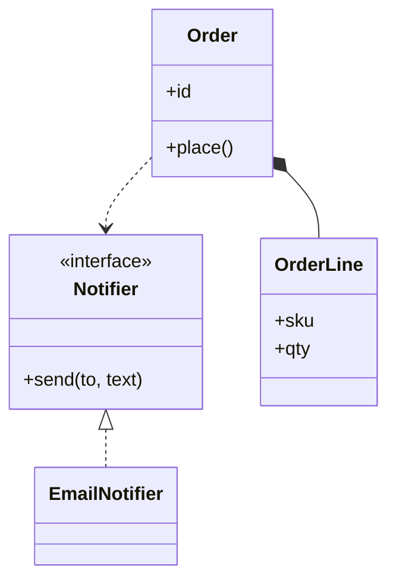

Read it as: `EmailNotifier` implements `Notifier`. An `Order` owns its lines. An `Order` uses a `Notifier`.

**Sequence diagram for "place order"**

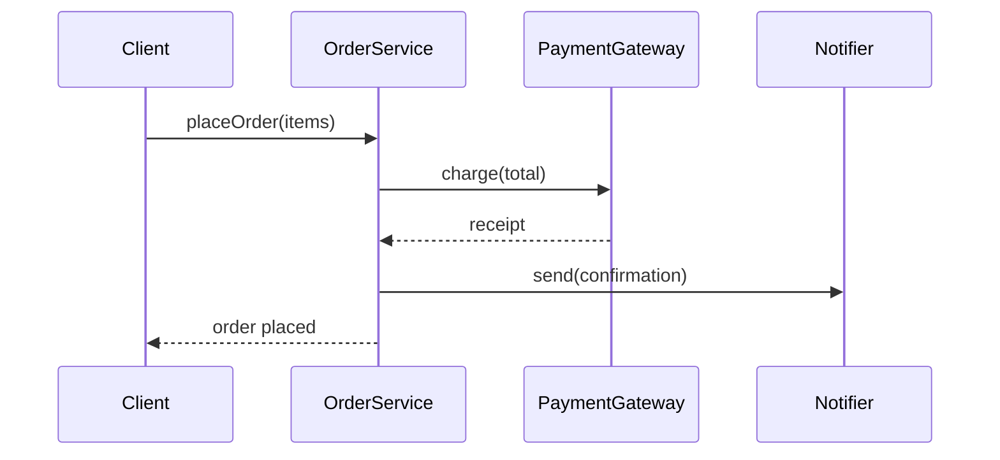

Solid arrows are calls. Dashed arrows are returns. Time flows downwards.

**Tips for interviews**
- Show only what matters: key fields and public methods, not every getter.
- Use cardinality (`1`, `*`) on important relationships.
- Prefer composition and association arrows over long inheritance trees.
- Draw the sequence for the main use case and one failure path.

**Gotchas**
- Mixing up aggregation and composition. The test is life cycle: if the parent is deleted, are the parts deleted too?
- Diagrams drift from code. Keep them small and keep them near the code (in the repository, written as text, so they are reviewed in pull requests).

**Interview tip:** Narrate while you draw: "Notifier is an interface, so the order service depends on the abstraction". It shows design intent, not just boxes.

_Module: Low-Level Design · Tags: uml, class-diagram, sequence-diagram, mermaid_

### 74. What are Clean Architecture, Hexagonal (ports and adapters) and Onion architecture, and what is the dependency rule?

**Short answer:** These styles put the business rules in the centre and the technical details (web, database, queues) on the outside. The dependency rule says source-code dependencies only point inwards: outer layers know inner layers, never the other way. The core is defined by interfaces (ports) and outer code implements them (adapters). Alistair Cockburn created Hexagonal, Jeffrey Palermo Onion, and Robert C. Martin popularised Clean Architecture.

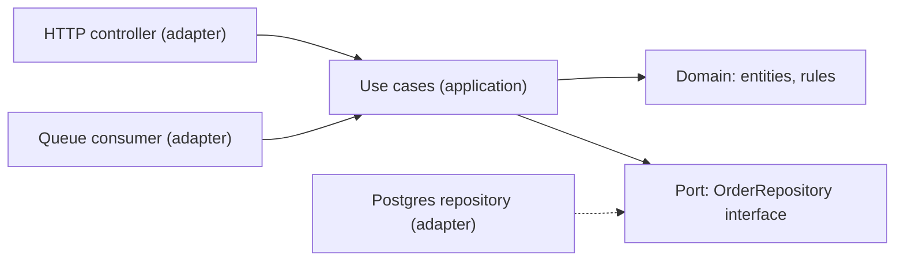

Solid arrows show who calls whom. The dotted arrow shows the database adapter implementing a port owned by the core. All source dependencies point towards the domain.

This is Dependency Inversion at the scale of the whole application. The business code can be tested with no database, and you can swap Postgres or the web framework with little change.

**A folder layout for a NestJS or Node service**

```text
src/
  domain/          entities, value objects, domain rules (no imports from outside)
  application/     use cases, ports (interfaces such as OrderRepository)
  adapters/
    http/          controllers, DTO mapping
    persistence/   postgres repository implements OrderRepository
    messaging/     queue publisher and consumers
  main.ts          composition root: wires adapters into use cases
```

| Layer | Knows about | Never imports |
| --- | --- | --- |
| Domain | itself only | frameworks, database, HTTP |
| Application | domain, ports | concrete adapters |
| Adapters | application and domain | each other |
| Main | everything (wiring) | |

**Trade-offs**
- More files, mapping between models and more indirection. For a simple CRUD service it is overkill.
- Pays off when business rules are complex, there are several entry points (HTTP, queue, CLI), or storage might change.
- A "ports for everything" style hides how the system really works. Create ports for things that can change or must be faked.

**Gotchas**
- Do not let ORM entities or framework decorators leak into the domain. Map at the edge.
- The dependency rule is about source code, not about runtime calls. The core still calls the adapter at runtime through the interface.

**Interview tip:** Say that you start simple, and introduce the ports when you have a second adapter or need a fast domain test.

_Module: Architecture · Tags: clean-architecture, hexagonal, ports-and-adapters, dependency-rule_

### 75. What are the basics of Domain-Driven Design: entities, value objects, aggregates, bounded contexts and ubiquitous language?

**Short answer:** Domain-Driven Design, introduced by Eric Evans, is an approach for complex business software. You model the code closely on the business: use the same words as the experts (ubiquitous language), split the system into bounded contexts with their own models, and protect the rules inside aggregates.

| Term | Meaning | Example |
| --- | --- | --- |
| Ubiquitous language | one shared vocabulary for developers and domain experts, used in code and talk | "shipment", not "delivery record" |
| Entity | object with identity that changes over time | `Order` |
| Value object | immutable, defined by values | `Money`, `Address` |
| Aggregate | a cluster of objects changed as one unit, with one root | `Order` with its `OrderLine`s |
| Aggregate root | the only entry point to the aggregate | callers use `order.addLine()` |
| Bounded context | an area in which a model and its words have one meaning | "Customer" in Sales vs in Support |
| Domain event | something that happened | `OrderPlaced` |
| Repository | loads and saves aggregates | `OrderRepository` |

**Aggregate rules**
- Keep the aggregate small. Change one aggregate per transaction.
- Reference other aggregates by ID, not by object.
- The root protects the invariants (for example "order total equals the sum of lines").

```ts
class Order {
  #lines: { sku: string; qty: number }[] = [];
  #placed = false;
  addLine(sku: string, qty: number) {
    if (this.#placed) throw new Error("order already placed");
    if (qty <= 0) throw new Error("quantity must be positive");
    this.#lines.push({ sku, qty });
  }
  place() {
    if (this.#lines.length === 0) throw new Error("empty order");
    this.#placed = true;
  }
  get lineCount() { return this.#lines.length; }
}
const o = new Order();
o.addLine("pen", 2);
o.place();
console.log(o.lineCount); // prints: 1
```

Outside code cannot add a line to a placed order. The root keeps the invariant.

**Bounded contexts** are where DDD meets microservices. A service often equals one bounded context. Contexts talk through events or APIs, and a translation layer (anti-corruption layer) protects one model from another.

**Gotchas**
- DDD costs time. It fits complex domains, not simple CRUD.
- Strategic DDD (language and contexts) gives most of the value. Tactical patterns (aggregates, repositories) are optional.
- Big aggregates cause locking and slow writes.

**Interview tip:** Explain "Customer" meaning different things to Sales and Support, and that this is why one big shared model fails.

_Module: Architecture · Tags: ddd, aggregates, bounded-context, eric-evans_

### 76. What are the trade-offs of layered architecture, and what is a modular monolith?

**Short answer:** Layered architecture splits code by technical role (presentation, business, data). It is simple and familiar, but changes to one feature cut across all layers. A modular monolith splits one deployable application by business module with strict boundaries. It often gives most benefits of microservices with far less operational cost.

| | Layered by technical role | Modular by business capability |
| --- | --- | --- |
| Folders | `controllers/`, `services/`, `repositories/` | `orders/`, `payments/`, `catalog/` |
| A feature change touches | all layers, many folders | mostly one module |
| Cohesion | low across the app | high inside each module |
| Boundaries | between layers | between modules, and layers inside each |
| Team ownership | hard to assign | one team per module |

**Why layers alone hurt as the system grows:** the `services` folder becomes a place where everything knows everything. Any service can call any repository, so coupling grows unseen.

**Modular monolith rules**
- Each module has a public API (a small facade or interface) and hidden internals.
- Modules do not read each other's tables. They call each other's API or react to events.
- Enforce boundaries with tools: lint rules, package visibility, architecture tests, separate build targets.
- Each module owns its schema (separate schema or table prefix).
- One deployment, one database server, one pipeline.

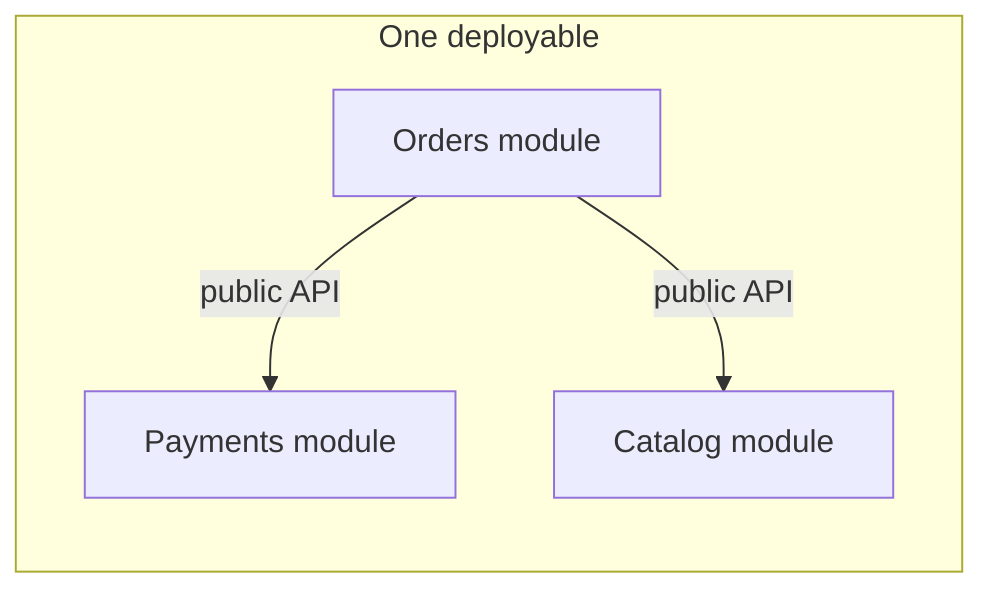

Modules call each other only through public APIs, so any module could be moved out into a service later.

**When to choose what**
- Start with a modular monolith for most new products and small teams.
- Move a module to a service when it needs independent scaling, a different technology, a different release speed or team autonomy.
- Avoid microservices because of fashion. The cost is distributed failures, deployments and debugging.

**Gotchas**
- Without enforced boundaries, a modular monolith becomes a big ball of mud with nicer folder names.
- A shared database with free joins across modules makes later extraction very hard.

**Interview tip:** Say "make the boundary first, make the deployment unit second". A good module boundary is the hard part either way.

_Module: Architecture · Tags: layered-architecture, modular-monolith, architecture_

### 77. What is evolutionary architecture and what are fitness functions?

**Short answer:** Evolutionary architecture means designing so the system can change safely over time, with automated checks to protect the qualities you care about. A fitness function is an automated check for one such quality, for example "domain code must not import the web framework" or "the p95 latency is under 300 ms". The term comes from the book *Building Evolutionary Architectures* by Neal Ford, Rebecca Parsons and Patrick Kua.

Architecture decays through many small changes, each of which looks fine. Fitness functions run in CI and fail the build when a rule is broken. This turns architecture rules from a document into a test.

| Quality | Example fitness function |
| --- | --- |
| Layering | no import from `domain/` to `adapters/` (ArchUnit, `dependency-cruiser`, `eslint-plugin-boundaries`) |
| No cycles | `madge --circular` returns nothing |
| Performance | load test in the pipeline fails if p95 is above a limit |
| Security | dependency scan has no high severity issues |
| Size | bundle size under a budget |
| Complexity | cyclomatic complexity of a function under a limit |

A tiny fitness function that checks layering over a list of imports:

```ts
type Edge = { from: string; to: string };
const imports: Edge[] = [
  { from: "adapters/http", to: "application" },
  { from: "application", to: "domain" },
  { from: "domain", to: "adapters/http" }, // ❌ the domain should never depend outwards
];
const forbidden = imports.filter((e) => e.from === "domain" && e.to !== "domain");
console.log(forbidden.length === 0 ? "layering ok" : `violations: ${forbidden.map((e) => e.from + "->" + e.to)}`);
// prints: violations: domain->adapters/http
```

In real projects the list of imports comes from a tool that reads the source, and a non-zero count fails the pipeline.

**Principles**
- Make small, frequent changes and use CI to protect them.
- Decide which qualities matter most (the "-ilities") and write a check for each.
- Use incremental change: the strangler fig, feature flags, branch by abstraction.
- Keep options open at the points where change is likely.

**Gotchas**
- Too many fitness functions slow the build and annoy the team. Pick the ones that guard real risk.
- A check without an owner gets ignored or deleted. Treat failures as seriously as failing tests.

**Interview tip:** Mention one rule you automated, such as "no cycles between modules", and the incident or drift it prevented.

_Module: Architecture · Tags: evolutionary-architecture, fitness-functions, architecture-tests_

### 78. What are the common anti-patterns, and how do teams fall into them?

**Short answer:** An anti-pattern is a common solution that looks reasonable but causes more problems than it solves. Teams fall into them through deadline pressure, copying without understanding, lack of ownership and the habit of adding instead of redesigning. Knowing the names helps you point them out early and calmly.

| Anti-pattern | What it is | How teams get there | Way out |
| --- | --- | --- | --- |
| God object | one class knows and does everything | each feature is "just one more method" | split by responsibility |
| Big ball of mud | no clear structure, everything depends on everything | no boundaries, years of quick fixes | introduce modules, strangle gradually |
| Spaghetti code | tangled control flow | long functions, many jumps, flags | extract functions, simplify flow |
| Golden hammer | one favourite tool for every problem | success with one technology | choose by the problem |
| Lava flow | dead or unclear code kept because nobody dares remove it | people left, no tests | add tests, delete in small steps |
| Cargo cult | copying practices without understanding why | "Netflix does it" | ask what problem it solves for us |
| Shotgun surgery | one change needs edits in many places | logic scattered | gather it in one module |
| Speculative generality | hooks and abstractions for imagined needs | fear of future change | YAGNI, delete |
| Copy-paste programming | duplicated blocks with small edits | fastest short path | extract when the knowledge is the same |
| Distributed monolith | microservices that must deploy together | splitting by layer, shared database | merge or redraw boundaries |

**Why it keeps happening**
- Short-term pressure rewards "make it work" and punishes cleanup.
- Nobody owns the overall design.
- Reviews check lines, not structure.
- New people copy what they see, including the bad parts.

**How to prevent it**
- Keep boundaries explicit and enforced (see fitness functions).
- Review design in short design meetings before large changes.
- Reserve time for cleanup and track debt.
- Write down decisions (ADRs).
- Delete code regularly. Version control remembers.

**Gotchas**
- Do not use anti-pattern names as insults. Say "this class is growing into a God object" and propose a first split.
- A pattern can be an anti-pattern in another context. A Singleton for a logger is tolerable, a Singleton holding mutable business state is not.

**Interview tip:** Tell a short story of one you fixed: how you noticed it, the first small step, and what improved.

_Module: Code Smells & Refactoring · Tags: anti-patterns, god-object, big-ball-of-mud, cargo-cult_

### 79. What are the costs of abstraction: the wrong abstraction and the Law of Leaky Abstractions?

**Short answer:** Every abstraction hides details to make code simpler, but it also adds indirection, a new concept to learn and a promise that must be kept. A wrong abstraction ties unrelated code together. Joel Spolsky's Law of Leaky Abstractions says every non-trivial abstraction leaks: sooner or later users need the hidden details.

**Costs**
- Reading cost: to follow the flow you must jump through layers.
- Change cost: the shared interface must fit every user, so changes ripple.
- Learning cost: new people must know the concept and its limits.
- Debugging cost: errors appear at the layer below, in terms nobody on the team knows.

**Leaks in practice**
- An ORM hides SQL until a page makes 200 queries (N+1) or a slow join. You must read the SQL.
- A "storage-agnostic" repository interface leaks when one database supports transactions or locking and another does not.
- A network call that looks like a function call (RPC) leaks latency, timeouts and partial failure.
- TCP hides packet loss until the connection stalls.

```ts
// A "simple" abstraction that leaks: callers must know it may fail or be slow
interface UserStore { get(id: string): Promise<{ name: string }> }
// Looks like a local lookup. In reality it is a network call:
// it needs a timeout, a retry policy and an answer for "service is down".
const store: UserStore = { get: async () => ({ name: "Asha" }) };
store.get("1").then((u) => console.log(u.name)); // prints: Asha
```

**How to choose abstractions well**
- Abstract a stable idea with at least two real uses, not a guess.
- Name it after the business meaning.
- Make the leaks visible: expose timeouts, errors and cost in the interface, instead of pretending they do not exist.
- Keep an escape hatch, for example allowing raw SQL for a hot path.
- Remove abstractions that no longer pay for themselves (inline them).

| Add an abstraction when | Hold back when |
| --- | --- |
| a detail is likely to change, and it hurts | there is one implementation and no reason to expect more |
| callers repeat the same careful steps | you cannot yet name the common idea |
| a boundary needs a test seam | it hides cost that callers must understand |

**Interview tip:** Say the sentence "all abstractions leak, so I make the important leaks part of the contract". Then give the RPC-as-function example.

_Module: Architecture · Tags: abstraction, leaky-abstractions, trade-offs_

### 80. How do composition and inheritance compare in depth: fragile base class, the diamond problem, mixins, traits and embedding?

**Short answer:** Inheritance ties a subclass to the exact behaviour of its parent. This gives the fragile base class problem: a harmless-looking change in the parent breaks children. Multiple inheritance adds the diamond problem. Languages offer other tools: interfaces, mixins, traits and Go struct embedding. All of them are ways to reuse behaviour while keeping coupling low.

**Fragile base class.** The classic case: a subclass overrides `add` and `addAll` to count items. If the parent's `addAll` calls `add`, items are counted twice. The subclass depended on an internal detail of the parent.

**Diamond problem.** `D` inherits from `B` and `C`, which both inherit from `A`. Which version of a method does `D` get? C++ needs `virtual` inheritance. Python resolves it with a defined order (the MRO). Java and C# avoid it by allowing one base class and many interfaces. Interface default methods can bring a small form back, and the compiler asks you to choose.

| Language | Reuse tools | Notes |
| --- | --- | --- |
| Java, C# | single inheritance plus interfaces (default methods) | the common pattern: interfaces and composition |
| Python | multiple inheritance, mixins | order matters (MRO), keep mixins small |
| TypeScript, JavaScript | single inheritance, mixin functions | many projects prefer composition |
| Go | no inheritance; interfaces and struct embedding | embedding promotes methods, it is not a subtype |
| Rust | traits, no inheritance | default methods in traits |

Go embedding gives convenient reuse without an "is-a" relationship.

```go
package main

import "fmt"

type Logger struct{ prefix string }

func (l Logger) Log(msg string) { fmt.Println(l.prefix + msg) }

// OrderService has a Logger. Its method Log is promoted.
type OrderService struct {
	Logger
	name string
}

func main() {
	s := OrderService{Logger: Logger{prefix: "[orders] "}, name: "orders"}
	s.Log("placed") // prints: [orders] placed
}
```

`OrderService` is not a `Logger` in the type system. It just contains one and forwards the call.

**When inheritance is fine:** a small, stable hierarchy of true subtypes, an abstract base that you own, and framework extension points.

**Rules of thumb**
- Use inheritance for "is-a" with the same behaviour promises (Liskov).
- Use composition for "has-a" and for reuse.
- Prefer interfaces for polymorphism.
- Keep mixins and embedded types small and independent, to avoid name clashes.

**Gotcha:** embedding exposes all methods of the inner type. If you do not want that in your API, use a named field and write forwarding methods.

**Interview tip:** Explain the fragile base class with the counting example. It shows you understand why "favour composition" exists and not just the slogan.

_Module: OOP Fundamentals · Tags: inheritance, composition, mixins, go-embedding_

### 81. How do immutability, sharing and ownership shape concurrent design?

**Short answer:** Data races need two things at once: sharing and mutation. Good concurrent design removes one of them. Make data immutable, or do not share it, or give it a single owner. Locks are the last resort. The Go proverb says: do not communicate by sharing memory, share memory by communicating.

| Strategy | Idea | Example |
| --- | --- | --- |
| Immutability | shared data never changes | config snapshot, value objects, persistent data structures |
| No sharing | each worker has its own data | per-request objects, thread-local data, sharding by key |
| Single owner | one goroutine or actor owns the state, others send messages | an actor, a Go goroutine with a channel |
| Locking | guard shared mutable state | mutex, database row lock |
| Optimistic control | detect conflicts and retry | version column, compare-and-set |

Here one goroutine owns a counter, and others only send messages. No lock is needed.

```go
package main

import "fmt"

func main() {
	events := make(chan int)
	done := make(chan int)

	go func() { // the owner of the total
		total := 0
		for n := range events {
			total += n
		}
		done <- total
	}()

	for i := 1; i <= 4; i++ {
		events <- i
	}
	close(events)
	fmt.Println(<-done) // prints: 10
}
```

**Design consequences**
- Prefer functions that take values and return new values over methods that edit shared fields.
- Keep aggregates small, with one writer. This is the same reason DDD limits a transaction to one aggregate.
- In Node.js, one thread runs your JavaScript, so races are about async steps, not threads. Two requests can still interleave between `await` points, so a read-modify-write across an `await` is unsafe without a database transaction or lock.
- In distributed systems, "ownership" means a partition key: all events for one account go to one consumer.

**Gotchas**
- A shallow `readonly` does not make nested data immutable.
- Locks can cause deadlocks and hide slow paths. Keep critical sections small and in one place.
- Immutable does not mean free. Copying large structures on every change can cost memory, so measure.

**Interview tip:** Ask "who owns this data?" as a first question about any concurrent design. A clear owner usually removes the need for a lock.

_Module: Architecture · Tags: concurrency, immutability, ownership, go_

### 82. What are the main principles of good API design?

**Short answer:** A good API is easy to use correctly and hard to use wrongly. It follows the principle of least surprise, has consistent names, keeps a small surface, and can evolve without breaking users. The idea of a "pit of success" says the easiest path should be the correct one.

**Principles**
- **Pit of success.** Defaults are safe, required things are required by types, and the common case is short.
- **Least surprise.** Same names for the same ideas everywhere (`createdAt`, not `created`, `creationDate` and `timestamp` in different places).
- **Small surface.** Every public method or field is a promise. Expose less, because you can add later but you cannot easily remove.
- **Make illegal states unrepresentable.** Use types: a `PaymentMethod` union rather than a string and optional fields.
- **Clear errors.** Stable error codes, a message and a hint.
- **Backwards compatibility.** Adding an optional field is safe. Removing or renaming a field, or changing its meaning, breaks users.
- **Idempotency and pagination** from the start for HTTP APIs.
- **Naming.** Use business words, verbs for actions, plural nouns for collections.

```ts
// ❌ hard to use correctly: which strings are valid, which fields go together?
type PayBad = { method: string; cardNo?: string; upiId?: string };

// ✅ pit of success: each variant carries exactly what it needs
type Pay =
  | { method: "card"; cardToken: string }
  | { method: "upi"; upiId: string };

const describe = (p: Pay) => (p.method === "card" ? `card ${p.cardToken}` : `upi ${p.upiId}`);
console.log(describe({ method: "upi", upiId: "asha@bank" })); // prints: upi asha@bank
```

| Change | Compatible? |
| --- | --- |
| add an optional response field | yes (readers should ignore unknown fields) |
| add a required request field | no |
| rename or remove a field | no |
| tighten validation | usually no |
| change a default | often a hidden break |

**Evolving an API**
- Version in the URL or header only when a break is needed.
- Deprecate with a date and a replacement, and measure usage before removal.
- Run contract tests (for example Pact or schema checks) in CI.

**Gotchas**
- The first version of an API lives for years. Spend more time on the first public shape than on the code behind it.
- Internal APIs deserve the same care. They become public to your own team.

**Interview tip:** Mention how you would find breaking changes automatically, for example with an OpenAPI diff in the pipeline.

_Module: Robust Design · Tags: api-design, backwards-compatibility, naming_

### 83. What is Conway's Law, and how does it affect software design?

**Short answer:** Conway's Law says that organisations design systems that copy their own communication structure. If three teams build a compiler, you get a three-pass compiler. Melvin Conway wrote this in 1968. For a lead it means team boundaries and system boundaries shape each other, so design both on purpose.

If the front-end team and the back-end team are separate, the system tends to split into a front end and a back end, even when the business feature cuts across both. Every feature then needs a hand-off between teams.

**The inverse Conway manoeuvre:** first shape the teams to match the architecture you want. If you want a payments service that can change on its own, create a team that owns payments from end to end.

| Team shape | Likely system | Effect |
| --- | --- | --- |
| Layer teams (UI, API, DB) | layered system | every feature crosses three teams, slow |
| Feature or business-capability teams | modules or services by capability | features ship inside one team |
| Shared ownership of everything | big ball of mud | nobody owns quality |
| Too many small teams too early | many nano-services | high coordination cost |

**How to use it**
- Draw the team map next to the service map. Where a service is owned by two teams, or one team owns ten services, expect trouble.
- Match service boundaries to bounded contexts, and give each context one owning team.
- Reduce the need for communication between teams with clear APIs and contracts.
- Use ideas from the book *Team Topologies*: stream-aligned teams, platform teams and a limited cognitive load per team.

**Gotchas**
- It is a tendency, not a law of physics. You can break it with effort, but you will fight it every day.
- Reorganising teams without changing code ownership changes nothing. Move the code boundaries too.
- Remote and multi-time-zone teams strengthen the effect, because communication is more expensive.

**Interview tip:** Say that when you saw many cross-team hand-offs for one feature, you proposed changing ownership boundaries, and not only the code.

_Module: Technical Debt & Leadership · Tags: conways-law, team-topologies, socio-technical_

---

## Resources

Where to read more at the source. Official docs and references come first.

**Reference**

- [Refactoring catalog (Martin Fowler)](https://refactoring.com/catalog/) — Every named refactoring with a short before/after. _(intermediate)_
- [Patterns of Enterprise Application Architecture catalog](https://martinfowler.com/eaaCatalog/) — Repository, Unit of Work, Service Layer and more, with short descriptions. _(advanced)_
- [SourceMaking: Anti-patterns](https://sourcemaking.com/antipatterns) — Software development, architecture and management anti-patterns. _(intermediate)_
- [DDD Reference (Eric Evans)](https://www.domainlanguage.com/ddd/reference/) — Short, free summary of the domain-driven design patterns. _(advanced)_

**Tutorial**

- [Refactoring.Guru: Design patterns](https://refactoring.guru/design-patterns) — Clear explanations and diagrams for every classic pattern, with examples in many languages. _(beginner)_
- [Refactoring.Guru: Code smells](https://refactoring.guru/refactoring/smells) — Catalogue of code smells and the refactoring that fixes each. _(intermediate)_
- [SourceMaking: Design patterns](https://sourcemaking.com/design_patterns) — Pattern catalogue with intent, structure and code. _(beginner)_
- [OODesign: Low-level design](https://www.oodesign.com) — Object-oriented design principles, patterns and case studies useful for LLD interviews. _(intermediate)_

**Book**

- [Game Programming Patterns](https://gameprogrammingpatterns.com) — Free book with the best plain-English explanations of Observer, State, Command and more. _(intermediate)_

**Article**

- [Yagni (Martin Fowler)](https://martinfowler.com/bliki/Yagni.html) — What YAGNI means, and when building ahead is fine. _(beginner)_
- [The Wrong Abstraction (Sandi Metz)](https://sandimetz.com/blog/2016/1/20/the-wrong-abstraction) — Why duplication is cheaper than the wrong abstraction. Source of the AHA idea. _(intermediate)_
- [AHA Programming (Kent C. Dodds)](https://kentcdodds.com/blog/aha-programming) — Avoid Hasty Abstractions: the rule of waiting for the pattern. _(intermediate)_
- [Technical Debt (Martin Fowler)](https://martinfowler.com/bliki/TechnicalDebt.html) — The debt metaphor, interest and when taking debt is wise. _(intermediate)_
- [The Clean Architecture (Robert C. Martin)](https://blog.cleancoder.com/uncle-bob/2012/08/13/the-clean-architecture.html) — The dependency rule and concentric layers, in the author's words. _(intermediate)_
- [Hexagonal Architecture (Alistair Cockburn)](https://alistair.cockburn.us/hexagonal-architecture/) — Ports and adapters from the person who named it. _(intermediate)_
- [Inversion of Control Containers and the Dependency Injection pattern](https://martinfowler.com/articles/injection.html) — The classic article separating IoC, DI and service locator. _(intermediate)_
