# DevOps & CI/CD

[← Back to index](../README.md) · [⭐ Favorites](favorites.md)

65 questions · 0 favorites · [📚 Resources](#resources)

## Contents

**Basic**

- [1. What do CI, continuous delivery and continuous deployment mean?](#1-what-do-ci-continuous-delivery-and-continuous-deployment-mean)
- [2. What is DevOps, and why is it not a job title?](#2-what-is-devops-and-why-is-it-not-a-job-title)
- [3. How are containers different from virtual machines?](#3-how-are-containers-different-from-virtual-machines)
- [4. What is the difference between a Docker image and a container, and what are layers?](#4-what-is-the-difference-between-a-docker-image-and-a-container-and-what-are-layers)
- [5. How do you write a good Dockerfile?](#5-how-do-you-write-a-good-dockerfile)
- [6. What is a multi-stage Docker build and why use it?](#6-what-is-a-multi-stage-docker-build-and-why-use-it)
- [7. How do Docker volumes, bind mounts and networking work?](#7-how-do-docker-volumes-bind-mounts-and-networking-work)
- [8. What is Docker Compose and how do you use it for local development?](#8-what-is-docker-compose-and-how-do-you-use-it-for-local-development)
- [9. What are container registries and image tags, and why is `latest` dangerous?](#9-what-are-container-registries-and-image-tags-and-why-is-latest-dangerous)
- [10. What are the Git basics every engineer should know: commit, branch, merge, rebase and fast-forward?](#10-what-are-the-git-basics-every-engineer-should-know-commit-branch-merge-rebase-and-fast-forward)
- [11. What do git cherry-pick, stash, reset and revert do?](#11-what-do-git-cherry-pick-stash-reset-and-revert-do)
- [12. What are the main branching strategies: trunk-based, GitHub flow and GitFlow?](#12-what-are-the-main-branching-strategies-trunk-based-github-flow-and-gitflow)
- [13. What makes a good pull request or merge request process?](#13-what-makes-a-good-pull-request-or-merge-request-process)
- [14. What is semantic versioning and why keep a changelog?](#14-what-is-semantic-versioning-and-why-keep-a-changelog)
- [15. How should configuration and secrets be handled (the twelve-factor approach)?](#15-how-should-configuration-and-secrets-be-handled-the-twelve-factor-approach)
- [16. What are the typical stages of a CI/CD pipeline?](#16-what-are-the-typical-stages-of-a-cicd-pipeline)
- [17. What types of tests run in a pipeline and where?](#17-what-types-of-tests-run-in-a-pipeline-and-where)

**Intermediate**

- [18. \[Tech Lead\] How would you design a CI/CD pipeline for a team of 20 engineers?](#18-tech-lead-how-would-you-design-a-cicd-pipeline-for-a-team-of-20-engineers)
- [19. \[Tech Lead\] How do you make a slow CI pipeline fast?](#19-tech-lead-how-do-you-make-a-slow-ci-pipeline-fast)
- [20. \[Tech Lead\] Which release strategy should you use: rolling, blue-green, canary, feature flags or dark launch?](#20-tech-lead-which-release-strategy-should-you-use-rolling-blue-green-canary-feature-flags-or-dark-launch)
- [21. \[Tech Lead\] How do you adopt trunk-based development and protect the main branch?](#21-tech-lead-how-do-you-adopt-trunk-based-development-and-protect-the-main-branch)
- [22. \[Tech Lead\] How do you manage environments and promote releases from dev to production?](#22-tech-lead-how-do-you-manage-environments-and-promote-releases-from-dev-to-production)
- [23. \[Tech Lead\] How do you manage secrets in CI/CD pipelines?](#23-tech-lead-how-do-you-manage-secrets-in-cicd-pipelines)
- [24. \[Tech Lead\] How do you measure delivery performance with DORA metrics?](#24-tech-lead-how-do-you-measure-delivery-performance-with-dora-metrics)
- [25. \[Tech Lead\] How do you handle flaky tests?](#25-tech-lead-how-do-you-handle-flaky-tests)
- [26. \[Tech Lead\] How do you introduce infrastructure as code and review infrastructure changes?](#26-tech-lead-how-do-you-introduce-infrastructure-as-code-and-review-infrastructure-changes)
- [27. \[Tech Lead\] How do you control the cost of CI?](#27-tech-lead-how-do-you-control-the-cost-of-ci)
- [28. What are the core concepts of GitLab CI/CD: pipelines, stages, jobs, runners and variables?](#28-what-are-the-core-concepts-of-gitlab-cicd-pipelines-stages-jobs-runners-and-variables)
- [29. What is the difference between `rules` and `only/except`, and what are `workflow:rules` and merge request pipelines?](#29-what-is-the-difference-between-rules-and-onlyexcept-and-what-are-workflowrules-and-merge-request-pipelines)
- [30. What are `needs` and DAG pipelines in GitLab CI?](#30-what-are-needs-and-dag-pipelines-in-gitlab-ci)
- [31. What is the difference between `cache` and `artifacts` in GitLab CI, and what mistakes are common?](#31-what-is-the-difference-between-cache-and-artifacts-in-gitlab-ci-and-what-mistakes-are-common)
- [32. How do `extends`, `include`, YAML anchors and templates keep GitLab CI files DRY?](#32-how-do-extends-include-yaml-anchors-and-templates-keep-gitlab-ci-files-dry)
- [33. How do environments, review apps and manual approval jobs work in GitLab?](#33-how-do-environments-review-apps-and-manual-approval-jobs-work-in-gitlab)
- [34. How do you use `services` for integration tests in GitLab CI?](#34-how-do-you-use-services-for-integration-tests-in-gitlab-ci)
- [35. How do you build Docker images in GitLab CI: Docker-in-Docker, Kaniko or BuildKit, and what are the security trade-offs?](#35-how-do-you-build-docker-images-in-gitlab-ci-docker-in-docker-kaniko-or-buildkit-and-what-are-the-security-trade-offs)
- [36. How do you use the GitLab Container Registry and clean it up?](#36-how-do-you-use-the-gitlab-container-registry-and-clean-it-up)
- [37. What are child pipelines and multi-project pipelines in GitLab?](#37-what-are-child-pipelines-and-multi-project-pipelines-in-gitlab)
- [38. How do scheduled pipelines and rollbacks work in GitLab CI?](#38-how-do-scheduled-pipelines-and-rollbacks-work-in-gitlab-ci)
- [39. How do you deploy to Kubernetes from a GitLab pipeline?](#39-how-do-you-deploy-to-kubernetes-from-a-gitlab-pipeline)
- [40. How do you build pipelines for a monorepo in GitLab CI?](#40-how-do-you-build-pipelines-for-a-monorepo-in-gitlab-ci)
- [41. How do you optimise Docker images for size and security, and how does Trivy fit in?](#41-how-do-you-optimise-docker-images-for-size-and-security-and-how-does-trivy-fit-in)
- [42. How does Docker networking work: bridge, host and none, and DNS between containers?](#42-how-does-docker-networking-work-bridge-host-and-none-and-dns-between-containers)
- [43. How do health checks, signals and PID 1 work in containers?](#43-how-do-health-checks-signals-and-pid-1-work-in-containers)
- [44. How do you set resource limits for containers?](#44-how-do-you-set-resource-limits-for-containers)
- [45. Which Git workflows work in practice: squash or merge commit, rebase, conventional commits and hooks?](#45-which-git-workflows-work-in-practice-squash-or-merge-commit-rebase-conventional-commits-and-hooks)
- [46. How does `git bisect` help find a bug, and when do you use it?](#46-how-does-git-bisect-help-find-a-bug-and-when-do-you-use-it)
- [47. What are the basics of Terraform: providers, state, plan, apply and modules?](#47-what-are-the-basics-of-terraform-providers-state-plan-apply-and-modules)
- [48. What are Bicep and ARM templates, and how do configuration management, provisioning and orchestration differ?](#48-what-are-bicep-and-arm-templates-and-how-do-configuration-management-provisioning-and-orchestration-differ)
- [49. What are artifact repositories and package registries, and why use them?](#49-what-are-artifact-repositories-and-package-registries-and-why-use-them)

**Advanced**

- [50. \[Tech Lead\] What is software supply-chain security and how do you apply it in a pipeline?](#50-tech-lead-what-is-software-supply-chain-security-and-how-do-you-apply-it-in-a-pipeline)
- [51. \[Tech Lead\] A bad deploy broke production. How do you handle the incident and what do you change afterwards?](#51-tech-lead-a-bad-deploy-broke-production-how-do-you-handle-the-incident-and-what-do-you-change-afterwards)
- [52. \[Tech Lead\] How do you set standards and reusable pipelines across many repositories?](#52-tech-lead-how-do-you-set-standards-and-reusable-pipelines-across-many-repositories)
- [53. How do containers really work: namespaces, cgroups and overlay filesystems?](#53-how-do-containers-really-work-namespaces-cgroups-and-overlay-filesystems)
- [54. What are containerd, runc and the CRI, and why did Kubernetes drop dockershim?](#54-what-are-containerd-runc-and-the-cri-and-why-did-kubernetes-drop-dockershim)
- [55. What is BuildKit, and how do cache mounts, secrets and reproducible builds work?](#55-what-is-buildkit-and-how-do-cache-mounts-secrets-and-reproducible-builds-work)
- [56. Why does deleting a file in a later Docker layer not make the image smaller?](#56-why-does-deleting-a-file-in-a-later-docker-layer-not-make-the-image-smaller)
- [57. How do you harden container security: rootless, seccomp, capabilities and read-only filesystems?](#57-how-do-you-harden-container-security-rootless-seccomp-capabilities-and-read-only-filesystems)
- [58. How do you sign and verify container images with cosign, Sigstore and admission policies?](#58-how-do-you-sign-and-verify-container-images-with-cosign-sigstore-and-admission-policies)
- [59. How do you manage Terraform state, drift and blast radius at scale?](#59-how-do-you-manage-terraform-state-drift-and-blast-radius-at-scale)
- [60. What is GitOps, how does pull-based deployment differ from push, and how do Argo CD and Flux compare?](#60-what-is-gitops-how-does-pull-based-deployment-differ-from-push-and-how-do-argo-cd-and-flux-compare)
- [61. What is progressive delivery with automated analysis and rollback?](#61-what-is-progressive-delivery-with-automated-analysis-and-rollback)
- [62. How do release trains, continuous deployment and regulated environments fit together?](#62-how-do-release-trains-continuous-deployment-and-regulated-environments-fit-together)
- [63. How do you run database migrations safely in a CI/CD pipeline?](#63-how-do-you-run-database-migrations-safely-in-a-cicd-pipeline)
- [64. What is platform engineering and an internal developer platform?](#64-what-is-platform-engineering-and-an-internal-developer-platform)
- [65. How would you design CI for a polyglot monorepo with Go, Node and React end to end?](#65-how-would-you-design-ci-for-a-polyglot-monorepo-with-go-node-and-react-end-to-end)

## Browse by module

| Module | Questions |
| --- | --- |
| CI/CD Pipelines (8) | [1](#1-what-do-ci-continuous-delivery-and-continuous-deployment-mean) · [16](#16-what-are-the-typical-stages-of-a-cicd-pipeline) · [17](#17-what-types-of-tests-run-in-a-pipeline-and-where) · [18](#18-tech-lead-how-would-you-design-a-cicd-pipeline-for-a-team-of-20-engineers) · [19](#19-tech-lead-how-do-you-make-a-slow-ci-pipeline-fast) · [25](#25-tech-lead-how-do-you-handle-flaky-tests) · [40](#40-how-do-you-build-pipelines-for-a-monorepo-in-gitlab-ci) · [65](#65-how-would-you-design-ci-for-a-polyglot-monorepo-with-go-node-and-react-end-to-end) |
| Container Internals (4) | [53](#53-how-do-containers-really-work-namespaces-cgroups-and-overlay-filesystems) · [54](#54-what-are-containerd-runc-and-the-cri-and-why-did-kubernetes-drop-dockershim) · [55](#55-what-is-buildkit-and-how-do-cache-mounts-secrets-and-reproducible-builds-work) · [56](#56-why-does-deleting-a-file-in-a-later-docker-layer-not-make-the-image-smaller) |
| DevOps Fundamentals (2) | [2](#2-what-is-devops-and-why-is-it-not-a-job-title) · [15](#15-how-should-configuration-and-secrets-be-handled-the-twelve-factor-approach) |
| Docker & Containers (11) | [3](#3-how-are-containers-different-from-virtual-machines) · [4](#4-what-is-the-difference-between-a-docker-image-and-a-container-and-what-are-layers) · [5](#5-how-do-you-write-a-good-dockerfile) · [6](#6-what-is-a-multi-stage-docker-build-and-why-use-it) · [7](#7-how-do-docker-volumes-bind-mounts-and-networking-work) · [8](#8-what-is-docker-compose-and-how-do-you-use-it-for-local-development) · [9](#9-what-are-container-registries-and-image-tags-and-why-is-latest-dangerous) · [41](#41-how-do-you-optimise-docker-images-for-size-and-security-and-how-does-trivy-fit-in) · [42](#42-how-does-docker-networking-work-bridge-host-and-none-and-dns-between-containers) · [43](#43-how-do-health-checks-signals-and-pid-1-work-in-containers) · [44](#44-how-do-you-set-resource-limits-for-containers) |
| Git & Workflow (7) | [10](#10-what-are-the-git-basics-every-engineer-should-know-commit-branch-merge-rebase-and-fast-forward) · [11](#11-what-do-git-cherry-pick-stash-reset-and-revert-do) · [12](#12-what-are-the-main-branching-strategies-trunk-based-github-flow-and-gitflow) · [13](#13-what-makes-a-good-pull-request-or-merge-request-process) · [21](#21-tech-lead-how-do-you-adopt-trunk-based-development-and-protect-the-main-branch) · [45](#45-which-git-workflows-work-in-practice-squash-or-merge-commit-rebase-conventional-commits-and-hooks) · [46](#46-how-does-git-bisect-help-find-a-bug-and-when-do-you-use-it) |
| GitLab CI (12) | [28](#28-what-are-the-core-concepts-of-gitlab-cicd-pipelines-stages-jobs-runners-and-variables) · [29](#29-what-is-the-difference-between-rules-and-onlyexcept-and-what-are-workflowrules-and-merge-request-pipelines) · [30](#30-what-are-needs-and-dag-pipelines-in-gitlab-ci) · [31](#31-what-is-the-difference-between-cache-and-artifacts-in-gitlab-ci-and-what-mistakes-are-common) · [32](#32-how-do-extends-include-yaml-anchors-and-templates-keep-gitlab-ci-files-dry) · [33](#33-how-do-environments-review-apps-and-manual-approval-jobs-work-in-gitlab) · [34](#34-how-do-you-use-services-for-integration-tests-in-gitlab-ci) · [35](#35-how-do-you-build-docker-images-in-gitlab-ci-docker-in-docker-kaniko-or-buildkit-and-what-are-the-security-trade-offs) · [36](#36-how-do-you-use-the-gitlab-container-registry-and-clean-it-up) · [37](#37-what-are-child-pipelines-and-multi-project-pipelines-in-gitlab) · [38](#38-how-do-scheduled-pipelines-and-rollbacks-work-in-gitlab-ci) · [39](#39-how-do-you-deploy-to-kubernetes-from-a-gitlab-pipeline) |
| Infrastructure as Code (4) | [26](#26-tech-lead-how-do-you-introduce-infrastructure-as-code-and-review-infrastructure-changes) · [47](#47-what-are-the-basics-of-terraform-providers-state-plan-apply-and-modules) · [48](#48-what-are-bicep-and-arm-templates-and-how-do-configuration-management-provisioning-and-orchestration-differ) · [59](#59-how-do-you-manage-terraform-state-drift-and-blast-radius-at-scale) |
| Platform & Leadership (4) | [24](#24-tech-lead-how-do-you-measure-delivery-performance-with-dora-metrics) · [27](#27-tech-lead-how-do-you-control-the-cost-of-ci) · [52](#52-tech-lead-how-do-you-set-standards-and-reusable-pipelines-across-many-repositories) · [64](#64-what-is-platform-engineering-and-an-internal-developer-platform) |
| Release Strategies (8) | [14](#14-what-is-semantic-versioning-and-why-keep-a-changelog) · [20](#20-tech-lead-which-release-strategy-should-you-use-rolling-blue-green-canary-feature-flags-or-dark-launch) · [22](#22-tech-lead-how-do-you-manage-environments-and-promote-releases-from-dev-to-production) · [51](#51-tech-lead-a-bad-deploy-broke-production-how-do-you-handle-the-incident-and-what-do-you-change-afterwards) · [60](#60-what-is-gitops-how-does-pull-based-deployment-differ-from-push-and-how-do-argo-cd-and-flux-compare) · [61](#61-what-is-progressive-delivery-with-automated-analysis-and-rollback) · [62](#62-how-do-release-trains-continuous-deployment-and-regulated-environments-fit-together) · [63](#63-how-do-you-run-database-migrations-safely-in-a-cicd-pipeline) |
| Supply Chain & Security (5) | [23](#23-tech-lead-how-do-you-manage-secrets-in-cicd-pipelines) · [49](#49-what-are-artifact-repositories-and-package-registries-and-why-use-them) · [50](#50-tech-lead-what-is-software-supply-chain-security-and-how-do-you-apply-it-in-a-pipeline) · [57](#57-how-do-you-harden-container-security-rootless-seccomp-capabilities-and-read-only-filesystems) · [58](#58-how-do-you-sign-and-verify-container-images-with-cosign-sigstore-and-admission-policies) |

## Basic

### 1. What do CI, continuous delivery and continuous deployment mean?

**Short answer:** Continuous integration (CI) means every change is merged often and automatically built and tested. Continuous delivery means every passing change is always ready to release, and a human presses the button. Continuous deployment goes one step further: every passing change goes to production with no human step.

**Why it exists.** Big, rare merges and manual releases hide bugs and make releases scary. Small, frequent, automated steps make problems visible while the change is still small and fresh in the author's head.

| Practice | What is automated | Who releases |
| --- | --- | --- |
| Continuous integration | Build, unit tests, lint on every push or merge request | Nobody, it only gives feedback |
| Continuous delivery | CI plus a deployable artifact, deploys to staging, release is one click | A human decides when |
| Continuous deployment | Everything including the production deploy | The pipeline, after all checks pass |

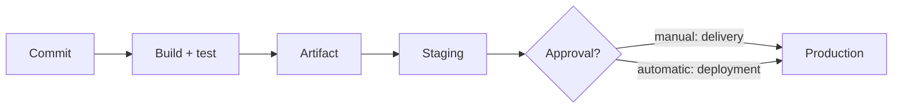

Read it left to right. The only difference between delivery and deployment is the decision box.

**Common mistakes**
- Calling a nightly build "CI". CI means integrating at least daily, ideally many times a day.
- Having a pipeline but a team that keeps long-lived branches. The tool is there, the practice is not.
- Believing continuous deployment needs no safety. It needs more: good tests, feature flags, monitoring and fast rollback.

**Interview tip:** Say which one your team does and why. "We do continuous delivery to production behind an approval, because of our customer's release windows, but staging deploys are fully automatic" is a strong, honest answer.

_Module: CI/CD Pipelines · Tags: ci-cd, fundamentals_

### 2. What is DevOps, and why is it not a job title?

**Short answer:** DevOps is a way of working where the people who build software also share responsibility for running it. It is about culture, shared ownership and fast feedback, supported by automation. It is not a team that "does the pipelines for everyone".

**The problem it solves.** In the old model developers threw code over a wall to operations. Developers wanted change, operations wanted stability, so they fought. DevOps removes the wall: the same team writes, deploys, monitors and fixes the service.

**Core ideas**
- **Flow:** small changes, short feedback loops.
- **Automation:** builds, tests, deploys and infrastructure are code.
- **Shared ownership:** "you build it, you run it", including on-call.
- **Measurement:** monitoring and metrics such as deploy frequency and failure rate.
- **Learning:** blameless postmortems.

**What goes wrong with the job title.** A "DevOps engineer" team can quickly become the new wall: every pipeline change is a ticket to them. A healthier model is a platform team that provides paved roads (templates, runners, clusters) and product teams that own their own services on top.

| Anti-pattern | Better |
| --- | --- |
| Separate "ops" team deploys for developers | Developers deploy through self-service pipelines |
| Blame after an outage | Blameless postmortem and fixes |
| Manual server setup | Infrastructure as code |

**Interview tip:** Interviewers listen for culture, not tools. Mention one real habit you introduced, such as a deploy-on-merge pipeline or a weekly look at failed deploys.

_Module: DevOps Fundamentals · Tags: devops, culture_

### 3. How are containers different from virtual machines?

**Short answer:** A virtual machine includes a full guest operating system on top of a hypervisor. A container is just an isolated process that shares the host's kernel. Containers start in a second, use little memory and are easy to pack densely, but they isolate less strongly than VMs.

**How to picture it.** A VM is a separate house with its own plumbing. A container is a flat in one building: separate rooms and doors, shared plumbing (the kernel).

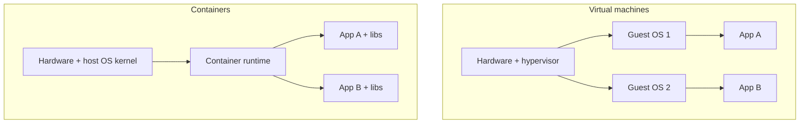

| | Virtual machine | Container |
| --- | --- | --- |
| Size | Gigabytes | Megabytes (often tens) |
| Start time | Tens of seconds to minutes | Usually under a second or two |
| Isolation | Strong, separate kernel | Weaker, shared kernel |
| Runs | Any OS | Same kernel family as the host (Linux containers need a Linux kernel) |

**Consequences.** A kernel bug can affect all containers on a host. For untrusted multi-tenant code, people add a sandbox such as gVisor or Kata Containers, or use VMs. On a Mac or Windows laptop, Docker Desktop quietly runs a small Linux VM, because Linux containers need a Linux kernel.

**Interview tip:** Say "a container is a process with a restricted view of the system", and then name namespaces and cgroups if asked how. Also mention that Kubernetes nodes are usually VMs running containers, so the two work together.

_Module: Docker & Containers · Tags: docker, containers, virtualization_

### 4. What is the difference between a Docker image and a container, and what are layers?

**Short answer:** An image is a read-only template: files plus metadata such as the start command. A container is a running instance of an image with a thin writable layer on top. One image can start many containers, like one class creating many objects.

**Layers.** An image is a stack of layers. Most Dockerfile instructions (`RUN`, `COPY`, `ADD`) create a new layer that stores only the file changes. Layers are identified by a hash and shared. If ten images start from the same base, the base is stored and downloaded once.

**The build cache.** Docker reuses a layer if the instruction and its inputs have not changed. The first instruction that changes invalidates the cache for itself and **every instruction after it**. This is why instruction order matters so much.

```dockerfile
FROM node:22-alpine
WORKDIR /app
# Changes rarely: cached on most builds
COPY package.json package-lock.json ./
RUN npm ci
# Changes on every commit: only these layers rebuild
COPY . .
RUN npm run build
```

When you only edit a source file, Docker reuses the layers up to `npm ci` and skips the slow install.

**Container writable layer.** Files a container writes go to its own layer and disappear when the container is removed. Persistent data must go into a volume.

```bash
docker build -t orders-web:1.4.0 .   # make an image
docker run -d --name web1 orders-web:1.4.0   # start a container
docker run -d --name web2 orders-web:1.4.0   # a second container, same image
docker history orders-web:1.4.0      # list the layers and their sizes
```

**Gotcha:** `docker ps` shows containers, `docker images` shows images. Deleting a container does not delete its image.

**Interview tip:** Tie layers to the two things interviewers care about: build speed (cache order) and image size (what each layer adds).

_Module: Docker & Containers · Tags: docker, images, layers_

### 5. How do you write a good Dockerfile?

**Short answer:** Start from a small, pinned base image. Copy dependency files first so the cache works. Copy the source later. Run as a non-root user. Keep a `.dockerignore`. Use a multi-stage build so build tools do not ship in the final image.

**Checklist**
- **Pin the base image.** Use `node:22-alpine` or better a digest, not `node:latest`.
- **Order for cache.** Rarely changing steps first (install dependencies), often changing steps last (copy source).
- **Non-root.** Create and switch to a user so a compromised process has fewer rights.
- **One process per container.** Logs go to stdout and stderr, not to files.
- **Exec form for `CMD`/`ENTRYPOINT`.** `["node","server.js"]` makes your app PID 1 and lets it receive signals.
- **`.dockerignore`.** Keeps `.git`, `node_modules`, local `.env` files and build output out of the build context. It makes builds faster and avoids leaking secrets.

```dockerfile
FROM node:22-alpine
WORKDIR /app
COPY package.json package-lock.json ./
RUN npm ci --omit=dev
COPY . .
# the official node image already contains a non-root user named node
USER node
EXPOSE 3000
CMD ["node", "server.js"]
```

```text
# .dockerignore
.git
node_modules
.env
*.log
dist
```

**Common mistakes**
- `COPY . .` before installing dependencies, so every code change reinstalls everything.
- Running `apt-get update` and `apt-get install` in separate `RUN` lines, which gives stale package lists. Combine them and clean the list files in the same line.
- Putting secrets in `ENV` or `ARG`. They stay in the image history.
- `EXPOSE` thinking it publishes a port. It only documents it.

**Interview tip:** Offer to review a Dockerfile live. Looking for the order of `COPY`, the base image, the user and the missing `.dockerignore` shows real experience.

_Module: Docker & Containers · Tags: docker, dockerfile, best-practices_

### 6. What is a multi-stage Docker build and why use it?

**Short answer:** A multi-stage build uses several `FROM` lines in one Dockerfile. Early stages have compilers and tools and build the program. The last stage starts from a tiny image and copies in only the result. The final image is small and has a smaller attack surface.

**Why.** A Go build image is about a gigabyte because it holds the compiler, tools and module cache. The running program only needs one static binary. Shipping the compiler is wasted size and extra things to patch.

```dockerfile
# Stage 1: build
FROM golang:1.23 AS build
WORKDIR /src
COPY go.mod go.sum ./
RUN go mod download
COPY . .
# static binary, no C library needed at run time
RUN CGO_ENABLED=0 go build -o /out/orders ./cmd/orders

# Stage 2: run
FROM gcr.io/distroless/static-debian12:nonroot
COPY --from=build /out/orders /orders
USER nonroot:nonroot
ENTRYPOINT ["/orders"]
```

The second stage has no shell and no package manager. Only files you copy with `COPY --from=build` arrive in it.

**Variations**
- Frontend: build with Node in stage one, copy the `dist` folder into an `nginx` image in stage two.
- A named stage can be the target of a build: `docker build --target test .` runs only up to the test stage.
- A separate `test` stage can run unit tests during the image build, if you want that.

**Trade-offs**
- Distroless and `scratch` images have no shell, so `docker exec` debugging is harder. Use ephemeral debug containers in Kubernetes, or keep a `debug` variant tag.
- A static Go binary needs `CGO_ENABLED=0` and, for HTTPS to other services, CA certificates. Distroless static already includes them. With `scratch` you must copy them.

**Interview tip:** Quote real numbers if you have them, for example "our Go service went from 1.1 GB to 18 MB, and pull time in the cluster dropped noticeably".

_Module: Docker & Containers · Tags: docker, multi-stage, image-size_

### 7. How do Docker volumes, bind mounts and networking work?

**Short answer:** A container's filesystem is temporary. Use a **volume** for data that must survive, a **bind mount** to share a host folder (good for local development), and a user-defined **network** so containers can reach each other by name.

**Storage options**

| Option | What it is | Use it for |
| --- | --- | --- |
| Volume | Storage managed by Docker | Database files, data that must survive |
| Bind mount | A host path mapped into the container | Live-reloading source code in development |
| `tmpfs` mount | Memory only | Temporary secrets or scratch data |

```bash
# named volume: data survives container removal
docker run -d --name db -v pgdata:/var/lib/postgresql/data postgres:16

# bind mount: edit code on the host, container sees it at once
docker run --rm -v "$(pwd)":/app -w /app node:22 node index.js
```

**Networking basics.** By default containers join a `bridge` network and get private IP addresses. Publishing a port with `-p 8080:3000` maps host port 8080 to container port 3000. On a user-defined network, Docker runs a small DNS so that a container can call another one by its name.

```bash
docker network create shop
docker run -d --name db --network shop postgres:16
docker run -d --name api --network shop -p 8080:3000 orders-api:1.0.0
# inside api, the database host is simply "db"
```

**Gotchas**
- Inside a container `localhost` means that container itself. Use the service name for other containers.
- Bind mounts on macOS and Windows can be slow, because files cross a VM boundary.
- Writing to the container layer is slower and is lost on restart.

**Interview tip:** In Kubernetes the same ideas become PersistentVolumes and Services, but a container is still stateless by default. Say that stateless containers are what makes scaling and rolling updates easy.

_Module: Docker & Containers · Tags: docker, volumes, networking_

### 8. What is Docker Compose and how do you use it for local development?

**Short answer:** Docker Compose describes a multi-container application in one YAML file and starts it with one command. It is ideal for local development and simple integration tests: your API, database and cache come up together on a shared network.

```yaml
# compose.yaml
services:
  api:
    build: .
    ports:
      - "8080:8080"
    environment:
      DATABASE_URL: postgres://app:app@db:5432/orders?sslmode=disable
    depends_on:
      db:
        condition: service_healthy
  db:
    image: postgres:16
    environment:
      POSTGRES_USER: app
      POSTGRES_PASSWORD: app
      POSTGRES_DB: orders
    volumes:
      - pgdata:/var/lib/postgresql/data
    healthcheck:
      test: ["CMD-SHELL", "pg_isready -U app -d orders"]
      interval: 5s
      timeout: 3s
      retries: 10
volumes:
  pgdata:
```

```bash
docker compose up -d --build   # start everything
docker compose logs -f api     # follow one service
docker compose down -v         # stop and delete containers and volumes
```

**What the file shows.** The `api` service is built from the local Dockerfile. It reaches the database with the host name `db`, the service name. `depends_on` with a healthcheck waits until Postgres is really ready, not just started.

**Good practice**
- Use `compose.yaml` for local dev only. Production on Kubernetes is described by manifests or Helm charts.
- Keep passwords here fake and local. Never commit real secrets.
- Use `docker compose watch` or bind mounts for live reload.
- Plain `depends_on` only orders start; without a health condition it does not wait for readiness.

**Interview tip:** Mention that "works on my machine" problems are reduced when a new teammate runs one command and gets the full stack. It is also handy in CI to start service dependencies.

_Module: Docker & Containers · Tags: docker, compose, local-development_

### 9. What are container registries and image tags, and why is `latest` dangerous?

**Short answer:** A registry stores and serves images (Docker Hub, GitLab Container Registry, Azure Container Registry). A tag is a movable label such as `1.4.0`. A digest is an immutable hash of the exact content. `latest` is dangerous because it is just a default tag that can point to anything, so you cannot tell what is running.

**Parts of an image name**

```text
registry.example.com/shop/orders-api:1.4.0
|______registry______|_repo path_____|_tag_|

registry.example.com/shop/orders-api@sha256:3f1c...e9a0
                                      |___ digest ___|
```

**Why `latest` hurts**
- Two environments can pull different content under the same name.
- Rollback is unclear: which image was "latest" yesterday?
- Kubernetes with `:latest` defaults to always pulling, so a node restart can quietly bring in a new version.

**Better rules**
- Tag every image with something unique and traceable: a semantic version, the Git commit SHA, or both. GitLab gives you `$CI_COMMIT_SHORT_SHA`.
- Treat release tags as immutable. Many registries can enforce this.
- Deploy by digest when you need an exact guarantee. The tag is for humans, the digest is for machines.
- Pin base images too, because `node:22` changes as new patch versions appear.

```bash
docker build -t "$CI_REGISTRY_IMAGE:$CI_COMMIT_SHORT_SHA" .
docker push "$CI_REGISTRY_IMAGE:$CI_COMMIT_SHORT_SHA"
# find the digest that the registry stored
docker inspect --format '{{index .RepoDigests 0}}' "$CI_REGISTRY_IMAGE:$CI_COMMIT_SHORT_SHA"
```

**Interview tip:** The key phrase is "build once, promote the same image". The same digest goes from staging to production, so what you tested is what you run.

_Module: Docker & Containers · Tags: docker, registry, tags, digest_

### 10. What are the Git basics every engineer should know: commit, branch, merge, rebase and fast-forward?

**Short answer:** A commit is a snapshot with a message and a pointer to its parent. A branch is just a movable name that points to a commit. Merge joins two histories and keeps both. Rebase replays your commits on top of another base to make history linear.

**Ideas**
- Git stores snapshots, not diffs. Commits form a graph, and each commit has a hash.
- `HEAD` is where you are now. A branch moves forward when you commit.
- A **fast-forward** merge happens when the target branch has not moved. Git simply moves the pointer. No merge commit is created.
- A **merge commit** is created when both branches have new commits. It has two parents.
- **Rebase** rewrites your commits as new ones (new hashes) on top of the target.

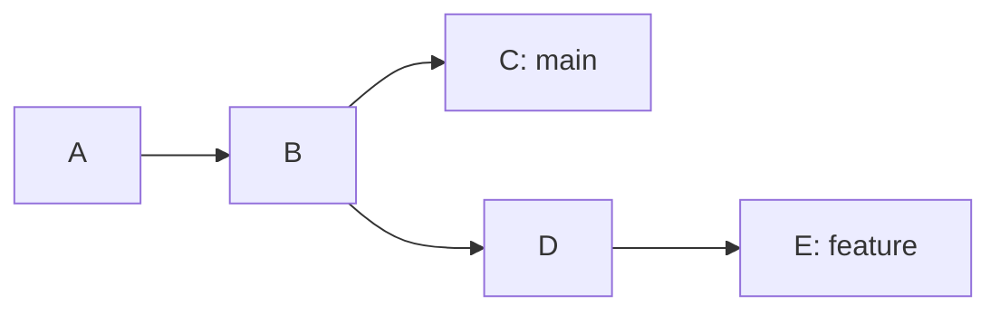

Here `main` and `feature` have diverged after B. A merge adds a commit with parents C and E. A rebase of `feature` onto `main` would recreate D and E after C.

```bash
git switch -c feature/discount      # create and move to a branch
git commit -am "Add discount rule"
git fetch origin
git rebase origin/main              # replay my commits on the latest main
git switch main && git merge --ff-only feature/discount   # only fast-forward, fail otherwise
```

**Golden rule of rebase.** Never rebase commits that other people already pulled. Rebase rewrites history, so shared branches would diverge. Rebasing your own unpublished or personal branch is fine, and then you push with `git push --force-with-lease`.

**Interview tip:** Explain the trade-off in one sentence: merge preserves the true history, rebase gives a clean readable one. Then say what your team does.

_Module: Git & Workflow · Tags: git, merge, rebase_

### 11. What do git cherry-pick, stash, reset and revert do?

**Short answer:** `cherry-pick` copies one commit to another branch. `stash` shelves uncommitted work. `reset` moves a branch pointer back and can discard commits. `revert` adds a new commit that undoes an earlier one, so it is the safe choice for shared history.

| Command | What it does | Rewrites history? | Use when |
| --- | --- | --- | --- |
| `git cherry-pick <sha>` | Applies one commit onto the current branch | No, creates a new commit | Backport a hotfix to a release branch |
| `git stash` | Saves working changes and cleans the tree | No | You must switch branches quickly |
| `git reset --soft <sha>` | Moves branch, keeps changes staged | Yes | Squash local commits |
| `git reset --hard <sha>` | Moves branch and throws away changes | Yes | Drop local work you do not want |
| `git revert <sha>` | New commit that reverses a commit | No | Undo something already pushed to main |

```bash
git stash push -m "wip discount"   # shelve work
git switch hotfix/1.4
git cherry-pick 9fceb02            # bring the fix from main
git switch -
git stash pop                      # get the work back

git revert 9fceb02                 # safe undo on a shared branch
git reset --hard HEAD~1            # only for local, unpushed commits
```

**Gotchas**
- `reset --hard` loses uncommitted work. Committed work is still reachable through `git reflog` for a while, which is your safety net.
- To revert a merge commit you must choose the parent: `git revert -m 1 <merge-sha>`.
- Cherry-picking the same fix to many branches creates duplicates. Prefer to fix once and merge forward when you can.

**Interview tip:** The one-liner is "reset for my private history, revert for shared history". Mention `reflog` as the way to recover from a bad reset.

_Module: Git & Workflow · Tags: git, undo, history_

### 12. What are the main branching strategies: trunk-based, GitHub flow and GitFlow?

**Short answer:** Trunk-based development means everyone merges small changes into one main branch very often, with short-lived branches. GitHub flow is similar: short feature branches and merge requests into a main that is always deployable. GitFlow uses long-lived `develop` and `release` branches and is slower but suits versioned, packaged software.

| Strategy | Branches | Release | Fits |
| --- | --- | --- | --- |
| Trunk-based | `main` plus branches living hours to a day or two | From main, often with feature flags | Web services, continuous delivery |
| GitHub flow | `main` plus short feature branches | Deploy after merge | Most SaaS teams |
| GitFlow | `main`, `develop`, `feature/*`, `release/*`, `hotfix/*` | Cut a release branch, stabilise, merge back | Installed software, many supported versions |

**Trade-offs**
- Long-lived branches mean big painful merges and late integration bugs. That is the main cost of GitFlow.
- Trunk-based needs strong automated tests and feature flags, because unfinished work reaches main hidden behind flags.
- GitFlow gives clear structure and release stabilisation, but many teams use it only because of habit.

**Rules of thumb**
- Services you deploy many times a week: trunk-based or GitHub flow.
- Software that customers install and you maintain in several versions, or avionics-like release cycles with certification: release branches are natural, but keep them short and cut from main.
- Whatever you choose, keep branch lifetime short and write it down.

**Interview tip:** Do not say "GitFlow is bad". Say it matches a release model where several versions live in the field, and that the DORA research links short-lived branches and frequent merges to better delivery performance.

_Module: Git & Workflow · Tags: git, branching, trunk-based_

### 13. What makes a good pull request or merge request process?

**Short answer:** Small, focused changes with a clear description, automated checks that must pass, and a fast review by at least one other person. Reviews should check design, correctness and risk, while formatting and style are left to tools.

**Author habits**
- Keep the change small. Under a few hundred changed lines is much easier to review well.
- Explain what and why in the description, and how you tested it. Link the ticket.
- One purpose per merge request. Put refactors in a separate one.
- Self-review the diff before asking others.

**Reviewer habits**
- Review soon. Waiting a day for a review is expensive for the author.
- Ask questions instead of giving orders, and mark what is a blocker and what is a nitpick.
- Check tests, error handling, security, naming and behaviour in production, not only syntax.

**Automation (in GitLab)**
- Required pipeline success before merge.
- Protected target branch, no direct pushes.
- Required approvals and a `CODEOWNERS` file so owners review their areas.
- Merge when pipeline succeeds, with squash if you want one commit per change.
- A merge request template with a checklist, for example "tests added, docs updated, rollback plan".

```text
# CODEOWNERS (GitLab syntax)
/deploy/       @platform-team
/services/billing/   @billing-team
*.tf           @infra-reviewers
```

**Common mistakes**
- Huge merge requests that people approve without reading.
- Reviews used to argue about style, which a linter should settle.
- One senior person as the only reviewer, which creates a bottleneck.

**Interview tip:** Mention a measurable goal such as "first review within four working hours". It shows you manage the process, not just the code.

_Module: Git & Workflow · Tags: code-review, merge-request, git_

### 14. What is semantic versioning and why keep a changelog?

**Short answer:** Semantic versioning (SemVer) uses three numbers, MAJOR.MINOR.PATCH. Increase MAJOR for breaking changes, MINOR for new backward-compatible features, PATCH for backward-compatible fixes. A changelog tells users what changed in each version.

**Examples**
- `1.4.2` to `1.4.3`: a bug fix.
- `1.4.2` to `1.5.0`: a new endpoint, old clients still work.
- `1.4.2` to `2.0.0`: a field was removed, old clients may break.
- `2.0.0-rc.1`: a pre-release, sorted before `2.0.0`.

SemVer is a promise about your **public API**. For a library the API is the code. For an HTTP service it is the contract, for example the OpenAPI file. For an internal service deployed alone, a version number matters less than a commit SHA, but it still helps for communication.

**Automating it.** With conventional commits (`feat:`, `fix:`, `feat!:` or `BREAKING CHANGE:`), tools such as semantic-release or release-please decide the next version, create the Git tag and write the changelog from commit messages.

```text
feat(orders): add discount codes        -> minor bump
fix(orders): round totals correctly     -> patch bump
feat(api)!: remove v1 order endpoint    -> major bump
```

**Changelog good practice**
- Written for humans, grouped by Added, Changed, Fixed, Removed.
- Includes breaking changes and migration steps at the top.
- Dates and links to the merge requests.

**Gotcha:** Version `0.x` means anything may change. Do not use a version bump to mean "marketing release". And never reuse or move a published version tag.

**Interview tip:** Link versions to rollback: a clear tag per release is what lets you say "roll back to 1.4.2" and mean one exact artifact.

_Module: Release Strategies · Tags: versioning, semver, changelog_

### 15. How should configuration and secrets be handled (the twelve-factor approach)?

**Short answer:** Keep code the same in every environment and change only the configuration. Read configuration from environment variables or mounted files, never hard-code it, and never commit secrets. Secrets come from a secret store at deploy or run time.

**The twelve-factor idea.** One build produces one artifact. Anything that differs between dev, staging and production (database URL, feature flags, API keys) is injected from outside. This is why you can promote the same image through environments.

| Kind | Example | Where it lives |
| --- | --- | --- |
| Non-secret config | log level, service URL | Environment variable, ConfigMap, Helm values |
| Secret | database password, API token | Secret store: Kubernetes Secret, Azure Key Vault, Vault |
| Build-time constant | version, commit SHA | Build argument or label |

```go
// read config from the environment and fail fast when it is missing
dsn := os.Getenv("DATABASE_URL")
if dsn == "" {
    log.Fatal("DATABASE_URL is required")
}
```

**Common mistakes**
- Committing a `.env` file or a key. Rotating a leaked key is mandatory, even after the commit is deleted, because Git history keeps it.
- Baking secrets in an image with `ENV` or `COPY`. Anyone who can pull the image can read them.
- Printing the full configuration at startup, which puts secrets into logs.
- One giant config file with environment `if` branches in the code.

**Good habits**
- Validate config at startup and exit with a clear message.
- Give each environment its own credentials with the least privileges.
- Prefer short-lived credentials and rotate regularly.
- Scan the repository for secrets (for example with gitleaks or GitLab secret detection) in the pipeline.

**Interview tip:** Connect it to Kubernetes: "ConfigMaps for settings, Secrets from a vault via external-secrets or CSI driver, same image everywhere".

_Module: DevOps Fundamentals · Tags: config, secrets, twelve-factor_

### 16. What are the typical stages of a CI/CD pipeline?

**Short answer:** A usual pipeline has these stages: build, test, scan, package, deploy, and verify. Each stage must pass before the next one runs, and the order is chosen so cheap, fast checks run first and fail early.

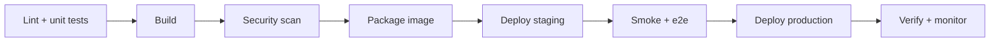

Read left to right. Each box is a gate. A failure stops the line and tells the author quickly.

| Stage | Purpose | Typical tools |
| --- | --- | --- |
| Lint and unit test | Fast feedback on code quality | golangci-lint, ESLint, go test, Jest |
| Build | Compile, bundle | go build, npm run build |
| Scan | Find vulnerabilities, secrets, licence issues | Trivy, gitleaks, SAST |
| Package | Build and push the image, tag it | Docker, BuildKit, Kaniko |
| Deploy | Roll the artifact to an environment | Helm, kubectl, Argo CD |
| Verify | Smoke tests, health checks, metrics | curl, k6, Datadog monitors |

**Design rules**
- **Fail fast.** Put the cheapest checks first.
- **Build once.** Later stages use the artifact from the build, never rebuild.
- **Same process for all environments.** Only the config changes.
- **Pipeline as code.** The definition lives in the repository and is reviewed like code.
- **Idempotent deploys.** Running the same deploy twice gives the same result.

**Common mistakes**
- Everything in one long job, so you cannot see which part failed or rerun it.
- Rebuilding the image per environment, which means production runs something never tested.
- Ignoring the verify stage: a "successful" deploy that is broken is still a failed release.

**Interview tip:** Describe the pipeline of your own service in one breath, including where the image is tagged and where a human approves.

_Module: CI/CD Pipelines · Tags: pipeline, stages, ci-cd_

### 17. What types of tests run in a pipeline and where?

**Short answer:** Run many fast unit tests on every push, fewer integration tests against real dependencies, and a small number of end-to-end and smoke tests against a deployed environment. This is the test pyramid: more tests at the bottom where they are cheap and stable.

| Test | What it checks | Speed | Where it runs |
| --- | --- | --- | --- |
| Unit | One function or class in isolation | Milliseconds | Every commit, on the runner |
| Integration | Code with a real database, queue or HTTP service | Seconds | Every merge request, using service containers |
| Contract | Consumer and provider agree on an API | Seconds | Merge request, before deploy |
| End-to-end | A full user journey through the real system | Minutes | After deploy to staging |
| Smoke | "Is the deployed thing alive?" a few key calls | Seconds | After every deploy, including production |
| Performance and security | Load, vulnerabilities | Minutes | Nightly or before release |

**Practical advice**
- Run tests in the same container image everywhere to avoid "passes locally, fails in CI".
- Keep end-to-end tests few, stable and on critical journeys only. Many of them are slow and flaky.
- Smoke tests after production deploys are cheap and catch broken config quickly.
- Publish test reports and coverage into the merge request so reviewers see them.

```yaml
unit-test:
  stage: test
  image: golang:1.23
  script:
    - go test ./... -race -coverprofile=coverage.out
  artifacts:
    when: always
    paths: [coverage.out]
```

**Common mistakes**
- The "ice cream cone": few unit tests and many slow UI tests.
- Integration tests that share one database and depend on order.
- Treating a green pipeline as proof of quality while the tests assert nothing.

**Interview tip:** Say how you decide: "behaviour at the edges is covered by integration tests with real Postgres, not mocks, because that is where our bugs were".

_Module: CI/CD Pipelines · Tags: testing, pipeline, test-pyramid_

## Intermediate

### 18. [Tech Lead] How would you design a CI/CD pipeline for a team of 20 engineers?

**Short answer:** Design around four goals: fast feedback, reproducible results, secure by default and cheap to run. Fast checks run on every merge request, one immutable artifact is built once, then promoted through environments with the same deploy code, and production is gated by automated checks and monitoring.

**Principles and what they mean in practice**
- **Fast feedback.** A developer should know within about ten minutes if a change is broken. Run lint and unit tests first, in parallel.
- **Reproducible.** Pinned tool versions, pinned base images, builds in containers, no hand-edited runners.
- **Secure.** Protected branches, masked and scoped secrets, dependency and image scanning, least-privilege deploy credentials.
- **Cheap.** Caching, auto-scaling runners, short artifact retention, no pipeline on drafts that only change docs.
- **Self-service.** Teams own their pipeline using shared templates, so no ticket is needed to ship.

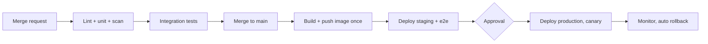

The top row protects main. The bottom row ships the same image from main.

**Decisions to make explicitly**
- Branching: trunk-based with short-lived branches and squash merges.
- Merge request pipelines run checks, main pipelines build and deploy.
- Deploy method: GitOps or pipeline-driven Helm, one way for all services.
- Ownership: a platform group owns templates and runners, each team owns its service pipeline.
- Metrics: pipeline duration, failure rate, deploy frequency.

**Trade-offs.** More gates mean more safety and slower flow. Keep the gates automatic and cheap, and keep human approvals only where risk or regulation requires them.

**Interview tip:** Start by asking constraints (release windows, compliance, monorepo or many repos, how many deploys per week). Interviewers like a lead who clarifies before drawing boxes.

_Module: CI/CD Pipelines · Tags: tech-lead, pipeline, design_

### 19. [Tech Lead] How do you make a slow CI pipeline fast?

**Short answer:** Measure first to find the slowest jobs on the critical path. Then cache dependencies and Docker layers, run independent jobs in parallel, split big test suites across jobs, build only what changed, and give heavy jobs bigger runners. Waiting time in queues counts too.

**Step 1: measure.** Look at job durations, queue time and the longest path through the pipeline. A pipeline of 12 minutes with a 9 minute test job needs test work, not runner work.

**Levers, roughly in order of payoff**

| Lever | What to do | Watch out for |
| --- | --- | --- |
| Caching | Dependency cache keyed on the lock file, Docker layer cache, build cache | Stale or poisoned caches |
| Parallelism | Independent jobs in one stage, or `needs` to start early | Runner capacity |
| Test splitting | Run one suite in N shards, balanced by past duration | Shards with uneven time |
| Affected-only | In a monorepo run only the services whose paths changed | Missing shared-code dependencies |
| Faster feedback order | Lint and unit tests before slow jobs, fail fast | Hiding slow jobs that fail late |
| Right-sized runners | More CPU for compilers and tests, cheap runners for light jobs | Cost |
| Smaller images and tools | Pre-built CI images with tools installed | Maintaining the CI image |
| Remove waste | No full clone (`GIT_DEPTH`), skip pipelines for docs-only changes | Tools that need full history |

```yaml
unit-test:
  stage: test
  parallel: 4               # four copies of the job
  script:
    - go test ./... -run . -shuffle=on   # here you would split by package list using CI_NODE_INDEX
  variables:
    GIT_DEPTH: "20"         # shallow clone is faster
```

GitLab sets `CI_NODE_INDEX` and `CI_NODE_TOTAL` for parallel jobs. Your script picks its slice with them.

**Gotchas**
- Fixing the average, not the long tail. Developers feel the slowest runs.
- Flaky tests with retries make the pipeline slow and hide problems.
- A faster pipeline that skips checks is not an improvement.

**Interview tip:** Give a number story: "we cut the merge request pipeline from 22 to 9 minutes by caching modules, sharding tests and moving e2e to after merge". Say what you measured.

_Module: CI/CD Pipelines · Tags: tech-lead, performance, caching_

### 20. [Tech Lead] Which release strategy should you use: rolling, blue-green, canary, feature flags or dark launch?

**Short answer:** Match the strategy to the risk. Rolling update is the simple default. Blue-green gives instant switch and rollback at double the capacity. Canary exposes a small share of users first and watches metrics. Feature flags and dark launches separate deploying code from releasing a feature.

| Strategy | How it works | Rollback | Cost | Use when |
| --- | --- | --- | --- | --- |
| Rolling | Replace instances gradually | Roll forward or undo the rollout | Low | Backward-compatible, low-risk changes |
| Blue-green | Two full environments, switch traffic | Switch back, seconds | Double capacity briefly | Big changes, need instant rollback |
| Canary | Send 1 to 5 percent of traffic to the new version, then widen | Send traffic back to stable | Needs good metrics and routing | High traffic, user-facing risk |
| Feature flag | Code ships off, a flag turns it on per user or group | Turn flag off, no deploy | Flag management and cleanup | Gradual feature rollout, A/B tests |
| Dark launch | New path runs in production but results are hidden or compared | Nothing visible to undo | Extra load | Validate a rewrite with real traffic |

**How to choose**
- If the change touches the database schema, the strategy alone is not enough. Use expand and contract migrations so old and new versions work together.
- If you cannot measure health (error rate, latency) automatically, canary gives little. Fix monitoring first.
- Combine them. A common pattern is a canary deploy of the code with new behaviour hidden behind a flag.

**Rolling back**
- Keep the previous image available and tagged.
- Prefer redeploying the last known good version through the same pipeline over hand edits.
- Decide the rollback trigger before release, for example "error rate above 2 percent for 5 minutes".

**Interview tip:** Say "deploy is not release". Deploying puts code on servers. Releasing exposes it to users. Flags let you control the second without risk in the first.

_Module: Release Strategies · Tags: tech-lead, release, canary_

### 21. [Tech Lead] How do you adopt trunk-based development and protect the main branch?

**Short answer:** Move in steps. Make main protected and always green, shorten branch life to a day or two, add feature flags for unfinished work, and make the automated tests trustworthy. Trunk-based development fails when people do not trust the tests.

**Adoption plan**
1. **Measure the starting point.** Average branch age, merge request size, time to merge, how often main is red.
2. **Protect main.** No direct pushes, required pipeline, at least one approval, `CODEOWNERS` for risky areas, linear history if you like.
3. **Shrink changes.** Teach slicing work: refactor first, then behaviour. Aim for merge requests under a day of work.
4. **Add flags.** Unfinished features merge hidden behind a flag with an owner and an expiry date.
5. **Speed up checks.** A merge request pipeline under ten minutes, or people will batch changes.
6. **Make a broken main a top priority.** Revert first, investigate later.
7. **Retire long-lived branches** and release branches only where truly needed.

**Branch protection settings to consider (GitLab)**
- Allowed to merge: maintainers or developers, not everyone.
- Allowed to push: no one.
- Require pipeline success and resolved discussions.
- Squash on merge, so one clean commit per change.
- Protected tags for releases.

**Trade-offs**
- Flags add code paths and cleanup debt. Track and delete them.
- Strict review rules slow small fixes. Allow a quick path for tiny, safe changes.
- Teams with weak tests need to improve tests first, or main will break often.

**Interview tip:** Mention that you change habits through data and examples, for example showing that merge requests older than three days had most of the conflicts and incidents.

_Module: Git & Workflow · Tags: tech-lead, trunk-based, branch-protection_

### 22. [Tech Lead] How do you manage environments and promote releases from dev to production?

**Short answer:** Build one artifact, then promote that same image through environments. Environment differences live in configuration, not in code. Each step has automated checks, and production has an approval or automatic gates. Everything is recorded for audit.

**Typical environments**

| Environment | Purpose | Deploy trigger |
| --- | --- | --- |
| Review app | One per merge request, for preview and testing | Automatic, deleted when MR closes |
| Dev | Shared integration, latest main | Automatic on merge |
| Staging | Production-like, runs e2e and load checks | Automatic after dev |
| Production | Real users | Manual approval or automatic gates |

**Principles**
- **Same artifact.** Promote by image digest. Never rebuild for production.
- **Config in Git.** Per-environment values files in a repository, with reviews and history.
- **Production-like staging.** Same versions of Kubernetes, same ingress, similar data shapes, but fewer replicas. Staging that differs wildly gives false confidence.
- **Approvals where they add value.** An approval step that nobody reads is theatre. Use it for risk, compliance or release windows.
- **Environment isolation.** Separate namespaces, clusters or subscriptions, separate credentials and network rules.

```yaml
deploy-production:
  stage: deploy
  environment:
    name: production
    url: https://shop.example.com
  rules:
    - if: $CI_COMMIT_BRANCH == $CI_DEFAULT_BRANCH
      when: manual           # a human clicks to release
  resource_group: production # only one production deploy at a time
  script:
    - helm upgrade --install orders ./chart -f values/prod.yaml --set image.tag="$CI_COMMIT_SHA"
```

**Gotchas**
- Drift: someone hot-fixes staging by hand and nobody notices. GitOps or regular re-apply helps.
- Shared staging that many teams block. Use ephemeral environments where possible.

**Interview tip:** Say "promote, do not rebuild" and explain the audit story: one commit, one image digest, one pipeline run, one approver.

_Module: Release Strategies · Tags: tech-lead, environments, promotion_

### 23. [Tech Lead] How do you manage secrets in CI/CD pipelines?

**Short answer:** Keep secrets out of the repository and the image. Give pipelines short-lived credentials from a secret manager or cloud identity federation (OIDC) instead of long-lived keys. Scope every secret to the minimum, mask it in logs and rotate it.

**Options from weak to strong**

| Approach | Risk | Notes |
| --- | --- | --- |
| Secret committed in repo | Very high | Treat as leaked, rotate |
| CI/CD variable (masked, protected) | Medium | Easy; available to any job on protected refs, long-lived |
| Variable scoped to an environment | Lower | Only deploy jobs for that environment see it |
| Secret manager fetched at job time (Vault, Key Vault) | Low | Central rotation and audit |
| OIDC federation to the cloud | Lowest | No stored secret, token valid minutes |

**OIDC idea.** The pipeline gets a signed identity token (a JWT) from GitLab that says "I am project X, branch main, environment production". The cloud (Azure, AWS, GCP, Vault) trusts GitLab as an identity provider and exchanges the token for a short-lived credential that only that project and branch may obtain.

```yaml
deploy:
  stage: deploy
  id_tokens:
    CLOUD_ID_TOKEN:
      aud: https://cloud.example.com   # the audience your cloud expects
  script:
    - ./exchange-token-and-deploy.sh   # uses $CLOUD_ID_TOKEN, no stored password
```

**Practices**
- Mark variables **protected** (only protected branches and tags) and **masked**. Masking is best effort: values can still leak through encoding or logs.
- Use different credentials per environment. A merge request pipeline must never see production secrets.
- Do not echo secrets and avoid `set -x` around them.
- Fork and merge request pipelines from untrusted sources must have no secrets.
- Scan commits for secrets (pre-commit hook plus pipeline scan) and have a rotation runbook.
- Kubernetes side: use external secret operators or a CSI driver, not plain secrets stored in Git.

**Interview tip:** The memorable line is "the best secret is the one that does not exist". Short-lived federated credentials remove storage, rotation and leak risk together.

_Module: Supply Chain & Security · Tags: tech-lead, secrets, security_

### 24. [Tech Lead] How do you measure delivery performance with DORA metrics?

**Short answer:** DORA defines four key metrics: deployment frequency, lead time for changes, change failure rate and time to restore service. Together they measure speed and stability. Use them to find bottlenecks in your process, not to rank people.

| Metric | Question it answers | How to measure |
| --- | --- | --- |
| Deployment frequency | How often do we ship to production? | Count production deploys per service |
| Lead time for changes | How long from commit to production? | Merge request first commit time to deploy time |
| Change failure rate | What share of deploys cause a failure? | Deploys needing rollback, hotfix or incident divided by all deploys |
| Time to restore service | How fast do we recover? | Incident start to recovery |

Newer DORA reports also discuss reliability and rework as extra signals. The four above are the classic core.

**What good looks like.** Elite teams deploy on demand, with lead time under a day, low failure rate and quick recovery. The important finding is that speed and stability go up together, not against each other.

**Using them well**
- Take data automatically from GitLab deployments and incident tools, not from spreadsheets.
- Look at trends per team, not absolute numbers across teams.
- When lead time is long, break it down: coding, waiting for review, pipeline time, waiting for release approval. The biggest wait is the target.
- Pair with team-level context. High deploy frequency with high failure rate means quality gates are weak.

**Gotchas (Goodhart's law)**
- When a measure becomes a target it stops being a good measure. Counting deploys as a goal creates tiny meaningless deploys.
- Never use them in individual performance reviews.
- Define "failure" and "deploy" clearly once, so numbers stay comparable.

**Interview tip:** Tell a story where a metric showed a bottleneck, for example review wait time, and what you changed (review rotation, smaller merge requests).

_Module: Platform & Leadership · Tags: tech-lead, dora, metrics_

### 25. [Tech Lead] How do you handle flaky tests?

**Short answer:** A flaky test passes and fails on the same code. Treat flakiness as a bug with an owner. Detect it automatically, quarantine it so it stops blocking everyone, then fix the root cause. Retrying silently hides the problem and wastes time.

**Common causes**
- Shared state between tests, order dependence, a shared database.
- Time: real clocks, sleeps, timezones.
- Concurrency and race conditions, in the test or the code.
- Network and external services.
- Resource limits on a busy runner, timeouts that are too tight.
- Non-deterministic data such as random ids or map ordering.

**Process**
1. **Detect.** Track tests that fail then pass on retry in the same pipeline. Many CI tools and test reports show it. Run suspicious tests many times, for example `go test -count=50 -run TestX`.
2. **Quarantine.** Move the test to a non-blocking job or tag it, open a ticket with an owner and a deadline.
3. **Find the cause.** Use race detector (`go test -race`), run with shuffled order, check logs and timing.
4. **Fix and restore.** Remove sleeps, use fake clocks, isolate data, wait for conditions not time.
5. **Prevent.** Run new tests multiple times in CI before merging, ban real `sleep` in tests, make test data unique per test.

```go
// ❌ bad: sleeps and hopes the worker is done
time.Sleep(2 * time.Second)

// ✅ good: wait for the condition with a timeout
require.Eventually(t, func() bool { return worker.Done() }, 5*time.Second, 50*time.Millisecond)
```

**Culture.** A flaky test teaches people to ignore red pipelines. That is the real cost. Make a red main a team priority and share a flaky-test count in your weekly review.

**Gotcha:** Automatic retries (`retry: 2` in GitLab) are fine for infrastructure failures, such as runner system failure, but not as the default fix for test flakiness.

**Interview tip:** Say "quarantine fast, fix properly, and count them". It shows both pragmatism and discipline.

_Module: CI/CD Pipelines · Tags: tech-lead, testing, flaky-tests_

### 26. [Tech Lead] How do you introduce infrastructure as code and review infrastructure changes?

**Short answer:** Start with new or low-risk resources, put the code in Git, use remote state with locking, and run `plan` automatically on merge requests so reviewers see exactly what will change. `apply` runs from the pipeline on main with an approval, never from laptops.

**Adoption steps**
1. Choose the tool (Terraform or OpenTofu, Bicep for Azure only) and the repo layout: modules, environments.
2. Import existing resources gradually, or create new ones with code and leave old ones alone until touched.
3. Set up remote state (for example Azure Storage with locking) and separate state per environment and per domain, to limit blast radius.
4. Pipeline: format and validate, lint, security scan (tfsec or Checkov), plan on merge request, apply on main after approval.
5. Remove console access for changes. Allow it for reading and emergencies, then import or revert.

```yaml
terraform-plan:
  stage: plan
  image:
    name: hashicorp/terraform:1.9
    entrypoint: [""]
  script:
    - terraform init -input=false
    - terraform validate
    - terraform plan -input=false -out=plan.tfplan
  artifacts:
    paths: [plan.tfplan]
  rules:
    - if: $CI_PIPELINE_SOURCE == "merge_request_event"
```

**Review checklist for a plan**
- Look for **destroy** and **replace**: they are the risky lines.
- Check for changed networking, identity and access rules.
- Check cost impact and naming and tags.
- Confirm the change only touches what the description says.
- Apply the exact saved plan, not a new one, so what was reviewed is what runs.

**Gotchas**
- A shared state file without locking leads to corrupted state.
- Secrets end up in state. Encrypt it and restrict access.
- Drift from manual changes. Schedule a plan job that reports drift.

**Interview tip:** The review rule that impresses: "the plan is the diff". We review the plan output as carefully as the code.

_Module: Infrastructure as Code · Tags: tech-lead, iac, terraform_

### 27. [Tech Lead] How do you control the cost of CI?

**Short answer:** Cost comes from runner time, storage and wasted pipelines. Measure per project, then reduce waste: auto-scale runners, cache well, skip pipelines that are not needed, shorten artifact retention and keep heavy jobs for where they matter.

**Where the money goes**
- **Compute minutes.** Long jobs, big runners, and idle runners that nobody uses.
- **Wasted runs.** Pipelines on every push of a draft, duplicated branch and merge request pipelines, reruns for flaky tests.
- **Storage.** Artifacts, caches, container registry images and logs kept forever.
- **Network.** Pulling big base images and dependencies again and again.

**Levers**

| Lever | Action |
| --- | --- |
| Autoscaling | Runners scale to zero when idle (Kubernetes or cloud autoscaling executors), spot or preemptible nodes for non-critical jobs |
| Cancel redundant | `interruptible: true` and auto-cancel older pipelines on the same branch |
| Avoid duplicates | `workflow:rules` so you do not run both a branch and a merge request pipeline |
| Path filters | Run a service's pipeline only if its files changed |
| Caching and local mirrors | Dependency proxy or pull-through cache for images and packages |
| Retention | `expire_in` on artifacts, registry cleanup policies, log retention |
| Right-size | Small runners by default, large ones tagged for heavy jobs |
| Nightly for heavy | Full e2e and security scans nightly, not on every commit |

```yaml
default:
  interruptible: true      # a newer push may cancel this job
build:
  script: make build
  artifacts:
    paths: [bin/]
    expire_in: 3 days      # do not keep build output forever
```

**Trade-off.** Cheapest is not best. A developer waiting 20 minutes costs more than a bigger runner. Compare runner cost with engineer time before cutting.

**Interview tip:** Say you review CI spend monthly, show it per team, and found waste such as duplicated pipelines or huge artifacts. Concrete wins are persuasive.

_Module: Platform & Leadership · Tags: tech-lead, cost, runners_

### 28. What are the core concepts of GitLab CI/CD: pipelines, stages, jobs, runners and variables?

**Short answer:** You describe a pipeline in a `.gitlab-ci.yml` file in the repository. A pipeline has stages, stages contain jobs, and jobs run on runners, which are agents that execute your scripts. Variables supply configuration. Jobs in one stage run in parallel, and stages run in order.

**Building blocks**
- **Pipeline:** one run of the file, triggered by a push, a merge request, a schedule, an API call or a manual start.
- **Stage:** an ordered group. Default order is `build`, `test`, `deploy`, or whatever you list under `stages:`.
- **Job:** the unit of work: a name, a `script`, and options such as `image`, `rules`, `artifacts`.
- **Runner:** a process (the GitLab Runner program) that picks up jobs. It runs them with an executor.
- **Variables:** key-value pairs, defined in YAML or in project and group settings, plus many predefined ones such as `CI_COMMIT_SHA` and `CI_REGISTRY_IMAGE`.

```yaml
stages: [build, test, deploy]

variables:
  GO_VERSION: "1.23"

build:
  stage: build
  image: golang:${GO_VERSION}
  script:
    - go build -o bin/orders ./cmd/orders
  artifacts:
    paths: [bin/]

test:
  stage: test
  image: golang:${GO_VERSION}
  script:
    - go test ./...
```

Here `build` runs first and produces a binary as an artifact. `test` starts only after `build` succeeds.

**Runners**

| Kind | Scope | Notes |
| --- | --- | --- |
| Shared | Whole instance | Easy start, but a noisy neighbour risk |
| Group | All projects in a group | Good for a team |
| Project | One project | For special needs or secrets isolation |

**Executors** decide how a job runs: `shell` runs on the runner machine, `docker` runs each job in a fresh container, `kubernetes` starts a pod per job. The docker and kubernetes executors give clean, reproducible environments and are the usual choice.

**Variables.** Mark sensitive ones as **masked** (hidden in logs) and **protected** (only for protected branches and tags).

**Interview tip:** Name the executor you use and why. "Kubernetes executor on AKS, one pod per job, autoscaled" tells the interviewer you operate runners, not just write YAML.

_Module: GitLab CI · Tags: gitlab-ci, pipeline, runners_

### 29. What is the difference between `rules` and `only/except`, and what are `workflow:rules` and merge request pipelines?

**Short answer:** `rules` is the modern, flexible way to decide if a job runs and how. `only` and `except` are older and are not recommended for new work. `workflow:rules` decides whether the **whole pipeline** is created. Merge request pipelines run for merge request events, branch pipelines run for pushes, and you must choose to avoid running both.

**`rules` basics.** Rules are evaluated top to bottom. The first match wins. You can use `if` with variables, `changes` for file paths, `exists`, and set `when` (`on_success`, `manual`, `never`, `delayed`).

```yaml
test:
  script: go test ./...
  rules:
    - if: $CI_PIPELINE_SOURCE == "merge_request_event"
    - if: $CI_COMMIT_BRANCH == $CI_DEFAULT_BRANCH

deploy-prod:
  script: ./deploy.sh
  rules:
    - if: $CI_COMMIT_BRANCH == $CI_DEFAULT_BRANCH
      when: manual
    - when: never
```

**The duplicate pipeline problem.** If a branch has an open merge request, a push creates a branch pipeline and a merge request pipeline, so work runs twice. Fix it with `workflow:rules`:

```yaml
workflow:
  rules:
    - if: $CI_PIPELINE_SOURCE == "merge_request_event"
    - if: $CI_COMMIT_BRANCH && $CI_OPEN_MERGE_REQUESTS
      when: never                     # skip the branch pipeline, MR pipeline covers it
    - if: $CI_COMMIT_BRANCH
```

**Merge request pipelines vs branch pipelines**

| | Merge request pipeline | Branch pipeline |
| --- | --- | --- |
| Triggered by | Changes in an open merge request | Any push |
| Sees | MR variables such as `CI_MERGE_REQUEST_IID` | Branch variables |
| Use for | Checks before merging | Build and deploy from main |

**Gotchas**
- `rules:changes` in a branch pipeline compares with the previous commit, which can surprise you on new branches. In merge request pipelines it compares with the target branch.
- If no rule matches, the job is not added. A job with `rules` but no final catch-all may disappear silently.
- Do not mix `only/except` and `rules` in one job. GitLab rejects it.

**Interview tip:** Say you put one `workflow:rules` block in your shared template so every project avoids duplicate pipelines.

_Module: GitLab CI · Tags: gitlab-ci, rules, merge-request-pipeline_

### 30. What are `needs` and DAG pipelines in GitLab CI?

**Short answer:** By default a job waits for the whole previous stage. With `needs` a job lists the specific jobs it depends on and starts as soon as they finish, even if other jobs in earlier stages are still running. The pipeline becomes a directed acyclic graph (DAG) and gets faster.

```yaml
stages: [build, test, package]

build-api:
  stage: build
  script: make api
build-web:
  stage: build
  script: make web          # slow job

test-api:
  stage: test
  needs: [build-api]        # starts without waiting for build-web
  script: make test-api

package-api:
  stage: package
  needs: [test-api]
  script: make package-api
```

If `build-web` takes 10 minutes, the whole API chain still finishes without waiting for it.

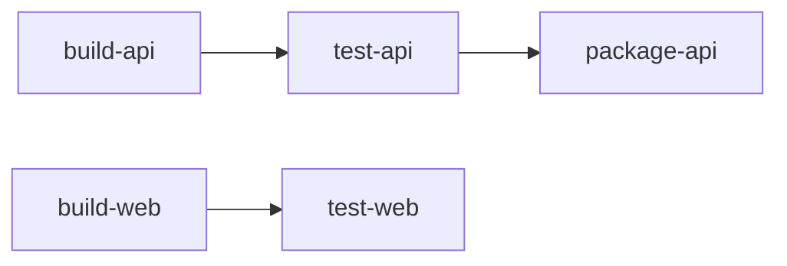

Read it as two lanes that do not block each other.

**Details**
- `needs` also controls which artifacts a job downloads. By default it gets artifacts only from the jobs it needs. Use `needs: [{job: x, artifacts: false}]` to skip.
- A job with `needs: []` starts immediately at pipeline start, regardless of stage.
- Optional dependencies: `needs: [{job: lint, optional: true}]` works with jobs that may not exist because of rules.
- The `stage` is still needed for ordering and for display.

**Gotchas**
- A need must be in an earlier stage (or the same stage in recent versions; check your GitLab version).
- Circular needs are rejected.
- Too many needs make the pipeline view hard to read. Use it where it saves real time, typically in monorepos with independent parts.

**Interview tip:** Say that stages are good for a simple mental model and needs are for speed. Pair it with the example of independent services in one repository.

_Module: GitLab CI · Tags: gitlab-ci, needs, dag_

### 31. What is the difference between `cache` and `artifacts` in GitLab CI, and what mistakes are common?

**Short answer:** `artifacts` pass files **between jobs in the same pipeline** and are stored on GitLab so you can download them. `cache` speeds up **later pipelines** by keeping things like downloaded dependencies on the runner side. Cache is a best-effort speedup. Artifacts are a guaranteed handover.

| | `artifacts` | `cache` |
| --- | --- | --- |
| Purpose | Output of a job: binaries, reports | Reused inputs: dependencies |
| Scope | Next jobs in this pipeline, plus download | Later jobs and pipelines |
| Reliable? | Yes | No, can be missing |
| Stored | GitLab server or object storage | Runner local or shared object storage |
| Expiry | `expire_in` | Key based, evicted |

```yaml
build:
  stage: build
  cache:
    key:
      files: [package-lock.json]    # new cache when the lockfile changes
    paths: [.npm/]
  script:
    - npm ci --cache .npm --prefer-offline
    - npm run build
  artifacts:
    paths: [dist/]
    expire_in: 1 week
```

**Common mistakes**
- Using cache to pass the build output to the next job. It can be missing or old. Use artifacts.
- Caching `node_modules` itself instead of the package manager cache. `npm ci` deletes `node_modules` anyway. Cache `.npm` and let `npm ci` rebuild from it.
- A global cache key, such as `key: default`, so branches overwrite each other's cache. Key it on the lock file.
- Not setting `expire_in`, so storage grows without limit.
- Caching paths outside the project directory. GitLab caches only paths inside the project workspace.
- Putting secrets or `.env` files into artifacts. Artifacts can be downloaded by project members.
- Cache poisoning: caches shared between untrusted merge requests and protected pipelines. Use separate cache keys for protected branches.

**Tip for tests:** `artifacts:when: always` keeps test reports even if the job failed. Use `artifacts:reports:junit` so GitLab shows failures in the merge request.

**Interview tip:** The one-line memory aid is "artifacts are for handover, cache is for speed".

_Module: GitLab CI · Tags: gitlab-ci, cache, artifacts_

### 32. How do `extends`, `include`, YAML anchors and templates keep GitLab CI files DRY?

**Short answer:** `extends` makes a job inherit from a hidden template job (a name starting with a dot). `include` pulls in YAML from other files, projects or URLs. YAML anchors copy a block inside one file. Use `extends` and `include` for sharing, and anchors for small local repeats.

```yaml
include:
  - project: platform/ci-templates
    ref: v2.3.0
    file: /security.yml
  - local: /ci/deploy.yml

.go-base:                       # hidden job, a template
  image: golang:1.23
  before_script:
    - go version
  cache:
    key:
      files: [go.sum]
    paths: [.cache/go-mod/]

unit-test:
  extends: .go-base
  script:
    - go test ./...

lint:
  extends: .go-base
  script:
    - golangci-lint run
```

**Differences**

| Feature | Scope | Merge behaviour |
| --- | --- | --- |
| `extends` | Across files after `include` | Deep merges hashes; arrays such as `script` are replaced, not merged |
| `include` | Brings other files in | Included files are merged first, your file overrides them |
| YAML anchors `&` and `*` | Same file only | Pure YAML copy; `<<:` merges maps |
| `!reference [.job, script]` | Reuse a single key | Good for sharing script fragments |

**Gotchas**
- With `extends`, defining `script` in the child **replaces** the parent's `script`. To combine, use `!reference`.
- Anchors do not work across `include` files.
- `include:remote` from a URL is a supply-chain risk. Prefer `project` with a pinned tag.
- Use the pipeline editor "Full configuration" view (or `glab ci lint`) to see the merged result when debugging.

**Interview tip:** Mention pinning included templates to tags and giving them a changelog, so a template change never silently breaks 50 projects.

_Module: GitLab CI · Tags: gitlab-ci, extends, include_

### 33. How do environments, review apps and manual approval jobs work in GitLab?

**Short answer:** The `environment` keyword links a job to a named place such as `staging` or `production`, so GitLab records deployments, shows the current version and enables rollback. Review apps are temporary environments for merge requests. A `when: manual` job gives you a gated step with a button.

```yaml
deploy-review:
  stage: deploy
  script:
    - helm upgrade --install "orders-$CI_MERGE_REQUEST_IID" ./chart --namespace review --set image.tag="$CI_COMMIT_SHORT_SHA"
  environment:
    name: review/$CI_MERGE_REQUEST_IID
    url: https://orders-$CI_MERGE_REQUEST_IID.review.example.com
    on_stop: stop-review
    auto_stop_in: 3 days
  rules:
    - if: $CI_PIPELINE_SOURCE == "merge_request_event"

stop-review:
  stage: deploy
  script:
    - helm uninstall "orders-$CI_MERGE_REQUEST_IID" --namespace review
  environment:
    name: review/$CI_MERGE_REQUEST_IID
    action: stop
  rules:
    - if: $CI_PIPELINE_SOURCE == "merge_request_event"
      when: manual
```

**What you get**
- The Environments page lists each deployment, commit and time. You can redeploy an earlier deployment to roll back.
- Review apps give testers and product owners a live link per merge request. `on_stop` and `auto_stop_in` clean them up and save cost.
- **Manual jobs** (`when: manual`) wait for a click. With protected environments, only chosen users or groups can run them, and you can require approvals (this is a paid-tier feature on some plans, check yours).

**Protected environments.** Mark `production` as protected in settings and list who may deploy. Combined with protected branches this makes a real approval gate.

**Related keyword: `resource_group`.** It makes jobs in the same group run one at a time, so two deployments never hit production together.

**Gotchas**
- A manual job that is `allow_failure: true` by default does not block the pipeline status. Set `allow_failure: false` if the pipeline should wait.
- Review apps need wildcard DNS and enough cluster resources, or they pile up.

**Interview tip:** Tell how review apps changed your workflow, for example designers approving UI changes before merge.

_Module: GitLab CI · Tags: gitlab-ci, environments, review-apps_

### 34. How do you use `services` for integration tests in GitLab CI?

**Short answer:** `services` starts extra containers next to your job container, such as Postgres or Redis, on the same network. Your tests reach them by host name, which defaults to the image name or an `alias` you choose. They live only for that job.

```yaml
integration-test:
  stage: test
  image: golang:1.23
  services:
    - name: postgres:16
      alias: db
  variables:
    POSTGRES_USER: app
    POSTGRES_PASSWORD: app
    POSTGRES_DB: orders
    DATABASE_URL: "postgres://app:app@db:5432/orders?sslmode=disable"
  script:
    - go test ./internal/store/... -tags=integration
```

The test container reaches the database at host `db`. The password here is a throwaway for a job-local container, not a real secret.

**Points to know**
- Services start before the script, but the service may still be starting. Make tests wait for readiness with a retry or use `pg_isready` first.
- On the Kubernetes executor, services run as extra containers in the same pod, so they share `localhost`. Host aliases behave a bit differently from the Docker executor, so test it on your runners.
- Pin versions (`postgres:16`), not `latest`.
- For heavier dependencies (Kafka, many services) consider Testcontainers, or an ephemeral environment.

**Why real dependencies.** Tests against a real database catch SQL errors, migrations, constraints and driver differences that mocks never see.

**Gotchas**
- Environment variables for the service image must be set in job `variables`, which are also visible to the job. That is fine for test credentials.
- Parallel jobs each get their own service container, so there is no shared state.
- A service that crashes is easy to miss. Check job logs for the service containers.

**Interview tip:** Say "mock at the edges, real database in the middle". It signals a pragmatic test strategy.

_Module: GitLab CI · Tags: gitlab-ci, services, integration-testing_

### 35. How do you build Docker images in GitLab CI: Docker-in-Docker, Kaniko or BuildKit, and what are the security trade-offs?

**Short answer:** Docker-in-Docker (DinD) is the most compatible but needs a privileged container, which is a security risk. Kaniko builds images without a Docker daemon and without privileged mode, but has some limits. Rootless BuildKit is a modern alternative with good caching. Choose by your security model and runner setup.

| Option | How it works | Pros | Cons |
| --- | --- | --- | --- |
| Docker-in-Docker | `docker:dind` service runs a daemon in a privileged container | Full Docker features, simple | Privileged runner, slower cache, escape risk |
| Mounting the host Docker socket | Job talks to the host daemon | Fast, shares cache | Job controls the host, very risky on shared runners |
| Kaniko | Executes Dockerfile in user space and pushes image | No daemon, no privilege | Slower for some builds, limited features; note the upstream Google project was archived in 2025 and forks exist, check current status before standardising |
| BuildKit (rootless) | Modern builder, standalone or via `buildctl` | Parallel stages, strong cache, cache export to registry | Needs some setup and kernel features |

```yaml
build-image:
  stage: package
  image:
    name: gcr.io/kaniko-project/executor:debug
    entrypoint: [""]
  script:
    - mkdir -p /kaniko/.docker
    - echo "{\"auths\":{\"$CI_REGISTRY\":{\"auth\":\"$(printf '%s:%s' "$CI_REGISTRY_USER" "$CI_REGISTRY_PASSWORD" | base64 | tr -d '\n')\"}}}" > /kaniko/.docker/config.json
    - /kaniko/executor --context "$CI_PROJECT_DIR" --dockerfile Dockerfile --destination "$CI_REGISTRY_IMAGE:$CI_COMMIT_SHORT_SHA" --cache=true
```

The job logs in with GitLab's built-in registry credentials, builds from the Dockerfile and pushes the image tagged with the commit.

**How to decide**
- Shared runners used by many teams: avoid privileged DinD, prefer a daemonless builder.
- A dedicated, ephemeral Kubernetes runner per job: DinD risk is smaller because the pod is thrown away, but still avoid privileged if you can.
- Need `docker compose` or `docker run` inside the job (for tests): DinD is the pragmatic answer, isolated on separate runners.

**Gotchas**
- With DinD the layer cache dies with each job. Use `--cache-from` with a registry image, or BuildKit cache export.
- Never bake CI tokens into the image or pass them as plain `--build-arg`. Use BuildKit secrets.

**Interview tip:** Say that the real answer depends on trust: who can run code on this runner. Untrusted code plus privileged mode is the risky combination.

_Module: GitLab CI · Tags: gitlab-ci, docker, kaniko, buildkit_

### 36. How do you use the GitLab Container Registry and clean it up?

**Short answer:** Each project has a built-in registry, with `$CI_REGISTRY_IMAGE` as the base name. Jobs log in with `$CI_REGISTRY_USER` and `$CI_REGISTRY_PASSWORD` (a short-lived job token). Without cleanup the registry grows forever, so set cleanup policies that keep recent and release tags and delete the rest.

```yaml
publish:
  stage: package
  image: docker:27
  services: [docker:27-dind]
  script:
    - echo "$CI_REGISTRY_PASSWORD" | docker login "$CI_REGISTRY" -u "$CI_REGISTRY_USER" --password-stdin
    - docker build -t "$CI_REGISTRY_IMAGE:$CI_COMMIT_SHORT_SHA" .
    - docker push "$CI_REGISTRY_IMAGE:$CI_COMMIT_SHORT_SHA"
```

**Cleanup policies** are configured in the project settings (Packages and registries, cleanup policies). You choose:
- how often it runs,
- how many tags to keep per image,
- delete tags older than a number of days,
- a regex for tags to always keep (for example `^v\d+\.\d+\.\d+$`),
- a regex for tags to remove (for example `.*-snapshot`).

**Good tagging for easy cleanup**
- Commit SHA tags for every pipeline: cleaned after a few weeks.
- Release tags (`v1.4.0`): kept long term, ideally immutable.
- Branch tags such as `main` or `review-123`: short retention.

**Related**
- The **dependency proxy** caches images pulled from Docker Hub, avoiding rate limits and speeding pulls.
- Garbage collection is needed on self-managed instances to reclaim disk space after tag deletion.
- Registry on AKS: pulling private images needs an image pull secret, or an Azure Container Registry integration, depending on where images live.

**Gotchas**
- Deleting a tag does not free the layers still used by other tags.
- Never delete the image that production currently runs. A rule "keep last N" is not enough if production is running an old version. Keep release tags.
- Untagged leftovers from `latest` retagging need cleanup too.

**Interview tip:** Mention cost and security: old images carry old vulnerabilities, so cleanup is also hygiene.

_Module: GitLab CI · Tags: gitlab-ci, registry, cleanup_

### 37. What are child pipelines and multi-project pipelines in GitLab?

**Short answer:** A child pipeline is a pipeline started by a job in the same project, defined by its own YAML file. A multi-project (downstream) pipeline is started in another project. Both use the `trigger` keyword and help split large configurations or coordinate several repositories.

```yaml
# parent .gitlab-ci.yml
stages: [build, deploy]

api-pipeline:
  stage: build
  trigger:
    include: services/api/.gitlab-ci.yml   # child pipeline in same project
    strategy: depend                        # parent waits for child result
  rules:
    - changes: ["services/api/**/*"]

deploy-platform:
  stage: deploy
  trigger:
    project: platform/deployments          # another project
    branch: main
    strategy: depend
  variables:
    APP_VERSION: $CI_COMMIT_SHORT_SHA
```

**Uses**
- **Monorepos:** one child pipeline per service, started only when its paths change.
- **Dynamic pipelines:** a job generates a YAML file as an artifact and the child runs it. Good when the jobs depend on what the repository contains.
- **Cross-repo flows:** an application repository triggers the deployment repository with the new version.

**Details**
- Without `strategy: depend`, the trigger job succeeds as soon as the child starts, and the parent does not wait.
- Variables pass to children via `variables:`. Pass only what is needed.
- A child has its own jobs and stages, and in the UI appears nested.
- Downstream pipelines in other projects run with the permissions of the triggering user or a trigger token. Check access rules.

**Gotchas**
- Children do not share artifacts by default. Pass them with `needs:pipeline` or fetch via the API.
- Deep nesting becomes hard to debug. Keep it to one or two levels.
- Each pipeline uses runner capacity. A parent that triggers 30 children can swamp shared runners.

**Interview tip:** Contrast with `include`: include merges config into one pipeline, trigger creates separate pipelines with separate statuses. Choose trigger when you want independence.

_Module: GitLab CI · Tags: gitlab-ci, trigger, child-pipelines_

### 38. How do scheduled pipelines and rollbacks work in GitLab CI?

**Short answer:** Scheduled pipelines run a pipeline on a cron schedule, for example nightly scans or cleanup. Rollbacks in GitLab are normally a redeploy of a previous known-good version, either from the Environments page or by running a rollback job with the old image tag.

**Scheduled pipelines**
- Set in CI/CD, Schedules, with a cron expression, a branch and variables.
- Inside the file detect them with `$CI_PIPELINE_SOURCE == "schedule"`.
- Typical jobs: dependency and image scans, full e2e suite, drift detection for Terraform, cleaning review environments.

```yaml
nightly-scan:
  stage: test
  script:
    - trivy image --exit-code 1 --severity CRITICAL "$CI_REGISTRY_IMAGE:main"
  rules:
    - if: $CI_PIPELINE_SOURCE == "schedule"
```

**Rollback options**

| Option | How | Notes |
| --- | --- | --- |
| Re-run an earlier deploy job | Environments page, "Re-deploy to environment" or retry the old deploy job | Uses the exact old pipeline's config and image |
| Dedicated rollback job | Manual job with a `VERSION` variable that deploys that tag | Clear and auditable |
| `git revert` and pipeline | Revert the commit on main, pipeline redeploys | Keeps Git as the source of truth, slower |
| Helm rollback | `helm rollback orders 12` | Quick, but Git state may no longer match the cluster |
| Feature flag off | No deploy at all | Fastest for flagged features |

```yaml
rollback-production:
  stage: deploy
  environment: production
  when: manual
  variables:
    VERSION: ""                 # set when starting the job
  script:
    - test -n "$VERSION"
    - helm upgrade --install orders ./chart -f values/prod.yaml --set image.tag="$VERSION"
```

**Gotchas**
- A rerun of an old deploy job uses variables as they were, but CI/CD variables in settings are current. Check that the old version still works with today's config.
- Rolling back code does not roll back the database.
- Schedules run as their owner. If that person leaves, the schedule stops working. Use a service account.

**Interview tip:** Practise the rollback. A rollback you never tested is a hope, not a plan.

_Module: GitLab CI · Tags: gitlab-ci, schedules, rollback_

### 39. How do you deploy to Kubernetes from a GitLab pipeline?

**Short answer:** There are two models. Push: the pipeline runs `helm` or `kubectl` against the cluster with credentials. Pull (GitOps): the pipeline updates a Git repository with the new version and an in-cluster agent such as Argo CD, Flux or the GitLab agent applies it. Pull is safer and gives drift correction.

| Model | How | Pros | Cons |
| --- | --- | --- | --- |
| Push with `helm upgrade` | Runner has cluster access | Simple, immediate feedback in the job | Cluster credentials live in CI, no drift repair |
| Push via GitLab agent for Kubernetes | Agent in cluster opens an outbound connection, the job uses it | No inbound cluster exposure, scoped access | Setup |
| GitOps with Argo CD or Flux | Pipeline commits a new image tag to a config repo, controller syncs | Git is the audit trail, drift fixed, no CI credentials in cluster | Two-step, feedback is indirect |

```yaml
deploy-staging:
  stage: deploy
  image: alpine/helm:3.15.4
  environment:
    name: staging
  script:
    - helm upgrade --install orders ./chart
        --namespace orders --create-namespace
        -f values/staging.yaml
        --set image.repository="$CI_REGISTRY_IMAGE"
        --set image.tag="$CI_COMMIT_SHORT_SHA"
        --atomic --timeout 5m
```

`--atomic` makes Helm roll back automatically if the release does not become ready in time.

**Key practices**
- Give the pipeline a service account with rights only in its namespace.
- Wait for rollout success in the job (`helm --wait` or `kubectl rollout status`) so a failed deploy fails the pipeline.
- Keep chart and values versioned. Deploy by image tag or digest.
- Run smoke tests after the deploy, then promote.

**Gotchas**
- A kubeconfig stored as a CI variable with admin rights is a high-value secret. Prefer the agent or OIDC.
- `helm upgrade` from many pipelines at once can collide. Use `resource_group`.

**Interview tip:** Explain the trade-off honestly. Push is easier to start with. Pull gives auditability and drift control, which matters as clusters and teams grow.

_Module: GitLab CI · Tags: gitlab-ci, kubernetes, helm, gitops_

### 40. How do you build pipelines for a monorepo in GitLab CI?

**Short answer:** Run only the jobs for what changed. Use `rules:changes` paths per service, child pipelines to keep each service separate, and make sure shared code changes trigger all dependents. Keep a safety net such as a full build on main or nightly.

```yaml
.api-rules:
  rules:
    - changes:
        paths:
          - services/api/**/*
          - libs/common/**/*          # shared code also triggers api
        compare_to: refs/heads/main   # compare with main, works on branches

api-test:
  extends: .api-rules
  script:
    - cd services/api && go test ./...

web-test:
  rules:
    - changes:
        paths: [services/web/**/*, libs/ui/**/*]
        compare_to: refs/heads/main
  script:
    - cd services/web && npm ci && npm test
```

**Approaches**

| Approach | How | Good for |
| --- | --- | --- |
| `rules:changes` per job | Path filters in one file | Small to medium repos |
| Parent and child pipelines | Parent triggers one child per changed service | Many services, separate YAML per team |
| Build tool aware | Nx, Turborepo, Bazel compute affected targets from the dependency graph | Large polyglot repos, best accuracy |
| Dynamic child pipeline | A script computes the change set and writes the YAML | Complex rules |

**Gotchas**
- The shared library trap: a change in `libs/common` must trigger services that use it. Missing paths cause unpublished breakage.
- `changes` without `compare_to` on branch pipelines can look at only the last commit, so earlier commits in the branch are missed. Use merge request pipelines or `compare_to`.
- Merging queues: two merge requests passing separately can break together. Use merge trains or a full run on main.
- Cache and artifacts become large. Key caches per service.

**Interview tip:** Mention a safety net: "affected-only on merge requests, but everything on main and nightly, so a missed dependency shows up within a day".

_Module: CI/CD Pipelines · Tags: gitlab-ci, monorepo, rules_

### 41. How do you optimise Docker images for size and security, and how does Trivy fit in?

**Short answer:** Use a minimal base (alpine, distroless or scratch for static binaries), multi-stage builds, fewer and cleaner layers, and no build tools in the final image. Scan images with a scanner such as Trivy in the pipeline, and rebuild regularly to pick up patched bases.

**Size levers**
- Smaller base: `debian-slim` is bigger than `alpine`, which is bigger than `distroless`, which is bigger than `scratch`.
- Multi-stage build: compile in one stage, copy the binary to another.
- Clean package caches in the same `RUN` that installs: `apt-get install ... && rm -rf /var/lib/apt/lists/*`.
- Use `.dockerignore`.
- Install only production dependencies (`npm ci --omit=dev`).

**Security levers**
- Fewer packages mean fewer vulnerabilities and fewer tools for attackers.
- Non-root user, read-only filesystem at runtime.
- No secrets in layers.
- Pin base image versions and rebuild often.

**Alpine caveat.** Alpine uses musl instead of glibc. Some native modules and some DNS or locale behaviour differ. Test, and consider distroless or debian-slim if you hit strange bugs.

**Scanning with Trivy in a pipeline**

```yaml
image-scan:
  stage: scan
  image:
    name: aquasec/trivy:0.56.2
    entrypoint: [""]
  script:
    - trivy image --exit-code 1 --severity CRITICAL,HIGH --ignore-unfixed "$CI_REGISTRY_IMAGE:$CI_COMMIT_SHORT_SHA"
```

The job fails if there are high or critical findings that have a fix available (`--ignore-unfixed` skips ones with no patch yet).

```bash
docker images orders-api            # compare sizes before and after
docker history orders-api:1.4.0     # which layer is large?
```

**Gotchas**
- Scanner results change daily as new CVEs appear. A build that passed last week may fail today. Use a policy and an exception file with expiry dates (`.trivyignore`).
- Many findings live in the OS packages of the base. Updating the base image often fixes them.
- Do not chase zero findings. Prioritise reachable, exploitable ones.

**Interview tip:** Pair scanning with a process: who triages, what blocks a release, and how fast critical patches go out.

_Module: Docker & Containers · Tags: docker, image-size, trivy, security_

### 42. How does Docker networking work: bridge, host and none, and DNS between containers?

**Short answer:** The default `bridge` network gives each container a private IP behind NAT. `host` mode shares the host's network stack with no isolation. `none` gives no network. User-defined bridge networks add automatic DNS by container or service name, which is what Compose uses.

| Mode | What it does | Use when |
| --- | --- | --- |
| `bridge` (default) | Private network, ports published with `-p` | Most apps |
| User-defined bridge | Same, plus DNS by name and better isolation | Multi-container apps, Compose |
| `host` | Container uses the host's interfaces directly (Linux) | Very high network performance, special tools |
| `none` | Only loopback | Maximum isolation, batch jobs |
| `overlay` | Multi-host network (Swarm) | Rare today, Kubernetes has its own networking |

```bash
docker network create shop
docker run -d --name cache --network shop redis:7
docker run --rm --network shop alpine ping -c 1 cache   # resolved by name
```

**How DNS works.** On a user-defined network Docker runs an embedded DNS server at 127.0.0.11 inside each container. It resolves other container names and network aliases on that network. On the default bridge there is no name resolution (only legacy links), so use your own network.

**In Compose.** Each project gets its own network. Services reach each other by service name, even if the container name differs. Only containers on the same network can talk. You can place services on several networks to separate, for example, a frontend and a database tier.

**Gotchas**
- `localhost` inside a container is the container. To reach the host from a container on Docker Desktop use `host.docker.internal`.
- Published ports (`-p 5432:5432`) open the service on the host. Do not publish a database port to the world. Bind to localhost: `-p 127.0.0.1:5432:5432`.
- Containers keep DNS answers from their start. If a dependency changes IP, the application may need to re-resolve names.
- Host mode does not work the same on Docker Desktop for Mac and Windows.

**Interview tip:** Relate it to Kubernetes: pods get their own IPs, and Services plus CoreDNS provide the name resolution Compose gives you locally.

_Module: Docker & Containers · Tags: docker, networking, dns_

### 43. How do health checks, signals and PID 1 work in containers?

**Short answer:** The process started by `CMD` or `ENTRYPOINT` becomes PID 1 in the container. Docker and Kubernetes stop containers by sending `SIGTERM`, then `SIGKILL` after a grace period. PID 1 must handle `SIGTERM` and must reap zombie child processes, or shutdowns are slow and unclean.

**The shell form trap.** `CMD node server.js` runs `/bin/sh -c "node server.js"`, so the shell is PID 1. Many shells do not pass signals to the child, and your app never sees `SIGTERM`. Use the exec form `CMD ["node","server.js"]`.

```dockerfile
# ❌ bad: shell is PID 1, signals may not reach the app
CMD node server.js

# ✅ good: the app is PID 1 and gets SIGTERM
CMD ["node", "server.js"]
```

**Why PID 1 is special.** On Linux, PID 1 gets no default signal handlers: if your app has not installed a `SIGTERM` handler, the signal is ignored. PID 1 also has to reap orphaned children (zombies). Programs not written for that can leak zombies.

**Fixes**
- Handle `SIGTERM` in the app: stop accepting new work, finish in-flight requests, close connections, exit. In Go use `signal.NotifyContext` and `server.Shutdown`. In Node listen for `SIGTERM` and call `server.close()`.
- Use a tiny init such as `tini` (`docker run --init` or `ENTRYPOINT ["/sbin/tini","--"]`) when your process spawns children.
- In Kubernetes set `terminationGracePeriodSeconds` longer than your drain time, and use a `preStop` hook or readiness change to stop traffic first.

**Health checks**

```dockerfile
HEALTHCHECK --interval=30s --timeout=3s --retries=3 \
  CMD wget -qO- http://localhost:8080/healthz || exit 1
```

Docker marks the container `healthy` or `unhealthy`. Compose uses it for `depends_on` conditions. Kubernetes ignores `HEALTHCHECK` and uses its own liveness, readiness and startup probes.

**Interview tip:** A classic incident story: "deploys took 30 seconds per pod because the app ignored SIGTERM and Kubernetes had to SIGKILL after the grace period". Mention it, and the fix.

_Module: Docker & Containers · Tags: docker, signals, graceful-shutdown_

### 44. How do you set resource limits for containers?

**Short answer:** Limits are enforced by Linux cgroups. A memory limit kills the container when it uses more (an OOM kill). A CPU limit throttles it rather than killing it. Set both deliberately, and make the runtime aware of the limit, otherwise the application may size itself on the host's resources.

```bash
docker run -d --name api \
  --memory 512m --memory-swap 512m \
  --cpus 1.5 \
  orders-api:1.4.0
```

**Behaviour**

| Resource | When the limit is hit | Symptom |
| --- | --- | --- |
| Memory | Kernel kills a process, container exits with code 137 | `OOMKilled` status |
| CPU | Process is throttled (paused for slices of time) | High latency, but no crash |
| PIDs (`--pids-limit`) | `fork` fails | Cannot start processes |

**Make runtimes limit-aware**
- Go: before Go 1.25 the runtime sets `GOMAXPROCS` from the host CPU count, not the container limit. Libraries such as `automaxprocs` fix this. Go 1.25 added container-aware defaults. For memory use `GOMEMLIMIT` set to about 80 to 90 percent of the limit.
- Node: set `--max-old-space-size` below the container limit. Newer Node versions read container limits, but check your version.
- Java: modern JVMs are container aware by default.

**In Kubernetes.** The same ideas become `requests` (for scheduling) and `limits` (for enforcement). Setting a CPU limit equal to the request is debated, because throttling hurts latency. See the Kubernetes topic for requests and limits.

**Gotchas**
- Exit code 137 is `128 + 9` (SIGKILL), the usual sign of OOM.
- No limit at all means one runaway container can starve the host.
- A limit too close to normal usage causes kills during traffic spikes.

**Interview tip:** Describe how you picked numbers: measure real usage under load, set the memory limit with headroom, and watch throttling metrics in Datadog.

_Module: Docker & Containers · Tags: docker, resources, cgroups_

### 45. Which Git workflows work in practice: squash or merge commit, rebase, conventional commits and hooks?

**Short answer:** A common healthy setup: short branches, rebase on main before merging, squash merge so main has one clean commit per change, and conventional commit messages so releases and changelogs can be automated. Hooks catch mistakes before they leave the laptop.

**Merge styles**

| Style | History on main | Pros | Cons |
| --- | --- | --- | --- |
| Merge commit | Branch shape preserved, a merge commit per change | Full history, easy to revert a whole merge | Noisy graph |
| Squash merge | One commit per merge request | Clean, easy to revert and bisect | Loses the small steps, long branches become one big commit |
| Rebase and fast-forward | Linear, every commit kept | Clean and detailed | Rewrites hashes, needs discipline on good commit messages |

**Conventional commits.** A message format: `type(scope): summary`. Types include `feat`, `fix`, `docs`, `refactor`, `test`, `chore`. A `!` or a `BREAKING CHANGE:` footer marks a breaking change. It makes history searchable and drives semantic versioning.

```text
fix(payments): retry the provider call on timeout

The provider returns 504 under load. Retry up to 3 times with backoff.
Refs: SHOP-412
```

**Hooks.** Scripts that Git runs at moments such as `pre-commit` and `commit-msg`. Use them to run linters, formatters, secret scanners and the commit message check. Hooks live in `.git/hooks` and are not shared by Git, so use a tool like `pre-commit`, Husky or lefthook to install them for the team, and repeat the same checks in CI because hooks can be skipped with `--no-verify`.

**Useful commands**
```bash
git pull --rebase                    # keep local commits on top of remote
git commit --fixup <sha>             # mark a fix for an earlier commit
git rebase -i --autosquash origin/main
git push --force-with-lease          # safer than --force after a rebase
```

**Gotchas**
- Never rebase a shared branch.
- Squash merges make `git branch --merged` unreliable, because the original commits are not in main.

**Interview tip:** Pick one and defend it: "squash plus conventional commits, because the merge request title becomes the changelog line".

_Module: Git & Workflow · Tags: git, workflow, conventional-commits_

### 46. How does `git bisect` help find a bug, and when do you use it?

**Short answer:** `git bisect` does a binary search through commit history to find the commit that introduced a bug. You mark one commit as good and one as bad, and Git checks out the middle commit again and again. With about N commits it needs only about log2 N steps, and can be fully automated with a test script.

**Manual use**

```bash
git bisect start
git bisect bad                 # current commit has the bug
git bisect good v1.4.0         # this older tag was fine
# Git checks out a middle commit. Test it, then answer:
git bisect good                # or: git bisect bad
# ... repeat until Git prints "<sha> is the first bad commit"
git bisect reset               # return to your branch
```

**Automated use.** Give Git a command that exits 0 for good and non-zero for bad (125 means "skip this commit, it cannot be tested").

```bash
git bisect start HEAD v1.4.0
git bisect run go test ./internal/orders -run TestDiscountRounding
git bisect reset
```

With 1,000 commits between good and bad, this needs only about 10 test runs.

**When it works well**
- You have a reliable failing test or script.
- History is clean: small commits that build. Squash merges help, because each commit on main is a whole change.
- A regression: it worked before and now does not.

**Gotchas**
- A flaky test sends bisect to the wrong commit. Make the check deterministic, or run it several times in the script.
- Commits that do not compile need `exit 125` to skip.
- Large merge commits can hide the culprit. Use `--first-parent` to follow main only, if your team uses merge commits.
- Build tools, dependencies and databases changing between commits can add noise.

**Interview tip:** This is a nice answer to "how do you debug a regression" and shows you value small, buildable commits.

_Module: Git & Workflow · Tags: git, bisect, debugging_

### 47. What are the basics of Terraform: providers, state, plan, apply and modules?

**Short answer:** Terraform lets you describe infrastructure in declarative files. Providers talk to cloud APIs. `terraform plan` shows what would change, `apply` makes it so. **State** records what Terraform manages. Modules package reusable configuration. Remote state with locking is required for teams.

```text
terraform {
  required_version = ">= 1.6"
  required_providers {
    azurerm = {
      source  = "hashicorp/azurerm"
      version = "~> 3.100"
    }
  }
  backend "azurerm" {
    resource_group_name  = "tfstate-rg"
    storage_account_name = "shoptfstate"
    container_name       = "tfstate"
    key                  = "prod/network.tfstate"
  }
}

provider "azurerm" {
  features {}
}

variable "location" {
  type    = string
  default = "westeurope"
}

resource "azurerm_resource_group" "app" {
  name     = "shop-prod-rg"
  location = var.location
}

module "aks" {
  source              = "./modules/aks"
  resource_group_name = azurerm_resource_group.app.name
  node_count          = 3
}
```

**Workflow**

```bash
terraform init      # download providers and configure the backend
terraform fmt -check
terraform validate
terraform plan -out=tf.plan
terraform apply tf.plan
```

**Key concepts**
- **Declarative:** you describe the end state, Terraform computes the steps.
- **State:** a file that maps your code to real resources and their attributes. Lose it and Terraform no longer knows what it owns.
- **Remote backend with locking:** stored in cloud storage, locked during writes so two applies do not collide.
- **Modules:** reuse and abstraction, with inputs and outputs. Version them.
- **Dependency graph:** Terraform orders resources by references.
- **Destroy and replace:** some changes force a resource to be replaced. Read the plan.

**Gotchas**
- State holds secrets in clear text. Restrict and encrypt it.
- Never edit state by hand. Use `terraform state` commands and `import`.
- Pin provider versions, and commit the lock file `.terraform.lock.hcl`.
- Licence: Terraform moved to a source-available licence in 2023 and the community fork OpenTofu exists. Most syntax is the same.

**Interview tip:** If asked "what is the plan for?", say it is the review step: humans approve the diff before anything changes.

_Module: Infrastructure as Code · Tags: terraform, iac, state_

### 48. What are Bicep and ARM templates, and how do configuration management, provisioning and orchestration differ?

**Short answer:** ARM templates are Azure's native JSON for declaring resources. Bicep is a friendlier language that compiles to ARM. Separately, provisioning creates infrastructure, configuration management sets up software on machines, and orchestration coordinates running workloads.

**Azure IaC options**

| Tool | Notes |
| --- | --- |
| ARM template | JSON, verbose, Azure only |
| Bicep | Concise, typed, modules, compiles to ARM, Azure only, no state file because Azure Resource Manager tracks deployments |
| Terraform or OpenTofu | Multi-cloud, state file, large provider ecosystem |
| Pulumi | Real programming languages |

```text
param location string = resourceGroup().location
param storageName string

resource storage 'Microsoft.Storage/storageAccounts@2023-01-01' = {
  name: storageName
  location: location
  sku: { name: 'Standard_LRS' }
  kind: 'StorageV2'
}
```

You deploy it with `az deployment group create --resource-group shop-rg --template-file main.bicep`, and `what-if` previews changes, like a plan.

**Three different jobs**

| Job | Question | Examples |
| --- | --- | --- |
| Provisioning | Which cloud resources exist? | Terraform, Bicep, CloudFormation |
| Configuration management | What is installed and configured on this machine? | Ansible, Chef, Puppet |
| Orchestration | Where and how do my workloads run, scale and heal? | Kubernetes, Nomad |

In a container world the middle one shrinks: you rebuild an immutable image rather than patch a running server. Ansible still helps for VMs, network gear and bootstrap tasks.

**Immutable vs mutable.** Immutable infrastructure replaces servers instead of changing them. It avoids configuration drift and makes rollbacks easy.

**Interview tip:** If your team uses AKS, say how it fits: IaC creates the cluster and network, Helm or GitOps deploys apps, and nobody logs into nodes to change things.

_Module: Infrastructure as Code · Tags: iac, bicep, arm, ansible_

### 49. What are artifact repositories and package registries, and why use them?

**Short answer:** An artifact repository stores the outputs of builds (binaries, images, packages) and can proxy public registries such as npm or Go modules. It gives you one trusted place to publish and consume, stable builds even when the public registry is down, and a place to scan and control what enters your company.

**What it stores**
- Container images (GitLab registry, Azure Container Registry, Harbor).
- Language packages: npm, Go modules, Maven, NuGet, PyPI.
- Generic files: release binaries, Helm charts, SBOMs.

**Why**
- **Reproducibility.** Published versions are immutable, so builds can be repeated.
- **Availability.** A proxy or cache keeps working when the public registry is slow or down. Remember the left-pad incident where a removed npm package broke many builds.
- **Security.** Block known bad packages, scan, and require approvals. Use private scopes and registry settings to avoid **dependency confusion**, where a public package with your internal name is installed by mistake.
- **Speed.** Local proxies are faster than the internet.
- **Governance.** Access control and audit logs.

**Typical set-up**
- Group registry or Artifactory/Nexus as a virtual repository: your private packages plus a cache of the public ones.
- CI publishes with a short-lived token (`$CI_JOB_TOKEN` in GitLab).
- Lock files and checksums stay in the repository. Go has `GOPROXY` and `GONOSUMDB` style settings, npm has `.npmrc` scopes.

```bash
# npm: send the @shop scope to the private registry only
echo "@shop:registry=https://gitlab.example.com/api/v4/packages/npm/" >> .npmrc
```

**Gotchas**
- Retention: delete old snapshots, keep release versions forever.
- Avoid overwriting a published version. Publish a new one.
- Rotating or revoking registry tokens breaks builds. Use job tokens or OIDC where possible.

**Interview tip:** Mention dependency confusion by name. It shows security awareness beyond scanning.

_Module: Supply Chain & Security · Tags: artifacts, registry, dependencies_

## Advanced

### 50. [Tech Lead] What is software supply-chain security and how do you apply it in a pipeline?

**Short answer:** Supply-chain security protects everything that goes into your software: dependencies, base images, build tools and the pipeline itself. Key controls are pinned dependencies, vulnerability scanning, an SBOM, signed images, protected branches and build provenance that proves where an artifact came from.

**What can be attacked**
- A malicious or typosquatted package, or a hijacked maintainer account.
- A vulnerable or tampered base image.
- A compromised CI runner or a leaked deploy token.
- A tampered artifact between build and deploy.

**Controls**

| Control | What it gives |
| --- | --- |
| Dependency pinning with lock files and verified checksums (`go.sum`, `package-lock.json`) | Same inputs every build |
| Automated updates (Renovate, Dependabot) with review | Patches without surprise |
| Vulnerability scan of dependencies and images (Trivy, Grype) | Known CVEs found before deploy |
| SBOM (software bill of materials), for example CycloneDX or SPDX | A list of what is inside, so you can answer "are we affected by CVE-X?" fast |
| Image signing (cosign) and verification at admission | Only your pipeline's images run |
| Protected branches, required reviews, protected variables | Hard to push malicious code or steal secrets |
| Ephemeral, isolated runners | A compromised job cannot persist |
| Build provenance (who built it, from which commit, with which steps) | Evidence for audits and incident response |

**SLSA at concept level.** SLSA (Supply-chain Levels for Software Artifacts) is a framework with levels. Low levels require a scripted build and provenance. Higher levels require a hardened, isolated build platform and provenance that cannot be forged by the project itself. You do not need top level on day one.

**Practical order of adoption.** Start with scanning, pinning and protected branches, then add SBOM and signing, then verify at the cluster.

**Common mistakes**
- Scanning and ignoring results. Set a policy: block on critical with a fix available, track the rest with owners and dates.
- Trusting `latest` or unpinned CI templates from the internet.

**Interview tip:** Mention a real attack class (for example a compromised dependency or CI tool) only in general terms and show how each control would have limited the damage.

_Module: Supply Chain & Security · Tags: tech-lead, supply-chain, sbom_

### 51. [Tech Lead] A bad deploy broke production. How do you handle the incident and what do you change afterwards?

**Short answer:** First stop the damage: roll back or turn off the feature, then communicate. Investigate after service is restored. Afterwards write a blameless postmortem and fix the process gaps that let the bad change through, not only the bug.

**During the incident**
1. **Detect.** Alerts on error rate, latency and saturation, or a deploy marker on the dashboard. Know that the deploy is the likely cause by looking at what changed recently.
2. **Declare and assign.** One incident commander, one person communicating, others investigate.
3. **Mitigate first.** Rollback to the last known good version, or turn off the flag. Do not debug live while users suffer.
4. **Communicate.** Update stakeholders on a fixed cadence in a single channel.
5. **Confirm recovery** with metrics, not feelings.

**After the incident**
- **Blameless postmortem** within a few days: timeline, impact, causes (several, not one), what went well, actions with owners and dates.
- Ask "why did our process let this reach production?" not "who did it?".

**Prevention ideas, matched to the cause**

| Cause | Prevention |
| --- | --- |
| Test gap | Add the test and a contract or integration test |
| Config error | Validate config in the pipeline, staging with the same config shape |
| All traffic hit at once | Canary or progressive rollout with automatic rollback |
| Slow detection | Alert on user-facing symptoms and add a post-deploy smoke test |
| Slow rollback | One-click rollback job, rehearsed |
| Risky migration | Expand and contract changes, separate migration from code release |

**Gotchas**
- Rolling back is not always possible: a database change may have been applied. This is why migrations must be backward compatible.
- A postmortem with only "be more careful" actions is a failed postmortem.

**Interview tip:** Use a real incident, name the metric that detected it, how long it took to restore, and one structural fix. Interviewers value learning over a perfect record.

_Module: Release Strategies · Tags: tech-lead, incident, postmortem_

### 52. [Tech Lead] How do you set standards and reusable pipelines across many repositories?

**Short answer:** Offer a golden path: shared, versioned pipeline templates that teams include in a few lines. They get security scanning, caching and deploy logic for free, can override what they need, and the platform team updates them centrally with versions and release notes.

**How in GitLab**
- A central project holds templates, used with `include:project` and a pinned `ref`. Or use CI/CD components (reusable, versioned units published in a catalog) where available on your GitLab version.
- Teams add inputs and overrides, not copy-pasted YAML.
- Versions are tags (`v2.3.0`). Teams upgrade on their own schedule, with Renovate-style update merge requests.

```yaml
# in a service repository
include:
  - project: platform/ci-templates
    ref: v2.3.0                 # pin a tag, never a moving branch
    file: /go-service.yml

variables:
  SERVICE_NAME: orders
```

**What a golden path includes**
- Build, test, scan, package and deploy jobs, with sensible defaults.
- A Dockerfile and Helm chart starter, a service template repository.
- Required security jobs that teams cannot remove (compliance pipelines or required configuration in GitLab Ultimate tiers, check your plan).
- Documentation and a support channel.

**Balance: paved road, not a cage**
- Make the standard way the easiest way. Teams who need to deviate can, with a reason.
- Treat the platform as a product: talk to users, version it, track adoption.
- Avoid breaking everyone with one change. Use versions, canary adopters and clear changelogs.

**Trade-offs**
- One shared template means one place to fix a vulnerability. It also means one place to break everything. Pin versions and test templates in a sample repository.
- Too many knobs make a template as complex as the YAML it replaced.

**Interview tip:** Mention how you measure success: percent of services on the template, time to onboard a new service, and fewer tickets to the platform team.

_Module: Platform & Leadership · Tags: tech-lead, platform, templates_

### 53. How do containers really work: namespaces, cgroups and overlay filesystems?

**Short answer:** A container is a normal Linux process with three kernel features applied. Namespaces limit what it can see (processes, network, mounts, hostname, users). Cgroups limit what it can use (CPU, memory, I/O, process count). A union filesystem such as overlayfs gives it a layered root filesystem built from the image.

**The three parts**
- **Namespaces** give a private view. The PID namespace makes the process think it is PID 1. The network namespace gives its own interfaces and routing table. The mount namespace gives its own filesystem tree. Others: UTS (hostname), IPC, user, and cgroup.
- **Control groups (cgroups)** are an accounting and limiting tree. Writing a memory limit into the cgroup makes the kernel kill the process group when it goes over (the OOM killer). A CPU quota throttles.
- **Overlay filesystem** stacks read-only image layers (`lowerdir`) with one writable layer (`upperdir`) and shows a merged view. A write to a lower-layer file first copies it up (copy-on-write).

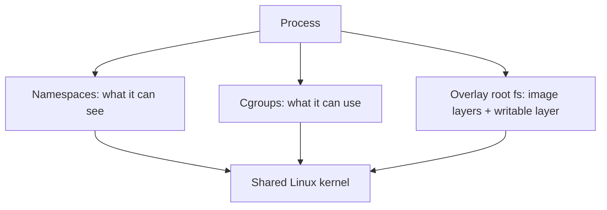

All containers on a host share one kernel. The isolation comes from these three features, not from a separate OS.

You can see it yourself:

```bash
# run a shell in new PID and mount namespaces (needs root)
sudo unshare --pid --fork --mount-proc bash -c 'ps aux'   # shows only its own processes

# where a container's limits live (cgroup v2)
cat /sys/fs/cgroup/<container-cgroup>/memory.max

# the image layers of a container
docker inspect --format '{{json .GraphDriver.Data}}' web1
```

**Extra isolation layers.** Capabilities split root's powers into pieces and containers drop most. Seccomp filters which system calls are allowed. AppArmor or SELinux add mandatory access control.

**Consequences for engineers**
- A kernel exploit can break out of every container. Sandboxes (gVisor, Kata) add a stronger boundary.
- `top` inside a container may show host numbers unless the tool reads the cgroup.
- Linux containers on Mac or Windows run inside a hidden Linux VM.

**Interview tip:** The crisp sentence is "a container is a process with namespaces, cgroups and a layered filesystem; there is no container object in the kernel".

_Module: Container Internals · Tags: containers, namespaces, cgroups_

### 54. What are containerd, runc and the CRI, and why did Kubernetes drop dockershim?

**Short answer:** Docker is a stack: the `docker` CLI talks to the Docker daemon, which uses containerd, which uses runc to create the container. Kubernetes talks to runtimes through the Container Runtime Interface (CRI). Docker did not implement CRI, so Kubernetes had a built-in adapter called dockershim. It was removed in Kubernetes 1.24, so nodes use containerd or CRI-O directly.

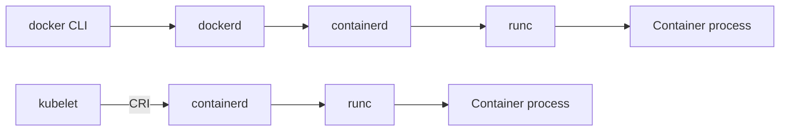

The top row is Docker on a laptop. The bottom row is a Kubernetes node. Both end at containerd and runc.

| Component | Job |
| --- | --- |
| runc | Low-level runtime: creates the namespaces and cgroups and starts the process, following the OCI runtime spec |
| containerd | Manages image pulls, storage, container lifecycle, and offers a gRPC API |
| CRI-O | Another CRI runtime built for Kubernetes |
| dockerd | Adds the Docker API, build, networks and volumes on top of containerd |
| OCI | Open standards for image format and runtime, so tools interoperate |

**Why dockershim was dropped.** It was extra code inside the kubelet, only to translate CRI calls to the Docker API. Docker itself already used containerd underneath, so Kubernetes could skip the middle layer. The change was announced in 1.20 and the code removed in 1.24.

**What it means in practice**
- Images built with Docker still run. The image format is OCI compatible.
- `docker ps` on a node no longer shows Kubernetes containers. Use `crictl ps` or `nerdctl`.
- Things that depended on the Docker socket on nodes (some monitoring or build tools) break. Docker-in-Docker through the host socket in pods no longer works on such nodes.
- AKS uses containerd on its node pools for current versions.

**Alternative runtimes.** `runsc` (gVisor) and Kata Containers plug in below containerd through a RuntimeClass for stronger isolation.

**Interview tip:** Answer calmly: "Kubernetes did not drop Docker images, it dropped the Docker daemon as a runtime". Interviewers often test for that misconception.

_Module: Container Internals · Tags: containerd, runc, cri, kubernetes_

### 55. What is BuildKit, and how do cache mounts, secrets and reproducible builds work?

**Short answer:** BuildKit is Docker's modern build engine, the default builder since Docker 23. It builds independent stages in parallel, skips unused stages, and supports cache mounts, secret mounts and cache export. These make builds faster and safer than the classic builder.

**Useful features**
- **Parallel stages.** Stages without dependencies build at the same time.
- **Cache mounts.** A directory that persists between builds but never lands in the image. Great for package manager caches.
- **Secret mounts.** A file available only during one `RUN`, never stored in a layer.
- **Cache export and import.** Share build cache across CI jobs through a registry.
- **SSH forwarding** for private repositories.

```dockerfile
# syntax=docker/dockerfile:1
FROM golang:1.23 AS build
WORKDIR /src
COPY go.mod go.sum ./
# reuse downloaded modules and compiled objects across builds
RUN --mount=type=cache,target=/go/pkg/mod \
    go mod download
COPY . .
RUN --mount=type=cache,target=/go/pkg/mod \
    --mount=type=cache,target=/root/.cache/go-build \
    CGO_ENABLED=0 go build -o /out/orders ./cmd/orders

FROM node:22-alpine AS web
WORKDIR /web
COPY package.json package-lock.json ./
# private registry credentials, not stored in any layer
RUN --mount=type=secret,id=npmrc,target=/root/.npmrc npm ci
```

```bash
docker build --secret id=npmrc,src=$HOME/.npmrc .
docker buildx build --cache-to type=registry,ref=registry.example.com/shop/cache:orders,mode=max \
                    --cache-from type=registry,ref=registry.example.com/shop/cache:orders .
```

**Reproducible builds.** The same source should give the same image bits. Helpers:
- Pin base images by digest and dependency versions through lock files.
- Avoid `apt-get install` without versions, or use a snapshot repository.
- Do not embed timestamps. Set `SOURCE_DATE_EPOCH` and use BuildKit's options to normalise timestamps (`--output ...,rewrite-timestamp=true`, available in newer BuildKit versions, check yours).
- Build in a clean, hermetic environment.

Perfect bit-for-bit reproducibility is hard for general images. Many teams aim for "reproducible enough": the same inputs, the same versions, verified provenance.

**Gotchas**
- A cache mount is not available at run time and is not shared across machines by default.
- `--secret` is safe; `ARG` and `ENV` secrets are not.

**Interview tip:** Say how much time cache mounts saved in your pipeline. Pair it with cache export, which matters most on ephemeral CI runners.

_Module: Container Internals · Tags: buildkit, docker, cache, reproducible-builds_

### 56. Why does deleting a file in a later Docker layer not make the image smaller?

**Short answer:** Layers are only added, never changed. Deleting a file in a later layer adds a "whiteout" marker that hides the file, but the original bytes stay in the earlier layer, which is still part of the image. To keep data out of the image, never write it, or delete it in the same layer that created it.

**Why it happens.** Each `RUN`, `COPY` or `ADD` stores a diff. A later `rm` only records "this path is gone". The union filesystem hides it, yet every layer is pulled and stored.

```dockerfile
# ❌ bad: the 500 MB archive stays in layer 2
FROM debian:12-slim
COPY bigdata.tar.gz /tmp/
RUN tar -xzf /tmp/bigdata.tar.gz -C /opt
RUN rm /tmp/bigdata.tar.gz

# ✅ good: download, use and delete in one layer
FROM debian:12-slim
RUN apt-get update \
 && apt-get install -y --no-install-recommends curl ca-certificates \
 && curl -fsSL https://example.com/bigdata.tar.gz | tar -xz -C /opt \
 && apt-get purge -y curl \
 && rm -rf /var/lib/apt/lists/*
```

**Better fixes**
- **Multi-stage builds.** Do the messy work in an early stage and copy only the result.
- **Cache mounts and bind mounts** during `RUN` that never become part of a layer.
- `COPY --from=build` of exactly the files you need.
- `--squash` exists in some builders, but it loses layer sharing. Multi-stage is cleaner.

**Security angle.** This is also why a secret copied into an image and then deleted is still leaked. Anyone can pull the image and extract the earlier layer. Tools like `docker history` and `dive` show it.

```bash
docker save orders-api:1.4.0 -o image.tar   # layers are separate tar files inside
dive orders-api:1.4.0                       # explore what each layer added
```

**Also remember:** changing file permissions with `chmod` or `chown` in a later `RUN` copies the whole file into the new layer, doubling its size. Use `COPY --chmod=0755` or `COPY --chown`.

**Interview tip:** A great closing line: "every layer is permanent history; to hide something you must never put it there".

_Module: Container Internals · Tags: docker, layers, image-size_

### 57. How do you harden container security: rootless, seccomp, capabilities and read-only filesystems?

**Short answer:** Apply least privilege in layers: run as a non-root user, drop all Linux capabilities and add back only what is needed, use the default seccomp profile, make the root filesystem read-only, block privilege escalation, and never bake secrets into images. Add network policies and keep images and hosts patched.

**Controls**

| Control | What it does |
| --- | --- |
| Non-root user | Limits damage if the app is compromised |
| Rootless runtime | The container engine itself runs without root on the host |
| Drop capabilities | Removes root powers like `NET_RAW` or `SYS_ADMIN` |
| Seccomp profile | Blocks dangerous system calls (default runtime profile blocks many) |
| Read-only root filesystem | Malware cannot write tools; mount `tmpfs` for temp files |
| `no-new-privileges` | Stops setuid tricks |
| No `--privileged`, no host namespaces, no Docker socket | Keeps the host out of reach |
| Image hygiene | Minimal base, scanned, no secrets in layers |

```yaml
apiVersion: v1
kind: Pod
metadata:
  name: orders-api
spec:
  securityContext:
    runAsNonRoot: true
    runAsUser: 10001
    seccompProfile:
      type: RuntimeDefault
  containers:
    - name: api
      image: registry.example.com/shop/orders-api:1.4.0
      securityContext:
        allowPrivilegeEscalation: false
        readOnlyRootFilesystem: true
        capabilities:
          drop: ["ALL"]
      volumeMounts:
        - name: tmp
          mountPath: /tmp
  volumes:
    - name: tmp
      emptyDir: {}
```

The pod runs as a fixed non-root user, cannot gain privileges, has no capabilities, and can write only to `/tmp`.

**Enforce, do not hope.** Kubernetes Pod Security Standards (baseline and restricted levels) enforced by Pod Security Admission, or policy engines such as Kyverno or OPA Gatekeeper, reject pods that do not meet the rules.

**Gotchas**
- Binding to ports below 1024 as non-root needs a capability or a higher port. Prefer port 8080.
- A read-only filesystem breaks apps that write to unexpected places. Find them in testing.
- Non-root plus a volume can fail on file ownership. Set `fsGroup`.

**Interview tip:** Mention that most real incidents come from basics: exposed dashboards, stolen tokens, privileged pods. Hardening is mostly consistent defaults, enforced by policy.

_Module: Supply Chain & Security · Tags: container-security, hardening, kubernetes_

### 58. How do you sign and verify container images with cosign, Sigstore and admission policies?

**Short answer:** Signing proves an image came from your pipeline and was not changed. You sign the image digest in CI with cosign, store the signature in the registry, and add an admission policy in the cluster that refuses unsigned or wrongly signed images. Keyless signing uses short-lived certificates tied to your CI identity instead of a long-lived private key.

**Flow**

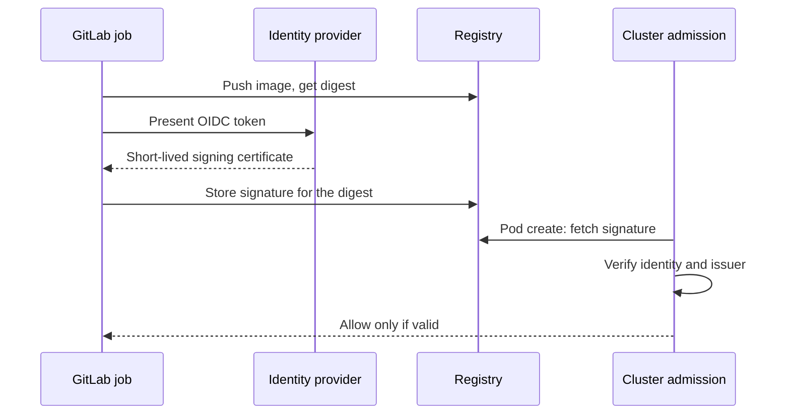

Read it top to bottom. The pipeline signs once; the cluster checks every time a pod starts.

**Signing in a pipeline (keyless idea)**

```yaml
sign-image:
  stage: package
  image: cgr.dev/chainguard/cosign:latest   # pin a version in real use
  id_tokens:
    SIGSTORE_ID_TOKEN:
      aud: sigstore
  script:
    - cosign sign --yes "$CI_REGISTRY_IMAGE@$IMAGE_DIGEST"
```

Always sign the **digest**, not a tag, because tags move.

**Admission policy (Kyverno example)**

```yaml
apiVersion: kyverno.io/v1
kind: ClusterPolicy
metadata:
  name: require-signed-images
spec:
  validationFailureAction: Enforce
  rules:
    - name: verify-shop-images
      match:
        any:
          - resources:
              kinds: ["Pod"]
      verifyImages:
        - imageReferences: ["registry.example.com/shop/*"]
          attestors:
            - entries:
                - keyless:
                    issuer: "https://gitlab.com"
                    subject: "https://gitlab.com/shop/*"
```

Other options: Sigstore policy-controller, Ratify on AKS with Azure Policy, or Notation (Notary v2) with Azure Container Registry.

**Beyond signatures.** Attach attestations: an SBOM, a vulnerability scan result, build provenance. The policy can require them too.

**Gotchas**
- Keyless signing records entries in a public transparency log (Rekor). Private organisations may run their own instance or use key-based signing with a key in a vault.
- Verify the identity (who signed), not only that "something" signed.
- Roll out in audit mode first, then enforce.

**Interview tip:** Say the goal in one line: "only images built by our main pipeline can run in production, and the cluster checks that itself".

_Module: Supply Chain & Security · Tags: cosign, sigstore, signing, admission_

### 59. How do you manage Terraform state, drift and blast radius at scale?

**Short answer:** Keep state remote, locked, encrypted and split into many small states by environment and by domain, so one mistake touches little. Detect drift with scheduled plans. Limit blast radius with separate credentials per environment, `prevent_destroy` on critical resources, and reviewed plans.

**State practices**
- **Remote backend with locking** (Azure Blob with lease locking, S3 with locking, Terraform Cloud).
- **Encrypt at rest**, restrict read access: state can contain secrets.
- **Split states.** Network, cluster, databases and each application are separate states. A bad apply in the app layer cannot destroy the network.
- **Share data** between states with outputs and data sources, or remote state references, kept minimal.
- **Per-environment credentials.** The pipeline for staging cannot touch production.

**Drift** is when real infrastructure differs from the code, often by a manual console change.

```bash
# exit code 2 means there are changes (drift or new code)
terraform plan -detailed-exitcode -input=false
```

Run this on a schedule in GitLab. When the exit code is 2, open an issue or alert. Then either apply to fix the drift or update the code to adopt the change.

**Limiting blast radius**

```text
resource "azurerm_postgresql_flexible_server" "orders" {
  name                = "shop-orders-db"
  resource_group_name = azurerm_resource_group.app.name
  location            = azurerm_resource_group.app.location
  version             = "16"

  lifecycle {
    prevent_destroy = true   # plan fails if it would delete this
  }
}
```

More controls:
- Cloud resource locks on critical resources.
- Required approvals for plans that include destroy.
- `-target` only in emergencies; it skips the graph and can leave the state inconsistent.
- Apply from one place (the pipeline), and use `terraform state` commands rarely, with a peer.

**Refactoring safely.** Use `moved` blocks to rename resources or change module paths without recreating them. Use `import` blocks to adopt existing resources into code.

**Gotchas**
- A lost or corrupted state is a serious incident: enable versioning on the state storage.
- Two people running apply at once without locks can corrupt state.
- Big monolithic states are slow and risky.

**Interview tip:** The key trade-off: more states means safer and faster plans, but more wiring between them. Split by rate of change and by team ownership.

_Module: Infrastructure as Code · Tags: terraform, state, drift_

### 60. What is GitOps, how does pull-based deployment differ from push, and how do Argo CD and Flux compare?

**Short answer:** GitOps means the desired state of the system lives in Git, and software continuously makes reality match it. In a pull model an agent inside the cluster watches Git and applies changes. In a push model the CI pipeline pushes changes with credentials. Pull needs no cluster credentials in CI and repairs drift.

**Four principles**
1. Desired state is declarative.
2. It is versioned and immutable in Git.
3. It is pulled automatically by agents.
4. It is continuously reconciled: if someone changes the cluster by hand, the agent puts it back.

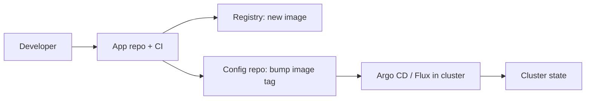

CI builds the image and commits the new tag. The in-cluster agent notices and applies it.

| | Push (pipeline deploys) | Pull (GitOps agent) |
| --- | --- | --- |
| Credentials | CI needs cluster access | Agent inside cluster, CI needs Git write only |
| Drift | Not noticed until next deploy | Detected and optionally healed |
| Audit | Pipeline logs | Git history |
| Feedback to developer | Immediate in the job | Indirect, needs notifications or status checks |
| Many clusters | Pipeline fan-out | Each cluster pulls its own config |

**Argo CD vs Flux**

| | Argo CD | Flux |
| --- | --- | --- |
| Style | Application-centric, rich web UI | Toolkit of controllers, CLI and Git first |
| Multi-tenancy | Projects and RBAC | Kubernetes RBAC and namespaces |
| Strengths | Visual diff and sync, ApplicationSets for many clusters | Lightweight, strong Helm and Kustomize controllers, image automation |
| Fits | Teams that want visibility | Platform teams that prefer pure Kubernetes-native parts |

Both are CNCF graduated projects.

**Practical advice**
- Separate the app repo from the config repo, so deploys do not trigger builds and access can differ.
- Use one folder or overlay per environment. Promotion is a pull request that changes a tag.
- Manage secrets with sealed or external secrets, never plain in Git.
- Define sync policy: automatic for dev, manual or gated for production.

**Gotchas**
- Auto-heal fights with hand-made emergency fixes. Teach people to commit instead.
- Two sources of truth (Helm values in CI and in Git) cause confusion. Pick one.

**Interview tip:** Say you would start with push for simplicity and move to GitOps when the number of clusters or audit needs grows. That shows judgement, not fashion.

_Module: Release Strategies · Tags: gitops, argocd, flux_

### 61. What is progressive delivery with automated analysis and rollback?

**Short answer:** Progressive delivery rolls a release out in steps, such as 5 percent, 25 percent, then 100 percent, and checks real metrics at each step. If error rate or latency crosses a threshold, the system pauses and rolls back automatically. It replaces "deploy and watch the dashboard" with a rule.

**Building blocks**
- A traffic-splitting mechanism: service mesh, ingress controller, or a rollout controller (Argo Rollouts, Flagger).
- A metrics source: Prometheus, Datadog and similar.
- Analysis rules: success conditions with thresholds and failure limits.
- Automatic abort and rollback.

```yaml
apiVersion: argoproj.io/v1alpha1
kind: Rollout
metadata:
  name: orders-api
spec:
  replicas: 5
  selector:
    matchLabels:
      app: orders-api
  strategy:
    canary:
      steps:
        - setWeight: 10
        - pause: {duration: 5m}
        - analysis:
            templates:
              - templateName: error-rate
        - setWeight: 50
        - pause: {duration: 10m}
  template:
    metadata:
      labels:
        app: orders-api
    spec:
      containers:
        - name: api
          image: registry.example.com/shop/orders-api:1.5.0
---
apiVersion: argoproj.io/v1alpha1
kind: AnalysisTemplate
metadata:
  name: error-rate
spec:
  metrics:
    - name: http-5xx-ratio
      interval: 1m
      count: 5
      failureLimit: 1
      successCondition: result[0] < 0.02
      provider:
        prometheus:
          address: http://prometheus.monitoring:9090
          query: |
            sum(rate(http_requests_total{app="orders-api",code=~"5.."}[2m]))
            / sum(rate(http_requests_total{app="orders-api"}[2m]))
```

The rollout sends 10 percent of traffic to the new version, waits, checks the 5xx ratio, and only then moves on. A failed check aborts and returns traffic to the stable version. Datadog can be the metric provider too.

**What to analyse**
- The golden signals: error rate, latency, saturation, plus one business metric (orders per minute).
- Compare canary against baseline, not against a fixed number, when traffic varies by time of day.
- Give each step enough time and traffic for a meaningful sample.

**Gotchas**
- Low traffic services cannot get statistically useful canary results. Use synthetic traffic or longer steps.
- Bad metrics give false rollbacks or false passes. Test the analysis by deploying a known-bad version in staging.
- Database changes are not rolled back. Keep schema changes backward compatible.
- Sticky sessions and caches can hide problems or leak across versions.

**Interview tip:** Mention that automation also needs a human override: a way to pause, promote or abort, with an audit trail.

_Module: Release Strategies · Tags: progressive-delivery, canary, argo-rollouts_

### 62. How do release trains, continuous deployment and regulated environments fit together?

**Short answer:** A release train ships on a fixed schedule, and whatever is ready rides the train. Continuous deployment ships each change as soon as it passes. In regulated environments (avionics, finance, healthcare) you still automate, but add approvals, traceability and evidence. Automation can strengthen compliance because it records everything.

| Model | When it ships | Fits |
| --- | --- | --- |
| Continuous deployment | Every merged change | SaaS with strong tests and monitoring |
| Continuous delivery | Always ready, human decides when | Most business systems |
| Release train | Fixed cadence, e.g. every 2 weeks | Many teams to coordinate, customer release windows, certified software |

**What regulators and auditors need**
- **Traceability:** requirement or ticket to commit to build to test result to release.
- **Approvals:** who approved what, when, with separation of duties (the author cannot be the only approver).
- **Evidence:** test reports, scan reports, SBOM, build logs retained for a defined period.
- **Controlled change:** only reviewed code from protected branches reaches production.
- **Reproducibility:** you can rebuild or at least retrieve the exact artifact of any shipped version.

**How a pipeline helps**
- Protected branches and required approvals enforce review.
- Environments with protected deploy jobs and approval rules give an audit trail.
- Tags and release notes generated from merge requests.
- Artifacts, reports and SBOMs stored with the release.
- Change records linked automatically from the pipeline to ticketing tools.

**Balance**
- Keep the pipeline the same for all changes. Treat compliance as a built-in gate, not a separate manual process.
- Heavy approvals for every small change defeat the purpose. Classify changes: standard (pre-approved, low risk, automated), normal (review needed), emergency (fast path, reviewed afterwards).
- For software shipped to devices or aircraft, the deployment step may be an offline delivery, but build, test and evidence collection can still be fully automated.

**Gotchas**
- A release train can become a bottleneck if branches live long. Cut from main, stabilise briefly, and keep hotfix rules clear.
- Feature flags help ship code before it is released, but flagged paths must still be tested and documented for auditors.

**Interview tip:** Say that "regulated" and "fast" are not opposites: automation produces better evidence than manual checklists.

_Module: Release Strategies · Tags: release-train, compliance, audit_

### 63. How do you run database migrations safely in a CI/CD pipeline?

**Short answer:** Make every migration backward compatible with the previous app version, using the expand and contract pattern. Run migrations as a separate, controlled step before or after the app deploy, test them on production-like data, and never rely on rollback of data changes. Old and new app versions must both work with the schema during a rolling update.

**Why it is hard.** During a rolling or canary deploy, old and new code run at the same time against one database. A migration that renames a column breaks the old code instantly.

**Expand and contract**
1. **Expand:** add the new column or table (nullable or with a default). Old code ignores it.
2. **Deploy new code** that writes both old and new, and reads the new with fallback.
3. **Backfill** existing rows in batches.
4. **Switch** reads to the new column.
5. **Contract:** in a later release remove the old column.

```text
-- release 1 (expand): safe for old code
ALTER TABLE orders ADD COLUMN currency text;

-- release 3 (contract): only after no code reads the old column
ALTER TABLE orders DROP COLUMN legacy_currency;
```

**Pipeline design**
- Keep migrations versioned in the repository, using a tool such as golang-migrate, Flyway, Liquibase or Atlas.
- Run them as a Kubernetes Job or a pre-deploy pipeline job with its own credentials, not inside every app pod at startup, where many replicas race.
- Take a lock or use a migration tool that locks, so only one runs.
- Test: apply migrations to a copy of the schema in CI, and test the new schema with the old app version.
- Watch long locks: `ALTER TABLE` on a big table can block writes. Use online techniques (`CREATE INDEX CONCURRENTLY` in PostgreSQL, add constraints as `NOT VALID` then validate).

**Rollback.** Prefer roll forward with a fix. A down migration that drops data is dangerous. Back up or snapshot before risky changes.

**Gotchas**
- Combining a destructive migration and the code release in one deploy removes your rollback path.
- Backfills in one giant transaction lock tables. Use batches.
- Different environments with different data sizes hide performance problems.

**Interview tip:** Say it simply: "never make the database change and the code that needs it break each other; each release must work with the schema before and after".

_Module: Release Strategies · Tags: database, migrations, expand-contract_

### 64. What is platform engineering and an internal developer platform?

**Short answer:** Platform engineering builds an internal developer platform (IDP): self-service tools and paved roads that let product teams create, deploy and run services without being infrastructure experts. The platform is treated as a product with users, a roadmap and metrics, so it reduces cognitive load instead of adding tickets.

**Why it appeared.** Doing "you build it, you run it" with Kubernetes, pipelines, cloud, security and observability asks too much from every team. Without help each team builds its own pipeline and standards drift.

**What an IDP offers**
- **Service templates (scaffolding):** new service with repo, pipeline, Dockerfile, Helm chart, dashboards and alerts in minutes.
- **Self-service infrastructure:** request a database or namespace through a pull request or portal, backed by Terraform or Crossplane.
- **Golden paths:** one recommended way for common cases, well supported.
- **Guardrails:** policies for security and cost built in, not enforced by tickets.
- **Developer portal / catalogue:** who owns which service, docs, status (for example Backstage).
- **Observability by default:** Datadog agent, standard dashboards, SLO templates.

**Team model**
- The platform team serves product teams as customers. They interview users, publish a roadmap and measure adoption.
- Product teams stay responsible for their own service. The platform makes it easy, not mandatory by force.

**Measuring success**
- Time to first deploy for a new service or developer.
- Percentage of services on the golden path.
- Lead time and change failure rate (DORA) across teams.
- Developer satisfaction and the number of support tickets.

**Pitfalls**
- Building a platform nobody asked for. Start with the most painful problem.
- Forcing teams onto it with no escape hatch. Allow deviations with a reason.
- Becoming an ops team in disguise with a ticket queue.
- Too much abstraction hides what teams need to understand when things break.

**Trade-off.** A platform costs a team's worth of people. It pays off when many teams repeat the same work. For a small organisation, good templates and shared CI includes may be enough.

**Interview tip:** Tie it to your experience: shared pipeline templates and a service starter repo are the first steps of a platform, even before any portal.

_Module: Platform & Leadership · Tags: platform-engineering, idp, golden-path_

### 65. How would you design CI for a polyglot monorepo with Go, Node and React end to end?

**Short answer:** Detect what changed, build only affected parts with language-specific cached jobs, run fast checks in parallel, produce one image per deployable service tagged by commit, and deploy only the changed services through the same promotion flow. Keep a full build on main as a safety net.

**Repo layout (example)**

```text
services/orders-api/   Go
services/notifier/     Node
apps/web/              React
libs/proto/            shared contracts
.gitlab/ci/            per-service pipeline files
```

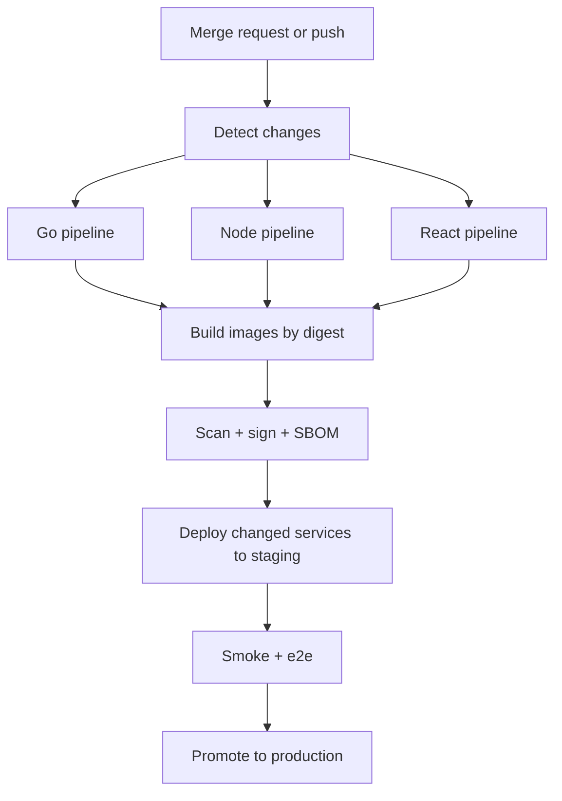

Read it top to bottom. Detection fans out to per-language lanes, which join for packaging and deployment.

```yaml
include:
  - local: .gitlab/ci/go.yml
  - local: .gitlab/ci/node.yml
  - local: .gitlab/ci/web.yml

workflow:
  rules:
    - if: $CI_PIPELINE_SOURCE == "merge_request_event"
    - if: $CI_COMMIT_BRANCH == $CI_DEFAULT_BRANCH

orders-api-pipeline:
  trigger:
    include: .gitlab/ci/orders-api.yml
    strategy: depend
  rules:
    - changes:
        paths: [services/orders-api/**/*, libs/proto/**/*]
        compare_to: refs/heads/main
    - if: $CI_COMMIT_BRANCH == $CI_DEFAULT_BRANCH
```

On main every service pipeline runs, on merge requests only changed ones.

**Design decisions**
- **Cache per language:** Go module and build cache keyed on `go.sum`, npm cache keyed on the lock file.
- **Shared contracts:** a change in `libs/proto` regenerates code and triggers every consumer.
- **Versioning:** one commit SHA for the repo, one image per service, tagged with the SHA. Services do not need independent semver unless you publish libraries.
- **Deployment:** a Helm chart per service, or one umbrella chart. Promote by image digest.
- **Contract tests** between services so independent deploys stay safe.
- **Tooling:** at large scale a build graph tool (Nx, Turborepo, Bazel) beats hand-written path filters.

**Trade-offs**

| Monorepo | Many repos |
| --- | --- |
| Atomic cross-service changes, shared tooling | Clear ownership, simple per-repo pipelines |
| Needs affected-only logic and good caching | Needs template sharing and version coordination |
| Repo size and permissions grow | Cross-repo changes need several merge requests |

**Gotchas**
- Missed dependency paths cause stale deployments of a service that should have rebuilt.
- One broken shared job blocks everyone. Version templates and test them.
- Merge queues or merge trains prevent two safe merge requests from breaking main together.

**Interview tip:** Start by asking about team size and release independence. Say that the pipeline serves the repo layout, and your key metric is the time a typical single-service change needs from commit to production.

_Module: CI/CD Pipelines · Tags: monorepo, design, gitlab-ci_

---

## Resources

Where to read more at the source. Official docs and references come first.

**Official docs**

- [Docker documentation](https://docs.docker.com) — Official docs for Docker Engine, Build, Compose and Desktop. _(beginner)_
- [Dockerfile best practices](https://docs.docker.com/build/building/best-practices/) — Small, cacheable, secure images: ordering, multi-stage, pinned bases. _(intermediate)_
- [Multi-stage builds](https://docs.docker.com/build/building/multi-stage/) — Compile in one stage, ship a tiny runtime image. _(intermediate)_
- [Docker Compose](https://docs.docker.com/compose/) — Define and run multi-container apps locally. _(beginner)_
- [GitLab CI/CD documentation](https://docs.gitlab.com/ci/) — Pipelines, jobs, runners, variables, environments. _(beginner)_
- [GitLab pipeline efficiency](https://docs.gitlab.com/ci/pipelines/pipeline_efficiency/) — Make pipelines faster and cheaper: cache, DAG, interruptible jobs. _(intermediate)_
- [Terraform documentation](https://developer.hashicorp.com/terraform/docs) — Providers, state, modules and the plan/apply workflow. _(intermediate)_
- [Sigstore documentation](https://docs.sigstore.dev/) — Sign and verify artifacts and images (cosign). _(advanced)_

**Reference**

- [GitLab CI/CD YAML reference](https://docs.gitlab.com/ci/yaml/) — Every keyword of .gitlab-ci.yml: rules, needs, cache, artifacts, include. _(intermediate)_
- [DORA research and metrics](https://dora.dev/) — The four key delivery metrics and the research behind them. _(intermediate)_
- [Trunk Based Development](https://trunkbaseddevelopment.com) — Branching model, short-lived branches and release techniques. _(intermediate)_
- [The Twelve-Factor App](https://12factor.net) — Principles for portable, cloud-ready services. _(beginner)_
- [SLSA supply-chain framework](https://slsa.dev) — Levels of build integrity and provenance. _(advanced)_

**Tutorial**

- [Terraform tutorials](https://developer.hashicorp.com/terraform/tutorials) — Hands-on tutorials from first config to remote state and modules. _(beginner)_

**Article**

- [Continuous Integration (Martin Fowler)](https://martinfowler.com/articles/continuousIntegration.html) — The classic definition and practices of CI. _(beginner)_
- [Continuous Delivery](https://continuousdelivery.com/) — Principles of deployment pipelines and release automation. _(intermediate)_

**Tool**

- [Trivy](https://trivy.dev/) — Scan images, filesystems and IaC for vulnerabilities and misconfiguration. _(intermediate)_

**Repository**

- [OCI image specification](https://github.com/opencontainers/image-spec) — How container images are structured: layers, manifests, config. _(advanced)_
