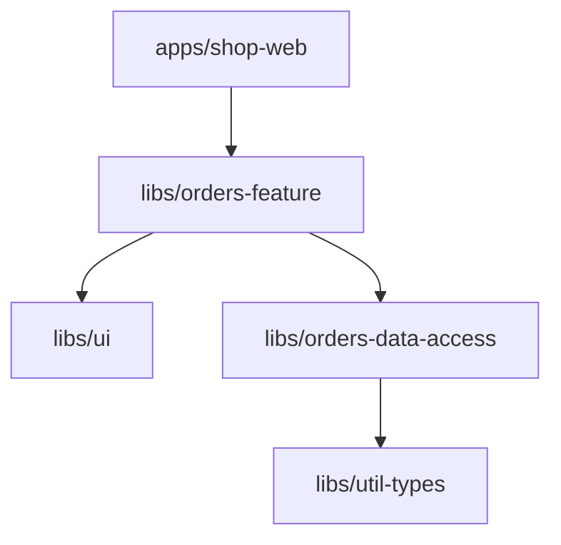
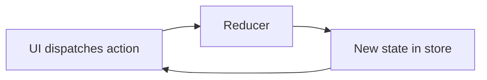
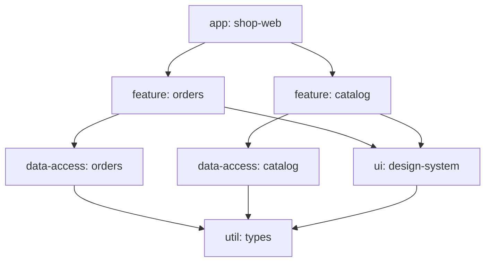
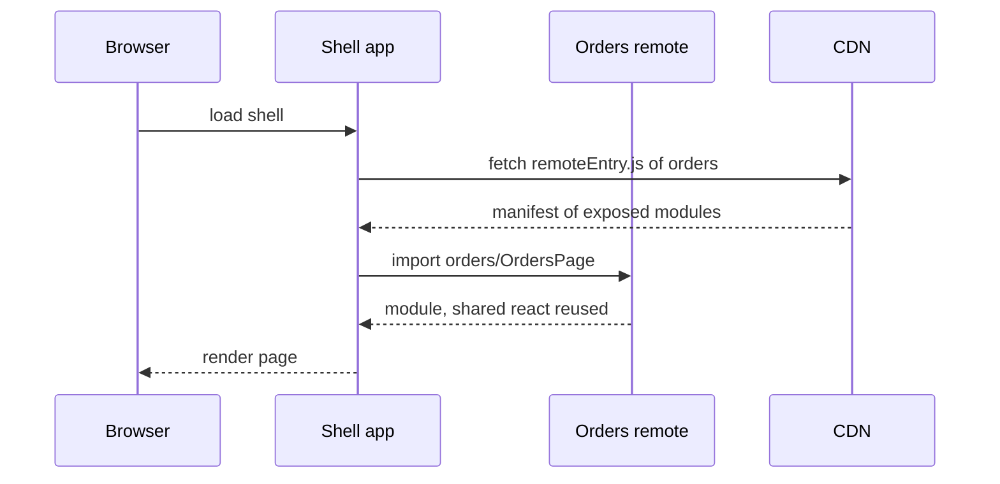
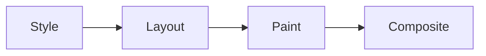
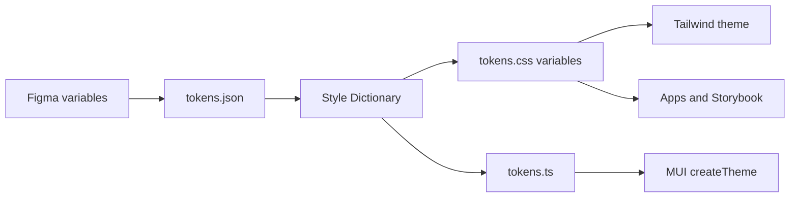
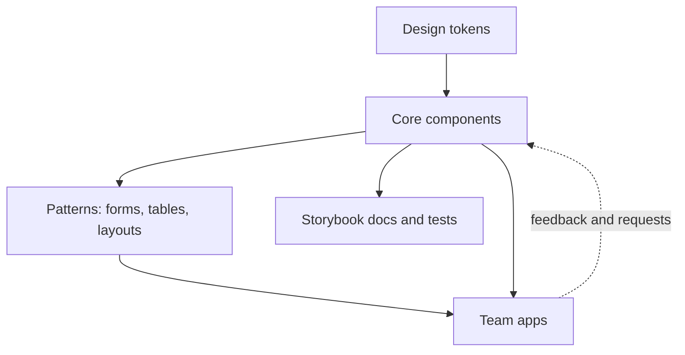

# Frontend Tooling & UI

[← Back to index](../README.md) · [⭐ Favorites](favorites.md)

72 questions · 0 favorites · [📚 Resources](#resources)

## Contents

**Basic**

- [1. What does a front-end build pipeline do?](#1-what-does-a-front-end-build-pipeline-do)
- [2. How do webpack, Vite, esbuild, swc, Babel and Rollup differ?](#2-how-do-webpack-vite-esbuild-swc-babel-and-rollup-differ)
- [3. What are npm, pnpm and Yarn, and why do lockfiles and workspaces matter?](#3-what-are-npm-pnpm-and-yarn-and-why-do-lockfiles-and-workspaces-matter)
- [4. What is the difference between dependencies, devDependencies and peerDependencies, and what do package.json scripts do?](#4-what-is-the-difference-between-dependencies-devdependencies-and-peerdependencies-and-what-do-packagejson-scripts-do)
- [5. What are ESLint and Prettier, and how do they differ?](#5-what-are-eslint-and-prettier-and-how-do-they-differ)
- [6. How do environment variables work in a front-end app, and what is build-time versus runtime config?](#6-how-do-environment-variables-work-in-a-front-end-app-and-what-is-build-time-versus-runtime-config)
- [7. What is a monorepo and how does Nx help?](#7-what-is-a-monorepo-and-how-does-nx-help)
- [8. What CSS fundamentals do interviewers expect: the box model, specificity and the cascade?](#8-what-css-fundamentals-do-interviewers-expect-the-box-model-specificity-and-the-cascade)
- [9. When do you use flexbox, grid and positioning?](#9-when-do-you-use-flexbox-grid-and-positioning)
- [10. How do you build responsive designs, and what is the difference between px, em and rem?](#10-how-do-you-build-responsive-designs-and-what-is-the-difference-between-px-em-and-rem)
- [11. How do CSS Modules, CSS-in-JS, utility-first CSS and BEM compare?](#11-how-do-css-modules-css-in-js-utility-first-css-and-bem-compare)
- [12. What is Tailwind CSS and how do utility classes, config and variants work?](#12-what-is-tailwind-css-and-how-do-utility-classes-config-and-variants-work)
- [13. What are the MUI basics: components, theme, sx, styled and ThemeProvider?](#13-what-are-the-mui-basics-components-theme-sx-styled-and-themeprovider)
- [14. How does Redux work: store, actions, reducers and immutable updates?](#14-how-does-redux-work-store-actions-reducers-and-immutable-updates)
- [15. What does Redux Toolkit add: configureStore, createSlice and Immer?](#15-what-does-redux-toolkit-add-configurestore-createslice-and-immer)
- [16. What is Storybook and what are stories, args and docs?](#16-what-is-storybook-and-what-are-stories-args-and-docs)
- [17. What is semantic HTML and what are the accessibility basics?](#17-what-is-semantic-html-and-what-are-the-accessibility-basics)
- [18. What browser DevTools skills should a front-end engineer have?](#18-what-browser-devtools-skills-should-a-front-end-engineer-have)

**Intermediate**

- [19. \[Tech Lead\] How would you structure an Nx monorepo for many teams?](#19-tech-lead-how-would-you-structure-an-nx-monorepo-for-many-teams)
- [20. \[Tech Lead\] How do you keep CI fast in a growing monorepo?](#20-tech-lead-how-do-you-keep-ci-fast-in-a-growing-monorepo)
- [21. \[Tech Lead\] How do you choose between MUI, Tailwind, headless UI and in-house components?](#21-tech-lead-how-do-you-choose-between-mui-tailwind-headless-ui-and-in-house-components)
- [22. \[Tech Lead\] How do you set bundle size budgets and build a performance culture?](#22-tech-lead-how-do-you-set-bundle-size-budgets-and-build-a-performance-culture)
- [23. \[Tech Lead\] How do you make accessibility a team standard?](#23-tech-lead-how-do-you-make-accessibility-a-team-standard)
- [24. \[Tech Lead\] How do you approach internationalisation and localisation in a front-end app?](#24-tech-lead-how-do-you-approach-internationalisation-and-localisation-in-a-front-end-app)
- [25. \[Tech Lead\] How do you manage front-end dependencies and supply chain security?](#25-tech-lead-how-do-you-manage-front-end-dependencies-and-supply-chain-security)
- [26. \[Tech Lead\] How do you monitor a front-end in production: errors, source maps and real-user monitoring?](#26-tech-lead-how-do-you-monitor-a-front-end-in-production-errors-source-maps-and-real-user-monitoring)
- [27. \[Tech Lead\] How do you improve developer experience in a front-end team?](#27-tech-lead-how-do-you-improve-developer-experience-in-a-front-end-team)
- [28. \[Tech Lead\] What is on your code review checklist for UI changes?](#28-tech-lead-what-is-on-your-code-review-checklist-for-ui-changes)
- [29. How do Nx targets, executors, inferred tasks and generators work?](#29-how-do-nx-targets-executors-inferred-tasks-and-generators-work)
- [30. How do Nx caching, Nx Cloud and affected commands work?](#30-how-do-nx-caching-nx-cloud-and-affected-commands-work)
- [31. How do you enforce module boundaries, avoid circular dependencies and use TS path mappings in Nx?](#31-how-do-you-enforce-module-boundaries-avoid-circular-dependencies-and-use-ts-path-mappings-in-nx)
- [32. How does Vite work: dev server, pre-bundling, plugins and the production build?](#32-how-does-vite-work-dev-server-pre-bundling-plugins-and-the-production-build)
- [33. How does webpack work: loaders, plugins, code splitting and why do builds get slow?](#33-how-does-webpack-work-loaders-plugins-code-splitting-and-why-do-builds-get-slow)
- [34. What is tree shaking, and how do `sideEffects` and barrel files affect it?](#34-what-is-tree-shaking-and-how-do-sideeffects-and-barrel-files-affect-it)
- [35. What code splitting strategies do you use, and how do preload and prefetch fit in?](#35-what-code-splitting-strategies-do-you-use-and-how-do-preload-and-prefetch-fit-in)
- [36. How do source maps work, and how do you debug production safely?](#36-how-do-source-maps-work-and-how-do-you-debug-production-safely)
- [37. How do Babel, swc and tsc differ, and why type check separately?](#37-how-do-babel-swc-and-tsc-differ-and-why-type-check-separately)
- [38. How do you theme MUI deeply: palette, typography, overrides, TypeScript augmentation and dark mode?](#38-how-do-you-theme-mui-deeply-palette-typography-overrides-typescript-augmentation-and-dark-mode)
- [39. How do you use Tailwind well at scale: tokens, apply, arbitrary values, merging and v3 versus v4?](#39-how-do-you-use-tailwind-well-at-scale-tokens-apply-arbitrary-values-merging-and-v3-versus-v4)
- [40. Can you combine MUI and Tailwind, and what goes wrong?](#40-can-you-combine-mui-and-tailwind-and-what-goes-wrong)
- [41. What CSS layout topics go deeper: stacking contexts, margin collapse, `min-width: 0` and sticky?](#41-what-css-layout-topics-go-deeper-stacking-contexts-margin-collapse-min-width-0-and-sticky)
- [42. How do responsive images, fonts and Core Web Vitals levers fit together?](#42-how-do-responsive-images-fonts-and-core-web-vitals-levers-fit-together)
- [43. How do createAsyncThunk and listener middleware work in Redux Toolkit?](#43-how-do-createasyncthunk-and-listener-middleware-work-in-redux-toolkit)
- [44. How does RTK Query handle caching, tags and invalidation?](#44-how-does-rtk-query-handle-caching-tags-and-invalidation)
- [45. How do createEntityAdapter and memoised selectors keep Redux state efficient?](#45-how-do-createentityadapter-and-memoised-selectors-keep-redux-state-efficient)
- [46. How do you type Redux hooks in TypeScript, and when should you avoid Redux?](#46-how-do-you-type-redux-hooks-in-typescript-and-when-should-you-avoid-redux)
- [47. How do you choose between Redux, Zustand, Jotai, React Query and Context?](#47-how-do-you-choose-between-redux-zustand-jotai-react-query-and-context)
- [48. How do you build forms with React Hook Form and Zod, including MUI?](#48-how-do-you-build-forms-with-react-hook-form-and-zod-including-mui)
- [49. What does Storybook add beyond the basics: CSF, interaction tests, visual testing and a11y?](#49-what-does-storybook-add-beyond-the-basics-csf-interaction-tests-visual-testing-and-a11y)
- [50. How do you set up ESLint flat config, typescript-eslint, Prettier, Husky and commit conventions?](#50-how-do-you-set-up-eslint-flat-config-typescript-eslint-prettier-husky-and-commit-conventions)
- [51. How do you test UI at the component level with Vitest or Jest and Testing Library?](#51-how-do-you-test-ui-at-the-component-level-with-vitest-or-jest-and-testing-library)
- [52. How do you manage environment config and feature flags in a front-end app?](#52-how-do-you-manage-environment-config-and-feature-flags-in-a-front-end-app)

**Advanced**

- [53. \[Tech Lead\] How do you upgrade a large front-end codebase safely (React, MUI, Tailwind, Nx)?](#53-tech-lead-how-do-you-upgrade-a-large-front-end-codebase-safely-react-mui-tailwind-nx)
- [54. \[Tech Lead\] How do you build and govern a design system on MUI or Tailwind?](#54-tech-lead-how-do-you-build-and-govern-a-design-system-on-mui-or-tailwind)
- [55. \[Tech Lead\] When should you use micro-frontends and Module Federation, and when not?](#55-tech-lead-when-should-you-use-micro-frontends-and-module-federation-and-when-not)
- [56. How does a bundler work internally: module graph, chunks, scope hoisting and hashing?](#56-how-does-a-bundler-work-internally-module-graph-chunks-scope-hoisting-and-hashing)
- [57. How do you design a library's public API: barrels, the `exports` map and ESM and CJS dual packages?](#57-how-do-you-design-a-librarys-public-api-barrels-the-exports-map-and-esm-and-cjs-dual-packages)
- [58. What are the trade-offs of Module Federation and micro-frontend architecture?](#58-what-are-the-trade-offs-of-module-federation-and-micro-frontend-architecture)
- [59. How do you engineer build performance: profiling, caching layers and incremental builds?](#59-how-do-you-engineer-build-performance-profiling-caching-layers-and-incremental-builds)
- [60. How do you do a measured performance deep dive on a MUI and React app?](#60-how-do-you-do-a-measured-performance-deep-dive-on-a-mui-and-react-app)
- [61. How does the browser rendering pipeline affect CSS performance?](#61-how-does-the-browser-rendering-pipeline-affect-css-performance)
- [62. How do you handle accessibility in depth: ARIA, focus management, live regions and testing?](#62-how-do-you-handle-accessibility-in-depth-aria-focus-management-live-regions-and-testing)
- [63. How do you build a design tokens pipeline from Style Dictionary to CSS variables, Tailwind and the MUI theme?](#63-how-do-you-build-a-design-tokens-pipeline-from-style-dictionary-to-css-variables-tailwind-and-the-mui-theme)
- [64. How do you implement internationalisation in React with i18next or FormatJS, ICU messages and RTL?](#64-how-do-you-implement-internationalisation-in-react-with-i18next-or-formatjs-icu-messages-and-rtl)
- [65. What build considerations come with SSR and SSG using Vite or Next.js?](#65-what-build-considerations-come-with-ssr-and-ssg-using-vite-or-nextjs)
- [66. What do PWAs and service workers mean for build tooling?](#66-what-do-pwas-and-service-workers-mean-for-build-tooling)
- [67. What front-end build security issues should a lead know: CSP, SRI, secret leaks and source maps?](#67-what-front-end-build-security-issues-should-a-lead-know-csp-sri-secret-leaks-and-source-maps)
- [68. How do you release libraries from a monorepo: versioning, changesets and publishing?](#68-how-do-you-release-libraries-from-a-monorepo-versioning-changesets-and-publishing)
- [69. How do you migrate from CRA or webpack to Vite, and from Redux to Redux Toolkit, step by step?](#69-how-do-you-migrate-from-cra-or-webpack-to-vite-and-from-redux-to-redux-toolkit-step-by-step)
- [70. Scenario: the bundle doubled after a dependency upgrade. How do you find out why?](#70-scenario-the-bundle-doubled-after-a-dependency-upgrade-how-do-you-find-out-why)
- [71. Scenario: CI takes 40 minutes in the monorepo. What do you do?](#71-scenario-ci-takes-40-minutes-in-the-monorepo-what-do-you-do)
- [72. Scenario: design a shared component library for five teams.](#72-scenario-design-a-shared-component-library-for-five-teams)

## Browse by module

| Module | Questions |
| --- | --- |
| Accessibility & i18n (5) | [17](#17-what-is-semantic-html-and-what-are-the-accessibility-basics) · [23](#23-tech-lead-how-do-you-make-accessibility-a-team-standard) · [24](#24-tech-lead-how-do-you-approach-internationalisation-and-localisation-in-a-front-end-app) · [62](#62-how-do-you-handle-accessibility-in-depth-aria-focus-management-live-regions-and-testing) · [64](#64-how-do-you-implement-internationalisation-in-react-with-i18next-or-formatjs-icu-messages-and-rtl) |
| Architecture & Leadership (8) | [26](#26-tech-lead-how-do-you-monitor-a-front-end-in-production-errors-source-maps-and-real-user-monitoring) · [27](#27-tech-lead-how-do-you-improve-developer-experience-in-a-front-end-team) · [28](#28-tech-lead-what-is-on-your-code-review-checklist-for-ui-changes) · [52](#52-how-do-you-manage-environment-config-and-feature-flags-in-a-front-end-app) · [53](#53-tech-lead-how-do-you-upgrade-a-large-front-end-codebase-safely-react-mui-tailwind-nx) · [55](#55-tech-lead-when-should-you-use-micro-frontends-and-module-federation-and-when-not) · [58](#58-what-are-the-trade-offs-of-module-federation-and-micro-frontend-architecture) · [69](#69-how-do-you-migrate-from-cra-or-webpack-to-vite-and-from-redux-to-redux-toolkit-step-by-step) |
| Build Tools (9) | [1](#1-what-does-a-front-end-build-pipeline-do) · [2](#2-how-do-webpack-vite-esbuild-swc-babel-and-rollup-differ) · [6](#6-how-do-environment-variables-work-in-a-front-end-app-and-what-is-build-time-versus-runtime-config) · [32](#32-how-does-vite-work-dev-server-pre-bundling-plugins-and-the-production-build) · [33](#33-how-does-webpack-work-loaders-plugins-code-splitting-and-why-do-builds-get-slow) · [36](#36-how-do-source-maps-work-and-how-do-you-debug-production-safely) · [37](#37-how-do-babel-swc-and-tsc-differ-and-why-type-check-separately) · [56](#56-how-does-a-bundler-work-internally-module-graph-chunks-scope-hoisting-and-hashing) · [59](#59-how-do-you-engineer-build-performance-profiling-caching-layers-and-incremental-builds) |
| CSS Fundamentals (6) | [8](#8-what-css-fundamentals-do-interviewers-expect-the-box-model-specificity-and-the-cascade) · [9](#9-when-do-you-use-flexbox-grid-and-positioning) · [10](#10-how-do-you-build-responsive-designs-and-what-is-the-difference-between-px-em-and-rem) · [11](#11-how-do-css-modules-css-in-js-utility-first-css-and-bem-compare) · [41](#41-what-css-layout-topics-go-deeper-stacking-contexts-margin-collapse-min-width-0-and-sticky) · [61](#61-how-does-the-browser-rendering-pipeline-affect-css-performance) |
| Design Systems & Storybook (5) | [16](#16-what-is-storybook-and-what-are-stories-args-and-docs) · [49](#49-what-does-storybook-add-beyond-the-basics-csf-interaction-tests-visual-testing-and-a11y) · [54](#54-tech-lead-how-do-you-build-and-govern-a-design-system-on-mui-or-tailwind) · [63](#63-how-do-you-build-a-design-tokens-pipeline-from-style-dictionary-to-css-variables-tailwind-and-the-mui-theme) · [72](#72-scenario-design-a-shared-component-library-for-five-teams) |
| Monorepo & Nx (9) | [7](#7-what-is-a-monorepo-and-how-does-nx-help) · [19](#19-tech-lead-how-would-you-structure-an-nx-monorepo-for-many-teams) · [20](#20-tech-lead-how-do-you-keep-ci-fast-in-a-growing-monorepo) · [29](#29-how-do-nx-targets-executors-inferred-tasks-and-generators-work) · [30](#30-how-do-nx-caching-nx-cloud-and-affected-commands-work) · [31](#31-how-do-you-enforce-module-boundaries-avoid-circular-dependencies-and-use-ts-path-mappings-in-nx) · [57](#57-how-do-you-design-a-librarys-public-api-barrels-the-exports-map-and-esm-and-cjs-dual-packages) · [68](#68-how-do-you-release-libraries-from-a-monorepo-versioning-changesets-and-publishing) · [71](#71-scenario-ci-takes-40-minutes-in-the-monorepo-what-do-you-do) |
| MUI & Component Libraries (4) | [13](#13-what-are-the-mui-basics-components-theme-sx-styled-and-themeprovider) · [21](#21-tech-lead-how-do-you-choose-between-mui-tailwind-headless-ui-and-in-house-components) · [38](#38-how-do-you-theme-mui-deeply-palette-typography-overrides-typescript-augmentation-and-dark-mode) · [48](#48-how-do-you-build-forms-with-react-hook-form-and-zod-including-mui) |
| Package Management & Quality (7) | [3](#3-what-are-npm-pnpm-and-yarn-and-why-do-lockfiles-and-workspaces-matter) · [4](#4-what-is-the-difference-between-dependencies-devdependencies-and-peerdependencies-and-what-do-packagejson-scripts-do) · [5](#5-what-are-eslint-and-prettier-and-how-do-they-differ) · [25](#25-tech-lead-how-do-you-manage-front-end-dependencies-and-supply-chain-security) · [50](#50-how-do-you-set-up-eslint-flat-config-typescript-eslint-prettier-husky-and-commit-conventions) · [51](#51-how-do-you-test-ui-at-the-component-level-with-vitest-or-jest-and-testing-library) · [67](#67-what-front-end-build-security-issues-should-a-lead-know-csp-sri-secret-leaks-and-source-maps) |
| Performance & Bundling (9) | [18](#18-what-browser-devtools-skills-should-a-front-end-engineer-have) · [22](#22-tech-lead-how-do-you-set-bundle-size-budgets-and-build-a-performance-culture) · [34](#34-what-is-tree-shaking-and-how-do-sideeffects-and-barrel-files-affect-it) · [35](#35-what-code-splitting-strategies-do-you-use-and-how-do-preload-and-prefetch-fit-in) · [42](#42-how-do-responsive-images-fonts-and-core-web-vitals-levers-fit-together) · [60](#60-how-do-you-do-a-measured-performance-deep-dive-on-a-mui-and-react-app) · [65](#65-what-build-considerations-come-with-ssr-and-ssg-using-vite-or-nextjs) · [66](#66-what-do-pwas-and-service-workers-mean-for-build-tooling) · [70](#70-scenario-the-bundle-doubled-after-a-dependency-upgrade-how-do-you-find-out-why) |
| State Management (7) | [14](#14-how-does-redux-work-store-actions-reducers-and-immutable-updates) · [15](#15-what-does-redux-toolkit-add-configurestore-createslice-and-immer) · [43](#43-how-do-createasyncthunk-and-listener-middleware-work-in-redux-toolkit) · [44](#44-how-does-rtk-query-handle-caching-tags-and-invalidation) · [45](#45-how-do-createentityadapter-and-memoised-selectors-keep-redux-state-efficient) · [46](#46-how-do-you-type-redux-hooks-in-typescript-and-when-should-you-avoid-redux) · [47](#47-how-do-you-choose-between-redux-zustand-jotai-react-query-and-context) |
| Tailwind CSS (3) | [12](#12-what-is-tailwind-css-and-how-do-utility-classes-config-and-variants-work) · [39](#39-how-do-you-use-tailwind-well-at-scale-tokens-apply-arbitrary-values-merging-and-v3-versus-v4) · [40](#40-can-you-combine-mui-and-tailwind-and-what-goes-wrong) |

## Basic

### 1. What does a front-end build pipeline do?

**Short answer:** A build pipeline turns the source code you write (TypeScript, JSX, modern CSS, many small files) into a few optimised files a browser can load fast. The usual steps are transpile, bundle, tree shake, split, minify and hash the file names.

Browsers cannot run TypeScript or JSX, and loading hundreds of tiny files is slow. The pipeline fixes both problems.


Read it left to right: each step feeds the next, and the output folder is what you deploy.

| Step | What it does |
| --- | --- |
| Transpile | Converts TypeScript, JSX and new syntax into JavaScript the target browsers understand |
| Bundle | Follows `import` statements and joins modules into files |
| Tree shake | Drops exports that nobody uses |
| Code split | Makes separate chunks so a page loads only what it needs |
| Minify | Removes whitespace and shortens names |
| Hash names | `app.3f9a1c.js`, so the file can be cached for a year and a new build gets a new name |

**Dev versus production.** In development you want fast start and instant updates (hot module replacement, HMR). In production you want small files and good caching. Good tools do both with different modes.

**Gotcha:** Type checking is a separate job. Most fast tools (esbuild, swc) strip types without checking them. Run `tsc --noEmit` in CI.

**Interview tip:** Name the purpose of each step and say why hashed file names matter: they allow long cache lifetimes without serving stale code.

_Module: Build Tools · Tags: build, bundling, tooling_

### 2. How do webpack, Vite, esbuild, swc, Babel and Rollup differ?

**Short answer:** Webpack and Rollup are bundlers. Vite is a dev server and build tool that uses native ES modules in development and Rollup in production. esbuild and swc are very fast compilers written in Go and Rust. Babel is the older, plugin-rich JavaScript transpiler.

| Tool | Role | Dev experience | Production build |
| --- | --- | --- | --- |
| webpack | Bundler with loaders and plugins | Bundles everything, so large apps start slowly | Mature, very configurable |
| Vite | Dev server and build tool | Serves source as native ESM, starts fast, quick HMR | Rollup (Vite 5 and 6) |
| Rollup | Bundler, great for libraries | Not a dev server | Clean output, strong tree shaking |
| esbuild | Bundler and transpiler in Go | Extremely fast | Fast but fewer plugin features and weaker code splitting control |
| swc | Transpiler and minifier in Rust | Used inside Next.js, Nx and Jest setups | Fast Babel replacement |
| Babel | Transpiler with plugins | Slow but flexible | Needed for rare custom transforms |

**Why Vite feels fast.** In dev it does not bundle your own code. The browser requests modules one by one, and Vite transforms each file on demand. Dependencies in `node_modules` are pre-bundled once with esbuild.

**Which to pick.** For a new React app, Vite is the common default. For an existing large webpack app with Module Federation or many custom loaders, migrate only if the pain is real. For a library, Rollup or Vite library mode.

**Gotcha:** Dev and production use different pipelines in Vite, so a bug can appear only after `vite build`. Run `vite preview` or a production build in CI.

**Interview tip:** Do not say "Vite replaces webpack in every case". Say what each tool optimises for and which one you would pick for your constraints.

_Module: Build Tools · Tags: webpack, vite, esbuild_

### 3. What are npm, pnpm and Yarn, and why do lockfiles and workspaces matter?

**Short answer:** They are package managers that install dependencies from a registry. A lockfile records the exact resolved version of every package so every machine and CI run installs the same tree. Workspaces let one repository hold many packages that share one install.

| Manager | Notes |
| --- | --- |
| npm | Ships with Node. Lockfile is `package-lock.json` |
| Yarn | Classic (v1) and Berry (v2 and later, with Plug'n'Play option). Lockfile is `yarn.lock` |
| pnpm | Stores each package once in a global store and links it. Strict, so code cannot import undeclared packages. Lockfile is `pnpm-lock.yaml` |

**Why the lockfile.** `package.json` says `"react": "^18.2.0"`, which allows many versions. The lockfile pins the exact one. Commit it. In CI use `npm ci`, `pnpm install --frozen-lockfile` or `yarn install --immutable`, which fail if the lockfile and `package.json` disagree.

**Workspaces.** In a monorepo, the root lists packages and the manager links them together:

```json
{
  "name": "shop",
  "private": true,
  "workspaces": ["apps/*", "libs/*"]
}
```

pnpm uses a `pnpm-workspace.yaml` file instead. Local packages can depend on each other with `workspace:*` in pnpm and Yarn.

**Gotcha:** npm and Yarn hoist packages, so code may import something it never declared and still work ("phantom dependency"). pnpm blocks that, which is a benefit but can reveal old bugs.

**Interview tip:** Mention the frozen install in CI and the phantom dependency problem. It shows you have run real pipelines.

_Module: Package Management & Quality · Tags: npm, pnpm, workspaces_

### 4. What is the difference between dependencies, devDependencies and peerDependencies, and what do package.json scripts do?

**Short answer:** `dependencies` are needed at runtime, `devDependencies` only to build, test or lint, and `peerDependencies` say "my consumer must provide this package". `scripts` are named shell commands run with `npm run`.

For a front-end app that is bundled, the line between the first two is mostly cosmetic, because the bundler inlines what is used. It matters for libraries and for Node servers.

| Field | Meaning | Example |
| --- | --- | --- |
| `dependencies` | Installed for consumers of the package | A date utility used inside your library |
| `devDependencies` | Not installed for consumers | `typescript`, `vitest`, `eslint` |
| `peerDependencies` | The host app supplies it, and one copy is shared | `react`, `react-dom` in a component library |
| `optionalDependencies` | Install if possible, ignore failure | Native add-ons |

A component library must declare `react` as a peer. If it listed React as a normal dependency, an app could end up with two copies of React and hooks would break with confusing errors.

```json
{
  "scripts": {
    "dev": "vite",
    "build": "tsc --noEmit && vite build",
    "lint": "eslint .",
    "test": "vitest run",
    "prepare": "husky"
  },
  "peerDependencies": { "react": ">=18", "react-dom": ">=18" }
}
```

Scripts named `pre` and `post` plus a script name run around it, for example `prebuild`. `prepare` runs after install, which is why Git hook tools use it.

**Gotcha:** A package used at runtime but placed in `devDependencies` of a library will be missing for consumers.

**Interview tip:** Use the two copies of React example for peers. It is the classic real bug.

_Module: Package Management & Quality · Tags: package-json, dependencies, scripts_

### 5. What are ESLint and Prettier, and how do they differ?

**Short answer:** ESLint finds code problems and bad patterns, such as unused variables or missing hook dependencies. Prettier only formats code, so style arguments end. They solve different problems and work together.

| Tool | Question it answers | Fixes automatically |
| --- | --- | --- |
| ESLint | Is this code likely wrong or against our rules? | Some rules |
| Prettier | Is this code laid out consistently? | Always, it rewrites the file |
| TypeScript | Do the types agree? | No |

**How they fit.** Run Prettier for layout and ESLint for logic. Do not let ESLint also enforce formatting rules, because the two will fight. Modern setups drop the old `eslint-plugin-prettier` and run Prettier as its own step. If you keep formatting-related ESLint rules, turn them off with `eslint-config-prettier`.

Useful ESLint pieces for a React and TypeScript team: `typescript-eslint` for type-aware rules, `eslint-plugin-react-hooks` for the rules of hooks, `eslint-plugin-jsx-a11y` for accessibility, and import rules for boundaries.

```bash
# check without changing files, good for CI
prettier --check .
eslint . --max-warnings 0
```

**Gotcha:** A rule that is only a warning is ignored by most people. Either make it an error or remove it.

**Interview tip:** Say you run both in a pre-commit hook on changed files and again in CI on everything, so nothing slips through.

_Module: Package Management & Quality · Tags: eslint, prettier, linting_

### 6. How do environment variables work in a front-end app, and what is build-time versus runtime config?

**Short answer:** In a browser app, environment variables are not read at runtime. The build tool replaces them with literal values in the bundle. So anything in the bundle is public, and changing a value usually needs a new build unless you load config at runtime.

In Vite you read `import.meta.env.VITE_API_URL`, and only names starting with `VITE_` are exposed. Webpack setups use `process.env.X` replaced by DefinePlugin, and Next.js exposes `NEXT_PUBLIC_` variables.

| Approach | How | Good for | Drawback |
| --- | --- | --- | --- |
| Build-time | Values baked into the bundle | Flags that never change per environment | One build per environment |
| Runtime | Load `/config.json` or a script tag at startup | One image deployed to dev, staging and prod | An extra request, must be typed and validated |

**Build once, deploy many** is the better practice for containers: build a single artefact and inject config when the container starts, for example by writing `config.json` from environment variables.

```ts
// runtime config loaded before the app renders
type AppConfig = { apiUrl: string };

export async function loadConfig(): Promise<AppConfig> {
  const res = await fetch("/config.json", { cache: "no-store" });
  if (!res.ok) throw new Error("config failed");
  return res.json();
}
```

**Gotcha:** Never put secrets in front-end env variables. They end up in the shipped JavaScript. Secrets belong on a server.

**Interview tip:** Explain that "environment variable" in a browser app really means "a constant replaced at build time", then offer runtime config as the way to avoid per-environment builds.

_Module: Build Tools · Tags: environment, config, vite_

### 7. What is a monorepo and how does Nx help?

**Short answer:** A monorepo keeps many apps and libraries in one Git repository. Nx adds a project graph, a task runner with caching, and tools to run only what a change affects.

**Why teams do it.** Shared code is one import away, one pull request can change a library and every app that uses it, and tooling and versions stay consistent. The cost is that builds and CI get slow unless tooling is smart.

**Nx concepts**
- **Project:** an app or a library, usually with a `project.json` or a `package.json`.
- **Project graph:** Nx reads imports and dependencies to know which project depends on which. Run `nx graph` to see it.
- **Targets:** named tasks per project, such as `build`, `test`, `lint`.
- **Caching:** if the inputs of a task did not change, Nx replays the saved output instead of running it.
- **Affected:** `nx affected -t test` runs only on projects touched by the change and their dependents.

```bash
nx build shop-web              # build one app and the libs it needs
nx run-many -t lint test       # run targets across all projects
nx affected -t build --base=origin/main
```



A change to `util-types` affects every project above it; a change to `shop-web` affects nothing else.

**Gotcha:** A monorepo is not a monolith. Without module boundaries it becomes one tangled app.

**Interview tip:** Mention the three wins: shared code, atomic changes, and faster CI through affected and caching.

_Module: Monorepo & Nx · Tags: monorepo, nx_

### 8. What CSS fundamentals do interviewers expect: the box model, specificity and the cascade?

**Short answer:** Every element is a box made of content, padding, border and margin. When rules conflict, the cascade decides by origin and importance, then specificity, then source order.

**Box model.** By default `width` sets the content only, so padding and border add to the size. With `box-sizing: border-box`, `width` includes padding and border, which is easier to reason about. Most projects reset it for everything.

```css
*, *::before, *::after { box-sizing: border-box; }

.card { width: 300px; padding: 16px; border: 1px solid #ccc; }
/* border-box: the card is exactly 300px wide */
```

**Specificity** is scored in three groups: ids, then classes, attributes and pseudo-classes, then elements. Higher wins, left group first.

| Selector | Score (ids, classes, elements) |
| --- | --- |
| `p` | 0,0,1 |
| `.card p` | 0,1,1 |
| `#main .card p` | 1,1,1 |
| inline `style` | beats all of the above |
| `!important` | beats normal rules, avoid |

If scores tie, the later rule wins. `:where()` has zero specificity, `:is()` takes its most specific argument. Cascade layers (`@layer`) let you order whole groups of rules regardless of specificity, and are useful when mixing libraries.

**Inheritance.** Some properties such as `color` and `font-family` pass to children, others such as `margin` and `border` do not.

**Gotchas**
- Deep selectors and ids make later overrides painful.
- `!important` starts an arms race.

**Interview tip:** Say you keep specificity flat (single classes) and use layers or component scoping instead of `!important`.

_Module: CSS Fundamentals · Tags: css, box-model, specificity_

### 9. When do you use flexbox, grid and positioning?

**Short answer:** Use flexbox to lay items out along one axis, grid for two-dimensional layout of rows and columns, and positioning to place an element relative to something else, such as a badge or a dropdown.

| Tool | Best for | Example |
| --- | --- | --- |
| Flexbox | Rows or columns of items, alignment, spacing | Toolbar, button group, centring |
| Grid | Page layout, card galleries, dashboards | A responsive card grid |
| `position: relative` | Anchor for children, small nudges | Parent of a badge |
| `position: absolute` | Place inside the nearest positioned ancestor | Tooltips, icons in inputs |
| `position: fixed` | Relative to the viewport | Sticky header, chat button |
| `position: sticky` | Sticks while scrolling inside its container | Table header |

```css
.toolbar { display: flex; align-items: center; gap: 8px; }
.toolbar .spacer { flex: 1; }          /* pushes the rest to the right */

.gallery {
  display: grid;
  grid-template-columns: repeat(auto-fill, minmax(220px, 1fr));
  gap: 16px;                            /* responsive without media queries */
}
```

**Rule of thumb.** If you think in one line of items, use flex. If you think in rows and columns together, use grid. They nest well: grid for the page, flex inside each card.

**Gotchas**
- `absolute` without a positioned ancestor positions against the page.
- `z-index` only works on positioned or flex and grid items, and is limited by stacking contexts.
- Centre with `display: grid; place-items: center;` for the shortest code.

**Interview tip:** Show the `auto-fill` and `minmax` grid. It proves you can build responsive layouts with little CSS.

_Module: CSS Fundamentals · Tags: css, flexbox, grid_

### 10. How do you build responsive designs, and what is the difference between px, em and rem?

**Short answer:** Start mobile first, use flexible layouts, and add media queries or container queries where the layout must change. Use `rem` for type and spacing so it respects the user's font setting, and `px` for thin borders.

**Units**

| Unit | Relative to | Use for |
| --- | --- | --- |
| `px` | Fixed CSS pixel | Borders, shadows |
| `rem` | Root font size (16px by default) | Font size, spacing, breakpoints |
| `em` | Font size of the element itself or its parent | Padding that scales with a component's text |
| `%`, `vw`, `vh` | Parent size or viewport | Fluid widths |
| `dvh` | Dynamic viewport height | Full-screen panels on mobile browsers |

**Media queries** react to the viewport. **Container queries** react to the size of a parent, which suits reusable components that appear in a sidebar and in a main area.

```css
.card { padding: 1rem; }

@media (min-width: 48rem) {      /* mobile first: widen up */
  .card { padding: 2rem; }
}

.panel { container-type: inline-size; }
@container (min-width: 30rem) {
  .card { display: flex; }
}
```

**Custom properties** (CSS variables) hold values such as colours and spacing and can change at runtime, which makes themes and dark mode easy:

```css
:root { --brand: #1976d2; }
[data-theme="dark"] { --brand: #90caf9; }
.button { background: var(--brand); }
```

**Gotcha:** Do not set `html { font-size: 62.5% }` blindly. It changes every rem and can break third-party components.

**Interview tip:** Mention that rem respects user accessibility settings, which px does not.

_Module: CSS Fundamentals · Tags: responsive, media-queries, units_

### 11. How do CSS Modules, CSS-in-JS, utility-first CSS and BEM compare?

**Short answer:** They are four ways to avoid global style clashes. BEM uses naming rules, CSS Modules scope class names per file at build time, CSS-in-JS writes styles in JavaScript, and utility-first (Tailwind) composes small single-purpose classes in markup.

| Approach | Scoping | Runtime cost | Strength | Weakness |
| --- | --- | --- | --- | --- |
| BEM | By naming (`card__title--big`) | None | Simple, no tooling | Discipline needed, verbose |
| CSS Modules | Generated unique class names | None | Real CSS, easy to adopt | Dynamic values need variables |
| CSS-in-JS (Emotion, styled-components) | Generated class names | Yes, styles built in the browser | Props-driven styles, colocated | Cost on render, SSR setup |
| Utility-first (Tailwind) | Classes are atomic and global but tiny | None | Fast to write, small CSS, consistent tokens | Long class lists, learning curve |

```tsx
// CSS Modules
import styles from "./Card.module.css";
export const Card = () => <div className={styles.card} />;

// Tailwind
export const Card2 = () => <div className="rounded-lg border p-4" />;
```

**What teams pick.** MUI uses Emotion (CSS-in-JS) by default, so a MUI app already has one. Tailwind and CSS Modules add zero runtime. Some libraries are moving to zero-runtime CSS-in-JS that extracts CSS at build time, because runtime styling does not fit React server components well.

**Gotcha:** Mixing three approaches in one app makes overrides painful. Choose one main approach and one escape hatch.

**Interview tip:** Judge by team size, theming needs and runtime cost, not by fashion.

_Module: CSS Fundamentals · Tags: css-modules, css-in-js, bem_

### 12. What is Tailwind CSS and how do utility classes, config and variants work?

**Short answer:** Tailwind is a utility-first CSS framework. You style by adding small classes like `p-4` and `text-lg` in your markup. It scans your files, generates only the classes you use, and supports responsive and state prefixes like `md:` and `hover:`.

**Just-in-time generation.** Since v3 the engine generates CSS on demand from the class names found in your source files, so the output is small and you can use arbitrary values such as `w-[137px]`.

**Design tokens.** Spacing, colours, fonts and breakpoints come from a theme. In Tailwind v3 you edit `tailwind.config.js`. In v4 you configure the theme in CSS with `@theme` and the files are detected automatically.

```tsx
export function Alert({ text }: { text: string }) {
  return (
    <div className="rounded-md bg-amber-50 p-4 text-sm text-amber-900
                    hover:bg-amber-100 md:p-6 dark:bg-amber-950 dark:text-amber-100">
      {text}
    </div>
  );
}
```

**Variants** stack in front of a class: `md:` for viewport width, `hover:` and `focus:` for state, `dark:` for dark mode, `group-hover:` for parent state. Mobile first means `md:p-6` applies from the medium breakpoint up.

**Dark mode.** v3 offers `darkMode: "media"` (follows the OS) or `"class"` (you toggle a class). In v4 you use a custom variant if you want a manual toggle.

**Gotcha:** Build class names whole. `` `text-${color}-500` `` is not found by the scanner, so the class is never generated. Map to full names instead.

**Interview tip:** Defend Tailwind with consistency and small CSS, and admit the trade-off: long class lists need component extraction.

_Module: Tailwind CSS · Tags: tailwind, utility-first_

### 13. What are the MUI basics: components, theme, sx, styled and ThemeProvider?

**Short answer:** MUI is a React component library that implements Material Design. A theme holds design tokens such as palette, typography and spacing. `ThemeProvider` makes the theme available, and you adjust components with the `sx` prop or the `styled` function.

```tsx
import { createTheme, ThemeProvider, styled } from "@mui/material/styles";
import Button from "@mui/material/Button";
import Box from "@mui/material/Box";
import SaveIcon from "@mui/icons-material/Save";

const theme = createTheme({
  palette: { primary: { main: "#0b6bcb" } },
  shape: { borderRadius: 8 },
});

const Tag = styled("span")(({ theme }) => ({
  padding: theme.spacing(0.5, 1),
  background: theme.palette.grey[200],
}));

export function Demo() {
  return (
    <ThemeProvider theme={theme}>
      <Box sx={{ p: 2, display: "flex", gap: 1 }}>
        <Button variant="contained" startIcon={<SaveIcon />}>Save</Button>
        <Tag>draft</Tag>
      </Box>
    </ThemeProvider>
  );
}
```

| Tool | Use for |
| --- | --- |
| `sx` prop | One-off styles on a single element, with theme-aware shortcuts like `p: 2` |
| `styled()` | Reusable styled components, dynamic props |
| Theme `components` overrides | Changing a component everywhere |

In `sx`, numeric spacing multiplies the theme spacing (8px by default), and `bgcolor: "primary.main"` reads from the palette.

**Import tip.** Import from the component path (`@mui/material/Button`) or use the named imports that current versions tree shake. For icons, prefer `@mui/icons-material/Save` over the root import in dev builds.

**Gotcha:** Heavy use of `sx` inside long lists adds style work. Hoist repeated styles to `styled`.

**Interview tip:** Say this is MUI v5 to v7 behaviour, and mention that the theme is where you enforce brand rules.

_Module: MUI & Component Libraries · Tags: mui, theming, emotion_

### 14. How does Redux work: store, actions, reducers and immutable updates?

**Short answer:** Redux keeps app state in one store. You change it only by dispatching actions, and pure reducer functions compute the next state from the previous state and the action. Updates must be immutable so changes can be detected cheaply and history can be traced.



The data flows in one direction: the UI sends an action, the reducer builds new state, and subscribed components re-render.

```ts
type State = { items: string[] };
type Action = { type: "add"; item: string };

function reducer(state: State = { items: [] }, action: Action): State {
  switch (action.type) {
    case "add":
      // ✅ new array, old state untouched
      return { ...state, items: [...state.items, action.item] };
    default:
      return state;
  }
}
```

**Why immutable.** Selectors and React-Redux compare by reference. If you mutate the old array, the reference does not change, so components do not update and devtools cannot show the previous state.

**Rules for reducers:** no mutation, no API calls, no random numbers or dates. Side effects go to thunks, listeners or RTK Query.

**Gotcha:** A reducer that mutates (`state.items.push(x)`) can seem to work and then fail in odd places such as memoised selectors.

**Interview tip:** Connect the three ideas: one source of truth, state changes only through actions, reducers are pure.

_Module: State Management · Tags: redux, immutability_

### 15. What does Redux Toolkit add: configureStore, createSlice and Immer?

**Short answer:** Redux Toolkit (RTK) is the official, recommended way to write Redux. `configureStore` sets up the store with good defaults, `createSlice` generates actions and reducers together, and Immer lets you write "mutating" code that produces immutable updates.

```ts
import { configureStore, createSlice, PayloadAction } from "@reduxjs/toolkit";

type Todo = { id: string; title: string; done: boolean };

const todos = createSlice({
  name: "todos",
  initialState: [] as Todo[],
  reducers: {
    added(state, action: PayloadAction<Todo>) {
      state.push(action.payload);          // Immer makes this safe
    },
    toggled(state, action: PayloadAction<string>) {
      const t = state.find((x) => x.id === action.payload);
      if (t) t.done = !t.done;
    },
  },
});

export const { added, toggled } = todos.actions;
export const store = configureStore({ reducer: { todos: todos.reducer } });
export type RootState = ReturnType<typeof store.getState>;
export type AppDispatch = typeof store.dispatch;
```

**What Immer does.** It gives you a draft copy. You change the draft, and Immer builds a new immutable object, sharing unchanged parts. You may either mutate the draft or return a new value, never both.

**Defaults in `configureStore`:** Redux DevTools, the thunk middleware, and development checks that warn on mutation and non-serialisable values in state.

**Gotcha:** Immer only works inside reducers. Mutating state outside them still breaks things.

**Interview tip:** Say that plain Redux with hand-written switch statements is no longer recommended in new code, and mention Redux Toolkit 2 is current.

_Module: State Management · Tags: redux-toolkit, immer_

### 16. What is Storybook and what are stories, args and docs?

**Short answer:** Storybook is a workshop for building and documenting UI components in isolation. A story is one rendered state of a component. Args are the props for a story, and docs pages are generated from the component and its stories.

Isolation means you can build a component without running the whole app, its API, or login. Designers and testers can open every state.

```tsx
// Button.stories.tsx  (Component Story Format 3)
import type { Meta, StoryObj } from "@storybook/react";
import { Button } from "./Button";

const meta = {
  title: "Inputs/Button",
  component: Button,
  tags: ["autodocs"],
  args: { children: "Save" },
} satisfies Meta<typeof Button>;
export default meta;

type Story = StoryObj<typeof meta>;
export const Primary: Story = { args: { variant: "primary" } };
export const Disabled: Story = { args: { disabled: true } };
```

**Why it helps**
- Every state (loading, error, empty, long text, disabled) gets a story, so edge cases are visible.
- Controls let anyone change args live.
- `autodocs` builds a documentation page from your types.
- Stories double as test fixtures for interaction and visual tests.

**Gotcha:** Stories that need many providers (router, store, theme) become fragile. Put shared providers in a global decorator.

**Interview tip:** Pitch Storybook as the shared contract between design and engineering, not just a demo page.

_Module: Design Systems & Storybook · Tags: storybook, components_

### 17. What is semantic HTML and what are the accessibility basics?

**Short answer:** Semantic HTML uses elements for what they mean (`button`, `nav`, `main`, `label`) instead of generic `div`s. Browsers and assistive tools then give you keyboard support, roles and names for free, which is the base of accessibility.

**Basics to know**
- Use a `button` for actions and an `a` with `href` for navigation. A clickable `div` has no keyboard support, role or focus.
- Every input needs a visible `label` connected with `htmlFor` and `id`.
- Images need `alt` text, and decorative ones use `alt=""`.
- Heading levels (`h1` to `h6`) describe structure, not size.
- Landmarks (`header`, `nav`, `main`, `footer`) let screen reader users jump around.
- Never remove the focus outline without a replacement.
- Colour contrast should meet WCAG AA: 4.5 to 1 for normal text.

```tsx
// ❌ bad: no role, no keyboard, no focus
<div onClick={save}>Save</div>

// ✅ good: all of that is built in
<button type="button" onClick={save}>Save</button>

<label htmlFor="email">Email</label>
<input id="email" type="email" autoComplete="email" />
```

**First rule of ARIA:** do not use ARIA if a native element does the job. ARIA only changes what assistive tools hear, not behaviour.

**Gotcha:** Placeholder text is not a label. It disappears while typing and has weak contrast.

**Interview tip:** Test with the keyboard alone: can you reach and use everything, and always see where focus is?

_Module: Accessibility & i18n · Tags: accessibility, html, a11y_

### 18. What browser DevTools skills should a front-end engineer have?

**Short answer:** Know five panels: Elements to inspect and edit DOM and CSS, Network to see requests and caching, Performance to profile runtime, Coverage to find unused code, and Lighthouse for a quick audit.

| Panel | What you do there |
| --- | --- |
| Elements | See computed styles, which rule won, box model, force `:hover` state |
| Console | Run code, read errors, `$0` is the selected element |
| Network | Check size, status, cache headers, waterfall, throttle to "Slow 4G" |
| Performance | Record a trace: long tasks, layout, paint, scripting time |
| Coverage | Percentage of JS and CSS actually used on a page |
| Lighthouse | Scores and advice for performance, accessibility, SEO |
| Application | Storage, service workers, cookies |
| React DevTools | Component tree and a profiler for re-renders |

**A simple workflow for a slow page**
1. Throttle CPU and network to resemble real users.
2. In Network, find large or late requests, and check compression and caching.
3. In Performance, record the load and look for long tasks over 50 ms.
4. In Coverage, find big scripts that are mostly unused and consider splitting them.
5. Fix one thing, measure again.

**Gotcha:** Testing on a fast laptop on local Wi-Fi hides most problems. Throttle, and test in a production build, because dev builds are slower and different.

**Interview tip:** Describe a real debugging story, such as using the Elements panel to find which rule wins, or Coverage to find a library that was loaded but unused.

_Module: Performance & Bundling · Tags: devtools, debugging, performance_

## Intermediate

### 19. [Tech Lead] How would you structure an Nx monorepo for many teams?

**Short answer:** Keep apps thin and put almost all code in libraries with a clear type (feature, ui, data-access, util) and a scope (the team or domain). Enforce who may import whom with tags and the module boundaries lint rule, and mirror ownership in CODEOWNERS.

**Library types**

| Type | Holds | May depend on |
| --- | --- | --- |
| `app` | Wiring: routes, providers, config | feature, ui, data-access, util |
| `feature` | Smart screens and flows for one domain | ui, data-access, util |
| `ui` | Presentational components, no data fetching | ui, util |
| `data-access` | API clients, RTK Query slices, state | data-access, util |
| `util` | Pure helpers, types, no React or domain | util only |



Arrows point to allowed imports. Features never import each other; they share through ui, data-access or util.

**Tags and rules.** Give each project two tags, for example `type:feature` and `scope:orders`, in `project.json`. Then `@nx/enforce-module-boundaries` in the ESLint config declares allowed pairs, such as `type:ui` may depend only on `type:ui` and `type:util`, and `scope:orders` may not import `scope:catalog`.

**Ownership.** A `CODEOWNERS` file maps folders such as `libs/orders/**` to a team, so reviews go to the right people. Shared `ui` and `util` libs get a platform team.

**Trade-offs.** Too many tiny libs add config overhead; too few big libs lose caching and boundaries. A useful guide: split when a team owns it, when it is reused, or when it makes the affected graph smaller.

**Interview tip:** Say the rules are enforced by lint in CI, not by wiki pages. Rules that are not enforced are ignored within months.

_Module: Monorepo & Nx · Tags: tech-lead, nx, architecture_

### 20. [Tech Lead] How do you keep CI fast in a growing monorepo?

**Short answer:** Never run everything. Run only affected projects, cache every task result locally and remotely, build once and reuse the output, and spread the remaining work across parallel or sharded jobs.

**Levers, in the order I would pull them**
1. **Affected only.** `nx affected -t lint test build --base=$NX_BASE --head=HEAD` runs tasks only for projects changed by the pull request and the projects that depend on them.
2. **Remote cache.** With Nx Cloud (or another remote cache), a task already run on any machine or on `main` is replayed from the cache. Track the hit rate; low hit rate usually means unstable inputs such as timestamps or unpinned env variables.
3. **Task pipeline.** Declare `dependsOn: ["^build"]` so Nx builds libs in the right order and in parallel where possible.
4. **Parallelism.** Use `--parallel` on a bigger runner, then split into jobs: lint, test and build in separate jobs, or shard tests across agents.
5. **Build once.** Build the app once and share the artefact with e2e and deploy jobs instead of rebuilding.
6. **Cheaper tests.** Run unit tests on every PR, but run the slow e2e suite only for affected apps, or on merge.
7. **Install fast.** Cache the package manager store and use a frozen lockfile install.

```yaml
# GitLab CI style sketch
test:
  script:
    - pnpm install --frozen-lockfile
    - pnpm nx affected -t lint test build --base=origin/main --parallel=3
```

**Measure.** Track pipeline duration, cache hit rate and the slowest targets weekly. Set a goal such as "median PR pipeline under 10 minutes".

**Gotchas**
- A shallow clone breaks the affected base. Fetch enough history.
- Cache poisoning risk: restrict who may write to the remote cache.

**Interview tip:** Lead with the diagnosis. Say you first look at the pipeline's time breakdown before tuning anything.

_Module: Monorepo & Nx · Tags: tech-lead, ci, nx_

### 21. [Tech Lead] How do you choose between MUI, Tailwind, headless UI and in-house components?

**Short answer:** Decide on speed to value, how custom the brand design is, accessibility needs, bundle and runtime cost, and team skills. MUI is fastest for standard business UI, Tailwind with headless primitives gives most visual control, and fully in-house is only worth it with a dedicated team.

| Option | Strengths | Weaknesses | Good fit |
| --- | --- | --- | --- |
| MUI | Rich, accessible components, data grid, theming, large community | Material look unless you theme heavily, Emotion runtime cost, large API | Internal tools, dashboards, quick delivery |
| Tailwind only | Full design freedom, no runtime, small CSS | You build every component and its accessibility | Marketing sites, custom brands with strong designers |
| Tailwind plus headless (Radix, React Aria, Headless UI) | Accessible behaviour, you own the look | More assembly, you maintain wrappers | Custom design system with a platform team |
| Fully in-house | Total control | Highest cost, accessibility burden | Only at large scale or unusual needs |

**Questions that decide it**
1. How different is our brand from Material? A heavy re-skin of MUI can cost more than starting headless.
2. Do we need complex widgets such as data grids, date pickers, autocomplete? Those are costly to build and test.
3. Who maintains it in three years? A pre-built library moves that cost to the vendor.
4. Do we have SSR or server components? Runtime CSS-in-JS needs extra care there.
5. Which licence terms apply? Some advanced MUI X features are commercial.

**Practical pattern.** Wrap whichever you choose behind your own component names. The wrapper layer is the real design system and lets you swap internals.

**Interview tip:** Give a recommendation with reasons for a specific context, not a favourite. Say what would change your mind.

_Module: MUI & Component Libraries · Tags: tech-lead, mui, tailwind, decision_

### 22. [Tech Lead] How do you set bundle size budgets and build a performance culture?

**Short answer:** Define measurable targets (Core Web Vitals and bundle size), check them automatically on every pull request, track real-user data in production, and make regressions visible and owned.

**Targets.** Use Google's "good" thresholds for the 75th percentile of real users: Largest Contentful Paint at or under 2.5 seconds, Interaction to Next Paint at or under 200 milliseconds, Cumulative Layout Shift at or under 0.1. Add a JavaScript budget, for example "initial route under 200 KB gzipped".

**Layers of protection**
| Layer | Tool | When |
| --- | --- | --- |
| Pull request | Bundle analysis, size limit, Lighthouse CI | Every PR, fail on budget breach |
| Staging | Lighthouse or WebPageTest runs on key pages | Each deploy |
| Production | Real-user monitoring (RUM) with web-vitals library | Continuous |

```ts
// minimal RUM sketch using the web-vitals package
import { onLCP, onINP, onCLS } from "web-vitals";

const send = (m: { name: string; value: number }) =>
  navigator.sendBeacon("/rum", JSON.stringify(m));

onLCP(send); onINP(send); onCLS(send);
```

**Habits**
- Show the size change in the PR comment so reviewers see it.
- Review the bundle analyser each quarter; remove duplicates and heavy libs.
- Treat a regression like a bug: owner, ticket, deadline.
- Lab data (Lighthouse) finds causes; field data (RUM) tells you if users are affected. Use both.

**Gotcha:** Budgets that nobody can raise get bypassed. Allow a documented exception with a reason.

**Interview tip:** Explain that INP replaced First Input Delay as a Core Web Vital in March 2024, a detail that shows you follow the field.

_Module: Performance & Bundling · Tags: tech-lead, performance, web-vitals_

### 23. [Tech Lead] How do you make accessibility a team standard?

**Short answer:** Build it into the process: accessible components in the design system, lint rules and automated axe checks in CI, a keyboard and screen reader check in review, and shared acceptance criteria. Automation finds about a third of issues, so manual checks stay.

**Layers**
1. **Components.** Start from accessible primitives (MUI, Radix, React Aria) and test them. Fix once, benefit everywhere.
2. **Lint.** `eslint-plugin-jsx-a11y` catches missing `alt`, click handlers on divs, bad labels.
3. **Automated tests.** `jest-axe` or `vitest-axe` in component tests, the Storybook a11y addon, and `axe-core` via Playwright or Cypress in e2e.
4. **Manual checks per feature.** Tab through the screen, check focus order and visible focus, zoom to 200 percent, try a screen reader (VoiceOver, NVDA).
5. **Design.** Contrast checked in tokens, target size, no colour-only meaning.
6. **Definition of done.** Add an a11y line to every story and PR template.

```tsx
// jest-axe style test
import { render } from "@testing-library/react";
import { axe } from "jest-axe";

test("form has no detectable a11y violations", async () => {
  const { container } = render(<LoginForm />);
  expect(await axe(container)).toHaveNoViolations();
});
```

**MUI gaps to watch.** MUI is generally accessible, but you must supply labels (`aria-label` on `IconButton`), associate `TextField` labels, handle focus return on custom dialogs, and check colour contrast on custom palettes. The Data Grid and Autocomplete need manual testing with a screen reader.

**Why it matters.** Legal requirements (for example the European Accessibility Act, applying from June 2025) and plain usability for everyone.

**Interview tip:** Say that automated tools are a floor, not proof of accessibility.

_Module: Accessibility & i18n · Tags: tech-lead, accessibility, quality_

### 24. [Tech Lead] How do you approach internationalisation and localisation in a front-end app?

**Short answer:** Separate text from code from day one, use a message format that handles plurals and variables, format dates and numbers with `Intl`, design layouts for text growth and right-to-left, and set up a translation workflow with fallbacks and checks in CI.

**Decisions**
| Topic | Recommendation |
| --- | --- |
| Library | `react-i18next` or FormatJS (`react-intl`), both fine; pick one |
| Message format | ICU messages for plurals and select, not string concatenation |
| Keys | Stable, descriptive keys, namespaced per feature |
| Loading | Lazy load locale files per route to protect bundle size |
| Dates, numbers, currency | `Intl.DateTimeFormat` and `Intl.NumberFormat`, never hand-built strings |
| Direction | Use CSS logical properties so right-to-left works |
| Process | Translation tool or vendor, review step, missing-key fallback to English |

```ts
// plural handled by Intl, not by "if count === 1"
const pr = new Intl.PluralRules("en");
pr.select(1); // "one"
pr.select(5); // "other"

new Intl.NumberFormat("de-DE", { style: "currency", currency: "EUR" }).format(1234.5);
// "1.234,50 €"
```

**Pitfalls**
- Concatenating sentence parts breaks word order in other languages.
- Hard-coded widths: German text is often 30 percent longer.
- Assuming every language has just two plural forms; Arabic has six.
- Storing local date strings rather than ISO timestamps.

**Process.** Add a CI check that fails on missing keys and a pseudo-locale (accented, longer text) to find hard-coded strings and layout breaks early.

**Interview tip:** Mention that retrofitting i18n later is far more expensive than adding it at the start.

_Module: Accessibility & i18n · Tags: tech-lead, i18n, localisation_

### 25. [Tech Lead] How do you manage front-end dependencies and supply chain security?

**Short answer:** Keep dependencies few and current, automate update pull requests, scan for vulnerabilities and licences in CI, pin installs with a lockfile, and treat every new package as a risk decision.

**Practices**
1. **Automated updates.** Renovate or Dependabot opens grouped pull requests. Group patch and minor updates, review majors on their own.
2. **Audit.** `npm audit` or `pnpm audit` in CI, plus a scanner such as Snyk or GitLab dependency scanning. Triage by whether the vulnerable code is reachable, not just by severity.
3. **Licences.** Check allowed licences (MIT, Apache 2.0) and flag copyleft or non-commercial ones.
4. **Install hygiene.** Frozen lockfile in CI. Consider disabling install scripts for packages that do not need them (`--ignore-scripts`) and review packages that run them.
5. **New package checklist.** Maintenance activity, size, number of transitive dependencies, a native alternative, typed or not.
6. **Private registry.** Use scoped names (`@company/...`) and registry rules to stop dependency confusion, where a public package with the same name as an internal one gets installed.
7. **Provenance.** Prefer packages published with provenance and review maintainer changes for critical ones.
8. **SBOM.** Generate a software bill of materials for releases if customers ask.

| Risk | Example | Control |
| --- | --- | --- |
| Known vulnerability | Old library with a CVE | Audit, Renovate |
| Malicious update | Hijacked maintainer account | Lockfile, delayed updates, review |
| Typosquatting | `reacct` | Allow-lists, review |
| Dependency confusion | Internal name published publicly | Scopes, registry config |

**Interview tip:** Describe how you keep this lightweight so teams do not ignore the alerts.

_Module: Package Management & Quality · Tags: tech-lead, security, dependencies_

### 26. [Tech Lead] How do you monitor a front-end in production: errors, source maps and real-user monitoring?

**Short answer:** Capture JavaScript errors and performance from real users, upload source maps privately so stack traces are readable, tag events with release and user-journey context, and alert on error rate and Web Vitals changes after each release.

**What to collect**
- **Errors:** unhandled exceptions, promise rejections, React error boundary catches, failed API calls.
- **Performance:** Core Web Vitals, route-change timings, long tasks.
- **Context:** release version, route, browser, anonymised user or session id, feature flags.
- **Sessions:** optional replay, with masking of personal data.

Tools include Datadog RUM, Sentry, or an open source stack with OpenTelemetry.

**Source maps.** Minified stack traces are useless. Generate source maps in the build, upload them to the monitoring tool during CI with the release id, and do not serve them publicly unless you accept that your source can be read. In Vite set `build.sourcemap: "hidden"` to create maps without linking them from the bundle.

```tsx
import { Component, ReactNode } from "react";

export class Boundary extends Component<{ children: ReactNode }, { failed: boolean }> {
  state = { failed: false };
  static getDerivedStateFromError() { return { failed: true }; }
  componentDidCatch(error: Error) { reportError(error); }   // send to monitoring
  render() { return this.state.failed ? <p>Something went wrong.</p> : this.props.children; }
}
```

**Release safety.** After a deploy, compare error rate and Web Vitals with the previous release, and roll back when they worsen. Link front-end traces to backend traces with a shared trace id when your platform supports it.

**Gotcha:** Third-party script errors ("Script error.") hide details. Avoid noisy alerts by filtering known browser extensions and bots.

**Interview tip:** Say you alert on user impact (error rate per session), not on every single exception.

_Module: Architecture & Leadership · Tags: tech-lead, observability, monitoring_

### 27. [Tech Lead] How do you improve developer experience in a front-end team?

**Short answer:** Make the fast path the right path: quick local feedback, one consistent toolchain, generators for common tasks, clear docs and a short onboarding. Measure it with surveys and numbers such as build time and PR cycle time.

**Areas to work on**
| Area | Practice |
| --- | --- |
| Speed | Fast dev server (Vite or swc), HMR under a second, cached builds, `nx affected` locally |
| Consistency | Shared ESLint, Prettier, TypeScript configs, one Node version via `.nvmrc` or Volta |
| Scaffolding | Nx generators or plop templates for a feature lib, a component and its story and test |
| Safety nets | Pre-commit with lint-staged, type check in CI, preview deployments per PR |
| Docs | A README per lib, architecture decision records (ADRs), Storybook |
| Onboarding | One command to start (`pnpm i && pnpm start`), a first-day task, buddy |
| Feedback | Short PRs, a code review SLA, a regular retro on tooling pain |

```bash
# example: generate a new feature library from a template
nx g @nx/react:library orders-feature --directory=libs/orders/feature \
  --tags="scope:orders,type:feature"
```

**Measure.** Cold start and HMR time, CI duration, flaky test rate, time from first commit to merge, and a short quarterly developer survey.

**Gotchas**
- Tooling changes without communication break trust. Announce, document, migrate for people.
- Over-engineering the platform. Fix the top three pains first.

**Interview tip:** Use a story: "we cut the local build from three minutes to twenty seconds and PR time dropped by a day".

_Module: Architecture & Leadership · Tags: tech-lead, developer-experience, productivity_

### 28. [Tech Lead] What is on your code review checklist for UI changes?

**Short answer:** Check behaviour first, then accessibility, states, performance, design-system use, tests and maintainability. Automation handles style so reviewers can focus on judgement.

**Checklist**
1. **Matches the design and the requirement.** Open the preview deployment or Storybook link, not just the diff.
2. **All states.** Loading, empty, error, long text, many items, slow network, no permission.
3. **Accessibility.** Keyboard use, visible focus, labels, roles, contrast, no clickable `div`.
4. **Responsive.** Small screens, zoom, text size, right-to-left if supported.
5. **Design system.** Uses shared components and tokens, no copied styles or magic numbers.
6. **Performance.** No big new dependency, lazy loading for heavy parts, stable keys, no needless re-renders in lists, images sized.
7. **State and data.** State lives in the right place, server data handled by the data layer, no duplicated copies, errors handled.
8. **Types and tests.** Strong types, no `any` without reason, tests for behaviour not implementation, a story for new components.
9. **Security.** No `dangerouslySetInnerHTML` with untrusted data, no secrets, safe links.
10. **Boundaries.** Imports respect Nx module rules, public API of a lib not bypassed.
11. **Size of the change.** Small, focused, with a clear description and screenshots.

**How to review.** Ask questions rather than command, separate must-fix from suggestions (a "nit:" prefix), and approve quickly when the risk is low. Put the checklist in the PR template so authors self-review first.

**Interview tip:** Mention that you review for the next maintainer, and that you automate anything you comment on twice.

_Module: Architecture & Leadership · Tags: tech-lead, code-review, quality_

### 29. How do Nx targets, executors, inferred tasks and generators work?

**Short answer:** A project has targets, which are named tasks like `build` or `test`. A target runs an executor (a packaged task), or in newer Nx versions a plugin infers the targets from your tool config files such as `vite.config.ts`. Generators scaffold code.

**project.json** is where targets are declared explicitly:

```json
{
  "name": "orders-feature",
  "tags": ["scope:orders", "type:feature"],
  "targets": {
    "test": {
      "executor": "@nx/vite:test",
      "outputs": ["{workspaceRoot}/coverage/libs/orders/feature"]
    }
  }
}
```

**Inferred tasks.** Since Nx 17 and more fully from Nx 18 and later, plugins listed in `nx.json` read config files and create targets automatically. For example the Vite plugin sees `vite.config.ts` and adds `build`, `serve` and `preview`. This means less duplicated config and teams can run the tools directly, while Nx still gets caching. Check the docs for your Nx version because defaults changed across 19 to 21.

**targetDefaults** in `nx.json` sets shared behaviour for all projects:

```json
{
  "targetDefaults": {
    "build": { "dependsOn": ["^build"], "cache": true },
    "test": { "cache": true }
  }
}
```

`^build` means "build my dependencies first". Plain `build` in `dependsOn` would mean another target of the same project.

**Generators** create and modify code: `nx g @nx/react:component Button --project=ui`. Write a custom generator to encode your team's conventions, such as a feature lib with a story and test already wired.

| Concept | Role |
| --- | --- |
| Executor | Runs a task (older, explicit) |
| Inferred task | Created from tool config by a plugin |
| Generator | Creates or changes files |
| Migration | Updates config during `nx migrate` |

**Gotcha:** List each task's `inputs` and `outputs` correctly. A wrong output list means the cache replays nothing useful.

**Interview tip:** Say that your team prefers inferred tasks for new projects, with explicit targets only for custom steps.

_Module: Monorepo & Nx · Tags: nx, targets, generators_

### 30. How do Nx caching, Nx Cloud and affected commands work?

**Short answer:** Nx hashes a task's inputs (source files, dependencies, config, environment). If the hash matches an earlier run, it restores the saved output and logs instead of running the task. Nx Cloud shares this cache between machines, and `affected` limits runs to changed projects.

**Computation cache.** The hash covers the project files, the files of projects it depends on, relevant config, the command, and chosen env variables or runtime values. On a hit Nx replays terminal output and puts output files back in place.

```json
{
  "namedInputs": {
    "default": ["{projectRoot}/**/*", "sharedGlobals"],
    "production": ["default", "!{projectRoot}/**/*.spec.ts", "!{projectRoot}/**/*.stories.tsx"]
  },
  "targetDefaults": { "build": { "inputs": ["production", "^production"] } }
}
```

The `production` input excludes tests and stories, so editing a test does not invalidate the build. That is a cheap and powerful tuning step.

**Remote cache.** With Nx Cloud (or a self-hosted compatible cache) your CI and teammates reuse results. A new developer can run a build and get most of it from the cache.

**Affected.** Nx compares the Git diff with a base (`--base=origin/main`) and uses the project graph to find changed projects and everything depending on them. Affected decides what to consider, the cache decides what to actually run.

| Flag | Meaning |
| --- | --- |
| `--base`, `--head` | Commits to compare |
| `--skip-nx-cache` | Ignore the cache once |
| `NX_DAEMON` | Background process that keeps the graph warm |

**Gotchas**
- Uncontrolled inputs (timestamps, `process.env` values) make hashes differ every time.
- Do not cache tasks with side effects such as deploys.
- Only trusted branches should write to a shared cache.

**Interview tip:** Quote the cache hit rate as the metric that tells you whether the setup is healthy.

_Module: Monorepo & Nx · Tags: nx, caching, affected_

### 31. How do you enforce module boundaries, avoid circular dependencies and use TS path mappings in Nx?

**Short answer:** Tag projects, configure the `@nx/enforce-module-boundaries` ESLint rule with allowed dependency pairs, import libraries only through their public entry point using TypeScript path aliases, and let the rule and `nx graph` expose cycles.

**Path mappings.** `tsconfig.base.json` maps a friendly name to each library's `index.ts`:

```json
{
  "compilerOptions": {
    "paths": {
      "@shop/orders/feature": ["libs/orders/feature/src/index.ts"],
      "@shop/ui": ["libs/ui/src/index.ts"]
    }
  }
}
```

Anything not exported from `index.ts` is private. Importing `@shop/ui/src/lib/internal` by deep path is what boundary rules and reviews should reject. Newer Nx setups can use package-manager workspaces and TypeScript project references instead of paths. Check what your generated workspace uses.

**Boundary rule** (ESLint config, shown in classic form):

```json
{
  "@nx/enforce-module-boundaries": ["error", {
    "enforceBuildableLibDependency": true,
    "depConstraints": [
      { "sourceTag": "type:ui", "onlyDependOnLibsWithTags": ["type:ui", "type:util"] },
      { "sourceTag": "scope:orders", "onlyDependOnLibsWithTags": ["scope:orders", "scope:shared"] }
    ]
  }]
}
```

**Circular dependencies.** The same rule reports a cycle between projects (A imports B imports A). Fix it by moving the shared part into a lower library (often `util` or `data-access`), or by inverting the dependency with an interface or callback.

**Buildable and publishable libs.** A buildable library has its own build target so Nx can cache and reuse its output. A publishable library also has a package name and version for npm. Make libs buildable only when you gain something, because it adds config.

**Gotcha:** Relative imports across library borders (`../../other-lib/src`) skip the rule and break the graph. The rule flags them.

**Interview tip:** Show that you use `nx graph --focus=orders-feature` to explain dependency problems to the team.

_Module: Monorepo & Nx · Tags: nx, module-boundaries, typescript_

### 32. How does Vite work: dev server, pre-bundling, plugins and the production build?

**Short answer:** In development, Vite serves your source as native ES modules and transforms files on request, so start-up is quick and HMR updates only the changed module. Dependencies are pre-bundled with esbuild. For production it bundles with Rollup (Vite 5 and 6).

**Dev server steps**
1. The browser loads `index.html`, which has `<script type="module" src="/src/main.tsx">`.
2. For each import, the browser requests a file. Vite compiles TypeScript and JSX on the fly using esbuild (or swc via a plugin).
3. Bare imports like `react` are rewritten to pre-bundled files in `node_modules/.vite`, so hundreds of small CommonJS files become one ESM file.
4. On save, Vite tells the browser to re-fetch just that module and the framework plugin applies hot update.

**Config**

```ts
// vite.config.ts
import { defineConfig } from "vite";
import react from "@vitejs/plugin-react";

export default defineConfig({
  plugins: [react()],
  server: { proxy: { "/api": "http://localhost:3001" } },   // avoid CORS in dev
  build: {
    sourcemap: "hidden",
    rollupOptions: {
      output: { manualChunks: { vendor: ["react", "react-dom"] } },
    },
  },
});
```

| Feature | Notes |
| --- | --- |
| Env | `import.meta.env.VITE_*`; modes via `.env.production` |
| Library mode | `build.lib` builds a package, mark peers as `external` |
| Plugins | Rollup-compatible hooks plus Vite-specific ones |
| `optimizeDeps` | Force pre-bundling of a problem package |
| Chunking | `manualChunks` or dynamic `import()` |

**Gotchas**
- Packages that are not valid ESM sometimes need `optimizeDeps.include`.
- Behaviour can differ between dev and build, so test the build.
- Vite's bundler internals are evolving (Rolldown is being introduced), so check release notes for your version.

**Interview tip:** Explain why a cold start does not grow with app size, since the dev server does not bundle your app.

_Module: Build Tools · Tags: vite, esbuild, rollup_

### 33. How does webpack work: loaders, plugins, code splitting and why do builds get slow?

**Short answer:** Webpack starts from entry files, builds a dependency graph, and uses loaders to transform each file type and plugins to change the whole build. It can split output into chunks. Builds get slow when it transforms too many files, uses heavy loaders, or has no caching.

**Concepts**
| Concept | Role |
| --- | --- |
| Entry | Where graph building starts |
| Loader | Transforms one file type (`babel-loader`, `css-loader`, `swc-loader`) |
| Plugin | Hooks into the build (`HtmlWebpackPlugin`, `MiniCssExtractPlugin`, `ModuleFederationPlugin`) |
| Output | Names and location of chunks, `[contenthash]` for caching |
| `splitChunks` | Rules for extracting shared and vendor code |

```js
// webpack.config.js (fragment)
module.exports = {
  mode: "production",
  output: { filename: "[name].[contenthash].js", clean: true },
  optimization: {
    splitChunks: { chunks: "all" },   // shared code goes to common chunks
    runtimeChunk: "single",           // keep the small runtime separate for stable hashes
  },
  devtool: "source-map",
  cache: { type: "filesystem" },      // persistent cache between runs
};
```

**Why builds get slow**
- Babel runs on all of `node_modules`. Restrict with `include` and `exclude`, or use `swc-loader` or `esbuild-loader`.
- Type checking inside the build. Move it to a separate process (`fork-ts-checker-webpack-plugin`) or to CI.
- Source maps with the most detailed setting in development.
- Large barrel imports (everything imported from one index).
- No persistent cache. Webpack 5 supports `cache.type: "filesystem"`.
- Many loaders in a chain.

**Measure first.** `speed-measure-webpack-plugin` or the built-in `--profile` and stats output show time per loader and plugin.

**Gotcha:** `[hash]` changes on every build; `[contenthash]` changes only when the file content changes.

**Interview tip:** Compare with Vite: webpack bundles before serving in dev, which is why big apps start slower. Mention webpack remains strong for Module Federation and complex setups.

_Module: Build Tools · Tags: webpack, loaders, plugins_

### 34. What is tree shaking, and how do `sideEffects` and barrel files affect it?

**Short answer:** Tree shaking removes exports that are never used. It needs ES modules (static `import` and `export`) and code the bundler can prove has no side effects. The `sideEffects` flag in `package.json` and barrel files strongly influence the result.

**How it works.** Because `import { a } from "./x"` is static, the bundler knows which exports are used and drops the rest during minification. CommonJS (`require`) is dynamic and cannot be shaken reliably.

**Side effects.** Code that does something when it is imported (registers a polyfill, injects CSS, patches a global) cannot be dropped, even if no export is used. Libraries tell bundlers which files are pure:

```json
{
  "name": "@shop/ui",
  "sideEffects": ["*.css"]
}
```

`"sideEffects": false` means "no file here has side effects, drop any unused module". Wrong claims can remove CSS or polyfills, so list real exceptions.

**Barrel files** are `index.ts` files that re-export many modules:

```ts
// ❌ bad: every icon goes through one barrel; slow in dev, may bloat builds
import { Add } from "@mui/icons-material";

// ✅ good: a direct path loads one module
import Add from "@mui/icons-material/Add";
```

Barrels can hurt in three ways: the bundler and tests parse every re-exported file, tree shaking fails if any module has side effects, and they hide circular imports. Modern production builds usually shake a barrel fine, but dev servers, Jest and type checks still load the lot. Inside an app, avoid deep barrels; for a library, expose a deliberate public API.

**Check it.** Use a bundle analyser. If a large library is fully present when you use one function, suspect CommonJS, a barrel or a missing `sideEffects` flag.

**Gotcha:** Importing `lodash` (CommonJS) pulls the whole library. Use `lodash-es` or per-function paths.

**Interview tip:** Say the right answer is to measure, not to ban barrels everywhere.

_Module: Performance & Bundling · Tags: tree-shaking, barrel-files, esm_

### 35. What code splitting strategies do you use, and how do preload and prefetch fit in?

**Short answer:** Split by route first, then by heavy components, and keep vendor code in separate stable chunks. Use `preload` for things needed right now and `prefetch` for things likely needed next.

| Strategy | How | Example |
| --- | --- | --- |
| Route-level | `React.lazy` per page | Reports page loads when opened |
| Component-level | Lazy load heavy widgets | Rich text editor, charts, PDF viewer, map |
| Vendor chunk | Group stable libraries | `react`, `react-dom`, UI library |
| On interaction | `import()` in an event handler | Export to Excel |
| Conditional | Load by feature flag or role | Admin tools |

```tsx
import { lazy, Suspense } from "react";
const Reports = lazy(() => import("./pages/Reports"));

export function Routes() {
  return (
    <Suspense fallback={<p>Loading…</p>}>
      <Reports />
    </Suspense>
  );
}
```

**Resource hints**
- `<link rel="preload" as="script" href="...">` fetches now at high priority, for something the current page needs soon.
- `<link rel="prefetch" href="...">` fetches at idle priority for a likely next navigation.
- Bundlers can add them: webpack has magic comments (`/* webpackPrefetch: true */`), and Vite adds `modulepreload` links for static dependencies of an entry.

**Why vendor chunks help.** App code changes every release, library code rarely does. Separate files keep the library chunk cached across releases, as long as file names are content-hashed.

**Trade-offs**
- Too many tiny chunks create request waterfalls.
- A lazy route with a loading flash needs a good fallback (skeleton).
- Prefetch on hover or when links enter the viewport to make the next page feel instant.

**Gotcha:** A lazy component imported also statically elsewhere ends up in the main bundle. Check with the analyser.

**Interview tip:** Mention that you split on user journeys, not on file size alone.

_Module: Performance & Bundling · Tags: code-splitting, lazy-loading, prefetch_

### 36. How do source maps work, and how do you debug production safely?

**Short answer:** A source map links minified code back to the original files so browsers and monitoring tools can show real file names and lines. In production, generate them but do not expose them publicly if your source is private. Upload them to your error tool instead.

**Options**
| Setting | Result |
| --- | --- |
| No source maps | Smallest and private, but stack traces are unreadable |
| Public `.map` files | Anyone can read your original source in DevTools |
| Hidden (Vite `sourcemap: "hidden"`, webpack `hidden-source-map`) | Map created but not referenced from the bundle; upload to Sentry or Datadog |
| Dev only maps | Fast rebuilds (`eval-cheap-module-source-map` in webpack) |

**Workflow for production bugs**
1. Reproduce with the same release. Use the release id attached to the error report.
2. Let the monitoring tool resolve the stack with the uploaded map.
3. If you must debug locally, load the map manually in DevTools (add source map by URL) from your build artefacts.
4. Use a preview environment or feature flag for extra logging instead of shipping debug code.

```bash
# upload step in CI, tool-specific example (name varies by vendor)
sentry-cli sourcemaps upload --release "$CI_COMMIT_SHA" ./dist
```

**Gotchas**
- Maps must match the exact build. Content-hashed files and a release id keep them aligned.
- Source maps do not slow users down unless they open DevTools, since browsers load them lazily.
- Do not leave secrets in source code; maps expose comments and names.

**Interview tip:** The balanced answer: generate hidden maps, upload privately, tag with release, and delete or restrict the files on the CDN.

_Module: Build Tools · Tags: source-maps, debugging, production_

### 37. How do Babel, swc and tsc differ, and why type check separately?

**Short answer:** Babel and swc transpile code and can strip TypeScript types, but they do not check types. `tsc` checks types and can also emit JavaScript. Fast pipelines transpile with swc or esbuild and run `tsc --noEmit` separately.

| Tool | Does | Speed | Notes |
| --- | --- | --- | --- |
| Babel | Transforms syntax with plugins, strips types | Slow | Biggest plugin ecosystem, needed for unusual transforms |
| swc | Same job in Rust | Very fast | Used in Next.js, Nx and Jest setups |
| esbuild | Transpile and bundle in Go | Very fast | Used by Vite for dev transforms |
| tsc | Type check and emit | Slowest per file | The only source of truth for types |

**Why separate.** Type checking needs the whole program, so it is slow and cannot be done per file in parallel. Transpiling is local per file. Splitting them gives fast feedback in the editor and dev server, and a strict check in CI.

```json
{
  "scripts": {
    "dev": "vite",
    "typecheck": "tsc --noEmit -p tsconfig.app.json",
    "build": "pnpm typecheck && vite build"
  }
}
```

**Gotchas**
- Per-file tools cannot handle features that need type information. `const enum` and `namespace` merging have limits, and TypeScript's `isolatedModules` option warns you about them.
- Use `import type` for type-only imports. With `verbatimModuleSyntax` the compiler enforces it.
- TypeScript is being ported to native code (project known as TypeScript 7) for much faster checking. Treat details as still developing.
- Browser targets: configure `browserslist` or `target` so you do not ship needless transforms.

**Incremental checks.** `tsc --incremental` and project references skip unchanged projects, which matters in a monorepo.

**Interview tip:** Say that a green dev server does not mean green types, which is why CI runs `tsc`.

_Module: Build Tools · Tags: babel, swc, typescript_

### 38. How do you theme MUI deeply: palette, typography, overrides, TypeScript augmentation and dark mode?

**Short answer:** Put brand decisions in `createTheme`: palette, typography, spacing, shape and component defaults and style overrides. Extend the theme types with module augmentation when you add custom values. Use the colour scheme and CSS variables features in recent versions for dark mode without re-render flicker.

```tsx
import { createTheme } from "@mui/material/styles";

declare module "@mui/material/styles" {
  interface Palette { brand: Palette["primary"] }
  interface PaletteOptions { brand?: PaletteOptions["primary"] }
}
declare module "@mui/material/Button" {
  interface ButtonPropsColorOverrides { brand: true }   // allow color="brand"
}

export const theme = createTheme({
  palette: { primary: { main: "#0b6bcb" }, brand: { main: "#7b1fa2" } },
  typography: { fontFamily: "Inter, system-ui, sans-serif", button: { textTransform: "none" } },
  spacing: 8,
  breakpoints: { values: { xs: 0, sm: 600, md: 900, lg: 1200, xl: 1536 } },
  components: {
    MuiButton: {
      defaultProps: { disableElevation: true },
      styleOverrides: { root: { borderRadius: 8 } },
    },
  },
});
```

**Dark mode.** In v5 you build a second theme (`palette.mode: "dark"`) and switch the provider. From v6, setting `cssVariables: true` and `colorSchemes: { dark: true }` lets MUI define colours as CSS variables and switch with a class or attribute, which avoids a flash on load and re-renders. Check the docs for your major version.

**`styled` or `sx`.** Use `sx` for one-offs, `styled` for reusable pieces and variants. Use theme `components` for global changes. Theme-level overrides keep behaviour consistent and are cheaper than repeated `sx` props.

**Layout helpers.** `Stack` is a flex column or row with spacing. `Grid` changed across versions: v5 had `Grid` and an unstable `Grid2`; in v7 the newer Grid is named `Grid` and the old one is `GridLegacy`. Know which you have.

**Gotchas**
- Creating a theme inside a component rerenders the whole tree each time. Create it once, or with `useMemo`.
- The MUI X Data Grid is heavy: virtualise rows, memoise column definitions, and avoid inline renderers that rebuild each render.

**Interview tip:** Mention theme augmentation. It shows TypeScript depth beyond the basic examples.

_Module: MUI & Component Libraries · Tags: mui, theming, typescript_

### 39. How do you use Tailwind well at scale: tokens, apply, arbitrary values, merging and v3 versus v4?

**Short answer:** Define design tokens in the theme, extract repeated patterns into components rather than `@apply`, use arbitrary values sparingly, merge class names safely with `clsx` and `tailwind-merge`, and sort classes with the Prettier plugin.

**Tokens.** Your colours, spacing, font sizes and radius live in the theme so developers pick from a scale. In v3 that is `tailwind.config.js` under `theme.extend`. In v4 it is CSS:

```css
/* Tailwind v4 */
@import "tailwindcss";
@theme {
  --color-brand-500: #0b6bcb;
  --font-sans: "Inter", system-ui, sans-serif;
}
```

**Extract components, not classes.** When a button pattern repeats, make a `<Button>` React component. `@apply` copies utilities into a CSS rule; it hides the utility-first benefit, adds a second place to look, and can cause ordering surprises. Use it for rare cases like styling markup you do not control.

**Arbitrary values** such as `w-[137px]` and `bg-[#123456]` are an escape hatch. If you use one value three times, add a token.

**Merging classes**

```tsx
import clsx from "clsx";
import { twMerge } from "tailwind-merge";

const cn = (...a: Parameters<typeof clsx>) => twMerge(clsx(a));

export function Button({ className, ...p }: React.ComponentProps<"button">) {
  // twMerge makes the caller's px-6 win over the default px-4
  return <button className={cn("rounded px-4 py-2 bg-brand-500 text-white", className)} {...p} />;
}
```

Without `tailwind-merge`, two conflicting utilities both appear and the winner depends on CSS order, not class order.

**Tooling.** `prettier-plugin-tailwindcss` sorts classes consistently. `content` globs (v3) must include every file with class names, or classes are missing in production. v4 detects sources automatically.

**v3 versus v4 in concept.** v4 has a faster engine, CSS-first configuration, automatic content detection, uses modern CSS features such as cascade layers and custom properties, and targets newer browsers. Plugins and config in JavaScript still work through compatibility options.

**Interview tip:** Admit that long class lists are the main complaint and answer with components, variants (`class-variance-authority`) and sorting.

_Module: Tailwind CSS · Tags: tailwind, maintainability, design-tokens_

### 40. Can you combine MUI and Tailwind, and what goes wrong?

**Short answer:** Yes, but the two fight over CSS order and specificity. You need to control the order with CSS cascade layers or MUI injection settings, and decide a clear split of roles. If you cannot define the split, avoid mixing.

**Problems**
1. **Order and specificity.** MUI injects Emotion styles at runtime. A Tailwind class like `p-4` on a MUI component may lose to MUI's own rule depending on where the style tags are placed.
2. **Preflight.** Tailwind's base reset changes element defaults (headings, buttons, borders) that MUI components or `CssBaseline` also set.
3. **Two token systems.** Colours and spacing defined twice drift apart.
4. **Bundle cost.** You ship Emotion and Tailwind output.

**Solutions**
- Put MUI in a CSS layer and declare order so utilities win. Recent MUI versions provide `StyledEngineProvider` with `enableCssLayer`, together with a layer order line in your CSS such as `@layer theme, base, mui, components, utilities;` (the Tailwind v4 integration guide uses this; verify for your versions).
- With Tailwind v3, a common older approach is `corePlugins: { preflight: false }` and `StyledEngineProvider injectFirst` so Tailwind loads after MUI styles, or the `important` option.
- Single source of truth for tokens: define them once, as CSS variables, and map both the MUI theme and Tailwind theme to them.

```tsx
import { StyledEngineProvider } from "@mui/material/styles";

// MUI styles go into a layer so Tailwind utilities can override them
export const App = () => (
  <StyledEngineProvider enableCssLayer>{/* ... */}</StyledEngineProvider>
);
```

**Healthy split.** Use MUI for complex interactive components (dialogs, data grid, autocomplete) and Tailwind for layout, spacing and custom regions. Do not restyle MUI internals with utilities; use the theme for that.

**When it is a bad idea:** a small app that could pick one; a team without capacity to maintain the integration; heavy use of `sx` and utilities on the same element.

**Interview tip:** Name the problem as "CSS order, specificity and reset conflicts", then give a layer-based fix.

_Module: Tailwind CSS · Tags: mui, tailwind, css-layers_

### 41. What CSS layout topics go deeper: stacking contexts, margin collapse, `min-width: 0` and sticky?

**Short answer:** Many layout bugs have a few causes: stacking contexts that trap `z-index`, margins that collapse, flex and grid items that refuse to shrink, and sticky elements blocked by an ancestor's overflow.

**Stacking context.** `z-index` only compares elements within the same stacking context. A new context is created by the root, by `position` with `z-index`, `opacity` below 1, `transform`, `filter`, `isolation: isolate`, among others. A modal with `z-index: 9999` inside a transformed parent can still sit under a sibling. Fix by rendering overlays in a portal at the end of `body` (MUI does this for Modal and Popover) and by keeping a small z-index scale in tokens.

**Margin collapse.** Vertical margins of adjacent blocks combine into the larger one, and a parent's top margin may merge with its first child. Flex and grid items do not collapse. A `display: flow-root` parent stops it.

**`min-width: 0`.** Flex and grid items default to `min-width: auto`, so long text or a wide table prevents shrinking and overflows.

```css
.row { display: flex; }
.row .content { flex: 1; min-width: 0; }   /* allows ellipsis and scrolling inside */
.row .content p { overflow: hidden; text-overflow: ellipsis; white-space: nowrap; }
```

**Sticky.** `position: sticky; top: 0` sticks inside its nearest scrolling ancestor. It fails if a parent has `overflow: hidden/auto` that you did not intend, or if the parent is no taller than the element.

**Flex or grid?**
| Situation | Use |
| --- | --- |
| Items in one line, content decides size | Flex |
| Rows and columns must align | Grid |
| Equal tracks, gap, named areas | Grid |
| Centre one thing | Either, grid shortest |

**Modern helpers:** logical properties (`margin-inline`, `padding-block`) for right-to-left support, `clamp(1rem, 2vw, 2rem)` for fluid sizes, `aspect-ratio: 16 / 9`, container queries, and `:has()` to style a parent based on children (supported in current major browsers).

**Interview tip:** Explain bugs through these causes. "z-index not working" almost always means stacking context.

_Module: CSS Fundamentals · Tags: css, layout, z-index_

### 42. How do responsive images, fonts and Core Web Vitals levers fit together?

**Short answer:** Most real-world LCP, CLS and INP problems come from images, fonts and JavaScript. Serve right-sized modern images, reserve space to avoid layout shifts, load fonts carefully, and keep the main thread free.

**Largest Contentful Paint (LCP).** The hero image or heading must show fast.
- Use `srcset` and `sizes` so phones get small files, plus modern formats (WebP, AVIF).
- Do not lazy load the LCP image. Give it `fetchpriority="high"` or preload it.
- Lazy load below-the-fold images with `loading="lazy"`.

```html

```

**Cumulative Layout Shift (CLS).** Set `width` and `height` (or `aspect-ratio`) so space is reserved. Reserve space for banners, ads and late content. Avoid inserting content above existing content.

**Fonts.** `font-display: swap` shows fallback text immediately. Preload the one critical font file with `crossorigin`. Subset fonts and use `size-adjust` fallbacks to cut shift. Self-host to avoid a new connection.

**Interaction to Next Paint (INP).** Slow responses come from long tasks. Split work, debounce handlers, move heavy work to a Web Worker, use `useTransition` or `startTransition` for non-urgent React updates, virtualise big lists.

| Metric | Good | Typical cause | First fix |
| --- | --- | --- | --- |
| LCP | 2.5 s or less | Big hero image, slow server, render-blocking CSS | Optimise and prioritise the LCP resource |
| CLS | 0.1 or less | Images without size, late fonts | Reserve space |
| INP | 200 ms or less | Long JavaScript tasks | Break up work |

**Interview tip:** Name the metric, its cause and the lever. That structure sounds senior and is easy to follow aloud.

_Module: Performance & Bundling · Tags: web-vitals, images, fonts_

### 43. How do createAsyncThunk and listener middleware work in Redux Toolkit?

**Short answer:** `createAsyncThunk` wraps an async function and dispatches pending, fulfilled and rejected actions for you. The listener middleware runs side effects in response to actions, as a simpler replacement for many sagas and custom middleware.

```ts
import { createAsyncThunk, createSlice } from "@reduxjs/toolkit";

type User = { id: string; name: string };

export const loadUser = createAsyncThunk<User, string, { rejectValue: string }>(
  "users/load",
  async (id, { rejectWithValue, signal }) => {
    const res = await fetch(`/api/users/${id}`, { signal });
    if (!res.ok) return rejectWithValue("not found");
    return (await res.json()) as User;
  },
);

const users = createSlice({
  name: "users",
  initialState: { current: null as User | null, status: "idle" as "idle" | "loading" | "failed" },
  reducers: {},
  extraReducers: (b) => {
    b.addCase(loadUser.pending, (s) => { s.status = "loading"; });
    b.addCase(loadUser.fulfilled, (s, a) => { s.status = "idle"; s.current = a.payload; });
    b.addCase(loadUser.rejected, (s) => { s.status = "failed"; });
  },
});
```

Notes: the thunk gets an `AbortSignal`, so cancelling is possible. `rejectWithValue` gives a typed error payload. The returned promise has `.unwrap()` to throw on failure inside a component.

**Listener middleware** (`createListenerMiddleware`) reacts to actions:

```ts
import { createListenerMiddleware } from "@reduxjs/toolkit";
export const listeners = createListenerMiddleware();

listeners.startListening({
  actionCreator: loadUser.rejected,
  effect: async (action, api) => {
    // log, show a toast, retry after a delay, debounce with api.delay
  },
});
```

Add it with `configureStore({ middleware: (gdm) => gdm().prepend(listeners.middleware) })`.

| Need | Tool |
| --- | --- |
| Fetch and cache server data | RTK Query (next question), not thunks |
| One-off async workflow | `createAsyncThunk` |
| React to actions, debounce, orchestrate | Listener middleware |
| Complex long-running flows | Saga, rarely needed now |

**Gotcha:** Hand-writing loading and error flags for every request duplicates what RTK Query already gives.

**Interview tip:** Say you use thunks for commands and RTK Query for reads.

_Module: State Management · Tags: redux-toolkit, async, middleware_

### 44. How does RTK Query handle caching, tags and invalidation?

**Short answer:** RTK Query defines endpoints with `createApi`, generates hooks, caches results by endpoint and arguments, deduplicates requests, and refetches data when mutations invalidate its tags.

```ts
import { createApi, fetchBaseQuery } from "@reduxjs/toolkit/query/react";

type Order = { id: string; total: number };

export const api = createApi({
  reducerPath: "api",
  baseQuery: fetchBaseQuery({ baseUrl: "/api" }),
  tagTypes: ["Order"],
  endpoints: (b) => ({
    getOrders: b.query<Order[], void>({
      query: () => "orders",
      providesTags: (res) =>
        res ? [...res.map((o) => ({ type: "Order" as const, id: o.id })), { type: "Order", id: "LIST" }]
            : [{ type: "Order", id: "LIST" }],
    }),
    addOrder: b.mutation<Order, Partial<Order>>({
      query: (body) => ({ url: "orders", method: "POST", body }),
      invalidatesTags: [{ type: "Order", id: "LIST" }],   // refetches the list
    }),
  }),
});
export const { useGetOrdersQuery, useAddOrderMutation } = api;
```

In a component: `const { data, isLoading, isError } = useGetOrdersQuery();`

**How caching works**
- Each subscribed component counts as a subscriber. Data stays cached for `keepUnusedDataFor` seconds (60 by default) after the last unsubscribes.
- Same endpoint and same args share one entry and one request.
- Options: `pollingInterval`, `refetchOnFocus`, `refetchOnReconnect`, `skip`.
- `providesTags` labels data; `invalidatesTags` on a mutation marks matching entries stale and active ones refetch.

**Other tools:** optimistic updates with `onQueryStarted` and `updateQueryData`, `transformResponse` to reshape data, `selectFromResult` to limit re-renders, code-splitting with `injectEndpoints`.

**Gotchas**
- Forgetting to add the api reducer and middleware to the store.
- Tags that are too coarse refetch too much; too fine miss updates.
- Storing the fetched list again in another slice creates two sources of truth.

**Interview tip:** Compare with TanStack Query. Both solve server-state caching. RTK Query is a natural fit when you already use Redux Toolkit.

_Module: State Management · Tags: rtk-query, caching, redux-toolkit_

### 45. How do createEntityAdapter and memoised selectors keep Redux state efficient?

**Short answer:** `createEntityAdapter` stores a collection as a normalised lookup table (`ids` plus `entities`) with ready-made reducers and selectors. `createSelector` from Reselect computes derived data and recalculates only when its inputs change.

```ts
import { createEntityAdapter, createSlice, createSelector } from "@reduxjs/toolkit";

type Todo = { id: string; title: string; done: boolean };
const adapter = createEntityAdapter<Todo>();   // uses `id` by default

const todos = createSlice({
  name: "todos",
  initialState: adapter.getInitialState(),
  reducers: { upserted: adapter.upsertOne, removed: adapter.removeOne },
});

const sel = adapter.getSelectors((s: { todos: ReturnType<typeof todos.reducer> }) => s.todos);

export const selectOpenTitles = createSelector(
  [sel.selectAll],
  (all) => all.filter((t) => !t.done).map((t) => t.title),
);
```

**Why normalise.** Updating one item in an array means searching it and copying the array. With a map by id, you update one key and every component reading other items keeps the same reference. It also prevents the same entity living in two places with different values.

**Why memoise.** A selector that filters or maps returns a new array every call. If a component selects it directly, it re-renders on every store change. `createSelector` returns the previous result when the input selectors return the same references. In Reselect 5 (used with RTK 2) the default memoisation is based on `weakMapMemoize`, which caches several argument sets. Older versions kept one.

| Mistake | Effect | Fix |
| --- | --- | --- |
| `useSelector(s => s.todos.filter(...))` | New array each time, rerender always | Memoised selector |
| Selector with arguments shared by many components | Cache thrash in old Reselect | Per-instance selector or Reselect 5 |
| Deriving data inside the reducer | State duplicates | Derive in a selector |

**Gotcha:** RTK in development warns when a selector returns a different reference for the same input; take that warning seriously.

**Interview tip:** Explain normalisation like a database table: one row per id, other places hold ids.

_Module: State Management · Tags: redux-toolkit, selectors, reselect_

### 46. How do you type Redux hooks in TypeScript, and when should you avoid Redux?

**Short answer:** Export `RootState` and `AppDispatch` types from the store and create pre-typed hooks once. Then decide state by its kind: server data goes to a cache layer, local UI state stays in components, and only truly shared client state belongs in Redux.

```ts
// store.ts
import { configureStore } from "@reduxjs/toolkit";
import { useDispatch, useSelector } from "react-redux";

export const store = configureStore({ reducer: { /* slices */ } });
export type RootState = ReturnType<typeof store.getState>;
export type AppDispatch = typeof store.dispatch;

// hooks.ts (React-Redux 9.1 and later support withTypes)
export const useAppDispatch = useDispatch.withTypes<AppDispatch>();
export const useAppSelector = useSelector.withTypes<RootState>();
```

Before `withTypes`, teams wrote `const useAppSelector: TypedUseSelectorHook<RootState> = useSelector;`. Use the typed hooks everywhere and ban the untyped ones with an ESLint rule.

**Kinds of state**
| Kind | Examples | Best home |
| --- | --- | --- |
| Server state | Orders, users, products | RTK Query or TanStack Query |
| URL state | Filters, page, tab | Router and search params |
| Local UI state | Open menu, input text | `useState` |
| Form state | Fields and errors | Form library |
| Shared client state | Current user session, wizard across routes, cart | Redux, Zustand or Context |

**Signs of overuse.** Every checkbox goes through actions. Server responses copied into slices. Loading flags per request written by hand. Fix by moving each kind to its right home. Many apps then keep a small Redux store.

**Devtools.** Redux DevTools shows each action and the state diff, supports time travel, and is a real argument for Redux in debugging complex flows. Disable or limit it in production for sensitive data.

**Interview tip:** Say "Redux is a tool for shared client state with traceable changes, not a default place for all data."

_Module: State Management · Tags: redux-toolkit, typescript, state_

### 47. How do you choose between Redux, Zustand, Jotai, React Query and Context?

**Short answer:** Choose by the kind of state and the team's needs. Server data fits React Query or RTK Query. Small shared client state fits Zustand or Jotai. Context suits rarely changing values like theme. Redux Toolkit fits large teams that want strict conventions, middleware and devtools.

| Tool | Model | Strength | Watch out |
| --- | --- | --- | --- |
| Context | Value passed down a tree | Built in, good for theme, locale, auth user | Every consumer re-renders on change |
| Redux Toolkit | One store, actions, reducers | Traceable, devtools, big ecosystem, conventions | More boilerplate and concepts |
| Zustand | Small hook-based store | Tiny API, selectors avoid re-renders | Fewer guardrails in big teams |
| Jotai | Atoms, bottom-up state | Fine-grained updates, derived atoms | Many atoms can be hard to follow |
| TanStack Query | Cache of server state | Caching, retries, background refetch | Not for client-only state |
| RTK Query | Same idea inside Redux | One toolchain with Redux | Tied to Redux |

```ts
// Zustand: a few lines for a shared cart
import { create } from "zustand";

type CartState = { items: string[]; add: (id: string) => void };
export const useCart = create<CartState>((set) => ({
  items: [],
  add: (id) => set((s) => ({ items: [...s.items, id] })),
}));

// a component selecting only items re-renders only when items change
const items = useCart((s) => s.items);
```

**Decision questions**
1. Is it server data? Use a query cache first.
2. Does it belong in the URL? Put it there.
3. Is it used by one component or a small subtree? Local state.
4. Shared across distant parts? Zustand or Redux.
5. How big is the team and do we need auditability? Larger teams value Redux conventions.

**Gotcha:** Context for fast-changing values (mouse position, form text) re-renders all consumers. Split contexts or choose a store with selectors.

**Interview tip:** Avoid tribalism. Say what you use now and why, then what would make you switch.

_Module: State Management · Tags: state-management, zustand, react-query_

### 48. How do you build forms with React Hook Form and Zod, including MUI?

**Short answer:** React Hook Form keeps field values mostly uncontrolled for performance. A schema library such as Zod defines validation and types once, and a resolver connects them. With MUI, wrap inputs with `Controller` or `register` so labels and errors show correctly.

```tsx
import { useForm } from "react-hook-form";
import { zodResolver } from "@hookform/resolvers/zod";
import { z } from "zod";
import TextField from "@mui/material/TextField";
import Button from "@mui/material/Button";

const schema = z.object({
  email: z.string().email("Enter a valid email"),
  age: z.coerce.number().int().min(18, "Must be 18 or older"),
});
type FormValues = z.infer<typeof schema>;   // one source for types and rules

export function SignUp({ onSave }: { onSave: (v: FormValues) => Promise<void> }) {
  const { register, handleSubmit, formState: { errors, isSubmitting } } =
    useForm<FormValues>({ resolver: zodResolver(schema) });

  return (
    <form onSubmit={handleSubmit(onSave)} noValidate>
      <TextField label="Email" {...register("email")}
        error={!!errors.email} helperText={errors.email?.message} />
      <TextField label="Age" type="number" {...register("age")}
        error={!!errors.age} helperText={errors.age?.message} />
      <Button type="submit" disabled={isSubmitting}>Create</Button>
    </form>
  );
}
```

Plain `register` works with MUI `TextField` because the ref is forwarded to the input. For components such as `Select`, `Autocomplete` or date pickers that are controlled, use `Controller`.

**Why it scales:** fewer re-renders than controlled forms, schema reuse between client and server validation, field arrays with `useFieldArray`.

**Details to get right**
- Show errors with `helperText` and set `error`, so assistive tools read them (MUI links helper text with `aria-describedby`).
- Validate on blur or submit first, then on change after an error (`mode: "onTouched"`).
- Move focus to the first error on submit.
- Zod's API changed between major versions (v3 and v4), so check names in your version.

**Gotcha:** Number fields return strings. Coerce in the schema.

**Interview tip:** Mention that server validation is still required, since client rules are for user experience, not security.

_Module: MUI & Component Libraries · Tags: forms, react-hook-form, zod_

### 49. What does Storybook add beyond the basics: CSF, interaction tests, visual testing and a11y?

**Short answer:** Stories can be tests. A `play` function simulates user actions and asserts results, visual testing tools compare screenshots of every story, and the a11y addon runs axe on each one. Together they turn Storybook into a quality gate for the UI library.

**Interaction test** with a play function (Storybook 8 style):

```tsx
import type { Meta, StoryObj } from "@storybook/react";
import { expect, userEvent, within, fn } from "@storybook/test";
import { LoginForm } from "./LoginForm";

const meta = { component: LoginForm, args: { onSubmit: fn() } } satisfies Meta<typeof LoginForm>;
export default meta;

export const FilledAndSubmitted: StoryObj<typeof meta> = {
  play: async ({ canvasElement, args }) => {
    const c = within(canvasElement);
    await userEvent.type(c.getByLabelText("Email"), "ada@example.com");
    await userEvent.click(c.getByRole("button", { name: /sign in/i }));
    await expect(args.onSubmit).toHaveBeenCalled();
  },
};
```

Run them in CI with the Storybook test runner, or with Vitest integration in newer versions.

**Visual testing.** Chromatic, Percy or Playwright screenshots capture each story. A pull request shows pixel diffs for review. This catches unintended CSS changes across the design system, which unit tests miss.

**Other features**
| Feature | Use |
| --- | --- |
| Controls and args | Explore props, reuse in docs |
| Decorators | Wrap stories in theme, router or store providers |
| Docs (autodocs, MDX) | Usage guidance next to live examples |
| a11y addon | axe violations per story |
| Viewport and theme toolbar | Check responsive and dark mode |
| Composition | Combine several Storybooks |

**Gotchas**
- Flaky visuals from animations, dates and random data. Freeze them.
- Storybook builds can be slow; the Vite builder helps.
- Keep stories small and deterministic. Mock the network with MSW.

**Interview tip:** Say that stories cover states and Chromatic covers appearance, while your unit and e2e tests cover behaviour across screens.

_Module: Design Systems & Storybook · Tags: storybook, testing, chromatic_

### 50. How do you set up ESLint flat config, typescript-eslint, Prettier, Husky and commit conventions?

**Short answer:** Use one shared ESLint flat config with typescript-eslint, run Prettier separately, run both on staged files with lint-staged in a Husky pre-commit hook, and enforce a commit message convention with commitlint. Repeat the checks in CI because hooks can be skipped.

**Flat config.** ESLint 9 uses `eslint.config.js` by default. It is an array of config objects.

```js
// eslint.config.js
import js from "@eslint/js";
import tseslint from "typescript-eslint";
import reactHooks from "eslint-plugin-react-hooks";
import jsxA11y from "eslint-plugin-jsx-a11y";
import prettier from "eslint-config-prettier";

export default tseslint.config(
  { ignores: ["dist", "coverage"] },
  js.configs.recommended,
  ...tseslint.configs.recommendedTypeChecked,
  {
    languageOptions: { parserOptions: { projectService: true } },
    plugins: { "react-hooks": reactHooks },
    rules: { ...reactHooks.configs.recommended.rules },
  },
  jsxA11y.flatConfigs.recommended,
  prettier, // last: turns off rules that conflict with Prettier
);
```

Type-aware rules (for example `no-floating-promises`) catch real bugs but need the TypeScript program, so they are slower. Package names and option names move between versions (`projectService` is newer than `project`), so check your versions.

**Hooks**

```json
{
  "lint-staged": {
    "*.{ts,tsx}": ["eslint --fix", "prettier --write"],
    "*.{json,css,md}": ["prettier --write"]
  }
}
```

Husky runs `npx lint-staged` in `.husky/pre-commit`, so only changed files are checked, which keeps commits fast.

**Commit conventions.** Conventional Commits (`feat(ui): add table`, `fix: ...`) with commitlint in a `commit-msg` hook. Benefits: readable history, automatic changelogs and version bumps with release tools.

**Gotcha:** Hooks can be bypassed with `--no-verify`, so CI is the real gate.

**Interview tip:** In an Nx repo, mention `nx affected -t lint` for CI and shared base configs per project type.

_Module: Package Management & Quality · Tags: eslint, husky, conventional-commits_

### 51. How do you test UI at the component level with Vitest or Jest and Testing Library?

**Short answer:** Render the component, interact with it the way a user would, and assert on what the user sees. Query by role and label, not by class names or internal state. Vitest is the natural runner for Vite projects; Jest remains common elsewhere.

```tsx
import { render, screen } from "@testing-library/react";
import userEvent from "@testing-library/user-event";
import { describe, it, expect, vi } from "vitest";
import { Counter } from "./Counter";

describe("Counter", () => {
  it("calls onChange when the button is clicked", async () => {
    const onChange = vi.fn();
    render(<Counter initial={1} onChange={onChange} />);

    await userEvent.click(screen.getByRole("button", { name: /increase/i }));

    expect(screen.getByText("2")).toBeInTheDocument();
    expect(onChange).toHaveBeenCalledWith(2);
  });
});
```

**Principles**
- Prefer `getByRole`, `getByLabelText`, `getByText`. They also test accessibility.
- Use `userEvent` over `fireEvent`; it matches real interaction.
- `findBy` and `waitFor` for async changes.
- Mock the network boundary with MSW, not the components under test.
- Wrap with the same providers as the app (theme, store, router) using a custom `render`.
- Do not test implementation details such as state names or child calls.

**Where each test type fits**
| Level | Tool | Checks |
| --- | --- | --- |
| Unit | Vitest | Pure functions, reducers, hooks |
| Component | Testing Library | Behaviour of one component |
| Visual | Storybook with Chromatic | Appearance |
| End-to-end | Playwright, Cypress | Key user journeys |

**Environment note:** component tests need `jsdom` or `happy-dom`. They do not run real layout, so size and CSS checks belong in a browser-based test.

See the Software Testing topic for strategy such as the test pyramid.

**Interview tip:** Say "test what the user can do, not how the code does it".

_Module: Package Management & Quality · Tags: testing, vitest, testing-library_

### 52. How do you manage environment config and feature flags in a front-end app?

**Short answer:** Keep deploy-specific values in runtime config so one build runs everywhere, and use feature flags to separate deploying code from releasing a feature. Remove old flags quickly, because they become debt.

**Config strategy**
1. Build once, configure at start (a `config.json` served beside the app, or values injected into `index.html` by the server).
2. Validate config at startup with a schema, and fail loudly in development.
3. Type it and access it through one module, never by reading `import.meta.env` in random files.
4. No secrets, ever.

**Feature flags**
| Type | Lifetime | Example |
| --- | --- | --- |
| Release flag | Days to weeks | Hide an unfinished checkout |
| Experiment flag | Weeks | A/B test a layout |
| Ops flag (kill switch) | Long | Turn off a heavy widget under load |
| Permission flag | Long | Features per customer plan |

```tsx
const flags = { newTable: true, betaExport: false } as const;

export function useFlag(name: keyof typeof flags): boolean {
  return flags[name];            // replace with a provider SDK later
}

export function Reports() {
  const newTable = useFlag("newTable");
  return newTable ? <NewTable /> : <OldTable />;
}
```

**Practices**
- Use a service (LaunchDarkly, Unleash, a home-grown API) when you need targeting or instant toggles.
- Decide the default when the flag service is down.
- Test both states in CI for important flags.
- Give every flag an owner and an expiry date, and delete it after rollout.
- Lazy load code behind a flag so users who do not have it do not download it.

**Gotcha:** A flag evaluated after first render causes layout flicker. Load flags before rendering or show a skeleton.

**Interview tip:** Pair flags with canary rollout and monitoring: release to 5 percent, watch errors, then expand.

_Module: Architecture & Leadership · Tags: feature-flags, configuration, release_

## Advanced

### 53. [Tech Lead] How do you upgrade a large front-end codebase safely (React, MUI, Tailwind, Nx)?

**Short answer:** Upgrade in small steps, one dependency family at a time, using the official migration tools and codemods, behind a green test suite, with a canary rollout. Never bundle a major upgrade with feature work.

**Approach**
1. **Read the migration guide and list breaking changes.** Estimate the blast radius with a code search for the affected APIs.
2. **Prepare on the current version.** Fix deprecation warnings first. Many majors are mostly "remove what was already deprecated".
3. **Use automation.** `nx migrate latest` produces `migrations.json` and runs the migrations for Nx and its plugins. MUI publishes codemods run through `npx @mui/codemod`. React offers codemods through `react-codemod`. For repeated changes, write a small `jscodeshift` or `ts-morph` script.
4. **One PR per concern,** in order: tooling (TypeScript, Node, Nx), React, then UI libraries. Keep each PR green.
5. **Dual support when possible.** For a long migration, such as MUI Grid versions, move screen by screen while both versions coexist.
6. **Roll out with a canary.** Release to a small group or an internal environment first. Watch error rates, Web Vitals and bundle size.
7. **Have a rollback.** A revert of the merge or a feature flag.

| Upgrade | Typical risk |
| --- | --- |
| React major | Behaviour changes (Strict Mode, batching, removed APIs), library compatibility |
| MUI major | Renamed props and components, theme shape changes, styling engine changes |
| Tailwind v3 to v4 | Config moved into CSS, renamed utilities, new browser baseline |
| Nx | Plugin and executor changes, config format changes |

**Communicate.** Post a short plan, a checklist of done and left screens, and a freeze window if needed.

**Gotcha:** Third-party libraries that lag behind the new React version are the usual blockers, so check peer ranges first.

**Interview tip:** Mention that you track bundle size and test coverage before and after, so you can prove the upgrade did not regress.

_Module: Architecture & Leadership · Tags: tech-lead, upgrades, migration_

### 54. [Tech Lead] How do you build and govern a design system on MUI or Tailwind?

**Short answer:** Start from design tokens, build a small set of well-tested components on top, document them in Storybook, version them, and run a clear contribution model so teams use the system instead of forking it.

**Layers**
- **Tokens:** colour, spacing, type, radius, motion, defined once. With MUI they feed `createTheme`; with Tailwind they feed the theme (`tailwind.config` in v3, `@theme` in v4). Better still, define them as CSS variables so both can read them.
- **Components:** wrappers around MUI or headless primitives with your defaults and API. Hide the library behind your own names so you can change it later.
- **Patterns:** page-level recipes such as form layout, empty state, data table.
- **Docs:** Storybook with usage guidance, do and do not, accessibility notes and props tables.

**Governance**
| Concern | Practice |
| --- | --- |
| Ownership | A small core team plus champions from product teams |
| Contribution | Proposal, design review, implementation, a11y and visual tests, release |
| Versioning | Semantic versioning with changesets; deprecate before removing |
| Quality gates | Axe checks, visual regression, bundle size, TypeScript API review |
| Adoption | Codemods, migration guides, office hours, a dashboard of usage |

**Metrics.** Percentage of screens using system components, number of local overrides, accessibility defects, time to build a new screen.

**Gotchas**
- Too many variants. Prefer composition over props explosion.
- A system without a roadmap and support becomes shelfware; one that blocks teams gets forked.

**Interview tip:** Say you measure adoption, not just delivery. A design system is a product with internal customers.

_Module: Design Systems & Storybook · Tags: tech-lead, design-system, governance_

### 55. [Tech Lead] When should you use micro-frontends and Module Federation, and when not?

**Short answer:** Use micro-frontends when many teams must deploy independent parts of one product on their own schedule and organisational independence is the real problem. Do not use them to fix build speed, code organisation or a small team; an Nx monorepo with clear libraries is simpler.

**What it gives**
- Independent deployment per team.
- Team autonomy over stack and release cadence.
- Gradual migration of a legacy app, piece by piece.

**What it costs**
| Cost | Detail |
| --- | --- |
| Runtime complexity | Remotes load at runtime and can fail or mismatch |
| Shared dependencies | Version drift of React or MUI, or double loading |
| Consistency | UI, accessibility and performance can diverge |
| Testing | Integration problems appear only when parts are combined |
| Operations | More pipelines, more monitoring, harder debugging |

**Alternatives to try first:** a monorepo with enforced boundaries, library packages versioned and deployed together, or feature flags with trunk-based development.

**If you go ahead**
1. Agree on a thin shell that owns routing, auth, theming and error boundaries.
2. Share a design system and a small, strictly versioned set of singletons (React, router).
3. Handle remote failure with error boundaries and fallbacks.
4. Contract-test the boundaries and keep one end-to-end smoke suite.
5. Monitor each remote for errors and load time.

**Interview tip:** Many strong candidates say "it solves an organisation problem, not a technical one". Add that you would pilot with one low-risk remote before committing.

_Module: Architecture & Leadership · Tags: tech-lead, micro-frontends, module-federation_

### 56. How does a bundler work internally: module graph, chunks, scope hoisting and hashing?

**Short answer:** A bundler resolves imports into a module graph, transforms each module, decides which modules go into which chunk, optimises (tree shaking, scope hoisting, minification) and writes files named by content hash.


Read it as a pipeline: the graph is built first, then analysed as a whole to decide chunks.

**Stages**
1. **Resolution.** For `import "./a"` or `"react"`, find the real file: extensions, `package.json` `exports` and `module` fields, aliases, conditions (`import`, `browser`, `production`).
2. **Transform.** Parse source to an AST (abstract syntax tree), apply loaders or plugins (TypeScript, JSX, CSS), and record new imports found. Repeat until no new modules appear.
3. **Module graph.** Nodes are modules, edges are imports. Dynamic `import()` creates edges that mark split points.
4. **Chunk graph.** Group modules into chunks: one per entry, one per dynamic import, plus shared chunks for modules used by several chunks (the `splitChunks` or `manualChunks` rules).
5. **Optimise.** Tree shaking removes unused exports. **Scope hoisting** (Rollup style, webpack module concatenation) merges modules into one function scope, which removes wrapper code and helps the minifier.
6. **Emit.** Add a small runtime for loading chunks, minify, and name files by a hash of their content.

**Long-term caching.** Content hashes work only when a change in one file changes as few output files as possible. Pitfalls: module ids that depend on order (use deterministic ids), the runtime embedded in the main chunk (extract it), and a vendor chunk that changes when you add any import. Keep the graph stable and the vendor chunk tied to the lockfile.

**Why this knowledge helps.** When a build behaves oddly you can reason: is it resolution (wrong file picked), transform (loader missing), graph (an unexpected import pulling in a library), or chunking (duplicate code in two chunks)?

**Gotcha:** Two copies of the same library appear when different versions are resolved from nested `node_modules`. Use dedupe tools and a single version policy.

**Interview tip:** Draw the graph on a whiteboard and show how one barrel import can pull a whole subtree into the entry chunk.

_Module: Build Tools · Tags: bundler, internals, caching_

### 57. How do you design a library's public API: barrels, the `exports` map and ESM and CJS dual packages?

**Short answer:** Give each library one deliberate entry point, describe it with the `exports` field so Node and bundlers resolve the right file, ship ES modules with types, and add CommonJS only if consumers need it. Keep internals private.

**Public API.** In a monorepo, `index.ts` is the contract. Export only what other teams may rely on. Everything else can change freely. For a published package, the `exports` map is the contract, and Node blocks imports of paths not listed.

```json
{
  "name": "@shop/ui",
  "version": "2.1.0",
  "type": "module",
  "sideEffects": ["**/*.css"],
  "exports": {
    ".": {
      "types": "./dist/index.d.ts",
      "import": "./dist/index.js",
      "require": "./dist/index.cjs"
    },
    "./button": {
      "types": "./dist/button.d.ts",
      "import": "./dist/button.js"
    },
    "./package.json": "./package.json"
  },
  "peerDependencies": { "react": ">=18" }
}
```

Order matters in condition objects: put `types` first.

**Barrel decision.** One root barrel is convenient but can hurt tree shaking and dev speed when the library is large. Subpath exports (`@shop/ui/button`) give consumers a precise import and keep each entry small. Good compromise: a root barrel for discoverability, subpaths for the biggest areas.

| Choice | Pros | Cons |
| --- | --- | --- |
| ESM only | Simple, tree shakes, the future | Old CommonJS consumers and tools need ESM support (modern Node can `require` ESM from v22) |
| Dual ESM and CJS | Widest compatibility | Dual package hazard: two copies loaded in one process; more build work |
| Types | Always ship `.d.ts` | Must match the `exports` layout |

**Checks.** Use tools such as `publint` and `arethetypeswrong` to verify the package works in Node ESM, CommonJS and bundlers. Mark peers as external in the build so React is not bundled in.

**Gotcha:** A deep import into `dist/internal/...` becomes de facto public API once somebody uses it. Block it with `exports`.

**Interview tip:** Say that you treat the public API like an HTTP API: versioned, reviewed, with deprecation periods.

_Module: Monorepo & Nx · Tags: libraries, exports, esm_

### 58. What are the trade-offs of Module Federation and micro-frontend architecture?

**Short answer:** Module Federation lets one build load code from another independently deployed build at runtime, sharing common libraries. It gives team independence, and in return adds runtime failure modes, version coordination and consistency risks.



The shell fetches the remote's entry file at runtime, negotiates shared libraries, then renders the remote module.

**Core ideas.** A **host** (shell) loads **remotes**. A remote **exposes** modules. **Shared** dependencies (`react`, `react-dom`, router, maybe MUI) declare version ranges and whether they are singletons. Webpack 5 introduced it; there are implementations and tooling for Vite and Rspack, and Nx has generators. Check the status for your toolchain.

**Trade-offs**
| Area | Risk | Mitigation |
| --- | --- | --- |
| Shared deps | Two versions of React break hooks | `singleton: true`, strict version policy, upgrade together |
| Failure | Remote down or slow | Error boundary, timeout, fallback UI, cache the manifest |
| Routing | Who owns the URL? | Shell owns routes; remotes mount under a prefix |
| Design consistency | Remotes drift | Shared design system and tokens, visual tests |
| Types | No compile-time contract | Publish types, contract tests |
| Performance | Extra requests, duplicate code | Share heavy libs, preload remotes |
| Debugging | Many versions live at once | Version in every error report, trace ids |
| Auth and state | Shared session needed | Shell provides auth context and an event bus, avoid shared global state |

**Deployment safety.** Version remote entries (or use a manifest service with environments), support canary and instant rollback per remote, and run a smoke test of the composed app.

**Gotcha:** Remotes that share a Redux store couple their releases again. Share a small, versioned contract instead.

**Interview tip:** Show you can say no. Many problems blamed on the monolith are fixed by a monorepo, boundaries and trunk-based development.

_Module: Architecture & Leadership · Tags: module-federation, micro-frontends, architecture_

### 59. How do you engineer build performance: profiling, caching layers and incremental builds?

**Short answer:** Measure where time goes, then add caching at each layer: package install, task results, compiler and transpiler, and CI. Replace slow tools only after profiling shows they are the bottleneck.

**Method**
1. **Baseline.** Record cold and warm times for install, dev start, HMR, build, typecheck, lint and tests, locally and in CI.
2. **Profile.** Use the tool's own view: webpack `--profile` and stats, `speed-measure-webpack-plugin`, Vite `--debug` and `vite-plugin-inspect`, `tsc --extendedDiagnostics`, `eslint` with `TIMING=1`, Nx run details and the CI job timeline.
3. **Fix the biggest item,** then measure again.

**Caching layers**
| Layer | Technique |
| --- | --- |
| Install | Package manager store cache in CI, frozen lockfile |
| Task results | Nx or Turborepo cache, remote cache shared by CI and developers |
| Transpile | swc or esbuild instead of Babel, webpack `cache: filesystem` |
| Type check | `tsc --incremental`, project references, `skipLibCheck` |
| Lint | `eslint --cache`, scope type-aware rules to the files that need them |
| Docker or CI | Layer caching, build once and promote the artefact |

**Typical wins**
- Move type checking out of the dev server so HMR stays fast.
- Fix barrel imports that make tests and dev load whole libraries.
- Replace `ts-jest` with an swc or esbuild based transform, or move to Vitest.
- Split a giant TypeScript project into referenced projects.
- Shard e2e tests across runners.

**Remote cache hit rate.** Track it. A low rate means inputs are not stable (absolute paths, timestamps, changing env variables) or `namedInputs` are too wide, for example including docs in the build inputs.

**Gotcha:** Optimising one stage can move the bottleneck. Keep the whole timeline visible.

**Interview tip:** Quote before and after numbers, such as "HMR from 4 s to 300 ms, CI median from 38 to 12 minutes".

_Module: Build Tools · Tags: build-performance, profiling, caching_

### 60. How do you do a measured performance deep dive on a MUI and React app?

**Short answer:** Measure first with the React Profiler and a performance trace, find the expensive renders or heavy bundles, fix the largest cause, and measure again. Common causes in MUI apps are large lists, many styled elements, icon and library imports, and heavy components loaded too early.

**Method**
1. Reproduce with a production build, CPU throttled four times, on a realistic data size.
2. Record with the React DevTools Profiler to see which components render and why. Record a Performance trace to see scripting, style recalculation and layout.
3. Pick the biggest cost, form a hypothesis, change one thing, compare.

**Common causes and fixes**
| Symptom | Likely cause | Fix |
| --- | --- | --- |
| Slow typing in a form | Whole page re-renders per key | Move state down, `React.memo`, uncontrolled inputs or React Hook Form |
| Slow big table or list | Thousands of DOM nodes | Virtualise (`react-window`, `@tanstack/react-virtual`, Data Grid virtualisation) |
| Slow first load | Large bundle | Lazy load heavy components (charts, grid, editor), route splitting |
| Many Emotion style tags | Dynamic `sx` or `styled` with changing props | Prefer static styles, use CSS variables for dynamic values, hoist styled components out of render |
| Icon bloat in dev | Barrel import of `@mui/icons-material` | Path imports, or an icon subset |
| Repeated renders | New object props every render | `useMemo`, `useCallback` where profiling shows benefit |

```tsx
// ❌ bad: new styled component created on every render, styles recomputed
function Row({ color }: { color: string }) {
  const Box = styled("div")({ color });
  return <Box>hi</Box>;
}

// ✅ good: define once, pass the dynamic part through a variable
const Box = styled("div")({ color: "var(--row-color)" });
function Row2({ color }: { color: string }) {
  return <Box style={{ "--row-color": color } as React.CSSProperties}>hi</Box>;
}
```

**Emotion cost.** Runtime CSS-in-JS serialises styles and inserts rules during render. It is fine for most screens and noticeable in huge lists. Theme CSS variables in recent MUI versions and zero-runtime options reduce it. React 19 and server components change the trade-offs, so check current MUI guidance.

**Gotcha:** Do not sprinkle `memo` everywhere. Unmeasured memoisation adds cost and complexity. React Compiler can automate some of it where adopted.

**Interview tip:** The method matters more than the list. Say "profile, change one thing, measure again" before naming any fix.

_Module: Performance & Bundling · Tags: performance, mui, react_

### 61. How does the browser rendering pipeline affect CSS performance?

**Short answer:** The browser computes styles, lays out boxes, paints pixels and composites layers. Changing properties that trigger layout is expensive, while animating `transform` and `opacity` can run on the compositor without layout or paint.



Each step feeds the next. A change early in the pipeline repeats all later steps.

| You change | Work triggered | Example properties |
| --- | --- | --- |
| Layout property | Layout, paint, composite | `width`, `height`, `top`, `margin`, `font-size` |
| Paint-only property | Paint, composite | `color`, `background`, `box-shadow` |
| Compositor property | Composite only | `transform`, `opacity` (and `filter` in many browsers) |

**Smooth animation.** Animate `transform: translateX()` instead of `left`, and `opacity` instead of `visibility` fades. Aim for a frame every 16 ms at 60 frames per second.

**Layout thrashing.** Reading layout (`offsetHeight`, `getBoundingClientRect`) after writing styles forces the browser to recalculate immediately. Doing it in a loop repeats the cost.

```js
// ❌ bad: read, write, read, write inside a loop forces layout every time
items.forEach((el) => { el.style.width = el.offsetWidth + 10 + "px"; });

// ✅ good: batch reads first, then writes
const widths = items.map((el) => el.offsetWidth);
items.forEach((el, i) => { el.style.width = widths[i] + 10 + "px"; });
```

**Other levers**
- `will-change: transform` hints a new layer, but too many layers use memory. Use it on elements that really animate, and remove it afterwards.
- `content-visibility: auto` skips rendering off-screen sections, and `contain` limits how far layout effects spread.
- Simple selectors cost little; deep layout, not selector depth, is usually the problem.
- Respect `prefers-reduced-motion`.

**Gotcha:** Layer promotion can blur text or hurt memory on low-power devices like embedded screens.

**Interview tip:** Open the Performance panel and show a recording where a layout-triggering animation janks and a transform version does not.

_Module: CSS Fundamentals · Tags: css, rendering, animation_

### 62. How do you handle accessibility in depth: ARIA, focus management, live regions and testing?

**Short answer:** Prefer native elements. Use ARIA only to expose roles, names and states that HTML cannot express, manage focus when the interface changes, announce dynamic updates with live regions, and verify with real keyboard and screen reader testing.

**ARIA essentials**
- **Role:** what it is (`dialog`, `tablist`, `alert`).
- **Name:** `aria-label`, `aria-labelledby`, or visible text.
- **State and property:** `aria-expanded`, `aria-selected`, `aria-invalid`, `aria-describedby`, `aria-busy`.
- Wrong ARIA is worse than none. `role="button"` on a div still needs keyboard handling and focus.

**Focus management**
| Situation | Do |
| --- | --- |
| Modal opens | Move focus inside, trap Tab, close on Escape, return focus to the trigger on close |
| Route change in an SPA | Move focus to the new page heading or announce the title |
| Item removed from a list | Move focus to a sensible neighbour |
| Error on submit | Focus the first invalid field or an error summary |

MUI `Modal` and `Dialog` trap focus and restore it. Custom popups often miss that.

**Live regions** announce changes without moving focus:

```tsx
export function SaveStatus({ message }: { message: string }) {
  // polite waits for the user to finish; use role="alert" for urgent errors
  return <div role="status" aria-live="polite">{message}</div>;
}
```

The live region must exist in the DOM before its text changes, or some screen readers stay silent.

**Testing**
1. Keyboard only: Tab, Shift+Tab, Enter, Space, Escape, arrow keys for composite widgets.
2. Screen reader: VoiceOver with Safari, NVDA with Firefox or Chrome. Check names, roles and states are spoken.
3. Zoom to 200 percent and 400 percent reflow; check high contrast mode.
4. Automated axe in CI as a floor.

**MUI patterns.** `Autocomplete`, `Select` and `Menu` follow ARIA patterns, but you must provide labels, and custom render functions can break the semantics. `IconButton` needs `aria-label`. `Tooltip` text is not a label.

**Gotcha:** `outline: none` with no focus replacement removes the keyboard user's cursor.

**Interview tip:** Quote the first rule of ARIA, then show a modal focus-return example.

_Module: Accessibility & i18n · Tags: accessibility, aria, focus_

### 63. How do you build a design tokens pipeline from Style Dictionary to CSS variables, Tailwind and the MUI theme?

**Short answer:** Keep tokens in one platform-neutral source (JSON, often exported from Figma), transform them with Style Dictionary into CSS variables and other formats, and make both Tailwind and the MUI theme consume the same variables.



The JSON is the source. Generated files are build artefacts that are never edited by hand.

**Token layers**
| Layer | Example | Purpose |
| --- | --- | --- |
| Primitive | `blue.600 = #1d4ed8` | Raw palette |
| Semantic | `color.action.primary = {blue.600}` | Meaning, themeable |
| Component | `button.background = {color.action.primary}` | Rare, for component overrides |

Teams reference semantic tokens, so a dark theme changes the mapping and not the components. The Design Tokens Community Group (DTCG) format is becoming the shared JSON standard, and Style Dictionary v4 supports it.

**Config sketch** (Style Dictionary v4, ESM):

```js
export default {
  source: ["tokens/**/*.json"],
  platforms: {
    css: { transformGroup: "css", buildPath: "dist/", files: [{ destination: "tokens.css", format: "css/variables" }] },
    ts:  { transformGroup: "js",  buildPath: "dist/", files: [{ destination: "tokens.ts",  format: "javascript/es6" }] },
  },
};
```

**Consumption**
- **CSS variables** `--color-action-primary` work everywhere, including runtime theme switching.
- **Tailwind:** v4 reads variables in `@theme`; in v3 map theme values to `var(--...)` in `tailwind.config.js`.
- **MUI:** build `createTheme` from the generated object, or use MUI's CSS variables support so components read the same variables.

**Pipeline hygiene.** Version the tokens package, run it in CI, visual-test Storybook on token changes, and publish a changelog for renamed tokens. Deprecate before removing.

**Gotcha:** Using raw hex values in components defeats the system. Add a lint rule or a Stylelint check.

**Interview tip:** Stress that tokens are an API between design and code, and renaming one is a breaking change.

_Module: Design Systems & Storybook · Tags: design-tokens, style-dictionary, theming_

### 64. How do you implement internationalisation in React with i18next or FormatJS, ICU messages and RTL?

**Short answer:** Keep messages outside components in locale files, use ICU message syntax for plurals and selects, format dates and numbers through `Intl`, lazy load locales, and support right-to-left by using logical CSS properties and the `dir` attribute.

**ICU message** handles plural rules for every language in one string:

```json
{
  "cart.items": "{count, plural, =0 {Your cart is empty} one {# item in your cart} other {# items in your cart}}"
}
```

```tsx
import { useIntl } from "react-intl";   // FormatJS

export function CartSummary({ count }: { count: number }) {
  const intl = useIntl();
  return <p>{intl.formatMessage({ id: "cart.items" }, { count })}</p>;
}
```

`react-i18next` supports plurals through its own suffix keys by default, and ICU through a plugin. Both work. Choose what your team already knows and keep one.

**Formatting with `Intl`**

```ts
new Intl.DateTimeFormat("en-GB", { dateStyle: "medium", timeZone: "UTC" }).format(new Date(0));
// "1 Jan 1970"
new Intl.RelativeTimeFormat("en", { numeric: "auto" }).format(-1, "day");
// "yesterday"
```

**Right-to-left (RTL).**
- Set `<html lang="ar" dir="rtl">` per locale.
- Use logical properties: `margin-inline-start`, `padding-inline`, `inset-inline-end`, `text-align: start`.
- Tailwind has `ms-*`, `me-*`, `ps-*`, `pe-*` and `rtl:` variants.
- MUI RTL needs `direction: "rtl"` in the theme and an Emotion RTL plugin (`stylis-plugin-rtl`) with a cache.
- Flip directional icons (arrows) but not logos or media controls by default.

**Workflow**
| Concern | Practice |
| --- | --- |
| Extraction | `formatjs extract` or `i18next-parser` finds keys in code |
| Translators | Provide context and screenshots, not just strings |
| Loading | One file per locale and namespace, lazy loaded |
| Checks | CI fails on missing or unused keys, ICU syntax validation |
| Testing | Pseudo-locale, long strings, RTL screenshots in Storybook |

**Gotchas**
- Never build sentences from fragments.
- Store UTC timestamps, format in the viewer's time zone.
- Sorting needs `Intl.Collator`; `sort()` by code point is wrong for many languages.

**Interview tip:** Mention that translated text affects layout and tests, so involve design early.

_Module: Accessibility & i18n · Tags: i18n, icu, rtl_

### 65. What build considerations come with SSR and SSG using Vite or Next.js?

**Short answer:** SSR and SSG need two builds: one for the server and one for the browser. Code must run safely in both places, data loading moves to the server, and the browser then hydrates the HTML. Frameworks such as Next.js handle this; with plain Vite you assemble it yourself.

**What changes**
| Topic | Detail |
| --- | --- |
| Two bundles | Client bundle plus server bundle (Vite `build --ssr`, Next does it for you) |
| Environment | No `window` or `document` on the server. Guard browser-only code in `useEffect` or dynamic import with SSR off |
| Hydration | Server HTML and the first client render must match, or React logs mismatches and may re-render |
| Data | Fetch on the server, pass to the client, avoid fetching twice |
| CSS-in-JS | Needs style extraction on the server (Emotion's cache and `extractCriticalToChunks`, or MUI's Next.js integration) to avoid unstyled flash |
| Code splitting | The server must know which chunks the page needs, to preload them |
| Caching | SSG/ISR pages cached on a CDN, SSR pages need cache headers |

```tsx
// ❌ bad: runs on the server where window does not exist
const width = window.innerWidth;

// ✅ good: read in an effect, which only runs in the browser
const [width, setWidth] = useState<number | null>(null);
useEffect(() => setWidth(window.innerWidth), []);
```

**Choosing.** If your app is behind a login and has no SEO need, client-side rendering with strong splitting is simpler. Use SSR for public, dynamic, SEO-relevant pages and SSG for content that rarely changes. React Server Components (stable in the React 19 era with a supporting framework) move more work to the server and reduce client JavaScript, but constrain libraries that need client-only features, including some CSS-in-JS.

**Gotcha:** Date, random and locale differences between server and client are classic hydration mismatch sources. Render those after mount or pass the value from the server.

**Interview tip:** Link this to the earlier CSR, SSR and SSG decision question in the React topic, then add the tooling costs.

_Module: Performance & Bundling · Tags: ssr, ssg, vite_

### 66. What do PWAs and service workers mean for build tooling?

**Short answer:** A service worker is a script that sits between the page and the network and can cache responses, so the app loads offline or fast. Build tools generate the list of files to precache, and you must plan how new versions replace old ones.

**What the build does.** Tools such as Workbox (`vite-plugin-pwa`, `workbox-webpack-plugin`) read the build output and generate a service worker with a precache manifest of hashed files, plus runtime caching rules. A web app manifest (`manifest.webmanifest`) provides name and icons for installation.

**Caching strategies**
| Strategy | Behaviour | Good for |
| --- | --- | --- |
| Cache first | Serve cache, fall back to network | Hashed JS, CSS, fonts |
| Network first | Try network, fall back to cache | API data that should be fresh |
| Stale while revalidate | Serve cache now, update in background | Avatars, non-critical data |

**Update flow.** A new service worker installs in the background and waits. Users keep the old version until all tabs close, unless you call `skipWaiting` and `clients.claim`, which can load new files into an old page and break it. A safer pattern is to show a "New version available, reload" prompt.

```ts
// register and detect updates (sketch)
const reg = await navigator.serviceWorker.register("/sw.js");
reg.addEventListener("updatefound", () => {
  const sw = reg.installing;
  sw?.addEventListener("statechange", () => {
    if (sw.state === "installed" && navigator.serviceWorker.controller) {
      showReloadPrompt();   // let the user choose when to refresh
    }
  });
});
```

**Gotchas**
- A broken service worker can trap users on an old version. Keep a kill switch and never cache `sw.js` itself for long.
- Serve `index.html` with a short cache time, and hashed assets with a long one.
- Test offline and update flows in a staging environment.
- Caching authenticated API responses can leak data between users on shared devices.

**Interview tip:** For an embedded or in-flight device, offline-first is a real fit, and the hard part is the update strategy, not the first install.

_Module: Performance & Bundling · Tags: pwa, service-worker, caching_

### 67. What front-end build security issues should a lead know: CSP, SRI, secret leaks and source maps?

**Short answer:** Restrict what the page may load with a Content Security Policy, verify third-party files with Subresource Integrity, keep secrets out of bundles, protect against dependency confusion, and decide what to do about source maps.

**Content Security Policy (CSP)** is a response header that lists allowed sources, which limits the damage of cross-site scripting.

```text
Content-Security-Policy: default-src 'self'; script-src 'self' 'nonce-r4nd0m'; style-src 'self' 'nonce-r4nd0m'; img-src 'self' data:; frame-ancestors 'none'
```

Build impact: inline scripts and inline styles are blocked unless you use a per-response nonce or hash. Emotion supports a nonce option on its cache. Vite and webpack can emit nonce placeholders. Avoid `unsafe-inline` and `unsafe-eval`. Use `Content-Security-Policy-Report-Only` first to find breakage.

**Subresource Integrity (SRI).** For scripts or styles from a CDN, add a hash so a tampered file is rejected:

```html
<script src="https://cdn.example.com/lib.js"
        integrity="sha384-BASE64HASH" crossorigin="anonymous"></script>
```

Prefer self-hosting; then SRI is less needed. Some build plugins can add SRI to your own files.

**Other risks**
| Risk | Control |
| --- | --- |
| Secrets in the bundle | Only public values in `VITE_` or `NEXT_PUBLIC_` variables. Scan the repo and the output with a secret scanner |
| Dependency confusion | Scoped private packages, registry routing, lockfile |
| Malicious install scripts | `--ignore-scripts` where possible, review, pinned versions |
| Public source maps | Hidden maps, upload to the monitoring tool only |
| XSS through `dangerouslySetInnerHTML` | Sanitise (DOMPurify), prefer text rendering |
| Third-party scripts | Load rarely, isolate, review, SRI or sandbox |
| Insecure links | `rel="noopener"` is default for `target="_blank"` in modern browsers, keep validating URLs |

**Gotcha:** Tokens stored in `localStorage` are readable by any injected script. Prefer HttpOnly cookies for session tokens.

**Interview tip:** Tie it together: CSP reduces what an XSS can do, SRI and lockfiles reduce what a supply chain attack can do.

_Module: Package Management & Quality · Tags: security, csp, supply-chain_

### 68. How do you release libraries from a monorepo: versioning, changesets and publishing?

**Short answer:** Decide fixed or independent versions, record changes with every pull request, generate versions and changelogs from them, and publish from CI. Changesets and `nx release` are two common tools.

**Versioning models**
| Model | How | Good for | Cost |
| --- | --- | --- | --- |
| Fixed (lockstep) | All packages share one version | A design system sold as one suite | Unchanged packages get bumps |
| Independent | Each package has its own version | Loosely related libs | Harder to reason about compatibility |
| No versions (internal only) | Apps always use the latest in the repo | Private monorepo with no external consumers | Needs the monorepo to ship together |

If libraries are used only by apps inside the monorepo, you often do not need to publish at all. The affected graph already tests consumers. Publish only what outside teams consume.

**Changesets flow**
1. A developer runs `npx changeset`, picks the packages and the bump (patch, minor, major) and writes a summary. A markdown file is committed with the PR.
2. On merge to main, a CI job opens a "Version Packages" PR, consuming the changesets, bumping versions (including dependants), and writing changelogs.
3. Merging that PR triggers publish.

```bash
npx changeset                 # describe a change
npx changeset version         # apply bumps and write CHANGELOG.md
npx changeset publish         # publish to the registry
```

`nx release` offers a similar flow built into Nx: versioning from conventional commits or version plans, changelog and publish, with a dry run (`--dry-run`) to preview.

**Practices**
- Follow semantic versioning; a removed export or changed prop type is a major change.
- Publish pre-release tags (`next`, `canary`) for early consumers.
- Use provenance and 2FA or trusted publishing for npm.
- Deprecate with a codemod and a migration guide before removing.
- Automate: no one publishes from a laptop.

**Gotcha:** Peer dependency ranges are part of the API. Widening a React range is safe; narrowing one is breaking.

**Interview tip:** Say you would start with the simplest model that serves the consumers, and move to independent versions only when teams truly release at different speeds.

_Module: Monorepo & Nx · Tags: release, changesets, versioning_

### 69. How do you migrate from CRA or webpack to Vite, and from Redux to Redux Toolkit, step by step?

**Short answer:** Migrate in small, reversible steps while the app keeps shipping. For build tools, prove the app starts under the new tool, then switch CI and production. For Redux, move slice by slice using the fact that RTK works with existing reducers.

**CRA or webpack to Vite**
1. **Prepare.** Upgrade dependencies, fix deprecation warnings, ensure tests and type check pass.
2. **Add Vite** next to the old setup: `vite.config.ts`, `@vitejs/plugin-react`, an `index.html` at the project root with a module script tag.
3. **Fix differences.**
   - Env variables: `process.env.REACT_APP_X` becomes `import.meta.env.VITE_X`.
   - Absolute imports: add `resolve.alias` or `vite-tsconfig-paths`.
   - SVG as components: `vite-plugin-svgr`.
   - CommonJS-only packages: `optimizeDeps`.
   - Global `process` or `Buffer` usage: replace or define.
   - Jest to Vitest, or keep Jest with an swc transform at first.
4. **Run both** in CI for a while: old production build and new build compared by size and e2e results.
5. **Switch** the deploy, keep the old config for a rollback window, then delete it.
6. **Measure:** dev start, HMR, build time, bundle size.

**Redux to Redux Toolkit**
1. Replace `createStore` with `configureStore`, passing the existing root reducer. Behaviour stays the same and you gain devtools and checks.
2. Convert one reducer at a time to `createSlice`. Action type strings can match the old ones, so existing code keeps working.
3. Replace hand-written thunks with `createAsyncThunk`, then move server data to RTK Query.
4. Replace `connect` with hooks, using typed `useAppSelector` and `useAppDispatch`.
5. Add selectors, and use `createEntityAdapter` for collections.
6. Turn the serializable and immutable check warnings into fixes.

| Risk | Mitigation |
| --- | --- |
| Hidden dev and build differences | Run e2e on a production preview |
| Large PR | One slice or one folder per PR |
| Team confusion | A short guide and a pairing session |

**Interview tip:** Emphasise that both migrations can be incremental, behind green tests, with a rollback plan.

_Module: Architecture & Leadership · Tags: migration, vite, redux-toolkit_

### 70. Scenario: the bundle doubled after a dependency upgrade. How do you find out why?

**Short answer:** Compare the bundle before and after with an analyser, find which modules grew, trace why each is included with the module graph, and fix the cause: a duplicate package, a lost tree shake, a new dependency, or an accidental static import.

**Steps**
1. **Reproduce and quantify.** Build the commit before and after the upgrade. Record the size of each chunk, raw and gzip.
2. **Diff the contents.** Use `webpack-bundle-analyzer`, `rollup-plugin-visualizer` or `source-map-explorer` on both builds. Look for a new large block or a block that appeared in more than one chunk.
3. **Check the lockfile diff.** `git diff pnpm-lock.yaml` and `pnpm why <pkg>` or `npm ls <pkg>` to see what the upgrade added or duplicated.
4. **Trace inclusion.** webpack: `--stats` with `reasons` or the analyser's "why included". Vite and Rollup: visualizer module tree.
5. **Match the cause to a fix.**

| Finding | Likely cause | Fix |
| --- | --- | --- |
| Two versions of the same library | Peer or range mismatch | Dedupe, align versions, `resolutions` or `overrides` |
| Whole library present for one function | Package became CommonJS or lost `sideEffects` | Use ESM entry, direct imports, report upstream |
| New polyfills | Package changed browser target | Check `browserslist` and transpile settings |
| Locale or icon packs bundled | Barrel or dynamic import pulled all | Direct imports, limit locales |
| Lazy chunk now in the main bundle | A static import appeared | Fix the import, enforce with a lint rule |
| Source maps counted | Looking at the wrong files | Measure only JS, CSS, assets served |

6. **Guard it.** Add a bundle size check to CI so the next jump fails the pull request with a clear diff.
7. **Communicate.** Post the finding, fix, and the budget rule to the team.

```bash
pnpm why lodash          # who depends on lodash, which versions?
pnpm dedupe --check      # would deduplication change the lockfile?
```

**Gotcha:** Compare production builds with the same flags. Dev builds and minification settings hide the real picture.

**Interview tip:** Tell it as a method: measure, diff, trace, fix, guard.

_Module: Performance & Bundling · Tags: scenario, bundle-size, debugging_

### 71. Scenario: CI takes 40 minutes in the monorepo. What do you do?

**Short answer:** First look at the timeline to see where the time goes. Then apply the cheapest fixes in order: affected-only runs, caching, parallelism and sharding, and removing duplicated work. Set a target and track it.

**Step 1: break down the 40 minutes.** Install, lint, type check, unit tests, build, e2e, deploy. Note which jobs run serially, which wait for runners, and how long a cold cache versus a warm one takes.

**Step 2: remove work that does not need doing**
- Run `nx affected` against the right base, with enough Git history fetched.
- Skip e2e and heavy jobs for pull requests that touch only docs or unrelated apps.
- Stop rebuilding: build once, and share artefacts between jobs.

**Step 3: cache**
- Package manager store cache and frozen lockfile.
- Nx remote cache, with stable inputs. Check the hit rate.
- TypeScript incremental builds and ESLint cache.

**Step 4: parallelise**
- Separate jobs for lint, test, build running at the same time.
- Shard the longest test suite across runners (`--shard=1/4` in Jest, Vitest and Playwright).
- Use larger runners if queue time is low and CPU is the limit.

**Step 5: make the work itself cheaper.** Slow transforms to swc or esbuild, split a giant test suite, mock the network, remove sleeps, fix flaky tests that cause retries.

| Before | After a typical pass |
| --- | --- |
| Install 4 min, no cache | 40 s with cache |
| Everything runs on every PR | Affected only |
| Tests serial, 18 min | 4 shards, 5 min |
| Build twice | Once, artefact reused |

**Step 6: protect the gain.** Track the median and p90 duration of the pipeline. Alert when it grows 20 percent. Add a rule that new slow tests need a reason.

**Gotcha:** Splitting into many tiny jobs adds start-up overhead for each. Balance job count with job length.

**Interview tip:** Show the order: measure, reduce, cache, parallelise, then optimise code. Speeding up code before removing needless work is the common mistake.

_Module: Monorepo & Nx · Tags: scenario, ci, monorepo_

### 72. Scenario: design a shared component library for five teams.

**Short answer:** Treat it as an internal product. Pick the foundation (MUI or headless plus Tailwind), define tokens, build a small core of accessible components with a stable API, document and test them in Storybook, release with versioning, and agree a contribution model with the five teams.

**Clarify first**
- Which products, brands and themes? One brand or several?
- Existing UI to reconcile? Which libraries today?
- Must it work in one repo (Nx) or be consumed from many?
- Accessibility level and browser support? Right-to-left and languages?
- Who staffs it?

**Design**
| Area | Decision |
| --- | --- |
| Foundation | Wrap MUI (fast, accessible, grid and pickers) or headless primitives with Tailwind for tighter brand control |
| Tokens | Semantic tokens as CSS variables, generated from one source |
| API rules | Composition over huge prop lists, consistent names (`size`, `variant`, `disabled`), forwarded refs, `className` and `sx` escape hatches controlled |
| Packaging | Nx library `ui`, buildable, ESM, `sideEffects` set, peer React, types |
| Docs | Storybook with usage, do and do not, a11y notes |
| Quality | Component tests, axe checks, visual regression, bundle size check per component |
| Release | Semantic versioning with changesets, canary builds, changelog, codemods for breaking changes |
| Governance | Core team of 2 to 3 plus a champion per product team, RFC for new components, office hours |



Tokens feed components; components feed patterns and apps; teams feed requests back.

**Rollout plan**
1. Audit current screens and pick the 15 most used components.
2. Build those, with one pilot team adopting them for a real feature.
3. Fix the API from the pilot, then open to all teams.
4. Add an adoption metric and a migration path for old components.

**Risks:** forks and local overrides, a slow core team that blocks others, breaking changes without migration help, and inaccessible customised variants.

**Interview tip:** Finish with how you will know it works: adoption, fewer duplicate components, accessibility defects down, faster delivery of new screens.

_Module: Design Systems & Storybook · Tags: scenario, design-system, component-library_

---

## Resources

Where to read more at the source. Official docs and references come first.

**Official docs**

- [Nx documentation](https://nx.dev/getting-started/intro) — Projects, tasks, caching, affected and module boundaries. _(beginner)_
- [Nx: Enforce module boundaries](https://nx.dev/features/enforce-module-boundaries) — Tags and lint rules that keep a monorepo healthy. _(intermediate)_
- [Vite guide](https://vite.dev/guide/) — Dev server, pre-bundling, env variables and builds. _(beginner)_
- [webpack concepts](https://webpack.js.org/concepts/) — Entry, output, loaders, plugins and code splitting. _(intermediate)_
- [MDN: Specificity](https://developer.mozilla.org/en-US/docs/Web/CSS/CSS_cascade/Specificity) — How the cascade decides which rule wins. _(beginner)_
- [Tailwind CSS documentation](https://tailwindcss.com/docs) — Utilities, variants, theme and configuration. _(beginner)_
- [MUI: Theming](https://mui.com/material-ui/customization/theming/) — Palette, typography, component overrides and dark mode. _(intermediate)_
- [Redux Toolkit](https://redux-toolkit.js.org/) — createSlice, configureStore, createAsyncThunk and RTK Query. _(beginner)_
- [Storybook documentation](https://storybook.js.org/docs) — Stories, args, docs, interaction and visual tests. _(beginner)_
- [ESLint: Configuration files](https://eslint.org/docs/latest/use/configure/configuration-files) — Flat config and how rules are combined. _(intermediate)_
- [pnpm workspaces](https://pnpm.io/workspaces) — Workspaces, the store and strict dependency resolution. _(intermediate)_
- [Module Federation](https://module-federation.io/) — Runtime sharing of modules between builds (micro-frontends). _(advanced)_

**Reference**

- [WAI-ARIA Authoring Practices](https://www.w3.org/WAI/ARIA/apg/) — Accessible patterns for dialogs, menus, tabs and more. _(advanced)_

**Tutorial**

- [MDN: CSS layout](https://developer.mozilla.org/en-US/docs/Learn_web_development/Core/CSS_layout) — Flexbox, grid, positioning and responsive design. _(beginner)_

**Course**

- [web.dev: Learn Performance](https://web.dev/learn/performance) — Loading, rendering and Core Web Vitals. _(intermediate)_

**Article**

- [Redux Style Guide](https://redux.js.org/style-guide/) — Official recommendations for structuring Redux code. _(intermediate)_
