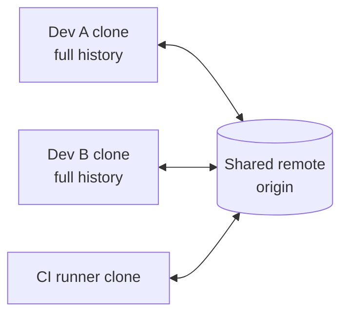
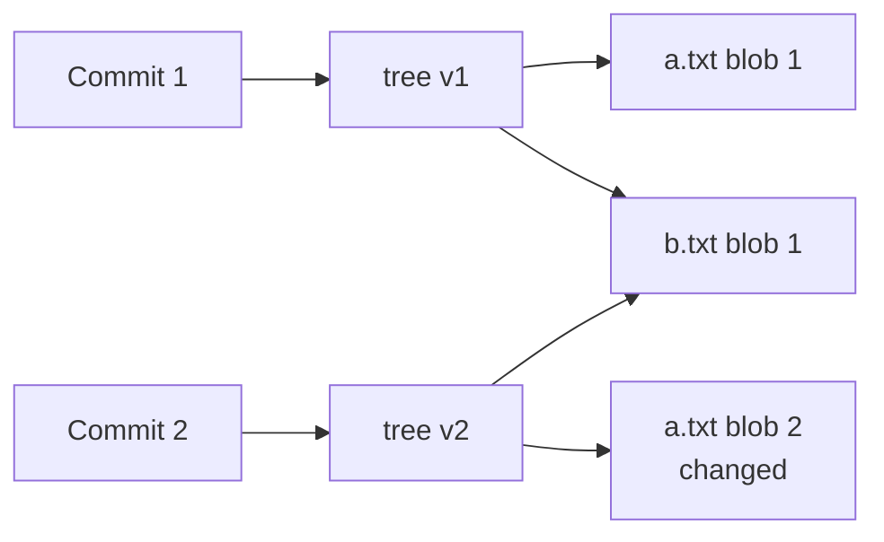
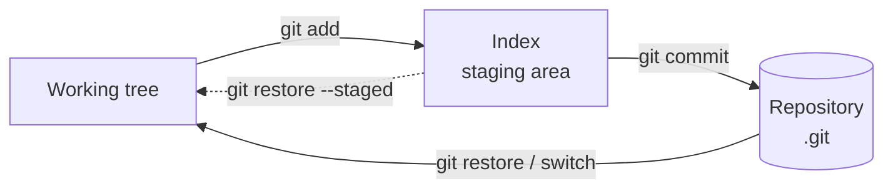
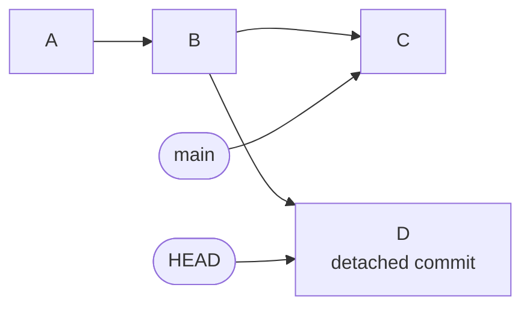
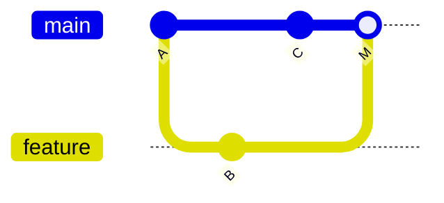
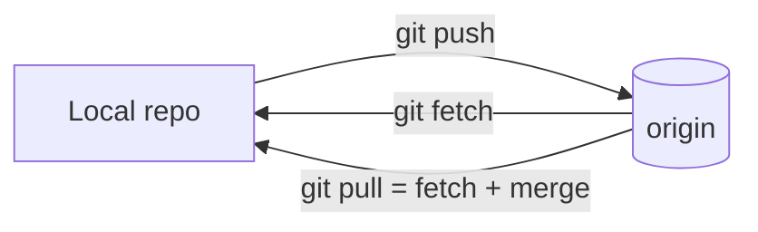
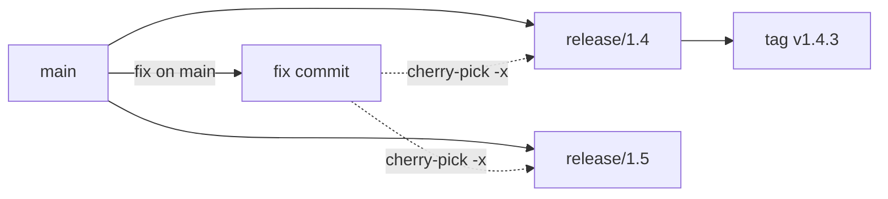
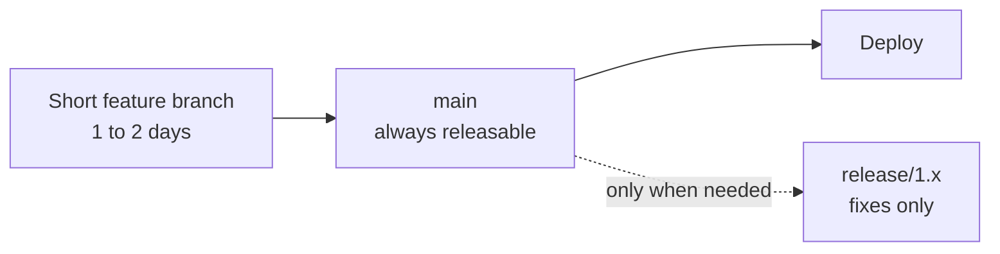

# Git & Version Control

[← Back to index](../README.md) · [⭐ Favorites](favorites.md)

33 questions · 0 favorites · [📚 Resources](#resources)

## Contents

**Basic**

- [1. What is version control, and why is Git called a distributed system?](#1-what-is-version-control-and-why-is-git-called-a-distributed-system)
- [2. How does Git think about data: snapshots or diffs?](#2-how-does-git-think-about-data-snapshots-or-diffs)
- [3. What are the working tree, the index (staging area) and the repository?](#3-what-are-the-working-tree-the-index-staging-area-and-the-repository)
- [4. What do the everyday commands `status`, `diff` and `log` show?](#4-what-do-the-everyday-commands-status-diff-and-log-show)
- [5. What does a Git commit contain?](#5-what-does-a-git-commit-contain)
- [6. What is a branch in Git, and what is HEAD?](#6-what-is-a-branch-in-git-and-what-is-head)
- [7. What is a detached HEAD, and how do you get out of it?](#7-what-is-a-detached-head-and-how-do-you-get-out-of-it)
- [8. How do you create and switch branches? What is the difference between `switch` and `checkout`?](#8-how-do-you-create-and-switch-branches-what-is-the-difference-between-switch-and-checkout)
- [9. What is the difference between a fast-forward merge and a three-way merge?](#9-what-is-the-difference-between-a-fast-forward-merge-and-a-three-way-merge)
- [10. What is a merge conflict, why does it happen, and how do you resolve it?](#10-what-is-a-merge-conflict-why-does-it-happen-and-how-do-you-resolve-it)
- [11. What are remotes in Git? Explain `clone`, `fetch`, `pull`, `push` and `origin`.](#11-what-are-remotes-in-git-explain-clone-fetch-pull-push-and-origin)
- [12. What is the difference between `git fetch` and `git pull`?](#12-what-is-the-difference-between-git-fetch-and-git-pull)
- [13. What are tracking branches and upstream branches?](#13-what-are-tracking-branches-and-upstream-branches)
- [14. What is the difference between Git, GitHub and GitLab?](#14-what-is-the-difference-between-git-github-and-gitlab)
- [15. What should go in `.gitignore`, and what should you never commit?](#15-what-should-go-in-gitignore-and-what-should-you-never-commit)
- [16. How do you undo changes in Git? Explain `restore`, `reset`, `revert` and `commit --amend`.](#16-how-do-you-undo-changes-in-git-explain-restore-reset-revert-and-commit---amend)
- [17. What is the difference between lightweight and annotated tags?](#17-what-is-the-difference-between-lightweight-and-annotated-tags)
- [18. How does `git stash` work, and when do you use it?](#18-how-does-git-stash-work-and-when-do-you-use-it)
- [19. How do you find who changed a line and when a piece of code appeared?](#19-how-do-you-find-who-changed-a-line-and-when-a-piece-of-code-appeared)
- [20. What makes a good commit message, and why are small atomic commits better?](#20-what-makes-a-good-commit-message-and-why-are-small-atomic-commits-better)

**Intermediate**

- [21. \[Tech Lead\] Merge, rebase or squash: what should the team policy be?](#21-tech-lead-merge-rebase-or-squash-what-should-the-team-policy-be)
- [22. \[Tech Lead\] How do you protect important branches and enforce review rules?](#22-tech-lead-how-do-you-protect-important-branches-and-enforce-review-rules)
- [23. \[Tech Lead\] How do you keep merge requests small and the review culture healthy?](#23-tech-lead-how-do-you-keep-merge-requests-small-and-the-review-culture-healthy)
- [24. \[Tech Lead\] A bad commit reached `main` and production is affected. What do you do: revert or fix forward?](#24-tech-lead-a-bad-commit-reached-main-and-production-is-affected-what-do-you-do-revert-or-fix-forward)
- [25. \[Tech Lead\] How do you avoid long-lived feature branches and merge hell?](#25-tech-lead-how-do-you-avoid-long-lived-feature-branches-and-merge-hell)
- [26. \[Tech Lead\] A secret was committed by accident. What is the response playbook?](#26-tech-lead-a-secret-was-committed-by-accident-what-is-the-response-playbook)
- [27. \[Tech Lead\] How do you manage releases, hotfixes and backports with Git?](#27-tech-lead-how-do-you-manage-releases-hotfixes-and-backports-with-git)
- [28. \[Tech Lead\] How do you onboard engineers to the team's Git workflow?](#28-tech-lead-how-do-you-onboard-engineers-to-the-teams-git-workflow)
- [29. \[Tech Lead\] How do you use Git hooks and CI checks to enforce standards?](#29-tech-lead-how-do-you-use-git-hooks-and-ci-checks-to-enforce-standards)
- [30. \[Tech Lead\] How do you handle large files and binary assets in Git?](#30-tech-lead-how-do-you-handle-large-files-and-binary-assets-in-git)
- [31. \[Tech Lead\] How do you measure and improve repository health?](#31-tech-lead-how-do-you-measure-and-improve-repository-health)

**Advanced**

- [32. \[Tech Lead\] How do you choose a branching strategy for a team?](#32-tech-lead-how-do-you-choose-a-branching-strategy-for-a-team)
- [33. \[Tech Lead\] Monorepo or polyrepo, and how do you keep Git fast at scale?](#33-tech-lead-monorepo-or-polyrepo-and-how-do-you-keep-git-fast-at-scale)

## Browse by module

| Module | Questions |
| --- | --- |
| Branching & Merging (5) | [6](#6-what-is-a-branch-in-git-and-what-is-head) · [7](#7-what-is-a-detached-head-and-how-do-you-get-out-of-it) · [8](#8-how-do-you-create-and-switch-branches-what-is-the-difference-between-switch-and-checkout) · [9](#9-what-is-the-difference-between-a-fast-forward-merge-and-a-three-way-merge) · [10](#10-what-is-a-merge-conflict-why-does-it-happen-and-how-do-you-resolve-it) |
| Git Fundamentals (7) | [1](#1-what-is-version-control-and-why-is-git-called-a-distributed-system) · [2](#2-how-does-git-think-about-data-snapshots-or-diffs) · [3](#3-what-are-the-working-tree-the-index-staging-area-and-the-repository) · [4](#4-what-do-the-everyday-commands-status-diff-and-log-show) · [5](#5-what-does-a-git-commit-contain) · [19](#19-how-do-you-find-who-changed-a-line-and-when-a-piece-of-code-appeared) · [20](#20-what-makes-a-good-commit-message-and-why-are-small-atomic-commits-better) |
| Remotes & Collaboration (4) | [11](#11-what-are-remotes-in-git-explain-clone-fetch-pull-push-and-origin) · [12](#12-what-is-the-difference-between-git-fetch-and-git-pull) · [13](#13-what-are-tracking-branches-and-upstream-branches) · [14](#14-what-is-the-difference-between-git-github-and-gitlab) |
| Repository Management (4) | [15](#15-what-should-go-in-gitignore-and-what-should-you-never-commit) · [17](#17-what-is-the-difference-between-lightweight-and-annotated-tags) · [30](#30-tech-lead-how-do-you-handle-large-files-and-binary-assets-in-git) · [33](#33-tech-lead-monorepo-or-polyrepo-and-how-do-you-keep-git-fast-at-scale) |
| Team Practice & Leadership (5) | [22](#22-tech-lead-how-do-you-protect-important-branches-and-enforce-review-rules) · [23](#23-tech-lead-how-do-you-keep-merge-requests-small-and-the-review-culture-healthy) · [28](#28-tech-lead-how-do-you-onboard-engineers-to-the-teams-git-workflow) · [29](#29-tech-lead-how-do-you-use-git-hooks-and-ci-checks-to-enforce-standards) · [31](#31-tech-lead-how-do-you-measure-and-improve-repository-health) |
| Undo & Recovery (4) | [16](#16-how-do-you-undo-changes-in-git-explain-restore-reset-revert-and-commit---amend) · [18](#18-how-does-git-stash-work-and-when-do-you-use-it) · [24](#24-tech-lead-a-bad-commit-reached-main-and-production-is-affected-what-do-you-do-revert-or-fix-forward) · [26](#26-tech-lead-a-secret-was-committed-by-accident-what-is-the-response-playbook) |
| Workflows & Strategy (4) | [21](#21-tech-lead-merge-rebase-or-squash-what-should-the-team-policy-be) · [25](#25-tech-lead-how-do-you-avoid-long-lived-feature-branches-and-merge-hell) · [27](#27-tech-lead-how-do-you-manage-releases-hotfixes-and-backports-with-git) · [32](#32-tech-lead-how-do-you-choose-a-branching-strategy-for-a-team) |

## Basic

### 1. What is version control, and why is Git called a distributed system?

**Short answer:** Version control records every change to your files, so you can see who changed what and why, go back to any point, and work in parallel with others. Git is distributed because every developer has a full copy of the whole history, not just the latest files.

In a central system like SVN, there is one server that holds the history. You ask the server for almost everything: log, diff, commit. If the server is down or you are offline, you are stuck.

In Git, `git clone` copies all commits to your machine. Commits, branches, log and diff all work locally and are very fast. The server (GitHub, GitLab, Azure Repos) is only a shared meeting point that the team agrees to treat as the official copy.

| Question | Central (SVN) | Distributed (Git) |
| --- | --- | --- |
| Where is the full history? | Only on the server | On every clone |
| Work offline? | Very limited | Yes, commit, branch and log all work |
| Branch cost | Copy of a directory on the server | A 41 byte pointer file |
| Single point of failure | The server | None, any clone can restore the server |
| Commit visible to others | Immediately | After `git push` |



Every box holds the full history. The remote is just the one the team agrees on.

**Gotcha:** distributed does not mean "no central repository". Teams still pick one official remote and protect its main branch. What changes is that you can commit and branch freely on your machine first, then share.

**Interview tip:** Give the practical benefits: fast local operations, cheap branches, offline work, and natural backups. Then add that the real power is cheap branching and merging, which makes pull requests and merge requests possible.

_Module: Git Fundamentals · Tags: basics, distributed, svn_

### 2. How does Git think about data: snapshots or diffs?

**Short answer:** Git stores snapshots. Each commit points to a complete picture of the project at that moment. Diffs that you see in `git show` are calculated when you ask, they are not what is stored.

Older tools save a list of file changes per version. Git saves a tree of file contents. To save space, files that did not change are not copied again. The new commit simply points to the same stored content as the old commit.

Content is stored by its hash, so identical content is stored once, even under different names or branches.



Commit 2 changed only `a.txt`. Both trees point to the same stored `b.txt`.

You can prove it. Two files with the same content get the same object id:

```bash
echo "hello" > one.txt
cp one.txt two.txt
git add one.txt two.txt
git ls-files -s
```

```text
100644 ce013625030ba8dba906f756967f9e9ca394464a 0	one.txt
100644 ce013625030ba8dba906f756967f9e9ca394464a 0	two.txt
```

Because of this design, branching is cheap, switching branches just changes which snapshot is in the working folder, and history is easy to verify. Later, Git packs objects and uses delta compression for storage size, but that is only a space optimisation, not the data model.

**Gotcha:** this is why Git has no real "rename" record. It just sees a file disappear and a file with the same content appear, and then detects the rename when you ask for the log or diff.

**Interview tip:** Say "snapshots, content addressed, deduplicated". It shows you know why branches are cheap and why a commit hash changes when anything in it changes.

_Module: Git Fundamentals · Tags: basics, snapshots, objects_

### 3. What are the working tree, the index (staging area) and the repository?

**Short answer:** Git has three areas. The working tree is your files on disk. The index (staging area) is the list of changes you plan to put in the next commit. The repository (the `.git` folder) holds the saved commits.

The staging area lets you build a commit on purpose. You can change ten files but commit only the three that belong together.



Edits flow right when you add and commit. Checkout and restore bring content back left.

```bash
echo "hello" > orders.txt
git status
git add orders.txt
git status -s
```

```text
On branch main

No commits yet

Untracked files:
  (use "git add <file>..." to include in what will be committed)
	orders.txt

nothing added to commit but untracked files present (use "git add" to track)
A  orders.txt
```

In the short status `A ` has two columns. The left column is the index versus the last commit. The right column is the working tree versus the index. After editing a file that is already staged, you would see `AM`.

**Gotcha:** `git commit` saves what is in the index, not what is on disk. If you edit a file after `git add`, the new edit is not in the commit unless you add again. `git commit -a` stages changes to tracked files for you, but it never adds new files.

**Interview tip:** Mention that `git add -p` lets you stage parts of a file, which is how you keep commits small and focused.

_Module: Git Fundamentals · Tags: basics, staging, index_

### 4. What do the everyday commands `status`, `diff` and `log` show?

**Short answer:** `git status` tells you what state your files are in. `git diff` shows the content of changes. `git log` shows the commit history. Each of them has options that you will use daily.

`git diff` compares the working tree with the index. `git diff --staged` compares the index with the last commit. If you have staged everything, plain `git diff` shows nothing, which confuses beginners.

```bash
echo "line2" >> orders.txt
git diff
git add orders.txt
git diff            # empty now
git diff --staged
```

```text
diff --git a/orders.txt b/orders.txt
index ce01362..1b3eb56 100644
--- a/orders.txt
+++ b/orders.txt
@@ -1 +1,2 @@
 hello
+line2
```

The last command prints the same diff, because now it is staged.

Useful `git log` flags:

| Command | What it shows |
| --- | --- |
| `git log --oneline` | One short line per commit |
| `git log --oneline --graph --decorate` | Branch shape, with branch and tag names |
| `git log -p` | Each commit with its patch |
| `git log --stat` | Files changed per commit |
| `git log --author="Dev"` | Only commits by that author |
| `git log --since="2 weeks ago"` | Date filter |
| `git log -- path/to/file` | History of one file or folder |
| `git log main..feature` | Commits in feature that are not in main |

```bash
git log --oneline --graph --decorate
```

```text
* b84c815 (HEAD -> main) Add second line
* 8966ee5 Add orders file
```

**Interview tip:** Say that you always run `git status` and `git diff --staged` before committing, so you know exactly what goes in.

_Module: Git Fundamentals · Tags: basics, log, diff, status_

### 5. What does a Git commit contain?

**Short answer:** A commit has a pointer to a tree (the snapshot of the project), pointers to its parent commits, the author and committer with timestamps, and the message. The commit id is the hash of all of that.

Because the parent hash is part of the commit, a commit id depends on all history before it. Change anything, even a letter in the message, and you get a new id, and every later commit gets a new id too. This is why rewriting history changes hashes.

```bash
git cat-file -p HEAD
```

```text
tree 9f1c2ab...
parent 8966ee5...
author Dev One <dev@example.com> 1792000000 +0530
committer Dev One <dev@example.com> 1792000000 +0530

Add second line
```

The hashes here are shortened and will differ on your machine. The first commit in a repository has no parent line. A merge commit has two or more.

| Field | Meaning |
| --- | --- |
| `tree` | The snapshot of the root folder |
| `parent` | Previous commit (zero, one, or more) |
| `author` | Who wrote the change, and when |
| `committer` | Who created this commit object, for example after a rebase or `cherry-pick` |
| message | The explanation. First line is the subject |

**Gotcha:** author and committer can differ. After a rebase, the author stays the original developer, and the committer becomes the person who rebased. This is why `git log` may show the same change with two dates.

**Interview tip:** If asked "why do hashes change on rebase", answer: the parent changed, so the commit content changed, so the hash changed.

_Module: Git Fundamentals · Tags: commit, objects_

### 6. What is a branch in Git, and what is HEAD?

**Short answer:** A branch is just a small file that holds the hash of one commit. It moves forward when you commit. `HEAD` is a pointer to the branch you are on now, so Git knows where the next commit goes.

Nothing is copied when you create a branch. That is why it is instant and cheap.


Both branches point to C3. HEAD points to feature, so the next commit moves feature only.

```bash
git switch -c feature/discount
git branch
cat .git/HEAD
cat .git/refs/heads/main
```

```text
Switched to a new branch 'feature/discount'
* feature/discount
  main
ref: refs/heads/feature/discount
b84c815ee30e...
```

You can see that `HEAD` holds the text `ref: refs/heads/feature/discount` and each branch is a file with a hash. This is the full secret of branches.

When HEAD holds a hash directly instead of a branch name, you are in a detached HEAD state. See the separate question on that.

**Gotcha:** deleting a branch only deletes the pointer. The commits stay in the object store until garbage collection, and you can usually get them back with `git reflog`.

**Interview tip:** Say "a branch is a movable pointer to a commit". This one sentence explains why Git branching is cheap and why merges are about commits, not about directories.

_Module: Branching & Merging · Tags: branches, head_

### 7. What is a detached HEAD, and how do you get out of it?

**Short answer:** Detached HEAD means HEAD points straight at a commit instead of a branch. You can look around and even commit, but those commits belong to no branch, so Git may delete them later. To keep the work, create a branch from where you are.

You get there by checking out a commit, a tag or a remote branch directly, for example `git switch --detach v1.0` or `git checkout a1b2c3d`.

```bash
git switch --detach v1.0
```

```text
HEAD is now at 5f765d2 Add app
```

Git prints a warning when you do this with `checkout`, and `git status` says `HEAD detached at 5f765d2`.

If you commit now, the new commit has no branch pointing to it. When you switch away, the only way back is the reflog.



Commit D is reachable only from HEAD. Move away and nothing points to D.

How to save it:

```bash
git switch -c fix/from-detached     # new branch at the current commit
```

How to leave without saving: `git switch main`.

**Gotcha:** many people lose work here. If you switched away already, run `git reflog`, find the hash of D, and run `git branch rescue <hash>`.

**Interview tip:** Detached HEAD is useful on purpose. It is how you build or test an old release tag, or how CI checks out a specific commit.

_Module: Branching & Merging · Tags: head, detached-head_

### 8. How do you create and switch branches? What is the difference between `switch` and `checkout`?

**Short answer:** Use `git switch <branch>` to move between branches and `git switch -c <name>` to create one. Old `git checkout` does the same and also restores files, so it does two jobs. Since Git 2.23, `switch` and `restore` split those jobs to make the commands clearer.

| Task | New way (Git 2.23 or later) | Old way |
| --- | --- | --- |
| Go to a branch | `git switch main` | `git checkout main` |
| Create and go | `git switch -c feature/x` | `git checkout -b feature/x` |
| Create from a start point | `git switch -c fix v1.0` | `git checkout -b fix v1.0` |
| Go back to the last branch | `git switch -` | `git checkout -` |
| Detach at a commit | `git switch --detach a1b2c3d` | `git checkout a1b2c3d` |
| Discard file changes | `git restore file` | `git checkout -- file` |

```bash
git switch -c feature/discount
git switch main
git switch -
```

```text
Switched to a new branch 'feature/discount'
Switched to branch 'main'
Switched to branch 'feature/discount'
```

Switching changes the files in your working tree to match the other branch. If you have uncommitted changes that would be overwritten, Git refuses and tells you. Changes to files that are the same on both branches are carried over.

**Gotcha:** `git checkout <name>` can mean a branch or a file path. If a branch and a file share a name, the result is surprising. `switch` only handles branches, so it avoids this.

**Interview tip:** Both work, and you should know both because old docs and teammates use `checkout`. Mention that you prefer `switch` and `restore` since they are harder to misuse.

_Module: Branching & Merging · Tags: branches, switch, checkout_

### 9. What is the difference between a fast-forward merge and a three-way merge?

**Short answer:** A fast-forward merge happens when the target branch has no new commits, so Git just moves its pointer forward. A three-way merge happens when both branches have new commits, so Git creates a new merge commit with two parents.

Fast-forward: `main` is behind `feature`, on a straight line. No new commit is needed.

```bash
git switch main
git merge feature
```

```text
Updating 5f765d2..cad88d6
Fast-forward
 f.txt | 1 +
 1 file changed, 1 insertion(+)
 create mode 100644 f.txt
```

Three-way: both sides moved, so Git compares both tips with their common ancestor and builds a merge commit.

```bash
git merge other -m "Merge branch 'other'"
git log --oneline --graph
```

```text
Merge made by the 'ort' strategy.
 o.txt | 1 +
 1 file changed, 1 insertion(+)
 create mode 100644 o.txt
*   e573903 Merge branch 'other'
|\  
| * 8683814 Other work
* | e19561a Main work
|/  
* cad88d6 Add feature
```



A is the common ancestor. M has two parents, C and B.

Useful flags: `--no-ff` always creates a merge commit, even when fast-forward is possible, so the feature stays visible as a group. `--ff-only` refuses to merge unless a fast-forward is possible, which is a safe way to update `main` from a remote.

**Gotcha:** the strategy named `ort` is the default since Git 2.34. Older versions used `recursive`.

**Interview tip:** Mention that a merge never rewrites history. It adds a commit, so it is safe on shared branches.

_Module: Branching & Merging · Tags: merge, fast-forward_

### 10. What is a merge conflict, why does it happen, and how do you resolve it?

**Short answer:** A conflict happens when both branches changed the same lines of the same file and Git cannot decide which one to keep. You open the file, choose the right result, remove the markers, `git add` the file and finish the merge.

Git merges text line by line. If two changes touch different parts of a file, it combines them silently. When they touch the same part, it stops and marks the file.

```bash
git merge c1
git status -s
cat p.txt
```

```text
Auto-merging p.txt
CONFLICT (add/add): Merge conflict in p.txt
Automatic merge failed; fix conflicts and then commit the result.
AA p.txt
<<<<<<< HEAD
price=20
=======
price=10
>>>>>>> c1
```

The part above `=======` is your side (HEAD). The part below is the incoming branch. Edit the file to the final text, with all three marker lines removed:

```bash
# edit p.txt so it contains the final value, then
git add p.txt
git commit          # finishes the merge
# or give up and go back
git merge --abort
```

Steps in order: run `git status` to list conflicted files, edit each, `git add`, then commit or `git merge --continue`. After that, build and run the tests. A conflict-free merge can still be logically wrong.

**Gotcha:** never commit the marker lines. A pre-commit check that searches for `<<<<<<<` is cheap protection.

**Interview tip:** Prevent conflicts, not only solve them. Short-lived branches, small changes and frequent integration reduce conflicts far more than any merge tool.

_Module: Branching & Merging · Tags: merge, conflicts_

### 11. What are remotes in Git? Explain `clone`, `fetch`, `pull`, `push` and `origin`.

**Short answer:** A remote is a named link to another copy of the repository, usually on a server. `origin` is the default name Git gives to the place you cloned from. `clone` copies a repository, `fetch` downloads new commits, `pull` downloads and integrates them, and `push` uploads your commits.

| Command | What it does |
| --- | --- |
| `git clone <url>` | Copies all history, sets up `origin`, and checks out the default branch |
| `git fetch` | Downloads new commits and updates `origin/*` branches. Does not touch your files |
| `git pull` | `fetch` plus a merge (or rebase) of the upstream branch into your current branch |
| `git push` | Uploads your branch commits and moves the remote branch |
| `git remote -v` | Lists remotes and their URLs |

```bash
git remote -v
git push -u origin main
git branch -vv
```

```text
origin	git@gitlab.example.com:shop/orders.git (fetch)
origin	git@gitlab.example.com:shop/orders.git (push)
branch 'main' set up to track 'origin/main'.
* main 1a95fb0 [origin/main] first
```

The URL shown is a made-up example. A repository can have more than one remote, for example `origin` for your fork and `upstream` for the original project.



**Gotcha:** `origin` is only a name. Nothing is special about it, you can rename it with `git remote rename`.

**Interview tip:** Explain that all your local work is private until you push. Also that `git push` is refused when the remote has commits you do not have, which protects others' work.

_Module: Remotes & Collaboration · Tags: remotes, clone, push, pull_

### 12. What is the difference between `git fetch` and `git pull`?

**Short answer:** `git fetch` only downloads new commits from the remote and updates your remote-tracking branches such as `origin/main`. `git pull` does a fetch and then merges (or rebases) that into your current branch, so it changes your files.

Fetch is always safe. It cannot break your work. You can look at what arrived before you decide what to do.

```bash
git fetch
git status -sb
git log --oneline main..origin/main
```

```text
From .../remote
   1a95fb0..03353fe  main       -> origin/main
## main...origin/main [behind 1]
03353fe second
```

You see that you are behind by one commit and you can read it. Then integrate it:

```bash
git merge --ff-only origin/main      # or: git rebase origin/main
```

`git pull` is the same as `git fetch` followed by `git merge origin/main`. With `--rebase` it uses rebase instead.

| | `fetch` | `pull` |
| --- | --- | --- |
| Changes working files | No | Yes |
| Can cause conflicts | No | Yes |
| Creates merge commit | No | Maybe |
| Good for | Looking before acting, CI | Quick updates of a clean branch |

**Gotcha:** a plain `git pull` on a branch that has diverged creates a merge commit named "Merge branch 'main' of ...". Many teams find these noisy. Set `git config --global pull.ff only` or `pull.rebase true` (see the question on `pull --rebase`).

**Interview tip:** Say that you like to fetch first, then decide. It shows you do not treat pull as magic.

_Module: Remotes & Collaboration · Tags: fetch, pull_

### 13. What are tracking branches and upstream branches?

**Short answer:** A remote-tracking branch such as `origin/main` is your local, read-only copy of where the remote branch was at the last fetch. An upstream (tracking) setup links your local branch to one of them, so plain `git pull`, `git push` and `git status` know which remote branch to use.

Without an upstream, you have to type the remote and branch every time.

```bash
git push -u origin feature/discount     # -u sets the upstream
git branch -vv
```

```text
* feature/discount 3a4b5c6 [origin/feature/discount] Add discount rules
  main             a1b2c3d [origin/main] Fix typo
```

The text in brackets shows the upstream. If you are ahead or behind, it adds `[origin/main: ahead 2]`.

Why it matters:
- `git status` says "Your branch is ahead of 'origin/main' by 2 commits".
- `git pull` and `git push` need no arguments.
- `@{u}` or `@{upstream}` can be used as a short name for the upstream, for example `git log @{u}..HEAD` shows what you have not pushed.

```bash
git branch --set-upstream-to=origin/main main     # set later
git config --global push.autoSetupRemote true     # Git 2.37+: first push sets it
```

`push.autoSetupRemote` exists since Git 2.37.

**Gotcha:** `origin/main` does not update by itself. It moves only when you fetch, pull or push. A stale `origin/main` makes "ahead/behind" numbers wrong.

**Interview tip:** Say that remote-tracking branches are bookmarks of the remote state. This helps to explain why `fetch` is safe and why `git diff origin/main` works offline.

_Module: Remotes & Collaboration · Tags: upstream, tracking, branches_

### 14. What is the difference between Git, GitHub and GitLab?

**Short answer:** Git is the version control tool that runs on your machine. GitHub, GitLab and Azure Repos are hosting services that store Git repositories and add collaboration features such as pull requests or merge requests, issues, permissions and CI pipelines.

Git works without any of them. You can use a plain folder or an SSH server as a remote. The hosting platforms add the team layer around Git.

| Part | Git itself | Hosting platform |
| --- | --- | --- |
| Commits, branches, merges | Yes | Uses Git underneath |
| Merge request or pull request | No | Yes, it is a platform feature |
| Code review comments | No | Yes |
| Protected branches, approvals | No (only hooks) | Yes |
| CI/CD pipelines | No | Yes, such as GitLab CI |
| Issues and boards | No | Yes |

An important idea: a merge request is not a Git object. It is a record on the server that says "merge branch A into B, after these checks". When you click Merge, the server runs normal Git operations (merge, squash or fast-forward) on its copy of the repository.

This also means that rules like "two approvals required" are platform rules. Plain Git on your laptop does not enforce them. The server rejects a push that breaks the rules.

**Gotcha:** the same Git commands work on all platforms, but the web features and names differ: GitHub says pull request, GitLab says merge request, and they have different setting names for branch protection.

**Interview tip:** If someone says "Git" for the website, correct it gently, then show you know where the line is: Git handles history, the platform handles process.

_Module: Remotes & Collaboration · Tags: basics, gitlab, github_

### 15. What should go in `.gitignore`, and what should you never commit?

**Short answer:** `.gitignore` lists files Git should not track: build output, dependencies, local settings and logs. Never commit secrets such as passwords, API keys, private keys or `.env` files. Once a secret is committed it stays in history, even if you delete the file later.

```text
# dependencies and build output
node_modules/
dist/
bin/
obj/

# local config and secrets
.env
*.pem
*.pfx

# editor and OS noise
.vscode/
.idea/
.DS_Store

# but keep the example file
!.env.example
```

Rules to remember:
- A pattern ending with `/` matches only folders.
- `*` matches within one folder, `**/` matches any depth.
- A line starting with `!` re-includes a file.
- Ignore rules apply only to untracked files. If a file is already tracked, adding it to `.gitignore` does nothing. Untrack it with `git rm --cached`.

```bash
echo ".env" >> .gitignore
git rm --cached .env
git status -s
```

```text
rm '.env'
D  .env
?? .gitignore
```

The file stays on disk, but the next commit removes it from the repository.

Also commit lock files (`package-lock.json`, `go.sum`). They make builds repeatable. Do not commit generated files that others can rebuild.

**Gotcha:** removing a secret in a later commit does not remove it from history. Treat any committed secret as leaked: rotate it first, then clean history if needed.

**Interview tip:** Mention a global ignore file (`core.excludesFile`) for personal noise like editor folders, so the project file stays small. Add a secret scanner in CI as a safety net.

_Module: Repository Management · Tags: gitignore, secrets, security_

### 16. How do you undo changes in Git? Explain `restore`, `reset`, `revert` and `commit --amend`.

**Short answer:** Choose by where the change is. Uncommitted edit: `git restore`. Last commit not yet shared: `git commit --amend` or `git reset`. Commit already shared: `git revert`, which adds a new commit that cancels the old one. Never rewrite shared history.

| Situation | Command | Safe on shared branch? |
| --- | --- | --- |
| Throw away edits in a file | `git restore file` | Local only |
| Unstage a file | `git restore --staged file` | Local only |
| Fix last commit message or add a forgotten file | `git commit --amend` | Only if not pushed |
| Undo last commit, keep the changes staged | `git reset --soft HEAD~1` | Only if not pushed |
| Undo last commit, keep changes unstaged | `git reset HEAD~1` (mixed, the default) | Only if not pushed |
| Undo last commit and delete the changes | `git reset --hard HEAD~1` | Only if not pushed |
| Cancel a commit that is already pushed | `git revert <commit>` | Yes |

```bash
git revert --no-edit HEAD
git log --oneline -3
```

```text
[main 517d669] Revert "Oops commit"
 1 file changed, 1 deletion(-)
 delete mode 100644 z.txt
517d669 Revert "Oops commit"
3740805 Oops commit
e573903 Merge branch 'other'
```

The history keeps both commits, so teammates who already pulled the bad one are fine.

**Gotcha:** `reset --hard` and `restore` on unsaved edits cannot be undone. Edits that were never committed or staged are gone. Committed work is different: it stays in `git reflog` for a while.

**Interview tip:** The rule is simple: if others might have it, revert. If only you have it, you may reset or amend. Say this sentence in the interview.

_Module: Undo & Recovery · Tags: undo, reset, revert, restore_

### 17. What is the difference between lightweight and annotated tags?

**Short answer:** A tag is a fixed name for one commit, used to mark releases. A lightweight tag is just a pointer. An annotated tag is a full Git object with a tagger, a date and a message, and it can be signed. Use annotated tags for releases.

```bash
git tag v1.0                          # lightweight
git tag -a v1.1 -m "Release 1.1"      # annotated
git tag
git cat-file -t v1.0
git cat-file -t v1.1
```

```text
v1.0
v1.1
commit
tag
```

The type shows the difference: `v1.0` points straight to a commit, `v1.1` is its own `tag` object that points to the commit.

| | Lightweight | Annotated |
| --- | --- | --- |
| Stores message and author | No | Yes |
| Can be signed (`-s`) | No | Yes |
| Shown by `git describe` by default | No | Yes |
| Good for | Private bookmarks | Releases |

Tags are not pushed automatically. You must push them:

```bash
git push origin v1.1          # one tag
git push origin --follow-tags # annotated tags reachable from pushed commits
git push origin --delete v1.1 # remove from remote
```

Tags do not move when you commit, unlike branches. That is why a release tag always points to the exact code that was shipped.

**Gotcha:** moving or re-using a tag after others fetched it causes confusion, because Git does not update existing tags on fetch by default. Treat release tags as permanent. Protect them in GitLab with protected tags.

**Interview tip:** Link tags to versioning: tag `v1.4.2` on the commit that CI built and released, and let the pipeline trigger from tags.

_Module: Repository Management · Tags: tags, releases_

### 18. How does `git stash` work, and when do you use it?

**Short answer:** `git stash` saves your uncommitted changes on a stack and gives you a clean working tree. You can then switch branches, and later bring the changes back with `git stash pop`.

Typical case: you are halfway through a feature and an urgent bug comes in. You do not want a half-finished commit.

```bash
git stash            # save tracked changes
git status -s        # clean now
git switch hotfix/login
# ...fix, commit, push...
git switch feature/cart
git stash pop        # bring the changes back and drop the stash
```

```text
Saved working directory and index state WIP on main: 782cb29 Change 6
```

Main commands:

| Command | Meaning |
| --- | --- |
| `git stash push -m "cart wip"` | Save with a name |
| `git stash list` | Show the stack: `stash@{0}`, `stash@{1}` |
| `git stash pop` | Apply the latest stash and remove it |
| `git stash apply` | Apply but keep it in the list |
| `git stash drop` | Delete one stash |
| `git stash -u` | Include untracked files |

By default stash ignores untracked files and ignored files. Add `-u` for untracked.

**Gotcha:** if `pop` hits a conflict, Git keeps the stash in the list so you do not lose it. Do not stash for days. Stashes are easy to forget, are not pushed, and have no branch name. For longer work, make a WIP commit on a branch instead.

**Interview tip:** Mention `git stash branch <name>`, which creates a branch from the commit where you stashed and applies the stash there. It avoids conflicts when the base branch has moved on.

_Module: Undo & Recovery · Tags: stash_

### 19. How do you find who changed a line and when a piece of code appeared?

**Short answer:** Use `git blame` to see which commit last changed each line, and `git log -S` or `-G` to find the commits that added or removed a piece of text. Together they answer "who, when and why" for any line.

`git blame` shows commit, author and line:

```bash
git blame -s f.txt
```

```text
cad88d62 1) feat
```

The first column is the commit that last touched the line. Then run `git show cad88d6` to read the message and the full change. In the line view, use `-L 10,20` to limit blame to lines 10 to 20, and `-w` to ignore whitespace-only changes.

`git log -S"text"` (called the pickaxe) finds commits where the number of occurrences of a string changed. It finds the commit that introduced or deleted a function or a constant, even if the line moved.

```bash
git log --oneline -S"feat"
git log --oneline -G"^price=\d+"      # regex: lines matching in the diff
git log -L :calculateTotal:src/cart.go  # history of one function
```

```text
cad88d6 Add feature
```

| Tool | Best for |
| --- | --- |
| `git blame file` | Who last changed this line |
| `git log -S"x"` | When did string `x` appear or disappear |
| `git log -G"regex"` | Same, with a regular expression |
| `git log -L :func:file` | Full history of one function |
| `git log --follow file` | History of a file across renames |

**Gotcha:** the last change to a line is often a formatting or rename commit that hides the real author. Use `git blame -w -C` (ignore whitespace, detect moved code) or a `.git-blame-ignore-revs` file with `git config blame.ignoreRevsFile`.

**Interview tip:** Say that blame is for finding the context, not for blaming. The goal is to read the commit message and pull request and understand why the line is there.

_Module: Git Fundamentals · Tags: blame, log, archaeology_

### 20. What makes a good commit message, and why are small atomic commits better?

**Short answer:** A good commit does one logical thing and has a message that says what changed and why. Small atomic commits are easier to review, revert, cherry-pick and bisect. A common message format is Conventional Commits: `type(scope): subject`.

A message has a short subject line (about 50 to 72 characters, imperative mood), a blank line, and a body that explains why. The code already shows what.

```text
fix(orders): reject negative quantities

The API accepted quantity = -1 and created a refund line.
Validate in the handler and return 400 so clients see the problem.

Refs: SHOP-412
```

Conventional Commit types: `feat` (new feature), `fix`, `docs`, `refactor`, `test`, `chore`, `perf`, `ci`. A `!` or `BREAKING CHANGE:` footer marks a breaking change. Tools can then create a changelog and pick the next semantic version automatically.

What atomic means:
- The commit builds and tests pass on its own.
- It contains one idea. A refactor and a feature go into two commits.
- You can revert it alone without breaking something else.

| Bad | Better |
| --- | --- |
| `fix stuff` | `fix(cart): keep coupon after login` |
| `WIP` pushed to main | Clean up with interactive rebase before the merge request |
| One giant commit "new module" | Several commits: schema, service, API, tests |

**Gotcha:** if your team squash-merges, the merge request title becomes the commit message on `main`. Then enforce the format on the title, not on every small commit.

**Interview tip:** Link it to outcomes: a clean history makes `git bisect`, `git revert` and release notes work. A history like "fix, fix again, oops" does not.

_Module: Git Fundamentals · Tags: commits, conventional-commits, best-practices_

## Intermediate

### 21. [Tech Lead] Merge, rebase or squash: what should the team policy be?

**Short answer:** There is no single right answer. Pick one merge method for `main`, write it down, and enforce it on the platform. Many teams choose squash merge for clean one-commit-per-change history, or rebase plus fast-forward when they care about every commit. Merge commits keep the true history but make the graph noisy.

| Method | Result on `main` | Good | Bad |
| --- | --- | --- | --- |
| Merge commit | Branch commits plus a merge commit | Keeps real history, no rewrite | Noisy graph, hard to bisect through merges |
| Squash merge | One new commit per merge request | Clean, easy to revert one change | Loses small steps, author credit in one commit |
| Rebase and fast-forward | Straight line of the original commits | Linear and detailed | Needs tidy commits, hashes change |
| Semi-linear (GitLab) | Rebase needed, then merge commit | Linear check plus visible merge | Extra rebases when queue is busy |

```bash
git log --oneline --graph
```

```text
* 46495d5 feat: add g (squash)
* 06ba897 root
```

That is what squash merge gives: a straight, readable line.

How I would decide:
- If developers write messy "wip" commits, use squash and require a good merge request title in conventional format.
- If the team writes careful atomic commits and uses interactive rebase, use rebase with fast-forward.
- If you need an audit trail of each merge and use release branches, merge commits are fine. Use `git log --first-parent` to read them as a clean list.

Whatever you choose, apply the same rule to everyone, set it in GitLab project settings (merge method and "squash commits" option), and explain why in the contributing guide.

**Gotcha:** after a squash merge, Git does not know the feature branch was merged. `git branch --merged` will not list it, so branch clean-up needs the platform's "delete source branch" option.

**Interview tip:** Say that you care about two goals: `main` must be easy to read and easy to revert. The method is only a way to get there.

_Module: Workflows & Strategy · Tags: tech-lead, merge, rebase, squash_

### 22. [Tech Lead] How do you protect important branches and enforce review rules?

**Short answer:** Protect `main` and release branches on the platform: no direct pushes, no force pushes, required merge request, a passing pipeline, and a minimum number of approvals. Add CODEOWNERS for sensitive paths, and signed commits where traceability matters.

Rules belong to the server, not to goodwill. Local Git cannot stop a mistake, but the remote can reject it.

Typical GitLab settings:
- **Protected branches**: allowed to merge, allowed to push set to "No one" or maintainers only. Force push disabled.
- **Merge request approvals**: at least one or two approvals, approvers cannot be the author, new commits reset approvals.
- **Pipelines must succeed**, and all threads must be resolved before merging.
- **CODEOWNERS** file: the owners of a path must approve changes to it.
- **Protected tags**: only release managers can create `v*` tags.
- **Push rules** (Premium tier): reject secrets, unsigned commits or bad messages. Check your plan.

```text
# CODEOWNERS (GitLab syntax)
/deploy/            @platform-team
/src/payments/      @payments-leads
*.tf                @infra-owners
```

Meaning: a change under `deploy/` needs approval from the platform team.

Signing commits (with GPG or SSH keys) proves who wrote a commit. It is useful in regulated environments, because the author name in Git is just text that anyone can set.

```bash
git config --global gpg.format ssh
git config --global user.signingkey ~/.ssh/id_ed25519.pub
git config --global commit.gpgsign true
```

**Gotcha:** admins and maintainers can often bypass rules. Review who has those roles, and avoid "temporary" exceptions that stay forever.

**Interview tip:** Mention balance. Too many required approvals slow the team down and teach people to click approve. Use code owners for risky areas and keep the rest light.

_Module: Team Practice & Leadership · Tags: tech-lead, gitlab, protected-branches, security_

### 23. [Tech Lead] How do you keep merge requests small and the review culture healthy?

**Short answer:** Aim for merge requests that a reviewer can understand in about 20 minutes, usually under 400 changed lines. Split big work into steps that can each be merged safely. Agree on a review turnaround time, and use stacked branches or feature flags when parts depend on each other.

Small changes are reviewed faster and better, merge with fewer conflicts, and are simple to revert. Big ones get a quick "looks good to me".

How to split a large change:
- Refactor first, behaviour second. A pure move or rename commit can be reviewed by skimming.
- Add the new code behind a feature flag, merge it dark, then switch it on later.
- Separate database migration, backend and frontend into steps that stay compatible.
- Use `git add -p` to craft commits, and `git rebase -i` to reorder them.

Stacked changes: when part 2 needs part 1 but part 1 is still in review, create branches on top of each other.

```bash
git switch -c part1
# ...commit...
git switch -c part2          # starts from part1
# ...commit...
# later, after review fixes on part1:
git switch part2
git rebase --update-refs part1      # Git 2.38+ also moves branches in the stack
```

`--update-refs` exists since Git 2.38. After the rebase, branches in the middle of the stack move too, and Git prints which refs it updated.

Team habits that help:
- A service level goal for review, for example first response within one working day.
- A merge request template: what, why, how to test, rollback plan.
- Author reviews their own diff first. Reviewers focus on design and risk, and let linters handle style.
- Pair or talk for tricky changes instead of long comment threads.

**Gotcha:** forcing a hard line limit makes people split in silly ways. Use it as a smell, not as a law.

**Interview tip:** Say how you measure it: time to first review, time to merge, and size of merge requests. Share the numbers and talk about them in the retrospective.

_Module: Team Practice & Leadership · Tags: tech-lead, code-review, merge-requests_

### 24. [Tech Lead] A bad commit reached `main` and production is affected. What do you do: revert or fix forward?

**Short answer:** First restore service, then investigate. If the cause is clear and the revert is simple, revert the commit and redeploy, because it is the fastest and safest path. Fix forward only when the fix is tiny and obvious or when a revert is not possible, for example after a database migration.

Steps I follow:
1. **Declare and communicate.** Tell the team and stakeholders. One person leads, others do not push to `main` meanwhile.
2. **Find the change.** Check the deployment time, then `git log --first-parent --since` and the merge request list. If unclear, `git bisect`.
3. **Decide.** Revert if the change is isolated. Roll back the deployed version first when your pipeline supports it, because that does not need Git at all.
4. **Revert with a merge request.** Do not rewrite or force push `main`.
5. **Verify** in production with metrics and logs.
6. **Post-mortem.** Add the test or check that would have caught it.

```bash
git revert --no-edit <bad-commit>        # normal commit
git revert -m 1 --no-edit <merge-commit> # merge commit: keep parent 1 (main)
git push origin HEAD:revert/bad-change   # then open a merge request
```

```text
[main 9c39464] Revert "Merge branch 'feat'"
```

For a merge commit you must say which parent is the mainline with `-m 1`, otherwise Git cannot know which side to undo.

| | Revert | Fix forward |
| --- | --- | --- |
| Speed when cause is known | Fast | Depends on the fix |
| Risk | Low | Another untested change under pressure |
| Works after schema changes | Often not alone | Yes, needed |

**Gotcha:** if you revert a merge and later want the branch back, merging it again brings nothing, because Git thinks it is already merged. Revert the revert first.

**Interview tip:** Emphasise that service restore comes before blame, and that a revert is a normal, safe, reviewed commit, not a failure.

_Module: Undo & Recovery · Tags: tech-lead, incident, revert_

### 25. [Tech Lead] How do you avoid long-lived feature branches and merge hell?

**Short answer:** Integrate often. Break the work into small steps, merge each one behind a feature flag, and merge `main` into your branch (or rebase) every day. The longer a branch lives, the more conflicts, surprises and risk it collects.

Conflicts grow faster than the size of the branch, because other people keep changing the same files. Worse, the real danger is not the text conflict but a silent logic conflict that appears only at the end.

What I do:
- **Feature flags.** Ship unfinished code turned off. The branch can then be merged every day, and the release is a config change, not a merge.
- **Branch by abstraction.** For a large refactor, introduce an interface, move callers one at a time, remove the old path at the end.
- **Sync every day.** `git fetch` then `git rebase origin/main` (or merge) so conflicts stay small.
- **Share early.** Open a draft merge request so the team sees direction.
- **Limit work in progress.** Finish what is open before starting more.

```bash
git fetch origin
git rebase origin/main        # or: git merge origin/main
git range-diff origin/main@{1} origin/main HEAD   # optional: see what changed
```

When a long branch already exists and hurts:
1. Merge `main` into it now, and fix conflicts once.
2. Run the whole test suite.
3. Cut the branch into several merge requests, starting with the safe parts like refactors and tests.

**Gotcha:** long-lived branches also hide bugs from CI because the code does not run with the latest `main`. Run the pipeline against the merge result (GitLab merged results pipelines) to catch this early.

**Interview tip:** Link it to delivery metrics: smaller batches improve lead time and reduce failures. This is the same message as continuous integration.

_Module: Workflows & Strategy · Tags: tech-lead, feature-flags, trunk-based, integration_

### 26. [Tech Lead] A secret was committed by accident. What is the response playbook?

**Short answer:** Rotate the secret immediately, because it is already compromised the moment it was pushed. Then check for use, then remove it from history if policy requires it, and add prevention. Cleaning history is secondary. Rotation is the real fix.

Steps in order:
1. **Revoke and rotate** the key, token or password. Do this before anything else. Update the services that use it.
2. **Check the damage.** Look at provider logs for use of the old secret. Include forks, CI logs and caches that may hold a copy.
3. **Remove from the latest code.** Move the secret to a vault or CI variable (GitLab protected, masked variables, Azure Key Vault).
4. **Rewrite history only if needed.** For public repositories, or strict rules, remove the file from all commits with `git filter-repo` (a separate tool, not part of Git itself).
5. **Coordinate the force push.** Freeze merges, announce, rewrite, force push all branches and tags, ask everyone to re-clone or reset. Ask the host to purge cached views and merge request refs.
6. **Prevent.** Add a secret scanner in pre-commit and CI, plus `.gitignore` for `.env` files.

```bash
# on a fresh mirror clone
git clone --mirror git@gitlab.example.com:shop/orders.git
cd orders.git
git filter-repo --invert-paths --path config/prod.env
git push --force --mirror
```

Check the options against the `git filter-repo` documentation for your version. Every commit after the removed file gets a new hash.

Inside the old copy, the leaked commit may still exist on the server for a while, in merge request refs or backups. That is why rotation comes first.

**Gotcha:** `git rm` and a new commit do not help. The secret is still in all earlier commits. Also, never "fix" it by force pushing without telling the team, since their clones still hold the secret and can push it back.

**Interview tip:** Say "assume breach, rotate first". Interviewers want to hear that you do not rely on deleting history.

_Module: Undo & Recovery · Tags: tech-lead, security, secrets, incident_

### 27. [Tech Lead] How do you manage releases, hotfixes and backports with Git?

**Short answer:** Tag every release, cut a `release/x.y` branch when you need to support old versions, fix bugs on `main` first, then cherry-pick the fix to the release branches. This keeps one source of truth and avoids fixes that exist only on old branches.

Flow: "main first, then backport".



The fix lands on main. Cherry-pick copies it to each supported release branch, and the release gets a new tag.

```bash
git switch release/1.4
git cherry-pick -x 61e1c8d
git tag -a v1.4.3 -m "Release 1.4.3"
git push origin release/1.4 v1.4.3
```

```text
(cherry picked from commit 61e1c8dce30144b9368b87555c22679b844e922e)
```

The `-x` flag adds that line to the message, so anyone can trace the original commit. That is very helpful for audits, which matter in aviation and other regulated work.

Practices:
- Use semantic versioning. Patch releases (1.4.3) only get fixes.
- Make the fix first on `main`. Exception: when the bug exists only on the old branch, fix there and forward-port.
- Protect `release/*` branches and release tags.
- Keep a short list of supported versions, and drop branches when support ends.
- Track "which releases contain this fix" with `git branch --contains <sha>` and `git tag --contains <sha>`.

**Gotcha:** cherry-picks create new commits with different hashes. If the release branch is later merged into `main`, you may see duplicate changes or conflicts.

**Interview tip:** Mention traceability: from a release tag, I can list every commit in it with `git log v1.4.2..v1.4.3`, and that list is the release notes.

_Module: Workflows & Strategy · Tags: tech-lead, releases, cherry-pick, hotfix_

### 28. [Tech Lead] How do you onboard engineers to the team's Git workflow?

**Short answer:** Write the workflow on one page, set safe defaults in shared config, enforce the rules on the server, and teach by pairing on a real merge request. People learn the model (commits, branches, remotes) faster than they learn command lists.

What goes in the one-page guide:
- Branch names: `feature/SHOP-123-short-title`, `fix/...`, `release/x.y`.
- How to start work, how to update your branch, how to open a merge request.
- Commit message format and the merge method (squash or rebase).
- What not to do: force push shared branches, commit secrets, commit generated files.
- What to do when stuck: `git status`, `git reflog`, ask in the channel.

A small cheat-sheet that covers 90 percent:

```bash
git switch -c feature/SHOP-123-discount     # start
git add -p && git commit -m "feat(cart): add discount rule"
git fetch origin && git rebase origin/main   # update
git push -u origin HEAD                      # share
git restore --staged <file>                  # unstage
git reflog                                   # find lost commits
```

Safe team defaults to put into onboarding scripts:

```bash
git config --global pull.rebase true
git config --global fetch.prune true
git config --global push.autoSetupRemote true
git config --global rerere.enabled true
git config --global init.defaultBranch main
```

Teach the mental model first: the three areas, branches as pointers, and the reflog as a safety net. When people know that committed work is almost never lost, they stop being afraid and ask for help earlier.

**Gotcha:** a long wiki that nobody reads is worse than a short page that is kept current. Review it each quarter, and add a lesson whenever a mistake happens twice.

**Interview tip:** Say that you run a short pairing session on the first merge request of each new person. It teaches the workflow and the review culture in one go.

_Module: Team Practice & Leadership · Tags: tech-lead, onboarding, workflow_

### 29. [Tech Lead] How do you use Git hooks and CI checks to enforce standards?

**Short answer:** Client-side hooks give fast feedback on the developer machine, but people can skip them. Server-side rules and CI checks cannot be skipped. So use hooks for convenience and the pipeline or push rules for enforcement.

| Where | Examples | Can be bypassed? |
| --- | --- | --- |
| `pre-commit` (local) | Format, lint, secret scan | Yes (`--no-verify`) |
| `commit-msg` (local) | Check the message format | Yes |
| `pre-push` (local) | Run quick tests | Yes |
| CI pipeline | Lint, tests, message check, secret scan | No, if merge requires green pipeline |
| Server-side hook or push rules | Reject large files, secrets, bad names | No |

Hooks are not copied by `git clone`. Share them with a tool or a folder in the repo:

```bash
git config core.hooksPath .githooks     # use a tracked folder (Git 2.9+)
```

A small `commit-msg` hook that checks the Conventional Commit format:

```bash
#!/bin/sh
if ! grep -qE '^(feat|fix|docs|chore|refactor|test)(\([a-z-]+\))?: .{3,}' "$1"; then
  echo "commit message must look like: fix(orders): short subject" >&2
  exit 1
fi
```

```text
commit message must look like: fix(orders): short subject
```

With this hook the message "stuff" is rejected and `feat(orders): add order list` is accepted. The file must be executable.

Tools such as the `pre-commit` framework, Husky or lefthook install hooks from a config file in the repo, so everyone gets the same checks.

Keep local hooks fast (a few seconds). A slow hook trains people to use `--no-verify`.

**Gotcha:** if a check exists only locally, assume it will be skipped. Mirror every important check in the pipeline.

**Interview tip:** Say "hooks help, CI enforces". It shows that you understand where trust ends.

_Module: Team Practice & Leadership · Tags: tech-lead, hooks, ci, quality_

### 30. [Tech Lead] How do you handle large files and binary assets in Git?

**Short answer:** Git is made for text and stores every version of every file forever, so large binaries make clones slow. Use Git LFS to keep big files outside the normal object store, or keep them in an artifact store and reference them by version. Decide early, because moving them later means rewriting history.

Problem: a 50 MB design file that changes ten times adds 500 MB to every clone. Git's delta compression does not help much for already compressed formats.

Git LFS stores a tiny pointer in Git and the real file on an LFS server (GitLab and GitHub support it).

```bash
git lfs install
git lfs track "*.psd"
cat .gitattributes
git add .gitattributes
```

```text
Tracking "*.psd"
*.psd filter=lfs diff=lfs merge=lfs -text
```

Commit `.gitattributes` first, then add the large files. Collaborators need LFS installed. In CI, make sure the job fetches LFS objects.

| Option | Use when |
| --- | --- |
| Git LFS | Assets that belong with the code (images, models, firmware blobs) and change sometimes |
| Package or artifact registry | Build outputs, libraries, installers |
| Object storage (Blob Storage, S3) with a manifest in Git | Very large data sets, videos |
| Partial clone | Large files exist in history already, you want to avoid downloading them all |

Guard rails: set a file size limit with push rules or a CI check, and ignore build output in `.gitignore`.

**Gotcha:** adding LFS tracking does not change old commits. Files already in history stay large. Use `git lfs migrate import` (rewrites history) to move them, and plan it like a history rewrite.

**Interview tip:** Mention cost and locking: LFS storage and bandwidth may be billed, and binary files cannot be merged, so file locking (`git lfs lock`) helps teams that share design assets.

_Module: Repository Management · Tags: tech-lead, lfs, binaries, performance_

### 31. [Tech Lead] How do you measure and improve repository health?

**Short answer:** Track a few signals: size of merge requests, time to merge, age and number of open branches, whether `main` is always green, and whether history is clean enough to bisect and revert. Review them regularly and fix the causes, not the people.

Signals and how to read them:

| Signal | How to check | What it tells you |
| --- | --- | --- |
| Stale branches | `git for-each-ref --sort=-committerdate refs/heads` | Work abandoned or too long |
| Merged leftovers | `git branch -r --merged origin/main` | Branches that should be deleted |
| Commit style | Sample `git log --oneline` | Whether messages help |
| Bisectable history | Can you build at every commit on `main`? | Reliability of tools like bisect |
| Repository size | `git count-objects -vH` | Large file or history problems |
| Time to merge | Platform analytics | Review bottlenecks |
| Red `main` time | Pipeline stats | Quality and flaky tests |

```bash
git for-each-ref --sort=-committerdate --format='%(refname:short) %(committerdate:short)' refs/heads
```

```text
main 2026-10-21
feat 2026-10-21
```

The command lists branches with the newest first. Old dates at the bottom are clean-up candidates.

Actions:
- Turn on "delete source branch after merge" and `fetch.prune`.
- Run a monthly clean-up of branches with no commits for 60 days after asking the owners.
- Use `git log --first-parent main` as the story of the product. It should read like release notes.
- Keep the history bisectable: no broken intermediate commits on `main`. Squash or rebase to guarantee it.
- Add `.git-blame-ignore-revs` for big formatting commits.
- Run `git maintenance` or `git gc` on big repositories, and watch the clone time in CI.

**Gotcha:** metrics become goals and get gamed. Use them to start a conversation.

**Interview tip:** Give one example where you changed a measurable thing, for example reducing merge request size and cutting the time to merge.

_Module: Team Practice & Leadership · Tags: tech-lead, repo-health, metrics, bisect_

## Advanced

### 32. [Tech Lead] How do you choose a branching strategy for a team?

**Short answer:** Pick the simplest strategy that fits how you release. If you deploy often from CI/CD, use trunk-based development or GitHub flow with short-lived branches. If you ship versioned products that must be maintained in parallel, add release branches. Use full GitFlow only when you really have scheduled, long-lived releases.

Decide with questions, not with fashion:
- How often do we release? Many times a day, weekly, or a few times a year?
- Do we support several versions at once (for example an on-board system in the field)?
- How good are our automated tests and our feature flags?
- How big is the team, and how long do branches live?

| Strategy | Shape | Fits | Cost |
| --- | --- | --- | --- |
| Trunk-based | Everyone merges to `main` at least daily. Branches live hours | Strong CI, feature flags, continuous delivery | Needs discipline and good tests |
| GitHub flow (GitLab flow light) | Short branch from `main`, merge request, merge, deploy | Web services and APIs | Weak for multiple supported versions |
| GitLab flow with environment or release branches | `main` plus `production` or `release/1.x` branches | Staged deploys, versioned releases | More branches to keep in sync |
| GitFlow | `main`, `develop`, `feature/*`, `release/*`, `hotfix/*` | Boxed release cycles, installed software | Heavy, slow integration, many merges |



The main idea: `main` must always be releasable, and branches must die quickly.

For a service team on GitLab, my default is: short-lived branches, a merge request with a pipeline, squash or fast-forward merge, deploy from `main`, feature flags for unfinished work. For software shipped to devices or aircraft with long certification, I add `release/x.y` branches that only receive tested fixes, cherry-picked from `main`.

**Gotcha:** the strategy fails when the merge request queue is slow. If reviews take three days, branches become long-lived whatever the diagram says.

**Interview tip:** Show you can change your answer with context. Say: "I choose by release cadence and test confidence, and I revisit it when those change."

_Module: Workflows & Strategy · Tags: tech-lead, branching, trunk-based_

### 33. [Tech Lead] Monorepo or polyrepo, and how do you keep Git fast at scale?

**Short answer:** A monorepo gives atomic changes across services and shared tooling, but needs good build tooling and Git scaling features. Polyrepo gives clear ownership and small clones, but cross-repo changes and version drift are painful. Choose by how much code changes together.

| | Monorepo | Polyrepo |
| --- | --- | --- |
| Cross-service change | One merge request | Several, in order |
| Shared code and tooling | Easy | Needs packages and versions |
| Access control | Coarse (CODEOWNERS) | Per repo |
| Clone and CI cost | Grows without care | Small |
| Build | Needs affected-only builds (Nx, Bazel, Turborepo, path rules) | Simple per repo |

Git features that keep a big repository usable:

| Feature | What it does |
| --- | --- |
| Shallow clone `--depth 1` | Only recent history. Good for CI |
| Partial clone `--filter=blob:none` | Download file contents on demand (needs server support) |
| Sparse checkout | Put only chosen folders in the working tree (`git sparse-checkout`, Git 2.25+) |
| `git maintenance` | Background commit-graph, prefetch and repack jobs (Git 2.30+) |
| `core.fsmonitor` and untracked cache | Faster `git status` |

```bash
git clone --filter=blob:none --no-checkout https://gitlab.example.com/shop/platform.git
cd platform
git sparse-checkout set services/orders libs/common
git checkout main
git sparse-checkout list
```

```text
services/orders
libs/common
```

Only the listed folders appear on disk, and file contents download when needed. The server must allow filters, which GitLab does.

In CI, use `GIT_DEPTH`, caching and `rules:changes` (path based jobs) so a change in one service does not rebuild all.

**Gotcha:** a monorepo without ownership rules becomes a place where everyone breaks everyone. Pair it with CODEOWNERS, trunk-based development and fast pipelines.

**Interview tip:** Say it is a trade-off about coupling: put code together that changes together, and split what has independent release cycles.

_Module: Repository Management · Tags: tech-lead, monorepo, scale, performance_

---

## Resources

Where to read more at the source. Official docs and references come first.

**Official docs**

- [Git reference documentation](https://git-scm.com/docs) — Manual pages for every Git command. _(intermediate)_
- [Git internals (Pro Git)](https://git-scm.com/book/en/v2/Git-Internals-Plumbing-and-Porcelain) — Objects, refs and the plumbing commands under Git. _(advanced)_
- [GitHub flow](https://docs.github.com/get-started/using-github/github-flow) — A lightweight branch-and-pull-request workflow. _(beginner)_
- [Git LFS](https://git-lfs.com) — Store large files outside the main repository history. _(intermediate)_
- [GitLab Git documentation](https://docs.gitlab.com/topics/git/) — Git guides inside GitLab: branches, merge requests, undoing changes. _(beginner)_

**Reference**

- [Trunk Based Development](https://trunkbaseddevelopment.com) — Short-lived branches, feature flags and release approaches. _(intermediate)_
- [Conventional Commits](https://www.conventionalcommits.org) — A specification for readable commit messages and automated changelogs. _(beginner)_
- [Semantic Versioning](https://semver.org) — Version numbers and what they promise. _(beginner)_

**Tutorial**

- [Learn Git Branching](https://learngitbranching.js.org) — Interactive visual tutorial for branching, merging and rebasing. _(beginner)_
- [Oh Shit, Git!?!](https://ohshitgit.com) — How to get out of common Git mistakes in plain English. _(beginner)_
- [Atlassian Git tutorials](https://www.atlassian.com/git/tutorials) — Clear tutorials on workflows, rebasing, hooks and more. _(beginner)_
- [Think Like (a) Git](https://think-like-a-git.net) — A mental model of Git as a graph of commits. _(intermediate)_

**Book**

- [Pro Git](https://git-scm.com/book/en/v2) — The official free book: from basics to internals. _(beginner)_

**Article**

- [A successful Git branching model](https://nvie.com/posts/a-successful-git-branching-model/) — The original GitFlow article, with its trade-offs. _(intermediate)_

**Repository**

- [git filter-repo](https://github.com/newren/git-filter-repo) — The recommended tool for rewriting history at scale. _(advanced)_
