# Git & Version Control

[← Back to index](../README.md) · [⭐ Favorites](favorites.md)

68 questions · 0 favorites · [📚 Resources](#resources)

## Contents

**Basic**

- [1. What is version control, and why is Git called a distributed system?](#1-what-is-version-control-and-why-is-git-called-a-distributed-system)
- [2. How does Git think about data: snapshots or diffs?](#2-how-does-git-think-about-data-snapshots-or-diffs)
- [3. What are the working tree, the index (staging area) and the repository?](#3-what-are-the-working-tree-the-index-staging-area-and-the-repository)
- [4. What do the everyday commands `status`, `diff` and `log` show?](#4-what-do-the-everyday-commands-status-diff-and-log-show)
- [5. What does a Git commit contain?](#5-what-does-a-git-commit-contain)
- [6. What is a branch in Git, and what is HEAD?](#6-what-is-a-branch-in-git-and-what-is-head)
- [7. What is a detached HEAD, and how do you get out of it?](#7-what-is-a-detached-head-and-how-do-you-get-out-of-it)
- [8. How do you create and switch branches? What is the difference between `switch` and `checkout`?](#8-how-do-you-create-and-switch-branches-what-is-the-difference-between-switch-and-checkout)
- [9. What is the difference between a fast-forward merge and a three-way merge?](#9-what-is-the-difference-between-a-fast-forward-merge-and-a-three-way-merge)
- [10. What is a merge conflict, why does it happen, and how do you resolve it?](#10-what-is-a-merge-conflict-why-does-it-happen-and-how-do-you-resolve-it)
- [11. What are remotes in Git? Explain `clone`, `fetch`, `pull`, `push` and `origin`.](#11-what-are-remotes-in-git-explain-clone-fetch-pull-push-and-origin)
- [12. What is the difference between `git fetch` and `git pull`?](#12-what-is-the-difference-between-git-fetch-and-git-pull)
- [13. What are tracking branches and upstream branches?](#13-what-are-tracking-branches-and-upstream-branches)
- [14. What is the difference between Git, GitHub and GitLab?](#14-what-is-the-difference-between-git-github-and-gitlab)
- [15. What should go in `.gitignore`, and what should you never commit?](#15-what-should-go-in-gitignore-and-what-should-you-never-commit)
- [16. How do you undo changes in Git? Explain `restore`, `reset`, `revert` and `commit --amend`.](#16-how-do-you-undo-changes-in-git-explain-restore-reset-revert-and-commit---amend)
- [17. What is the difference between lightweight and annotated tags?](#17-what-is-the-difference-between-lightweight-and-annotated-tags)
- [18. How does `git stash` work, and when do you use it?](#18-how-does-git-stash-work-and-when-do-you-use-it)
- [19. How do you find who changed a line and when a piece of code appeared?](#19-how-do-you-find-who-changed-a-line-and-when-a-piece-of-code-appeared)
- [20. What makes a good commit message, and why are small atomic commits better?](#20-what-makes-a-good-commit-message-and-why-are-small-atomic-commits-better)

**Intermediate**

- [21. \[Tech Lead\] Merge, rebase or squash: what should the team policy be?](#21-tech-lead-merge-rebase-or-squash-what-should-the-team-policy-be)
- [22. \[Tech Lead\] How do you protect important branches and enforce review rules?](#22-tech-lead-how-do-you-protect-important-branches-and-enforce-review-rules)
- [23. \[Tech Lead\] How do you keep merge requests small and the review culture healthy?](#23-tech-lead-how-do-you-keep-merge-requests-small-and-the-review-culture-healthy)
- [24. \[Tech Lead\] A bad commit reached `main` and production is affected. What do you do: revert or fix forward?](#24-tech-lead-a-bad-commit-reached-main-and-production-is-affected-what-do-you-do-revert-or-fix-forward)
- [25. \[Tech Lead\] How do you avoid long-lived feature branches and merge hell?](#25-tech-lead-how-do-you-avoid-long-lived-feature-branches-and-merge-hell)
- [26. \[Tech Lead\] A secret was committed by accident. What is the response playbook?](#26-tech-lead-a-secret-was-committed-by-accident-what-is-the-response-playbook)
- [27. \[Tech Lead\] How do you manage releases, hotfixes and backports with Git?](#27-tech-lead-how-do-you-manage-releases-hotfixes-and-backports-with-git)
- [28. \[Tech Lead\] How do you onboard engineers to the team's Git workflow?](#28-tech-lead-how-do-you-onboard-engineers-to-the-teams-git-workflow)
- [29. \[Tech Lead\] How do you use Git hooks and CI checks to enforce standards?](#29-tech-lead-how-do-you-use-git-hooks-and-ci-checks-to-enforce-standards)
- [30. \[Tech Lead\] How do you handle large files and binary assets in Git?](#30-tech-lead-how-do-you-handle-large-files-and-binary-assets-in-git)
- [31. \[Tech Lead\] How do you measure and improve repository health?](#31-tech-lead-how-do-you-measure-and-improve-repository-health)
- [32. What does `git rebase` do, and what is the golden rule of rebasing?](#32-what-does-git-rebase-do-and-what-is-the-golden-rule-of-rebasing)
- [33. How does interactive rebase work: squash, fixup, reword, edit, reorder, drop?](#33-how-does-interactive-rebase-work-squash-fixup-reword-edit-reorder-drop)
- [34. What is the difference between `git pull`, `git pull --rebase` and the `pull.rebase` setting?](#34-what-is-the-difference-between-git-pull-git-pull---rebase-and-the-pullrebase-setting)
- [35. What is the difference between `reset`, `revert`, `restore` and `checkout`?](#35-what-is-the-difference-between-reset-revert-restore-and-checkout)
- [36. How does `git cherry-pick` work, and what are its pitfalls?](#36-how-does-git-cherry-pick-work-and-what-are-its-pitfalls)
- [37. How do you recover "lost" commits and branches with `git reflog`?](#37-how-do-you-recover-lost-commits-and-branches-with-git-reflog)
- [38. How does `git bisect` find the commit that introduced a bug?](#38-how-does-git-bisect-find-the-commit-that-introduced-a-bug)
- [39. What are the advanced stash features: untracked files, partial stash, apply and stash branches?](#39-what-are-the-advanced-stash-features-untracked-files-partial-stash-apply-and-stash-branches)
- [40. How does `git add -p` help to craft clean commits?](#40-how-does-git-add--p-help-to-craft-clean-commits)
- [41. How does `git worktree` help you work on several branches at once?](#41-how-does-git-worktree-help-you-work-on-several-branches-at-once)
- [42. How do you resolve conflicts well: merge tools, `rerere`, and what do "ours" and "theirs" mean?](#42-how-do-you-resolve-conflicts-well-merge-tools-rerere-and-what-do-ours-and-theirs-mean)
- [43. What is the difference between `git diff A..B` and `A...B`, and between `git log A..B` and `A...B`?](#43-what-is-the-difference-between-git-diff-ab-and-ab-and-between-git-log-ab-and-ab)
- [44. What does `git fetch` do internally, and what is `FETCH_HEAD`?](#44-what-does-git-fetch-do-internally-and-what-is-fetch_head)
- [45. How do you clean up stale remote branches?](#45-how-do-you-clean-up-stale-remote-branches)
- [46. How do you force push safely with `--force-with-lease`?](#46-how-do-you-force-push-safely-with---force-with-lease)
- [47. Submodules, subtrees or a package manager: how do you share code between repositories?](#47-submodules-subtrees-or-a-package-manager-how-do-you-share-code-between-repositories)
- [48. How do Git config levels, aliases and `includeIf` work?](#48-how-do-git-config-levels-aliases-and-includeif-work)
- [49. How do you handle line endings (CRLF and LF) and `.gitattributes`?](#49-how-do-you-handle-line-endings-crlf-and-lf-and-gitattributes)
- [50. How do you sign commits and tags, and how do you verify them?](#50-how-do-you-sign-commits-and-tags-and-how-do-you-verify-them)
- [51. How do you use tags and semantic versioning in a release workflow?](#51-how-do-you-use-tags-and-semantic-versioning-in-a-release-workflow)
- [52. How do `git format-patch`, `git am` and `git apply` work?](#52-how-do-git-format-patch-git-am-and-git-apply-work)
- [53. What do `.gitignore`, `git rm --cached` and `git clean` each do?](#53-what-do-gitignore-git-rm---cached-and-git-clean-each-do)
- [54. What merge methods do GitLab and GitHub offer, and what is a merge request in Git terms?](#54-what-merge-methods-do-gitlab-and-github-offer-and-what-is-a-merge-request-in-git-terms)

**Advanced**

- [55. \[Tech Lead\] How do you choose a branching strategy for a team?](#55-tech-lead-how-do-you-choose-a-branching-strategy-for-a-team)
- [56. \[Tech Lead\] Monorepo or polyrepo, and how do you keep Git fast at scale?](#56-tech-lead-monorepo-or-polyrepo-and-how-do-you-keep-git-fast-at-scale)
- [57. What is Git's object model: blobs, trees, commits and tags?](#57-what-is-gits-object-model-blobs-trees-commits-and-tags)
- [58. What is inside the `.git` directory?](#58-what-is-inside-the-git-directory)
- [59. How do packfiles, delta compression and `git gc` work?](#59-how-do-packfiles-delta-compression-and-git-gc-work)
- [60. How are branches, tags and remote-tracking refs stored? Are they just files?](#60-how-are-branches-tags-and-remote-tracking-refs-stored-are-they-just-files)
- [61. How does Git find the merge base and perform a three-way merge?](#61-how-does-git-find-the-merge-base-and-perform-a-three-way-merge)
- [62. What merge strategies exist, and how does rename detection work?](#62-what-merge-strategies-exist-and-how-does-rename-detection-work)
- [63. How do you rewrite history at scale with `git filter-repo`, and what are the consequences?](#63-how-do-you-rewrite-history-at-scale-with-git-filter-repo-and-what-are-the-consequences)
- [64. How do partial clone, shallow clone, sparse checkout and `git maintenance` help with huge repositories?](#64-how-do-partial-clone-shallow-clone-sparse-checkout-and-git-maintenance-help-with-huge-repositories)
- [65. What are the commit graph and bitmap indexes, and why do they make Git faster?](#65-what-are-the-commit-graph-and-bitmap-indexes-and-why-do-they-make-git-faster)
- [66. What is the revision syntax: `HEAD~2`, `HEAD^2`, `@{upstream}`, `:/text` and more?](#66-what-is-the-revision-syntax-head2-head2-upstream-text-and-more)
- [67. Explain step by step what happens on `git commit`, `git merge` and `git push`.](#67-explain-step-by-step-what-happens-on-git-commit-git-merge-and-git-push)
- [68. How would you design a release process on Git, from feature to production?](#68-how-would-you-design-a-release-process-on-git-from-feature-to-production)

## Browse by module

| Module | Questions |
| --- | --- |
| Branching & Merging (8) | [6](#6-what-is-a-branch-in-git-and-what-is-head) · [7](#7-what-is-a-detached-head-and-how-do-you-get-out-of-it) · [8](#8-how-do-you-create-and-switch-branches-what-is-the-difference-between-switch-and-checkout) · [9](#9-what-is-the-difference-between-a-fast-forward-merge-and-a-three-way-merge) · [10](#10-what-is-a-merge-conflict-why-does-it-happen-and-how-do-you-resolve-it) · [41](#41-how-does-git-worktree-help-you-work-on-several-branches-at-once) · [42](#42-how-do-you-resolve-conflicts-well-merge-tools-rerere-and-what-do-ours-and-theirs-mean) · [43](#43-what-is-the-difference-between-git-diff-ab-and-ab-and-between-git-log-ab-and-ab) |
| Git Fundamentals (8) | [1](#1-what-is-version-control-and-why-is-git-called-a-distributed-system) · [2](#2-how-does-git-think-about-data-snapshots-or-diffs) · [3](#3-what-are-the-working-tree-the-index-staging-area-and-the-repository) · [4](#4-what-do-the-everyday-commands-status-diff-and-log-show) · [5](#5-what-does-a-git-commit-contain) · [19](#19-how-do-you-find-who-changed-a-line-and-when-a-piece-of-code-appeared) · [20](#20-what-makes-a-good-commit-message-and-why-are-small-atomic-commits-better) · [40](#40-how-does-git-add--p-help-to-craft-clean-commits) |
| Git Internals (9) | [57](#57-what-is-gits-object-model-blobs-trees-commits-and-tags) · [58](#58-what-is-inside-the-git-directory) · [59](#59-how-do-packfiles-delta-compression-and-git-gc-work) · [60](#60-how-are-branches-tags-and-remote-tracking-refs-stored-are-they-just-files) · [61](#61-how-does-git-find-the-merge-base-and-perform-a-three-way-merge) · [62](#62-what-merge-strategies-exist-and-how-does-rename-detection-work) · [65](#65-what-are-the-commit-graph-and-bitmap-indexes-and-why-do-they-make-git-faster) · [66](#66-what-is-the-revision-syntax-head2-head2-upstream-text-and-more) · [67](#67-explain-step-by-step-what-happens-on-git-commit-git-merge-and-git-push) |
| Remotes & Collaboration (9) | [11](#11-what-are-remotes-in-git-explain-clone-fetch-pull-push-and-origin) · [12](#12-what-is-the-difference-between-git-fetch-and-git-pull) · [13](#13-what-are-tracking-branches-and-upstream-branches) · [14](#14-what-is-the-difference-between-git-github-and-gitlab) · [34](#34-what-is-the-difference-between-git-pull-git-pull---rebase-and-the-pullrebase-setting) · [44](#44-what-does-git-fetch-do-internally-and-what-is-fetch_head) · [45](#45-how-do-you-clean-up-stale-remote-branches) · [46](#46-how-do-you-force-push-safely-with---force-with-lease) · [52](#52-how-do-git-format-patch-git-am-and-git-apply-work) |
| Repository Management (9) | [15](#15-what-should-go-in-gitignore-and-what-should-you-never-commit) · [17](#17-what-is-the-difference-between-lightweight-and-annotated-tags) · [30](#30-tech-lead-how-do-you-handle-large-files-and-binary-assets-in-git) · [47](#47-submodules-subtrees-or-a-package-manager-how-do-you-share-code-between-repositories) · [48](#48-how-do-git-config-levels-aliases-and-includeif-work) · [49](#49-how-do-you-handle-line-endings-crlf-and-lf-and-gitattributes) · [53](#53-what-do-gitignore-git-rm---cached-and-git-clean-each-do) · [56](#56-tech-lead-monorepo-or-polyrepo-and-how-do-you-keep-git-fast-at-scale) · [64](#64-how-do-partial-clone-shallow-clone-sparse-checkout-and-git-maintenance-help-with-huge-repositories) |
| Rewriting History (4) | [32](#32-what-does-git-rebase-do-and-what-is-the-golden-rule-of-rebasing) · [33](#33-how-does-interactive-rebase-work-squash-fixup-reword-edit-reorder-drop) · [36](#36-how-does-git-cherry-pick-work-and-what-are-its-pitfalls) · [63](#63-how-do-you-rewrite-history-at-scale-with-git-filter-repo-and-what-are-the-consequences) |
| Team Practice & Leadership (6) | [22](#22-tech-lead-how-do-you-protect-important-branches-and-enforce-review-rules) · [23](#23-tech-lead-how-do-you-keep-merge-requests-small-and-the-review-culture-healthy) · [28](#28-tech-lead-how-do-you-onboard-engineers-to-the-teams-git-workflow) · [29](#29-tech-lead-how-do-you-use-git-hooks-and-ci-checks-to-enforce-standards) · [31](#31-tech-lead-how-do-you-measure-and-improve-repository-health) · [50](#50-how-do-you-sign-commits-and-tags-and-how-do-you-verify-them) |
| Undo & Recovery (8) | [16](#16-how-do-you-undo-changes-in-git-explain-restore-reset-revert-and-commit---amend) · [18](#18-how-does-git-stash-work-and-when-do-you-use-it) · [24](#24-tech-lead-a-bad-commit-reached-main-and-production-is-affected-what-do-you-do-revert-or-fix-forward) · [26](#26-tech-lead-a-secret-was-committed-by-accident-what-is-the-response-playbook) · [35](#35-what-is-the-difference-between-reset-revert-restore-and-checkout) · [37](#37-how-do-you-recover-lost-commits-and-branches-with-git-reflog) · [38](#38-how-does-git-bisect-find-the-commit-that-introduced-a-bug) · [39](#39-what-are-the-advanced-stash-features-untracked-files-partial-stash-apply-and-stash-branches) |
| Workflows & Strategy (7) | [21](#21-tech-lead-merge-rebase-or-squash-what-should-the-team-policy-be) · [25](#25-tech-lead-how-do-you-avoid-long-lived-feature-branches-and-merge-hell) · [27](#27-tech-lead-how-do-you-manage-releases-hotfixes-and-backports-with-git) · [51](#51-how-do-you-use-tags-and-semantic-versioning-in-a-release-workflow) · [54](#54-what-merge-methods-do-gitlab-and-github-offer-and-what-is-a-merge-request-in-git-terms) · [55](#55-tech-lead-how-do-you-choose-a-branching-strategy-for-a-team) · [68](#68-how-would-you-design-a-release-process-on-git-from-feature-to-production) |

## Basic

### 1. What is version control, and why is Git called a distributed system?

**Short answer:** Version control records every change to your files, so you can see who changed what and why, go back to any point, and work in parallel with others. Git is distributed because every developer has a full copy of the whole history, not just the latest files.

In a central system like SVN, there is one server that holds the history. You ask the server for almost everything: log, diff, commit. If the server is down or you are offline, you are stuck.

In Git, `git clone` copies all commits to your machine. Commits, branches, log and diff all work locally and are very fast. The server (GitHub, GitLab, Azure Repos) is only a shared meeting point that the team agrees to treat as the official copy.

| Question | Central (SVN) | Distributed (Git) |
| --- | --- | --- |
| Where is the full history? | Only on the server | On every clone |
| Work offline? | Very limited | Yes, commit, branch and log all work |
| Branch cost | Copy of a directory on the server | A 41 byte pointer file |
| Single point of failure | The server | None, any clone can restore the server |
| Commit visible to others | Immediately | After `git push` |

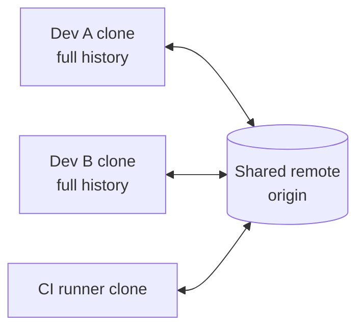

Every box holds the full history. The remote is just the one the team agrees on.

**Gotcha:** distributed does not mean "no central repository". Teams still pick one official remote and protect its main branch. What changes is that you can commit and branch freely on your machine first, then share.

**Interview tip:** Give the practical benefits: fast local operations, cheap branches, offline work, and natural backups. Then add that the real power is cheap branching and merging, which makes pull requests and merge requests possible.

_Module: Git Fundamentals · Tags: basics, distributed, svn_

### 2. How does Git think about data: snapshots or diffs?

**Short answer:** Git stores snapshots. Each commit points to a complete picture of the project at that moment. Diffs that you see in `git show` are calculated when you ask, they are not what is stored.

Older tools save a list of file changes per version. Git saves a tree of file contents. To save space, files that did not change are not copied again. The new commit simply points to the same stored content as the old commit.

Content is stored by its hash, so identical content is stored once, even under different names or branches.

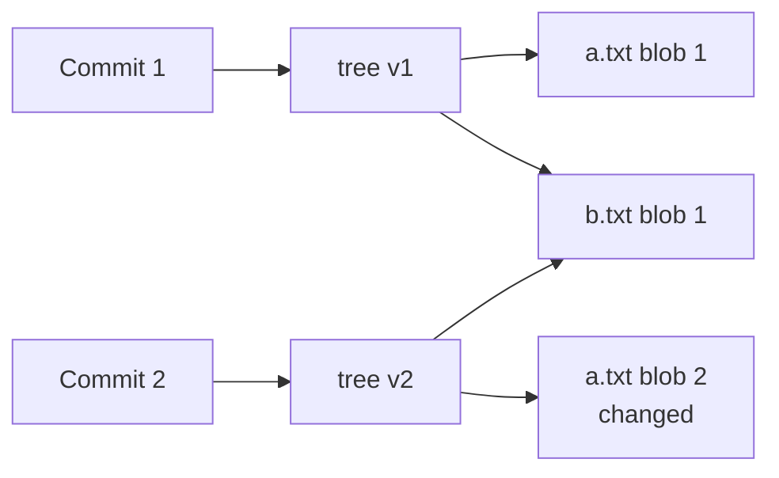

Commit 2 changed only `a.txt`. Both trees point to the same stored `b.txt`.

You can prove it. Two files with the same content get the same object id:

```bash
echo "hello" > one.txt
cp one.txt two.txt
git add one.txt two.txt
git ls-files -s
```

```text
100644 ce013625030ba8dba906f756967f9e9ca394464a 0	one.txt
100644 ce013625030ba8dba906f756967f9e9ca394464a 0	two.txt
```

Because of this design, branching is cheap, switching branches just changes which snapshot is in the working folder, and history is easy to verify. Later, Git packs objects and uses delta compression for storage size, but that is only a space optimisation, not the data model.

**Gotcha:** this is why Git has no real "rename" record. It just sees a file disappear and a file with the same content appear, and then detects the rename when you ask for the log or diff.

**Interview tip:** Say "snapshots, content addressed, deduplicated". It shows you know why branches are cheap and why a commit hash changes when anything in it changes.

_Module: Git Fundamentals · Tags: basics, snapshots, objects_

### 3. What are the working tree, the index (staging area) and the repository?

**Short answer:** Git has three areas. The working tree is your files on disk. The index (staging area) is the list of changes you plan to put in the next commit. The repository (the `.git` folder) holds the saved commits.

The staging area lets you build a commit on purpose. You can change ten files but commit only the three that belong together.

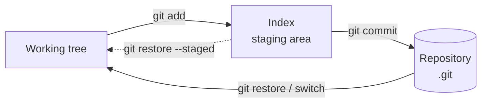

Edits flow right when you add and commit. Checkout and restore bring content back left.

```bash
echo "hello" > orders.txt
git status
git add orders.txt
git status -s
```

```text
On branch main

No commits yet

Untracked files:
  (use "git add <file>..." to include in what will be committed)
	orders.txt

nothing added to commit but untracked files present (use "git add" to track)
A  orders.txt
```

In the short status `A ` has two columns. The left column is the index versus the last commit. The right column is the working tree versus the index. After editing a file that is already staged, you would see `AM`.

**Gotcha:** `git commit` saves what is in the index, not what is on disk. If you edit a file after `git add`, the new edit is not in the commit unless you add again. `git commit -a` stages changes to tracked files for you, but it never adds new files.

**Interview tip:** Mention that `git add -p` lets you stage parts of a file, which is how you keep commits small and focused.

_Module: Git Fundamentals · Tags: basics, staging, index_

### 4. What do the everyday commands `status`, `diff` and `log` show?

**Short answer:** `git status` tells you what state your files are in. `git diff` shows the content of changes. `git log` shows the commit history. Each of them has options that you will use daily.

`git diff` compares the working tree with the index. `git diff --staged` compares the index with the last commit. If you have staged everything, plain `git diff` shows nothing, which confuses beginners.

```bash
echo "line2" >> orders.txt
git diff
git add orders.txt
git diff            # empty now
git diff --staged
```

```text
diff --git a/orders.txt b/orders.txt
index ce01362..1b3eb56 100644
--- a/orders.txt
+++ b/orders.txt
@@ -1 +1,2 @@
 hello
+line2
```

The last command prints the same diff, because now it is staged.

Useful `git log` flags:

| Command | What it shows |
| --- | --- |
| `git log --oneline` | One short line per commit |
| `git log --oneline --graph --decorate` | Branch shape, with branch and tag names |
| `git log -p` | Each commit with its patch |
| `git log --stat` | Files changed per commit |
| `git log --author="Dev"` | Only commits by that author |
| `git log --since="2 weeks ago"` | Date filter |
| `git log -- path/to/file` | History of one file or folder |
| `git log main..feature` | Commits in feature that are not in main |

```bash
git log --oneline --graph --decorate
```

```text
* b84c815 (HEAD -> main) Add second line
* 8966ee5 Add orders file
```

**Interview tip:** Say that you always run `git status` and `git diff --staged` before committing, so you know exactly what goes in.

_Module: Git Fundamentals · Tags: basics, log, diff, status_

### 5. What does a Git commit contain?

**Short answer:** A commit has a pointer to a tree (the snapshot of the project), pointers to its parent commits, the author and committer with timestamps, and the message. The commit id is the hash of all of that.

Because the parent hash is part of the commit, a commit id depends on all history before it. Change anything, even a letter in the message, and you get a new id, and every later commit gets a new id too. This is why rewriting history changes hashes.

```bash
git cat-file -p HEAD
```

```text
tree 9f1c2ab...
parent 8966ee5...
author Dev One <dev@example.com> 1792000000 +0530
committer Dev One <dev@example.com> 1792000000 +0530

Add second line
```

The hashes here are shortened and will differ on your machine. The first commit in a repository has no parent line. A merge commit has two or more.

| Field | Meaning |
| --- | --- |
| `tree` | The snapshot of the root folder |
| `parent` | Previous commit (zero, one, or more) |
| `author` | Who wrote the change, and when |
| `committer` | Who created this commit object, for example after a rebase or `cherry-pick` |
| message | The explanation. First line is the subject |

**Gotcha:** author and committer can differ. After a rebase, the author stays the original developer, and the committer becomes the person who rebased. This is why `git log` may show the same change with two dates.

**Interview tip:** If asked "why do hashes change on rebase", answer: the parent changed, so the commit content changed, so the hash changed.

_Module: Git Fundamentals · Tags: commit, objects_

### 6. What is a branch in Git, and what is HEAD?

**Short answer:** A branch is just a small file that holds the hash of one commit. It moves forward when you commit. `HEAD` is a pointer to the branch you are on now, so Git knows where the next commit goes.

Nothing is copied when you create a branch. That is why it is instant and cheap.

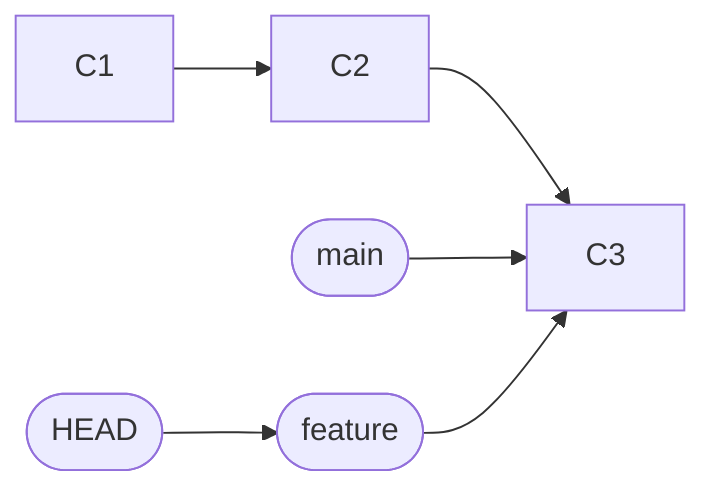

Both branches point to C3. HEAD points to feature, so the next commit moves feature only.

```bash
git switch -c feature/discount
git branch
cat .git/HEAD
cat .git/refs/heads/main
```

```text
Switched to a new branch 'feature/discount'
* feature/discount
  main
ref: refs/heads/feature/discount
b84c815ee30e...
```

You can see that `HEAD` holds the text `ref: refs/heads/feature/discount` and each branch is a file with a hash. This is the full secret of branches.

When HEAD holds a hash directly instead of a branch name, you are in a detached HEAD state. See the separate question on that.

**Gotcha:** deleting a branch only deletes the pointer. The commits stay in the object store until garbage collection, and you can usually get them back with `git reflog`.

**Interview tip:** Say "a branch is a movable pointer to a commit". This one sentence explains why Git branching is cheap and why merges are about commits, not about directories.

_Module: Branching & Merging · Tags: branches, head_

### 7. What is a detached HEAD, and how do you get out of it?

**Short answer:** Detached HEAD means HEAD points straight at a commit instead of a branch. You can look around and even commit, but those commits belong to no branch, so Git may delete them later. To keep the work, create a branch from where you are.

You get there by checking out a commit, a tag or a remote branch directly, for example `git switch --detach v1.0` or `git checkout a1b2c3d`.

```bash
git switch --detach v1.0
```

```text
HEAD is now at 5f765d2 Add app
```

Git prints a warning when you do this with `checkout`, and `git status` says `HEAD detached at 5f765d2`.

If you commit now, the new commit has no branch pointing to it. When you switch away, the only way back is the reflog.

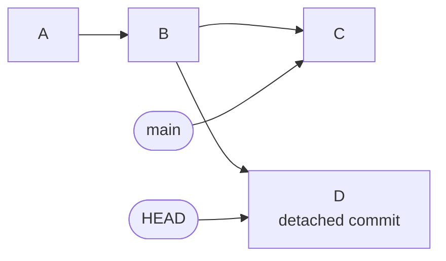

Commit D is reachable only from HEAD. Move away and nothing points to D.

How to save it:

```bash
git switch -c fix/from-detached     # new branch at the current commit
```

How to leave without saving: `git switch main`.

**Gotcha:** many people lose work here. If you switched away already, run `git reflog`, find the hash of D, and run `git branch rescue <hash>`.

**Interview tip:** Detached HEAD is useful on purpose. It is how you build or test an old release tag, or how CI checks out a specific commit.

_Module: Branching & Merging · Tags: head, detached-head_

### 8. How do you create and switch branches? What is the difference between `switch` and `checkout`?

**Short answer:** Use `git switch <branch>` to move between branches and `git switch -c <name>` to create one. Old `git checkout` does the same and also restores files, so it does two jobs. Since Git 2.23, `switch` and `restore` split those jobs to make the commands clearer.

| Task | New way (Git 2.23 or later) | Old way |
| --- | --- | --- |
| Go to a branch | `git switch main` | `git checkout main` |
| Create and go | `git switch -c feature/x` | `git checkout -b feature/x` |
| Create from a start point | `git switch -c fix v1.0` | `git checkout -b fix v1.0` |
| Go back to the last branch | `git switch -` | `git checkout -` |
| Detach at a commit | `git switch --detach a1b2c3d` | `git checkout a1b2c3d` |
| Discard file changes | `git restore file` | `git checkout -- file` |

```bash
git switch -c feature/discount
git switch main
git switch -
```

```text
Switched to a new branch 'feature/discount'
Switched to branch 'main'
Switched to branch 'feature/discount'
```

Switching changes the files in your working tree to match the other branch. If you have uncommitted changes that would be overwritten, Git refuses and tells you. Changes to files that are the same on both branches are carried over.

**Gotcha:** `git checkout <name>` can mean a branch or a file path. If a branch and a file share a name, the result is surprising. `switch` only handles branches, so it avoids this.

**Interview tip:** Both work, and you should know both because old docs and teammates use `checkout`. Mention that you prefer `switch` and `restore` since they are harder to misuse.

_Module: Branching & Merging · Tags: branches, switch, checkout_

### 9. What is the difference between a fast-forward merge and a three-way merge?

**Short answer:** A fast-forward merge happens when the target branch has no new commits, so Git just moves its pointer forward. A three-way merge happens when both branches have new commits, so Git creates a new merge commit with two parents.

Fast-forward: `main` is behind `feature`, on a straight line. No new commit is needed.

```bash
git switch main
git merge feature
```

```text
Updating 5f765d2..cad88d6
Fast-forward
 f.txt | 1 +
 1 file changed, 1 insertion(+)
 create mode 100644 f.txt
```

Three-way: both sides moved, so Git compares both tips with their common ancestor and builds a merge commit.

```bash
git merge other -m "Merge branch 'other'"
git log --oneline --graph
```

```text
Merge made by the 'ort' strategy.
 o.txt | 1 +
 1 file changed, 1 insertion(+)
 create mode 100644 o.txt
*   e573903 Merge branch 'other'
|\  
| * 8683814 Other work
* | e19561a Main work
|/  
* cad88d6 Add feature
```

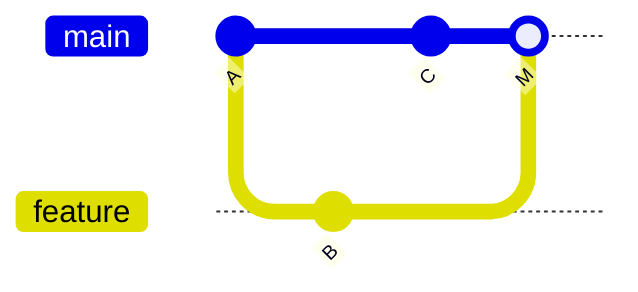

A is the common ancestor. M has two parents, C and B.

Useful flags: `--no-ff` always creates a merge commit, even when fast-forward is possible, so the feature stays visible as a group. `--ff-only` refuses to merge unless a fast-forward is possible, which is a safe way to update `main` from a remote.

**Gotcha:** the strategy named `ort` is the default since Git 2.34. Older versions used `recursive`.

**Interview tip:** Mention that a merge never rewrites history. It adds a commit, so it is safe on shared branches.

_Module: Branching & Merging · Tags: merge, fast-forward_

### 10. What is a merge conflict, why does it happen, and how do you resolve it?

**Short answer:** A conflict happens when both branches changed the same lines of the same file and Git cannot decide which one to keep. You open the file, choose the right result, remove the markers, `git add` the file and finish the merge.

Git merges text line by line. If two changes touch different parts of a file, it combines them silently. When they touch the same part, it stops and marks the file.

```bash
git merge c1
git status -s
cat p.txt
```

```text
Auto-merging p.txt
CONFLICT (add/add): Merge conflict in p.txt
Automatic merge failed; fix conflicts and then commit the result.
AA p.txt
<<<<<<< HEAD
price=20
=======
price=10
>>>>>>> c1
```

The part above `=======` is your side (HEAD). The part below is the incoming branch. Edit the file to the final text, with all three marker lines removed:

```bash
# edit p.txt so it contains the final value, then
git add p.txt
git commit          # finishes the merge
# or give up and go back
git merge --abort
```

Steps in order: run `git status` to list conflicted files, edit each, `git add`, then commit or `git merge --continue`. After that, build and run the tests. A conflict-free merge can still be logically wrong.

**Gotcha:** never commit the marker lines. A pre-commit check that searches for `<<<<<<<` is cheap protection.

**Interview tip:** Prevent conflicts, not only solve them. Short-lived branches, small changes and frequent integration reduce conflicts far more than any merge tool.

_Module: Branching & Merging · Tags: merge, conflicts_

### 11. What are remotes in Git? Explain `clone`, `fetch`, `pull`, `push` and `origin`.

**Short answer:** A remote is a named link to another copy of the repository, usually on a server. `origin` is the default name Git gives to the place you cloned from. `clone` copies a repository, `fetch` downloads new commits, `pull` downloads and integrates them, and `push` uploads your commits.

| Command | What it does |
| --- | --- |
| `git clone <url>` | Copies all history, sets up `origin`, and checks out the default branch |
| `git fetch` | Downloads new commits and updates `origin/*` branches. Does not touch your files |
| `git pull` | `fetch` plus a merge (or rebase) of the upstream branch into your current branch |
| `git push` | Uploads your branch commits and moves the remote branch |
| `git remote -v` | Lists remotes and their URLs |

```bash
git remote -v
git push -u origin main
git branch -vv
```

```text
origin	git@gitlab.example.com:shop/orders.git (fetch)
origin	git@gitlab.example.com:shop/orders.git (push)
branch 'main' set up to track 'origin/main'.
* main 1a95fb0 [origin/main] first
```

The URL shown is a made-up example. A repository can have more than one remote, for example `origin` for your fork and `upstream` for the original project.

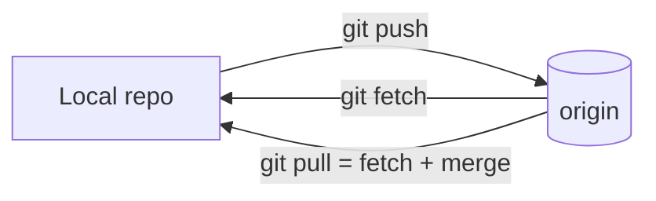

**Gotcha:** `origin` is only a name. Nothing is special about it, you can rename it with `git remote rename`.

**Interview tip:** Explain that all your local work is private until you push. Also that `git push` is refused when the remote has commits you do not have, which protects others' work.

_Module: Remotes & Collaboration · Tags: remotes, clone, push, pull_

### 12. What is the difference between `git fetch` and `git pull`?

**Short answer:** `git fetch` only downloads new commits from the remote and updates your remote-tracking branches such as `origin/main`. `git pull` does a fetch and then merges (or rebases) that into your current branch, so it changes your files.

Fetch is always safe. It cannot break your work. You can look at what arrived before you decide what to do.

```bash
git fetch
git status -sb
git log --oneline main..origin/main
```

```text
From .../remote
   1a95fb0..03353fe  main       -> origin/main
## main...origin/main [behind 1]
03353fe second
```

You see that you are behind by one commit and you can read it. Then integrate it:

```bash
git merge --ff-only origin/main      # or: git rebase origin/main
```

`git pull` is the same as `git fetch` followed by `git merge origin/main`. With `--rebase` it uses rebase instead.

| | `fetch` | `pull` |
| --- | --- | --- |
| Changes working files | No | Yes |
| Can cause conflicts | No | Yes |
| Creates merge commit | No | Maybe |
| Good for | Looking before acting, CI | Quick updates of a clean branch |

**Gotcha:** a plain `git pull` on a branch that has diverged creates a merge commit named "Merge branch 'main' of ...". Many teams find these noisy. Set `git config --global pull.ff only` or `pull.rebase true` (see the question on `pull --rebase`).

**Interview tip:** Say that you like to fetch first, then decide. It shows you do not treat pull as magic.

_Module: Remotes & Collaboration · Tags: fetch, pull_

### 13. What are tracking branches and upstream branches?

**Short answer:** A remote-tracking branch such as `origin/main` is your local, read-only copy of where the remote branch was at the last fetch. An upstream (tracking) setup links your local branch to one of them, so plain `git pull`, `git push` and `git status` know which remote branch to use.

Without an upstream, you have to type the remote and branch every time.

```bash
git push -u origin feature/discount     # -u sets the upstream
git branch -vv
```

```text
* feature/discount 3a4b5c6 [origin/feature/discount] Add discount rules
  main             a1b2c3d [origin/main] Fix typo
```

The text in brackets shows the upstream. If you are ahead or behind, it adds `[origin/main: ahead 2]`.

Why it matters:
- `git status` says "Your branch is ahead of 'origin/main' by 2 commits".
- `git pull` and `git push` need no arguments.
- `@{u}` or `@{upstream}` can be used as a short name for the upstream, for example `git log @{u}..HEAD` shows what you have not pushed.

```bash
git branch --set-upstream-to=origin/main main     # set later
git config --global push.autoSetupRemote true     # Git 2.37+: first push sets it
```

`push.autoSetupRemote` exists since Git 2.37.

**Gotcha:** `origin/main` does not update by itself. It moves only when you fetch, pull or push. A stale `origin/main` makes "ahead/behind" numbers wrong.

**Interview tip:** Say that remote-tracking branches are bookmarks of the remote state. This helps to explain why `fetch` is safe and why `git diff origin/main` works offline.

_Module: Remotes & Collaboration · Tags: upstream, tracking, branches_

### 14. What is the difference between Git, GitHub and GitLab?

**Short answer:** Git is the version control tool that runs on your machine. GitHub, GitLab and Azure Repos are hosting services that store Git repositories and add collaboration features such as pull requests or merge requests, issues, permissions and CI pipelines.

Git works without any of them. You can use a plain folder or an SSH server as a remote. The hosting platforms add the team layer around Git.

| Part | Git itself | Hosting platform |
| --- | --- | --- |
| Commits, branches, merges | Yes | Uses Git underneath |
| Merge request or pull request | No | Yes, it is a platform feature |
| Code review comments | No | Yes |
| Protected branches, approvals | No (only hooks) | Yes |
| CI/CD pipelines | No | Yes, such as GitLab CI |
| Issues and boards | No | Yes |

An important idea: a merge request is not a Git object. It is a record on the server that says "merge branch A into B, after these checks". When you click Merge, the server runs normal Git operations (merge, squash or fast-forward) on its copy of the repository.

This also means that rules like "two approvals required" are platform rules. Plain Git on your laptop does not enforce them. The server rejects a push that breaks the rules.

**Gotcha:** the same Git commands work on all platforms, but the web features and names differ: GitHub says pull request, GitLab says merge request, and they have different setting names for branch protection.

**Interview tip:** If someone says "Git" for the website, correct it gently, then show you know where the line is: Git handles history, the platform handles process.

_Module: Remotes & Collaboration · Tags: basics, gitlab, github_

### 15. What should go in `.gitignore`, and what should you never commit?

**Short answer:** `.gitignore` lists files Git should not track: build output, dependencies, local settings and logs. Never commit secrets such as passwords, API keys, private keys or `.env` files. Once a secret is committed it stays in history, even if you delete the file later.

```text
# dependencies and build output
node_modules/
dist/
bin/
obj/

# local config and secrets
.env
*.pem
*.pfx

# editor and OS noise
.vscode/
.idea/
.DS_Store

# but keep the example file
!.env.example
```

Rules to remember:
- A pattern ending with `/` matches only folders.
- `*` matches within one folder, `**/` matches any depth.
- A line starting with `!` re-includes a file.
- Ignore rules apply only to untracked files. If a file is already tracked, adding it to `.gitignore` does nothing. Untrack it with `git rm --cached`.

```bash
echo ".env" >> .gitignore
git rm --cached .env
git status -s
```

```text
rm '.env'
D  .env
?? .gitignore
```

The file stays on disk, but the next commit removes it from the repository.

Also commit lock files (`package-lock.json`, `go.sum`). They make builds repeatable. Do not commit generated files that others can rebuild.

**Gotcha:** removing a secret in a later commit does not remove it from history. Treat any committed secret as leaked: rotate it first, then clean history if needed.

**Interview tip:** Mention a global ignore file (`core.excludesFile`) for personal noise like editor folders, so the project file stays small. Add a secret scanner in CI as a safety net.

_Module: Repository Management · Tags: gitignore, secrets, security_

### 16. How do you undo changes in Git? Explain `restore`, `reset`, `revert` and `commit --amend`.

**Short answer:** Choose by where the change is. Uncommitted edit: `git restore`. Last commit not yet shared: `git commit --amend` or `git reset`. Commit already shared: `git revert`, which adds a new commit that cancels the old one. Never rewrite shared history.

| Situation | Command | Safe on shared branch? |
| --- | --- | --- |
| Throw away edits in a file | `git restore file` | Local only |
| Unstage a file | `git restore --staged file` | Local only |
| Fix last commit message or add a forgotten file | `git commit --amend` | Only if not pushed |
| Undo last commit, keep the changes staged | `git reset --soft HEAD~1` | Only if not pushed |
| Undo last commit, keep changes unstaged | `git reset HEAD~1` (mixed, the default) | Only if not pushed |
| Undo last commit and delete the changes | `git reset --hard HEAD~1` | Only if not pushed |
| Cancel a commit that is already pushed | `git revert <commit>` | Yes |

```bash
git revert --no-edit HEAD
git log --oneline -3
```

```text
[main 517d669] Revert "Oops commit"
 1 file changed, 1 deletion(-)
 delete mode 100644 z.txt
517d669 Revert "Oops commit"
3740805 Oops commit
e573903 Merge branch 'other'
```

The history keeps both commits, so teammates who already pulled the bad one are fine.

**Gotcha:** `reset --hard` and `restore` on unsaved edits cannot be undone. Edits that were never committed or staged are gone. Committed work is different: it stays in `git reflog` for a while.

**Interview tip:** The rule is simple: if others might have it, revert. If only you have it, you may reset or amend. Say this sentence in the interview.

_Module: Undo & Recovery · Tags: undo, reset, revert, restore_

### 17. What is the difference between lightweight and annotated tags?

**Short answer:** A tag is a fixed name for one commit, used to mark releases. A lightweight tag is just a pointer. An annotated tag is a full Git object with a tagger, a date and a message, and it can be signed. Use annotated tags for releases.

```bash
git tag v1.0                          # lightweight
git tag -a v1.1 -m "Release 1.1"      # annotated
git tag
git cat-file -t v1.0
git cat-file -t v1.1
```

```text
v1.0
v1.1
commit
tag
```

The type shows the difference: `v1.0` points straight to a commit, `v1.1` is its own `tag` object that points to the commit.

| | Lightweight | Annotated |
| --- | --- | --- |
| Stores message and author | No | Yes |
| Can be signed (`-s`) | No | Yes |
| Shown by `git describe` by default | No | Yes |
| Good for | Private bookmarks | Releases |

Tags are not pushed automatically. You must push them:

```bash
git push origin v1.1          # one tag
git push origin --follow-tags # annotated tags reachable from pushed commits
git push origin --delete v1.1 # remove from remote
```

Tags do not move when you commit, unlike branches. That is why a release tag always points to the exact code that was shipped.

**Gotcha:** moving or re-using a tag after others fetched it causes confusion, because Git does not update existing tags on fetch by default. Treat release tags as permanent. Protect them in GitLab with protected tags.

**Interview tip:** Link tags to versioning: tag `v1.4.2` on the commit that CI built and released, and let the pipeline trigger from tags.

_Module: Repository Management · Tags: tags, releases_

### 18. How does `git stash` work, and when do you use it?

**Short answer:** `git stash` saves your uncommitted changes on a stack and gives you a clean working tree. You can then switch branches, and later bring the changes back with `git stash pop`.

Typical case: you are halfway through a feature and an urgent bug comes in. You do not want a half-finished commit.

```bash
git stash            # save tracked changes
git status -s        # clean now
git switch hotfix/login
# ...fix, commit, push...
git switch feature/cart
git stash pop        # bring the changes back and drop the stash
```

```text
Saved working directory and index state WIP on main: 782cb29 Change 6
```

Main commands:

| Command | Meaning |
| --- | --- |
| `git stash push -m "cart wip"` | Save with a name |
| `git stash list` | Show the stack: `stash@{0}`, `stash@{1}` |
| `git stash pop` | Apply the latest stash and remove it |
| `git stash apply` | Apply but keep it in the list |
| `git stash drop` | Delete one stash |
| `git stash -u` | Include untracked files |

By default stash ignores untracked files and ignored files. Add `-u` for untracked.

**Gotcha:** if `pop` hits a conflict, Git keeps the stash in the list so you do not lose it. Do not stash for days. Stashes are easy to forget, are not pushed, and have no branch name. For longer work, make a WIP commit on a branch instead.

**Interview tip:** Mention `git stash branch <name>`, which creates a branch from the commit where you stashed and applies the stash there. It avoids conflicts when the base branch has moved on.

_Module: Undo & Recovery · Tags: stash_

### 19. How do you find who changed a line and when a piece of code appeared?

**Short answer:** Use `git blame` to see which commit last changed each line, and `git log -S` or `-G` to find the commits that added or removed a piece of text. Together they answer "who, when and why" for any line.

`git blame` shows commit, author and line:

```bash
git blame -s f.txt
```

```text
cad88d62 1) feat
```

The first column is the commit that last touched the line. Then run `git show cad88d6` to read the message and the full change. In the line view, use `-L 10,20` to limit blame to lines 10 to 20, and `-w` to ignore whitespace-only changes.

`git log -S"text"` (called the pickaxe) finds commits where the number of occurrences of a string changed. It finds the commit that introduced or deleted a function or a constant, even if the line moved.

```bash
git log --oneline -S"feat"
git log --oneline -G"^price=\d+"      # regex: lines matching in the diff
git log -L :calculateTotal:src/cart.go  # history of one function
```

```text
cad88d6 Add feature
```

| Tool | Best for |
| --- | --- |
| `git blame file` | Who last changed this line |
| `git log -S"x"` | When did string `x` appear or disappear |
| `git log -G"regex"` | Same, with a regular expression |
| `git log -L :func:file` | Full history of one function |
| `git log --follow file` | History of a file across renames |

**Gotcha:** the last change to a line is often a formatting or rename commit that hides the real author. Use `git blame -w -C` (ignore whitespace, detect moved code) or a `.git-blame-ignore-revs` file with `git config blame.ignoreRevsFile`.

**Interview tip:** Say that blame is for finding the context, not for blaming. The goal is to read the commit message and pull request and understand why the line is there.

_Module: Git Fundamentals · Tags: blame, log, archaeology_

### 20. What makes a good commit message, and why are small atomic commits better?

**Short answer:** A good commit does one logical thing and has a message that says what changed and why. Small atomic commits are easier to review, revert, cherry-pick and bisect. A common message format is Conventional Commits: `type(scope): subject`.

A message has a short subject line (about 50 to 72 characters, imperative mood), a blank line, and a body that explains why. The code already shows what.

```text
fix(orders): reject negative quantities

The API accepted quantity = -1 and created a refund line.
Validate in the handler and return 400 so clients see the problem.

Refs: SHOP-412
```

Conventional Commit types: `feat` (new feature), `fix`, `docs`, `refactor`, `test`, `chore`, `perf`, `ci`. A `!` or `BREAKING CHANGE:` footer marks a breaking change. Tools can then create a changelog and pick the next semantic version automatically.

What atomic means:
- The commit builds and tests pass on its own.
- It contains one idea. A refactor and a feature go into two commits.
- You can revert it alone without breaking something else.

| Bad | Better |
| --- | --- |
| `fix stuff` | `fix(cart): keep coupon after login` |
| `WIP` pushed to main | Clean up with interactive rebase before the merge request |
| One giant commit "new module" | Several commits: schema, service, API, tests |

**Gotcha:** if your team squash-merges, the merge request title becomes the commit message on `main`. Then enforce the format on the title, not on every small commit.

**Interview tip:** Link it to outcomes: a clean history makes `git bisect`, `git revert` and release notes work. A history like "fix, fix again, oops" does not.

_Module: Git Fundamentals · Tags: commits, conventional-commits, best-practices_

## Intermediate

### 21. [Tech Lead] Merge, rebase or squash: what should the team policy be?

**Short answer:** There is no single right answer. Pick one merge method for `main`, write it down, and enforce it on the platform. Many teams choose squash merge for clean one-commit-per-change history, or rebase plus fast-forward when they care about every commit. Merge commits keep the true history but make the graph noisy.

| Method | Result on `main` | Good | Bad |
| --- | --- | --- | --- |
| Merge commit | Branch commits plus a merge commit | Keeps real history, no rewrite | Noisy graph, hard to bisect through merges |
| Squash merge | One new commit per merge request | Clean, easy to revert one change | Loses small steps, author credit in one commit |
| Rebase and fast-forward | Straight line of the original commits | Linear and detailed | Needs tidy commits, hashes change |
| Semi-linear (GitLab) | Rebase needed, then merge commit | Linear check plus visible merge | Extra rebases when queue is busy |

```bash
git log --oneline --graph
```

```text
* 46495d5 feat: add g (squash)
* 06ba897 root
```

That is what squash merge gives: a straight, readable line.

How I would decide:
- If developers write messy "wip" commits, use squash and require a good merge request title in conventional format.
- If the team writes careful atomic commits and uses interactive rebase, use rebase with fast-forward.
- If you need an audit trail of each merge and use release branches, merge commits are fine. Use `git log --first-parent` to read them as a clean list.

Whatever you choose, apply the same rule to everyone, set it in GitLab project settings (merge method and "squash commits" option), and explain why in the contributing guide.

**Gotcha:** after a squash merge, Git does not know the feature branch was merged. `git branch --merged` will not list it, so branch clean-up needs the platform's "delete source branch" option.

**Interview tip:** Say that you care about two goals: `main` must be easy to read and easy to revert. The method is only a way to get there.

_Module: Workflows & Strategy · Tags: tech-lead, merge, rebase, squash_

### 22. [Tech Lead] How do you protect important branches and enforce review rules?

**Short answer:** Protect `main` and release branches on the platform: no direct pushes, no force pushes, required merge request, a passing pipeline, and a minimum number of approvals. Add CODEOWNERS for sensitive paths, and signed commits where traceability matters.

Rules belong to the server, not to goodwill. Local Git cannot stop a mistake, but the remote can reject it.

Typical GitLab settings:
- **Protected branches**: allowed to merge, allowed to push set to "No one" or maintainers only. Force push disabled.
- **Merge request approvals**: at least one or two approvals, approvers cannot be the author, new commits reset approvals.
- **Pipelines must succeed**, and all threads must be resolved before merging.
- **CODEOWNERS** file: the owners of a path must approve changes to it.
- **Protected tags**: only release managers can create `v*` tags.
- **Push rules** (Premium tier): reject secrets, unsigned commits or bad messages. Check your plan.

```text
# CODEOWNERS (GitLab syntax)
/deploy/            @platform-team
/src/payments/      @payments-leads
*.tf                @infra-owners
```

Meaning: a change under `deploy/` needs approval from the platform team.

Signing commits (with GPG or SSH keys) proves who wrote a commit. It is useful in regulated environments, because the author name in Git is just text that anyone can set.

```bash
git config --global gpg.format ssh
git config --global user.signingkey ~/.ssh/id_ed25519.pub
git config --global commit.gpgsign true
```

**Gotcha:** admins and maintainers can often bypass rules. Review who has those roles, and avoid "temporary" exceptions that stay forever.

**Interview tip:** Mention balance. Too many required approvals slow the team down and teach people to click approve. Use code owners for risky areas and keep the rest light.

_Module: Team Practice & Leadership · Tags: tech-lead, gitlab, protected-branches, security_

### 23. [Tech Lead] How do you keep merge requests small and the review culture healthy?

**Short answer:** Aim for merge requests that a reviewer can understand in about 20 minutes, usually under 400 changed lines. Split big work into steps that can each be merged safely. Agree on a review turnaround time, and use stacked branches or feature flags when parts depend on each other.

Small changes are reviewed faster and better, merge with fewer conflicts, and are simple to revert. Big ones get a quick "looks good to me".

How to split a large change:
- Refactor first, behaviour second. A pure move or rename commit can be reviewed by skimming.
- Add the new code behind a feature flag, merge it dark, then switch it on later.
- Separate database migration, backend and frontend into steps that stay compatible.
- Use `git add -p` to craft commits, and `git rebase -i` to reorder them.

Stacked changes: when part 2 needs part 1 but part 1 is still in review, create branches on top of each other.

```bash
git switch -c part1
# ...commit...
git switch -c part2          # starts from part1
# ...commit...
# later, after review fixes on part1:
git switch part2
git rebase --update-refs part1      # Git 2.38+ also moves branches in the stack
```

`--update-refs` exists since Git 2.38. After the rebase, branches in the middle of the stack move too, and Git prints which refs it updated.

Team habits that help:
- A service level goal for review, for example first response within one working day.
- A merge request template: what, why, how to test, rollback plan.
- Author reviews their own diff first. Reviewers focus on design and risk, and let linters handle style.
- Pair or talk for tricky changes instead of long comment threads.

**Gotcha:** forcing a hard line limit makes people split in silly ways. Use it as a smell, not as a law.

**Interview tip:** Say how you measure it: time to first review, time to merge, and size of merge requests. Share the numbers and talk about them in the retrospective.

_Module: Team Practice & Leadership · Tags: tech-lead, code-review, merge-requests_

### 24. [Tech Lead] A bad commit reached `main` and production is affected. What do you do: revert or fix forward?

**Short answer:** First restore service, then investigate. If the cause is clear and the revert is simple, revert the commit and redeploy, because it is the fastest and safest path. Fix forward only when the fix is tiny and obvious or when a revert is not possible, for example after a database migration.

Steps I follow:
1. **Declare and communicate.** Tell the team and stakeholders. One person leads, others do not push to `main` meanwhile.
2. **Find the change.** Check the deployment time, then `git log --first-parent --since` and the merge request list. If unclear, `git bisect`.
3. **Decide.** Revert if the change is isolated. Roll back the deployed version first when your pipeline supports it, because that does not need Git at all.
4. **Revert with a merge request.** Do not rewrite or force push `main`.
5. **Verify** in production with metrics and logs.
6. **Post-mortem.** Add the test or check that would have caught it.

```bash
git revert --no-edit <bad-commit>        # normal commit
git revert -m 1 --no-edit <merge-commit> # merge commit: keep parent 1 (main)
git push origin HEAD:revert/bad-change   # then open a merge request
```

```text
[main 9c39464] Revert "Merge branch 'feat'"
```

For a merge commit you must say which parent is the mainline with `-m 1`, otherwise Git cannot know which side to undo.

| | Revert | Fix forward |
| --- | --- | --- |
| Speed when cause is known | Fast | Depends on the fix |
| Risk | Low | Another untested change under pressure |
| Works after schema changes | Often not alone | Yes, needed |

**Gotcha:** if you revert a merge and later want the branch back, merging it again brings nothing, because Git thinks it is already merged. Revert the revert first.

**Interview tip:** Emphasise that service restore comes before blame, and that a revert is a normal, safe, reviewed commit, not a failure.

_Module: Undo & Recovery · Tags: tech-lead, incident, revert_

### 25. [Tech Lead] How do you avoid long-lived feature branches and merge hell?

**Short answer:** Integrate often. Break the work into small steps, merge each one behind a feature flag, and merge `main` into your branch (or rebase) every day. The longer a branch lives, the more conflicts, surprises and risk it collects.

Conflicts grow faster than the size of the branch, because other people keep changing the same files. Worse, the real danger is not the text conflict but a silent logic conflict that appears only at the end.

What I do:
- **Feature flags.** Ship unfinished code turned off. The branch can then be merged every day, and the release is a config change, not a merge.
- **Branch by abstraction.** For a large refactor, introduce an interface, move callers one at a time, remove the old path at the end.
- **Sync every day.** `git fetch` then `git rebase origin/main` (or merge) so conflicts stay small.
- **Share early.** Open a draft merge request so the team sees direction.
- **Limit work in progress.** Finish what is open before starting more.

```bash
git fetch origin
git rebase origin/main        # or: git merge origin/main
git range-diff origin/main@{1} origin/main HEAD   # optional: see what changed
```

When a long branch already exists and hurts:
1. Merge `main` into it now, and fix conflicts once.
2. Run the whole test suite.
3. Cut the branch into several merge requests, starting with the safe parts like refactors and tests.

**Gotcha:** long-lived branches also hide bugs from CI because the code does not run with the latest `main`. Run the pipeline against the merge result (GitLab merged results pipelines) to catch this early.

**Interview tip:** Link it to delivery metrics: smaller batches improve lead time and reduce failures. This is the same message as continuous integration.

_Module: Workflows & Strategy · Tags: tech-lead, feature-flags, trunk-based, integration_

### 26. [Tech Lead] A secret was committed by accident. What is the response playbook?

**Short answer:** Rotate the secret immediately, because it is already compromised the moment it was pushed. Then check for use, then remove it from history if policy requires it, and add prevention. Cleaning history is secondary. Rotation is the real fix.

Steps in order:
1. **Revoke and rotate** the key, token or password. Do this before anything else. Update the services that use it.
2. **Check the damage.** Look at provider logs for use of the old secret. Include forks, CI logs and caches that may hold a copy.
3. **Remove from the latest code.** Move the secret to a vault or CI variable (GitLab protected, masked variables, Azure Key Vault).
4. **Rewrite history only if needed.** For public repositories, or strict rules, remove the file from all commits with `git filter-repo` (a separate tool, not part of Git itself).
5. **Coordinate the force push.** Freeze merges, announce, rewrite, force push all branches and tags, ask everyone to re-clone or reset. Ask the host to purge cached views and merge request refs.
6. **Prevent.** Add a secret scanner in pre-commit and CI, plus `.gitignore` for `.env` files.

```bash
# on a fresh mirror clone
git clone --mirror git@gitlab.example.com:shop/orders.git
cd orders.git
git filter-repo --invert-paths --path config/prod.env
git push --force --mirror
```

Check the options against the `git filter-repo` documentation for your version. Every commit after the removed file gets a new hash.

Inside the old copy, the leaked commit may still exist on the server for a while, in merge request refs or backups. That is why rotation comes first.

**Gotcha:** `git rm` and a new commit do not help. The secret is still in all earlier commits. Also, never "fix" it by force pushing without telling the team, since their clones still hold the secret and can push it back.

**Interview tip:** Say "assume breach, rotate first". Interviewers want to hear that you do not rely on deleting history.

_Module: Undo & Recovery · Tags: tech-lead, security, secrets, incident_

### 27. [Tech Lead] How do you manage releases, hotfixes and backports with Git?

**Short answer:** Tag every release, cut a `release/x.y` branch when you need to support old versions, fix bugs on `main` first, then cherry-pick the fix to the release branches. This keeps one source of truth and avoids fixes that exist only on old branches.

Flow: "main first, then backport".

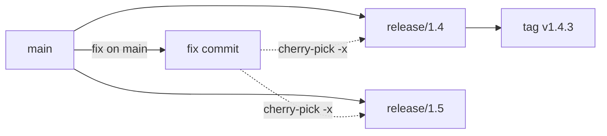

The fix lands on main. Cherry-pick copies it to each supported release branch, and the release gets a new tag.

```bash
git switch release/1.4
git cherry-pick -x 61e1c8d
git tag -a v1.4.3 -m "Release 1.4.3"
git push origin release/1.4 v1.4.3
```

```text
(cherry picked from commit 61e1c8dce30144b9368b87555c22679b844e922e)
```

The `-x` flag adds that line to the message, so anyone can trace the original commit. That is very helpful for audits, which matter in aviation and other regulated work.

Practices:
- Use semantic versioning. Patch releases (1.4.3) only get fixes.
- Make the fix first on `main`. Exception: when the bug exists only on the old branch, fix there and forward-port.
- Protect `release/*` branches and release tags.
- Keep a short list of supported versions, and drop branches when support ends.
- Track "which releases contain this fix" with `git branch --contains <sha>` and `git tag --contains <sha>`.

**Gotcha:** cherry-picks create new commits with different hashes. If the release branch is later merged into `main`, you may see duplicate changes or conflicts.

**Interview tip:** Mention traceability: from a release tag, I can list every commit in it with `git log v1.4.2..v1.4.3`, and that list is the release notes.

_Module: Workflows & Strategy · Tags: tech-lead, releases, cherry-pick, hotfix_

### 28. [Tech Lead] How do you onboard engineers to the team's Git workflow?

**Short answer:** Write the workflow on one page, set safe defaults in shared config, enforce the rules on the server, and teach by pairing on a real merge request. People learn the model (commits, branches, remotes) faster than they learn command lists.

What goes in the one-page guide:
- Branch names: `feature/SHOP-123-short-title`, `fix/...`, `release/x.y`.
- How to start work, how to update your branch, how to open a merge request.
- Commit message format and the merge method (squash or rebase).
- What not to do: force push shared branches, commit secrets, commit generated files.
- What to do when stuck: `git status`, `git reflog`, ask in the channel.

A small cheat-sheet that covers 90 percent:

```bash
git switch -c feature/SHOP-123-discount     # start
git add -p && git commit -m "feat(cart): add discount rule"
git fetch origin && git rebase origin/main   # update
git push -u origin HEAD                      # share
git restore --staged <file>                  # unstage
git reflog                                   # find lost commits
```

Safe team defaults to put into onboarding scripts:

```bash
git config --global pull.rebase true
git config --global fetch.prune true
git config --global push.autoSetupRemote true
git config --global rerere.enabled true
git config --global init.defaultBranch main
```

Teach the mental model first: the three areas, branches as pointers, and the reflog as a safety net. When people know that committed work is almost never lost, they stop being afraid and ask for help earlier.

**Gotcha:** a long wiki that nobody reads is worse than a short page that is kept current. Review it each quarter, and add a lesson whenever a mistake happens twice.

**Interview tip:** Say that you run a short pairing session on the first merge request of each new person. It teaches the workflow and the review culture in one go.

_Module: Team Practice & Leadership · Tags: tech-lead, onboarding, workflow_

### 29. [Tech Lead] How do you use Git hooks and CI checks to enforce standards?

**Short answer:** Client-side hooks give fast feedback on the developer machine, but people can skip them. Server-side rules and CI checks cannot be skipped. So use hooks for convenience and the pipeline or push rules for enforcement.

| Where | Examples | Can be bypassed? |
| --- | --- | --- |
| `pre-commit` (local) | Format, lint, secret scan | Yes (`--no-verify`) |
| `commit-msg` (local) | Check the message format | Yes |
| `pre-push` (local) | Run quick tests | Yes |
| CI pipeline | Lint, tests, message check, secret scan | No, if merge requires green pipeline |
| Server-side hook or push rules | Reject large files, secrets, bad names | No |

Hooks are not copied by `git clone`. Share them with a tool or a folder in the repo:

```bash
git config core.hooksPath .githooks     # use a tracked folder (Git 2.9+)
```

A small `commit-msg` hook that checks the Conventional Commit format:

```bash
#!/bin/sh
if ! grep -qE '^(feat|fix|docs|chore|refactor|test)(\([a-z-]+\))?: .{3,}' "$1"; then
  echo "commit message must look like: fix(orders): short subject" >&2
  exit 1
fi
```

```text
commit message must look like: fix(orders): short subject
```

With this hook the message "stuff" is rejected and `feat(orders): add order list` is accepted. The file must be executable.

Tools such as the `pre-commit` framework, Husky or lefthook install hooks from a config file in the repo, so everyone gets the same checks.

Keep local hooks fast (a few seconds). A slow hook trains people to use `--no-verify`.

**Gotcha:** if a check exists only locally, assume it will be skipped. Mirror every important check in the pipeline.

**Interview tip:** Say "hooks help, CI enforces". It shows that you understand where trust ends.

_Module: Team Practice & Leadership · Tags: tech-lead, hooks, ci, quality_

### 30. [Tech Lead] How do you handle large files and binary assets in Git?

**Short answer:** Git is made for text and stores every version of every file forever, so large binaries make clones slow. Use Git LFS to keep big files outside the normal object store, or keep them in an artifact store and reference them by version. Decide early, because moving them later means rewriting history.

Problem: a 50 MB design file that changes ten times adds 500 MB to every clone. Git's delta compression does not help much for already compressed formats.

Git LFS stores a tiny pointer in Git and the real file on an LFS server (GitLab and GitHub support it).

```bash
git lfs install
git lfs track "*.psd"
cat .gitattributes
git add .gitattributes
```

```text
Tracking "*.psd"
*.psd filter=lfs diff=lfs merge=lfs -text
```

Commit `.gitattributes` first, then add the large files. Collaborators need LFS installed. In CI, make sure the job fetches LFS objects.

| Option | Use when |
| --- | --- |
| Git LFS | Assets that belong with the code (images, models, firmware blobs) and change sometimes |
| Package or artifact registry | Build outputs, libraries, installers |
| Object storage (Blob Storage, S3) with a manifest in Git | Very large data sets, videos |
| Partial clone | Large files exist in history already, you want to avoid downloading them all |

Guard rails: set a file size limit with push rules or a CI check, and ignore build output in `.gitignore`.

**Gotcha:** adding LFS tracking does not change old commits. Files already in history stay large. Use `git lfs migrate import` (rewrites history) to move them, and plan it like a history rewrite.

**Interview tip:** Mention cost and locking: LFS storage and bandwidth may be billed, and binary files cannot be merged, so file locking (`git lfs lock`) helps teams that share design assets.

_Module: Repository Management · Tags: tech-lead, lfs, binaries, performance_

### 31. [Tech Lead] How do you measure and improve repository health?

**Short answer:** Track a few signals: size of merge requests, time to merge, age and number of open branches, whether `main` is always green, and whether history is clean enough to bisect and revert. Review them regularly and fix the causes, not the people.

Signals and how to read them:

| Signal | How to check | What it tells you |
| --- | --- | --- |
| Stale branches | `git for-each-ref --sort=-committerdate refs/heads` | Work abandoned or too long |
| Merged leftovers | `git branch -r --merged origin/main` | Branches that should be deleted |
| Commit style | Sample `git log --oneline` | Whether messages help |
| Bisectable history | Can you build at every commit on `main`? | Reliability of tools like bisect |
| Repository size | `git count-objects -vH` | Large file or history problems |
| Time to merge | Platform analytics | Review bottlenecks |
| Red `main` time | Pipeline stats | Quality and flaky tests |

```bash
git for-each-ref --sort=-committerdate --format='%(refname:short) %(committerdate:short)' refs/heads
```

```text
main 2026-10-21
feat 2026-10-21
```

The command lists branches with the newest first. Old dates at the bottom are clean-up candidates.

Actions:
- Turn on "delete source branch after merge" and `fetch.prune`.
- Run a monthly clean-up of branches with no commits for 60 days after asking the owners.
- Use `git log --first-parent main` as the story of the product. It should read like release notes.
- Keep the history bisectable: no broken intermediate commits on `main`. Squash or rebase to guarantee it.
- Add `.git-blame-ignore-revs` for big formatting commits.
- Run `git maintenance` or `git gc` on big repositories, and watch the clone time in CI.

**Gotcha:** metrics become goals and get gamed. Use them to start a conversation.

**Interview tip:** Give one example where you changed a measurable thing, for example reducing merge request size and cutting the time to merge.

_Module: Team Practice & Leadership · Tags: tech-lead, repo-health, metrics, bisect_

### 32. What does `git rebase` do, and what is the golden rule of rebasing?

**Short answer:** Rebase takes the commits of your branch and replays them, one by one, on top of a new base. The result is a straight history, but the replayed commits are new commits with new hashes. The golden rule: never rebase commits that other people already have.

Say `feature` split from `main`, and `main` moved on. A merge joins them with a merge commit. A rebase moves your commits to start at the new tip of `main`.

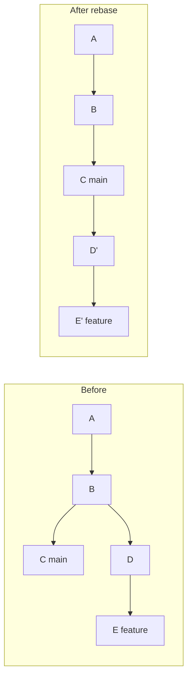

D and E become D' and E'. They have the same changes but a different parent, so they are different commits.

```bash
git switch feature
git rebase main
```

```text
Successfully rebased and updated refs/heads/feature.
```

Why the golden rule exists: if a teammate has D and E, and you replace them with D' and E', their branch and yours now disagree. Git sees duplicate changes, and conflicts appear. Rebase your own private branch freely. Do not rebase `main` or any shared branch.

| | Merge | Rebase |
| --- | --- | --- |
| History | Keeps the real shape | Linear |
| Rewrites commits | No | Yes |
| Safe on shared branches | Yes | No |
| Conflicts | Once | Possibly once per replayed commit |

**Gotcha:** after rebasing a branch you already pushed, a normal push is rejected. You need `git push --force-with-lease`, and only when the branch is yours alone.

**Interview tip:** Say that rebase does not change content, it changes the base and the hashes. Then state the rule and the safe exception: your own unshared branch.

_Module: Rewriting History · Tags: rebase, history_

### 33. How does interactive rebase work: squash, fixup, reword, edit, reorder, drop?

**Short answer:** `git rebase -i <base>` opens a to-do list of your commits. You change the word in front of each line, and Git replays the commits with those actions. It is the tool for cleaning a branch before review.

Start it for the commits after `main`:

```bash
git rebase -i main
```

The editor shows lines like this, oldest commit first:

```text
pick 42f96c4 Add cart model
pick c04cc7c wip
pick cfc5fed Add cart tests
pick af44734 fix typo in cart model
```

| Action | What it does |
| --- | --- |
| `pick` | Keep the commit as it is |
| `reword` | Keep the changes, edit the message |
| `edit` | Stop so you can change the commit, then `git rebase --continue` |
| `squash` | Meld into the previous commit and combine the messages |
| `fixup` | Meld into the previous commit and drop this message |
| `drop` | Delete the commit |
| reorder lines | Reorder the commits |

I changed the list to put the typo fix right after its model commit, drop `wip` and reword the tests commit:

```text
pick 42f96c4 Add cart model
fixup af44734 fix typo in cart model
drop c04cc7c wip
reword cfc5fed Add cart tests
```

```bash
git log --oneline
```

```text
eae5148 Add cart tests
02e799c Add cart model
2d4af63 Add base
```

Four commits became two clean ones. The hashes are new.

A handy shortcut: `git commit --fixup <hash>` creates a commit named `fixup! ...`, and `git rebase -i --autosquash main` puts it in the right place automatically.

**Gotcha:** if you reorder commits that touch the same lines, you get conflicts. Also, never use it on pushed shared commits. If you go wrong, `git rebase --abort` returns to the start.

**Interview tip:** Say that you commit freely while working, then tidy with interactive rebase before opening the merge request. Reviewers get a clear story.

_Module: Rewriting History · Tags: rebase, interactive, history_

### 34. What is the difference between `git pull`, `git pull --rebase` and the `pull.rebase` setting?

**Short answer:** A plain `git pull` fetches and then merges. If you and the remote both have new commits, you get an extra merge commit. `git pull --rebase` fetches and replays your local commits on top of the remote ones, which keeps history linear. Set `pull.rebase true` to make that the default.

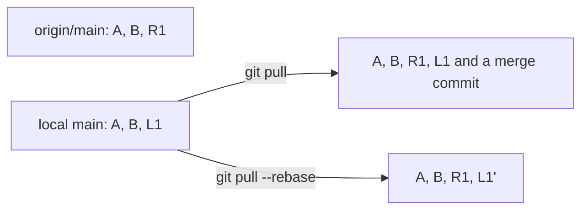

Pull gives a merge commit. Pull with rebase gives a straight line with L1 replayed as L1 prime.

Settings:

```bash
git config --global pull.rebase true     # always rebase on pull
git config --global pull.ff only         # or: refuse anything that is not a fast-forward
```

With `pull.ff only` a diverged pull fails with a message, and you choose between merge and rebase on purpose. Modern Git warns, or stops, when branches have diverged and you did not choose a style.

The rebase option is safe when the local commits are only yours and not pushed. It becomes a problem if you have merge commits locally; use `--rebase=merges` (since Git 2.18) to keep them.

| Option | Result | Good when |
| --- | --- | --- |
| `pull` (merge) | Merge commits in history | You want exact history |
| `pull --rebase` | Linear history | Feature branches with a team that likes linear history |
| `pull --ff-only` | Fails if diverged | `main`, where you should never have local commits |

**Gotcha:** if the rebase hits conflicts, you are in the middle of a rebase. Resolve, `git add`, `git rebase --continue`, or `git rebase --abort` to go back.

**Interview tip:** Say you set `pull.rebase` or `pull.ff` in the team setup so nobody creates accidental "Merge branch main of origin" commits.

_Module: Remotes & Collaboration · Tags: pull, rebase, config_

### 35. What is the difference between `reset`, `revert`, `restore` and `checkout`?

**Short answer:** `reset` moves the branch pointer (and optionally the index and files). `revert` adds a new commit that undoes an old one. `restore` copies file content from a commit or the index into the index or the working tree. `checkout` is the older command that did several of these jobs.

| Command | What it changes | History | Safe for shared commits |
| --- | --- | --- | --- |
| `git reset --soft <c>` | Branch pointer only | Rewrites (moves back) | No |
| `git reset --mixed <c>` | Pointer and index | Rewrites | No |
| `git reset --hard <c>` | Pointer, index and files | Rewrites | No |
| `git revert <c>` | Adds a new inverse commit | Adds | Yes |
| `git restore <file>` | Working file from the index | None | Local only |
| `git restore --staged <file>` | Index from HEAD | None | Local only |
| `git restore --source=<c> <file>` | File from any commit | None | Local only |
| `git checkout <branch>` | Moves HEAD, switch branch | None | Yes |
| `git checkout -- <file>` | Same as restore | None | Local only |

Reset modes, shown on a repository with two commits:

```bash
git reset --soft HEAD~1    # last commit is undone, changes stay staged
git reset HEAD~1           # undone, changes stay in the files, not staged
git reset --hard HEAD~1    # undone and changes deleted
```

```text
A  f1          <- after --soft: staged
?? f1          <- after the default mixed: untracked file again
HEAD is now at 782cb29 Change 6    <- after --hard, f1 is gone
```

Restore a single file from an older commit:

```bash
git restore --source=HEAD~2 a
cat a
```

```text
1
```

**Gotcha:** `reset --hard` also throws away uncommitted work in tracked files, and nothing in the reflog can bring that back. Run `git status` first, and use `git stash` if unsure.

**Interview tip:** Organise the answer by the three areas: reset moves the branch pointer, restore moves content between areas, revert adds history.

_Module: Undo & Recovery · Tags: reset, revert, restore, checkout_

### 36. How does `git cherry-pick` work, and what are its pitfalls?

**Short answer:** `git cherry-pick <commit>` copies the change of one commit onto your current branch as a new commit. It is the tool for backporting a fix. The pitfalls are duplicate commits with different hashes, conflicts when context differs, and losing track of where the change came from.

```bash
git switch main
git cherry-pick -x f2
git log -1 --format=%B
```

```text
[main 428170c] fix: hotfix h

fix: hotfix h

(cherry picked from commit 61e1c8dce30144b9368b87555c22679b844e922e)
```

The option `-x` appends the original hash to the message. Use it on shared branches, so anyone can trace the origin.

Useful variants:
- `git cherry-pick A..B` copies a range (A excluded, B included).
- `git cherry-pick -m 1 <merge>` copies a merge commit, choosing parent 1 as the mainline.
- `git cherry-pick -n` applies the change without committing.
- If it stops with a conflict: fix, `git add`, `git cherry-pick --continue`, or `--abort`.

Pitfalls:
- **Duplicates.** The copy has a new hash. When both branches are merged later, Git usually handles identical changes well, but history shows the change twice, and `git log main..release` still lists the original.
- **Hidden dependencies.** The fix may rely on an earlier commit that you did not pick. It applies cleanly but behaves wrongly. Test after every pick.
- **Ordering.** Pick older commits first.
- **Missing trace.** Without `-x` nobody knows where it came from.

To check if a change is already on another branch, `git cherry -v main feature` lists commits of `feature` that have no equivalent on `main` (marked `+`), and commits that have one (marked `-`).

**Gotcha:** if you cherry-pick many commits of a feature, ask if a merge or a rebase would be simpler.

**Interview tip:** Say it is for backports and hotfixes, not for moving a whole feature.

_Module: Rewriting History · Tags: cherry-pick, backport_

### 37. How do you recover "lost" commits and branches with `git reflog`?

**Short answer:** The reflog is a local log of where `HEAD` and each branch pointed, over time. Even after a hard reset, a deleted branch or a bad rebase, the old commits are still in the object store for a while, and the reflog tells you their hashes. Create a branch from that hash and the work is back.

Example: delete a branch with unmerged work, then restore it.

```bash
git branch -D feature/cart
git reflog | head -3
git branch feature/cart HEAD@{1}
git log --oneline feature/cart
```

```text
Deleted branch feature/cart (was dd46209).
06ba897 HEAD@{0}: checkout: moving from feature/cart to main
dd46209 HEAD@{1}: commit: cart 2
96abc86 HEAD@{2}: commit: cart 1
dd46209 cart 2
96abc86 cart 1
06ba897 root
```

Git even prints the hash when you delete (`was dd46209`). Another example, undo a wrong reset:

```bash
git reset --hard HEAD~1
git reflog | head -2
git reset --hard HEAD@{1}      # back to where you were
```

```text
e573903 HEAD@{0}: reset: moving to HEAD~1
3740805 HEAD@{1}: commit: Oops commit
```

Facts to know:
- The reflog is local. It is not pushed and a fresh clone has none.
- Entries expire: 90 days for reachable and 30 days for unreachable commits by default. `git gc` then removes unreachable objects.
- `git reflog show feature` shows one branch. `HEAD@{2.hours.ago}` is also a valid reference.
- Uncommitted changes are never in the reflog.

**Gotcha:** after `git gc --prune=now` or when the retention time passes, the commit is really gone.

**Interview tip:** Say "if it was ever committed, it is almost always recoverable". It shows that you work without fear and that you also stress committing early.

_Module: Undo & Recovery · Tags: reflog, recovery_

### 38. How does `git bisect` find the commit that introduced a bug?

**Short answer:** `git bisect` does a binary search over history. You mark one commit good and one bad, and Git checks out the middle one. You test and answer good or bad, and the range halves each time. With a test script (`bisect run`) it finds the culprit automatically in about log2 of n steps.

Manual flow:

```bash
git bisect start
git bisect bad                 # current commit is broken
git bisect good v1.4.0         # this older tag worked
# Git checks out a middle commit; you test, then
git bisect good                # or: git bisect bad
git bisect reset               # finish and go back
```

Automated flow: write a script that exits 0 for good and non-zero (1 to 127, except 125) for bad. Exit code 125 means "cannot test this commit, skip it".

```bash
git bisect start HEAD HEAD~5
git bisect run ./t.sh
```

```text
running './t.sh'
running './t.sh'
running './t.sh'
12a8e7a82cdd67f867c90fe33db144eb31be92a6 is the first bad commit
```

In a history of 6 commits where the bug appeared in commit 4, three runs were enough. A history of 1000 commits needs about 10 steps.

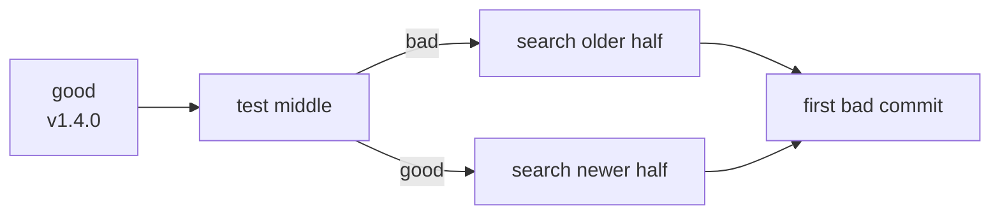

**Gotcha:** bisect works well only if every commit builds and the test is reliable. Broken intermediate commits and flaky tests give wrong answers. That is another reason for small atomic commits and linear, always-green history.

**Interview tip:** Mention `git bisect skip` for unbuildable commits and the habit of turning the bisect script into a regression test afterwards.

_Module: Undo & Recovery · Tags: bisect, debugging_

### 39. What are the advanced stash features: untracked files, partial stash, apply and stash branches?

**Short answer:** Beyond plain `git stash`, you can include untracked files with `-u`, stash only chosen hunks with `push -p`, name stashes, keep a stash with `apply`, and turn one into a branch with `stash branch`.

```bash
echo tmp >> v.txt
echo new > untracked.txt
git stash -u -m "cart wip"
git stash list
```

```text
Saved working directory and index state On main: cart wip
stash@{0}: On main: cart wip
```

| Command | Use |
| --- | --- |
| `git stash push -m "msg"` | Save with a name |
| `git stash -u` | Include untracked files |
| `git stash -a` | Include ignored files as well (rarely wanted) |
| `git stash push -p` | Pick hunks interactively |
| `git stash push -- path/file` | Stash only some paths |
| `git stash apply stash@{1}` | Apply but keep the stash |
| `git stash pop` | Apply and drop the stash if there is no conflict |
| `git stash show -p stash@{0}` | See the content |
| `git stash branch rescue` | New branch from the stash base, apply and drop |

```bash
git stash branch rescue
```

```text
Switched to a new branch 'rescue'
On branch rescue
```

This is the cleanest way to continue after the base branch moved on and `pop` conflicts, because the branch starts at the commit where you stashed.

Stashes are commits under `refs/stash`, so they are also in the reflog and can be recovered after a drop with `git fsck --unreachable | grep commit`, if you act soon.

**Gotcha:** `git stash` without `-u` leaves untracked files in place, which can make the next branch switch fail or surprise you. Also, stash entries are local and easy to forget.

**Interview tip:** Say that for work longer than a day you prefer a WIP commit on a branch. It is visible, shareable and backed up when pushed.

_Module: Undo & Recovery · Tags: stash, workflow_

### 40. How does `git add -p` help to craft clean commits?

**Short answer:** `git add -p` shows each changed hunk of your edits and asks if you want to stage it. This lets you split one messy working tree into several focused commits, so each commit contains only one idea.

When you fix a bug and also clean a neighbouring function, one `git add .` mixes both. With `-p` you stage the bug fix first.

```bash
git add -p
```

```text
@@ -10,6 +10,7 @@ func total(items []Item) int {
 ...
(1/2) Stage this hunk [y,n,q,a,d,j,J,g,/,e,?]?
```

Keys you use most:

| Key | Meaning |
| --- | --- |
| `y` / `n` | Stage or skip this hunk |
| `s` | Split the hunk into smaller hunks |
| `e` | Edit the hunk by hand, for hunks that cannot be split |
| `q` | Quit |
| `?` | Help |

The cycle becomes: `git add -p`, `git diff --staged` to review exactly what goes in, `git commit`, then repeat for the next idea.

Related tools:
- `git restore -p file` discards chosen hunks only.
- `git reset -p` unstages chosen hunks.
- `git commit --fixup <hash>` with `rebase -i --autosquash` puts a small fix into the earlier commit it belongs to.
- `git diff --staged` before every commit is a good habit.

**Gotcha:** `add -p` does not stage new untracked files. Use `git add -N <file>` (intent to add) first, then `-p` works for that file too.

**Interview tip:** Tie this to review quality: small, single-purpose commits are easy to review, revert and bisect.

_Module: Git Fundamentals · Tags: staging, commits, add-p_

### 41. How does `git worktree` help you work on several branches at once?

**Short answer:** `git worktree add` creates another folder that has a different branch checked out, and it shares the same `.git` data with your main folder. You can fix a hotfix in one folder while a long build or test runs in another, without stashing or cloning again. It exists since Git 2.5.

```bash
git worktree add ../orders-hotfix -b hotfix/login
git worktree list
```

```text
Preparing worktree (new branch 'hotfix')
HEAD is now at 782cb29 Change 6
/work/orders         782cb29 [main]
/work/orders-hotfix  782cb29 [hotfix]
```

You can now open `../orders-hotfix` in a second editor window, commit there, push, and then remove it:

```bash
git worktree remove ../orders-hotfix
git worktree prune          # clean records of deleted folders
```

Why it is better than the alternatives:

| Option | Problem |
| --- | --- |
| `git stash` and switch | Easy to forget, and the build cache is lost |
| A second `git clone` | Duplicates all objects, and branches are not shared |
| Worktree | One object store, separate working folders |

Good uses: review a merge request without touching your own work, run a long test on one branch while coding on another, compare two versions side by side, build a release branch while developing on `main`.

Rules: the same branch cannot be checked out in two worktrees at once. Git refuses, which prevents two folders from fighting over one branch. A worktree has its own index and its own uncommitted changes.

**Gotcha:** dependency folders such as `node_modules` are not shared, so each worktree needs its own install. Do not delete a worktree folder by hand; use `git worktree remove`.

**Interview tip:** Say that you use worktrees for reviews and hotfixes to avoid context switch costs.

_Module: Branching & Merging · Tags: worktree, workflow_

### 42. How do you resolve conflicts well: merge tools, `rerere`, and what do "ours" and "theirs" mean?

**Short answer:** Understand both sides, resolve in a three-way tool, test, and let `rerere` remember repeat resolutions. Be careful with the words ours and theirs, because they swap meaning between merge and rebase.

Steps: `git status` lists conflicted files. `git mergetool` opens a three-way tool that shows base, your side and their side. For tricky files `git checkout --conflict=diff3 file` adds the common ancestor into the markers, which helps to see what each side really changed. Enable it for good with `git config --global merge.conflictstyle zdiff3` (Git 2.35+).

Ours and theirs:

| Operation | "ours" (stage 2) | "theirs" (stage 3) |
| --- | --- | --- |
| `git merge topic` on `main` | `main`, the branch you are on | `topic`, the one you merge in |
| `git rebase main` on `topic` | `main`, the new base | `topic`, your commit being replayed |

During a rebase the roles feel reversed, because Git builds the result on top of the base and applies your commits one at a time. I checked both cases. In the rebase on `topic`, `git show :2:f` printed the content from `main` and `:3:f` printed the one from `topic`. In a merge on `topic` it was the opposite.

```bash
git checkout --ours -- file       # take the side marked ours
git checkout --theirs -- file
git merge -X theirs topic         # on conflicts only, prefer theirs
```

`rerere` means "reuse recorded resolution". It remembers how you fixed a conflict and applies it next time. Useful when you rebase a long branch several times.

```bash
git config rerere.enabled true
git merge x1
```

```text
CONFLICT (add/add): Merge conflict in cf
Recorded preimage for 'cf'
```

After you resolve and commit, the same conflict later prints `Resolved 'cf' using previous resolution.`

**Gotcha:** `-X theirs` and `-s ours` are different. The first is an option for conflicting hunks only, and the second (strategy) ignores the other branch completely.

**Interview tip:** Say that after resolving you build and run tests, since a clean text merge can still be wrong.

_Module: Branching & Merging · Tags: conflicts, rerere, merge, rebase_

### 43. What is the difference between `git diff A..B` and `A...B`, and between `git log A..B` and `A...B`?

**Short answer:** Two dots and three dots mean different things in `diff` and in `log`. For `log`, `A..B` is commits in B but not in A, and `A...B` is commits in either but not both. For `diff`, `A..B` compares the two tips, while `A...B` compares B with the merge base of A and B, which shows only what B added.

Take `main` and `feature`, split at a common commit M, each with its own new commits.

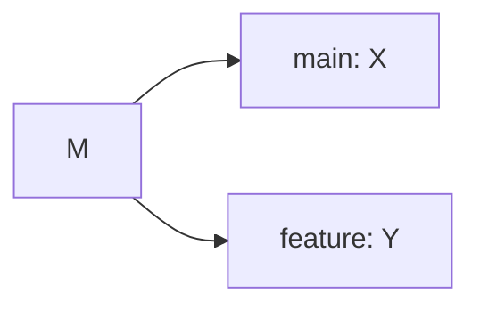

| Command | Meaning here |
| --- | --- |
| `git log main..feature` | Commits only in feature: Y |
| `git log feature..main` | Commits only in main: X |
| `git log main...feature` | Both sides: X and Y |
| `git diff main..feature` | Tip of main against tip of feature (includes the reverse of X) |
| `git diff main...feature` | Merge base M against feature: only the change made on feature |

A real run on two branches with one commit each:

```bash
git log --oneline c1..c2
git log --oneline c1...c2
git diff --stat main...f2
```

```text
4ab624f price 20
--
6a55cbc price 10
4ab624f price 20
 g | 2 ++
 h | 1 +
 2 files changed, 3 insertions(+)
```

The first block is `c1..c2`, the second is `c1...c2`.

When to use which:
- "What will my merge request add?" is `git diff origin/main...HEAD`. This is what the platform shows.
- "What do I have that is not pushed yet?" is `git log @{u}..HEAD`.
- "What did the remote get that I do not have?" is `git log HEAD..@{u}`.
- "What differs between two branches in both directions?" is `git log --left-right main...feature`.

**Gotcha:** `git diff A B` and `git diff A..B` are the same, but `git log A B` (with a space) means "commits reachable from A or B", not a range.

**Interview tip:** Remember the pair: log with two dots is the set difference, diff with three dots starts from the merge base. Merge request diffs use the three-dot idea.

_Module: Branching & Merging · Tags: diff, log, revisions_

### 44. What does `git fetch` do internally, and what is `FETCH_HEAD`?

**Short answer:** Fetch asks the remote which refs it has, downloads the commits and objects you are missing, and updates your remote-tracking refs such as `refs/remotes/origin/main`. It does not touch your branches or files. `FETCH_HEAD` is a file that records what the last fetch downloaded.

The rule that decides what to update is the refspec in `.git/config`:

```text
[remote "origin"]
    url = git@gitlab.example.com:shop/orders.git
    fetch = +refs/heads/*:refs/remotes/origin/*
```

It reads: take every branch on the remote (`refs/heads/*`) and store it locally as `refs/remotes/origin/*`. The `+` allows non-fast-forward updates of these tracking refs, since they only mirror the remote.

```bash
git fetch
cat .git/FETCH_HEAD
git log --oneline main..origin/main
```

```text
From .../remote
   1a95fb0..03353fe  main       -> origin/main
03353fe...	branch 'main' of .../remote
03353fe second
```

The line with two hashes shows the old and new value of `origin/main`. The `FETCH_HEAD` line holds the new hash and the source. Scripts use it, for example `git fetch origin main` followed by `git merge FETCH_HEAD`.

Steps inside a fetch:
1. Ask the remote for its list of refs.
2. Compare with what you have and negotiate the missing commits.
3. Receive a pack with only the missing objects.
4. Update the tracking refs.

You can fetch a single branch (`git fetch origin main`), or a merge request ref on GitLab: `git fetch origin merge-requests/42/head:mr-42`.

**Gotcha:** a fetch that downloads nothing new only means your tracking refs are up to date, not that your branch is. Compare with `git status -sb`.

**Interview tip:** Explain that this is why `git pull` is just fetch plus merge, and why fetch can never lose your work.

_Module: Remotes & Collaboration · Tags: fetch, remotes, internals_

### 45. How do you clean up stale remote branches?

**Short answer:** Deleting a branch on the server does not remove your local `origin/old-branch` reference. Run `git fetch --prune` (or set `fetch.prune true`) to drop tracking refs whose branch is gone, delete merged local branches yourself, and delete remote branches with `git push origin --delete`.

```bash
git branch -r
git fetch --prune
git branch -r
```

```text
  origin/HEAD -> origin/main
  origin/main
  origin/old-branch
From .../remote
 - [deleted]         (none)     -> origin/old-branch
  origin/HEAD -> origin/main
  origin/main
```

| Task | Command |
| --- | --- |
| Remove stale tracking refs | `git fetch --prune` or `git remote prune origin` |
| Do it every time | `git config --global fetch.prune true` |
| Delete a remote branch | `git push origin --delete old-branch` |
| List merged local branches | `git branch --merged main` |
| Delete a merged local branch | `git branch -d feature/x` |
| Force-delete an unmerged branch | `git branch -D feature/x` |
| Find local branches whose remote is gone | `git branch -vv` and look for `: gone]` |

A small clean-up script for local branches already merged into `main`:

```bash
git branch --merged main | grep -v '^\*\|main' | xargs -r git branch -d
```

GNU `xargs -r` skips the command when there is no input. On macOS use plain `xargs` and check the list first.

**Gotcha:** after a squash merge, `git branch --merged` does not list the feature branch, because the squashed commit has a different hash. Use `git branch -vv` and look for `gone` after fetching with prune, since the platform deleted the source branch.

**Interview tip:** Say you turn on "delete source branch after merge" in GitLab and `fetch.prune` locally, so clean-up happens by itself.

_Module: Remotes & Collaboration · Tags: prune, branches, cleanup_

### 46. How do you force push safely with `--force-with-lease`?

**Short answer:** After you rewrite your own branch (rebase or amend), a normal push is rejected. Use `git push --force-with-lease`. It forces the update only if the remote branch is still where you last saw it. If a teammate pushed something meanwhile, it refuses, so you do not overwrite their work.

A plain `--force` replaces the remote branch whatever is there. The lease adds a check, like "I expect the remote to be at this hash".

```bash
git commit --amend -m "fix v2"
git push --force-with-lease
```

Normal case, nobody else pushed:

```text
 + 03353fe...87889e3 main -> main (forced update)
```

If a teammate pushed after your last fetch:

```text
 ! [rejected]        fix -> fix (stale info)
error: failed to push some refs to '.../remote.git'
```

You then fetch, look at what arrived, rebase on it, and push again.

Rules:
- Only force push your own feature branch. Never `main` or release branches (protect them so the server refuses).
- Fetch first so the lease knows the current state. A background fetch by an IDE can hide new commits from the check, because it moves your remote-tracking ref. For more safety use `--force-with-lease=branch:expectedhash`, or add `--force-if-includes` (Git 2.30+).
- Add an alias: `git config --global alias.pushf "push --force-with-lease"`.

| Option | Behaviour |
| --- | --- |
| `--force` | Overwrites without checks |
| `--force-with-lease` | Overwrites only if the remote is as expected |
| `--force-if-includes` | Also checks that you have integrated the remote tip locally |

**Gotcha:** the lease protects against surprise commits that you never fetched. It does not protect a branch that several people work on on purpose. Agree on who owns which branch.

**Interview tip:** Say "I never use plain force. I use force-with-lease on my own branches only".

_Module: Remotes & Collaboration · Tags: push, force, safety_

### 47. Submodules, subtrees or a package manager: how do you share code between repositories?

**Short answer:** Prefer a package manager and versioned packages for libraries. Use submodules when you must pin an exact commit of another repository and keep its history separate. Use subtree when you want the other code copied into your repository, so that normal clone and checkout just work.

| Option | What is stored | Strength | Weakness |
| --- | --- | --- | --- |
| Package manager (npm, Go modules, NuGet) | A version number | Simple, semantic versions, caching | Needs a registry or tags |
| Submodule | A pointer to an exact commit, plus `.gitmodules` | Pins a commit, histories stay separate | Extra steps, easy to forget to update or push |
| Subtree | A copy of the other code in your history | Plain clone works, nothing special for users | History gets bigger, pushing changes upstream is harder |

Adding a submodule:

```bash
git submodule add ../lib vendor/lib
cat .gitmodules
git status -s
```

```text
[submodule "vendor/lib"]
	path = vendor/lib
	url = ../lib
A  .gitmodules
A  vendor/lib
```

The parent repository records only the commit hash of `vendor/lib`. Anyone cloning must run:

```bash
git clone --recurse-submodules <url>
git submodule update --init --recursive    # if already cloned
```

To move the pinned version: enter the submodule, check out the new commit, then commit the changed pointer in the parent repository.

Common trouble: someone commits the pointer but forgets to push the submodule commit. Others then fail with "not our ref". CI must also fetch submodules (in GitLab set `GIT_SUBMODULE_STRATEGY: recursive`).

Subtree example: `git subtree add --prefix=vendor/lib <url> main --squash`.

**Gotcha:** a submodule is not a branch. It points to one commit, and in detached HEAD state, which surprises new users.

**Interview tip:** Say that you use packages for libraries and avoid submodules unless pinning source is a real need. Then mention the clone and CI steps they require.

_Module: Repository Management · Tags: submodules, subtree, dependencies_

### 48. How do Git config levels, aliases and `includeIf` work?

**Short answer:** Git reads settings from three levels: system, global (your user), and local (the repository). The most specific one wins. Aliases are shortcuts for commands. `includeIf` loads extra config only for repositories in a certain folder, which is how you keep work and personal identities apart.

| Level | File | Set with |
| --- | --- | --- |
| System | `/etc/gitconfig` | `git config --system` |
| Global | `~/.gitconfig` | `git config --global` |
| Local | `.git/config` | `git config` (default) |
| Worktree | `.git/config.worktree` | `git config --worktree` |

Local overrides global, which overrides system. See where a value comes from:

```bash
git config --show-origin user.email
git config --list --show-origin
```

Aliases:

```bash
git config --global alias.st "status -sb"
git config --global alias.lg "log --oneline --graph --decorate"
git lg
```

Different identity for work repositories:

```text
# ~/.gitconfig
[user]
	name = Anu Personal
	email = me@home.example
[includeIf "gitdir:~/work/"]
	path = ~/.gitconfig-work

# ~/.gitconfig-work
[user]
	email = anu@company.example
```

Inside a repository under `~/work/` the email was the company one, and the name stayed personal:

```text
file:.../home/.gitconfig-work	anu@company.example
Anu Personal
```

The trailing slash in `gitdir:~/work/` matters, it means "everything under this folder". For remotes there is `hasconfig:remote.*.url:` (Git 2.36+).

**Gotcha:** committing with the wrong email is a common mistake and it ends up in history. Add `user.useConfigOnly true` so Git refuses to guess an identity.

**Interview tip:** Say that you keep a shared team config in the repository docs, but you never commit personal config, and use includeIf for company and personal repositories.

_Module: Repository Management · Tags: config, aliases, identity_

### 49. How do you handle line endings (CRLF and LF) and `.gitattributes`?

**Short answer:** Windows uses CRLF and Linux and macOS use LF, and mixed endings make noisy diffs and break shell scripts. Put a `.gitattributes` file in the repository to set the rules for everyone, rather than relying on each person's `core.autocrlf`.

A sensible file:

```text
* text=auto
*.sh text eol=lf
*.bat text eol=crlf
*.png binary
*.psd binary
```

Meaning:
- `text=auto`: Git detects text files and normalises them to LF inside the repository.
- `eol=lf` or `eol=crlf`: force a given ending in the working tree for those files.
- `binary`: never change, never diff as text.

Check what Git sees:

```bash
git ls-files --eol win.txt
```

```text
i/crlf  w/crlf  attr/text=auto        	win.txt
```

`i/` is the ending in the index, `w/` the working tree, and `attr/` the rule applied. Here a Windows-style file shows CRLF in both places. Running `git add --renormalize .` re-adds files so the index version follows the rules and becomes LF.

Personal fallback setting: `core.autocrlf true` on Windows (convert to LF on commit, CRLF on checkout) and `input` on macOS and Linux (convert to LF on commit only). The attributes file takes priority and is shared, so it is the better tool.

Typical bug: a shell script with CRLF in a Linux container fails with `bad interpreter: /bin/sh^M`. Forcing `*.sh text eol=lf` prevents it.

**Gotcha:** adding `.gitattributes` to an old repository can show many files as changed. Do the normalisation in a separate commit, and add it to `.git-blame-ignore-revs`.

**Interview tip:** Mention the container case. Developers on Windows and Docker builds on Linux is where this bites teams most.

_Module: Repository Management · Tags: gitattributes, line-endings, windows_

### 50. How do you sign commits and tags, and how do you verify them?

**Short answer:** A signature proves that a commit was created by the holder of a key. The author name in Git is only text, so anyone can fake it. You can sign with GPG, or since Git 2.34 with an SSH key. The platform then shows a Verified badge, and you can require signed commits on protected branches.

Setup with an SSH key:

```bash
git config --global gpg.format ssh
git config --global user.signingkey ~/.ssh/id_ed25519.pub
git config --global commit.gpgsign true      # sign every commit
git config --global tag.gpgsign true
```

Sign and verify:

```bash
git commit -S -m "fix(auth): rotate token on login"
git log --show-signature -1
git tag -s v2.0.0 -m "Release 2.0.0"
git verify-tag v2.0.0
```

For SSH signatures, verification locally needs an allowed signers file:

```bash
git config --global gpg.ssh.allowedSignersFile ~/.config/git/allowed_signers
```

Each line of that file holds an email and a public key. Also upload the public key to GitLab as a signing key so the server can mark commits as verified.

| Method | Pros | Cons |
| --- | --- | --- |
| GPG | Mature, key expiry, web of trust | Harder to set up |
| SSH key | Reuses the key you already have, simple | Needs the allowed signers file for local checks (Git 2.34+) |
| Sigstore style (gitsign) | No long-lived keys | Needs extra tooling |

What signing does not do: it does not prove that the code is good or reviewed. It proves authorship and integrity.

**Gotcha:** a rebase or squash by someone else re-creates the commits, and the original signatures are lost. The new commit is signed by the person who rebased, or by the platform if the web UI squashed it.

**Interview tip:** Link signing to supply-chain security and regulated work: you can say who produced a release, and that nobody changed history after the fact.

_Module: Team Practice & Leadership · Tags: signing, gpg, ssh, security_

### 51. How do you use tags and semantic versioning in a release workflow?

**Short answer:** Use semantic versioning: MAJOR.MINOR.PATCH, where major means a breaking change, minor a compatible feature, and patch a compatible fix. Create an annotated tag `vMAJOR.MINOR.PATCH` on the exact commit that CI built, and let the release pipeline run from the tag.

Typical flow:

1. Merge changes to `main` with conventional commit messages.
2. Choose the next version: any `feat` means minor, only `fix` means patch, any breaking change means major. Tools such as release-please or semantic-release can do this.
3. Tag the commit and push the tag.
4. The pipeline for tags builds, tests, publishes the artifact and creates release notes.

```bash
git tag -a v1.2.0 -m "Release 1.2.0"
git describe
git tag -l "v1.*"
git push origin v1.2.0
```

```text
v1.2.0
v1.2.0
```

`git describe` prints the nearest tag and, if the commit is after it, the number of commits since and the hash, such as `v1.2.0-5-g3a4b5c6`. This is a handy build version. Release notes between two tags:

```bash
git log --oneline v1.1.0..v1.2.0
```

| Version change | Example |
| --- | --- |
| Bug fix, no API change | 1.2.0 to 1.2.1 |
| New feature, compatible | 1.2.1 to 1.3.0 |
| Breaking change | 1.3.0 to 2.0.0 |
| Pre-release | 2.0.0-rc.1 |

Protect release tags in GitLab so only maintainers can create or delete them, and never move a published tag. If a release is wrong, publish a new patch version.

**Gotcha:** Go modules and many package tools read the Git tag as the version, so a wrong tag or a missing `v` prefix breaks consumers.

**Interview tip:** Say that the tag, the built artifact and the changelog should be traceable to each other, from the running service back to the commit.

_Module: Workflows & Strategy · Tags: tags, semver, releases_

### 52. How do `git format-patch`, `git am` and `git apply` work?

**Short answer:** These tools move commits as plain text files, without a shared remote. `format-patch` writes each commit as an email-style patch file, `am` applies those files and keeps the author, date and message, and `apply` applies a raw diff to the working tree without making a commit.

```bash
git format-patch -1 HEAD -o ../patches
git switch main
git am ../patches/0001-Add-b.patch
git log --oneline
```

```text
Applying: Add b
ea1d1b6 Add b
c1eea63 one
```

A patch file starts like an email: `From <sha>`, `From: author`, `Date:`, `Subject: [PATCH] message`, a diffstat and then the diff.

| Command | Result |
| --- | --- |
| `git diff > change.diff` | A plain diff of uncommitted work |
| `git apply change.diff` | Applies it to files, no commit |
| `git apply --check change.diff` | Dry run |
| `git format-patch main..feature` | One patch file per commit |
| `git am *.patch` | Creates commits with the original author |
| `git am --abort` / `--continue` | Same idea as for rebase |
| `git bundle create repo.bundle --all` | Whole repository in one file |

Where this is still useful: projects that review by mailing list (the Linux kernel works this way), moving a fix between unrelated repositories or forks, sending a change from an air-gapped network by file, and attaching a fix to a ticket.

**Gotcha:** `git am` stops on conflicts. Fix the files, `git add`, `git am --continue`. A mismatch in line endings is a frequent cause; try `git am --3way`.

**Interview tip:** Mention bundles for offline transfers, which is common in secured environments with no direct network path.

_Module: Remotes & Collaboration · Tags: patches, format-patch, am_

### 53. What do `.gitignore`, `git rm --cached` and `git clean` each do?

**Short answer:** `.gitignore` hides untracked files from Git. `git rm --cached` stops tracking a file but keeps it on disk. `git clean` deletes untracked files from the working tree. Use `git clean -n` first to see what would be removed.

Case: a `.env` file was committed by mistake.

```bash
echo ".env" >> .gitignore
git rm --cached .env
git status -s
```

```text
rm '.env'
D  .env
?? .gitignore
```

The file stays on disk, and the next commit removes it from the current tree. It is still in older commits. If it held a secret, rotate it.

Clean up untracked files:

```bash
git clean -n         # dry run
git clean -f         # delete untracked files
git clean -fd        # also folders
git clean -fdx       # also ignored files, like build output
```

```text
Would remove junk.tmp
Removing junk.tmp
```

| Task | Command |
| --- | --- |
| Why is a file ignored? | `git check-ignore -v path` |
| List ignored files | `git status --ignored` |
| Personal ignore for one repo | `.git/info/exclude` |
| Global ignore | `git config --global core.excludesFile ~/.gitignore_global` |
| Stop Git noticing local edits to a tracked file | `git update-index --skip-worktree path` |

**Gotcha:** `git clean -fdx` is destructive and cannot be undone, because the files were never committed. It removes your local `.env` and build caches too. Always run the dry run first.

**Interview tip:** Say that `.gitignore` is for files that should never be tracked, and that tracked files need `rm --cached` because ignore rules only work for untracked paths.

_Module: Repository Management · Tags: gitignore, clean, rm_

### 54. What merge methods do GitLab and GitHub offer, and what is a merge request in Git terms?

**Short answer:** A merge request (GitHub: pull request) is a platform record that asks to merge a source branch into a target branch after review and checks. When you click merge, the server runs one of a few Git operations: a merge commit, a squash, a fast-forward, or a rebase followed by a merge.

GitLab project settings offer these merge methods:

| Method | What the server does | History on `main` |
| --- | --- | --- |
| Merge commit | `git merge --no-ff` | Branch commits plus a merge commit |
| Merge commit with semi-linear history | Requires the branch to be rebased first, then a merge commit | Linear, with merge commits |
| Fast-forward merge | Only allowed if no rebase is needed, no merge commit | Straight line |
| Squash commits (option) | All branch commits become one | One commit per merge request |

GitHub offers three buttons: merge commit, squash and merge, rebase and merge.

A merge request in Git terms is simply refs and a diff:

```bash
git fetch origin merge-requests/42/head:mr-42    # GitLab keeps a ref per merge request
git diff origin/main...mr-42                     # what the request adds
```

The page shows the three-dot diff, so changes already on `main` do not appear as yours.

Other concepts:
- **Draft** merge requests: marked not ready, merging is blocked. Open them early to share direction.
- **Merged results pipelines** (GitLab): the pipeline runs on the result of merging your branch with the target, to catch conflicts with `main` before merging.
- **Merge trains** (GitLab): queue of merge requests tested one after the other, so `main` stays green.
- **Squash and the commit message**: the merge request title often becomes the final subject, so a good title matters.

**Gotcha:** fast-forward only needs frequent rebases when many people merge. Merge trains or semi-linear mode reduces the manual work.

**Interview tip:** Name the method your team uses and why. Add that the method is a platform setting, so the same rule applies to everyone.

_Module: Workflows & Strategy · Tags: gitlab, merge-request, squash, merge-methods_

## Advanced

### 55. [Tech Lead] How do you choose a branching strategy for a team?

**Short answer:** Pick the simplest strategy that fits how you release. If you deploy often from CI/CD, use trunk-based development or GitHub flow with short-lived branches. If you ship versioned products that must be maintained in parallel, add release branches. Use full GitFlow only when you really have scheduled, long-lived releases.

Decide with questions, not with fashion:
- How often do we release? Many times a day, weekly, or a few times a year?
- Do we support several versions at once (for example an on-board system in the field)?
- How good are our automated tests and our feature flags?
- How big is the team, and how long do branches live?

| Strategy | Shape | Fits | Cost |
| --- | --- | --- | --- |
| Trunk-based | Everyone merges to `main` at least daily. Branches live hours | Strong CI, feature flags, continuous delivery | Needs discipline and good tests |
| GitHub flow (GitLab flow light) | Short branch from `main`, merge request, merge, deploy | Web services and APIs | Weak for multiple supported versions |
| GitLab flow with environment or release branches | `main` plus `production` or `release/1.x` branches | Staged deploys, versioned releases | More branches to keep in sync |
| GitFlow | `main`, `develop`, `feature/*`, `release/*`, `hotfix/*` | Boxed release cycles, installed software | Heavy, slow integration, many merges |

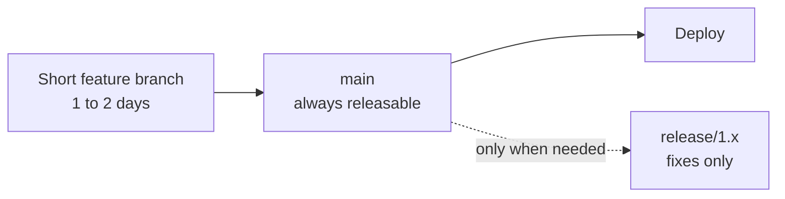

The main idea: `main` must always be releasable, and branches must die quickly.

For a service team on GitLab, my default is: short-lived branches, a merge request with a pipeline, squash or fast-forward merge, deploy from `main`, feature flags for unfinished work. For software shipped to devices or aircraft with long certification, I add `release/x.y` branches that only receive tested fixes, cherry-picked from `main`.

**Gotcha:** the strategy fails when the merge request queue is slow. If reviews take three days, branches become long-lived whatever the diagram says.

**Interview tip:** Show you can change your answer with context. Say: "I choose by release cadence and test confidence, and I revisit it when those change."

_Module: Workflows & Strategy · Tags: tech-lead, branching, trunk-based_

### 56. [Tech Lead] Monorepo or polyrepo, and how do you keep Git fast at scale?

**Short answer:** A monorepo gives atomic changes across services and shared tooling, but needs good build tooling and Git scaling features. Polyrepo gives clear ownership and small clones, but cross-repo changes and version drift are painful. Choose by how much code changes together.

| | Monorepo | Polyrepo |
| --- | --- | --- |
| Cross-service change | One merge request | Several, in order |
| Shared code and tooling | Easy | Needs packages and versions |
| Access control | Coarse (CODEOWNERS) | Per repo |
| Clone and CI cost | Grows without care | Small |
| Build | Needs affected-only builds (Nx, Bazel, Turborepo, path rules) | Simple per repo |

Git features that keep a big repository usable:

| Feature | What it does |
| --- | --- |
| Shallow clone `--depth 1` | Only recent history. Good for CI |
| Partial clone `--filter=blob:none` | Download file contents on demand (needs server support) |
| Sparse checkout | Put only chosen folders in the working tree (`git sparse-checkout`, Git 2.25+) |
| `git maintenance` | Background commit-graph, prefetch and repack jobs (Git 2.30+) |
| `core.fsmonitor` and untracked cache | Faster `git status` |

```bash
git clone --filter=blob:none --no-checkout https://gitlab.example.com/shop/platform.git
cd platform
git sparse-checkout set services/orders libs/common
git checkout main
git sparse-checkout list
```

```text
services/orders
libs/common
```

Only the listed folders appear on disk, and file contents download when needed. The server must allow filters, which GitLab does.

In CI, use `GIT_DEPTH`, caching and `rules:changes` (path based jobs) so a change in one service does not rebuild all.

**Gotcha:** a monorepo without ownership rules becomes a place where everyone breaks everyone. Pair it with CODEOWNERS, trunk-based development and fast pipelines.

**Interview tip:** Say it is a trade-off about coupling: put code together that changes together, and split what has independent release cycles.

_Module: Repository Management · Tags: tech-lead, monorepo, scale, performance_

### 57. What is Git's object model: blobs, trees, commits and tags?

**Short answer:** Git is a content-addressable store. It keeps four kinds of objects, each named by the hash of its content: a blob (file content), a tree (a folder listing), a commit (a snapshot with history info) and a tag (a named pointer with a message). Everything else in Git is built from these.

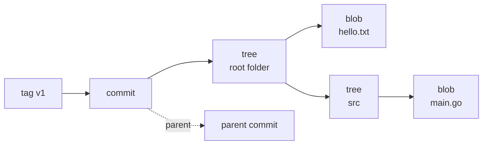

A tag points to a commit, a commit points to a root tree and its parents, trees point to blobs and sub-trees.

You can look at them with plumbing commands:

```bash
git cat-file -p HEAD^{tree}
git cat-file -t $(git rev-parse HEAD:hello.txt)
git cat-file -s HEAD:hello.txt
```

```text
100644 blob ce013625030ba8dba906f756967f9e9ca394464a	hello.txt
040000 tree 77df178079bf87a06c3c0f74a434ed330bfa78b0	src

blob
6
```

The blob has no file name. Names live in the tree. So two files with the same content share one blob.

How the id is computed: the hash of a header plus the content. For a blob, the header is the word `blob`, a space, the size, and a zero byte. You can check it by hand: hashing `blob 6`, a zero byte, and `hello` plus newline with SHA-1 gave `ce01362`, the same id as `git hash-object hello.txt`.

Hash functions: Git used SHA-1 for most of its life (40 hex characters). It supports SHA-256 (64 characters) with `git init --object-format=sha256`. In such a repository the commit id has 64 characters. SHA-256 repositories cannot yet talk to SHA-1 ones, and hosting support is limited, so most teams still use SHA-1.

Because ids come from content, an object can never change silently. A change gives a new id, and a commit id covers its whole history through the parent links. This is what makes Git history tamper-evident.

**Gotcha:** SHA-1 is known to be weak against deliberate collisions. Git uses a hardened SHA-1 implementation that detects known attack patterns, so it is safe for practical use, and the SHA-256 work is the long term fix.

**Interview tip:** Draw the four objects on a whiteboard. It shows that you understand Git as a data structure rather than a list of commands.

_Module: Git Internals · Tags: objects, internals, sha_

### 58. What is inside the `.git` directory?

**Short answer:** `.git` is the whole repository. The key parts are `objects` (all data), `refs` (branch and tag pointers), `HEAD` (current branch), `index` (the staging area), `config`, and `hooks`. Your working folder is just a checkout of one commit from it.

```bash
find .git -maxdepth 1 | sort
```

```text
.git
.git/COMMIT_EDITMSG
.git/HEAD
.git/config
.git/description
.git/hooks
.git/index
.git/info
.git/logs
.git/objects
.git/refs
```

| Path | What it holds |
| --- | --- |
| `HEAD` | The current branch, like `ref: refs/heads/main` |
| `config` | Local settings and remotes |
| `index` | The staging area: a binary list of paths, modes and blob ids |
| `objects/` | Loose objects in folders by the first two hex digits, and `pack/` for packfiles |
| `refs/heads`, `refs/tags`, `refs/remotes` | One small file per branch, tag or remote-tracking branch |
| `packed-refs` | Many refs packed in one text file (after `git gc`) |
| `logs/` | The reflog data |
| `hooks/` | Sample and active hook scripts |
| `info/exclude` | A personal ignore file |
| `COMMIT_EDITMSG`, `FETCH_HEAD`, `ORIG_HEAD` | Scratch files from recent operations |

A loose object lives under a folder named by the first two characters of its id. The blob with id `ce01362...` sits at `.git/objects/ce/013625...`, zlib compressed.

```bash
cat .git/HEAD
cat .git/refs/heads/main
git ls-files -s
```

```text
ref: refs/heads/main
0eb6006f44773fef2785d6d59bc5f5e3c0473802
100644 ce013625030ba8dba906f756967f9e9ca394464a 0	hello.txt
```

The last command reads the index. Each entry has the file mode, the blob id, the stage number (0 means no conflict, 1 to 3 are used during a conflict) and the path.

**Gotcha:** never edit files in `.git` by hand, and do not copy only the working folder if you want history. In a worktree or submodule, `.git` is a file that points to the real directory.

**Interview tip:** Say that deleting `.git` removes the history but keeps the files, and that copying `.git` alone is a full backup of the repository.

_Module: Git Internals · Tags: internals, git-directory_

### 59. How do packfiles, delta compression and `git gc` work?

**Short answer:** New objects are stored one by one as loose, compressed files. `git gc` collects them into a packfile, where similar objects are stored as deltas against each other, and removes unreachable objects after a grace period. Packfiles make the repository small and make clones fast.

In a repository with 40 commits that changed one big file a little each time, the object folder took about 496 KB on disk with loose objects and about 32 KB after `git gc`.

```bash
git count-objects -v
git gc
git count-objects -v
git verify-pack -v .git/objects/pack/pack-*.idx | tail -3
```

```text
count: 98
in-pack: 0
packs: 0
count: 0
in-pack: 98
packs: 1
non delta: 86 objects
chain length = 1: 20 objects
chain length = 2: 18 objects
```

Before, 98 loose objects. After, they are all in one pack. The summary shows that many objects are stored as a delta of another object, and the delta chains are short.

Key ideas:
- **Delta compression** is a storage trick. It does not change the snapshot model. Git picks similar objects (often versions of the same file), stores one in full and the other as a difference.
- The `.idx` file is an index into the `.pack` file for fast lookup.
- Git runs `gc --auto` for you after some commands when there are many loose objects.
- Pushing and fetching send packfiles too, called thin packs, with only the missing objects.
- `git gc --prune=now` deletes unreachable objects immediately. Normally they live at least two weeks, and the reflog keeps them reachable.

| Command | Use |
| --- | --- |
| `git gc` | Pack and clean |
| `git repack -ad` | Rebuild packs, drop redundant ones |
| `git count-objects -vH` | Size report |
| `git fsck` | Check object integrity, find dangling objects |

**Gotcha:** a large binary that changes often compresses badly, so repository size still grows. That is the reason for LFS.

**Interview tip:** Say "snapshots in the model, deltas only in storage". It clears the common confusion.

_Module: Git Internals · Tags: packfiles, gc, performance_

### 60. How are branches, tags and remote-tracking refs stored? Are they just files?

**Short answer:** Yes. A ref is a file whose content is a commit hash. Branches live in `refs/heads`, tags in `refs/tags`, and remote-tracking branches in `refs/remotes`. `HEAD` is a file that usually holds a symbolic reference to a branch. After `git gc` many refs are collected into one file, `packed-refs`.

```bash
find .git/refs -type f | sort
cat .git/packed-refs
git rev-parse main
git symbolic-ref HEAD
```

```text
.git/refs/heads/main
# pack-refs with: peeled fully-peeled sorted 
4ba1dbd... refs/heads/main
4cad1d3... refs/tags/v1
```

Hashes shortened and they will differ on your machine. After the garbage collection, the loose ref files are packed. When a ref exists in both, the loose file wins.

This explains many behaviours:
- Creating a branch writes 41 bytes. Deleting a branch deletes a pointer.
- A commit moves a branch by writing the new hash into the file. Git does that atomically with a lock file.
- Annotated tag refs point to a tag object, and the tag object points to the commit. The `^{}` lines in `packed-refs` show the peeled commit.
- Reflog entries are under `.git/logs/refs/...`, one line per movement.
- `refs/stash`, `refs/notes/*` and the GitLab refs `refs/merge-requests/*` are also normal refs.

Plumbing commands to work with refs safely:

```bash
git update-ref refs/heads/rescue 3740805     # create or move a ref
git for-each-ref refs/heads                   # list refs with data
git show-ref --tags
git symbolic-ref HEAD refs/heads/main         # change what HEAD points to
```

A newer storage format, the reftable backend, exists in recent Git versions (it arrived in 2.45) for very large numbers of refs. Files remain the default.

**Gotcha:** with the file backend, refs differing only by case clash on case-insensitive file systems (macOS, Windows). Avoid branch names such as `Feature` and `feature`.

**Interview tip:** Link it back to performance: Git operations on thousands of branches are fast because refs are tiny, but listing 100,000 loose refs is slow, which is why packed-refs and reftable exist.

_Module: Git Internals · Tags: refs, internals_

### 61. How does Git find the merge base and perform a three-way merge?

**Short answer:** Git finds the best common ancestor of the two tips, called the merge base. Then it compares the base with each side. If only one side changed a part, it takes that change. If both changed the same part in different ways, it reports a conflict. This is a three-way merge.

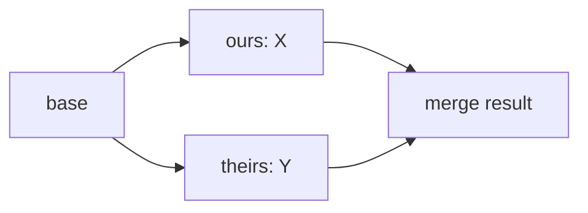

The base is the third input. It lets Git know who changed what.

```bash
git merge-base c1 c2
git merge-base --all HEAD HEAD~3
```

```text
e573903
62bd4e5
```

How decisions are made for each region:

| Base | Ours | Theirs | Result |
| --- | --- | --- | --- |
| A | A | B | B (only they changed it) |
| A | B | A | B (only we changed it) |
| A | B | B | B (same change on both sides) |
| A | B | C | Conflict |

Why the base matters: with only two versions, Git could not tell whether a line was added by one side or deleted by the other. The base makes the intent clear.

Tricky case: criss-cross merges, where two branches have merged each other, so there can be more than one best base. The old `recursive` strategy merged those bases into a virtual one. The `ort` strategy (default since Git 2.34) does it faster and with fewer wrong results.

You can preview a merge without touching anything, since Git 2.38:

```bash
git merge-tree --write-tree x1 x2
echo $?
```

```text
<tree id>
100644 05bef1a... 2	cf
100644 331bae0... 3	cf

Auto-merging cf
CONFLICT (add/add): Merge conflict in cf
```

The exit code is 1 on conflicts and 0 on a clean merge. The first line is the id of the resulting tree. This is how servers can test mergeability without a working tree.

**Gotcha:** a conflict-free merge can be wrong in meaning, since Git sees lines, not logic.

**Interview tip:** Use the table. It shows that you understand why merge needs three inputs.

_Module: Git Internals · Tags: merge, merge-base, internals_

### 62. What merge strategies exist, and how does rename detection work?

**Short answer:** The default strategy is `ort` (Git 2.34 and later; before that `recursive`). Others are `octopus` for merging more than two branches, `ours` to record a merge while keeping our tree, and `subtree`. Git does not record renames. It detects them by comparing content similarity when diffing or merging.

| Strategy or option | Meaning |
| --- | --- |
| `-s ort` | Default two-branch strategy, handles renames and criss-cross merges |
| `-s octopus` | Merge several branches at once, refuses if there are conflicts |
| `-s ours` | Result is exactly our tree, the other branch only joins the history |
| `-X ours` / `-X theirs` | On conflicting hunks, prefer one side |
| `-X ignore-space-change` | Ignore whitespace differences |
| `-X find-renames=70%` | Set the similarity threshold |
| `-s subtree` | Merge a project that lives in a subfolder |

A use for `-s ours`: mark an old branch as merged without taking its content.

```bash
git merge -s ours old-release -m "Mark old-release as merged"
```

Rename detection: if a file disappears and another appears with at least 50 percent similar content (the default), Git treats it as a rename. Therefore a rename plus a small edit is still understood in a merge, and changes made by a teammate to the old name are applied to the new name.

```bash
git mv a b
git commit -m "refactor: rename a"
git diff -M --stat HEAD~1
git log --follow --oneline b
```

```text
 hello.txt => greeting.txt | 0
 1 file changed, 0 insertions(+), 0 deletions(-)
3322c15 rename
523f24e init
```

Ideas to keep: if you rename and rewrite most of a file in one commit, detection fails and Git shows a delete and an add. So rename in one commit and edit in another. Directory renames are handled by `ort`: new files added by another branch into the old directory move with the rename.

**Gotcha:** `-s ours` is often confused with `-X ours`. The first one throws away everything from the other branch, even clean changes.

**Interview tip:** Say that Git stores snapshots and infers renames. It ties together the object model and merge behaviour.

_Module: Git Internals · Tags: merge-strategies, ort, renames_

### 63. How do you rewrite history at scale with `git filter-repo`, and what are the consequences?

**Short answer:** `git filter-repo` is a separate tool (a Python script that you install, recommended by the Git project over the old `filter-branch`) that rewrites every commit in a repository. Use it to remove a file or secret from all history, extract a folder into its own repository, or fix author emails. Every affected commit gets a new hash, so everyone must re-clone.

Typical jobs:

```bash
git clone --mirror git@gitlab.example.com:shop/orders.git orders-clean.git
cd orders-clean.git
git filter-repo --invert-paths --path config/prod.env     # remove a file everywhere
git filter-repo --path services/payments/ --path-rename services/payments/:  # extract a folder
git filter-repo --replace-text expressions.txt            # scrub strings
git filter-repo --mailmap mailmap.txt                     # rewrite author identity
```

Check these options against the documentation of the version you use. The tool refuses to run on a non-fresh clone unless you pass `--force`, to protect you from damaging the only copy.

Consequences you must plan:
1. All commit ids from the first changed commit onward are new, as each commit id includes its parents.
2. Tags and branches are rewritten. Signed commits lose their signatures.
3. Open merge requests and local clones point at the old history. Teammates should re-clone, and not merge old branches back, or the removed data returns.
4. `filter-repo` removes the `origin` remote on purpose. Add it again and force push all refs with `git push --force --mirror`, which needs permission to bypass branch protection.
5. The server may keep old objects in caches and in merge request refs. Contact the platform admin for a purge when removing secrets.
6. Deployment pipelines that refer to commit hashes may break.

| Tool | Status |
| --- | --- |
| `git filter-repo` | Recommended, fast, safe defaults |
| `git filter-branch` | Slow, error-prone, discouraged |
| BFG Repo-Cleaner | Simple for big files and passwords, Java |

**Gotcha:** if a secret leaked, rotate it first. Rewriting history is a clean-up, not a fix.

**Interview tip:** Mention the communication plan as much as the command: freeze, announce, rewrite, force push, ask everyone to re-clone.

_Module: Rewriting History · Tags: filter-repo, history, security_

### 64. How do partial clone, shallow clone, sparse checkout and `git maintenance` help with huge repositories?

**Short answer:** Each reduces a different cost. Shallow clone limits the history. Partial clone delays downloading file contents. Sparse checkout limits which folders appear in your working tree. `git maintenance` runs background jobs that keep the repository fast.

| Technique | Command | Saves |
| --- | --- | --- |
| Shallow clone | `git clone --depth 1 <url>` | History size. Good for CI builds |
| Partial clone | `git clone --filter=blob:none <url>` | Downloads file contents on demand |
| Sparse checkout | `git sparse-checkout set <dirs>` (Git 2.25+) | Files in the working tree |
| Maintenance | `git maintenance start` (Git 2.30+) | Slow `fetch`, `status` and `log` over time |

Examples with a local source repository that has three commits:

```bash
git clone --depth 1 file:///work/srcrepo shallow
git -C shallow log --oneline
git -C shallow rev-parse --is-shallow-repository
```

```text
4d8ded3 c3
true
```

Only one commit exists in the shallow clone, although the source has three.

```bash
git clone --filter=blob:none --no-checkout file:///work/srcrepo partial
cd partial
git config remote.origin.partialclonefilter
git sparse-checkout set svc-a
git checkout main
ls
```

```text
blob:none
svc-a
```

The partial clone has all commits and trees, but file contents arrive only when needed. Together with sparse checkout, only `svc-a` is on disk. This needs a server that allows filters; GitLab does. A shallow clone cannot always push or find a merge base, so use it for read-only work like CI, and `git fetch --unshallow` to get the full history back.

Maintenance schedules jobs such as prefetching, commit-graph updates and repacking:

```bash
git maintenance start      # registers hourly and daily background tasks
git maintenance run --task=gc
```

Also useful: `core.fsmonitor true` and `core.untrackedCache true` to speed up `git status` in big working trees.

**Gotcha:** blobless partial clones make some commands slow, as `git blame` or `git log -p` fetch many blobs one by one. Treeless clones (`--filter=tree:0`) are good for CI but worse for developers.

**Interview tip:** Match the technique to the user: CI gets shallow, developers get partial plus sparse, and the server team keeps maintenance and bitmaps current.

_Module: Repository Management · Tags: partial-clone, sparse-checkout, maintenance, performance_

### 65. What are the commit graph and bitmap indexes, and why do they make Git faster?

**Short answer:** Many operations walk the history: log, merge-base, "is A an ancestor of B". The commit-graph file caches the parent links and dates of commits so Git does not have to open and parse each commit object. Reachability bitmaps, stored beside a packfile, list which objects belong to chosen commits, so fetch and clone can decide what to send without walking everything.

```bash
git commit-graph write --reachable
ls .git/objects/info
git repack -adb
ls .git/objects/pack
```

```text
commit-graph
packs
pack-<sha>.bitmap
pack-<sha>.idx
pack-<sha>.pack
pack-<sha>.rev
```

| Feature | File | Speeds up |
| --- | --- | --- |
| Commit graph | `.git/objects/info/commit-graph` | `log --graph`, `merge-base`, `branch --contains`, `tag --contains` |
| Generation numbers | Stored in the commit graph | Ancestor checks stop early |
| Bitmap index | `pack-*.bitmap` | Clone and fetch object counting on servers |
| Multi-pack index | `multi-pack-index` | Fast lookup over many packs |
| Changed-path Bloom filters | In the commit graph | `git log -- path` on big repositories |

You rarely run these by hand. Hosting platforms keep bitmaps and graphs up to date on the server, and `git maintenance` or `gc` maintains the commit graph locally (the setting `fetch.writeCommitGraph` writes it on fetch).

Why a lead should care: on a large monorepo, `git log -- some/dir` or `git branch --contains` may take minutes without these files and seconds with them. When developers say "Git is slow", measure first with `GIT_TRACE=1` or `GIT_TRACE_PERFORMANCE=1`, check `git count-objects -vH`, and make sure maintenance is on.

**Gotcha:** these files are caches. They are safe to delete and rebuild, and they are not pushed.

**Interview tip:** Say that you do not tune Git by guessing. You enable maintenance, use partial clone and sparse checkout, and measure with trace output.

_Module: Git Internals · Tags: commit-graph, bitmaps, performance_

### 66. What is the revision syntax: `HEAD~2`, `HEAD^2`, `@{upstream}`, `:/text` and more?

**Short answer:** Git has a small language for naming commits. `~n` goes back n first-parent steps, `^n` selects the nth parent of a merge, `@{u}` is the upstream, `@{n}` the nth previous value in the reflog, `:/text` the newest commit whose message matches, and `A..B` or `A...B` are ranges.

| Syntax | Meaning |
| --- | --- |
| `HEAD`, `main`, `v1.0`, `a1b2c3d` | Branch, tag or an abbreviated hash |
| `HEAD~1`, `HEAD~` | The parent (first parent) |
| `HEAD~3` | Three generations back along first parents |
| `HEAD^`, `HEAD^1` | First parent |
| `HEAD^2` | Second parent. Only merges have one |
| `HEAD^{tree}` | The tree of the commit |
| `main@{1}` | Where main pointed one move ago (reflog) |
| `HEAD@{2.hours.ago}` | Where HEAD was two hours ago |
| `@{u}` or `@{upstream}` | The upstream branch of the current branch |
| `@{push}` | Where a push would go |
| `:/fix typo` | Newest commit whose message matches |
| `HEAD:path/file` | The blob of a file at that commit |
| `:2:file` | The file in the index at stage 2 (during conflicts) |
| `A..B`, `A...B` | Ranges (see the range question) |
| `^A B` | Commits reachable from B but not from A |

On a small history with three commits and a merge:

```bash
git log -1 --format=%s HEAD~1
git log -1 --format=%s :/two
git log -1 --format=%s HEAD^1
git log -1 --format=%s HEAD^2
```

```text
two
two
three
side
```

`HEAD^1` is the branch you merged into, and `HEAD^2` is the branch you merged.

Remember the difference: `~` walks back along the first parent, repeated. `^` picks which parent. So `HEAD~2` equals `HEAD^^`, but `HEAD^2` is not the same as `HEAD~2`.

`git rev-parse` turns any of these into a full hash, which scripts need:

```bash
git rev-parse --short HEAD~2
git rev-parse --abbrev-ref @{u}
```

**Gotcha:** in some shells you must quote `HEAD@{1}` or `HEAD^`. In zsh the braces and in Windows `cmd` the caret need quotes.

**Interview tip:** The pair `HEAD~2` against `HEAD^2` is a classic follow-up, so say it clearly.

_Module: Git Internals · Tags: rev-parse, revisions, reference_

### 67. Explain step by step what happens on `git commit`, `git merge` and `git push`.

**Short answer:** A commit turns the index into tree objects, wraps them in a commit object that points to the parent, then moves the branch pointer. A merge finds the base, merges the trees, and writes a commit with two parents. A push sends the missing objects in a pack and asks the remote to move a ref, which succeeds only if it is a fast-forward or forced.

**git commit**
1. Read the index (the staged snapshot).
2. Write tree objects for each folder, bottom up. Blobs already exist from `git add`.
3. Write a commit object: root tree, parent (current `HEAD`), author, committer, message.
4. Update the current branch file to the new commit hash and add a reflog line.
5. Run hooks around it: `pre-commit`, `commit-msg`, `post-commit`.

**git merge topic**
1. Find the merge base of `HEAD` and `topic`.
2. If `HEAD` is the base, fast-forward: move the branch, update the files. Done.
3. Otherwise compare base, ours and theirs per file, merge changed regions and detect renames.
4. If clean, write the merged tree and a commit with two parents. If not, write conflict markers, record stages 1 to 3 in the index, and stop.

**git push origin main**
1. Ask the remote for its refs.
2. Work out which objects the remote lacks, and build a pack of those only.
3. Send the pack and a command: "move `refs/heads/main` from old to new".
4. The remote checks that the new commit descends from the old one (fast-forward). Otherwise it rejects, unless the push is forced.
5. Server-side hooks and platform rules run (protected branches, push rules). Then the ref is updated, and the pipeline starts.

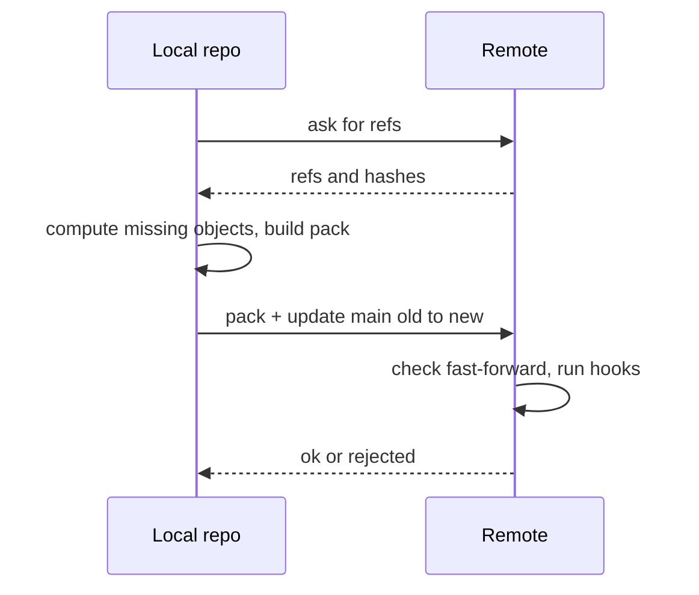

```bash
git push origin main
```

```text
 ! [rejected]        main -> main (non-fast-forward)
hint: Updates were rejected because the tip of your current branch is behind
```

That rejection is step 4: your commit does not descend from the remote one.

**Gotcha:** a push moves a ref on the remote. It does not "send a branch". The objects are just the transport.

**Interview tip:** Walk through one of them slowly and name the objects created. That is what turns a command user into someone who understands Git.

_Module: Git Internals · Tags: internals, commit, merge, push_

### 68. How would you design a release process on Git, from feature to production?

**Short answer:** Keep one source of truth (`main`), merge small reviewed changes behind feature flags, build once from a tagged commit, promote the same artifact through environments, and use short-lived release branches only for supported versions. Every step must be traceable to a commit.

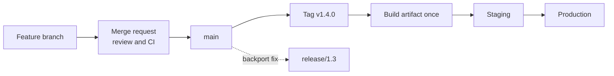

Changes flow left to right. The tag marks what was built, and the same artifact is promoted. Fixes for old versions are cherry-picked to a release branch.

Design decisions to state:

| Area | Decision |
| --- | --- |
| Branching | Short-lived branches from `main`, protected `main` and release branches |
| Merge method | Squash or fast-forward, one rule for all |
| Quality gates | Required pipeline, approvals, CODEOWNERS for risky areas |
| Versioning | Semantic versioning, annotated tags created by the pipeline or a release manager |
| Build | Build once from the tag. Never rebuild per environment |
| Config | Environment settings outside the artifact (variables, vault) |
| Unfinished work | Feature flags, so merging does not mean releasing |
| Hotfix | Fix on `main`, then `cherry-pick -x` to `release/x.y` and tag `x.y.z` |
| Rollback | Redeploy the previous tag. A revert commit is the Git-level rollback |
| Traceability | From a running version, tag, commit, merge request, ticket |
| Release notes | `git log vPrev..vNext` grouped by conventional commit type |

Sequence for a hotfix in production:

```bash
git switch release/1.3
git cherry-pick -x 61e1c8d
git tag -a v1.3.2 -m "Hotfix 1.3.2"
git push origin release/1.3 v1.3.2
```

Add measures: lead time from merge to production, change failure rate, and time to restore. These come from delivery research that many teams use.

For regulated work such as avionics software, add a signed tag, a stored build record and a release checklist, and keep release branches long enough to support the fielded versions.

**Gotcha:** the process fails when the artifact differs between staging and production. "Build once, promote" prevents it.

**Interview tip:** Walk through one change from commit to production and name the control at each step. Then explain what you would change if releases had to be monthly instead of daily.

_Module: Workflows & Strategy · Tags: tech-lead, release-process, design_

---

## Resources

Where to read more at the source. Official docs and references come first.

**Official docs**

- [Git reference documentation](https://git-scm.com/docs) — Manual pages for every Git command. _(intermediate)_
- [Git internals (Pro Git)](https://git-scm.com/book/en/v2/Git-Internals-Plumbing-and-Porcelain) — Objects, refs and the plumbing commands under Git. _(advanced)_
- [GitHub flow](https://docs.github.com/get-started/using-github/github-flow) — A lightweight branch-and-pull-request workflow. _(beginner)_
- [Git LFS](https://git-lfs.com) — Store large files outside the main repository history. _(intermediate)_
- [GitLab Git documentation](https://docs.gitlab.com/topics/git/) — Git guides inside GitLab: branches, merge requests, undoing changes. _(beginner)_

**Reference**

- [Trunk Based Development](https://trunkbaseddevelopment.com) — Short-lived branches, feature flags and release approaches. _(intermediate)_
- [Conventional Commits](https://www.conventionalcommits.org) — A specification for readable commit messages and automated changelogs. _(beginner)_
- [Semantic Versioning](https://semver.org) — Version numbers and what they promise. _(beginner)_

**Tutorial**

- [Learn Git Branching](https://learngitbranching.js.org) — Interactive visual tutorial for branching, merging and rebasing. _(beginner)_
- [Oh Shit, Git!?!](https://ohshitgit.com) — How to get out of common Git mistakes in plain English. _(beginner)_
- [Atlassian Git tutorials](https://www.atlassian.com/git/tutorials) — Clear tutorials on workflows, rebasing, hooks and more. _(beginner)_
- [Think Like (a) Git](https://think-like-a-git.net) — A mental model of Git as a graph of commits. _(intermediate)_

**Book**

- [Pro Git](https://git-scm.com/book/en/v2) — The official free book: from basics to internals. _(beginner)_

**Article**

- [A successful Git branching model](https://nvie.com/posts/a-successful-git-branching-model/) — The original GitFlow article, with its trade-offs. _(intermediate)_

**Repository**

- [git filter-repo](https://github.com/newren/git-filter-repo) — The recommended tool for rewriting history at scale. _(advanced)_
