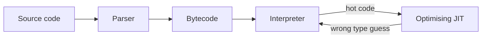
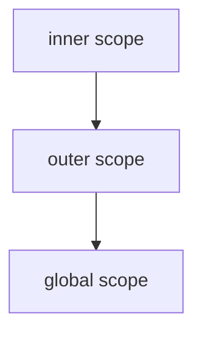
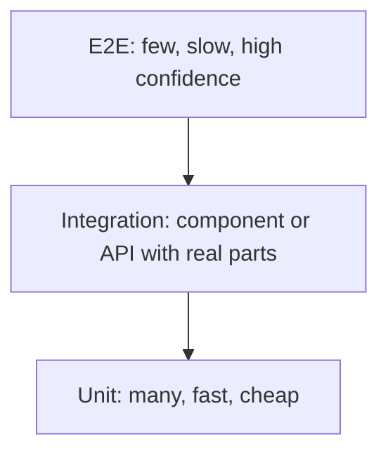
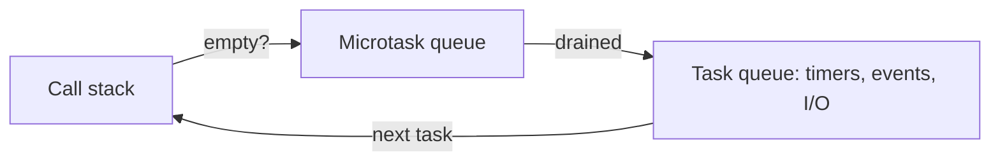
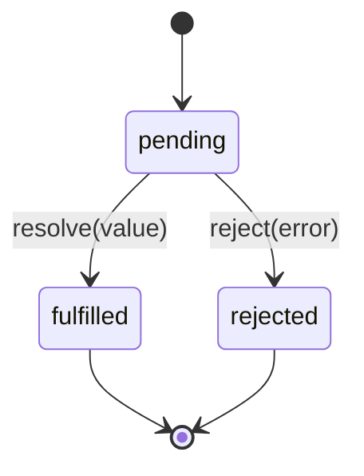
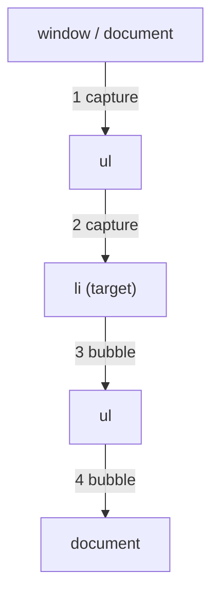
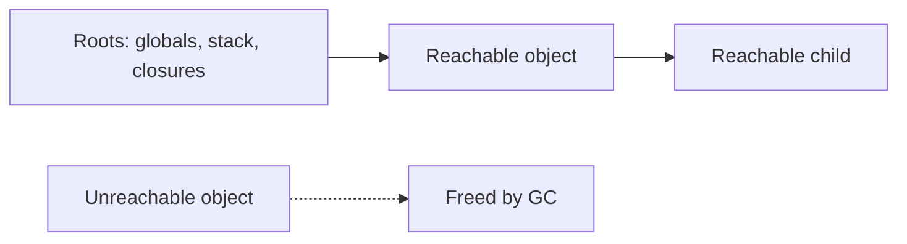
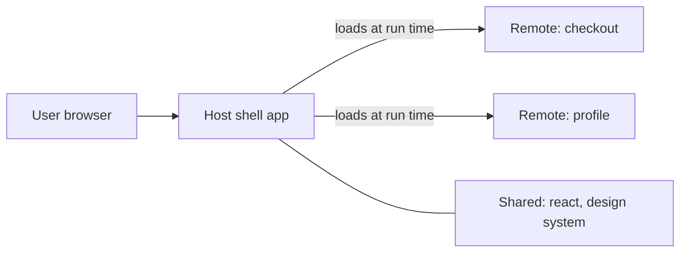

# JavaScript

[← Back to index](../README.md) · [⭐ Favorites](favorites.md)

66 questions · 1 favorites · [📚 Resources](#resources)

## Contents

**Basic**

- [1. How does JavaScript run? What are the engine, the single thread and JIT compilation?](#1-how-does-javascript-run-what-are-the-engine-the-single-thread-and-jit-compilation)
- [2. What is the difference between `let`, `const` and `var`?](#2--what-is-the-difference-between-let-const-and-var)
- [3. What are hoisting and the temporal dead zone?](#3-what-are-hoisting-and-the-temporal-dead-zone)
- [4. What are the primitive types and object types? Explain the `typeof` quirks and `null` vs `undefined`.](#4-what-are-the-primitive-types-and-object-types-explain-the-typeof-quirks-and-null-vs-undefined)
- [5. How does type coercion work? Explain truthy and falsy values.](#5-how-does-type-coercion-work-explain-truthy-and-falsy-values)
- [6. What is the difference between `==` and `===`? What do `Object.is` and `NaN` do?](#6-what-is-the-difference-between--and--what-do-objectis-and-nan-do)
- [7. What is the difference between function declarations, function expressions and arrow functions?](#7-what-is-the-difference-between-function-declarations-function-expressions-and-arrow-functions)
- [8. How does `this` work in JavaScript?](#8-how-does-this-work-in-javascript)
- [9. What is a closure and why is it useful?](#9-what-is-a-closure-and-why-is-it-useful)
- [10. What are lexical scope and the scope chain?](#10-what-are-lexical-scope-and-the-scope-chain)
- [11. How do objects, property access, destructuring, spread and rest work?](#11-how-do-objects-property-access-destructuring-spread-and-rest-work)
- [12. Which array methods should you know, and which ones mutate the array?](#12-which-array-methods-should-you-know-and-which-ones-mutate-the-array)
- [13. How do strings and template literals work?](#13-how-do-strings-and-template-literals-work)
- [14. How do numbers work in JavaScript? Explain floating point, `BigInt` and `Number.EPSILON`.](#14-how-do-numbers-work-in-javascript-explain-floating-point-bigint-and-numberepsilon)
- [15. What is the difference between pass by value and pass by reference? What are shallow and deep copies?](#15-what-is-the-difference-between-pass-by-value-and-pass-by-reference-what-are-shallow-and-deep-copies)
- [16. What are the differences between `for`, `for...of`, `for...in` and `forEach`?](#16-what-are-the-differences-between-for-forof-forin-and-foreach)
- [17. What is the difference between ES modules and CommonJS?](#17-what-is-the-difference-between-es-modules-and-commonjs)
- [18. How do errors, `try/catch/finally` and the built-in error types work?](#18-how-do-errors-trycatchfinally-and-the-built-in-error-types-work)
- [19. What are `Map`, `Set`, `WeakMap` and `WeakSet`, and when do you use them?](#19-what-are-map-set-weakmap-and-weakset-and-when-do-you-use-them)
- [20. What are optional chaining, nullish coalescing and logical assignment?](#20-what-are-optional-chaining-nullish-coalescing-and-logical-assignment)

**Intermediate**

- [21. \[Tech Lead\] A page feels slow. How do you find and fix slow JavaScript?](#21-tech-lead-a-page-feels-slow-how-do-you-find-and-fix-slow-javascript)
- [22. \[Tech Lead\] How do memory leaks happen in the browser and how do you find them?](#22-tech-lead-how-do-memory-leaks-happen-in-the-browser-and-how-do-you-find-them)
- [23. \[Tech Lead\] Debounce vs throttle: which do you use, and when?](#23-tech-lead-debounce-vs-throttle-which-do-you-use-and-when)
- [24. \[Tech Lead\] How do you reduce bundle size and use code splitting?](#24-tech-lead-how-do-you-reduce-bundle-size-and-use-code-splitting)
- [25. \[Tech Lead\] How do you monitor JavaScript errors in production?](#25-tech-lead-how-do-you-monitor-javascript-errors-in-production)
- [26. \[Tech Lead\] What are the main security risks in JavaScript apps and how do you reduce them?](#26-tech-lead-what-are-the-main-security-risks-in-javascript-apps-and-how-do-you-reduce-them)
- [27. \[Tech Lead\] How do you design a testing strategy for a JavaScript codebase?](#27-tech-lead-how-do-you-design-a-testing-strategy-for-a-javascript-codebase)
- [28. \[Tech Lead\] How do you adopt linting, formatting and TypeScript in an existing JavaScript codebase?](#28-tech-lead-how-do-you-adopt-linting-formatting-and-typescript-in-an-existing-javascript-codebase)
- [29. \[Tech Lead\] How do you handle browser compatibility, transpiling and polyfills?](#29-tech-lead-how-do-you-handle-browser-compatibility-transpiling-and-polyfills)
- [30. \[Tech Lead\] How do you manage npm dependencies and upgrades safely?](#30-tech-lead-how-do-you-manage-npm-dependencies-and-upgrades-safely)
- [31. \[Tech Lead\] When and how would you move work off the main thread with Web Workers?](#31-tech-lead-when-and-how-would-you-move-work-off-the-main-thread-with-web-workers)
- [32. \[Tech Lead\] What do you look for in a JavaScript code review, and how do you set standards for the team?](#32-tech-lead-what-do-you-look-for-in-a-javascript-code-review-and-how-do-you-set-standards-for-the-team)
- [33. What are prototypes and the prototype chain?](#33-what-are-prototypes-and-the-prototype-chain)
- [34. How do classes, inheritance and private fields work?](#34-how-do-classes-inheritance-and-private-fields-work)
- [35. What do `call`, `apply` and `bind` do?](#35-what-do-call-apply-and-bind-do)
- [36. What is the event loop? How do the call stack, task queue and microtasks work?](#36-what-is-the-event-loop-how-do-the-call-stack-task-queue-and-microtasks-work)
- [37. What is the difference between callbacks and promises?](#37-what-is-the-difference-between-callbacks-and-promises)
- [38. How do promise chaining and error handling work?](#38-how-do-promise-chaining-and-error-handling-work)
- [39. How do you use async/await well: sequential vs parallel, errors and loops?](#39-how-do-you-use-asyncawait-well-sequential-vs-parallel-errors-and-loops)
- [40. What is the difference between `Promise.all`, `allSettled`, `race` and `any`?](#40-what-is-the-difference-between-promiseall-allsettled-race-and-any)
- [41. What are iterators and generators?](#41-what-are-iterators-and-generators)
- [42. What are `Symbol`s and what are they used for?](#42-what-are-symbols-and-what-are-they-used-for)
- [43. What are `Proxy` and `Reflect` and where are they used?](#43-what-are-proxy-and-reflect-and-where-are-they-used)
- [44. What are getters, setters and property descriptors?](#44-what-are-getters-setters-and-property-descriptors)
- [45. What are higher-order functions, currying and function composition?](#45-what-are-higher-order-functions-currying-and-function-composition)
- [46. How does memoization work and when should you use it?](#46-how-does-memoization-work-and-when-should-you-use-it)
- [47. How do event bubbling, capturing and delegation work?](#47-how-do-event-bubbling-capturing-and-delegation-work)
- [48. How do you use `fetch` and `AbortController`?](#48-how-do-you-use-fetch-and-abortcontroller)
- [49. How do `localStorage`, `sessionStorage` and cookies differ?](#49-how-do-localstorage-sessionstorage-and-cookies-differ)
- [50. How do you do immutability in JavaScript? What do `Object.freeze` and spread do?](#50-how-do-you-do-immutability-in-javascript-what-do-objectfreeze-and-spread-do)
- [51. How do `Date` and `Intl` work, and what are the common date problems?](#51-how-do-date-and-intl-work-and-what-are-the-common-date-problems)
- [52. What regular expression essentials should a developer know?](#52-what-regular-expression-essentials-should-a-developer-know)
- [53. What are the JSON edge cases a developer should know?](#53-what-are-the-json-edge-cases-a-developer-should-know)
- [54. Why do closures in loops cause bugs, and how do you fix them?](#54-why-do-closures-in-loops-cause-bugs-and-how-do-you-fix-them)

**Advanced**

- [55. How does V8 make JavaScript fast? Explain hidden classes, inline caches and deoptimisation.](#55-how-does-v8-make-javascript-fast-explain-hidden-classes-inline-caches-and-deoptimisation)
- [56. How does garbage collection work in JavaScript, and what leak patterns exist?](#56-how-does-garbage-collection-work-in-javascript-and-what-leak-patterns-exist)
- [57. How does the event loop differ between the browser and Node.js?](#57-how-does-the-event-loop-differ-between-the-browser-and-nodejs)
- [58. How do module resolution, bundling and tree shaking work?](#58-how-do-module-resolution-bundling-and-tree-shaking-work)
- [59. What are `SharedArrayBuffer` and `Atomics`, and when would you use them?](#59-what-are-sharedarraybuffer-and-atomics-and-when-would-you-use-them)
- [60. What are service workers and which caching strategies do you use?](#60-what-are-service-workers-and-which-caching-strategies-do-you-use)
- [61. How would you implement a simplified `Promise` or promise helpers in an interview?](#61-how-would-you-implement-a-simplified-promise-or-promise-helpers-in-an-interview)
- [62. How do you implement `debounce`, `deepClone` and `deepEqual` from scratch?](#62-how-do-you-implement-debounce-deepclone-and-deepequal-from-scratch)
- [63. How would you implement an LRU cache and a `pipe` function?](#63-how-would-you-implement-an-lru-cache-and-a-pipe-function)
- [64. Output puzzles: what do these hoisting, closure and `this` snippets print?](#64-output-puzzles-what-do-these-hoisting-closure-and-this-snippets-print)
- [65. Event loop ordering puzzle: what order do `async`, `await`, promises and timers run in?](#65-event-loop-ordering-puzzle-what-order-do-async-await-promises-and-timers-run-in)
- [66. What is module federation and how do micro-frontends work in JavaScript?](#66-what-is-module-federation-and-how-do-micro-frontends-work-in-javascript)

## Browse by module

| Module | Questions |
| --- | --- |
| Async & Event Loop (6) | [36](#36-what-is-the-event-loop-how-do-the-call-stack-task-queue-and-microtasks-work) · [37](#37-what-is-the-difference-between-callbacks-and-promises) · [38](#38-how-do-promise-chaining-and-error-handling-work) · [39](#39-how-do-you-use-asyncawait-well-sequential-vs-parallel-errors-and-loops) · [40](#40-what-is-the-difference-between-promiseall-allsettled-race-and-any) · [57](#57-how-does-the-event-loop-differ-between-the-browser-and-nodejs) |
| Browser & DOM (4) | [47](#47-how-do-event-bubbling-capturing-and-delegation-work) · [48](#48-how-do-you-use-fetch-and-abortcontroller) · [49](#49-how-do-localstorage-sessionstorage-and-cookies-differ) · [60](#60-what-are-service-workers-and-which-caching-strategies-do-you-use) |
| Coding Exercises (5) | [61](#61-how-would-you-implement-a-simplified-promise-or-promise-helpers-in-an-interview) · [62](#62-how-do-you-implement-debounce-deepclone-and-deepequal-from-scratch) · [63](#63-how-would-you-implement-an-lru-cache-and-a-pipe-function) · [64](#64-output-puzzles-what-do-these-hoisting-closure-and-this-snippets-print) · [65](#65-event-loop-ordering-puzzle-what-order-do-async-await-promises-and-timers-run-in) |
| Core Language (8) | [4](#4-what-are-the-primitive-types-and-object-types-explain-the-typeof-quirks-and-null-vs-undefined) · [5](#5-how-does-type-coercion-work-explain-truthy-and-falsy-values) · [6](#6-what-is-the-difference-between--and--what-do-objectis-and-nan-do) · [15](#15-what-is-the-difference-between-pass-by-value-and-pass-by-reference-what-are-shallow-and-deep-copies) · [16](#16-what-are-the-differences-between-for-forof-forin-and-foreach) · [18](#18-how-do-errors-trycatchfinally-and-the-built-in-error-types-work) · [20](#20-what-are-optional-chaining-nullish-coalescing-and-logical-assignment) · [41](#41-what-are-iterators-and-generators) |
| Data Structures & Built-ins (7) | [12](#12-which-array-methods-should-you-know-and-which-ones-mutate-the-array) · [13](#13-how-do-strings-and-template-literals-work) · [14](#14-how-do-numbers-work-in-javascript-explain-floating-point-bigint-and-numberepsilon) · [19](#19-what-are-map-set-weakmap-and-weakset-and-when-do-you-use-them) · [51](#51-how-do-date-and-intl-work-and-what-are-the-common-date-problems) · [52](#52-what-regular-expression-essentials-should-a-developer-know) · [53](#53-what-are-the-json-edge-cases-a-developer-should-know) |
| Engine Internals (2) | [1](#1-how-does-javascript-run-what-are-the-engine-the-single-thread-and-jit-compilation) · [55](#55-how-does-v8-make-javascript-fast-explain-hidden-classes-inline-caches-and-deoptimisation) |
| Functions & Scope (10) | [2](#2--what-is-the-difference-between-let-const-and-var) · [3](#3-what-are-hoisting-and-the-temporal-dead-zone) · [7](#7-what-is-the-difference-between-function-declarations-function-expressions-and-arrow-functions) · [8](#8-how-does-this-work-in-javascript) · [9](#9-what-is-a-closure-and-why-is-it-useful) · [10](#10-what-are-lexical-scope-and-the-scope-chain) · [35](#35-what-do-call-apply-and-bind-do) · [45](#45-what-are-higher-order-functions-currying-and-function-composition) · [46](#46-how-does-memoization-work-and-when-should-you-use-it) · [54](#54-why-do-closures-in-loops-cause-bugs-and-how-do-you-fix-them) |
| Modules & Tooling (7) | [17](#17-what-is-the-difference-between-es-modules-and-commonjs) · [24](#24-tech-lead-how-do-you-reduce-bundle-size-and-use-code-splitting) · [28](#28-tech-lead-how-do-you-adopt-linting-formatting-and-typescript-in-an-existing-javascript-codebase) · [29](#29-tech-lead-how-do-you-handle-browser-compatibility-transpiling-and-polyfills) · [30](#30-tech-lead-how-do-you-manage-npm-dependencies-and-upgrades-safely) · [58](#58-how-do-module-resolution-bundling-and-tree-shaking-work) · [66](#66-what-is-module-federation-and-how-do-micro-frontends-work-in-javascript) |
| Objects & Prototypes (7) | [11](#11-how-do-objects-property-access-destructuring-spread-and-rest-work) · [33](#33-what-are-prototypes-and-the-prototype-chain) · [34](#34-how-do-classes-inheritance-and-private-fields-work) · [42](#42-what-are-symbols-and-what-are-they-used-for) · [43](#43-what-are-proxy-and-reflect-and-where-are-they-used) · [44](#44-what-are-getters-setters-and-property-descriptors) · [50](#50-how-do-you-do-immutability-in-javascript-what-do-objectfreeze-and-spread-do) |
| Performance & Memory (6) | [21](#21-tech-lead-a-page-feels-slow-how-do-you-find-and-fix-slow-javascript) · [22](#22-tech-lead-how-do-memory-leaks-happen-in-the-browser-and-how-do-you-find-them) · [23](#23-tech-lead-debounce-vs-throttle-which-do-you-use-and-when) · [31](#31-tech-lead-when-and-how-would-you-move-work-off-the-main-thread-with-web-workers) · [56](#56-how-does-garbage-collection-work-in-javascript-and-what-leak-patterns-exist) · [59](#59-what-are-sharedarraybuffer-and-atomics-and-when-would-you-use-them) |
| Security & Quality (4) | [25](#25-tech-lead-how-do-you-monitor-javascript-errors-in-production) · [26](#26-tech-lead-what-are-the-main-security-risks-in-javascript-apps-and-how-do-you-reduce-them) · [27](#27-tech-lead-how-do-you-design-a-testing-strategy-for-a-javascript-codebase) · [32](#32-tech-lead-what-do-you-look-for-in-a-javascript-code-review-and-how-do-you-set-standards-for-the-team) |

## Basic

### 1. How does JavaScript run? What are the engine, the single thread and JIT compilation?

**Short answer:** JavaScript runs inside an engine (V8 in Chrome and Node.js, SpiderMonkey in Firefox, JavaScriptCore in Safari). The engine runs your code on one thread, one piece at a time, and uses a JIT compiler to turn hot code into fast machine code.

**How it works**
1. The engine **parses** your source into a syntax tree.
2. An **interpreter** (V8 calls it Ignition) turns it into bytecode and starts running it right away.
3. The engine watches which functions run often. Those "hot" functions go to an **optimising compiler** (V8 calls it TurboFan), which makes machine code based on the types it has seen.
4. If the guess about types turns out wrong, the engine throws the fast code away and goes back to the slow path. This is called deoptimisation.

"Single threaded" means there is one **call stack**. Only one function runs at any moment. Slow work such as network calls or timers is handed to the host (browser or Node.js), and the result comes back later through the event loop. That is why a long `for` loop freezes a web page: nothing else can run on that thread.



Read it left to right. Code starts in the interpreter and moves to the JIT only when it is hot. A bad guess sends it back.

**Remember**
- The language does not have threads or a clock. The host environment gives you `setTimeout`, `fetch` and the DOM.
- The same engine can run in the browser and on the server. The APIs around it are different.

**Interview tip:** Say "single threaded but non-blocking" and explain who does the waiting (the host). A good follow-up is "how do you use more CPU cores?" The answer is Web Workers in the browser and worker threads or processes in Node.js.

_Module: Engine Internals · Tags: runtime, engine, v8_

### 2. ⭐ What is the difference between `let`, `const` and `var`?

**Short answer:** `var` is function scoped and can be used before its line (it is `undefined`). `let` and `const` are block scoped and cannot be used before their line. `const` also forbids re-assigning the name. Use `const` by default, `let` when you must re-assign, and avoid `var`.

| Feature | `var` | `let` | `const` |
| --- | --- | --- | --- |
| Scope | function | block | block |
| Re-assign | yes | yes | no |
| Re-declare in same scope | yes | no | no |
| Before the declaration line | `undefined` | error (TDZ) | error (TDZ) |

```js
function demo() {
  if (true) {
    var a = 1;   // lives in the whole function
    let b = 2;   // lives only inside this block
  }
  console.log(a);          // prints: 1
  console.log(typeof b);   // prints: undefined (b is not visible here)
}
demo();

const user = { name: "Asha" };
user.name = "Ravi";        // fine: the object is changed, not the binding
// user = {};              // ❌ TypeError: Assignment to constant variable
console.log(user.name);    // prints: Ravi
```

**Gotcha:** `const` does not make a value immutable. It only stops you from pointing the name at something else. Use `Object.freeze` or immutable updates for the value.

**Interview tip:** The classic follow-up is the loop with `setTimeout`. With `var` all callbacks print the last value, with `let` each loop turn gets a fresh variable. See the closures in loops question.

_Module: Functions & Scope · Tags: variables, scope, hoisting_

### 3. What are hoisting and the temporal dead zone?

**Short answer:** Hoisting means declarations are registered before the code runs, so a name exists from the start of its scope. `var` is set to `undefined` at that time. `let`, `const` and `class` exist but are not initialised until their line runs. Touching them early throws a `ReferenceError`. That gap is the temporal dead zone (TDZ).

**What gets hoisted**
- Function declarations are hoisted with their body, so you can call them before they appear in the file.
- `var` is hoisted and set to `undefined`.
- `let`, `const`, `class` are hoisted but stay "uninitialised" until execution reaches them.
- Function expressions and arrow functions follow the rule of the variable that holds them.

```js
console.log(a);          // prints: undefined (var is hoisted)
var a = 1;

try {
  console.log(b);        // ❌ ReferenceError: Cannot access 'b' before initialization
} catch (e) {
  console.log(e.name);   // prints: ReferenceError
}
let b = 2;

sayHi();                 // prints: hi (declaration is fully hoisted)
function sayHi() { console.log("hi"); }

try {
  notYet();              // ❌ TypeError: notYet is not a function
} catch (e) {
  console.log(e.name);   // prints: TypeError
}
var notYet = () => {};
```

**Why the TDZ exists:** it catches bugs where you use a variable before it has a value. With `var` such bugs stay silent as `undefined`.

**Gotcha:** `typeof` is safe for undeclared names but not inside the TDZ. `typeof x` throws if `x` is a `let` declared later in the same scope.

**Interview tip:** Avoid saying "hoisting moves code to the top". Nothing moves. The engine creates the bindings first, then runs the code.

_Module: Functions & Scope · Tags: hoisting, scope, tdz_

### 4. What are the primitive types and object types? Explain the `typeof` quirks and `null` vs `undefined`.

**Short answer:** JavaScript has seven primitive types: string, number, bigint, boolean, undefined, null and symbol. Everything else is an object (arrays, functions, dates, maps). Primitives are immutable and copied by value. `undefined` means "no value has been set", `null` means "empty on purpose".

```js
console.log(typeof "hi");        // prints: string
console.log(typeof 42n);         // prints: bigint
console.log(typeof Symbol());    // prints: symbol
console.log(typeof undefined);   // prints: undefined
console.log(typeof null);        // prints: object   (a very old bug, kept for compatibility)
console.log(typeof []);          // prints: object
console.log(typeof (() => {}));  // prints: function (functions are objects with a special tag)
console.log(Array.isArray([]));  // prints: true
```

**Quirks to know**
- `typeof null` is `"object"`. To test for null, use `value === null`.
- `typeof` cannot tell arrays, dates or plain objects apart. Use `Array.isArray`, `instanceof` or `Object.prototype.toString.call(x)`.
- Primitives have wrapper objects (`new String("a")`). Never create them yourself, because `typeof new String("a")` is `object` and it is always truthy.

**`null` vs `undefined`**

| | `undefined` | `null` |
| --- | --- | --- |
| Meaning | not assigned, missing | deliberately empty |
| Who sets it | the language (missing argument, missing property) | the developer or an API |
| JSON | dropped from objects | kept as `null` |

**Remember:** `null == undefined` is `true`, but `null === undefined` is `false`. The `??` operator treats both as "missing".

**Interview tip:** Mention that strings are immutable: `"abc"[0] = "x"` silently does nothing (or throws in strict mode).

_Module: Core Language · Tags: types, typeof, null_

### 5. How does type coercion work? Explain truthy and falsy values.

**Short answer:** Coercion is JavaScript converting a value from one type to another, either because you asked (`Number("5")`) or automatically (`"5" * 2`). In an `if`, every value is treated as true or false. There are only eight falsy values. Everything else is truthy.

**The falsy values:** `false`, `0`, `-0`, `0n`, `""`, `null`, `undefined`, `NaN`. Empty arrays and empty objects are truthy.

**Automatic rules in short**
- `+` with a string on either side joins strings. Other operators (`-`, `*`, `/`) convert to numbers.
- Objects are converted to primitives first (using `valueOf` or `toString`).
- `Number(null)` is `0`, `Number(undefined)` is `NaN`, `Number("")` is `0`.

```js
console.log("5" + 1);        // prints: 51
console.log("5" - 1);        // prints: 4
console.log([] + {});        // prints: [object Object]
console.log(Boolean([]));    // prints: true
console.log(Boolean(""));    // prints: false
console.log(Number("12px")); // prints: NaN
console.log(parseInt("12px"));// prints: 12
```

**Gotcha:** `if (count)` is wrong when `0` is a valid value. Write `if (count !== undefined)` or use `count ?? defaultValue`.

**Rules of thumb**
- Convert explicitly at the edges (`Number(input)`, `String(x)`), and compare with `===` inside.
- TypeScript catches most accidental coercion at compile time.

**Interview tip:** Interviewers love `[] + {}` and `"5" + 1`. Explain the rule (the `+` operator prefers strings) instead of memorising results.

_Module: Core Language · Tags: coercion, truthy, types_

### 6. What is the difference between `==` and `===`? What do `Object.is` and `NaN` do?

**Short answer:** `===` compares value and type with no conversion. `==` converts types first, which gives surprising results. Use `===` always, with one common exception: `x == null` to check for both `null` and `undefined`. `Object.is` is like `===` but treats `NaN` as equal to itself and tells `0` from `-0`.

```js
console.log(1 == "1");          // prints: true  (string converted to number)
console.log(1 === "1");         // prints: false
console.log(0 == false);        // prints: true
console.log(null == undefined); // prints: true
console.log(null == 0);         // prints: false
console.log(NaN === NaN);       // prints: false
console.log(Object.is(NaN, NaN)); // prints: true
console.log(0 === -0);          // prints: true
console.log(Object.is(0, -0));  // prints: false
console.log(Number.isNaN("abc"));// prints: false
console.log(isNaN("abc"));      // prints: true (the global one converts first)
```

**Key facts**
- `NaN` ("not a number") is the only value not equal to itself. It is produced by invalid maths such as `0 / 0` or `Number("abc")`.
- Use `Number.isNaN(x)`, not the global `isNaN`, which converts the value first.
- Objects are compared by reference: `{} === {}` is `false`, and `[1] == "1"` is `true` because of conversion.

**Gotcha:** A linter rule such as `eqeqeq` (with the `null` exception) stops this class of bug across the whole team.

**Interview tip:** If asked "when is `==` fine?", answer `value == null`. It is short and checks both missing values.

_Module: Core Language · Tags: equality, coercion, nan_

### 7. What is the difference between function declarations, function expressions and arrow functions?

**Short answer:** A declaration (`function add() {}`) is hoisted with its body. An expression (`const add = function () {}`) is a value stored in a variable and is not usable before that line. An arrow function (`const add = () => {}`) is a shorter expression that has no own `this`, no `arguments` and cannot be used with `new`.

| Feature | Declaration | Expression | Arrow |
| --- | --- | --- | --- |
| Hoisted with body | yes | no | no |
| Own `this` | yes | yes | no (uses outer `this`) |
| `arguments` object | yes | yes | no |
| Use with `new` | yes | yes | no |
| Good as a method | yes | yes | usually no |

```js
const counter = {
  count: 0,
  // method: `this` is the counter object
  start() {
    // arrow keeps the outer `this`, so this.count works
    [1, 2, 3].forEach(() => { this.count++; });
    return this.count;
  },
  // ❌ bad: an arrow here takes `this` from the outside, not from counter
  broken: () => typeof this,
};
console.log(counter.start()); // prints: 3
```

**When to use which**
- Arrow functions for callbacks (`map`, `filter`, promises) and short helpers.
- Method shorthand or regular functions for object methods and constructors.
- Always give long-lived functions a name, because names appear in stack traces.

**Remember:** Functions are **first-class**. You can store them in variables, pass them as arguments and return them. That is the base of callbacks, higher-order functions and closures.

**Interview tip:** Be ready for "why not use an arrow function as an object method or a prototype method?" The answer is the missing own `this`.

_Module: Functions & Scope · Tags: functions, arrow-functions, hoisting_

### 8. How does `this` work in JavaScript?

**Short answer:** `this` is decided by **how a function is called**, not where it is written. There are four rules in order of priority: `new`, explicit binding (`call`, `apply`, `bind`), method call (`obj.fn()` gives `obj`), and plain call (`undefined` in strict mode, or the global object in sloppy mode). Arrow functions ignore these rules and use the `this` of the surrounding code.

```js
"use strict";
const user = {
  name: "Asha",
  hello() { return this && this.name; },
};

console.log(user.hello());        // prints: Asha   (method call)

const detached = user.hello;
console.log(detached());          // prints: undefined (plain call, strict mode: this is undefined)

const bound = user.hello.bind({ name: "Ravi" });
console.log(bound());             // prints: Ravi   (explicit binding)

function Person(n) { this.name = n; }
console.log(new Person("Mia").name); // prints: Mia (new creates a fresh object)
```

**Common ways to lose `this`**
- Passing a method as a callback: `button.addEventListener("click", user.hello)`.
- Extracting a method into a variable, as `detached` above.
- Using a regular function inside a callback inside a method.

**Fixes:** use an arrow function wrapper, `.bind(this)`, or class fields written as arrow functions.

**Gotcha:** In a DOM event handler written as a regular function, `this` is the element. In an arrow function it is not.

**Interview tip:** Walk through the rules as a checklist: was it called with `new`? with `call`/`bind`? as `obj.method()`? Otherwise plain call. This shows structure and is easy to follow.

_Module: Functions & Scope · Tags: this, binding, functions_

### 9. What is a closure and why is it useful?

**Short answer:** A closure is a function together with the variables from the place where it was created. The function keeps access to those variables even after the outer function has finished. It is how JavaScript gives you private state, factories and callbacks that remember things.

```js
function makeCounter() {
  let count = 0;               // private: nobody outside can touch it
  return {
    inc: () => ++count,
    get: () => count,
  };
}

const a = makeCounter();
const b = makeCounter();
a.inc(); a.inc();
console.log(a.get()); // prints: 2
console.log(b.get()); // prints: 0  (each call makes its own count)
```

**How it works:** When a function is created, it keeps a hidden link to the scope it was created in. The variables in that scope stay alive as long as some function can still reach them.

**Where you see closures**
- Private state, as above (module pattern).
- Function factories (`makeValidator(min, max)`).
- Callbacks, event handlers, debounce, memoize, React hooks.
- Partial application and currying.

**Gotcha: memory.** A closure keeps the whole captured scope reachable. A long-lived closure that captures a large array can hold it in memory. Release references you do not need, or remove listeners.

**Interview tip:** Say it in one sentence ("a function remembers the scope where it was defined"), then show the counter. Be ready for the closure-in-loop puzzle.

_Module: Functions & Scope · Tags: closures, scope, functions_

### 10. What are lexical scope and the scope chain?

**Short answer:** Lexical scope means a function can see the variables of the place where it is **written**, not where it is called. When JavaScript looks up a name, it checks the current scope, then the parent scope, and so on up to the global scope. That path is the scope chain.

```js
const level = "global";

function outer() {
  const level = "outer";
  function inner() {
    return level;          // finds "outer" first, going up the chain
  }
  return inner;
}

function caller() {
  const level = "caller";  // does not matter: scope depends on where inner was written
  return outer()();
}
console.log(caller());     // prints: outer
```



Lookup goes up the diagram until the name is found. If it reaches the top without a match you get a `ReferenceError`.

**Rules**
- An inner scope can see outer variables. An outer scope cannot see inner ones.
- A variable with the same name in an inner scope **shadows** the outer one.
- Block scope (`{}` with `let` or `const`), function scope and module scope each create a level.
- Assigning to an undeclared name in sloppy mode creates a global. Strict mode and ES modules throw instead.

**Interview tip:** Contrast it with dynamic scope (used by `this`): scope is fixed at write time, `this` is fixed at call time.

_Module: Functions & Scope · Tags: scope, closures, lexical_

### 11. How do objects, property access, destructuring, spread and rest work?

**Short answer:** Objects are key-value collections. You read properties with a dot (`user.name`) or brackets (`user["name"]`). Destructuring pulls values out into variables in one line. Spread (`...`) copies or merges values. Rest (`...`) collects the remaining values.

```js
const user = { id: 7, name: "Asha", address: { city: "Pune" } };

// destructuring with rename and default
const { name: fullName, role = "viewer" } = user;
console.log(fullName, role);          // prints: Asha viewer

// nested destructuring
const { address: { city } } = user;
console.log(city);                    // prints: Pune

// rest in objects and arrays
const { id, ...others } = user;
console.log(Object.keys(others));     // prints: [ 'name', 'address' ]
const [first, ...tail] = [1, 2, 3];
console.log(first, tail);             // prints: 1 [ 2, 3 ]

// spread: copy and override (shallow)
const updated = { ...user, name: "Ravi" };
console.log(updated.name, user.name); // prints: Ravi Asha

// function parameters
const sum = (...nums) => nums.reduce((a, b) => a + b, 0);
console.log(sum(1, 2, 3));            // prints: 6
```

**Good to know**
- Spread and `Object.assign` copy only the **top level** (shallow copy).
- Later keys win: `{ ...a, ...b }` takes `b`'s value when both have the key.
- Computed keys: `{ [key]: value }`.
- Destructuring `null` or `undefined` throws a `TypeError`.

**Interview tip:** Mention that this style makes immutable updates in React and Redux easy, and warn that nested objects still need nested spreads.

_Module: Objects & Prototypes · Tags: objects, destructuring, spread_

### 12. Which array methods should you know, and which ones mutate the array?

**Short answer:** `map` transforms every item, `filter` keeps some, `reduce` folds everything into one value, `find` returns the first match, `some` and `every` answer yes/no questions. These return new values and leave the original alone. `push`, `pop`, `splice`, `sort` and `reverse` change the array in place.

```js
const orders = [
  { id: 1, total: 40, paid: true },
  { id: 2, total: 15, paid: false },
  { id: 3, total: 90, paid: true },
];

const paid = orders.filter(o => o.paid);               // new array
const totals = paid.map(o => o.total);                  // [40, 90]
const sum = totals.reduce((acc, t) => acc + t, 0);      // always pass an initial value
console.log(sum);                                       // prints: 130
console.log(orders.find(o => o.total > 50)?.id);        // prints: 3
console.log(orders.some(o => !o.paid));                 // prints: true
console.log(orders.every(o => o.total > 10));           // prints: true
```

**Mutating vs non-mutating**

| Mutates | Does not mutate |
| --- | --- |
| `push`, `pop`, `shift`, `unshift`, `splice`, `sort`, `reverse`, `fill` | `map`, `filter`, `slice`, `concat`, `flat`, `with`, `toSorted`, `toReversed`, `toSpliced` |

`toSorted`, `toReversed`, `toSpliced` and `with` arrived in ES2023 (Node 20+).

**Gotchas**
- `sort()` without a compare function sorts as strings: `[10, 9, 1].sort()` gives `[1, 10, 9]`. Use `sort((a, b) => a - b)`.
- `forEach` ignores `await` and cannot be stopped early. Use `for...of` for those cases.
- `reduce` on an empty array with no initial value throws.

**Interview tip:** Be ready to write `map` or `filter` with `reduce`, and to explain why chaining many methods on huge arrays creates extra temporary arrays.

_Module: Data Structures & Built-ins · Tags: arrays, map, reduce_

### 13. How do strings and template literals work?

**Short answer:** Strings are immutable sequences of UTF-16 characters. Template literals (backticks) allow `${expression}` inside, multi-line text and tagged templates. Every string method returns a new string.

```js
const user = "Asha";
const items = 3;
const msg = `Hi ${user}, you have ${items} item${items === 1 ? "" : "s"}.`;
console.log(msg);                     // prints: Hi Asha, you have 3 items.

console.log("  trim me ".trim());      // prints: trim me
console.log("a,b,c".split(","));      // prints: [ 'a', 'b', 'c' ]
console.log("abc".padStart(5, "*"));  // prints: **abc
console.log("Hello".includes("ell")); // prints: true
console.log("a-b-c".replaceAll("-", "+")); // prints: a+b+c  (ES2021)
console.log("😀".length);             // prints: 2  (UTF-16 code units, not characters)
console.log([..."😀"].length);        // prints: 1  (iterating by code point)
```

**Good to know**
- `slice`, `substring`, `at(-1)` read parts. `at` is ES2022.
- Use `localeCompare` and `Intl` for human sorting and formatting.
- Joining many pieces: an array and `join` or a template literal is clear and fast enough. Engines optimise `+=` well too.
- **Tagged templates** call a function with the string parts and values. Libraries such as `styled-components` and SQL helpers use them to escape values safely.

**Gotcha:** Never build SQL or HTML by plain string concatenation with user input. Use parameterised queries or escaping.

**Interview tip:** The emoji `length` example shows you understand UTF-16 and is a common follow-up.

_Module: Data Structures & Built-ins · Tags: strings, template-literals_

### 14. How do numbers work in JavaScript? Explain floating point, `BigInt` and `Number.EPSILON`.

**Short answer:** All normal numbers are 64-bit floating point (IEEE 754 doubles). That is why `0.1 + 0.2` is not exactly `0.3`. Integers are exact only up to `Number.MAX_SAFE_INTEGER` (2 to the power 53 minus 1). For larger integers use `BigInt`. For money, keep integer cents.

```js
console.log(0.1 + 0.2);                       // prints: 0.30000000000000004
console.log(0.1 + 0.2 === 0.3);               // prints: false
console.log(Math.abs(0.1 + 0.2 - 0.3) < Number.EPSILON); // prints: true

console.log(Number.MAX_SAFE_INTEGER);         // prints: 9007199254740991
console.log(9007199254740993 === 9007199254740992); // prints: true (precision lost)

const big = 9007199254740993n;                // n suffix makes a BigInt
console.log(big + 1n);                        // prints: 9007199254740994n
// console.log(big + 1);                      // ❌ TypeError: cannot mix BigInt and Number

console.log((1.005).toFixed(2));              // prints: 1.00 (binary rounding surprise)
console.log(1 / 0, -1 / 0);                   // prints: Infinity -Infinity
```

**Rules of thumb**
- Compare decimals with a tolerance (`Number.EPSILON` is the gap between 1 and the next number, so it fits values near 1).
- Do money in whole minor units (cents) or use a decimal library. Format with `Intl.NumberFormat`.
- IDs from other systems (for example 64-bit snowflake IDs) can lose precision in `JSON.parse`. Send them as strings.
- `BigInt` does not work with `Math` functions, and `JSON.stringify` throws on it.

**Interview tip:** The decimal answer is not "JavaScript is broken". Any language with doubles behaves the same. Show you know the safe-integer limit and how to deal with money.

_Module: Data Structures & Built-ins · Tags: numbers, bigint, floating-point_

### 15. What is the difference between pass by value and pass by reference? What are shallow and deep copies?

**Short answer:** JavaScript always passes arguments by value, but for objects the value is a **reference** (a pointer). So a function can change the object you pass in, but it cannot make your variable point to a different object. A shallow copy duplicates only the top level. A deep copy duplicates everything nested. `structuredClone` makes a deep copy.

```js
function rename(user) {
  user.name = "Ravi";        // changes the shared object
  user = { name: "Other" };  // only changes the local variable
}
const u = { name: "Asha", tags: ["a"] };
rename(u);
console.log(u.name);          // prints: Ravi

const shallow = { ...u };
shallow.tags.push("b");       // nested array is shared
console.log(u.tags);          // prints: [ 'a', 'b' ]

const deep = structuredClone(u);   // Node 17+, all modern browsers
deep.tags.push("c");
console.log(u.tags);          // prints: [ 'a', 'b' ]  (unchanged)
```

**Ways to copy**

| Method | Depth | Limits |
| --- | --- | --- |
| spread, `Object.assign`, `slice` | shallow | nested objects shared |
| `JSON.parse(JSON.stringify(x))` | deep | loses `undefined`, functions, `Date` becomes a string, throws on cycles |
| `structuredClone(x)` | deep | handles `Date`, `Map`, `Set`, cycles; throws on functions and class methods are lost |

**Gotcha:** In React, mutating nested state and then setting the same reference means nothing re-renders. Copy the path you change.

**Interview tip:** Say "pass by sharing" or "by value of the reference". It is the accurate term and impresses.

_Module: Core Language · Tags: references, copying, structuredclone_

### 16. What are the differences between `for`, `for...of`, `for...in` and `forEach`?

**Short answer:** `for` is the general loop. `for...of` walks the **values** of anything iterable (arrays, strings, Maps, Sets). `for...in` walks the enumerable **keys** of an object, including inherited ones, so it is rarely right for arrays. `forEach` is an array method that calls a function per item and cannot be stopped or awaited.

```js
const arr = ["a", "b"];
arr.extra = "x";

for (const v of arr) console.log(v);   // prints: a  then b
for (const k in arr) console.log(k);   // prints: 0  1  extra  (keys as strings, plus extras)

for (const [k, v] of Object.entries({ x: 1, y: 2 })) {
  console.log(k, v);                   // prints: x 1  then y 2
}

// await inside forEach does not wait
async function bad(ids) {
  ids.forEach(async (id) => { await save(id); }); // ❌ returns before saves finish
}
async function good(ids) {
  for (const id of ids) await save(id);           // ✅ one after another
}
```

**Choosing**
- Need `break`, `continue`, `return` or `await`: `for...of` or a classic `for`.
- Need an index and speed in a hot loop: classic `for`.
- Plain objects: `Object.keys`, `Object.values` or `Object.entries` with `for...of`.
- Transform into a new array: `map` and `filter`, not `forEach` with `push`.

**Gotcha:** `for...in` also visits inherited properties, so old code uses `hasOwnProperty` inside it. Prefer `Object.keys`.

**Interview tip:** The `async` inside `forEach` bug is a favourite. Mention `Promise.all(ids.map(save))` when order does not matter.

_Module: Core Language · Tags: loops, iteration, arrays_

### 17. What is the difference between ES modules and CommonJS?

**Short answer:** CommonJS (`require`, `module.exports`) is the original Node.js module system: synchronous and loaded at run time. ES modules (`import`, `export`) are the language standard: static, asynchronous, and supported by browsers and modern Node.js. ES modules let bundlers remove unused code (tree shaking).

| | CommonJS | ES modules |
| --- | --- | --- |
| Syntax | `require()` / `module.exports` | `import` / `export` |
| Loading | sync, at run time | static analysis, async |
| Bindings | a copy of the exported value | live read-only view |
| `this` at top level | `module.exports` | `undefined` |
| Top-level `await` | no | yes |
| Tree shaking | hard | easy |

```js
// math.mjs  (or .js with "type": "module" in package.json)
export const add = (a, b) => a + b;
export default function greet() { return "hi"; }

// app.mjs
import greet, { add } from "./math.mjs";
console.log(add(1, 2), greet());   // prints: 3 hi

// dynamic import works in both systems and is how you code-split
const { add: lazyAdd } = await import("./math.mjs");
```

**Node.js notes**
- Node decides the type by the file extension (`.mjs`, `.cjs`) or the `"type"` field in `package.json`.
- ESM must write full file extensions in relative imports.
- CommonJS can `import()` an ES module, and Node 22.12 and later also allow `require()` of synchronous ES modules. Older versions could not.
- Mixing both in a library is painful. Use the `exports` field in `package.json` with separate entries.

**Interview tip:** Mention "live bindings": if a module changes an exported `let`, importers see the new value. CommonJS exports are plain copies.

_Module: Modules & Tooling · Tags: modules, esm, commonjs_

### 18. How do errors, `try/catch/finally` and the built-in error types work?

**Short answer:** You `throw` an error and catch it with `try/catch`. `finally` always runs, whether or not there was an error. Throw `Error` objects (not strings), because they carry a stack trace. Built-in subtypes include `TypeError`, `RangeError`, `SyntaxError` and `ReferenceError`.

```js
class ValidationError extends Error {
  constructor(message, field) {
    super(message);
    this.name = "ValidationError";
    this.field = field;
  }
}

function parseAge(text) {
  const n = Number(text);
  if (Number.isNaN(n)) throw new ValidationError("Age must be a number", "age");
  return n;
}

try {
  parseAge("abc");
} catch (err) {
  if (err instanceof ValidationError) console.log(err.field, err.message);
  else throw err;                       // do not swallow unknown errors
} finally {
  console.log("cleanup");               // always runs
}
// prints: age Age must be a number
// prints: cleanup

// error chaining with cause (ES2022)
try { JSON.parse("{"); }
catch (e) { console.log(new Error("Bad config", { cause: e }).cause.name); } // prints: SyntaxError
```

**Rules of thumb**
- Catch only what you can handle. Re-throw the rest.
- Anything can be thrown in JavaScript, so in TypeScript `catch (e)` is `unknown`. Check it before use.
- `try/catch` does not catch errors from callbacks that run later. Use promise `.catch` or `await` inside `try`.
- Do not use exceptions for normal control flow.

**Interview tip:** Mention custom error classes with a `name` and extra fields, and `cause` for wrapping errors without losing the original.

_Module: Core Language · Tags: errors, try-catch, exceptions_

### 19. What are `Map`, `Set`, `WeakMap` and `WeakSet`, and when do you use them?

**Short answer:** `Map` is a key-value store where keys can be any type and insertion order is kept. `Set` stores unique values. `WeakMap` and `WeakSet` hold their keys weakly, so an object used as a key can still be garbage collected. They are not iterable and have no size.

```js
const seen = new Set([1, 2, 2, 3]);
console.log(seen.size, seen.has(2));      // prints: 3 true
console.log([...new Set([1, 1, 2])]);     // prints: [ 1, 2 ]  (de-duplicate an array)

const byId = new Map();
const key = { id: 1 };
byId.set(key, "object key works");
byId.set("a", 1);
console.log(byId.get(key));               // prints: object key works

// WeakMap: store private data next to an object without leaking it
const meta = new WeakMap();
function track(el) { meta.set(el, { clicks: 0 }); }
// when `el` is no longer used anywhere else, its entry disappears
```

**Map vs plain object**
- Map keys can be objects or numbers (an object turns keys into strings).
- Map has `size`, is directly iterable and is made for frequent adds and removes.
- A plain object suits fixed shapes and JSON. A Map does not serialise to JSON directly.
- Object keys such as `__proto__` or `toString` can cause bugs. Maps avoid them.

**Use WeakMap for** caches or metadata attached to objects you do not own (DOM nodes, request objects) where you want automatic clean-up.

**Interview tip:** Say "Set for fast membership and de-duplication, `has` is roughly constant time". For `WeakMap`, explain why it cannot be iterated: the garbage collector may remove entries at any time.

_Module: Data Structures & Built-ins · Tags: map, set, collections_

### 20. What are optional chaining, nullish coalescing and logical assignment?

**Short answer:** Optional chaining `?.` stops and returns `undefined` if the value before it is `null` or `undefined`. Nullish coalescing `??` gives a default only for `null` or `undefined`. Logical assignment (`??=`, `||=`, `&&=`) combines a check and an assignment. All are modern syntax (ES2020 and ES2021).

```js
const user = { profile: null, settings: { retries: 0 } };

console.log(user.profile?.email);        // prints: undefined (no TypeError)
console.log(user.getName?.());           // prints: undefined (method may not exist)
console.log(user.list?.[0]);             // prints: undefined

// ?? vs ||
console.log(user.settings.retries || 3); // prints: 3   (0 is falsy, so default wrongly used)
console.log(user.settings.retries ?? 3); // prints: 0   (0 is kept)

// logical assignment
user.settings.timeout ??= 5000;          // set only if missing
console.log(user.settings.timeout);      // prints: 5000
```

**Rules**
- `a ?? b` only replaces `null` and `undefined`. `a || b` replaces every falsy value (`0`, `""`, `false`).
- You cannot mix `??` with `||` or `&&` without brackets.
- `?.` short circuits the whole chain: `a?.b.c.d` stops at the first missing part.

**Gotcha:** Too many `?.` can hide a real bug, such as a missing API field. Validate data at the boundary (for example with a schema library) and keep the inside strict.

**Interview tip:** The `||` versus `??` example with `0` or an empty string is the point interviewers look for.

_Module: Core Language · Tags: operators, es2020, nullish_

## Intermediate

### 21. [Tech Lead] A page feels slow. How do you find and fix slow JavaScript?

**Short answer:** Measure first, then fix the biggest thing. Reproduce the slowness, record it in the Chrome DevTools Performance panel, find the long tasks on the main thread, fix the cause, and measure again. Guessing and micro-optimising without a profile wastes time.

**Process**
1. **Define the symptom with a number.** For example, Interaction to Next Paint (INP) above 200 ms, or a page that takes 4 seconds to become usable. Use Lighthouse or field data (Real User Monitoring) to see who is affected.
2. **Record a profile** in DevTools with CPU throttling (4x slowdown) to imitate a mid-range phone. Look for **long tasks**: any task over 50 ms blocks input.
3. **Read the flame chart.** Wide bars are expensive. Check if time goes to your script, to layout (reflow), to paint, or to garbage collection.
4. **Fix the cause**, then record again and compare.

**Typical causes and fixes**

| Cause | Fix |
| --- | --- |
| Heavy loop or big JSON work on the main thread | break into chunks, or move to a Web Worker |
| Layout thrashing (read then write DOM in a loop) | batch reads, then batch writes |
| Too many DOM nodes or re-renders | virtualise long lists, memoise, avoid needless state updates |
| Large bundle to parse | code splitting, remove unused libraries |
| Expensive handlers on scroll or input | debounce or throttle, passive listeners |

```js
// ❌ bad: forces layout on every loop turn (read, write, read, write)
for (const el of items) {
  el.style.width = box.offsetWidth + "px";
}

// ✅ good: read once, then write
const width = box.offsetWidth + "px";
for (const el of items) el.style.width = width;
```

**Reflow vs repaint:** reflow recalculates sizes and positions (costly). Repaint only redraws pixels (cheaper). Animations on `transform` and `opacity` avoid both and can run on the compositor.

**Interview tip:** Show the loop "measure, change one thing, measure again" and mention a performance budget in CI (Lighthouse CI or bundle size limits) so the gains do not regress.

_Module: Performance & Memory · Tags: tech-lead, performance, devtools_

### 22. [Tech Lead] How do memory leaks happen in the browser and how do you find them?

**Short answer:** A leak is memory that your app no longer needs but still keeps reachable, so the garbage collector cannot free it. You find it by taking heap snapshots before and after repeating an action, comparing them, and following the "retainers" path to the object that holds on to it.

**Common causes**
- Event listeners or timers that are never removed (`addEventListener`, `setInterval`).
- Detached DOM nodes: removed from the page but still referenced in a variable or cache.
- Closures that capture big objects and live for a long time.
- Global variables, ever-growing caches or arrays with no limit.
- Subscriptions (WebSocket, observables, store listeners) without unsubscribe, a typical React `useEffect` mistake.

```js
// ❌ bad: the listener keeps `bigData` alive for the page lifetime
function mount(el, bigData) {
  window.addEventListener("resize", () => draw(el, bigData));
}

// ✅ good: return a cleanup and call it on unmount
function mountSafe(el, bigData) {
  const onResize = () => draw(el, bigData);
  window.addEventListener("resize", onResize);
  return () => window.removeEventListener("resize", onResize);
}
```

**How to find it**
1. Open DevTools **Memory** panel. Take a heap snapshot.
2. Repeat the suspicious action 10 times (open and close a modal), then force garbage collection and take a second snapshot.
3. Use the "Comparison" view and sort by objects added. Look for **Detached** DOM nodes and growing counts of your own classes.
4. Click an object and read **Retainers** to see who holds it.
5. The **Performance** panel with the Memory checkbox shows a saw-tooth pattern that never returns to baseline.

**Fixes:** clean up in `useEffect` return functions, use `AbortController`, use `WeakMap` or `WeakRef` for caches, and cap cache size (LRU).

**Interview tip:** Say that a leak is about reachability, not forgetting to call `free`. Mention that in production you notice it as slowly rising memory in long-lived tabs, for example dashboards or kiosk screens.

_Module: Performance & Memory · Tags: tech-lead, memory, leaks, devtools_

### 23. [Tech Lead] Debounce vs throttle: which do you use, and when?

**Short answer:** Debounce waits until the events stop for a set time, then runs once. Throttle runs at most once per time window while events keep coming. Use debounce for "wait until the user finishes" (search box, auto-save). Use throttle for "update regularly while it happens" (scroll, resize, drag).

| | Debounce | Throttle |
| --- | --- | --- |
| Runs when | after quiet period | at fixed intervals |
| During continuous events | never, until they stop | every N ms |
| Typical use | search-as-you-type, validation, auto-save | scroll position, resize, mouse move, rate-limited API calls |

```js
function debounce(fn, ms) {
  let timer;
  return (...args) => {
    clearTimeout(timer);                      // restart the wait on every call
    timer = setTimeout(() => fn(...args), ms);
  };
}

function throttle(fn, ms) {
  let last = 0;
  return (...args) => {
    const now = Date.now();
    if (now - last >= ms) { last = now; fn(...args); }
  };
}

const log = debounce((q) => console.log("search:", q), 50);
log("a"); log("ab"); log("abc");
// prints (after about 50 ms): search: abc
```

**Production points**
- Debounce a search call, and also cancel the previous in-flight request with `AbortController`, or old responses can arrive late and overwrite new ones.
- Prefer `requestAnimationFrame` for visual updates, `IntersectionObserver` instead of scroll listeners, and `ResizeObserver` instead of resize handlers.
- Create the debounced function once (in React: `useMemo` or `useRef`), not on every render, or the timer is lost.
- Add a **leading** option when the first click must act immediately (double-submit protection).
- Use a tested library function (Lodash `debounce`) rather than copying your own into many files.

**Interview tip:** Ask "do I want the last event or regular samples?" That one question picks the tool. Add the stale-response race as a bonus.

_Module: Performance & Memory · Tags: tech-lead, debounce, throttle, performance_

### 24. [Tech Lead] How do you reduce bundle size and use code splitting?

**Short answer:** Measure the bundle with an analyzer, remove or replace heavy dependencies, enable tree shaking, and split the code so users download only what the current page needs. Set a size budget in CI so it does not grow back.

**Steps**
1. **See what is inside.** Use a visualiser such as `webpack-bundle-analyzer`, `source-map-explorer` or the Vite equivalent. Often one date or chart library is half the bundle.
2. **Remove weight.** Replace big libraries with smaller ones or native APIs (`Intl`, `fetch`, `structuredClone`). Import only what you use (`import debounce from "lodash/debounce"`, or `lodash-es`).
3. **Tree shaking.** Use ES modules and mark packages `"sideEffects": false` so the bundler can drop unused exports.
4. **Split by route and by feature.** Load admin screens, charts, editors and rich text only when needed.
5. **Compress and cache.** Brotli, long cache headers with content-hashed file names, and a CDN.
6. **Load smartly.** `preload` critical files, `defer` the rest, lazy load images below the fold.

```js
// route-level splitting: the chart code is downloaded only when the page opens
const ReportsPage = React.lazy(() => import("./pages/ReportsPage"));

// feature-level splitting on a user action
button.addEventListener("click", async () => {
  const { exportToPdf } = await import("./exportToPdf.js");
  exportToPdf(data);
});
```

**Budget in CI:** fail the pipeline when the main bundle grows more than, say, 5 percent, or goes over a fixed number of kilobytes. This turns performance into a team habit.

**Trade-off:** more chunks mean more requests and a possible loading flash. Prefetch the next likely chunk on hover or idle time.

**Interview tip:** Give a real example: "we found one locale-heavy date library at 70 KB gzipped and replaced it with `Intl` and a small helper". Numbers make the answer credible.

_Module: Modules & Tooling · Tags: tech-lead, bundle, performance, code-splitting_

### 25. [Tech Lead] How do you monitor JavaScript errors in production?

**Short answer:** Capture global errors and unhandled promise rejections in the browser, upload source maps so stack traces point to real files, send events to a tool such as Sentry or Datadog RUM with release and user-session context, and alert on new or spiking errors.

**What to capture**
- `window.onerror` or `addEventListener("error")` for uncaught exceptions.
- `unhandledrejection` for promises nobody caught.
- React error boundaries for render failures.
- Failed network calls and slow requests (RUM tools do this for you).
- In Node.js: `process.on("unhandledRejection")` and `uncaughtException`, then exit and let Kubernetes restart the pod.

```js
window.addEventListener("error", (e) => {
  report({ type: "error", message: e.message, file: e.filename, line: e.lineno });
});
window.addEventListener("unhandledrejection", (e) => {
  report({ type: "rejection", reason: String(e.reason) });
});
```

**Make the data useful**
1. **Source maps:** minified stack traces are unreadable. Upload source maps to the monitoring tool in CI, tagged with the release version, and do **not** serve them publicly.
2. **Release and environment tags** so you can say "this started in 2.14.0".
3. **Context:** user id (hashed if needed), route, browser, a breadcrumb trail of clicks and requests. Never log passwords, tokens or personal data.
4. **Grouping and sampling:** group by fingerprint, sample noisy errors, ignore known browser-extension noise.
5. **Alerting:** alert on new error types and on rate changes, not on every event. Link alerts to owners.

**Rules of thumb**
- Track error-free sessions as a metric, not just error counts.
- Pair errors with performance data (Core Web Vitals) in the same tool.

**Interview tip:** Mention the full loop: deploy, release tag, alert, triage, fix, verify the error rate dropped. That shows operational maturity.

_Module: Security & Quality · Tags: tech-lead, monitoring, errors, source-maps_

### 26. [Tech Lead] What are the main security risks in JavaScript apps and how do you reduce them?

**Short answer:** The main risks are XSS (attacker code runs in your page), CSRF (a site tricks a logged-in browser into sending a request), and supply-chain attacks through npm packages. Defend with output encoding, a Content Security Policy, SameSite cookies, and disciplined dependency management.

| Risk | What happens | Main defences |
| --- | --- | --- |
| **XSS** | untrusted text is run as HTML or script | framework escaping, avoid `innerHTML` and `dangerouslySetInnerHTML`, sanitise with a library, strict CSP |
| **CSRF** | another site makes your browser call your API with cookies | `SameSite=Lax/Strict` cookies, CSRF tokens, check `Origin` |
| **Token theft** | script reads tokens from storage | `HttpOnly` cookies for sessions, short-lived tokens |
| **Supply chain** | a malicious or hijacked package runs in build or at run time | lockfile, review updates, `npm audit`, pin versions, limit install scripts |
| **Open redirects / injection** | unvalidated input used in URLs or queries | validate on the server, allow-lists, parameterised queries |

```js
// ❌ bad: user text becomes HTML
el.innerHTML = comment;

// ✅ good: text is treated as text
el.textContent = comment;
```

A CSP header limits where scripts can load from, which turns many XSS bugs into harmless errors:

```text
Content-Security-Policy: default-src 'self'; script-src 'self'; object-src 'none'; base-uri 'none'
```

**As a lead**
- Add `npm audit` (or a scanner such as Snyk or Dependabot) to CI and agree who fixes findings and how fast.
- Commit the lockfile, use `npm ci` in pipelines, and review new dependencies like new code.
- Keep secrets out of front-end code. Anything in the bundle is public.
- Validate all input again on the server. The browser is not a trust boundary.

**Interview tip:** Say "localStorage is readable by any script on the page, so one XSS bug leaks the token". It links the topics together.

_Module: Security & Quality · Tags: tech-lead, security, xss, csrf_

### 27. [Tech Lead] How do you design a testing strategy for a JavaScript codebase?

**Short answer:** Use a mix: many fast unit tests for logic, a good number of integration tests for features working together, and a few end-to-end tests for the critical user journeys. Mock only the boundaries you do not own (network, time, randomness), not your own code.



Read it from the top: the higher the layer, the fewer the tests and the more they cost.

**Guidelines**
- **Unit tests** (Jest or Vitest) for pure functions, reducers, validators. Fast and stable.
- **Integration tests** for a feature: for React use Testing Library to click and read what the user sees, with the network mocked by MSW. For Node use Supertest against the app with a test database.
- **E2E tests** (Playwright or Cypress) for login, checkout and other money paths only. Run them against a staging environment.
- **Contract tests** between services so front end and back end do not break each other.
- **Static checks:** TypeScript and ESLint catch a whole class of bugs for free.

**What to mock**

| Mock | Do not mock |
| --- | --- |
| HTTP calls, third-party APIs | your own modules and helpers |
| timers (`jest.useFakeTimers`), dates | the thing under test |
| randomness, UUIDs | the framework (render for real) |

**Team practices**
- Test behaviour, not implementation details. Tests that break on every refactor get deleted.
- Fix or delete flaky tests quickly. A flaky suite teaches people to ignore red builds.
- Run unit and lint on every commit, E2E before release. Track time to feedback.
- Coverage is a hint, not a goal. Look at uncovered risky code, not the percentage.

**Interview tip:** Say what you would not test (library code, trivial getters) and how you handle flaky tests. It shows judgement.

_Module: Security & Quality · Tags: tech-lead, testing, quality_

### 28. [Tech Lead] How do you adopt linting, formatting and TypeScript in an existing JavaScript codebase?

**Short answer:** Introduce tooling in small safe steps. First add Prettier and ESLint with a pre-commit check and CI gate, then enable TypeScript gradually with `allowJs` and `checkJs`, converting files as they are touched. Avoid a big-bang rewrite.

**Plan**
1. **Agree on rules as a team.** Prefer a shared config over debates. Let Prettier handle formatting so reviews skip style.
2. **Add Prettier first** and format the whole repo in **one commit**. Add that commit to `.git-blame-ignore-revs` so blame stays useful.
3. **Add ESLint** with a recommended preset. Start with errors only for real bugs (unused vars, `no-undef`, `eqeqeq`) and warnings for style. Fix new code only, using "lint changed files" in CI at first.
4. **Add TypeScript beside JavaScript.** In `tsconfig.json` set `allowJs: true`, optionally `checkJs: true`, and `strict` for new files. JSDoc types can give early value without renaming files.
5. **Migrate by value.** Start with shared utilities, API types and the domain model. Rename `.js` to `.ts` when touching a file. Use `unknown` rather than `any`. Track the count of `any` as a metric.
6. **Make it stick:** a pre-commit hook (lint-staged), CI gate, and a short README of conventions.

```json
{
  "compilerOptions": {
    "allowJs": true,
    "checkJs": false,
    "strict": true,
    "noEmit": true,
    "target": "ES2022",
    "module": "ESNext"
  },
  "include": ["src"]
}
```

**Trade-offs:** types cost time up front and add build steps, but they pay back in refactoring safety, editor help and fewer production type errors. Types do not replace runtime validation of external data, so use a schema library (zod, valibot) at API boundaries.

**Interview tip:** Mention how you got buy-in: a pilot on one module, measured bugs avoided, and no stop-the-world migration.

_Module: Modules & Tooling · Tags: tech-lead, typescript, eslint, migration_

### 29. [Tech Lead] How do you handle browser compatibility, transpiling and polyfills?

**Short answer:** Decide which browsers you support from real analytics, declare them in a `browserslist`, and let the build tool transpile new syntax and add polyfills only where needed. Syntax can be rewritten by a compiler. Missing APIs need a polyfill.

**Key ideas**
- **Transpiling** (Babel, SWC, esbuild, TypeScript) rewrites new syntax (optional chaining, classes) into older syntax.
- **Polyfills** add missing runtime features (`Promise.allSettled`, `structuredClone`). Compilers cannot fake an API, so you ship code for it (for example `core-js`).
- **Feature detection** beats browser sniffing: check `if ("IntersectionObserver" in window)`.
- **Progressive enhancement:** make the core work everywhere and add extras when supported.

```text
# .browserslistrc
> 0.5%
last 2 versions
not dead
```

**How to decide**
1. Look at analytics for browser and version share. Agree a support policy with product (for example the last two versions of evergreen browsers, plus Safari 15+).
2. Set the targets once, and let tools such as Babel `preset-env`, Autoprefixer and ESLint compat plugins read them.
3. Serve **modern code to modern browsers** (module/nomodule or targeting `es2020`). Smaller and faster bundles for most users.
4. Test on real browsers in CI (Playwright can run Chromium, Firefox and WebKit) and on at least one real low-end device.
5. Check support data on MDN or caniuse before using a new API.

**Gotchas:** Polyfilling everything bloats the bundle. Safari is often the late one. Embedded or kiosk browsers (like in-vehicle or in-flight screens) can be years old, so confirm the real target.

**Interview tip:** Tie the answer to a decision process: "analytics, policy, browserslist, tests", not "we use Babel".

_Module: Modules & Tooling · Tags: tech-lead, compatibility, babel, polyfills_

### 30. [Tech Lead] How do you manage npm dependencies and upgrades safely?

**Short answer:** Treat dependencies as code you did not write but are responsible for. Commit the lockfile, keep the set small, upgrade often in small steps with automation, scan for vulnerabilities, and have tests that make upgrades safe.

**Practices**
- **Lockfile and `npm ci`:** the lockfile pins the exact tree. CI and Docker use `npm ci`, which fails if `package.json` and the lockfile disagree.
- **Semver ranges:** `^1.2.3` accepts minor and patch updates, `~1.2.3` only patches. A major version may break. Libraries can break semver by mistake, so tests matter.
- **Automate updates:** Renovate or Dependabot opens small PRs grouped by risk. Merge patches fast, review majors.
- **Scan:** `npm audit`, Snyk or GitHub advisories in CI. Triage by whether the vulnerable code is actually reachable.
- **Vet new packages:** weekly downloads, last release, maintainers, size, licence, number of transitive dependencies. Ask "can I write these 10 lines myself?" (the famous left-pad lesson).
- **Reduce install-time risk:** limit install scripts (`--ignore-scripts` where possible), use a private registry or proxy, and use a scoped registry to avoid dependency confusion.
- **Monorepos:** use workspaces (pnpm, npm, Yarn) and one version policy for shared libraries.

```bash
npm outdated            # what is behind
npm audit --omit=dev    # vulnerabilities in production dependencies
npm ci                  # clean install from the lockfile (use in CI)
npm ls some-package     # why is this package here?
```

**Upgrade strategy for a big one (for example a framework major):** read the changelog, upgrade in a branch, use codemods if provided, run the full test suite, release behind a feature flag or to a small canary, and keep the old version available to roll back.

**Interview tip:** Say how you avoid "upgrade debt": a fixed weekly slot for dependency PRs is cheaper than a yearly painful upgrade.

_Module: Modules & Tooling · Tags: tech-lead, npm, dependencies, supply-chain_

### 31. [Tech Lead] When and how would you move work off the main thread with Web Workers?

**Short answer:** Use a Web Worker when you have heavy computation that makes the page janky (parsing a big file, image processing, search indexing, encryption). A worker runs on its own thread and talks to the page with messages. It cannot touch the DOM.

```js
// main.js
const worker = new Worker(new URL("./sum.worker.js", import.meta.url), { type: "module" });
worker.postMessage({ numbers: Array.from({ length: 1_000_000 }, (_, i) => i) });
worker.onmessage = (e) => console.log("sum:", e.data);   // prints: sum: 499999500000
worker.onerror = (e) => console.error("worker failed", e.message);

// sum.worker.js
self.onmessage = (e) => {
  const total = e.data.numbers.reduce((a, b) => a + b, 0);
  self.postMessage(total);
};
```

**How it works**
- Messages are copied with the structured clone algorithm, so large data costs time.
- **Transferable objects** (`ArrayBuffer`) are moved with no copy: `postMessage(buf, [buf])`. The sender loses access.
- `SharedArrayBuffer` lets threads share memory (needs cross-origin isolation headers and care with `Atomics`).
- Libraries such as Comlink make a worker feel like a normal async function.

**When to use it**
- The work takes more than about 50 ms and you cannot split it.
- You want the UI to stay responsive at all times.

**When not to**
- Small tasks: creating a worker and copying data can cost more than the work.
- DOM-heavy work. Workers have no DOM. Consider splitting work into small chunks with `requestIdleCallback` or `scheduler.postTask` instead.

**Other types:** Service workers (network proxy and offline), Shared workers, and worklets. In Node.js the equivalent is `worker_threads`.

**Interview tip:** Explain the cost model (message copy versus transfer) and name a real case, such as parsing a large CSV in the browser while keeping the progress bar smooth.

_Module: Performance & Memory · Tags: tech-lead, web-workers, performance, concurrency_

### 32. [Tech Lead] What do you look for in a JavaScript code review, and how do you set standards for the team?

**Short answer:** Automate everything a machine can check (format, lint, types, tests), so humans review design, correctness, readability and risk. Keep PRs small, give kind and specific feedback, and write the team rules down so review is consistent.

**What reviewers should check**
1. **Correctness:** edge cases (`null`, empty list, errors), async handling (missing `await`, unhandled rejection, race conditions).
2. **Design:** is it in the right place, simple enough, does it duplicate existing code?
3. **Safety:** input validation, XSS, secrets, permission checks, sensitive data in logs.
4. **Performance:** work inside loops, needless re-renders, big imports added to the bundle.
5. **Tests and observability:** is the behaviour tested, are errors logged with enough context?
6. **Readability:** clear names, small functions, comments explain *why*.

**JavaScript-specific checklist**
- `===` instead of `==`, `const` by default, no accidental globals.
- No mutation of function arguments or shared state.
- Every promise is awaited, returned or caught. No `async` inside `forEach`.
- Listeners and timers are cleaned up.
- `JSON.parse` and external data are validated.

**Make it work as a team**
- PR size under about 300 lines. Large changes are split.
- A PR template with a checklist, and a definition of done.
- Review turnaround target (for example within one working day).
- Label comments: **must fix**, **suggestion**, **question**, **nit**.
- Praise good work. Reviews are also mentoring: explain the reason, link to the guide.
- Rotate reviewers to spread knowledge, and avoid single-person bottlenecks.

**Interview tip:** Interviewers listen for culture. Mention that you review the code, not the person, and that every repeated review comment becomes a lint rule.

_Module: Security & Quality · Tags: tech-lead, code-review, team-practices_

### 33. What are prototypes and the prototype chain?

**Short answer:** Every object has a hidden link to another object called its prototype. When you read a property and it is not on the object itself, JavaScript looks at the prototype, then the prototype's prototype, until it finds it or reaches `null`. That path is the prototype chain, and it is how inheritance works.

```js
const animal = { eats: true, speak() { return "..."; } };
const dog = Object.create(animal);   // dog's prototype is animal
dog.barks = true;

console.log(dog.barks);              // prints: true   (own property)
console.log(dog.eats);               // prints: true   (found on the prototype)
console.log(Object.getPrototypeOf(dog) === animal); // prints: true
console.log(dog.hasOwnProperty("eats"));            // prints: false
console.log(dog.toString === Object.prototype.toString); // prints: true
```


Lookup follows the arrows. The first object that has the property wins.

**Key points**
- `obj.__proto__` and `Object.getPrototypeOf(obj)` read the link. Use the second one in code.
- A function used with `new` sets the new object's prototype to `Fn.prototype`. That is why methods are shared and not copied per object.
- Writing a property always creates it on the object itself. It does not change the prototype (this is called shadowing).
- Looking up a missing property walks the whole chain, so very deep chains cost time.

**Gotcha:** Putting arrays or objects on a prototype shares them between all instances. A push in one instance shows in the others.

**Interview tip:** Say "JavaScript has delegation, not copying". Objects delegate missing lookups to their prototype. This one line explains classes too.

_Module: Objects & Prototypes · Tags: prototypes, inheritance, objects_

### 34. How do classes, inheritance and private fields work?

**Short answer:** `class` (ES2015) is clearer syntax on top of prototypes. `extends` sets up the prototype chain, `super` calls the parent, and `#name` fields (ES2022) are truly private to the class. A class is not a separate object model.

```js
class Account {
  #balance = 0;                       // private field, not reachable from outside
  static count = 0;                   // belongs to the class

  constructor(owner) {
    this.owner = owner;
    Account.count++;
  }
  deposit(n) { this.#balance += n; return this; }
  get balance() { return this.#balance; }   // getter
}

class Savings extends Account {
  constructor(owner, rate) {
    super(owner);                     // must call before using `this`
    this.rate = rate;
  }
  addInterest() { return this.deposit(this.balance * this.rate); }
}

const s = new Savings("Asha", 0.1);
s.deposit(100).addInterest();
console.log(s.balance);               // prints: 110
// console.log(s.#balance); // ❌ SyntaxError: private field is not reachable outside the class
```

**Key facts**
- Class methods live on `Class.prototype`, shared by all instances.
- A class declaration is hoisted but is in the temporal dead zone until its line.
- Calling a class without `new` throws.
- Private `#fields` are different from the old `_name` habit, which is only a convention.
- Methods passed as callbacks lose `this`. Use an arrow function field or `.bind`.

**Inheritance vs composition:** deep class trees are hard to change. Prefer small objects and functions combined together (composition), and use inheritance for real "is a" relations.

**Interview tip:** Show that `typeof Account` is `"function"` and that `Account.prototype.deposit` exists. It proves you know classes are prototypes underneath.

_Module: Objects & Prototypes · Tags: classes, inheritance, private-fields_

### 35. What do `call`, `apply` and `bind` do?

**Short answer:** All three set `this` for a function. `call(thisArg, a, b)` calls it right away with arguments listed. `apply(thisArg, [a, b])` calls it right away with an array. `bind(thisArg, a)` does not call it, it returns a new function with `this` (and maybe some arguments) fixed.

```js
function intro(greeting, punct) {
  return `${greeting}, I am ${this.name}${punct}`;
}
const asha = { name: "Asha" };

console.log(intro.call(asha, "Hi", "!"));     // prints: Hi, I am Asha!
console.log(intro.apply(asha, ["Hello", "."])); // prints: Hello, I am Asha.

const hiAsha = intro.bind(asha, "Hey");       // partial application too
console.log(hiAsha("?"));                     // prints: Hey, I am Asha?

// borrowing a method
console.log(Math.max.apply(null, [3, 9, 4])); // prints: 9
console.log(Math.max(...[3, 9, 4]));          // prints: 9  (spread is the modern way)
```

| Method | Runs now | Arguments | Returns |
| --- | --- | --- | --- |
| `call` | yes | listed | result |
| `apply` | yes | one array | result |
| `bind` | no | listed (optional) | new function |

**Good to know**
- Binding twice does not change `this`: the first `bind` wins.
- `bind` on an arrow function cannot change `this`, because arrows have no own `this`.
- A bound function used with `new` ignores the bound `this`.
- Use `bind` for callbacks in class code, or arrow function fields.

**Interview tip:** A common task is "write your own `bind`". Return a function that calls `fn.apply(context, [...boundArgs, ...newArgs])`.

_Module: Functions & Scope · Tags: this, functions, bind_

### 36. What is the event loop? How do the call stack, task queue and microtasks work?

**Short answer:** JavaScript runs one thing at a time on the call stack. Async work (timers, network, events) is handled by the host, and its callbacks wait in queues. The event loop picks the next callback only when the stack is empty. **Microtasks** (promise callbacks, `queueMicrotask`) always run before the next **task** (timers, events, I/O).



After every task, the engine empties the whole microtask queue, then the browser may render, then the next task runs.

**Order of execution**
1. Run the current script (a task) until the stack is empty.
2. Run **all** microtasks, including new ones they add.
3. Render if needed (browser).
4. Take the next task and go to step 1.

```js
console.log("1 sync");
setTimeout(() => console.log("4 timeout"), 0);
Promise.resolve().then(() => console.log("3 promise"));
queueMicrotask(() => console.log("3b microtask"));
console.log("2 sync");
// prints: 1 sync, 2 sync, 3 promise, 3b microtask, 4 timeout
```

**Why it matters**
- `setTimeout(fn, 0)` does not run "now". It runs after the current code and all microtasks.
- A long synchronous loop blocks everything, including clicks and rendering.
- Microtasks that keep adding microtasks can starve rendering and timers.
- `await` is promise based, so the code after `await` is a microtask.

**Interview tip:** Walk through the example out loud in order, and say "stack, then microtasks, then next task". Explaining the order calmly is worth more than the definition.

_Module: Async & Event Loop · Tags: event-loop, async, microtasks_

### 37. What is the difference between callbacks and promises?

**Short answer:** A callback is a function you pass to be called later, and it is easy to end up with deeply nested code and scattered error handling. A promise is an object that stands for a future result. It has three states, can be chained, and gives one place to handle errors.



A promise starts as pending and settles once, either fulfilled or rejected. It never changes again.

```js
// callback style: nested, errors handled at every level
getUser(id, (err, user) => {
  if (err) return handle(err);
  getOrders(user.id, (err, orders) => {
    if (err) return handle(err);
    show(orders);
  });
});

// promise style: flat chain, one catch
getUser(id)
  .then((user) => getOrders(user.id))
  .then(show)
  .catch(handle);
```

**Why promises are better**
- Flat chains instead of the "pyramid of doom".
- Errors flow down the chain to the nearest `.catch`.
- A promise can only settle once, so no "callback called twice" bug.
- Callbacks of `.then` always run asynchronously (as microtasks), so the order is predictable.
- They work with `async` and `await` and with helpers like `Promise.all`.

**Turning a callback API into a promise (promisify)**

```js
const wait = (ms) => new Promise((resolve) => setTimeout(resolve, ms));
wait(10).then(() => console.log("done")); // prints: done
```

**Interview tip:** Mention that `util.promisify` does this for Node style `(err, result)` callbacks, and that many Node APIs now have promise versions (`fs/promises`).

_Module: Async & Event Loop · Tags: promises, callbacks, async_

### 38. How do promise chaining and error handling work?

**Short answer:** `.then` always returns a new promise. Whatever you return from the callback becomes the next value, and if you return a promise it is waited for. A thrown error or rejection skips forward to the next `.catch`. `.finally` runs either way and does not change the result.

```js
Promise.resolve(2)
  .then((n) => n * 2)                       // returns a value: 4
  .then((n) => Promise.resolve(n + 1))      // returns a promise: waited, 5
  .then((n) => { throw new Error("boom " + n); })
  .then(() => console.log("skipped"))       // skipped: we are in rejected mode
  .catch((e) => { console.log(e.message); return "recovered"; }) // prints: boom 5
  .then((v) => console.log(v))              // prints: recovered
  .finally(() => console.log("cleanup"));   // prints: cleanup
```

**Rules**
- Always **return** the inner promise inside `.then`, or the chain does not wait for it.
- `.catch` handles the error and, if it returns normally, the chain continues as fulfilled.
- To let callers handle it too, re-throw in the catch.
- An error thrown inside a `.then` callback becomes a rejection. It is not thrown to the outside.
- A rejected promise with no handler triggers an `unhandledrejection` event. In Node.js 15 and later this crashes the process by default.

```js
// ❌ bad: the inner promise is not returned, errors are lost and order breaks
p.then(() => { saveUser(); });

// ✅ good
p.then(() => saveUser());
```

**Interview tip:** Mention the difference between `.then(ok, fail)` and `.then(ok).catch(fail)`. The second also catches errors thrown inside `ok`.

_Module: Async & Event Loop · Tags: promises, chaining, errors_

### 39. How do you use async/await well: sequential vs parallel, errors and loops?

**Short answer:** `async` functions always return a promise, and `await` pauses that function until a promise settles, without blocking the thread. It makes async code look like normal code. The common mistakes are awaiting one by one when calls are independent, and using `await` inside `forEach`.

```js
const delay = (ms, v) => new Promise((r) => setTimeout(() => r(v), ms));

async function sequential() {
  const a = await delay(50, "A");   // waits 50 ms
  const b = await delay(50, "B");   // then waits 50 ms again
  return [a, b];                    // about 100 ms
}

async function parallel() {
  const [a, b] = await Promise.all([delay(50, "A"), delay(50, "B")]);
  return [a, b];                    // about 50 ms
}

async function main() {
  console.time("seq"); await sequential(); console.timeEnd("seq"); // prints: seq: ~100ms
  console.time("par"); await parallel();   console.timeEnd("par"); // prints: par: ~50ms
}
main();
```

**Error handling**
- Use `try/catch` around `await`. A rejected promise throws at the `await` line.
- A forgotten `await` returns a promise instead of a value and skips the `catch`.
- `return await` inside `try` is needed if you want the catch to see the error.

**Loops**
- One after another: `for (const x of list) await work(x)`.
- All at once: `await Promise.all(list.map(work))`.
- Limited concurrency (for example 5 at a time): use a small pool or a library such as `p-limit`, so you do not flood a server.
- `forEach(async ...)` does not wait. `map` with `Promise.all` does.

**Gotcha:** Top-level `await` works in ES modules only. In CommonJS, wrap it in an async function.

**Interview tip:** Say "independent work goes in `Promise.all`, dependent work awaits in order, and large batches need a concurrency limit".

_Module: Async & Event Loop · Tags: async-await, promises, concurrency_

### 40. What is the difference between `Promise.all`, `allSettled`, `race` and `any`?

**Short answer:** They all take many promises but decide differently. `all` waits for all and fails fast on the first rejection. `allSettled` waits for all and reports each outcome. `race` follows the first one to settle. `any` follows the first one to succeed and fails only if all fail.

| Method | Fulfils when | Rejects when | Typical use |
| --- | --- | --- | --- |
| `Promise.all` | all fulfil (array of values) | any rejects (first error) | load all data a page needs |
| `Promise.allSettled` | all settle (array of status objects) | never | batch jobs where partial success is fine |
| `Promise.race` | first settles (either way) | first settles with rejection | timeouts |
| `Promise.any` | first fulfils | all reject (`AggregateError`) | try mirrors, fastest server wins |

```js
const ok = (v, ms) => new Promise((r) => setTimeout(() => r(v), ms));
const fail = (m, ms) => new Promise((_, rej) => setTimeout(() => rej(new Error(m)), ms));

(async () => {
  console.log(await Promise.all([ok(1, 10), ok(2, 20)]));           // prints: [ 1, 2 ]
  console.log(await Promise.allSettled([ok(1, 10), fail("x", 5)])); // prints: [ { status: 'fulfilled', value: 1 }, { status: 'rejected', reason: Error: x ... } ]
  console.log(await Promise.race([ok("slow", 50), ok("fast", 5)])); // prints: fast
  console.log(await Promise.any([fail("a", 5), ok("b", 20)]));      // prints: b
})();
```

**Timeout pattern with `race`**

```js
const withTimeout = (p, ms) =>
  Promise.race([p, new Promise((_, rej) => setTimeout(() => rej(new Error("timeout")), ms))]);
```

**Gotchas**
- When `all` rejects, the other promises are **not cancelled**. They keep running. Use `AbortController` to really stop work.
- `allSettled` is ES2020 and `any` is ES2021.
- An empty array: `all` and `allSettled` fulfil with `[]`, `race` never settles, `any` rejects.

**Interview tip:** Match the method to the business question: "must everything succeed?" (`all`), "report each?" (`allSettled`), "fastest wins?" (`race` or `any`).

_Module: Async & Event Loop · Tags: promises, concurrency, combinators_

### 41. What are iterators and generators?

**Short answer:** An iterator is an object with a `next()` method that returns `{ value, done }`. Anything with a `[Symbol.iterator]` method is iterable and works with `for...of` and spread. A generator function (`function*`) is an easy way to build an iterator: it can pause at `yield` and continue later.

```js
function* range(start, end) {
  for (let i = start; i < end; i++) yield i;   // pauses here each time
}

console.log([...range(0, 4)]);   // prints: [ 0, 1, 2, 3 ]

const it = range(1, 3);
console.log(it.next());          // prints: { value: 1, done: false }
console.log(it.next());          // prints: { value: 2, done: false }
console.log(it.next());          // prints: { value: undefined, done: true }

// infinite sequence: values are made on demand (lazy)
function* ids() { let n = 1; while (true) yield n++; }
const gen = ids();
console.log(gen.next().value, gen.next().value); // prints: 1 2

// custom iterable
const team = { members: ["A", "B"], *[Symbol.iterator]() { yield* this.members; } };
console.log([...team]);          // prints: [ 'A', 'B' ]
```

**Why use them**
- **Lazy** data: produce large or infinite sequences one value at a time.
- Custom iteration for your own data structures.
- `async function*` and `for await...of` read streams and paginated APIs.
- `yield` can also receive values (`next(x)`), which libraries like redux-saga used for async flows.

**Gotcha:** A generator can be used only once. After it finishes, create a new one.

**Interview tip:** Mention async generators for paging through an API with `for await`, which is a realistic use.

_Module: Core Language · Tags: generators, iterators, es2015_

### 42. What are `Symbol`s and what are they used for?

**Short answer:** A `Symbol` is a primitive that is always unique. It is used as a property key that cannot clash with other keys, and for "well-known symbols" that let you hook into language behaviour, such as `Symbol.iterator`.

```js
const a = Symbol("id");
const b = Symbol("id");
console.log(a === b);              // prints: false (every symbol is unique)

const user = { name: "Asha", [a]: 42 };
console.log(user[a]);              // prints: 42
console.log(Object.keys(user));    // prints: [ 'name' ]  (symbols are skipped)
console.log(JSON.stringify(user)); // prints: {"name":"Asha"}

// shared symbols through a global registry
console.log(Symbol.for("app.key") === Symbol.for("app.key")); // prints: true

// well-known symbol: customise conversion
const money = {
  amount: 5,
  [Symbol.toPrimitive](hint) { return hint === "string" ? "$5" : 5; },
};
console.log(`${money}`, money + 1);  // prints: $5 6
```

**Uses**
- Hidden or collision-free keys for metadata on objects you do not own.
- Protocols: `Symbol.iterator`, `Symbol.asyncIterator`, `Symbol.toPrimitive`, `Symbol.hasInstance`.
- Unique constants (like enum values) that cannot be forged.

**Notes**
- Symbols are not fully private. `Object.getOwnPropertySymbols` finds them. For real privacy use `#private` fields.
- They are skipped by `for...in`, `Object.keys` and JSON.

**Interview tip:** The two points interviewers want: "unique and collision free" and "that is how `for...of` finds `Symbol.iterator`".

_Module: Objects & Prototypes · Tags: symbol, es2015, metaprogramming_

### 43. What are `Proxy` and `Reflect` and where are they used?

**Short answer:** A `Proxy` wraps an object and lets you intercept operations on it, such as reading, writing, deleting or calling. `Reflect` has the default versions of those operations, so a trap can do its extra work and then forward to the original behaviour.

```js
const target = { name: "Asha", age: 30 };

const logged = new Proxy(target, {
  get(obj, prop, receiver) {
    console.log("read", String(prop));
    return Reflect.get(obj, prop, receiver);        // default behaviour
  },
  set(obj, prop, value, receiver) {
    if (prop === "age" && typeof value !== "number") {
      throw new TypeError("age must be a number");  // validation
    }
    return Reflect.set(obj, prop, value, receiver);
  },
});

logged.name;            // prints: read name
logged.age = 31;        // allowed
try { logged.age = "x"; } catch (e) { console.log(e.message); } // prints: age must be a number
console.log(target.age); // prints: 31
```

**Real uses**
- **Reactivity:** Vue 3 tracks reads and writes with proxies. Libraries like MobX and Immer use them too.
- Validation, default values, read-only views, logging, and API clients that build method names on the fly.
- Test doubles and mocks.

**Cost and limits**
- Proxies are slower than plain objects, so avoid them on hot paths.
- Private `#fields` do not work through a proxy: methods called on the proxy see the proxy as `this`.
- The proxy and the target are different objects, so `proxy === target` is `false`.
- Debugging is harder because behaviour is hidden. Use sparingly.

**Interview tip:** Name Vue 3 as the well-known example and mention that this is the reason it dropped the older `Object.defineProperty` approach.

_Module: Objects & Prototypes · Tags: proxy, reflect, metaprogramming_

### 44. What are getters, setters and property descriptors?

**Short answer:** Every property has a descriptor with flags: `writable`, `enumerable`, `configurable`, and either a `value` or a pair of `get`/`set` functions. `Object.defineProperty` lets you control these flags. Getters and setters look like normal properties but run code.

```js
const user = { first: "Asha", last: "Rao" };

Object.defineProperty(user, "id", {
  value: 7,
  writable: false,        // cannot change
  enumerable: false,      // hidden from loops and Object.keys
});
user.id = 99;             // ignored silently (throws in strict mode)
console.log(user.id);     // prints: 7
console.log(Object.keys(user)); // prints: [ 'first', 'last' ]

// accessor property with get and set
const profile = {
  _age: 20,
  get age() { return this._age; },
  set age(v) {
    if (v < 0) throw new RangeError("age must be positive");
    this._age = v;
  },
};
profile.age = 25;
console.log(profile.age); // prints: 25

console.log(Object.getOwnPropertyDescriptor(user, "id"));
// prints: { value: 7, writable: false, enumerable: false, configurable: false }
```

**Flags**
- `writable: false` stops value changes.
- `enumerable: false` hides the key from `for...in`, `Object.keys` and spread.
- `configurable: false` stops deleting or redefining the property.
- Properties made by `defineProperty` default all flags to `false`. Normal assignment gives `true`.

**Notes:** `Object.freeze` sets all properties to non-writable and non-configurable. Getters are recalculated on every read, so keep them cheap.

**Interview tip:** Mention computed properties and validation as the reason to use accessors, and Vue 2 as a famous old user of `defineProperty`.

_Module: Objects & Prototypes · Tags: objects, descriptors, getters_

### 45. What are higher-order functions, currying and function composition?

**Short answer:** A higher-order function takes a function as an argument or returns one (`map`, `filter`, debounce). Currying turns a function of many arguments into a chain of single-argument functions. Composition joins small functions so the output of one feeds the next.

```js
// higher-order: returns a function
const multiplyBy = (n) => (x) => x * n;
const double = multiplyBy(2);
console.log([1, 2, 3].map(double));        // prints: [ 2, 4, 6 ]

// currying
const add = (a) => (b) => (c) => a + b + c;
console.log(add(1)(2)(3));                 // prints: 6

// a general curry helper
const curry = (fn) =>
  function curried(...args) {
    return args.length >= fn.length
      ? fn.apply(this, args)
      : (...more) => curried.apply(this, [...args, ...more]);
  };
const sum3 = curry((a, b, c) => a + b + c);
console.log(sum3(1)(2, 3));                // prints: 6

// composition: right to left, like maths
const compose = (...fns) => (x) => fns.reduceRight((acc, f) => f(acc), x);
const slugify = compose(
  (s) => s.replace(/\s+/g, "-"),
  (s) => s.toLowerCase(),
  (s) => s.trim()
);
console.log(slugify("  Hello Big World ")); // prints: hello-big-world
```

**Why it matters**
- Small reusable pieces and easy testing.
- `pipe` is the same as `compose` but left to right, which many people read more easily.
- Partial application (fix some arguments now, give the rest later) removes repetition.

**Trade-off:** Heavy currying can make stack traces and debugging harder to read. Use it where it makes code shorter, not to look clever.

**Interview tip:** Writing `curry` and `compose` or `pipe` on a whiteboard is a classic request. Explain `fn.length` as the number of declared parameters.

_Module: Functions & Scope · Tags: functional, currying, composition_

### 46. How does memoization work and when should you use it?

**Short answer:** Memoization caches the result of a function for given arguments, so calling it again with the same arguments returns the saved result. It trades memory for speed and is only safe for **pure** functions: same input always gives the same output with no side effects.

```js
function memoize(fn) {
  const cache = new Map();
  return (...args) => {
    const key = JSON.stringify(args);       // simple key for primitive arguments
    if (cache.has(key)) return cache.get(key);
    const result = fn(...args);
    cache.set(key, result);
    return result;
  };
}

let calls = 0;
const square = memoize((n) => { calls++; return n * n; });
console.log(square(9), square(9), calls);   // prints: 81 81 1

const fib = memoize((n) => (n < 2 ? n : fib(n - 1) + fib(n - 2)));
console.log(fib(50));                        // prints: 12586269025 (instant, not billions of calls)
```

**When it helps**
- Expensive pure calculations called repeatedly, such as recursive algorithms and heavy transforms.
- React: `useMemo`, `useCallback` and `React.memo` use the same idea to avoid redoing work or re-rendering.

**Pitfalls**
- **Unbounded cache:** it grows forever. Use an LRU limit, or `WeakMap` when the key is an object.
- **Key choice:** `JSON.stringify` is slow for big arguments and fails for functions, cycles or objects with the same fields in a different order.
- Functions that read time, random values, or external state are not pure and must not be memoized.
- Memoizing cheap functions costs more than it saves. Measure first.
- Caching async results: store the promise, and remove it if it rejects.

**Interview tip:** Mention the memory leak risk and the cache key problem. Those two points show you have used it in real code.

_Module: Functions & Scope · Tags: memoization, closures, performance_

### 47. How do event bubbling, capturing and delegation work?

**Short answer:** When an event happens on an element, it first travels down from the window to the element (capturing), runs on the target, then travels back up through the parents (bubbling). Event delegation uses this: put one listener on a parent and check `event.target` to handle clicks from many children.



The event goes down in the capture phase, hits the target, then bubbles up. Listeners run in the bubble phase unless you pass `{ capture: true }`.

```js
const list = document.querySelector("#todos");

// one listener handles every present and future <li>
list.addEventListener("click", (event) => {
  const item = event.target.closest("li");      // robust when clicking inner elements
  if (!item || !list.contains(item)) return;
  console.log("clicked", item.dataset.id);
});
```

**Useful methods**
- `event.stopPropagation()` stops the event travelling further. Use it rarely, because it breaks other listeners such as analytics.
- `event.preventDefault()` stops the browser default action (form submit, link follow). It does not stop bubbling.
- `event.target` is the element clicked. `event.currentTarget` is the element with the listener.
- `{ once: true }` runs a listener only once. `{ passive: true }` promises no `preventDefault`, which helps scrolling performance.
- Some events do not bubble (`focus`, `blur`). Use `focusin` and `focusout`.

**Why delegation:** fewer listeners, less memory, and it works for elements added later. React uses delegation at the root container.

**Interview tip:** Mention `target` versus `currentTarget`, and that the capture phase is the one people forget.

_Module: Browser & DOM · Tags: dom, events, delegation_

### 48. How do you use `fetch` and `AbortController`?

**Short answer:** `fetch` returns a promise for a `Response`. It only rejects on network failure, not on HTTP error codes like 404 or 500, so you must check `response.ok`. `AbortController` gives you a signal you pass to `fetch` so you can cancel the request, for timeouts or when the user leaves.

```js
async function getJson(url, { timeoutMs = 5000 } = {}) {
  const controller = new AbortController();
  const timer = setTimeout(() => controller.abort(), timeoutMs);
  try {
    const res = await fetch(url, { signal: controller.signal });
    if (!res.ok) throw new Error(`HTTP ${res.status}`);   // 404 and 500 do not reject by themselves
    return await res.json();
  } finally {
    clearTimeout(timer);
  }
}

getJson("https://example.com/api/orders").catch((e) => {
  console.log(e.name === "AbortError" ? "timed out" : e.message);
});
```

**Good to know**
- Send JSON with `method: "POST"`, `headers: { "Content-Type": "application/json" }` and `body: JSON.stringify(data)`.
- The body can be read once (`json()`, `text()`, `blob()`). Use `res.clone()` to read twice.
- `AbortSignal.timeout(5000)` (modern browsers and Node 18+) gives a ready-made timeout signal.
- `fetch` is built into Node.js 18 and later.
- Cookies are not sent to other origins unless you set `credentials: "include"` and the server allows it with CORS.

**Cancel stale requests:** in a search box, abort the previous request before starting a new one, or a slow old answer can overwrite a newer one. In React, abort in the `useEffect` cleanup.

**Gotchas:** Fetch has no built-in retry or timeout. Add retries with backoff only for safe (idempotent) requests.

**Interview tip:** The first line to say is "`fetch` does not reject on 404". It shows hands-on experience.

_Module: Browser & DOM · Tags: fetch, abortcontroller, http_

### 49. How do `localStorage`, `sessionStorage` and cookies differ?

**Short answer:** All three keep data in the browser. `localStorage` lasts until cleared. `sessionStorage` lasts for one tab. Cookies are small and are sent to the server on every request, and they can be marked `HttpOnly` so scripts cannot read them. Keep session tokens in `HttpOnly` cookies, not in web storage.

| | `localStorage` | `sessionStorage` | Cookie |
| --- | --- | --- | --- |
| Lifetime | until cleared | until the tab closes | set by `Expires` or `Max-Age` |
| Size | about 5 MB | about 5 MB | about 4 KB each |
| Sent to server | no | no | yes, automatically |
| Readable by scripts | yes | yes | yes, unless `HttpOnly` |
| Works across tabs | yes (same origin) | no | yes |

```js
localStorage.setItem("theme", "dark");
console.log(localStorage.getItem("theme"));    // prints: dark

// values are strings only: serialise objects
localStorage.setItem("prefs", JSON.stringify({ compact: true }));
const prefs = JSON.parse(localStorage.getItem("prefs") ?? "{}");

// a cookie set from a server should look like this:
// Set-Cookie: session=abc123; HttpOnly; Secure; SameSite=Lax; Path=/; Max-Age=3600
```

**Rules of thumb**
- Web storage is **synchronous**, so big reads block the main thread. Use IndexedDB for large or structured data.
- Any script on the page can read web storage, so an XSS bug leaks everything in it.
- Wrap access in `try/catch`. It can throw in private mode or when storage is full.
- Do not store secrets or personal data. Check privacy rules for tracking cookies.
- The `storage` event tells other tabs when `localStorage` changes.

**Interview tip:** Link this to security: "session in an `HttpOnly`, `Secure`, `SameSite` cookie; UI preferences in `localStorage`".

_Module: Browser & DOM · Tags: storage, cookies, security_

### 50. How do you do immutability in JavaScript? What do `Object.freeze` and spread do?

**Short answer:** Immutability means you never change a value, you create a new one with the change. In JavaScript you do this with spread, `map`, `filter` and `slice`. `Object.freeze` makes an object read-only but only at the first level (it is shallow).

```js
const state = { user: { name: "Asha" }, items: [1, 2] };

// immutable updates: copy the path that changes
const next = {
  ...state,
  user: { ...state.user, name: "Ravi" },
  items: [...state.items, 3],
};
console.log(state.items, next.items);        // prints: [ 1, 2 ] [ 1, 2, 3 ]
console.log(state.user === next.user);       // prints: false
console.log(state.items === next.items);     // prints: false

const frozen = Object.freeze({ a: 1, nested: { b: 2 } });
frozen.a = 99;                                // ignored (throws in strict mode)
frozen.nested.b = 99;                         // works: freeze is shallow
console.log(frozen.a, frozen.nested.b);       // prints: 1 99
```

**Why it matters**
- Change detection is cheap: a new reference means "something changed". React, Redux and memoisation depend on this.
- Fewer surprises from shared state, and easy undo or history.
- Safer concurrency and easier debugging.

**Tools**
- **Immer** lets you write "mutating" code on a draft and produces an immutable result. Redux Toolkit uses it.
- `Object.freeze` in development to catch accidental mutation.
- TypeScript `readonly` and `as const` for compile-time protection.
- ES2023 `toSorted`, `toSpliced`, `with` for arrays.

**Cost:** copying large structures on every update is expensive. Structural sharing (reuse unchanged parts, as above) keeps it cheap.

**Interview tip:** Connect it to React: "setState with the same reference does not re-render, so mutating state in place leads to a stale UI".

_Module: Objects & Prototypes · Tags: immutability, freeze, state_

### 51. How do `Date` and `Intl` work, and what are the common date problems?

**Short answer:** A `Date` stores a single moment as milliseconds since 1 January 1970 UTC. It prints in the local time zone, months start at 0, and parsing non-ISO strings is unreliable. Store and send times in UTC ISO format, and use `Intl` to format for people.

```js
const d = new Date("2024-03-15T10:30:00Z");   // Z means UTC
console.log(d.toISOString());                  // prints: 2024-03-15T10:30:00.000Z
console.log(d.getTime());                      // prints: 1710498600000
console.log(new Date(2024, 0, 31).getMonth()); // prints: 0  (January is 0)

// format for a user and a time zone
console.log(new Intl.DateTimeFormat("en-GB", {
  dateStyle: "medium", timeStyle: "short", timeZone: "Asia/Kolkata",
}).format(d));                                  // prints: 15 Mar 2024, 16:00

console.log(new Intl.NumberFormat("en-IN", { style: "currency", currency: "INR" })
  .format(1234567.5));                          // prints: ₹12,34,567.50

console.log(new Date("not a date").toString()); // prints: Invalid Date
```

**Common problems**
- Month index starts at 0 but day of month starts at 1.
- `new Date("2024-03-15")` is read as UTC, but `new Date("2024-03-15T00:00")` is read as local time. This causes off-by-one-day bugs.
- Adding "one day" by adding 24 hours breaks around daylight saving changes.
- A `Date` has no time zone of its own. It is only a moment.
- Date maths with `setMonth` can overflow (31 January plus one month).

**Rules of thumb**
- Send ISO 8601 strings in UTC over APIs. Convert at the edges.
- Use `Intl` for formatting, and `Intl.RelativeTimeFormat` for "3 days ago".
- For heavy date logic use a library (date-fns, Luxon, Day.js). The `Temporal` API is the modern replacement but is not yet available everywhere, so check support before you use it.

**Interview tip:** Mention a bug you have seen: a date stored as local midnight showing the previous day for users in another time zone.

_Module: Data Structures & Built-ins · Tags: date, intl, time-zones_

### 52. What regular expression essentials should a developer know?

**Short answer:** A regular expression describes a text pattern. Know character classes (`\d`, `\w`, `\s`), quantifiers (`+`, `*`, `?`, `{n,m}`), anchors (`^`, `$`), groups and named groups, and flags (`g`, `i`, `m`, `u`). Use `test` to check, `match` and `matchAll` to extract, and `replace` to rewrite.

```js
const date = /(?<year>\d{4})-(?<month>\d{2})-(?<day>\d{2})/;
const m = "Due: 2024-03-15".match(date);
console.log(m.groups.year, m.groups.month);       // prints: 2024 03

console.log(/^[\w.+-]+@[\w-]+\.[\w.]+$/.test("asha@example.com")); // prints: true

// all matches with the g flag
const ids = [..."id=12, id=7".matchAll(/id=(\d+)/g)].map((x) => x[1]);
console.log(ids);                                  // prints: [ '12', '7' ]

// replace with a function
console.log("a-b-c".replace(/-(\w)/g, (_, c) => c.toUpperCase())); // prints: aBC

// lazy vs greedy
console.log("<b>x</b><b>y</b>".match(/<b>.*?<\/b>/)[0]); // prints: <b>x</b>
```

**Tips**
- Named groups `(?<name>...)` are easier to read than numbers.
- `.*` is greedy and takes as much as it can. `.*?` is lazy and takes as little.
- A regex with the `g` flag keeps `lastIndex` state between `test` calls. Reusing one can give alternating results.
- Use the `u` flag for Unicode, and escape user input before building a pattern from it.

**Danger: ReDoS.** Patterns with nested repeats such as `(a+)+$` can take exponential time on crafted input and freeze a server. Avoid nested quantifiers, limit input length, and use a safe regex checker or a linter rule.

**Gotcha:** Do not parse HTML or validate full email addresses with a regex. Use a parser or a well-tested library, and confirm email by sending a message.

**Interview tip:** Name the ReDoS risk. It connects regex to Node.js availability and security.

_Module: Data Structures & Built-ins · Tags: regex, strings_

### 53. What are the JSON edge cases a developer should know?

**Short answer:** `JSON.stringify` silently drops or changes values JSON cannot represent: `undefined`, functions and symbols are skipped, `Date` becomes a string, `NaN` and `Infinity` become `null`, `Map` and `Set` become `{}`, and circular references throw. `JSON.parse` throws on invalid text.

```js
const data = {
  a: undefined,
  b: () => 1,
  c: new Date("2024-01-01T00:00:00Z"),
  d: NaN,
  e: new Map([[1, 2]]),
  f: [undefined],
};
console.log(JSON.stringify(data));
// prints: {"c":"2024-01-01T00:00:00.000Z","d":null,"e":{},"f":[null]}

try { JSON.stringify(10n); } catch (e) { console.log(e.name); }    // prints: TypeError (BigInt)

const loop = {}; loop.self = loop;
try { JSON.stringify(loop); } catch (e) { console.log(e.name); }   // prints: TypeError (circular)

// useful options
console.log(JSON.stringify({ a: 1, b: [1, 2] }, null, 2));         // pretty print with 2 spaces
console.log(JSON.stringify({ id: 1, secret: "x" }, ["id"]));       // prints: {"id":1}

// toJSON controls how an object is serialised
console.log(JSON.stringify({ toJSON() { return "custom"; } }));    // prints: "custom"

// reviver revives dates
const back = JSON.parse('{"at":"2024-01-01T00:00:00.000Z"}',
  (k, v) => (k === "at" ? new Date(v) : v));
console.log(back.at instanceof Date);                               // prints: true
```

**Safety and robustness**
- Wrap `JSON.parse` in `try/catch` for any external input, and validate the shape afterwards (zod or similar), because `JSON.parse` returns `any`.
- Large 64-bit integers lose precision on parse. Use strings for IDs.
- `JSON.parse(JSON.stringify(x))` is a poor deep clone. Use `structuredClone`.
- JSON has no comments or trailing commas.

**Interview tip:** List the three that surprise people most: `undefined` disappears, `Date` becomes a string, and `NaN` becomes `null`.

_Module: Data Structures & Built-ins · Tags: json, serialization, edge-cases_

### 54. Why do closures in loops cause bugs, and how do you fix them?

**Short answer:** With `var`, the whole loop shares one variable. Callbacks that run later all see the final value. With `let`, each loop turn gets its own fresh variable, so each callback sees its own value. The fix is to use `let`, or wrap the body in a function.

```js
// ❌ bad: var is shared, all callbacks see 3
for (var i = 0; i < 3; i++) {
  setTimeout(() => console.log("var", i), 0);
}
// prints: var 3, var 3, var 3

// ✅ good: let creates a new binding per iteration
for (let j = 0; j < 3; j++) {
  setTimeout(() => console.log("let", j), 0);
}
// prints: let 0, let 1, let 2

// ✅ older fix: an immediately-invoked function copies the value
for (var k = 0; k < 3; k++) {
  ((n) => setTimeout(() => console.log("iife", n), 0))(k);
}
// prints: iife 0, iife 1, iife 2
```

**Why it happens:** the callback does not store the value of `i`. It keeps a link to the variable `i`. By the time the timer fires, the loop has ended and `i` is 3. With `let`, the engine copies the variable into a new scope at each turn of the loop.

**Other places it shows up**
- Event handlers created in a loop in old code.
- React: a handler or effect that "remembers" an old state value is a stale closure. Fix by using the functional update form or listing dependencies.
- `forEach` and `map` callbacks do not have this problem, because each call has its own parameter.

**Interview tip:** This is the most asked closure puzzle. Give the answer in two lines (shared variable versus new binding per iteration), then show both fixes.

_Module: Functions & Scope · Tags: closures, loops, var-let_

## Advanced

### 55. How does V8 make JavaScript fast? Explain hidden classes, inline caches and deoptimisation.

**Short answer:** V8 guesses the shape of your objects and the types in your functions, then compiles fast machine code for that guess. Objects with the same properties added in the same order share a **hidden class** (also called shape or map). **Inline caches** remember the shape seen at each property access. If a guess later proves wrong, V8 **deoptimises** and falls back to slower code.

**The pieces**
- **Hidden classes:** a property read such as `p.x` becomes a fixed memory offset when V8 knows the shape, instead of a dictionary lookup.
- **Inline cache (IC):** each access site records which shapes it has seen. Monomorphic (one shape) is fastest, polymorphic (2 to 4) is fine, megamorphic (many) is slow.
- **Tiering:** Ignition interprets bytecode, Sparkplug and Maglev compile quickly, TurboFan produces the most optimised code for hot functions.
- **Deoptimisation:** optimised code carries assumptions (for example "this is always a small integer"). When one breaks, V8 throws the code away and returns to the interpreter.

```js
// ✅ good: every point is created with the same shape, same order
class Point { constructor(x, y) { this.x = x; this.y = y; } }

// ❌ bad: same data, different shapes, so the access site gets polluted
const a = { x: 1, y: 2 };
const b = { y: 2, x: 1 };         // different property order = different hidden class
const c = { x: 1 }; c.y = 2; delete c.x;   // delete can switch to slow dictionary mode

function len(p) { return Math.hypot(p.x, p.y); }   // sees many shapes: slower
```

**Practical habits**
- Initialise all fields in the constructor, in the same order, and do not add or delete properties later.
- Keep arrays holding one type (all small integers is fastest) and avoid holes (`new Array(1000)` then filling sparsely).
- Keep function argument types stable.
- Do not guess: use `node --trace-deopt` or the DevTools profile to see real problems.

**Trade-off:** these tricks matter in hot loops and libraries, not in normal application code. Readable code first, measure, then tune.

**Interview tip:** Explain "V8 bets on stable shapes and types". That one sentence connects all four terms.

_Module: Engine Internals · Tags: v8, jit, internals_

### 56. How does garbage collection work in JavaScript, and what leak patterns exist?

**Short answer:** JavaScript frees memory automatically. The collector finds objects that can no longer be reached from the roots (globals, the call stack, live closures) and reclaims them. V8 uses a **generational** design: new objects are collected often and cheaply, and survivors move to an older space that is collected less often and mostly in the background.

**How V8 does it**
- **Young generation (scavenger):** most objects die young. A fast copying collector cleans a small area very often.
- **Old generation (mark-sweep-compact):** objects that survive are promoted. The collector marks reachable objects, frees the rest and sometimes compacts memory. It works incrementally and in parallel to keep pauses short.
- Reachability is what counts, not usage. A reference you forgot about keeps the object alive.



Objects connected to a root stay. Objects with no path from a root are freed.

**Leak patterns**
1. Global variables and ever-growing module level caches or arrays.
2. Forgotten timers, listeners and subscriptions.
3. Closures that hold large data.
4. Detached DOM nodes held by a variable.
5. `Map` with object keys that you never delete (use `WeakMap`).
6. Unbounded queues or logs, for example collecting events when the consumer is slower than the producer.

```js
// WeakMap: the entry vanishes when the key object is no longer used elsewhere
const cache = new WeakMap();
function sizeOf(obj) {
  if (!cache.has(obj)) cache.set(obj, JSON.stringify(obj).length);
  return cache.get(obj);
}
```

**In Node.js:** watch `process.memoryUsage()`, take heap snapshots with `--inspect` or `v8.writeHeapSnapshot()`, and set pod memory limits. Raising `--max-old-space-size` hides a leak and does not fix it. Keep it below the container limit.

**Interview tip:** Say "GC cannot free what is still reachable, so a leak is usually an accidental reference". Mention `WeakRef` and `FinalizationRegistry` exist but are rarely needed and have timing you cannot rely on.

_Module: Performance & Memory · Tags: garbage-collection, memory, v8_

### 57. How does the event loop differ between the browser and Node.js?

**Short answer:** Both use a call stack, queues and microtasks, but Node.js (libuv) runs its event loop in named phases and has two extra queues: `process.nextTick` and `setImmediate`. The browser ties the loop to rendering and has no `nextTick` or `setImmediate`.

**Node.js loop phases (simplified)**
1. **timers:** run due `setTimeout` and `setInterval` callbacks.
2. **pending callbacks:** some system callbacks.
3. **poll:** wait for and run I/O callbacks (network, files).
4. **check:** run `setImmediate` callbacks.
5. **close callbacks.**

Between every callback, Node empties the `process.nextTick` queue first, then promise microtasks (since Node 11, this happens between each timer and immediate callback, like browsers).

```js
setTimeout(() => console.log("timeout"), 0);
setImmediate(() => console.log("immediate"));
process.nextTick(() => console.log("nextTick"));
Promise.resolve().then(() => console.log("promise"));
console.log("sync");
// prints (in a CommonJS file): sync, nextTick, promise, then timeout and immediate
// In an ES module, promise comes before nextTick, because the module itself runs as a microtask.
```

The order of `timeout` and `immediate` from the main module can vary. Inside an I/O callback, `setImmediate` always runs first.

| | Browser | Node.js |
| --- | --- | --- |
| Engine and loop | V8 etc. plus the browser's loop | V8 plus libuv |
| Rendering step | yes, between tasks | no |
| `nextTick`, `setImmediate` | no | yes |
| Thread pool | none visible | libuv pool for fs, dns, crypto |
| Timers | clamped to at least 4 ms when nested | `setTimeout(0)` is 1 ms |

**Consequences for a lead**
- A CPU-heavy handler blocks all requests in a Node.js process. Move it to worker threads or another service.
- Recursive `nextTick` can starve I/O. Prefer `setImmediate` or promises to yield.
- Measure event loop lag (`perf_hooks.monitorEventLoopDelay`) as a health metric.

**Interview tip:** Give the printed order for the example, then say "nextTick before promises, both before timers". It shows you have really used it.

_Module: Async & Event Loop · Tags: event-loop, nodejs, browser_

### 58. How do module resolution, bundling and tree shaking work?

**Short answer:** A bundler starts at the entry file, follows every `import` to build a dependency graph, resolves each path to a real file, and writes one or more output files (chunks). Tree shaking removes exports nobody uses. It works because ES module imports and exports are static and can be analysed without running the code.

**Resolution**
- Relative paths (`./utils`) are resolved against the importing file, trying extensions and index files.
- Bare names (`lodash`) are looked up in `node_modules` going up through parent folders, then the package's `exports` or `main` field decides the file.
- `exports` in `package.json` can give different files for `import`, `require`, the browser and Node.js. This is also how a package hides its internals.
- TypeScript, aliases (`@/utils`) and monorepo workspaces add their own mapping.

**Tree shaking needs**
1. ES module syntax. CommonJS `require` is dynamic and is hard to shake.
2. Code with no side effects at import time, or the package marked `"sideEffects": false`.
3. Production mode with minification, which removes the dead code.

```js
// utils.js
export const used = () => "kept";
export const unused = () => "removed from the bundle";

// app.js
import { used } from "./utils.js";
console.log(used());   // prints: kept
```

**Gotchas**
- `import * as _ from "lodash"` or barrel files (`index.js` re-exporting everything) can pull in more than you want.
- Code that runs on import (polyfills, CSS, registering globals) counts as a side effect and stays.
- Dual packages (ESM and CJS) can load twice and break `instanceof`.
- Circular imports give `undefined` or TDZ errors depending on load order.

**Tools:** webpack, Rollup, esbuild, Vite (esbuild in dev, Rollup in build), Turbopack, Rspack. Use a visualiser to check what shipped.

**Interview tip:** Say "static imports are what make tree shaking possible", then mention `sideEffects` as the setting library authors forget.

_Module: Modules & Tooling · Tags: bundling, tree-shaking, modules_

### 59. What are `SharedArrayBuffer` and `Atomics`, and when would you use them?

**Short answer:** A `SharedArrayBuffer` is a block of memory that several threads (the page and Web Workers, or Node.js worker threads) can read and write at once, instead of copying messages. Because threads can race, `Atomics` provides safe operations such as add, compare-and-swap, `wait` and `notify`.

```js
// main thread (shown as a sketch)
const shared = new SharedArrayBuffer(4);            // 4 bytes
const counter = new Int32Array(shared);
const worker = new Worker("worker.js");
worker.postMessage(shared);                          // shared, not copied

// worker.js
self.onmessage = ({ data }) => {
  const counter = new Int32Array(data);
  for (let i = 0; i < 1000; i++) Atomics.add(counter, 0, 1); // ✅ safe increment
  // counter[0]++ would be ❌ a race: read, add, write can interleave with other threads
};
```

**Key points**
- Normal `postMessage` copies data (structured clone). Transferables move it. Shared memory gives zero copy and real parallel access.
- `Atomics.wait` blocks a thread until another calls `Atomics.notify`. It is allowed in workers, not on the page's main thread.
- Browsers require **cross-origin isolation** to expose `SharedArrayBuffer`: the headers `Cross-Origin-Opener-Policy: same-origin` and `Cross-Origin-Embedder-Policy: require-corp`. This is a security measure after the Spectre attacks.
- The same ideas exist in Node.js with `worker_threads`.

**When to use**
- Large numeric data shared by several workers (image or audio processing, physics, WebAssembly threads).
- Lock-free queues and counters.

**When not to**
- Typical apps. Message passing is simpler and avoids data races. Shared memory brings the usual concurrency bugs (races, deadlocks) that JavaScript otherwise spares you.

**Interview tip:** The right answer to "should we use shared memory?" is usually "only after measuring that message copying is the bottleneck".

_Module: Performance & Memory · Tags: concurrency, sharedarraybuffer, atomics_

### 60. What are service workers and which caching strategies do you use?

**Short answer:** A service worker is a script that runs in the background between your page and the network. It can intercept `fetch` requests, serve answers from the Cache Storage, and enable offline use, push notifications and background sync. It needs HTTPS and has its own lifecycle.

**Lifecycle:** register, install (pre-cache files), waiting, activate (clean old caches), then it controls pages. A new version waits until old tabs close unless you call `skipWaiting`.

**Common strategies**

| Strategy | How it works | Good for |
| --- | --- | --- |
| Cache first | answer from cache, else network | versioned static files, fonts, images |
| Network first | try network, fall back to cache | pages and API data that must be fresh |
| Stale while revalidate | answer from cache now, refresh it in the background | avatars, feeds, non-critical data |
| Network only | never cache | payments, auth |
| Cache only | only pre-cached files | app shell for offline |

```js
// sw.js: stale-while-revalidate for API reads
self.addEventListener("fetch", (event) => {
  if (event.request.method !== "GET") return;
  event.respondWith(
    caches.open("api-v1").then(async (cache) => {
      const cached = await cache.match(event.request);
      const fresh = fetch(event.request).then((res) => {
        cache.put(event.request, res.clone());   // a response body can be used once
        return res;
      });
      return cached || fresh;
    })
  );
});
```

**Pitfalls**
- A bad service worker can break the site for everyone, and the old one lives on in browsers. Always version caches, delete old ones on activate, and keep a kill-switch plan.
- Do not cache `index.html` forever. Users get stuck on old versions.
- Never cache authenticated or personal responses in a shared way.
- Test updates, offline and the "waiting" state in DevTools Application panel.
- Tools like Workbox give tested strategies. Prefer them over hand-written code.

**Interview tip:** Mention the update problem: "how do users get the new version?" Explain `skipWaiting`, a "new version available" prompt, and versioned caches.

_Module: Browser & DOM · Tags: service-worker, caching, pwa_

### 61. How would you implement a simplified `Promise` or promise helpers in an interview?

**Short answer:** A minimal promise holds a state (pending, fulfilled, rejected), a value, and a list of callbacks. `then` registers callbacks and returns a new promise. Callbacks must run asynchronously, so schedule them with `queueMicrotask`. Interviewers do not expect the full specification, only the core idea.

```js
class MyPromise {
  #state = "pending";
  #value;
  #handlers = [];

  constructor(executor) {
    const settle = (state, value) => {
      if (this.#state !== "pending") return;          // settle only once
      this.#state = state;
      this.#value = value;
      this.#handlers.forEach((h) => this.#run(h));
    };
    const resolve = (v) => {
      if (v && typeof v.then === "function") v.then(resolve, reject); // adopt thenables
      else settle("fulfilled", v);
    };
    const reject = (e) => settle("rejected", e);
    try { executor(resolve, reject); } catch (e) { reject(e); }
  }

  #run({ onOk, onFail, resolve, reject }) {
    queueMicrotask(() => {
      const cb = this.#state === "fulfilled" ? onOk : onFail;
      if (typeof cb !== "function") {                 // pass through
        return (this.#state === "fulfilled" ? resolve : reject)(this.#value);
      }
      try { resolve(cb(this.#value)); } catch (e) { reject(e); }
    });
  }

  then(onOk, onFail) {
    return new MyPromise((resolve, reject) => {
      const h = { onOk, onFail, resolve, reject };
      if (this.#state === "pending") this.#handlers.push(h);
      else this.#run(h);
    });
  }
  catch(onFail) { return this.then(undefined, onFail); }
}

new MyPromise((res) => setTimeout(() => res(2), 10))
  .then((n) => n * 21)
  .then((n) => console.log(n));        // prints: 42
```

**What to explain while coding**
- `then` returns a new promise, which is what makes chaining work.
- Callbacks run in a microtask, never synchronously.
- A promise settles once. Later calls to `resolve` are ignored.
- Returning a promise from `then` is unwrapped (the "thenable" rule).

**Related helper exercise:** `Promise.all` is a counter plus a results array, resolved when the counter reaches the length and rejected on the first error. Keep the index so results stay in input order.

**Interview tip:** Say aloud what you leave out (`finally`, unhandled rejection tracking, spec edge cases). That is better than a half-correct attempt at everything.

_Module: Coding Exercises · Tags: promises, coding-exercise, async_

### 62. How do you implement `debounce`, `deepClone` and `deepEqual` from scratch?

**Short answer:** Debounce keeps one timer and restarts it on each call. Deep clone walks the value recursively and remembers visited objects to survive cycles. Deep equal compares types, then keys and values recursively. In real projects use `structuredClone` and a tested library, and in interviews show you can handle the edge cases.

```js
function debounce(fn, ms) {
  let t;
  const debounced = (...a) => { clearTimeout(t); t = setTimeout(() => fn(...a), ms); };
  debounced.cancel = () => clearTimeout(t);
  return debounced;
}

function deepClone(value, seen = new WeakMap()) {
  if (value === null || typeof value !== "object") return value;
  if (seen.has(value)) return seen.get(value);               // cycles
  if (value instanceof Date) return new Date(value);
  if (value instanceof Map) {
    const m = new Map(); seen.set(value, m);
    value.forEach((v, k) => m.set(deepClone(k, seen), deepClone(v, seen)));
    return m;
  }
  const copy = Array.isArray(value) ? [] : {};
  seen.set(value, copy);
  for (const key of Reflect.ownKeys(value)) copy[key] = deepClone(value[key], seen);
  return copy;
}

function deepEqual(a, b) {
  if (Object.is(a, b)) return true;
  if (typeof a !== "object" || typeof b !== "object" || !a || !b) return false;
  if (Array.isArray(a) !== Array.isArray(b)) return false;
  if (a instanceof Date && b instanceof Date) return a.getTime() === b.getTime();
  const ka = Object.keys(a), kb = Object.keys(b);
  return ka.length === kb.length && ka.every((k) => k in b && deepEqual(a[k], b[k]));
}

const src = { n: 1, list: [1, { x: 2 }], when: new Date(0) };
src.self = src;                                             // a cycle
const copy = deepClone(src);
console.log(copy !== src, copy.self === copy, copy.list[1] !== src.list[1]); // prints: true true true
console.log(deepEqual({ a: [1, 2] }, { a: [1, 2] }), deepEqual({ a: 1 }, { a: 2 })); // prints: true false
```

**Edge cases to mention**
- Cycles (handled by the `WeakMap`), `Date`, `Map`, `Set`, `RegExp`, typed arrays, and class instances (prototype).
- `NaN` equals `NaN` with `Object.is`. `0` and `-0` differ, which may not be what you want.
- Functions cannot be cloned meaningfully.
- Symbol keys: `Reflect.ownKeys` includes them, `Object.keys` does not.

**Interview tip:** Start by clarifying the requirements ("do we need cycles? class instances?"). Then write the simple version and extend it.

_Module: Coding Exercises · Tags: coding-exercise, deep-clone, deep-equal_

### 63. How would you implement an LRU cache and a `pipe` function?

**Short answer:** An LRU (least recently used) cache keeps a fixed number of items and removes the one used longest ago. In JavaScript a `Map` remembers insertion order, so you can delete and re-insert a key on every access to move it to the "most recent" end. `pipe` runs functions left to right, passing each result to the next.

```js
class LRUCache {
  #max; #map = new Map();
  constructor(max) { this.#max = max; }

  get(key) {
    if (!this.#map.has(key)) return undefined;
    const value = this.#map.get(key);
    this.#map.delete(key);
    this.#map.set(key, value);               // now the most recent
    return value;
  }
  set(key, value) {
    this.#map.delete(key);
    this.#map.set(key, value);
    if (this.#map.size > this.#max) {
      this.#map.delete(this.#map.keys().next().value);  // first key = least recent
    }
  }
}

const cache = new LRUCache(2);
cache.set("a", 1); cache.set("b", 2);
cache.get("a");                 // a is now recent
cache.set("c", 3);              // evicts b
console.log(cache.get("b"), cache.get("a"), cache.get("c")); // prints: undefined 1 3

const pipe = (...fns) => (x) => fns.reduce((acc, fn) => fn(acc), x);
const total = pipe((n) => n + 1, (n) => n * 2, String);
console.log(total(4));          // prints: 10
```

**Complexity:** `get` and `set` are O(1) on average, because `Map` operations and taking the first key are constant time.

**Variants to mention**
- The classic version uses a hash map plus a doubly linked list. It gives the same O(1) result and is what languages without ordered maps use.
- Add a time to live (TTL) so entries also expire.
- For async data, cache the promise, so concurrent callers share one request, and delete it on failure.
- Real code: the `lru-cache` package is well tested.

**Interview tip:** Say why `Map` works ("insertion order is part of its contract") before writing code. Then walk through the example with two items and one eviction.

_Module: Coding Exercises · Tags: coding-exercise, lru-cache, functional_

### 64. Output puzzles: what do these hoisting, closure and `this` snippets print?

**Short answer:** Solve puzzles by applying a few rules in order: declarations are created first (`var` is `undefined`, functions are complete, `let` and `const` are in the TDZ), closures see variables not copies, and `this` depends on the call. Say the rule out loud for each line.

```js
// Puzzle 1: hoisting and function vs var
console.log(typeof f, typeof g);   // prints: function undefined
function f() {}
var g = function () {};

// Puzzle 2: var name hides the function
var x = 1;
function show() {
  console.log(x);                  // prints: undefined (local var x is hoisted)
  var x = 2;
}
show();

// Puzzle 3: closure sees the latest value
const fns = [];
for (var i = 0; i < 3; i++) fns.push(() => i);
console.log(fns.map((f) => f()));  // prints: [ 3, 3, 3 ]

// Puzzle 4: this in an object method versus an extracted method
const obj = {
  name: "A",
  regular() { return this?.name; },
  arrow: () => typeof this,
};
const { regular } = obj;
console.log(obj.regular(), regular(), obj.arrow());
// in an ES module this prints: A undefined undefined

// Puzzle 5: equality and coercion
console.log([] == false, [] + [], [1] == 1, null >= 0, null == 0);
// prints: true  (empty string) true true false

// Puzzle 6: parseInt in map
console.log(["1", "2", "3"].map(parseInt));   // prints: [ 1, NaN, NaN ]
```

**Why**
- Puzzle 2: the local `var x` is hoisted to the top of `show` and is `undefined` when logged.
- Puzzle 3: one shared `i`, as in the closures in loops question.
- Puzzle 4: the extracted method loses `this`. The arrow takes `this` from the module (`undefined` in an ES module, `{}` in CommonJS where `typeof this` would be `object`).
- Puzzle 5: `[] == false` converts both to numbers (0 and 0). `null >= 0` converts `null` to 0, but `null == 0` is false because `==` has a special rule for `null`.
- Puzzle 6: `map` passes `(value, index)`, and `parseInt(value, radix)` receives the index as radix.

**Interview tip:** Do not rush. Write the hoisted version of the code first, then trace the values. Interviewers watch your method more than the answer.

_Module: Coding Exercises · Tags: puzzles, hoisting, closures_

### 65. Event loop ordering puzzle: what order do `async`, `await`, promises and timers run in?

**Short answer:** Run all synchronous code first. Then drain microtasks (promise callbacks and the continuation after each `await`) in the order they were queued. Only then run timers. The first `await` on an already resolved value costs one microtask turn.

```js
console.log("1");

setTimeout(() => console.log("2 timeout"), 0);

async function main() {
  console.log("3 start main");
  await null;                          // continuation goes to the microtask queue
  console.log("4 after await");
}

main();

Promise.resolve()
  .then(() => console.log("5 then A"))
  .then(() => console.log("6 then B"));

queueMicrotask(() => console.log("7 microtask"));

console.log("8 end");
// prints:
// 1
// 3 start main
// 8 end
// 4 after await
// 5 then A
// 7 microtask
// 6 then B
// 2 timeout
```

**Walk through**
1. Synchronous lines run first: `1`, then `main()` runs up to its `await` (printing `3 start main`), then `8 end`.
2. Microtask queue at that point, in order: the continuation of `main`, `then A`, the `queueMicrotask` callback.
3. They run in that order. `then A` finishing queues `then B`, which goes to the **back** of the queue, after `7 microtask`.
4. The microtask queue is empty, so the timer callback runs last.

**Rules to remember**
- `await value` and `.then` both resume in a microtask.
- Every chained `.then` adds one more turn.
- Awaiting a native promise takes one turn in modern engines. Awaiting a thenable (custom object with `then`) can take more.
- `setTimeout(fn, 0)` always loses to promises that are already queued.

**Interview tip:** Draw two columns on the board, "microtask queue" and "task queue", and update them line by line. It is the safest way to get a long puzzle right.

_Module: Coding Exercises · Tags: puzzles, event-loop, async-await_

### 66. What is module federation and how do micro-frontends work in JavaScript?

**Short answer:** Micro-frontends split a large web app into independently built and deployed pieces owned by different teams. Module federation (a webpack 5 and Rspack feature, also available for Vite through plugins) lets one app load code from another app's build at run time, and share libraries such as React so they are loaded once.



The shell decides the layout and routes. Remotes publish components that the shell loads when needed.

```js
// webpack.config.js of the "checkout" remote (sketch)
const { ModuleFederationPlugin } = require("webpack").container;
module.exports = {
  plugins: [
    new ModuleFederationPlugin({
      name: "checkout",
      filename: "remoteEntry.js",
      exposes: { "./CheckoutPage": "./src/CheckoutPage" },
      shared: { react: { singleton: true }, "react-dom": { singleton: true } },
    }),
  ],
};

// in the host: load it lazily
// const Checkout = React.lazy(() => import("checkout/CheckoutPage"));
```

**Benefits:** independent deploys, team autonomy, gradual migration from a legacy app, and different release speeds.

**Costs and risks**
- Version drift of shared libraries. A `singleton` and agreed version ranges are required.
- A broken remote can break the shell, so wrap remotes in error boundaries with a fallback.
- Inconsistent look and feel unless a shared design system exists.
- Harder testing, tracing and performance work. Extra network requests.
- Operational overhead: more pipelines and contracts to manage.

**Alternatives:** a monorepo with one build, iframes (strong isolation, weak integration), web components, or server side composition.

**Interview tip:** The mature answer is "micro-frontends solve an organisation problem, not a technical one". Use them when many teams need to ship independently, and avoid them for a small team.

_Module: Modules & Tooling · Tags: micro-frontends, module-federation, architecture_

---

## Resources

Where to read more at the source. Official docs and references come first.

**Official docs**

- [MDN JavaScript](https://developer.mozilla.org/en-US/docs/Web/JavaScript) — The most trusted reference for the language, with compatibility tables. _(beginner)_
- [npm documentation](https://docs.npmjs.com) — package.json, scripts, versions, workspaces and publishing. _(beginner)_
- [web.dev](https://web.dev) — Google's guides on performance, Core Web Vitals, accessibility and security. _(intermediate)_

**Reference**

- [ECMAScript Language Specification](https://tc39.es/ecma262/) — The definitive rules of the language. Hard to read but final. _(advanced)_
- [OWASP Cheat Sheet Series](https://cheatsheetseries.owasp.org/) — Practical security guidance: XSS, CSRF, authentication, dependencies. _(intermediate)_

**Tutorial**

- [MDN JavaScript Guide](https://developer.mozilla.org/en-US/docs/Web/JavaScript/Guide) — Step-by-step guide from basics to advanced features. _(beginner)_
- [The Modern JavaScript Tutorial](https://javascript.info) — Clear, example-driven tutorial covering the language, the browser and more. _(beginner)_
- [Using promises (MDN)](https://developer.mozilla.org/en-US/docs/Web/JavaScript/Guide/Using_promises) — Chaining, error handling and common mistakes. _(beginner)_
- [JavaScript modules (MDN)](https://developer.mozilla.org/en-US/docs/Web/JavaScript/Guide/Modules) — import and export, dynamic import and how browsers load modules. _(intermediate)_

**Book**

- [You Don't Know JS Yet](https://github.com/getify/You-Dont-Know-JS) — Free book series that goes deep on scope, closures, this and types. _(intermediate)_

**Article**

- [The event loop (MDN)](https://developer.mozilla.org/en-US/docs/Web/JavaScript/Event_loop) — The call stack, task queue and microtasks explained. _(intermediate)_
- [V8 blog](https://v8.dev/blog) — How the V8 engine works and gets faster: JIT, GC, new features. _(advanced)_

**Video**

- [Jake Archibald: In The Loop](https://www.youtube.com/watch?v=cCOL7MC4Pl0) — A famous talk that makes tasks, microtasks and rendering click. _(intermediate)_

**Tool**

- [Can I use](https://caniuse.com) — Browser support tables for web features. _(beginner)_

**Repository**

- [TC39 proposals](https://github.com/tc39/proposals) — Every proposed language feature and its stage: what is coming next. _(advanced)_
