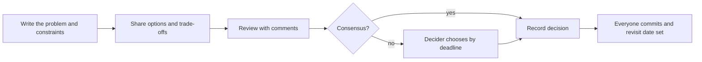
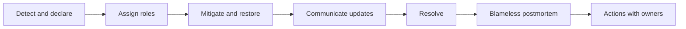
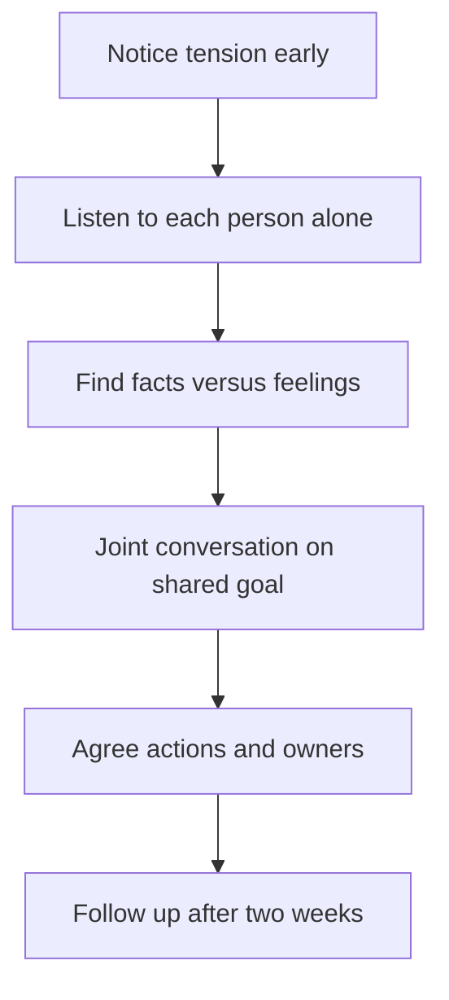
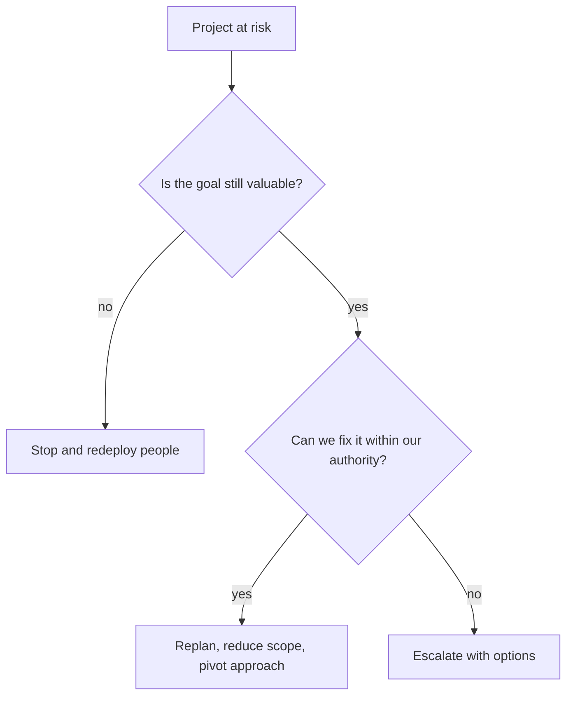

# Leadership & Behavioral

[← Back to index](../README.md) · [⭐ Favorites](favorites.md)

63 questions · 0 favorites · [📚 Resources](#resources)

## Contents

**Basic**

- [1. How do behavioural interviews work, and what are interviewers actually scoring?](#1-how-do-behavioural-interviews-work-and-what-are-interviewers-actually-scoring)
- [2. What is the STAR method, and how do CAR and SOAR compare?](#2-what-is-the-star-method-and-how-do-car-and-soar-compare)
- [3. How do you prepare a story bank for behavioural interviews?](#3-how-do-you-prepare-a-story-bank-for-behavioural-interviews)
- [4. How do you answer "Tell me about yourself" as a tech lead?](#4-how-do-you-answer-tell-me-about-yourself-as-a-tech-lead)
- [5. How do you answer questions about why this role, why this company and why you are leaving?](#5-how-do-you-answer-questions-about-why-this-role-why-this-company-and-why-you-are-leaving)
- [6. How do you answer questions about your strengths and weaknesses?](#6-how-do-you-answer-questions-about-your-strengths-and-weaknesses)
- [7. What is the difference between a tech lead, an engineering manager, a staff engineer and an architect?](#7-what-is-the-difference-between-a-tech-lead-an-engineering-manager-a-staff-engineer-and-an-architect)
- [8. What is the difference between leadership and management?](#8-what-is-the-difference-between-leadership-and-management)
- [9. What makes a good tech lead?](#9-what-makes-a-good-tech-lead)
- [10. How do you talk about impact with metrics when you do not have numbers?](#10-how-do-you-talk-about-impact-with-metrics-when-you-do-not-have-numbers)
- [11. How should you answer when you do not know something?](#11-how-should-you-answer-when-you-do-not-know-something)
- [12. How do you talk honestly about a failure?](#12-how-do-you-talk-honestly-about-a-failure)
- [13. How do you answer "Tell me about a time you disagreed with your manager"?](#13-how-do-you-answer-tell-me-about-a-time-you-disagreed-with-your-manager)
- [14. What do teamwork and collaboration look like for a tech lead?](#14-what-do-teamwork-and-collaboration-look-like-for-a-tech-lead)
- [15. What do ownership and accountability mean in practice?](#15-what-do-ownership-and-accountability-mean-in-practice)
- [16. How do written, verbal and asynchronous communication differ, and how do you choose?](#16-how-do-written-verbal-and-asynchronous-communication-differ-and-how-do-you-choose)

**Intermediate**

- [17. \[Tech Lead\] How do you lead and influence a team without formal authority?](#17-tech-lead-how-do-you-lead-and-influence-a-team-without-formal-authority)
- [18. \[Tech Lead\] How do you run technical design discussions and make decisions when people disagree?](#18-tech-lead-how-do-you-run-technical-design-discussions-and-make-decisions-when-people-disagree)
- [19. \[Tech Lead\] How do you mentor and grow engineers?](#19-tech-lead-how-do-you-mentor-and-grow-engineers)
- [20. \[Tech Lead\] How do you give effective feedback, including hard feedback?](#20-tech-lead-how-do-you-give-effective-feedback-including-hard-feedback)
- [21. \[Tech Lead\] How do you delegate well and avoid being the bottleneck or the hero?](#21-tech-lead-how-do-you-delegate-well-and-avoid-being-the-bottleneck-or-the-hero)
- [22. \[Tech Lead\] How do you build a code review culture and set standards?](#22-tech-lead-how-do-you-build-a-code-review-culture-and-set-standards)
- [23. \[Tech Lead\] How do you onboard new engineers?](#23-tech-lead-how-do-you-onboard-new-engineers)
- [24. \[Tech Lead\] How do you manage technical debt and negotiate time for it with product?](#24-tech-lead-how-do-you-manage-technical-debt-and-negotiate-time-for-it-with-product)
- [25. \[Tech Lead\] How do you estimate and plan work, and handle unrealistic deadlines and scope creep?](#25-tech-lead-how-do-you-estimate-and-plan-work-and-handle-unrealistic-deadlines-and-scope-creep)
- [26. \[Tech Lead\] How do you say no and prioritise? What frameworks do you use?](#26-tech-lead-how-do-you-say-no-and-prioritise-what-frameworks-do-you-use)
- [27. \[Tech Lead\] How do you manage stakeholders and communicate bad news early?](#27-tech-lead-how-do-you-manage-stakeholders-and-communicate-bad-news-early)
- [28. \[Tech Lead\] How do you lead through a production incident and run a blameless postmortem?](#28-tech-lead-how-do-you-lead-through-a-production-incident-and-run-a-blameless-postmortem)
- [29. \[Tech Lead\] How do you balance hands-on coding with leading?](#29-tech-lead-how-do-you-balance-hands-on-coding-with-leading)
- [30. \[Tech Lead\] How do you build a culture of quality, testing and ownership?](#30-tech-lead-how-do-you-build-a-culture-of-quality-testing-and-ownership)
- [31. \[Tech Lead\] How do you work with product and design, and with remote or cross-time-zone teams?](#31-tech-lead-how-do-you-work-with-product-and-design-and-with-remote-or-cross-time-zone-teams)
- [32. How do you handle a conflict between two engineers on your team?](#32-how-do-you-handle-a-conflict-between-two-engineers-on-your-team)
- [33. How do you handle conflict with a stakeholder or product manager?](#33-how-do-you-handle-conflict-with-a-stakeholder-or-product-manager)
- [34. Tell me about a time you changed your mind.](#34-tell-me-about-a-time-you-changed-your-mind)
- [35. Tell me about a time you made a wrong technical decision. What did you learn?](#35-tell-me-about-a-time-you-made-a-wrong-technical-decision-what-did-you-learn)
- [36. Tell me about a time you improved a process or team velocity. How did you measure it?](#36-tell-me-about-a-time-you-improved-a-process-or-team-velocity-how-did-you-measure-it)
- [37. Tell me about a time you led a migration or rewrite. How did you manage risk?](#37-tell-me-about-a-time-you-led-a-migration-or-rewrite-how-did-you-manage-risk)
- [38. Tell me about a time you handled ambiguity.](#38-tell-me-about-a-time-you-handled-ambiguity)
- [39. Tell me about a time you took initiative beyond your role.](#39-tell-me-about-a-time-you-took-initiative-beyond-your-role)
- [40. How do you handle a team member's burnout or low morale?](#40-how-do-you-handle-a-team-members-burnout-or-low-morale)
- [41. How do you manage up and keep your manager informed?](#41-how-do-you-manage-up-and-keep-your-manager-informed)
- [42. How do you work with a difficult senior or peer?](#42-how-do-you-work-with-a-difficult-senior-or-peer)
- [43. How do you hire: what do you look for, how do you structure a loop and avoid bias?](#43-how-do-you-hire-what-do-you-look-for-how-do-you-structure-a-loop-and-avoid-bias)
- [44. How do you handle underperformance, performance improvement plans and firing, respectfully?](#44-how-do-you-handle-underperformance-performance-improvement-plans-and-firing-respectfully)
- [45. How do you handle a missed deadline and recover trust?](#45-how-do-you-handle-a-missed-deadline-and-recover-trust)
- [46. How do you lead a team through reorganisation or change?](#46-how-do-you-lead-a-team-through-reorganisation-or-change)
- [47. How do you set team goals or OKRs and measure engineering effectiveness without gaming metrics?](#47-how-do-you-set-team-goals-or-okrs-and-measure-engineering-effectiveness-without-gaming-metrics)
- [48. How do you share knowledge with docs, RFCs and brown bags?](#48-how-do-you-share-knowledge-with-docs-rfcs-and-brown-bags)
- [49. How do you work with offshore or distributed teams?](#49-how-do-you-work-with-offshore-or-distributed-teams)
- [50. How do you handle customer-facing issues, escalations and on-call?](#50-how-do-you-handle-customer-facing-issues-escalations-and-on-call)

**Advanced**

- [51. How do you set a technical vision and strategy for a team, and write it down?](#51-how-do-you-set-a-technical-vision-and-strategy-for-a-team-and-write-it-down)
- [52. How do you decide between building and buying, and lead architecture decisions at scale with ADRs?](#52-how-do-you-decide-between-building-and-buying-and-lead-architecture-decisions-at-scale-with-adrs)
- [53. How do you lead a team through a high-stakes launch in a safety-critical or regulated environment?](#53-how-do-you-lead-a-team-through-a-high-stakes-launch-in-a-safety-critical-or-regulated-environment)
- [54. How do you manage a multi-team initiative and its dependencies?](#54-how-do-you-manage-a-multi-team-initiative-and-its-dependencies)
- [55. How do you negotiate scope, timeline and budget?](#55-how-do-you-negotiate-scope-timeline-and-budget)
- [56. How do you handle a failing project: when to escalate, pivot or kill it?](#56-how-do-you-handle-a-failing-project-when-to-escalate-pivot-or-kill-it)
- [57. How do you build psychological safety and handle conflicts of values on a team?](#57-how-do-you-build-psychological-safety-and-handle-conflicts-of-values-on-a-team)
- [58. How do you scale yourself: from tech lead to manager or staff path, and have career conversations?](#58-how-do-you-scale-yourself-from-tech-lead-to-manager-or-staff-path-and-have-career-conversations)
- [59. How do you lead in an AI-assisted engineering world: policy, review and upskilling?](#59-how-do-you-lead-in-an-ai-assisted-engineering-world-policy-review-and-upskilling)
- [60. What questions should you ask the interviewer?](#60-what-questions-should-you-ask-the-interviewer)
- [61. What is your plan for the first ninety days as a new tech lead?](#61-what-is-your-plan-for-the-first-ninety-days-as-a-new-tech-lead)
- [62. What are the general principles of compensation and level negotiation?](#62-what-are-the-general-principles-of-compensation-and-level-negotiation)
- [63. What are ten rapid-fire mock interview questions, with hints for a strong answer?](#63-what-are-ten-rapid-fire-mock-interview-questions-with-hints-for-a-strong-answer)

## Browse by module

| Module | Questions |
| --- | --- |
| Conflict & Communication (11) | [13](#13-how-do-you-answer-tell-me-about-a-time-you-disagreed-with-your-manager) · [14](#14-what-do-teamwork-and-collaboration-look-like-for-a-tech-lead) · [16](#16-how-do-written-verbal-and-asynchronous-communication-differ-and-how-do-you-choose) · [27](#27-tech-lead-how-do-you-manage-stakeholders-and-communicate-bad-news-early) · [31](#31-tech-lead-how-do-you-work-with-product-and-design-and-with-remote-or-cross-time-zone-teams) · [32](#32-how-do-you-handle-a-conflict-between-two-engineers-on-your-team) · [33](#33-how-do-you-handle-conflict-with-a-stakeholder-or-product-manager) · [34](#34-tell-me-about-a-time-you-changed-your-mind) · [41](#41-how-do-you-manage-up-and-keep-your-manager-informed) · [42](#42-how-do-you-work-with-a-difficult-senior-or-peer) · [49](#49-how-do-you-work-with-offshore-or-distributed-teams) |
| Delivery & Planning (8) | [24](#24-tech-lead-how-do-you-manage-technical-debt-and-negotiate-time-for-it-with-product) · [25](#25-tech-lead-how-do-you-estimate-and-plan-work-and-handle-unrealistic-deadlines-and-scope-creep) · [26](#26-tech-lead-how-do-you-say-no-and-prioritise-what-frameworks-do-you-use) · [36](#36-tell-me-about-a-time-you-improved-a-process-or-team-velocity-how-did-you-measure-it) · [45](#45-how-do-you-handle-a-missed-deadline-and-recover-trust) · [47](#47-how-do-you-set-team-goals-or-okrs-and-measure-engineering-effectiveness-without-gaming-metrics) · [54](#54-how-do-you-manage-a-multi-team-initiative-and-its-dependencies) · [55](#55-how-do-you-negotiate-scope-timeline-and-budget) |
| Hiring & Culture (4) | [43](#43-how-do-you-hire-what-do-you-look-for-how-do-you-structure-a-loop-and-avoid-bias) · [44](#44-how-do-you-handle-underperformance-performance-improvement-plans-and-firing-respectfully) · [48](#48-how-do-you-share-knowledge-with-docs-rfcs-and-brown-bags) · [57](#57-how-do-you-build-psychological-safety-and-handle-conflicts-of-values-on-a-team) |
| Interview Approach (11) | [1](#1-how-do-behavioural-interviews-work-and-what-are-interviewers-actually-scoring) · [2](#2-what-is-the-star-method-and-how-do-car-and-soar-compare) · [3](#3-how-do-you-prepare-a-story-bank-for-behavioural-interviews) · [4](#4-how-do-you-answer-tell-me-about-yourself-as-a-tech-lead) · [5](#5-how-do-you-answer-questions-about-why-this-role-why-this-company-and-why-you-are-leaving) · [6](#6-how-do-you-answer-questions-about-your-strengths-and-weaknesses) · [10](#10-how-do-you-talk-about-impact-with-metrics-when-you-do-not-have-numbers) · [11](#11-how-should-you-answer-when-you-do-not-know-something) · [12](#12-how-do-you-talk-honestly-about-a-failure) · [60](#60-what-questions-should-you-ask-the-interviewer) · [63](#63-what-are-ten-rapid-fire-mock-interview-questions-with-hints-for-a-strong-answer) |
| Leading Technical Work (10) | [9](#9-what-makes-a-good-tech-lead) · [15](#15-what-do-ownership-and-accountability-mean-in-practice) · [17](#17-tech-lead-how-do-you-lead-and-influence-a-team-without-formal-authority) · [18](#18-tech-lead-how-do-you-run-technical-design-discussions-and-make-decisions-when-people-disagree) · [29](#29-tech-lead-how-do-you-balance-hands-on-coding-with-leading) · [35](#35-tell-me-about-a-time-you-made-a-wrong-technical-decision-what-did-you-learn) · [37](#37-tell-me-about-a-time-you-led-a-migration-or-rewrite-how-did-you-manage-risk) · [38](#38-tell-me-about-a-time-you-handled-ambiguity) · [39](#39-tell-me-about-a-time-you-took-initiative-beyond-your-role) · [52](#52-how-do-you-decide-between-building-and-buying-and-lead-architecture-decisions-at-scale-with-adrs) |
| People & Mentoring (6) | [19](#19-tech-lead-how-do-you-mentor-and-grow-engineers) · [20](#20-tech-lead-how-do-you-give-effective-feedback-including-hard-feedback) · [21](#21-tech-lead-how-do-you-delegate-well-and-avoid-being-the-bottleneck-or-the-hero) · [23](#23-tech-lead-how-do-you-onboard-new-engineers) · [40](#40-how-do-you-handle-a-team-members-burnout-or-low-morale) · [46](#46-how-do-you-lead-a-team-through-reorganisation-or-change) |
| Quality & Reliability (6) | [22](#22-tech-lead-how-do-you-build-a-code-review-culture-and-set-standards) · [28](#28-tech-lead-how-do-you-lead-through-a-production-incident-and-run-a-blameless-postmortem) · [30](#30-tech-lead-how-do-you-build-a-culture-of-quality-testing-and-ownership) · [50](#50-how-do-you-handle-customer-facing-issues-escalations-and-on-call) · [53](#53-how-do-you-lead-a-team-through-a-high-stakes-launch-in-a-safety-critical-or-regulated-environment) · [59](#59-how-do-you-lead-in-an-ai-assisted-engineering-world-policy-review-and-upskilling) |
| Strategy & Career (7) | [7](#7-what-is-the-difference-between-a-tech-lead-an-engineering-manager-a-staff-engineer-and-an-architect) · [8](#8-what-is-the-difference-between-leadership-and-management) · [51](#51-how-do-you-set-a-technical-vision-and-strategy-for-a-team-and-write-it-down) · [56](#56-how-do-you-handle-a-failing-project-when-to-escalate-pivot-or-kill-it) · [58](#58-how-do-you-scale-yourself-from-tech-lead-to-manager-or-staff-path-and-have-career-conversations) · [61](#61-what-is-your-plan-for-the-first-ninety-days-as-a-new-tech-lead) · [62](#62-what-are-the-general-principles-of-compensation-and-level-negotiation) |

## Basic

### 1. How do behavioural interviews work, and what are interviewers actually scoring?

**Short answer:** A behavioural interview asks about things you did in the past, because past behaviour is the best predictor of future behaviour. The interviewer scores evidence, not charm. They look for a clear situation, your own actions, a real result and what you learned.

#### What is being scored

Most companies use a rubric with a few competencies, for example ownership, communication, conflict handling, influence, mentoring and judgement. Each interviewer writes notes, then a group compares them. A good story gives them quotes to write down.

| They ask | They are really testing |
| --- | --- |
| "Tell me about a time you disagreed..." | Can you disagree with respect and still commit? |
| "Tell me about a failure..." | Honesty, learning, accountability |
| "How did you handle a weak performer?" | Care plus standards, and fairness |
| "Tell me about a hard decision..." | Judgement, trade-offs, communication |

**Example answer (framework, not your story):** "In [project] I noticed [problem]. I owned [specific action]. The result was [metric]. Next time I would [lesson]."

**Common mistakes**
- Answering with "we" for everything. They cannot score what you did.
- Talking in general ("I usually...") instead of one real event.
- Telling a story with no result.
- Choosing stories where you were a passive observer.

**Interview tip:** For leadership roles, expect the interviewer to probe: "What was your exact role?" and "What would you do differently?" Prepare for those two follow-ups in every story. Also expect the question "Who disagreed with you?" because it shows how you handled other people.

_Module: Interview Approach · Tags: behavioural, interview-basics_

### 2. What is the STAR method, and how do CAR and SOAR compare?

**Short answer:** STAR means Situation, Task, Action, Result. It is a way to keep a story short, in order and focused on what you did. CAR and SOAR are lighter or richer versions of the same idea.

#### The shapes

| Method | Steps | Best when |
| --- | --- | --- |
| STAR | Situation, Task, Action, Result | The standard. Safe for any behavioural question |
| CAR | Context, Action, Result | You have little time, or the context is simple |
| SOAR | Situation, Obstacle, Action, Result | The story is about overcoming a hard obstacle |

A useful time split is about 15 percent setting the scene, 60 percent actions and 25 percent result and learning. Most weak answers spend too long on the situation.

**Example answer (template to fill with your own story):**
- Situation: "Our [service] had [problem] before [event]."
- Task: "As tech lead I was responsible for [goal]."
- Action: "I did three things. First [action]. Second [action]. Third [action]. I involved [people] because [reason]."
- Result: "[Metric] improved from [before] to [after]. The team [outcome]. I learned [lesson]."

**Common mistakes**
- Skipping the result, or saying only "it went well".
- Listing tasks with no reasons. Explain why you chose each action.
- Hiding the hard part, for example the disagreement.

**Interview tip:** Add a short "reflection" line after the result. For a lead it is often the strongest sentence: "What I would do differently is..." Keep each story under about two to three minutes. Expect the follow-up "What did you personally do versus the team?"

_Module: Interview Approach · Tags: star, storytelling_

### 3. How do you prepare a story bank for behavioural interviews?

**Short answer:** Write eight to ten real stories from your career, each rich enough to answer several questions. Map each story to competencies, so you are never starting from zero in the room.

#### Build the bank

For each story write: situation in two lines, your actions, the result with a number, and what you learned. Practise each aloud until it takes about two minutes.

| Story slot | Typical competencies it covers |
| --- | --- |
| A project you led end to end | Ownership, planning, delivery |
| A conflict between people | Conflict, empathy, communication |
| A technical decision that went wrong | Failure, learning, humility |
| A time you influenced without authority | Influence, stakeholder management |
| A time you mentored someone | Coaching, growth |
| A production incident you led | Calm under pressure, process |
| A time you handled ambiguity | Judgement, initiative |
| A time you improved a process | Impact, continuous improvement |
| A hard people situation (performance, burnout) | Care, fairness |
| A time you said no | Prioritisation, courage |

**Example answer (how one story is reused):** The incident story can answer "tell me about pressure", "tell me about a failure" and "tell me about leading others". Only the emphasis changes.

**Common mistakes**
- Preparing stories only from the last month.
- Using one story for every question.
- Memorising word for word. Memorise the bullets, not the sentences.

**Interview tip:** Keep the bank as a one-page table. Before each interview read the company's values and pick which stories fit. Include at least two stories where things went badly, because interviewers trust people who can talk about that.

_Module: Interview Approach · Tags: story-bank, preparation_

### 4. How do you answer "Tell me about yourself" as a tech lead?

**Short answer:** Use present, past, future. Start with who you are now, show the path that got you here in a few highlights, and finish with why this role is the next step. Aim for about ninety seconds.

#### The formula

| Part | Content | Time |
| --- | --- | --- |
| Present | Your role, team size, what you own, one headline result | 30 seconds |
| Past | Two or three steps that built your leadership and technical depth | 30 seconds |
| Future | What you want next and why this company fits | 20 seconds |

**Example answer (template; replace every placeholder with your own facts):** "I am a technical lead on [platform], leading [N] engineers. We [headline result, for example reduced release time by X percent]. Before that I was a software engineer working on [area], where I learned [skill]. Over time I moved towards [mentoring, design ownership, delivery]. Now I am looking for [kind of scope], and your team's work on [specific thing] is exactly that."

**Common mistakes**
- Reading the CV in order from school.
- Spending three minutes on one old job.
- Ending without linking to the role.
- Only technology, no people or outcome.

**Interview tip:** The introduction sets the agenda. Mention two themes you want to be asked about, such as "building a team" and "improving delivery", and interviewers often follow those. Keep it honest and short, and stop speaking when done.

_Module: Interview Approach · Tags: introduction, pitch_

### 5. How do you answer questions about why this role, why this company and why you are leaving?

**Short answer:** Give a positive pull, not a complaint. Say what you want to grow into, why this company and problem fit that, and why now. Never trash your current employer.

#### Three separate answers

| Question | Strong angle |
| --- | --- |
| Why this role? | It matches the scope you want next, for example more ownership or people growth |
| Why this company? | Specific: product, scale, engineering culture, a problem you want to solve. Shows research |
| Why leaving? | Looking for growth or a new challenge, framed as moving towards something |

**Example answer (template):** "I have enjoyed [current work] and learned [lesson]. I am ready for [bigger scope, such as a larger team or more cross-team influence]. Your company's work on [specific product or challenge] is interesting to me because [reason]. So it is a step forward, not an escape."

**Common mistakes**
- Complaining about your manager, pay or team.
- Generic praise: "great culture, big company".
- Saying you want to leave only for money.
- Not having researched the product at all.

**Interview tip:** Read the job description and the company's engineering blog or talks before the interview, and name one real thing. If there was a gap or a short stay, explain it briefly and calmly. Expect a follow-up: "What would make you leave this job in two years?" A good answer talks about lack of learning or impact, not about people.

_Module: Interview Approach · Tags: motivation, career_

### 6. How do you answer questions about your strengths and weaknesses?

**Short answer:** Pick strengths that matter for the role and prove each with a short example. Pick a real weakness that is not fatal for the role, and show what you are doing about it.

#### Strengths

Choose two or three. Say the strength, then a one-line proof. For a tech lead good ones are clear written communication, making decisions with incomplete data, and growing other people.

#### Weaknesses

A weakness answer has three parts: the weakness, the impact it once had, and the habit you built to manage it.

**Example answer (template):** "My weakness is that I tend to take on hard tasks myself instead of delegating. In [project] it made me a bottleneck. Now I decide up front who can own a task, I pair for the first part, and I check in only at agreed points. Last quarter [metric or result] improved because of that."

**Common mistakes**
- "I work too hard" or "I am a perfectionist". These sound evasive.
- A weakness that disqualifies you, such as "I do not like working with people".
- A weakness with no action taken.
- Listing five strengths with no evidence.

**Interview tip:** Pick weaknesses that are common for people at your stage, such as delegation, saying no, or giving direct feedback early. Then you can speak with real detail. Expect the follow-up "How would your team describe that?" so be ready with a real quote or a moment.

_Module: Interview Approach · Tags: strengths, weaknesses, self-awareness_

### 7. What is the difference between a tech lead, an engineering manager, a staff engineer and an architect?

**Short answer:** They are different jobs with overlap. A tech lead guides the technical direction of one team. An engineering manager owns the people and delivery of a team. A staff engineer solves hard technical problems across teams. An architect designs systems and standards, often across a large area.

#### Comparison

| Role | Main focus | Typical output | Still writes code? |
| --- | --- | --- | --- |
| Tech lead | Technical direction and delivery of one team | Designs, reviews, unblocking, plans | Yes, often |
| Engineering manager | People, hiring, performance, delivery | Team health, hiring, priorities | Rarely |
| Staff engineer | Cross-team technical problems | Strategy, hard prototypes, influence | Yes |
| Architect | System-wide structure and standards | Reference designs, decision records | Sometimes |

Titles vary between companies. Always ask how they define it. In some companies the tech lead is also the line manager.

**Example answer (template):** "In my current role I am a tech lead. I own the design quality and delivery for [team]. I also do [mentoring or part of people management, say honestly]. I want to move towards [management or staff path] because [reason based on what energises you]."

**Common mistakes**
- Treating tech lead as just "the best coder".
- Not knowing how the company defines the roles.
- Wanting a manager role without liking people problems.

**Interview tip:** Say which path you lean to and why, with evidence from your last year, for example "I enjoy coaching more than architecture reviews". Interviewers for lead roles listen for honest self-awareness. A follow-up is "What part of management would you miss least?"

_Module: Strategy & Career · Tags: roles, career_

### 8. What is the difference between leadership and management?

**Short answer:** Management is about making a system work: plans, process, people, budgets. Leadership is about creating direction and helping others to move there. A tech lead needs both, and the mix changes with the situation.

#### Compare

| | Management | Leadership |
| --- | --- | --- |
| Focus | Process, delivery, resources | Direction, motivation, growth |
| Question it asks | "How do we get this done?" | "Where are we going and why?" |
| Authority | Often formal | Often earned by trust |
| Example | Sprint planning, hiring plan | Explaining the technical vision |

You can lead without a title, for example by raising a quality standard that others adopt. You can manage without leading, for example by only tracking tickets.

**Example answer (template):** "To me management gives the team stability and leadership gives it direction. In [project] I did both. I set up [process] so delivery was predictable, and I wrote a short vision for [area] so people understood why the work mattered. The team's [metric] improved."

**Common mistakes**
- A cliché like "managers manage, leaders lead", with no example.
- Making management sound boring and leadership glamorous. Teams need both.
- Using the word leadership but describing only task assignment.

**Interview tip:** Give one example where you needed more leadership and one where you needed more management. That shows judgement. The follow-up is often "Which comes more naturally to you?" so have an honest answer ready.

_Module: Strategy & Career · Tags: leadership, management_

### 9. What makes a good tech lead?

**Short answer:** A good tech lead combines enough technical depth to make sound decisions, clear communication, ownership of outcomes, and a habit of enabling others rather than doing everything alone. The team's success is the measure, not personal output.

#### Four pillars

| Pillar | What it looks like |
| --- | --- |
| Technical depth | Good design judgement, knows trade-offs, reviews well |
| Communication | Explains the why, writes clearly, tells people bad news early |
| Ownership | Cares about outcomes, quality and on-call, not just tasks |
| Enabling others | Delegates, mentors, makes the team better when you are away |

A simple test: if you go on holiday for two weeks, does the team still deliver and decide well? If yes, you are building a good team.

**Example answer (template):** "I see the role as multiplying the team. In [project] I stopped being the one who answered every design question. I created [design review habit or doc template], paired with [engineer], and within [period] they led the next design. Delivery got faster by [metric]."

**Common mistakes**
- Being the hero who fixes everything.
- Only technical talk, no interest in people.
- Avoiding decisions so everyone stays happy.
- Making decisions without explaining them.

**Interview tip:** Use a story to prove each pillar rather than listing them. Expect "How do you decide when to code and when to lead?" which is the main tension of the role.

_Module: Leading Technical Work · Tags: tech-lead, leadership_

### 10. How do you talk about impact with metrics when you do not have numbers?

**Short answer:** Use honest, approximate evidence. Compare before and after, use ranges, or use proxies such as time saved, incidents reduced, people helped and feedback received. Never invent exact numbers.

#### Where to find a number

- Time: build time, release frequency, hours of manual work removed.
- Quality: incident count, bug reports, on-call pages.
- People: onboarding time for new joiners, number of engineers who grew into a bigger role.
- Money or risk: cost saved, an audit finding closed.
- Opinion: what customers, partners or your manager said.

**Example answer (template with honest estimates):** "I did not have a dashboard for this, but roughly [N] engineers lost about [X] hours a week to [problem]. After [change] the problem stopped. I checked with the team and they confirmed it. About [Y] hours a week were saved."

**Common mistakes**
- Inventing a precise number such as 37.4 percent.
- Saying "improved a lot" with no scale.
- Claiming a team result as only your own.

**Interview tip:** Say "approximately" and say how you measured it. Interviewers prefer an honest estimate over a perfect fake. If you truly had no data, say so and describe how you would measure it now. That is also a good sign of leadership maturity.

_Module: Interview Approach · Tags: impact, metrics_

### 11. How should you answer when you do not know something?

**Short answer:** Say clearly that you do not know, then show how you would find out. Honesty plus a sensible method scores much better than guessing with confidence.

#### A simple pattern

1. Be direct: "I have not worked with that directly."
2. Connect to what you know: "The closest thing I have done is..."
3. Reason aloud: "My first guess would be... and I would check by..."
4. Show how you learn: who you would ask, what you would read, what you would try.

**Example answer (template):** "I have not run [technology] in production. In a similar case with [related thing] I started by [step], then asked [expert], and wrote down what we learned. For this I would start with a small experiment and set a clear exit point."

**Common mistakes**
- Bluffing. An expert in the room will notice.
- Freezing or saying only "I don't know".
- Over-apologising.
- Changing the topic to something you do know.

**Interview tip:** A tech lead is expected to say "I do not know, who does?" Often. It shows psychological safety, because your team learns it is fine to say it too. A follow-up is "How do you handle it when your team asks something you cannot answer?" Mention pulling in the right person and sharing the learning.

_Module: Interview Approach · Tags: honesty, problem-solving_

### 12. How do you talk honestly about a failure?

**Short answer:** Pick a real failure with real stakes. Own your part without blaming others, explain the impact, and focus most of the answer on what you changed afterwards.

#### Structure

| Step | What to say |
| --- | --- |
| What happened | Facts, short, no excuses |
| Your part | The decision or gap that was yours |
| Impact | Who or what was affected, honestly |
| Recovery | What you did to fix it |
| Change | Habits or process now different, with proof |

**Example answer (template):** "In [project] I decided [choice] without [missing step]. As a result [impact]. I told [people] early, we fixed it by [action], and it took [time]. Since then I always [new habit], and in [later project] that caught [issue] before it reached users."

**Common mistakes**
- A fake failure such as "I cared too much".
- Blaming a teammate, the product manager or the tools.
- Skipping the lesson.
- Choosing a failure so big it raises doubts, with no recovery.

**Interview tip:** Choose a failure that is at least a year old, so you can show a lasting change. Do not make it sound heroic. The follow-up is often "How did you tell your manager?" so be ready to show you raised it early.

_Module: Interview Approach · Tags: failure, learning_

### 13. How do you answer "Tell me about a time you disagreed with your manager"?

**Short answer:** Show that you disagree openly and respectfully, with evidence, in private, and that you commit to the final decision. The story should show judgement, not a victory over the manager.

#### What a strong story contains

- A real difference of view on something important.
- Preparation: facts, options, risks, not only opinion.
- A private conversation first, with curiosity about their reasons.
- The outcome: either your view changed things, or you disagreed and committed and made it work.
- What you learned about the manager's context.

**Example answer (template):** "My manager wanted [decision, for example a faster release]. I was concerned about [risk]. I booked time, brought [data], and asked what drove the date. They explained [constraint]. We agreed on [compromise]. Even where I did not get my way, I committed and set up [safeguard]. The result was [outcome]."

**Common mistakes**
- Saying you have never disagreed. That sounds like a weak or dishonest leader.
- A story where the manager was simply wrong and you were right.
- Going over their head without talking first.
- Ending with resentment.

**Interview tip:** Interviewers listen to how you describe the manager: with respect or contempt. Follow-up: "What if your manager still said no on a safety or ethics issue?" Answer that you would escalate through the proper channel.

_Module: Conflict & Communication · Tags: conflict, managing-up_

### 14. What do teamwork and collaboration look like for a tech lead?

**Short answer:** As a lead you make it easy for others to work well together. You share context, clarify who decides what, protect focus time, and make credit and blame fair. Collaboration is a skill you design into the team, not a mood.

#### Habits that show it

| Habit | Why it works |
| --- | --- |
| Share the why, not only the task | People make better small decisions |
| Clear owners for each area | Fewer dropped balls |
| Short design reviews and open docs | Ideas come from everyone |
| Credit others publicly, take blame privately | Trust grows |
| Pair or swap work to spread knowledge | No single points of failure |

**Example answer (template):** "In [project], two teams depended on each other and blamed each other for delays. I proposed a weekly twenty-minute sync, a shared board with named owners, and an agreed definition of done for the interface. After [period] handoff delays dropped from [X] to [Y]."

**Common mistakes**
- Saying "I am a team player" with no example.
- Talking only about your own team and never other teams.
- Taking credit for team results.

**Interview tip:** Prepare one story about collaborating across a team boundary, because that is where leads are tested. The follow-up is "How do you handle someone who does not collaborate?" Mention a private, specific conversation first.

_Module: Conflict & Communication · Tags: teamwork, collaboration_

### 15. What do ownership and accountability mean in practice?

**Short answer:** Ownership means treating the outcome as yours, from design to production, without waiting to be told. Accountability means you answer for results, including the failures, and you fix the system, not just the symptom.

#### What it looks like

- You follow a feature until users benefit, not until merge.
- You raise risks early, even when it is uncomfortable.
- When something breaks you say "I own the fix" and then you do it.
- You do not blame others in public. You ask what in the system allowed the problem.
- You close the loop: a promised action gets done or you say clearly it will not.

| Low ownership | High ownership |
| --- | --- |
| "That is the other team's service" | "I will find the right owner and track it" |
| Waits for a ticket | Spots the gap and proposes a fix |
| Hides a missed date | Tells stakeholders early with a new plan |

**Example answer (template):** "A [feature] I led went live with [problem]. I told [stakeholder] the same day, led the fix, and then asked why [test or review] had not caught it. We added [change]. The next [releases] had no repeat."

**Common mistakes**
- Mixing ownership with doing everything yourself.
- Blaming a process or a person.
- Claiming ownership only of the good outcomes.

**Interview tip:** Use the phrase "I owned the outcome, not just my task." A follow-up is "Tell me about something that was not your job that you took on." Have that story ready.

_Module: Leading Technical Work · Tags: ownership, accountability_

### 16. How do written, verbal and asynchronous communication differ, and how do you choose?

**Short answer:** Choose the channel by the type of message. Use writing for decisions and anything people need later. Use conversation for emotion, conflict and fast back-and-forth. Use async updates to protect focus time, with a clear deadline for replies.

#### Choosing

| Situation | Best channel | Why |
| --- | --- | --- |
| Design decision | Short written doc, then a meeting if needed | Gives a record and time to think |
| Giving hard feedback | Face to face or a call | Tone matters |
| Status update | Async message or dashboard | Saves meeting time |
| Urgent incident | Voice or video plus a written timeline | Speed plus record |
| Disagreement in a thread | Move to a call, then write the outcome | Avoids misreading tone |

**Example answer (template):** "On a distributed team I introduced a short decision doc with context, options and a decision deadline. Meetings dropped from [N] to [M] a week and decisions were easier to find later. For sensitive topics I stayed with one-to-one calls."

**Common mistakes**
- Long chat threads for complex decisions.
- Meetings with no agenda or output.
- Writing in a way that assumes everyone has the same context.
- Long messages with the main point at the bottom.

**Interview tip:** Say you put the conclusion first: "what I need from you and by when". Follow-up: "How do you communicate with non-technical stakeholders?" Answer: outcomes, risk and options in plain words, and no jargon.

_Module: Conflict & Communication · Tags: communication, async_

## Intermediate

### 17. [Tech Lead] How do you lead and influence a team without formal authority?

**Short answer:** Without a title you lead through trust, clarity and evidence. You earn credibility by delivering and helping, you explain the why behind your proposals, and you make it easy for others to say yes.

#### What works

| Lever | How to use it |
| --- | --- |
| Credibility | Deliver, review well, help others first |
| Evidence | Bring data, a small prototype or a clear risk |
| Relationships | Understand what each person cares about before you ask |
| Shared goals | Link your proposal to the team's or the company's goal |
| Small wins | Pilot an idea with volunteers, then show results |

**Example answer (template):** "I wanted [team] to adopt [practice, for example contract tests], but I did not manage them. I first asked what hurt them most. I ran a two-week pilot on [service], showed that [metric] improved, and offered to pair. Within [period] [N] teams adopted it by choice."

**Common mistakes**
- Asking people to change with no benefit for them.
- Escalating to a manager too early.
- Pushing the same argument three times without listening.
- Claiming authority you do not have.

**Interview tip:** Say that influence is built before you need it. Follow-ups: "What did you do when someone still refused?" Answer: understand the real objection, adjust, or accept a smaller scope, and escalate only about outcomes, not people.

_Module: Leading Technical Work · Tags: tech-lead, influence_

### 18. [Tech Lead] How do you run technical design discussions and make decisions when people disagree?

**Short answer:** Write the problem and options down first, give everyone a fair hearing, set a decision date and a clear decider, then decide and record why. After the decision, everyone commits, even those who disagreed. This is often called disagree and commit.

#### A simple process

Read the flow from left to right. If there is no agreement, a named decider chooses by the deadline.

**Example answer (template):** "We had two options for [problem]. I wrote a one-page doc with the constraints and trade-offs, asked for comments for three days, and held a thirty-minute meeting only for the open points. Two engineers preferred option B. I chose A because [reason], wrote it in a decision record, and set a review date. We agreed to measure [signal]. The team committed, and at the review we kept A."

**Common mistakes**
- Endless debate with no decider.
- Choosing alone and not explaining.
- Letting the loudest voice win.
- Not recording the decision, so it is reopened every month.

**Interview tip:** Mention that disagreement is useful. Make sure quiet people are heard by asking for written input first. Follow-up: "What if you were wrong?" Say you set a review point and a cheap way to reverse.

_Module: Leading Technical Work · Tags: tech-lead, decisions, design-review_

### 19. [Tech Lead] How do you mentor and grow engineers?

**Short answer:** Start by learning what each person wants and where they are now. Mix coaching, where you ask questions so they find the answer, with directing, where you tell them what to do, depending on their experience. Give stretch work, regular feedback and a written growth plan.

#### Coaching versus directing

| Situation | Style | Example |
| --- | --- | --- |
| New or inexperienced with the task | Directing | "Use this pattern, here is why" |
| Some experience | Coaching | "What options do you see? What are the risks?" |
| Experienced, high skill | Delegating | "You own it. Tell me if you want input" |

A good growth plan has one or two goals for the next quarter, the work that will prove them, who will help, and the level expectations they are growing towards.

**Example answer (template):** "[Engineer] wanted to move from [level] to [level]. We agreed on two goals: lead a design and improve production debugging. I gave them [project] with a check-in every week for the first month, then every two weeks. They presented the design to [audience]. Six months later they were [outcome]."

**Common mistakes**
- Mentoring only when asked.
- Always giving answers, so people never learn.
- A plan with no real work attached.
- Treating all engineers the same.

**Interview tip:** Say that the best sign of mentoring is the engineer doing something you used to do. Follow-up: "How do you handle someone who is not ready for promotion but expects it?" Explain the gap with clear examples and a plan.

_Module: People & Mentoring · Tags: tech-lead, mentoring, coaching_

### 20. [Tech Lead] How do you give effective feedback, including hard feedback?

**Short answer:** Give feedback early, privately and about specific behaviour. A common model is SBI: Situation, Behaviour, Impact. Describe what happened, what you saw, and the effect it had, then ask for their view.

#### SBI in one line each

| Part | Example |
| --- | --- |
| Situation | "In yesterday's design review..." |
| Behaviour | "...you interrupted [colleague] three times..." |
| Impact | "...and they stopped sharing their ideas. We lost their view." |

Then ask: "How did you see it?" and agree on a next step.

#### Handling an underperformer

1. Check expectations are clear and the person has the support they need.
2. Give specific, documented feedback early and often.
3. Look for the cause: skill, will, workload or personal issues.
4. Agree a short plan with clear measures and dates.
5. Involve your manager and HR early if there is no improvement.

**Example answer (template):** "[Engineer] often delivered late without warning. I used SBI in a private talk, we found they were blocked by [cause], and we agreed on a weekly check-in and smaller tasks. After [period] on-time delivery rose from [X] to [Y]."

**Common mistakes**
- Saving feedback for the annual review.
- Vague words such as "be more proactive".
- The "feedback sandwich" that hides the message.
- Giving hard feedback in public.

**Interview tip:** Also mention praising specifically. Follow-up: "How do you receive feedback yourself?" Give a real example where you changed something after hearing it.

_Module: People & Mentoring · Tags: tech-lead, feedback, performance_

### 21. [Tech Lead] How do you delegate well and avoid being the bottleneck or the hero?

**Short answer:** Delegate outcomes, not only tasks. Match the work to the person's growth, give clear context and boundaries, and check in at agreed points. A hero who fixes everything becomes a bottleneck and leaves the team weak.

#### Signs you are a bottleneck

- Work waits for your review or your answer.
- Only you can fix some part of the system.
- You are in every meeting and every design.
- Others stop making decisions.

#### How to delegate

| Step | Detail |
| --- | --- |
| Pick the right work | Something that stretches, with a safety net |
| Explain the goal and limits | What good looks like, deadline, what they can decide |
| Agree on check-ins | Short and planned, not constant |
| Accept a different way | Judge the result, not the method |
| Give credit publicly | Builds confidence |

**Example answer (template):** "I was the only person who knew [component]. I paired with [engineer] to fix two issues, then handed them the next one with a one-page brief. I reviewed their design but did not rewrite it. By [date] they were the owner and I was no longer on the escalation path."

**Common mistakes**
- Delegating only boring work.
- Taking the task back at the first problem.
- Delegating without authority to decide.
- Being unavailable after delegating.

**Interview tip:** Say you aim to make yourself less needed. Follow-up: "What do you do when the delegate does it worse than you would?" Answer: coach, accept good enough, and check whether the standard really matters.

_Module: People & Mentoring · Tags: tech-lead, delegation_

### 22. [Tech Lead] How do you build a code review culture and set standards?

**Short answer:** Make reviews fast, kind and focused on what matters. Write a short checklist, automate style with tools, review the design and risk by humans, and lead by example by accepting feedback on your own code.

#### Principles

| Principle | Practice |
| --- | --- |
| Small changes | Easier and faster to review |
| Automate the boring | Linters, formatters, tests in the pipeline |
| Humans review design and risk | Naming, error handling, edge cases, security |
| Speed | An agreed target, for example a first response within one working day |
| Tone | Comments about code, not people; ask questions |
| Learning | Reviews are teaching in both directions |

**Example answer (template):** "Reviews were slow, averaging [X] days. We agreed a first response within [time], capped change size at about [N] lines where possible, moved style to the linter, and I reviewed with questions rather than commands. Average review time fell to [Y] and the team said reviews felt more useful."

**Common mistakes**
- Nitpicking style that a tool could check.
- Review as gatekeeping by one person.
- Blocking on personal preference.
- Never reviewing the lead's own code.

**Interview tip:** Mention that you separate must-fix from suggestions, for example with a label such as "nit" or "optional". Follow-up: "How do you handle a senior who ignores review feedback?" Answer: talk privately, agree the standard together, and point to the written guideline.

_Module: Quality & Reliability · Tags: tech-lead, code-review, standards_

### 23. [Tech Lead] How do you onboard new engineers?

**Short answer:** Plan the first weeks in advance. Give a buddy, a working environment on day one, a small real task in the first week, and clear expectations at thirty, sixty and ninety days. Measure time to first useful contribution.

#### A simple plan

| Phase | Goal | Example activities |
| --- | --- | --- |
| Before day one | Remove friction | Accounts, laptop, access, welcome message |
| Week one | Feel welcome and ship something small | Buddy, set up environment, a tiny fix to production |
| Month one | Understand the system and the team | Architecture walkthrough, shadow on-call, first feature |
| Month three | Own something | A feature or a service area, feedback conversation |

Good onboarding depends on documentation that is kept current. New joiners are the best testers of your docs, so ask them to fix what was wrong.

**Example answer (template):** "Our new joiners took about [X] weeks to first merge. I wrote a setup script and a checklist, assigned a buddy, and prepared a list of starter tasks. Time to first merge fell to [Y] days and new joiners rated onboarding [score or comment]."

**Common mistakes**
- Leaving a new joiner alone with a thick wiki.
- Starting with a very large task.
- No clear expectations.
- Docs that nobody maintains.

**Interview tip:** Say you ask new people to improve the onboarding guide. Follow-up: "How do you onboard someone remote?" Mention more scheduled contact, an explicit buddy, and written context.

_Module: People & Mentoring · Tags: tech-lead, onboarding_

### 24. [Tech Lead] How do you manage technical debt and negotiate time for it with product?

**Short answer:** Treat technical debt as a business risk and cost, not a developer preference. Make it visible, link each item to impact such as slower delivery, incidents or risk, and agree a steady share of capacity for it with product.

#### Steps

1. List the debt and rate each item by impact and effort.
2. Translate into business language: "this adds two days to every release" or "this has caused three incidents".
3. Propose a standing allowance, for example a portion of each sprint, plus larger items scheduled like features.
4. Tie debt work to roadmap items: "While we build X, we fix Y."
5. Report what the investment returned.

| Debt type | Approach |
| --- | --- |
| Slows every change | Schedule early, high return |
| Causes incidents | Treat as reliability work |
| Annoying but harmless | Leave, or fix when you touch it |

**Example answer (template):** "Our build took [X] minutes and blocked [N] engineers. I showed product the cost, about [Y] engineer hours per week. We agreed one item per sprint for debt. After [period] the build was [Z] minutes and feature throughput rose by [metric]."

**Common mistakes**
- Asking for a "refactoring sprint" with no business case.
- Hiding debt work inside feature estimates without telling anyone.
- Paying debt that nobody feels.
- Never saying no to new debt that is deliberate and short term.

**Interview tip:** Mention that some debt is a good choice if you track it and pay it. Follow-up: "How do you decide what to fix first?" Answer: impact times frequency, divided by effort.

_Module: Delivery & Planning · Tags: tech-lead, technical-debt, product_

### 25. [Tech Lead] How do you estimate and plan work, and handle unrealistic deadlines and scope creep?

**Short answer:** Estimate as a team, use ranges rather than single numbers, state your assumptions and risks, and revisit often. When a deadline looks unrealistic, show options: reduce scope, move the date, or add resources with their cost. Do not silently promise.

#### Practical habits

| Practice | Why |
| --- | --- |
| Break work into small pieces | Errors shrink and progress is visible |
| Give a range and confidence | "Three to five weeks, medium confidence" is honest |
| List assumptions and unknowns | Surprises are named early |
| Slice for early value | Something shippable after each slice |
| Keep a change log of scope | Scope creep becomes visible |

#### Pushing back on a deadline

Bring a trade-off table: the date as asked with the reduced scope, the full scope with a later date, or the same scope with more people, which may not help because of onboarding cost.

**Example answer (template):** "Product asked for [feature] in [N] weeks. My team estimate was [M]. I showed three options. We chose to ship [core part] by the date and [rest] two weeks later. Each new request after that went through a quick trade-off: what do we drop?"

**Common mistakes**
- Agreeing to a date and hoping.
- Padding every estimate in secret.
- Treating an estimate as a promise.
- Letting scope change without changing date.

**Interview tip:** Say you communicate risk as early as you see it. Follow-up: "What if the date is fixed by a customer or regulator?" Then scope and quality gates become the variables, and you escalate risk clearly.

_Module: Delivery & Planning · Tags: tech-lead, estimation, planning_

### 26. [Tech Lead] How do you say no and prioritise? What frameworks do you use?

**Short answer:** Say no to requests, not to people. Explain what you are protecting, show the trade-off, and offer an alternative or a later date. Use a simple framework to make the reasoning visible.

#### Frameworks

| Framework | How it works | Best for |
| --- | --- | --- |
| Impact versus effort | Plot items on two axes, do high impact and low effort first | Quick team triage |
| RICE | Score Reach times Impact times Confidence, divided by Effort | Comparing many product items |
| MoSCoW | Must, Should, Could, Will not | Fixing scope for a release |

RICE stands for Reach, Impact, Confidence and Effort. The scores are estimates, so use them to start a conversation, not to end one.

**Example answer (template):** "Three teams asked for urgent work in the same sprint. I listed each with impact and effort, shared it with [stakeholders], and said: we can do A and B, C would delay A by [time]. If C is more important, tell me what moves. They chose C and we agreed a new date. Nobody was surprised."

**Common mistakes**
- A flat "no" with no reason.
- Saying yes to everything and then failing quietly.
- Using scores as if they were facts.
- Prioritising by who shouts loudest.

**Interview tip:** Say that "yes, and here is what it displaces" is often better than no. Follow-up: "What if your boss's boss asks?" Show the same trade-off calmly and let them decide with full information.

_Module: Delivery & Planning · Tags: tech-lead, prioritisation, frameworks_

### 27. [Tech Lead] How do you manage stakeholders and communicate bad news early?

**Short answer:** Know who your stakeholders are, what each cares about and how often they want updates. When there is bad news, tell them early, with the facts, the impact, your plan and what you need from them. Early bad news is a cost; late bad news is a betrayal.

#### Map and rhythm

| Stakeholder | Cares about | Update style |
| --- | --- | --- |
| Product manager | Scope, date, user value | Weekly, short, risks highlighted |
| Senior leadership | Risk, cost, outcomes | Brief summary, exceptions only |
| Partners or customers | Reliability, commitments | Clear dates, honest status |

#### Bad news format

State the problem. State the impact. State the options and your recommendation. State what you need.

**Example answer (template):** "In week [N] we found that [integration] would take [X] longer. Same day I wrote to [stakeholder]: the issue, the new estimate range, three options, my recommendation, and a decision needed by [date]. They chose [option]. Later they told me they valued the early warning."

**Common mistakes**
- Waiting until you are sure, which means too late.
- Hiding problems in jargon.
- Bringing problems with no options.
- Surprising a stakeholder in a public meeting.

**Interview tip:** Say you "never let a stakeholder learn about a problem from someone else". Follow-up: "Tell me about a time bad news went badly." Be honest about what you changed.

_Module: Conflict & Communication · Tags: tech-lead, stakeholders, communication_

### 28. [Tech Lead] How do you lead through a production incident and run a blameless postmortem?

**Short answer:** In an incident, stay calm, give clear roles, restore service first and investigate after. Afterwards run a blameless postmortem: describe what happened and why the system allowed it, and agree actions with owners. The goal is learning, not blame.

#### Incident flow

Read left to right. Communication runs alongside mitigation, not after it.

#### Roles

An incident commander coordinates and decides. A technical lead investigates. A communicator updates stakeholders. In a small team one person may hold two roles, but say who does what.

**Example answer (template):** "During [incident] I took the commander role so others could debug. We rolled back first, which restored service in [time]. I sent updates every [N] minutes. In the postmortem we found [cause] and, importantly, that [gap in alerting or review] let it through. We made [N] actions with owners, and the same class of failure did not come back."

**Common mistakes**
- Everyone debugging, nobody communicating.
- Searching for who to blame.
- A postmortem with no follow-up actions.
- Fixing the root cause before service is restored when a rollback is possible.

**Interview tip:** Say "blameless does not mean without accountability": people own actions, but the system is judged. Follow-up: "How do you handle a repeated incident caused by one person?" Treat it as a coaching and process topic.

_Module: Quality & Reliability · Tags: tech-lead, incidents, postmortem_

### 29. [Tech Lead] How do you balance hands-on coding with leading?

**Short answer:** Keep enough coding to stay credible and informed, but do not put yourself on the critical path. Take work that is exploratory, small or risky to others, and make time for design, reviews, one-to-ones and unblocking.

#### How to split time

| Activity | Guideline |
| --- | --- |
| Design, review and unblocking | Protect first, others depend on it |
| Coding | Choose work that does not block the team if you are interrupted |
| People time | Regular one-to-ones in the calendar |
| Focus time | Blocks of two hours on a few days |

The split changes with team size. A lead of three or four engineers may code half the time. A lead of eight or more usually codes much less.

**Example answer (template):** "I used to take the hardest ticket and then block reviews. Now I take spikes, tooling and small fixes, I keep review slots twice a day, and I pair rather than own the critical feature. Review wait time dropped from [X] to [Y]."

**Common mistakes**
- Coding all day and ignoring the team.
- Stopping coding entirely and losing context.
- Owning the critical path then being unavailable.
- No time blocks, so everything is interrupted.

**Interview tip:** Be honest about what you chose and why. Follow-up: "What do you do when you must choose between a feature and a one-to-one?" Answer: the people time, as it rarely recovers if skipped.

_Module: Leading Technical Work · Tags: tech-lead, time-management_

### 30. [Tech Lead] How do you build a culture of quality, testing and ownership?

**Short answer:** Culture is what you reward and tolerate. Make quality easy with automated tests and pipelines, make it visible with a few shared measures, and make it normal by acting on it yourself. Teams own what they build, including running it.

#### Practical levers

| Lever | Example |
| --- | --- |
| Definition of done | Includes tests, alerts and docs |
| Fast pipeline | If tests are slow nobody runs them |
| Test pyramid | Many unit tests, fewer integration tests, few end-to-end |
| You build it, you run it | Team handles on-call and learns from incidents |
| Visible measures | Escaped defects, flaky tests, change failure rate |
| Celebrate prevention | Praise the bug caught in review |

**Example answer (template):** "We had frequent regressions in [area]. I proposed a definition of done with tests and a dashboard, fixed the flaky tests first because they destroyed trust, and added a short post-release review. Escaped defects fell from [X] to [Y] in [period], and engineers began suggesting tests in reviews."

**Common mistakes**
- Mandating a coverage number and gaming it.
- Blaming QA or testers.
- Letting flaky tests stay red.
- Quality talk with no time in the plan.

**Interview tip:** Say you lead by doing: you write tests, and fix a broken pipeline yourself. Follow-up: "How do you keep speed and quality together?" Small changes and good automation make both possible.

_Module: Quality & Reliability · Tags: tech-lead, quality, culture_

### 31. [Tech Lead] How do you work with product and design, and with remote or cross-time-zone teams?

**Short answer:** Work as partners on the same problem. Involve engineers early, agree on outcomes, and be clear on constraints. For distributed teams, rely on written decisions, overlap hours, and handovers that leave nothing implicit.

#### With product and design

- Bring engineering insight at the idea stage, not after the spec is final.
- Ask about the user problem and the success measure, not only the feature.
- Offer options that trade effort for value.
- Review designs together for feasibility early.

#### With remote and cross-time-zone teams

| Practice | Why |
| --- | --- |
| Written decisions and docs | Nobody depends on a missed meeting |
| A small daily overlap window | Time for real-time questions |
| Rotating meeting times | Fairness over time zones |
| Clear handover notes | Work continues without waiting |
| Video for sensitive talks | Reduces misreading |

**Example answer (template):** "Our team spanned [N] time zones. I set a two-hour overlap, moved status to a shared board, and required a short written handover at the end of each day. Questions that used to take two days now took one, and the team told me they felt included."

**Common mistakes**
- Receiving specs and only then raising issues.
- All the important talk in the hallway of one site.
- Expecting instant answers across time zones.
- Treating remote people as second class.

**Interview tip:** Say that trust grows from reliable, visible follow-through. Follow-up: "How do you handle a product manager who changes priorities weekly?" Answer: make the cost of change visible and agree a stable window.

_Module: Conflict & Communication · Tags: tech-lead, product, distributed-teams_

### 32. How do you handle a conflict between two engineers on your team?

**Short answer:** Talk to each person privately first to understand their view, then bring them together to focus on the shared goal and the specific issue. Separate the facts from the feelings, agree a way forward, and follow up.

#### Steps

Follow the arrows from top to bottom. Do not skip the private talks.

**Example answer (template):** "Two engineers disagreed about [design] and stopped talking in reviews. I met each alone. One felt unheard, the other felt blocked. I brought them together, asked each to state the other's concern fairly, and we agreed to decide using [criteria]. I checked in two weeks later. Reviews returned to normal and [result] shipped."

**Common mistakes**
- Waiting for it to go away.
- Taking sides before hearing both.
- Resolving it in front of the whole team.
- Forcing a fake agreement with no follow-up.

**Interview tip:** Say that most conflicts are about unclear roles, goals or respect, so you check those first. Follow-up: "What if one person refuses to talk?" Answer: set clear behaviour expectations and involve your manager if needed.

_Module: Conflict & Communication · Tags: conflict, people_

### 33. How do you handle conflict with a stakeholder or product manager?

**Short answer:** Start by understanding their goal and pressure. Then bring your concern as a shared problem with options, not as an argument. Agree on the decision owner and the evidence that would change either view.

#### Approach

| Step | Action |
| --- | --- |
| Understand | "What are you trying to achieve and by when?" |
| Share your constraint | Risk, effort, dependency, in plain words |
| Offer options | Reduce scope, phase delivery, accept the risk with a safeguard |
| Decide | Who decides, when, based on what |
| Commit | Everyone supports the decision |

**Example answer (template):** "The product manager wanted [feature] for [event]. I believed the quality risk was high. Instead of saying no, I proposed shipping [smaller scope] behind a flag with monitoring and the rest two weeks later. They agreed. We hit the date and had no incident, and the relationship was stronger afterwards."

**Common mistakes**
- Arguing technical details they do not care about.
- Treating the product manager as the enemy.
- Saying yes and then missing quietly.
- Escalating without talking first.

**Interview tip:** Show that you see the other side's incentives. Follow-up: "What if you still disagree after the decision?" Say you commit, record your concern, and watch the agreed risk signal.

_Module: Conflict & Communication · Tags: conflict, stakeholders_

### 34. Tell me about a time you changed your mind.

**Short answer:** Choose a story where new evidence or someone else's argument changed your view on something that mattered. It shows humility and good judgement. Say clearly what you believed, what changed it, and what you did.

#### What a strong story shows

- You held a real, reasoned position first.
- You listened to a junior person or a different discipline.
- You changed without ego and said so openly.
- The result was better than your original plan.

**Example answer (template):** "I wanted to build [solution] in-house. [Engineer] argued for [alternative] and showed me a quick test with [data]. I had assumed [wrong assumption]. I said in the team meeting that I had changed my mind and why. We took the alternative, which saved [time or cost], and I now ask for a quick test before big build decisions."

**Common mistakes**
- A fake story where you were nearly right anyway.
- A trivial subject, such as a tool preference.
- Blaming others for your first view.
- Saying you never change your mind.

**Interview tip:** Highlight that you changed your mind publicly, because teams copy that behaviour. Follow-up: "How do you decide when to hold your position?" Answer: when the evidence is strong, or when the risk is safety or security critical.

_Module: Conflict & Communication · Tags: humility, decisions_

### 35. Tell me about a time you made a wrong technical decision. What did you learn?

**Short answer:** Pick a real decision with an honest cost. Explain why it looked right at the time, how you noticed it was wrong, how you fixed it, and which part of your decision process you changed.

#### Structure

| Part | Content |
| --- | --- |
| Context | What you knew then |
| Decision | What and why, including who agreed |
| Signal | How the wrongness appeared |
| Recovery | How you limited damage and fixed it |
| Change | New habit, such as spikes, ADRs or review points |

**Example answer (template):** "We picked [technology] for [service] because of [reason]. After [months] we saw [problem, such as complexity or cost]. I raised it with the team, we ran a short evaluation of [alternative], and migrated [service] over [period]. Since then I require a small proof of concept, a written decision record with exit criteria, and an early review at [milestone]."

**Common mistakes**
- Blaming the technology or the vendor.
- A decision that was not really yours.
- No change in your behaviour afterwards.
- Making it sound like bad luck.

**Interview tip:** Use hindsight carefully: say what you could not have known and what you could have. Follow-up: "How do you make decisions that are cheap to reverse?" Prefer small steps, feature flags and clear boundaries.

_Module: Leading Technical Work · Tags: failure, decisions_

### 36. Tell me about a time you improved a process or team velocity. How did you measure it?

**Short answer:** Find the real bottleneck with data, change one thing at a time, and measure before and after. Use team-level delivery measures such as the DORA metrics and cycle time, and avoid using them to rank individuals.

#### Useful measures

| Measure | Meaning |
| --- | --- |
| Lead time for changes | Time from commit to production |
| Deployment frequency | How often you release |
| Change failure rate | Share of releases that cause a problem |
| Time to restore service | How fast you recover |
| Cycle time | Time from work started to done |

These are the four DORA metrics plus cycle time. Use them as questions, not targets.

**Example answer (template):** "Our cycle time was [X] days. I mapped the flow and found that pull requests waited [Y] days for review. We introduced a review rota, smaller changes and a working agreement. Cycle time fell to [Z] days and release frequency rose from [A] to [B] with no rise in failure rate."

**Common mistakes**
- Changing five things and not knowing which worked.
- Measuring story points as speed.
- Pushing speed with no quality guard.
- Telling the team to go faster.

**Interview tip:** Always pair a speed measure with a quality measure. Follow-up: "How would you know if people were gaming it?" Look for a rise in rework or hidden queues.

_Module: Delivery & Planning · Tags: process, dora, metrics_

### 37. Tell me about a time you led a migration or rewrite. How did you manage risk?

**Short answer:** Avoid a big-bang rewrite. Migrate in small, reversible steps, run old and new in parallel, define success and rollback criteria, and keep delivering value to users during the work.

#### Risk controls

| Risk | Control |
| --- | --- |
| Unknown behaviour of the old system | Characterisation tests, shadow traffic |
| Big switch failure | Gradual traffic shift, feature flags |
| Data loss or drift | Dual writes with reconciliation, backups |
| Team burnout | Milestones, visible progress, parallel feature work |
| Scope growth | Written scope, a freeze on new features in the old part |

A common pattern is the strangler approach: build the new piece around the old one and route more and more traffic to it until the old one can be removed.

**Example answer (template):** "We moved [system] from [old] to [new]. I split it into [N] slices, each with a rollback plan. We shadowed [percent] of traffic for [period], compared results, then shifted traffic in steps. We finished with [downtime or incident count], and removed the old system in [month]."

**Common mistakes**
- A rewrite that stops all features for a year.
- No rollback plan.
- Migrating without agreed success criteria.
- Not telling stakeholders about the temporary cost.

**Interview tip:** Say how you decided not to rewrite parts. Follow-up: "How did you decide when it was done?" Answer: old traffic at zero, data verified, and the old system switched off.

_Module: Leading Technical Work · Tags: migration, risk_

### 38. Tell me about a time you handled ambiguity.

**Short answer:** Show that you can create clarity from an unclear problem: ask questions, name assumptions, run a small experiment, make a decision with the information you have, and adjust as you learn.

#### Method

1. Write down what you know, what you assume and what you do not know.
2. Talk to the people who feel the problem.
3. Pick the riskiest assumption and test it cheaply.
4. Decide on a first step that is easy to reverse.
5. Share a short plan and update it.

**Example answer (template):** "We were asked to support [new requirement] with no specification. I interviewed [people], wrote a one-page problem statement and three assumptions, built a thin prototype in [time], and showed it to [users]. Two assumptions were wrong. We changed course early and delivered [outcome] with less waste."

**Common mistakes**
- Waiting for a perfect specification.
- Guessing silently and building the wrong thing.
- Analysis with no decision.
- Making the team feel lost.

**Interview tip:** Mention that you give the team a clear next step even when the whole path is unclear. Follow-up: "What if stakeholders gave conflicting answers?" Document the conflict and ask them to resolve it, with options.

_Module: Leading Technical Work · Tags: ambiguity, judgement_

### 39. Tell me about a time you took initiative beyond your role.

**Short answer:** Pick a problem nobody owned, show how you noticed it, how you made the case, and the result. Stress that you stayed accountable for your normal work and brought others along.

#### What a strong story contains

- You saw a real pain, for example flaky builds, missing runbooks or slow releases.
- You checked it mattered with a number or feedback.
- You asked for support rather than working in secret.
- You handed over ownership at the end so it lasted.

**Example answer (template):** "Nobody owned [problem], and each team lost [time] a week. I wrote a half-page proposal, got agreement from [manager] to spend [limited time], built [solution], and presented it. [N] teams adopted it. I then handed it to [owner] with documentation."

**Common mistakes**
- Work that ignored your actual responsibilities.
- Claiming a grand result for a small tool.
- Acting without telling anyone.
- No hand-over, so it died when you moved on.

**Interview tip:** Link the initiative to the company's goals. Follow-up: "What was the cost of doing this?" Answer honestly with what you delayed and how you managed it.

_Module: Leading Technical Work · Tags: initiative, ownership_

### 40. How do you handle a team member's burnout or low morale?

**Short answer:** Notice early, talk privately and with care, listen before offering solutions, and look at the causes in workload and environment. Then change something concrete: scope, pace, support or time off. Follow up regularly.

#### Warning signs

- Withdrawal, irritability, or a sudden drop in quality.
- Long hours and no breaks.
- Cynicism about work they used to enjoy.

#### What a lead can do

| Cause | Action |
| --- | --- |
| Overload | Reduce scope, move deadlines, share on-call |
| Unclear purpose | Reconnect work to the outcome |
| Lack of control | Give decisions back |
| Conflict | Address it |
| Personal issues | Offer flexibility and point to company support |

**Example answer (template):** "I noticed [engineer] was quiet and working late. In a one-to-one I asked how they were. They felt overwhelmed by [cause]. We removed [task], rotated on-call, and agreed a lighter month. I checked in weekly. They recovered, and I changed our planning so we did not over-commit again."

**Common mistakes**
- Saying "just take a break" with no change.
- Asking about private matters too deeply.
- Ignoring the team-wide cause.
- Sharing private details with others.

**Interview tip:** You are not a therapist: know when to bring in HR or company support. Follow-up: "What if the whole team is burned out?" Reduce commitments and speak to your manager about the system.

_Module: People & Mentoring · Tags: burnout, morale, wellbeing_

### 41. How do you manage up and keep your manager informed?

**Short answer:** Make your manager's job easier. Share progress, risks and decisions on a steady rhythm, with no surprises. Bring problems with options, and ask for the support or decision you need.

#### Practical habits

| Habit | Detail |
| --- | --- |
| Regular update | A short weekly note: done, next, risks, asks |
| One-to-one | You set the agenda, including career and feedback |
| No surprises | Bad news early, in private |
| Understand their goals | Know what their manager asks them |
| Ask for decisions | State the decision, the options and your recommendation |

**Example answer (template):** "I send my manager a five-line note every Friday. When a dependency slipped, I wrote the same day with the impact, two options and a recommendation. They could brief their own leaders before anyone asked, and they gave me more trust and autonomy."

**Common mistakes**
- Only talking when things go wrong.
- Overloading them with detail.
- Assuming they know your problems.
- Complaining without a proposal.

**Interview tip:** Say that the aim is autonomy through trust. Follow-up: "What do you do when your manager is unavailable or unhelpful?" Build a rhythm anyway, put things in writing, and find another mentor.

_Module: Conflict & Communication · Tags: managing-up, communication_

### 42. How do you work with a difficult senior or peer?

**Short answer:** Assume good intent, find what drives them, and address specific behaviours privately. Build trust through small wins and respect. Escalate only after you tried a direct, honest conversation.

#### Approach

| Step | Action |
| --- | --- |
| Observe | Describe specific behaviour, not labels like "arrogant" |
| Understand | What are they worried about? |
| Talk | Use SBI in private: situation, behaviour, impact |
| Adapt | Adjust how you communicate to what works with them |
| Escalate | If harm continues, involve your manager with facts |

**Example answer (template):** "A senior engineer often dismissed ideas in design reviews. I asked for coffee, said what I noticed and how it affected the discussion. They told me they were worried about [risk]. We agreed they would write concerns before the meeting. Reviews became more productive and they later sponsored one of my proposals."

**Common mistakes**
- Gossiping about them.
- Describing them as the problem rather than the behaviour.
- Avoiding them completely.
- Escalating before talking.

**Interview tip:** Show empathy without being a pushover. Follow-up: "What if they are rude to junior people?" That needs a direct response and, if repeated, escalation, because it harms the team.

_Module: Conflict & Communication · Tags: difficult-people, collaboration_

### 43. How do you hire: what do you look for, how do you structure a loop and avoid bias?

**Short answer:** Define what you need first, test it with structured, consistent interviews, score against a rubric, and decide as a group using evidence. Structure reduces bias and gives a fairer result.

#### A hiring loop

| Stage | Purpose |
| --- | --- |
| Role definition | Skills, level and traits you need |
| Screen | Basic fit and motivation |
| Technical exercise | Realistic problem solving, not trivia |
| Design or system round | Judgement and trade-offs |
| Behavioural round | Collaboration, ownership, learning |
| Debrief | Independent written feedback first, then discussion |

#### What to look for

Curiosity, communication, reasoning about trade-offs, and the ability to learn. Match the bar to the level.

#### Reducing bias

Use the same questions for all candidates, score each competency separately, write notes before the debrief, and avoid "culture fit" as a reason. Prefer "culture add".

**Example answer (template):** "We moved from free-form chats to a rubric with four competencies. Interviewers wrote scores before the debrief. Offer acceptance rose and new hires ramped in [time]."

**Common mistakes**
- Trick questions.
- Hiring clones of yourself.
- Letting the first impression decide.
- Long, slow processes that lose good candidates.

**Interview tip:** Mention candidate experience: respect their time and give feedback. Follow-up: "Have you made a bad hire?" Be honest and talk about what you changed.

_Module: Hiring & Culture · Tags: hiring, interviewing, bias_

### 44. How do you handle underperformance, performance improvement plans and firing, respectfully?

**Short answer:** Address problems early with clear expectations and support. If there is no improvement, use a documented plan with measurable goals and dates, involving your manager and HR. Treat the person with dignity throughout, including at the end.

#### Stages

| Stage | What happens |
| --- | --- |
| Informal | Clear, specific feedback and support |
| Formal plan | Written goals, timeline, regular check-ins, resources |
| Decision | If goals are not met, follow company process |
| Exit | Respectful, private, clear, with support where possible |

A plan should never be a surprise. The person should have heard the concerns several times before.

**Example answer (template):** "[Engineer] struggled with [area] for a quarter. We spoke early, I paired them with [mentor], and set weekly goals. Progress stalled, so with HR we set a formal plan with measures. They improved in [area] and stayed, or moved on with my support in a way that kept their dignity." Use the outcome that is true for you.

**Common mistakes**
- Avoiding the issue until it is too late.
- A plan designed to fail.
- Telling the rest of the team the details.
- Forgetting the team that carries the extra load.

**Interview tip:** Speak with care, not coldness. Follow-up: "How did the team react?" Explain that you were transparent without sharing private information. Never share legal advice; follow the company process.

_Module: Hiring & Culture · Tags: performance, pip, people_

### 45. How do you handle a missed deadline and recover trust?

**Short answer:** Tell stakeholders as soon as you know, take responsibility, explain the cause without excuses, give a new realistic plan, and then deliver on it. Trust returns through reliable follow-through.

#### Recovery steps

1. Communicate early with facts and impact.
2. Offer options: partial delivery, new date, extra help.
3. Find the real cause, such as estimation, dependency or scope change.
4. Change something concrete in the process.
5. Update regularly until delivery.

**Example answer (template):** "We were going to miss [date] by [N] weeks because [cause]. I told [stakeholder] the same day, proposed delivering [core part] first, and gave weekly updates. We delivered the core on the new date. I added [a change such as earlier integration tests], and the next two releases were on time."

**Common mistakes**
- Hoping to catch up and staying quiet.
- Blaming another team.
- Promising a new date without evidence.
- No process change.

**Interview tip:** Highlight that recovery is about predictability, not heroics. Follow-up: "Did the team work overtime?" Say honestly whether you avoided it and how.

_Module: Delivery & Planning · Tags: deadlines, trust_

### 46. How do you lead a team through reorganisation or change?

**Short answer:** People need honesty, a reason, and a sense of control. Share what you know when you can, say what you do not know, listen to concerns, and focus the team on what they can influence. Keep delivery steady.

#### Practical steps

| Step | Why |
| --- | --- |
| Explain the why and what changes | Reduces rumours |
| Say what is not yet decided | Honesty builds trust |
| One-to-ones for each person | Different concerns |
| Keep routines | Stability helps |
| Involve people in how to implement | Gives control |
| Watch for attrition risks | Talk to key people early |

**Example answer (template):** "When [teams merged], I held a Q and A the same day, told people what I knew, and listed the open questions. I met everyone individually in the first week. We agreed on working rules for the combined team. Delivery stayed on track and nobody left in the first [months]."

**Common mistakes**
- Silence while you wait for perfect information.
- Pretending to like a decision you do not.
- Overpromising about job security.
- Ignoring those who quietly disengage.

**Interview tip:** Be loyal to the decision while honest about the impact. Follow-up: "What if you disagree with the reorg?" Raise it through the right channel, then support the outcome constructively.

_Module: People & Mentoring · Tags: change, reorganisation_

### 47. How do you set team goals or OKRs and measure engineering effectiveness without gaming metrics?

**Short answer:** Set a few goals tied to outcomes, make them ambitious but clear, and use measures as signals, not targets for individuals. When a measure becomes a target it is easy to game, so pair measures and check the story behind the numbers.

#### OKR basics

An objective says where you want to go. Key results say how you will know. Keep three to five objectives at most.

| Do | Avoid |
| --- | --- |
| Outcome measures such as reduced incident time | Output measures such as lines of code |
| Team level measures | Ranking individuals |
| Paired measures: speed with quality | A single number alone |
| Review and discuss regularly | Set and forget |

**Example answer (template):** "Our objective was a more reliable release process. Key results: change failure rate from [X] to [Y] and restore time under [Z] minutes. We reviewed them monthly. When we saw deployments rising but rework too, we adjusted rather than celebrating the first number."

**Common mistakes**
- Counting pull requests or commits.
- Too many goals.
- Using metrics for performance reviews.
- Goals the team had no say in.

**Interview tip:** Mention a time you dropped a metric because it caused bad behaviour. Follow-up: "How do you measure a platform team?" Use developer experience surveys and reliability outcomes of its users.

_Module: Delivery & Planning · Tags: okr, metrics, goals_

### 48. How do you share knowledge with docs, RFCs and brown bags?

**Short answer:** Write things down where people will look, keep them short and current, and give people a reason to share. Use RFCs for decisions, runbooks for operations and short talks for learning.

#### Tools

| Tool | Use |
| --- | --- |
| RFC or design doc | Propose and discuss a significant change before building |
| Decision record | Keep why a decision was made |
| Runbook | Steps to handle a known problem |
| Brown bag talk | A short informal session to teach |
| Pairing and rotation | Spread knowledge of risky areas |

**Example answer (template):** "Only two people understood [system]. We ran three short brown bags, wrote a runbook with the on-call engineer, and rotated the first line of support. After [period], any engineer could handle the most common issues and the number of escalations to the two experts fell by [X]."

**Common mistakes**
- Long docs nobody reads.
- Docs owned by nobody.
- Hero knowledge held by one person.
- Mandating documentation with no time for it.

**Interview tip:** Say that you make sharing part of the normal work and credit it in reviews. Follow-up: "How do you keep docs fresh?" Tie them to code changes and review them in the definition of done.

_Module: Hiring & Culture · Tags: knowledge-sharing, documentation_

### 49. How do you work with offshore or distributed teams?

**Short answer:** Build trust through clear goals, clear ownership and regular contact. Treat partners as part of the team, share context rather than only tasks, and make quality expectations explicit and testable.

#### Practices

| Area | Practice |
| --- | --- |
| Context | Share the why, users and architecture, not only tickets |
| Interfaces | Clear contracts and automated tests |
| Communication | Overlap hours, shared channels, video calls |
| Quality | Shared definition of done, joint reviews |
| Relationship | Visit or meet if possible; recognise contributions |

**Example answer (template):** "We worked with a partner team in [location]. At first we sent detailed tickets and received poor results. I changed to sharing the goal and constraints, a weekly planning call, and shared review on pull requests. Rework fell from [X] to [Y], and they proposed improvements of their own."

**Common mistakes**
- Treating them as a ticket factory.
- Vague acceptance criteria.
- Finding problems only at final delivery.
- Cultural assumptions about directness.

**Interview tip:** Mention that you adapt feedback style to cultural differences, being clear and respectful. Follow-up: "How do you handle quality issues?" Early reviews, automated checks and a joint retrospective.

_Module: Conflict & Communication · Tags: distributed-teams, collaboration_

### 50. How do you handle customer-facing issues, escalations and on-call?

**Short answer:** Put the customer's problem first: acknowledge it, own it, communicate often and fix it. Make on-call fair and sustainable with clear runbooks, alerts that matter and a rota that shares the load.

#### Escalation basics

| Step | Action |
| --- | --- |
| Acknowledge | Respond quickly, even if you have no answer yet |
| Assess | Impact, scope, workaround |
| Communicate | One owner talks to the customer, with regular updates |
| Fix and follow up | Root cause and prevention |
| Learn | Feed it into the backlog and runbooks |

#### Sustainable on-call

Reduce noisy alerts, write runbooks, rotate fairly, give time off after hard nights, and treat repeated pages as bugs.

**Example answer (template):** "A customer reported [issue] during [event]. I took ownership, gave the customer updates every [N] hours, applied a workaround in [time], and fixed the cause in [days]. We added [alert or test]. The customer later said the communication mattered as much as the fix."

**Common mistakes**
- Defensive replies to the customer.
- Many people talking to the customer with mixed messages.
- Alert fatigue.
- Burning out the same few people.

**Interview tip:** Mention that in a regulated or safety-related environment you also record the issue formally. Follow-up: "How do you decide when to escalate internally?" When impact is high, the fix is unclear, or the deadline for the customer is close.

_Module: Quality & Reliability · Tags: on-call, escalation, customers_

## Advanced

### 51. How do you set a technical vision and strategy for a team, and write it down?

**Short answer:** A technical strategy answers three things: where we are, where we need to be and how we get there. Write it as a short document that is tied to business goals, names the trade-offs and what you will not do, and revisit it regularly.

#### A simple structure

| Section | Content |
| --- | --- |
| Context | Business goals, users, current pain, constraints |
| Diagnosis | The key challenges, honestly stated |
| Guiding principles | Rules that help decisions, for example "prefer boring technology" |
| Coherent actions | A few initiatives, ordered, with owners |
| Non-goals | What you will not do and why |
| Measures | How you will know it works |

Keep it to a few pages. Share a draft early with engineers and product, because a strategy nobody helped to shape will not be followed.

**Example answer (template):** "Our platform had [problem]. I drafted a four-page strategy: three principles, four initiatives over [period], and a list of non-goals. I reviewed it with the team and product, adjusted it, and used it to say no to [idea]. After [period], [metric] improved and decisions needed less debate."

**Common mistakes**
- A list of technologies instead of a strategy.
- Vision with no action.
- Written once and forgotten.
- Written alone and announced.

**Interview tip:** Say that a good strategy makes some decisions easier by closing options. Follow-up: "How do you keep it alive?" Review quarterly and refer to it in planning and design reviews.

_Module: Strategy & Career · Tags: strategy, vision_

### 52. How do you decide between building and buying, and lead architecture decisions at scale with ADRs?

**Short answer:** Build what is a core differentiator for your business, and buy or adopt what is a commodity, unless fit, cost, risk or control argue otherwise. Record important decisions in short architecture decision records, so people understand the why later.

#### Decision factors

| Factor | Question |
| --- | --- |
| Differentiation | Does this make our product special? |
| Total cost | Build, run, maintain, license, integrate, and exit cost |
| Time to value | How soon do we need it? |
| Risk | Vendor lock-in, security, compliance, support |
| Team skills | Can we run it well? |
| Fit | Does it meet our needs without heavy customisation? |

#### Architecture decision records

An ADR is a one-page note: context, options considered, decision, consequences and a status such as proposed or accepted. Store it next to the code. At scale, agree who must review decisions that cross team boundaries.

**Example answer (template):** "We needed [capability]. Building was possible but not our core. I compared three options in an ADR with cost and exit paths, ran a two-week trial of the preferred one, and we adopted it with an abstraction at the boundary. We saved about [time] and could replace it later."

**Common mistakes**
- Building because it is fun.
- Buying without considering exit.
- Ignoring running costs.
- Decisions made in chat and forgotten.

**Interview tip:** Mention reversibility: spend more care on one-way doors. Follow-up: "How do you stop architecture review from becoming a bottleneck?" Define which decisions need review and give teams guidelines for the rest.

_Module: Leading Technical Work · Tags: architecture, build-vs-buy, adr_

### 53. How do you lead a team through a high-stakes launch in a safety-critical or regulated environment?

**Short answer:** Combine disciplined change control with clear risk thinking. Know what must be proven before release, keep an audit trail, plan rollout and rollback, and build a culture where people can raise safety concerns without fear. Speed comes from clear process, not from skipping it.

#### Key elements in general terms

| Element | What it means |
| --- | --- |
| Change control | Every change is reviewed, traceable and approved |
| Audit trail | You can show who changed what, why and when |
| Risk assessment | List what can go wrong, how likely, how severe, how you reduce it |
| Verification | Tests and evidence linked to requirements |
| Staged rollout | Small group first, monitoring, clear go and no-go criteria |
| Safety culture | Reporting is rewarded, near misses are discussed |

The exact standards depend on your industry and customer. Do not claim a specific standard unless you have worked with it.

**Example answer (template):** "Before launching [system] we built a checklist of go and no-go criteria with our quality and safety colleagues. Every change in the release was traceable to a requirement and a test. We rolled out to [small group], watched [measures] for [period], and kept a rollback tested. The launch had [result]. In the review we noted [lesson]."

**Common mistakes**
- Treating compliance as paperwork at the end.
- Hiding doubts to keep a date.
- No tested rollback.
- Heroic last-night changes.

**Interview tip:** Say that you make it easy to do the right thing by automating evidence collection. Follow-up: "What if the date and a safety concern conflict?" Safety wins, and you communicate early with options.

_Module: Quality & Reliability · Tags: safety, compliance, launch_

### 54. How do you manage a multi-team initiative and its dependencies?

**Short answer:** Make the shared goal, the owner of each piece and the dependencies visible. Agree interfaces early, plan integration points, meet at a steady rhythm, and escalate blockers quickly with options.

#### Practical toolkit

| Tool | Use |
| --- | --- |
| One-page brief | Goal, scope, owners, date, success measure |
| Dependency map | Who needs what from whom and when |
| Interface contracts | Agreed early and tested automatically |
| Integration milestones | Real end-to-end checks, not only status reports |
| Risk log | Reviewed every week |
| Single point of coordination | One named person |

**Example answer (template):** "[N] teams had to deliver parts of [feature]. I created a dependency map, got each team to commit to dates for their interface, and set an early integration test. In week [N] we found a mismatch and fixed it cheaply. We launched on the planned date."

**Common mistakes**
- Assuming teams will align on their own.
- Integrating only at the end.
- Status reports that hide risk.
- Escalating as blame.

**Interview tip:** Emphasise early integration and honest status. Follow-up: "What if another team will not prioritise your need?" Understand their goals, find mutual value, then escalate with a clear request.

_Module: Delivery & Planning · Tags: dependencies, cross-team, programme_

### 55. How do you negotiate scope, timeline and budget?

**Short answer:** Treat scope, time, cost and quality as linked. Understand what really matters to the other side, bring options with clear trade-offs, and be honest about risk. Aim for an agreement both sides can keep.

#### The levers

| Lever | Change means |
| --- | --- |
| Scope | Deliver less, or in phases |
| Time | Later date |
| Cost | More people or tooling, with ramp-up cost |
| Quality | Usually the one lever you should not secretly pull |

#### Approach

1. Ask for the underlying need and the hard constraints.
2. Prepare two or three packages, each with a recommendation.
3. State risks and confidence in plain words.
4. Agree what you will review and when.

**Example answer (template):** "A stakeholder wanted [everything] by [date] with [N] people. I offered three packages: core by the date, full scope two months later, or full scope by the date with [N+2] people and a higher risk. I recommended the first. They chose it and we agreed a checkpoint in [week]."

**Common mistakes**
- Negotiating positions instead of needs.
- Giving a number without assumptions.
- Quietly cutting quality.
- Winning an argument and losing a partner.

**Interview tip:** Say that a good deal is one you can deliver. Follow-up: "When did you walk away from a deal?" Describe the point where the risk was unacceptable and how you explained it.

_Module: Delivery & Planning · Tags: negotiation, scope, budget_

### 56. How do you handle a failing project: when to escalate, pivot or kill it?

**Short answer:** Define early what success and failure look like, check against them honestly, and decide when signals are clear. Escalate when the problem is beyond your authority, pivot when the goal is valid but the approach is wrong, and stop when the value no longer justifies the cost.

#### Decision flow

Read from top to bottom. Each answer leads to a clear action.

#### Signals

Repeated slips with no learning, a growing list of unknowns, a team that has lost belief, or a cost that now exceeds the benefit. Watch for the sunk cost trap: past spending is not a reason to continue.

**Example answer (template):** "After [period], [project] had missed [N] milestones. I compared the remaining cost to the value and brought three options to leadership: reduce to [core], switch to [alternative], or stop. We chose [option], moved the team to [work], and I wrote down lessons for future projects."

**Common mistakes**
- Hoping for a miracle.
- Escalating without a recommendation.
- Hiding problems from stakeholders.
- Blaming the team when stopping.

**Interview tip:** Show courage and care for the team in the same answer. Follow-up: "How did the team feel about stopping?" Give credit for what was learned and move people to meaningful work.

_Module: Strategy & Career · Tags: project-management, judgement_

### 57. How do you build psychological safety and handle conflicts of values on a team?

**Short answer:** Psychological safety means people believe they can speak up, ask questions or admit mistakes without being punished. A lead builds it by modelling vulnerability, responding well to bad news and setting fair norms. When values clash, name the shared principle, listen, and set clear behaviour boundaries.

#### Building safety

| Behaviour | Effect |
| --- | --- |
| Admit your own mistakes | Others feel it is safe |
| Thank people for bad news | More bad news comes early |
| Ask for dissent, quietest first | Better decisions |
| Blameless reviews | Learning rather than hiding |
| Credit publicly | Trust |

#### Conflict of values

Examples are speed versus quality, or honesty versus loyalty. Ask what each person is protecting. Anchor on team principles and company values, and decide what is a matter of preference and what is a standard of behaviour. Respectful disagreement is welcome. Disrespect is not.

**Example answer (template):** "Two engineers disagreed on shipping with known minor defects. One valued speed, one valued craft. We discussed what each protected, agreed on a definition of acceptable risk, and set a rule for when defects block a release. Both felt heard, and release arguments dropped."

**Common mistakes**
- Treating safety as being nice with no standards.
- Punishing the messenger.
- Ignoring a person who dominates meetings.
- Avoiding hard values conversations.

**Interview tip:** Give one concrete moment when you reacted well to bad news. Follow-up: "How do you know the team feels safe?" Watch participation, listen to retros, and use anonymous surveys.

_Module: Hiring & Culture · Tags: psychological-safety, culture, values_

### 58. How do you scale yourself: from tech lead to manager or staff path, and have career conversations?

**Short answer:** Scaling yourself means increasing impact through other people, systems and clear decisions, not through longer hours. Choose management or staff by what energises you, test it with real responsibilities, and have honest career conversations with your manager and your team.

#### Two paths

| | Management track | Staff / principal track |
| --- | --- | --- |
| Impact through | People, team health, hiring, delivery | Technical strategy, cross-team solutions |
| Daily work | One-to-ones, planning, coaching | Design, prototypes, reviews, writing |
| Good fit if | You enjoy growing people | You enjoy deep technical problems |
| Trial | Run hiring or performance cycle | Lead a cross-team technical project |

Many people move between the two. It is not a one-way door.

#### Career conversations

Ask engineers what they want, what energises them and where they are stuck. Agree one or two actions. Do the same with your own manager: say clearly what you want and what evidence you will build.

**Example answer (template):** "I realised I spent most of my time on people and planning, and enjoyed it. I asked my manager to let me lead [hiring or reviews] for a quarter. It confirmed my interest and I created a plan for the skills I lacked, such as [budget, performance management]."

**Common mistakes**
- Choosing management for status.
- Staying a hero.
- Waiting to be noticed.
- Avoiding career talks with the team.

**Interview tip:** Be honest and specific about your direction. Follow-up: "What will you miss from hands-on work?" Say how you will stay technical enough.

_Module: Strategy & Career · Tags: career, growth, management_

### 59. How do you lead in an AI-assisted engineering world: policy, review and upskilling?

**Short answer:** Use AI tools to speed up work while keeping humans accountable for the result. Set clear policy on data and security, keep code review rigorous, check quality with tests, and help the team learn to use the tools well.

#### Areas to lead

| Area | Practice |
| --- | --- |
| Policy | What data may be shared with tools, approved tools, licence and security rules |
| Review | AI-written code gets the same review and tests as any other code |
| Quality | Strong tests and small changes catch plausible but wrong output |
| Learning | Share prompts that work, pair on usage, discuss failures |
| Juniors | Make sure they still learn fundamentals and debugging |
| Measurement | Look at outcomes such as cycle time and defects, not tool usage counts |

**Example answer (template):** "We piloted [tool] with a small group for [period]. We set a rule that nothing confidential goes into unapproved tools, that authors must understand and test all generated code, and that reviews stay unchanged. We tracked cycle time and defects. Cycle time improved by [X] and defects stayed flat, so we expanded."

**Common mistakes**
- Banning the tools completely or allowing all use without rules.
- Accepting generated code without review.
- Measuring success by lines produced.
- Ignoring the learning needs of junior engineers.

**Interview tip:** Say that the engineer remains responsible for what they commit. Follow-up: "How do you handle a team member who relies on it too much?" Coach on understanding and testing, and ask them to explain the code.

_Module: Quality & Reliability · Tags: ai, policy, upskilling_

### 60. What questions should you ask the interviewer?

**Short answer:** Ask questions that show you think like a lead: about the team's goals, how decisions are made, what success looks like, and the challenges. They also help you decide whether you want the job.

#### Good questions

| Topic | Example question |
| --- | --- |
| Expectations | "What would success look like in the first ninety days and the first year?" |
| Team | "How is the team structured, and what are its biggest strengths and gaps?" |
| Decisions | "How are technical decisions made and recorded?" |
| Quality | "How do you handle incidents and technical debt?" |
| People | "How do you support growth and promotion?" |
| Challenges | "What is the hardest problem the team faces now?" |
| Manager | "How would you describe your management style?" |

**Example answer (template):** Close with: "Based on what we discussed, what concerns do you have about my fit, so I can address them now?"

**Common mistakes**
- No questions at all.
- Asking only about pay and holidays in a first round.
- Questions answered on the website.
- Not listening to the answers.

**Interview tip:** Take brief notes and refer to the answers later. Ask different questions for different interviewers: the manager, a peer, a product partner. Follow-up: you may be asked "What did you learn about us?" so keep your notes.

_Module: Interview Approach · Tags: interview-questions, preparation_

### 61. What is your plan for the first ninety days as a new tech lead?

**Short answer:** Listen and learn in the first month, make small visible improvements in the second, and set direction and priorities in the third. Build relationships first, and avoid big changes before you understand the context.

#### The plan

| Period | Focus | Example actions |
| --- | --- | --- |
| Days 1 to 30 | Learn | Meet every engineer and key stakeholder, read the architecture and incidents, shadow on-call, ask what to keep and what to change |
| Days 31 to 60 | Contribute | Fix one visible pain, set up one-to-ones, agree working norms, deliver a small piece |
| Days 61 to 90 | Lead | Share observations and a draft plan, agree priorities with manager and product, set measures |

**Example answer (template):** "In the first month I will ask everyone three questions: what works well, what slows you down and what one thing would you change. By day sixty I will fix one agreed pain, such as [flaky tests]. By day ninety I will share a short plan with measures and review it with the team and my manager."

**Common mistakes**
- Announcing a new process in week one.
- Criticising the past team.
- Neglecting relationships outside the team.
- No agreed expectations with your manager.

**Interview tip:** Agree on what success looks like at ninety days with your manager at the start. Follow-up: "What if you discover a serious problem early?" Verify, tell your manager promptly and propose a plan.

_Module: Strategy & Career · Tags: first-90-days, onboarding_

### 62. What are the general principles of compensation and level negotiation?

**Short answer:** Prepare, be honest, and negotiate the whole package and the level, not just one number. Know your priorities, understand the range for the role, and keep the conversation respectful and collaborative.

#### Principles

| Principle | Detail |
| --- | --- |
| Research | Understand typical ranges for role, level and location |
| Level matters | Level affects future pay, scope and growth |
| Whole package | Salary, bonus, equity, benefits, flexibility, learning budget |
| Timing | Negotiate after you have an offer, not before |
| Evidence | Link your ask to scope, results and market data |
| Alternatives | Having other options gives you confidence |
| Tone | Enthusiastic, factual and calm |

**Example answer (template):** "I am excited about the role. Based on the scope we discussed and my experience with [specific results], I was expecting a package closer to [your researched range]. Is there flexibility? I would also like to confirm the level, as I believe the responsibilities match [level]."

**Common mistakes**
- Lying about other offers.
- Accepting immediately out of relief.
- Negotiating by email only when a call would build rapport.
- Ignoring the level, only the number.

**Interview tip:** Do not give your current salary if the law or your preference allows; talk about expectations. Follow-up: "What is your expected salary?" Answer with a researched range and flexibility, not a single number.

_Module: Strategy & Career · Tags: negotiation, compensation, level_

### 63. What are ten rapid-fire mock interview questions, with hints for a strong answer?

**Short answer:** Use this pack to practise out loud. Give each answer in about sixty to ninety seconds, with one real example. The hints show what a strong answer must contain.

#### The ten questions

| No | Question | Strong answer hint |
| --- | --- | --- |
| 1 | Tell me about yourself. | Present, past, future in ninety seconds, linked to the role |
| 2 | Tell me about a time you led without authority. | Credibility, evidence, small pilot, result |
| 3 | Describe a conflict in your team. | Private talks first, shared goal, follow-up |
| 4 | What is your biggest failure? | Own it, impact, recovery, changed habit |
| 5 | How do you handle an underperformer? | Early specific feedback, support, plan, dignity |
| 6 | How do you say no to a stakeholder? | Explain trade-off, offer options, let them decide |
| 7 | How do you prioritise? | Impact, effort, a framework, communicate the why |
| 8 | Tell me about a tough technical decision. | Options, trade-offs, decision record, review |
| 9 | How do you stay technical as a lead? | Chosen coding, reviews, learning, not on the critical path |
| 10 | Why should we hire you? | Two or three strengths with proof, fit with their needs |

**Example answer (template for question 10):** "You need someone who can [need from the job description]. In [project] I did [action] and achieved [result]. I enjoy growing engineers: [example]. I would bring that to your team."

**Common mistakes**
- Speaking for more than two minutes.
- Answers that start generic and never reach an example.
- Never mentioning the result.
- Practising only in your head.

**Interview tip:** Record yourself or practise with a friend, and listen for "we" versus "I". Follow-up: choose your weakest two answers and rewrite them with a clear result.

_Module: Interview Approach · Tags: mock-interview, practice_

---

## Resources

Where to read more at the source. Official docs and references come first.

**Reference**

- [Amazon Leadership Principles](https://www.amazon.jobs/en/principles) — A widely used framework for behavioural questions and stories. _(beginner)_
- [StaffEng](https://staffeng.com) — Stories and guides on staff-plus engineering roles and what they involve. _(intermediate)_
- [Postmortem culture (Google SRE)](https://sre.google/sre-book/postmortem-culture/) — How to run blameless postmortems and learn from failure. _(intermediate)_
- [Architecture Decision Records](https://adr.github.io/) — Why and how to record architecture decisions. _(intermediate)_
- [Team Topologies](https://teamtopologies.com/) — Team types and interaction modes for fast flow. _(intermediate)_
- [DORA research and metrics](https://dora.dev/) — Measure delivery performance without gaming it. _(intermediate)_

**Tutorial**

- [Tech Interview Handbook: Behavioral interviews](https://www.techinterviewhandbook.org/behavioral-interview/) — How behavioural rounds work, with question lists and sample answers. _(beginner)_

**Book**

- [An Elegant Puzzle (Will Larson)](https://lethain.com/elegant-puzzle/) — Systems of engineering management: teams, growth, process. _(intermediate)_

**Article**

- [Will Larson: Irrational Exuberance](https://lethain.com) — Essays on engineering leadership, strategy and organisation. _(intermediate)_
- [re:Work: Understanding team effectiveness](https://rework.withgoogle.com/en/guides/understanding-team-effectiveness) — Google's research on psychological safety and effective teams. _(intermediate)_
- [re:Work: What makes a great manager](https://rework.withgoogle.com/en/guides/managers-identify-what-makes-a-great-manager) — Google's findings on the behaviours of effective managers. _(intermediate)_
- [Radical Candor](https://www.radicalcandor.com/) — A framework for direct, caring feedback. _(intermediate)_
- [Brag documents (Julia Evans)](https://jvns.ca/blog/brag-documents/) — Keep a record of your work to use in reviews, promotions and interviews. _(beginner)_
