# Microservices

[← Back to index](../README.md) · [⭐ Favorites](favorites.md)

55 questions · 0 favorites · [📚 Resources](#resources)

## Contents

**Basic**

- [1. What are microservices, and what problem do they solve?](#1-what-are-microservices-and-what-problem-do-they-solve)
- [2. Monolith vs modular monolith vs microservices: when would you NOT choose microservices?](#2-monolith-vs-modular-monolith-vs-microservices-when-would-you-not-choose-microservices)
- [3. What is a service boundary, and how do bounded contexts from DDD help you find it?](#3-what-is-a-service-boundary-and-how-do-bounded-contexts-from-ddd-help-you-find-it)
- [4. Synchronous vs asynchronous communication between services: how do you choose?](#4-synchronous-vs-asynchronous-communication-between-services-how-do-you-choose)
- [5. REST vs gRPC vs messaging: which one would you use between services?](#5-rest-vs-grpc-vs-messaging-which-one-would-you-use-between-services)
- [6. What does an API gateway do, and what is a Backend for Frontend (BFF)?](#6-what-does-an-api-gateway-do-and-what-is-a-backend-for-frontend-bff)
- [7. How do service discovery and load balancing work?](#7-how-do-service-discovery-and-load-balancing-work)
- [8. Why does each microservice own its database, and what does that cost you?](#8-why-does-each-microservice-own-its-database-and-what-does-that-cost-you)
- [9. What are the twelve-factor principles, and why must services be stateless?](#9-what-are-the-twelve-factor-principles-and-why-must-services-be-stateless)
- [10. What is the CAP theorem, and what does eventual consistency mean in plain words?](#10-what-is-the-cap-theorem-and-what-does-eventual-consistency-mean-in-plain-words)
- [11. What role do containers and an orchestrator like Kubernetes play in microservices?](#11-what-role-do-containers-and-an-orchestrator-like-kubernetes-play-in-microservices)
- [12. What are coupling and cohesion, and how do you avoid a distributed monolith?](#12-what-are-coupling-and-cohesion-and-how-do-you-avoid-a-distributed-monolith)
- [13. What are liveness, readiness and startup health checks, and why do they matter?](#13-what-are-liveness-readiness-and-startup-health-checks-and-why-do-they-matter)

**Intermediate**

- [14. \[Tech Lead\] How do you decompose a monolith safely using the strangler fig pattern?](#14-tech-lead-how-do-you-decompose-a-monolith-safely-using-the-strangler-fig-pattern)
- [15. \[Tech Lead\] How do Conway's law and team design affect service ownership and on-call?](#15-tech-lead-how-do-conways-law-and-team-design-affect-service-ownership-and-on-call)
- [16. \[Tech Lead\] How do you make a microservice system observable: logs, metrics, traces, correlation ids and SLOs?](#16-tech-lead-how-do-you-make-a-microservice-system-observable-logs-metrics-traces-correlation-ids-and-slos)
- [17. \[Tech Lead\] What testing strategy works for microservices: test pyramid, contract tests and testing in production?](#17-tech-lead-what-testing-strategy-works-for-microservices-test-pyramid-contract-tests-and-testing-in-production)
- [18. \[Tech Lead\] How would you set up CI/CD per service, and when do you pick monorepo vs polyrepo?](#18-tech-lead-how-would-you-set-up-cicd-per-service-and-when-do-you-pick-monorepo-vs-polyrepo)
- [19. \[Tech Lead\] How do you handle API versioning, backward compatibility and deprecation across teams?](#19-tech-lead-how-do-you-handle-api-versioning-backward-compatibility-and-deprecation-across-teams)
- [20. \[Tech Lead\] A slow dependency causes a cascading failure in production. How do you handle the incident?](#20-tech-lead-a-slow-dependency-causes-a-cascading-failure-in-production-how-do-you-handle-the-incident)
- [21. \[Tech Lead\] How do you manage latency budgets and performance across a chain of service calls?](#21-tech-lead-how-do-you-manage-latency-budgets-and-performance-across-a-chain-of-service-calls)
- [22. \[Tech Lead\] How do you secure communication and access between microservices?](#22-tech-lead-how-do-you-secure-communication-and-access-between-microservices)
- [23. \[Tech Lead\] What are the cost and complexity trade-offs of microservices, and how do you decide build vs buy?](#23-tech-lead-what-are-the-cost-and-complexity-trade-offs-of-microservices-and-how-do-you-decide-build-vs-buy)
- [24. \[Tech Lead\] How do you keep documentation, ADRs and API standards consistent across many teams?](#24-tech-lead-how-do-you-keep-documentation-adrs-and-api-standards-consistent-across-many-teams)
- [25. \[Tech Lead\] How do you decide the number and size of services?](#25-tech-lead-how-do-you-decide-the-number-and-size-of-services)
- [26. What is the saga pattern, and how do orchestration and choreography differ?](#26-what-is-the-saga-pattern-and-how-do-orchestration-and-choreography-differ)
- [27. What is the transactional outbox pattern, and what problem does it solve?](#27-what-is-the-transactional-outbox-pattern-and-what-problem-does-it-solve)
- [28. What is idempotency, and how do idempotency keys make retries safe?](#28-what-is-idempotency-and-how-do-idempotency-keys-make-retries-safe)
- [29. What is CQRS, and when is it worth the extra complexity?](#29-what-is-cqrs-and-when-is-it-worth-the-extra-complexity)
- [30. What is event sourcing, and what are its benefits and risks?](#30-what-is-event-sourcing-and-what-are-its-benefits-and-risks)
- [31. How do timeouts, retries with backoff and jitter, circuit breakers and bulkheads work together?](#31-how-do-timeouts-retries-with-backoff-and-jitter-circuit-breakers-and-bulkheads-work-together)
- [32. What are the strategies for API versioning, and which would you choose?](#32-what-are-the-strategies-for-api-versioning-and-which-would-you-choose)
- [33. How do Kafka, RabbitMQ and Azure Service Bus differ, and what delivery guarantees do brokers give?](#33-how-do-kafka-rabbitmq-and-azure-service-bus-differ-and-what-delivery-guarantees-do-brokers-give)
- [34. What are the main event-driven architecture patterns, and how do you design good event schemas?](#34-what-are-the-main-event-driven-architecture-patterns-and-how-do-you-design-good-event-schemas)
- [35. What caching strategies work across microservices, and what are the risks?](#35-what-caching-strategies-work-across-microservices-and-what-are-the-risks)
- [36. How does distributed tracing with OpenTelemetry work?](#36-how-does-distributed-tracing-with-opentelemetry-work)
- [37. How do rate limiting and throttling protect services?](#37-how-do-rate-limiting-and-throttling-protect-services)
- [38. What is graceful degradation, and how do you design fallbacks?](#38-what-is-graceful-degradation-and-how-do-you-design-fallbacks)
- [39. How do feature flags and canary releases make deployments safer?](#39-how-do-feature-flags-and-canary-releases-make-deployments-safer)
- [40. How do you manage secrets and configuration across microservices?](#40-how-do-you-manage-secrets-and-configuration-across-microservices)
- [41. What problems does a service mesh solve, and what does it cost?](#41-what-problems-does-a-service-mesh-solve-and-what-does-it-cost)
- [42. What is the difference between an API gateway and a service mesh?](#42-what-is-the-difference-between-an-api-gateway-and-a-service-mesh)

**Advanced**

- [43. \[Tech Lead\] How do you migrate data from a monolith database to a new service's own database?](#43-tech-lead-how-do-you-migrate-data-from-a-monolith-database-to-a-new-services-own-database)
- [44. What are distributed transactions and two-phase commit, and why do microservices use sagas instead?](#44-what-are-distributed-transactions-and-two-phase-commit-and-why-do-microservices-use-sagas-instead)
- [45. How do consensus, leader election and Raft work in plain words, and why are distributed locks dangerous?](#45-how-do-consensus-leader-election-and-raft-work-in-plain-words-and-why-are-distributed-locks-dangerous)
- [46. Why is exactly-once delivery considered a myth, and what do you do instead?](#46-why-is-exactly-once-delivery-considered-a-myth-and-what-do-you-do-instead)
- [47. How do ordering, partitions and keys work in a message system?](#47-how-do-ordering-partitions-and-keys-work-in-a-message-system)
- [48. How do multi-region and active-active designs work, and what are the data replication trade-offs?](#48-how-do-multi-region-and-active-active-designs-work-and-what-are-the-data-replication-trade-offs)
- [49. What consistency models exist: strong, eventual, causal and read-your-writes?](#49-what-consistency-models-exist-strong-eventual-causal-and-read-your-writes)
- [50. How do you evolve event and API schemas safely with Avro or Protobuf?](#50-how-do-you-evolve-event-and-api-schemas-safely-with-avro-or-protobuf)
- [51. How do backpressure and streaming protect a system under heavy load?](#51-how-do-backpressure-and-streaming-protect-a-system-under-heavy-load)
- [52. System design: how would you design cloud to aircraft content sync with intermittent connectivity?](#52-system-design-how-would-you-design-cloud-to-aircraft-content-sync-with-intermittent-connectivity)
- [53. System design: how would you design an e-commerce checkout across microservices?](#53-system-design-how-would-you-design-an-e-commerce-checkout-across-microservices)
- [54. System design: how would you design a notification service for email, SMS and push?](#54-system-design-how-would-you-design-a-notification-service-for-email-sms-and-push)
- [55. How do you migrate a live system without downtime?](#55-how-do-you-migrate-a-live-system-without-downtime)

## Browse by module

| Module | Questions |
| --- | --- |
| Architecture & Design (9) | [2](#2-monolith-vs-modular-monolith-vs-microservices-when-would-you-not-choose-microservices) · [3](#3-what-is-a-service-boundary-and-how-do-bounded-contexts-from-ddd-help-you-find-it) · [12](#12-what-are-coupling-and-cohesion-and-how-do-you-avoid-a-distributed-monolith) · [14](#14-tech-lead-how-do-you-decompose-a-monolith-safely-using-the-strangler-fig-pattern) · [15](#15-tech-lead-how-do-conways-law-and-team-design-affect-service-ownership-and-on-call) · [23](#23-tech-lead-what-are-the-cost-and-complexity-trade-offs-of-microservices-and-how-do-you-decide-build-vs-buy) · [24](#24-tech-lead-how-do-you-keep-documentation-adrs-and-api-standards-consistent-across-many-teams) · [25](#25-tech-lead-how-do-you-decide-the-number-and-size-of-services) · [55](#55-how-do-you-migrate-a-live-system-without-downtime) |
| Communication (9) | [4](#4-synchronous-vs-asynchronous-communication-between-services-how-do-you-choose) · [5](#5-rest-vs-grpc-vs-messaging-which-one-would-you-use-between-services) · [6](#6-what-does-an-api-gateway-do-and-what-is-a-backend-for-frontend-bff) · [7](#7-how-do-service-discovery-and-load-balancing-work) · [32](#32-what-are-the-strategies-for-api-versioning-and-which-would-you-choose) · [33](#33-how-do-kafka-rabbitmq-and-azure-service-bus-differ-and-what-delivery-guarantees-do-brokers-give) · [34](#34-what-are-the-main-event-driven-architecture-patterns-and-how-do-you-design-good-event-schemas) · [41](#41-what-problems-does-a-service-mesh-solve-and-what-does-it-cost) · [42](#42-what-is-the-difference-between-an-api-gateway-and-a-service-mesh) |
| Data & Consistency (11) | [8](#8-why-does-each-microservice-own-its-database-and-what-does-that-cost-you) · [10](#10-what-is-the-cap-theorem-and-what-does-eventual-consistency-mean-in-plain-words) · [26](#26-what-is-the-saga-pattern-and-how-do-orchestration-and-choreography-differ) · [27](#27-what-is-the-transactional-outbox-pattern-and-what-problem-does-it-solve) · [28](#28-what-is-idempotency-and-how-do-idempotency-keys-make-retries-safe) · [29](#29-what-is-cqrs-and-when-is-it-worth-the-extra-complexity) · [30](#30-what-is-event-sourcing-and-what-are-its-benefits-and-risks) · [35](#35-what-caching-strategies-work-across-microservices-and-what-are-the-risks) · [43](#43-tech-lead-how-do-you-migrate-data-from-a-monolith-database-to-a-new-services-own-database) · [49](#49-what-consistency-models-exist-strong-eventual-causal-and-read-your-writes) · [50](#50-how-do-you-evolve-event-and-api-schemas-safely-with-avro-or-protobuf) |
| Delivery & Testing (4) | [17](#17-tech-lead-what-testing-strategy-works-for-microservices-test-pyramid-contract-tests-and-testing-in-production) · [18](#18-tech-lead-how-would-you-set-up-cicd-per-service-and-when-do-you-pick-monorepo-vs-polyrepo) · [19](#19-tech-lead-how-do-you-handle-api-versioning-backward-compatibility-and-deprecation-across-teams) · [39](#39-how-do-feature-flags-and-canary-releases-make-deployments-safer) |
| Distributed Systems (6) | [44](#44-what-are-distributed-transactions-and-two-phase-commit-and-why-do-microservices-use-sagas-instead) · [45](#45-how-do-consensus-leader-election-and-raft-work-in-plain-words-and-why-are-distributed-locks-dangerous) · [46](#46-why-is-exactly-once-delivery-considered-a-myth-and-what-do-you-do-instead) · [47](#47-how-do-ordering-partitions-and-keys-work-in-a-message-system) · [48](#48-how-do-multi-region-and-active-active-designs-work-and-what-are-the-data-replication-trade-offs) · [51](#51-how-do-backpressure-and-streaming-protect-a-system-under-heavy-load) |
| Fundamentals (3) | [1](#1-what-are-microservices-and-what-problem-do-they-solve) · [9](#9-what-are-the-twelve-factor-principles-and-why-must-services-be-stateless) · [11](#11-what-role-do-containers-and-an-orchestrator-like-kubernetes-play-in-microservices) |
| Observability (3) | [16](#16-tech-lead-how-do-you-make-a-microservice-system-observable-logs-metrics-traces-correlation-ids-and-slos) · [21](#21-tech-lead-how-do-you-manage-latency-budgets-and-performance-across-a-chain-of-service-calls) · [36](#36-how-does-distributed-tracing-with-opentelemetry-work) |
| Resilience (5) | [13](#13-what-are-liveness-readiness-and-startup-health-checks-and-why-do-they-matter) · [20](#20-tech-lead-a-slow-dependency-causes-a-cascading-failure-in-production-how-do-you-handle-the-incident) · [31](#31-how-do-timeouts-retries-with-backoff-and-jitter-circuit-breakers-and-bulkheads-work-together) · [37](#37-how-do-rate-limiting-and-throttling-protect-services) · [38](#38-what-is-graceful-degradation-and-how-do-you-design-fallbacks) |
| Security (2) | [22](#22-tech-lead-how-do-you-secure-communication-and-access-between-microservices) · [40](#40-how-do-you-manage-secrets-and-configuration-across-microservices) |
| System Design Cases (3) | [52](#52-system-design-how-would-you-design-cloud-to-aircraft-content-sync-with-intermittent-connectivity) · [53](#53-system-design-how-would-you-design-an-e-commerce-checkout-across-microservices) · [54](#54-system-design-how-would-you-design-a-notification-service-for-email-sms-and-push) |

## Basic

### 1. What are microservices, and what problem do they solve?

**Short answer:** Microservices are a way to build one application as many small services. Each service owns one business capability, runs in its own process, has its own data, and can be deployed on its own. They solve the problem of many teams blocking each other in one large codebase.

Think of a shopping mall instead of one giant shop. Each shop (orders, payments, catalog) is run by its own team, opens and closes on its own, and talks to the others through agreed doors.

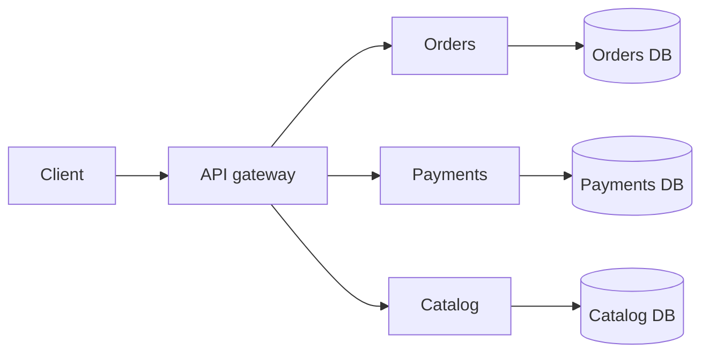

Read it left to right: one entry point, three services, and each service has its own database.

**What you get**
- Independent deployment: the payments team ships without waiting for the catalog team.
- Independent scaling: scale only the busy service.
- Fault isolation: a bug in one service need not take down everything.
- Technology freedom: Go for one service, Python for another.

**What you pay**
- Network calls can fail or be slow.
- Data is spread over many databases, so transactions are harder.
- You need strong CI/CD, monitoring and tracing.
- Testing and debugging span several services.

**Remember:** microservices are an organisation tool as much as a technical one. They pay off when team size and release speed are the real pain, not when the codebase is just "big".

**Interview tip:** Always state the cost along with the benefit. A strong answer says "I would start with the problem (team coordination, scaling) and only then pick microservices".

_Module: Fundamentals · Tags: architecture, fundamentals_

### 2. Monolith vs modular monolith vs microservices: when would you NOT choose microservices?

**Short answer:** A monolith deploys as one unit. A modular monolith is still one deployable, but with strict internal module boundaries. Microservices split into separately deployed services. Do not choose microservices when the team is small, the domain is unclear, or you lack CI/CD and monitoring maturity.

| Style | Deploy unit | Strength | Weakness | Good fit |
| --- | --- | --- | --- | --- |
| Monolith | one | simple, fast to build, easy debugging | grows tangled, one big release | small team, new product |
| Modular monolith | one | clear modules, simple operations | needs discipline to keep boundaries | medium team, evolving domain |
| Microservices | many | independent deploy and scale | distributed complexity | many teams, clear domains |

**When NOT to use microservices**
- You have fewer than about 10 to 15 engineers. One team can handle one deployable.
- The domain is new and boundaries keep moving. Wrong service boundaries are expensive to fix, because they become network APIs and separate databases.
- You have no automated pipeline, no central logging and no tracing.
- The real problem is messy code. Splitting messy code into services gives you messy services with network calls.

A modular monolith is often the best first step. You get clean modules (for example `orders`, `billing`, `catalog`) that only talk through public interfaces. If one module later needs its own scaling or team, you can lift it out.

```text
/app
  /orders      public API: orders.Service
  /billing     public API: billing.Service
  /catalog
```

**Gotcha:** the "distributed monolith" is the worst of both. Services are deployed separately but must be released together. See the coupling question.

**Interview tip:** Say that many successful teams start with a modular monolith and extract services later with evidence. This shows judgement, not fashion.

_Module: Architecture & Design · Tags: architecture, monolith, trade-offs_

### 3. What is a service boundary, and how do bounded contexts from DDD help you find it?

**Short answer:** A service boundary decides what one service owns and what it leaves to others. A bounded context, from Domain-Driven Design (DDD), is an area of the business where words have one clear meaning. Good service boundaries usually follow bounded contexts.

The word "customer" means different things in different places. For Sales it is a lead with a budget. For Billing it is a payer with a tax id. For Support it is a person with open tickets. Forcing one shared `Customer` model on all of them creates conflict. Each context keeps its own model.

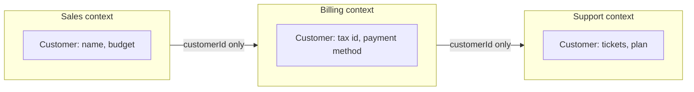

The contexts share only an id. Each keeps its own details.

**How to find boundaries**
1. Talk to domain experts and listen for where the same word changes meaning.
2. Map business capabilities (order, pay, ship, notify).
3. Look for data that changes together. Things that change together should live together.
4. Run an Event Storming workshop: list domain events on sticky notes and group them.

**Signs of a bad boundary**
- Two services must change together for most features.
- A service needs data from five others to answer one request.
- Two services share one database table.

**Remember:** a service is a unit of ownership, not a unit of code size. Aim for high cohesion inside and loose coupling between.

**Interview tip:** Give an example from your own work, such as separating "playlist" from "content licensing" in an entertainment system, and explain which words meant different things.

_Module: Architecture & Design · Tags: ddd, boundaries, design_

### 4. Synchronous vs asynchronous communication between services: how do you choose?

**Short answer:** In synchronous communication the caller sends a request and waits for the answer (HTTP, gRPC). In asynchronous communication the caller sends a message or event and moves on (a queue or topic). Use sync when you need an answer now. Use async when the work can happen later or you want services decoupled.

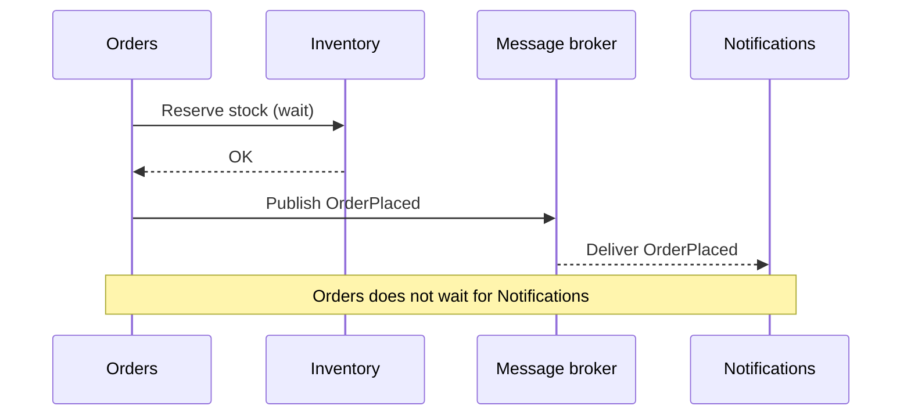

The first call is synchronous. The publish is asynchronous.

| | Synchronous | Asynchronous |
| --- | --- | --- |
| Coupling | caller needs callee up now | caller only needs the broker |
| Latency | adds up along the chain | caller returns quickly |
| Failure | errors propagate at once | messages wait and retry |
| Simplicity | easy to reason about | needs idempotency, ordering care |
| Good for | reads, validation, user-facing queries | side effects, notifications, long jobs |

**Rules of thumb**
- A user is waiting for the answer: sync.
- Another service needs to react to a fact that happened: async event.
- A long task (video encoding, report): async with a status endpoint.
- Avoid long sync chains. If A calls B calls C calls D, availability is the product of all four.

For example, if each service is 99.9% available, four in a chain give about 99.6%.

**Gotcha:** async is not free. You must handle duplicates, delays and out-of-order messages.

**Interview tip:** Mention that you often use both: sync for the request path, async for follow-up work.

_Module: Communication · Tags: communication, messaging, trade-offs_

### 5. REST vs gRPC vs messaging: which one would you use between services?

**Short answer:** REST over HTTP and JSON is simple, human readable and good for public APIs. gRPC uses HTTP/2 and Protocol Buffers; it is fast, typed and good for internal service calls. Messaging (Kafka, RabbitMQ, Service Bus) is for async events and work queues.

| Option | Format | Strength | Weakness | Typical use |
| --- | --- | --- | --- | --- |
| REST | JSON over HTTP/1.1 or 2 | easy tools, easy debugging, caches well | larger payloads, no strict contract unless OpenAPI | public and browser-facing APIs |
| gRPC | Protobuf over HTTP/2 | small, fast, generated clients, streaming | hard to call from a browser directly, harder to debug by eye | internal service to service |
| Messaging | any, usually JSON or Avro | decoupled, buffered, retry | eventual consistency, more moving parts | events, background work |

A gRPC contract is a `.proto` file. Both sides generate code from it:

```proto
syntax = "proto3";

service OrderService {
  rpc GetOrder (GetOrderRequest) returns (Order);
}

message GetOrderRequest { string order_id = 1; }
message Order {
  string order_id = 1;
  string status   = 2;
  int64  total_cents = 3;
}
```

**How to choose**
- Browser or third-party clients: REST (or GraphQL at a gateway).
- High-volume internal calls, streaming, strong typing across languages: gRPC.
- You do not need an immediate reply, or many consumers care: messaging.

**Gotchas**
- gRPC needs HTTP/2 support in your load balancer and ingress. Plain L4 balancing can pin all calls from one client to one pod, because the connection is long-lived.
- Never use field numbers in protobuf twice, and never reuse deleted ones.

**Interview tip:** The mature answer is "REST at the edge, gRPC or events inside, chosen per interaction", not one protocol for everything.

_Module: Communication · Tags: rest, grpc, messaging, communication_

### 6. What does an API gateway do, and what is a Backend for Frontend (BFF)?

**Short answer:** An API gateway is the single entry point for clients. It routes requests to services and handles shared edge concerns such as authentication, rate limiting and TLS. A BFF is a gateway made for one kind of client (web, mobile, seat-back screen) that shapes data for that client.

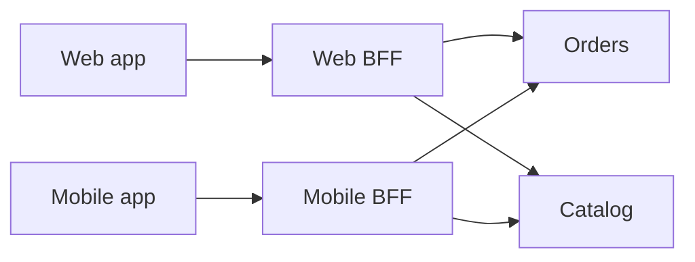

Each client gets its own BFF. Each BFF calls the same services but returns exactly the data its client needs.

**Gateway jobs**
- Routing and path rewriting.
- Authentication and token checks.
- Rate limiting and quotas.
- TLS termination, request logging, correlation id creation.
- Optional response caching and simple aggregation.

**BFF jobs**
- Combine several service calls into one response.
- Trim fields (a mobile screen needs less than a web page).
- Adapt formats and hide internal changes from the UI.

**Gotchas**
- Do not put business rules in the gateway. It becomes a new monolith and a bottleneck owned by nobody.
- A gateway is a single point of failure, so run several replicas and keep it stateless.
- A BFF should be owned by the same team as its front end, so UI changes do not wait on another team.

**Remember:** keep the gateway thin. Cross-cutting concerns yes, domain logic no.

**Interview tip:** If asked "gateway or BFF?", say one gateway for common concerns, plus a BFF per client type only when clients need clearly different shapes of data.

_Module: Communication · Tags: api-gateway, bff, edge_

### 7. How do service discovery and load balancing work?

**Short answer:** Service discovery lets a service find the current address of another service, because instances start, stop and move all the time. Load balancing spreads requests across the healthy instances. In Kubernetes both are built in through Services and DNS.

There are two styles.

| Style | Who picks the instance | Example |
| --- | --- | --- |
| Client-side | the caller asks a registry and chooses an instance | Consul or Eureka with a client library, gRPC client balancing |
| Server-side | a proxy or load balancer picks | Kubernetes Service, cloud load balancer, Envoy |

In Kubernetes, a Service gives a stable name and virtual IP. Pods come and go behind it, and only ready pods receive traffic.

```yaml
apiVersion: v1
kind: Service
metadata:
  name: orders
spec:
  selector:
    app: orders
  ports:
    - port: 80
      targetPort: 8080
```

Any pod in the same namespace can now call `http://orders`. Across namespaces use `orders.shop.svc.cluster.local`.

**Common balancing methods**
- Round robin: take turns.
- Least connections: send to the least busy.
- Consistent hashing: same key goes to the same instance (useful for caches).

**Gotchas**
- A normal Kubernetes Service balances per connection. A long-lived gRPC connection stays on one pod. Use a headless Service with client balancing, or a mesh or proxy that balances per request.
- DNS caching can send traffic to dead addresses. Respect TTLs and use health checks.
- Without readiness checks, balancers send traffic to pods that are not ready.

**Interview tip:** Say that on Kubernetes you rarely run your own registry. Mention the gRPC balancing gotcha to show real experience.

_Module: Communication · Tags: service-discovery, load-balancing, kubernetes_

### 8. Why does each microservice own its database, and what does that cost you?

**Short answer:** Each service owns its data and no other service reads or writes its tables directly. Others must use its API or its events. This keeps services independent, because you can change the schema or even the database type without breaking anyone.

If two services share one database, the schema becomes a hidden API. A column rename in one service breaks another at runtime, and you can no longer deploy them independently. That is the "shared database" anti-pattern.

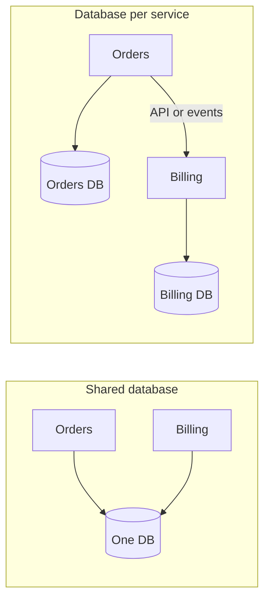

On the left both services touch the same tables. On the right each has its own and they talk through an API or events.

**Benefits**
- Free schema changes inside the service.
- Right database for each job (PostgreSQL for orders, Redis for cache, search index for catalog).
- Clear ownership and failure isolation.

**Costs**
- No cross-service joins. You call APIs, or keep a local copy of data you need, built from events.
- No single ACID transaction across services. You need sagas and eventual consistency.
- Reporting is harder. Often you copy data into a warehouse.

"Own" does not mean a separate server. Separate schemas or logical databases on one server work at first, if access rules are enforced.

**Gotcha:** copying data (for example the customer name into orders) is fine. The copy is a read model. The owner stays the single source of truth.

**Interview tip:** Mention that you started with separate schemas and strict credentials per service, which gave most of the benefit at low cost.

_Module: Data & Consistency · Tags: data, database-per-service, ownership_

### 9. What are the twelve-factor principles, and why must services be stateless?

**Short answer:** The twelve-factor app is a set of rules for building cloud-ready services. The most important for microservices: keep configuration in the environment, treat backing services as attachable resources, send logs to stdout, and keep processes stateless so any instance can be replaced or scaled at any time.

**The ones you use every day**
- Config in environment variables, not in code or in the image.
- One codebase per service, many deploys (dev, staging, prod).
- Dependencies declared explicitly (go.mod, package.json).
- Backing services (database, queue) are attached by URL and can be swapped.
- Build, release and run are separate stages.
- Processes are stateless and share nothing.
- Logs are an event stream written to stdout.
- Fast startup and graceful shutdown (disposability).
- Dev and prod stay as similar as possible.

**Why stateless**
If a request needs data from memory of a specific instance, the load balancer must always send the user to that instance (sticky sessions). If that pod dies, the data is gone. Scaling and rolling updates become risky.

```go
// ❌ bad: state in memory, lost on restart, different on every pod
var sessions = map[string]Session{}

// ✅ good: state in an external store, any pod can serve any request
func (s *Server) loadSession(ctx context.Context, id string) (Session, error) {
	return s.redis.GetSession(ctx, id)
}
```

State is not banned. It just lives in databases, caches and queues, not in the process. Kubernetes pods are disposable: they can be killed at any time, so a service must shut down cleanly on SIGTERM and finish in-flight requests.

**Gotcha:** local disk is also state. Write uploads to object storage, not to the pod.

**Interview tip:** Link statelessness to horizontal scaling, rolling deploys and autoscaling. It shows you know why the rule exists.

_Module: Fundamentals · Tags: twelve-factor, configuration, stateless_

### 10. What is the CAP theorem, and what does eventual consistency mean in plain words?

**Short answer:** When a network partition happens (some nodes cannot talk to each other), a distributed system must choose between consistency (everyone sees the same latest data) and availability (every request gets an answer). Eventual consistency means copies may differ for a short time, but they converge if no new writes arrive.

CAP names three properties: Consistency, Availability, Partition tolerance. Partitions are a fact of networks, so you cannot give up P. The real choice only appears during a partition.

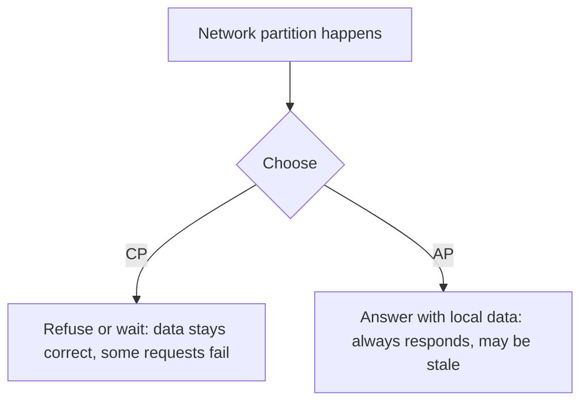

Read it top to bottom: the partition forces a choice between correct-but-sometimes-unavailable and available-but-maybe-stale.

**Examples**
- A bank balance used for a transfer: choose consistency. Better to fail than to overspend.
- A product page view count or a "likes" number: choose availability. A slightly old number is fine.
- A seat map on an aircraft screen that works offline: availability. It syncs when the link returns.

**Eventual consistency in practice**
You place an order. The order service saves it, publishes `OrderPlaced`, and the email service sends mail a moment later. For a short time the order exists but no email was sent. Eventually both agree.

**Gotchas**
- CAP is often misused. It does not say a system is "CP" or "AP" all the time. Many systems let you tune per operation.
- Even without a partition there is a latency versus consistency trade-off (the PACELC idea).
- Eventual consistency needs UI care: show "processing", do not pretend it is done.

**Interview tip:** Use a business example and say which parts of the system need strong consistency and which can be eventual. That is the senior answer.

_Module: Data & Consistency · Tags: cap, consistency, distributed-systems_

### 11. What role do containers and an orchestrator like Kubernetes play in microservices?

**Short answer:** A container packages a service with its dependencies so it runs the same everywhere. An orchestrator such as Kubernetes runs many containers for you: it schedules them on machines, restarts failed ones, scales them, rolls out updates and connects them with networking.

Microservices create many small deployables. Doing that by hand with virtual machines is slow and error prone. Containers are small and start in seconds. Kubernetes adds the control layer.

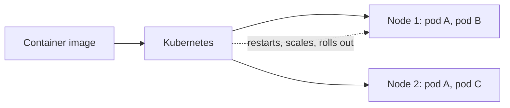

You declare what you want (three copies of orders). Kubernetes makes it true and keeps it true.

**What Kubernetes gives you**
- Self-healing: crashed pods are restarted, dead nodes are replaced.
- Horizontal scaling by rules (HPA).
- Rolling updates and rollbacks.
- Service discovery and load balancing.
- Config and secrets injection.
- Resource limits so one service cannot eat the whole node.

```yaml
apiVersion: apps/v1
kind: Deployment
metadata:
  name: orders
spec:
  replicas: 3
  selector:
    matchLabels: { app: orders }
  template:
    metadata:
      labels: { app: orders }
    spec:
      containers:
        - name: orders
          image: registry.example.com/orders:1.4.2
          resources:
            requests: { cpu: 100m, memory: 128Mi }
            limits: { memory: 256Mi }
```

**Gotcha:** Kubernetes does not make a design good. It runs your services; it does not fix poor boundaries or missing timeouts. Also it adds its own learning curve and cost.

**Interview tip:** Mention that you can run microservices without Kubernetes (for example on a managed container service), and that Kubernetes pays off when you have many services and need standard operations.

_Module: Fundamentals · Tags: containers, kubernetes, docker_

### 12. What are coupling and cohesion, and how do you avoid a distributed monolith?

**Short answer:** Cohesion means things inside one service belong together. Coupling means how much one service depends on another. Good services have high cohesion and low coupling. A distributed monolith is a system split into services that are still so tightly coupled that they must be changed and deployed together.

**Signs of a distributed monolith**
- One feature needs changes in four services and a coordinated release.
- Services share a database or a shared model library that changes often.
- Long chains of synchronous calls: A calls B calls C.
- Services cannot start or be tested without the others.
- Releases are done "in the right order" from a checklist.

**Types of coupling**

| Coupling | Example | Fix |
| --- | --- | --- |
| Data | shared tables | database per service |
| Temporal | caller needs callee up right now | async events, timeouts, fallbacks |
| Deployment | must release together | backward compatible APIs |
| Domain | one concept split over many services | merge, or redraw boundary |
| Library | shared domain DTO package | share contracts (schemas) not logic |

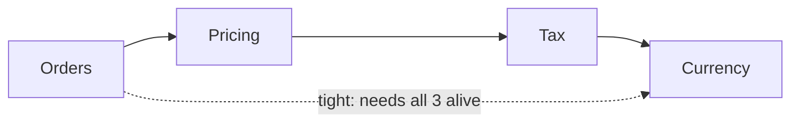

If every request walks this chain, the system is only as strong as its weakest link and all four change together.

**How to avoid it**
1. Draw boundaries around business capabilities.
2. Prefer events for "something happened" and keep local copies of data you need.
3. Make API changes backward compatible, so each side deploys alone.
4. Ask: "Can this team deploy on a Tuesday without telling anyone?" If not, there is hidden coupling.

**Gotcha:** if two services always change together, they may really be one service. Merging is a valid fix.

**Interview tip:** Use the Tuesday test. It is memorable and practical.

_Module: Architecture & Design · Tags: coupling, cohesion, anti-patterns_

### 13. What are liveness, readiness and startup health checks, and why do they matter?

**Short answer:** A liveness check says "is this process stuck and should it be restarted?". A readiness check says "can this instance take traffic right now?". A startup check gives slow-starting apps time before the other two begin. Together they let the platform heal and route traffic safely.

| Probe | Question | On failure |
| --- | --- | --- |
| Liveness | Is the process alive and not deadlocked? | container is restarted |
| Readiness | Can it serve requests now? | removed from load balancing, not restarted |
| Startup | Has it finished starting? | other probes wait; restart if it never succeeds |

```yaml
containers:
  - name: orders
    image: registry.example.com/orders:1.4.2
    startupProbe:
      httpGet: { path: /healthz, port: 8080 }
      failureThreshold: 30
      periodSeconds: 2
    livenessProbe:
      httpGet: { path: /healthz, port: 8080 }
      periodSeconds: 10
    readinessProbe:
      httpGet: { path: /readyz, port: 8080 }
      periodSeconds: 5
```

**Design rules**
- Liveness should check only the process itself. Keep it cheap.
- Readiness may check the things you need to serve: cache warmed, database connection available, migrations done.
- Return 503 from readiness while shutting down, so traffic drains first.

**Gotcha: do not put downstream dependencies in the liveness check.** If the database is down and liveness fails, Kubernetes restarts every pod at once, which makes the outage worse. A failing dependency should make readiness fail (or better, the service should degrade), never liveness.

**Gotcha:** a readiness check that calls a shared dependency can make all pods unready together, and the service has zero capacity. Think about what "unready" does to the whole fleet.

**Interview tip:** The liveness versus readiness mistake is a classic outage cause. Telling that story shows production experience.

_Module: Resilience · Tags: health-checks, kubernetes, reliability_

## Intermediate

### 14. [Tech Lead] How do you decompose a monolith safely using the strangler fig pattern?

**Short answer:** With the strangler fig pattern you put a routing layer in front of the monolith and move one capability at a time into a new service. Traffic is switched slice by slice. The old code shrinks until it can be removed. You never do a big-bang rewrite.

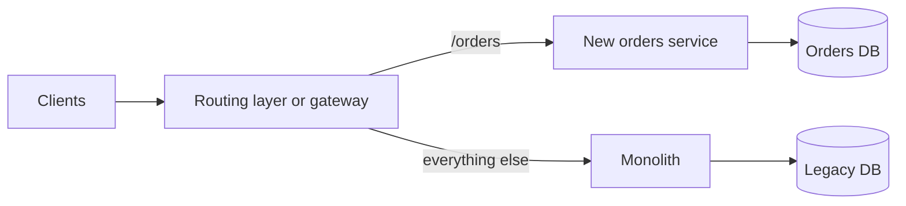

The gateway decides per route where a request goes. Moving a route is a config change that can be undone.

**How I would run it**
1. **Pick the first slice carefully.** Choose something valuable but low risk: clear boundary, few database joins, painful to change today. Not the core payment path on day one.
2. **Find the seams.** Look at call graphs, tables touched and change history. Draw the bounded contexts first.
3. **Put the facade in place.** A gateway or reverse proxy that still sends everything to the monolith. Prove it changes nothing.
4. **Build the new service behind it.** Keep the monolith version alive.
5. **Shadow and compare.** Send a copy of real traffic to the new service, compare the answers, do not return them.
6. **Canary the switch.** 1%, 10%, 50%, 100%, watching error rate and latency. Roll back by flipping the route.
7. **Move the data.** Often the hardest step: see the data migration question. Start by letting the new service read through the monolith API, then copy and cut over.
8. **Delete the old code.** If you never delete, you have two systems.

**Gotchas**
- An anti-corruption layer is useful: it translates the old model into the new one so legacy concepts do not leak into the new service.
- Keep the monolith shipping features during the migration, or the business will lose patience.
- Measure progress: percent of traffic moved, lines of code deleted.

**Interview tip:** Say "reversible steps, measured at each step". Also mention the decision to stop: if the modular monolith is good enough, you may not need to extract everything.

_Module: Architecture & Design · Tags: tech-lead, migration, strangler-fig_

### 15. [Tech Lead] How do Conway's law and team design affect service ownership and on-call?

**Short answer:** Conway's law says a system's design copies the communication structure of the organisation that builds it. So you should design teams and services together. Each service needs one clear owning team that builds it, runs it and carries the pager for it.

If you have a front-end team, a back-end team and a database team, you will get a three-layer system where every feature needs three teams. If you have a team per business capability, you get services that match those capabilities. The "inverse Conway manoeuvre" means you shape the teams first to get the architecture you want.

**Team Topologies in short**
- **Stream-aligned team:** owns a slice of the business end to end (for example "playlists and content discovery").
- **Platform team:** offers paved roads (CI templates, Kubernetes, observability) as an internal product.
- **Enabling team:** coaches others for a time (security, testing).
- **Complicated-subsystem team:** owns deep specialist work (for example a recommendation engine).

**Ownership rules I would set**
1. Every service has exactly one owning team, listed in a catalog (name, repo, runbook, Slack channel, on-call rota).
2. You build it, you run it. Owners see their own incidents, so quality improves.
3. A team should own a manageable number of services. A rough guide: if a team cannot hold the whole system in its head, it owns too much.
4. Shared libraries and shared services need a named owner too, or nobody maintains them.

**On-call**
- Rotation of at least 5 to 6 people to keep it humane.
- Alerts must be actionable and tied to user impact (SLOs), not CPU noise.
- Every alert links to a runbook. After each incident, hold a blameless review.
- Pay or compensate on-call time fairly.

**Gotcha:** if two teams must agree on every change, the boundary is wrong. Fix the boundary or the team shape.

**Interview tip:** Tell how you matched your team's responsibilities to service boundaries, and how you handled a service that nobody wanted to own.

_Module: Architecture & Design · Tags: tech-lead, conways-law, teams, ownership_

### 16. [Tech Lead] How do you make a microservice system observable: logs, metrics, traces, correlation ids and SLOs?

**Short answer:** Observability means you can understand what the system is doing from the outside. You need three signals: logs (what happened), metrics (how much and how often), and traces (the path of one request across services). Tie them together with a correlation id and judge health with SLOs.

| Signal | Question it answers | Example |
| --- | --- | --- |
| Logs | What exactly happened here? | `payment declined, reason=insufficient_funds` |
| Metrics | Is it healthy, is it getting worse? | error rate, p99 latency, queue depth |
| Traces | Where did this request spend time? | gateway, orders, payments, 480 ms in payments |

**Correlation id.** Create an id at the edge (or accept the incoming one), pass it in a header on every call and message, and put it in every log line. Then one search shows the whole story. With OpenTelemetry the trace id plays this role.

```go
// middleware: reuse or create the id, pass it on, log with it
func CorrelationID(next http.Handler) http.Handler {
	return http.HandlerFunc(func(w http.ResponseWriter, r *http.Request) {
		id := r.Header.Get("X-Correlation-ID")
		if id == "" {
			id = uuid.NewString()
		}
		w.Header().Set("X-Correlation-ID", id)
		ctx := context.WithValue(r.Context(), ctxKey{}, id)
		next.ServeHTTP(w, r.WithContext(ctx))
	})
}
```

**What to measure.** Start with the RED method for services (Rate, Errors, Duration) and the USE method for resources (Utilisation, Saturation, Errors). Use structured JSON logs and avoid high-cardinality metric labels such as user ids.

**SLOs.** An SLI is a measurement (for example the share of requests under 300 ms). An SLO is the target (99.5% over 30 days). The gap is the error budget. If the budget is spent, slow down feature work and fix reliability. Alert on budget burn rate, not on every blip.

**Gotcha:** logging everything is costly and noisy. Sample traces, keep log levels sensible, set retention by value.

**Interview tip:** Mention a real tool setup, for example Datadog APM with unified service tags, and a time when a trace found a slow downstream call within minutes.

_Module: Observability · Tags: tech-lead, observability, slo, datadog_

### 17. [Tech Lead] What testing strategy works for microservices: test pyramid, contract tests and testing in production?

**Short answer:** Keep many fast unit tests, a smaller number of integration tests per service, and consumer-driven contract tests between services. Use very few full end-to-end tests. Add careful testing in production (canaries, feature flags, synthetic checks) because no test environment matches production.

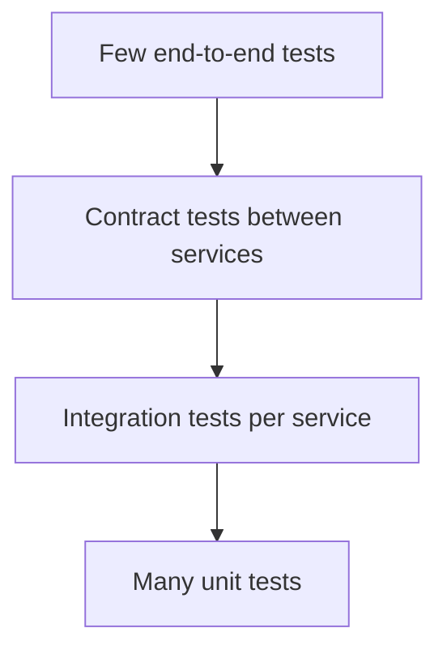

Higher layers are slower, flakier and fewer.

**Why not many end-to-end tests?** They need every service up, they are slow, flaky, and a failure does not say who broke it. A shared test environment becomes a bottleneck.

**Contract tests (for example Pact).** The consumer writes down what it expects from the provider: request shape and response shape. This becomes a contract file. The provider's pipeline replays that contract against the real provider code. If the provider changes something a consumer relies on, the provider build fails before release.

```text
Consumer CI:  runs tests against a mock, publishes pact to a broker
Provider CI:  fetches pacts, verifies them against the real service
Deploy gate:  "can-i-deploy" asks the broker if versions are compatible
```

**Other layers**
- Component tests: one service with fake dependencies (or containers via Testcontainers for its own database).
- Test the failure paths: timeouts, retries, duplicate messages.
- Load tests for critical paths, run regularly.

**Testing in production, carefully**
- Canary releases and gradual rollout with automatic rollback.
- Feature flags to expose features to staff first.
- Synthetic transactions that run every minute.
- Shadow traffic. Never use it for requests that cause side effects like payments.

**Gotcha:** contract tests check shape, not business correctness. Keep a small set of end-to-end journeys for the money paths.

**Interview tip:** Say you aim for confidence per service from the pipeline alone, with contracts replacing most cross-team environments.

_Module: Delivery & Testing · Tags: tech-lead, testing, contract-testing, pact_

### 18. [Tech Lead] How would you set up CI/CD per service, and when do you pick monorepo vs polyrepo?

**Short answer:** Each service gets its own pipeline that builds, tests, scans and deploys it independently. A monorepo keeps all services in one repository, which makes shared changes easy. A polyrepo gives one repo per service, which gives clear ownership. Choose by how much code is shared and how much tooling you can invest in.

**A good per-service pipeline**
1. Lint and unit tests.
2. Build one immutable container image, tagged with the commit hash.
3. Security scan (dependencies, image, secrets).
4. Contract and integration tests.
5. Deploy to a test environment automatically.
6. Promote the same image to staging and production. Never rebuild for prod.
7. Progressive rollout with health checks and automatic rollback.

```yaml
# .gitlab-ci.yml (fragment): run only when this service changes
orders-test:
  stage: test
  rules:
    - changes:
        - services/orders/**/*
        - libs/common/**/*
  script:
    - cd services/orders && go test ./...
```

| | Monorepo | Polyrepo |
| --- | --- | --- |
| Shared code change | one atomic commit | many repos, versioned releases |
| Ownership | needs CODEOWNERS | natural |
| CI | needs path filters and caching | simple per repo |
| Tooling | needs investment (Bazel, Nx, path rules) | little |
| Risk | accidental coupling, slow CI | version drift of shared libraries |
| Visibility | easy to search everything | harder |

**My rule:** a polyrepo is simplest when services are truly independent. A monorepo helps when teams share many contracts and want atomic refactors, provided you have path-based pipelines and CODEOWNERS. A monorepo does not mean a monolith: services still deploy separately.

**Gotchas**
- Do not let a shared library become a deployment coupling. Version it and keep it small.
- Pipeline templates (GitLab `include`) keep many services consistent without copy-paste.

**Interview tip:** Mention deployment frequency and lead time as the measures that show whether the pipeline design works.

_Module: Delivery & Testing · Tags: tech-lead, ci-cd, monorepo, gitlab_

### 19. [Tech Lead] How do you handle API versioning, backward compatibility and deprecation across teams?

**Short answer:** Make changes backward compatible by default so consumers do not have to move in lock step. Only introduce a new version for real breaking changes, run old and new side by side, and retire the old one with a published deprecation plan and usage data.

**Safe changes (backward compatible)**
- Add a new optional field or endpoint.
- Add a new enum value, if clients are told to tolerate unknown values.
- Loosen validation.

**Breaking changes**
- Remove or rename a field.
- Change a type or meaning.
- Make an optional field required.
- Change error codes or behaviour clients rely on.

**Be liberal in what you accept.** Clients should ignore unknown fields (the tolerant reader). Servers should not break because a client sent less.

**Expand and contract** is the safe way to change something:
1. Expand: add the new field and keep the old one. Write both.
2. Migrate consumers (track who calls the old one).
3. Contract: remove the old field when usage is zero.

**Deprecation process**
- Announce with a date. Add `Deprecation` and `Sunset` response headers.
- Log which clients still use the old version and contact them directly.
- Provide a migration guide.
- Contract tests show which consumers would break.
- Keep a support policy, for example the last two versions for 6 months.

```http
HTTP/1.1 200 OK
Deprecation: true
Sunset: Wed, 30 Jun 2027 00:00:00 GMT
Link: </v2/orders>; rel="successor-version"
```

**Gotcha:** every live version is a cost. Too many versions means you maintain many systems. Prefer evolving one version.

**Interview tip:** Say the real metric is "how many consumers still use v1". Without that number you cannot retire anything.

_Module: Delivery & Testing · Tags: tech-lead, versioning, compatibility, deprecation_

### 20. [Tech Lead] A slow dependency causes a cascading failure in production. How do you handle the incident?

**Short answer:** First stop the bleeding: shed load, disable the failing dependency path or roll back the last change, then restore service. Investigate the root cause after users are safe. Afterwards run a blameless review and add the missing protections such as timeouts, circuit breakers and bulkheads.

**How a cascade happens.** Service C becomes slow. B waits on C and its threads or connections fill up. B becomes slow. A waits on B and fills up too. Retries multiply the load. Soon everything is down even though only C had a problem.

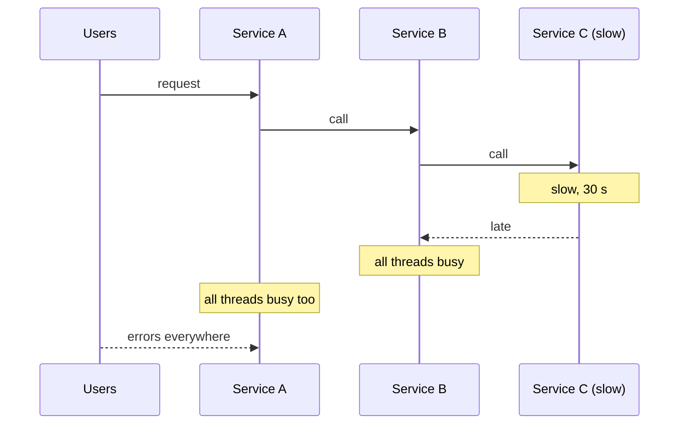

**During the incident**
1. Declare the incident, name an incident commander, open one channel. Communicate status on a schedule.
2. Check the dashboards: what changed (deploy, traffic, config)? Roll back if a deploy lines up.
3. Reduce load: rate limit, turn off non-essential features with flags, serve cached data.
4. Open the circuit manually or scale up the healthy path if that helps. Do not blindly restart everything: a cold start under load can make it worse.
5. Confirm recovery with metrics, not feelings.

**Prevention (what the review should add)**
- Timeouts on every outgoing call, shorter than the caller's own timeout.
- Retries with backoff, jitter and a retry budget.
- Circuit breakers and bulkheads to isolate pools.
- Load shedding and graceful degradation.
- Alerts on saturation, not only errors.
- Game days and chaos experiments to test it.

**Gotcha:** blaming a person ends learning. Ask what made the mistake easy to make.

**Interview tip:** Tell a real timeline: detection time, mitigation time and the one change that would have prevented it.

_Module: Resilience · Tags: tech-lead, incident-response, resilience, cascading-failure_

### 21. [Tech Lead] How do you manage latency budgets and performance across a chain of service calls?

**Short answer:** Start from the user's target, for example 300 ms at p95, and split it into a budget per hop. Measure with distributed tracing, cut the number of sequential calls, run calls in parallel, cache, and pass a deadline downstream so work is dropped when it is too late.

Latency adds up along a chain and tail latency gets worse with fan-out. If a page calls 10 services in parallel and each is slow 1% of the time, then about 10% of pages hit a slow one.

**Method**
1. Define the SLO per user journey (p50, p95, p99).
2. Trace real requests. Find the critical path: the longest chain that decides total time.
3. Give each hop a budget, for example gateway 20 ms, orders 80 ms, catalog 100 ms.
4. Attack the largest slice first: avoid N+1 calls, add an index, cache.
5. Re-run the load test and keep a performance check in CI for key paths.

**Techniques**
- Parallelise independent calls.
- Batch requests instead of one call per item.
- Cache close to the caller (see the caching question).
- Move non-urgent work to async.
- Use gRPC or compact payloads for chatty internal traffic.
- Co-locate chatty services in the same zone.

**Deadline propagation** means the remaining time travels with the request, so a service does not start expensive work when the caller will already have given up.

```go
// the context carries the deadline across calls
ctx, cancel := context.WithTimeout(r.Context(), 250*time.Millisecond)
defer cancel()
resp, err := catalogClient.GetItem(ctx, req) // gRPC passes the deadline on
```

**Gotcha:** averages hide pain. Always look at percentiles, and measure from the client side too.

**Interview tip:** Mention that you reduced calls on a hot path (for example by combining two service calls through a read model) rather than only tuning code.

_Module: Observability · Tags: tech-lead, latency, performance, tracing_

### 22. [Tech Lead] How do you secure communication and access between microservices?

**Short answer:** Assume the internal network is not safe (zero trust). Authenticate every caller, encrypt traffic with mutual TLS, authorise every request by identity and permission, and pass the end user's identity safely with signed tokens. Keep secrets out of code.

**Layers**

| Layer | What it answers | Typical tool |
| --- | --- | --- |
| Edge authentication | Who is the user? | OAuth2 / OpenID Connect at the gateway, JWT |
| Service identity | Which service is calling? | mTLS certificates, workload identity |
| Authorisation | Is this caller allowed to do this? | scopes, roles, policy engine, ownership checks |
| Transport | Is traffic private and not altered? | TLS, mTLS via a mesh |
| Secrets | Where are keys kept? | Key Vault, Vault, Kubernetes secrets with encryption |

**JWT flow.** The user logs in with an identity provider and gets a signed access token. The gateway checks the signature, expiry, issuer and audience. It forwards the token (or a smaller internal token). Each service validates it again and checks permissions. Do not trust a header just because it came from inside the cluster.

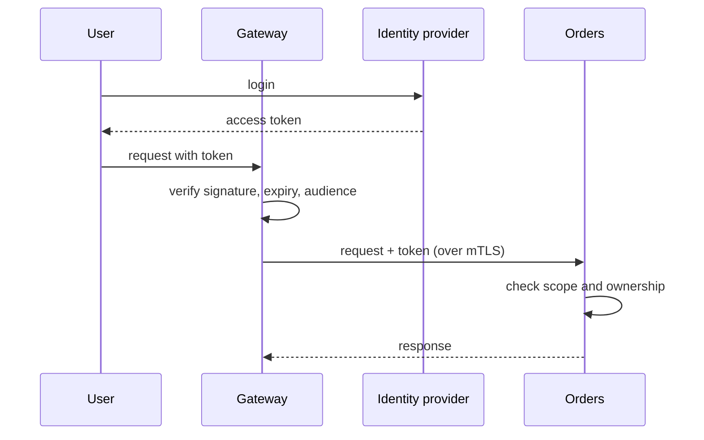

**Rules**
- Use short-lived tokens. Use the client credentials flow for service to service calls with no user.
- Least privilege: each service gets only the access it needs. Use Kubernetes NetworkPolicies to limit who can talk to whom.
- Check object ownership, not only the role (a user may read only their own orders).
- Scan images and dependencies; rotate secrets.

**Gotcha:** a gateway-only check leaves every service open to anyone who reaches the cluster network.

**Interview tip:** Mention a mesh (for example mTLS via a sidecar or ambient mode) as a way to get encryption and identity without app code, while authorisation stays in the service.

_Module: Security · Tags: tech-lead, security, mtls, oauth2, zero-trust_

### 23. [Tech Lead] What are the cost and complexity trade-offs of microservices, and how do you decide build vs buy?

**Short answer:** Microservices add real costs: infrastructure, tooling, on-call and the mental load of a distributed system. Accept that cost only where it buys something concrete. Build what is your competitive advantage and buy or use managed services for everything else.

**Cost sources**
- Infrastructure: more pods, more databases, more network traffic, idle capacity per service.
- Platform: CI/CD, observability, service discovery, secret handling.
- People: on-call rotas, onboarding time, more cross-team coordination.
- Observability bill: logs and traces from many services get large quickly.
- Cognitive load: nobody understands the whole system.

**Questions I ask before adding a service**
1. Does it need to scale or deploy independently from its neighbours?
2. Is there a team ready to own it?
3. What is its data, and who else needs it?
4. What happens when it is down?
5. Could a module in an existing service do the job?

**Build vs buy**

| Choose | When |
| --- | --- |
| Buy or managed | commodity: auth provider, message broker, database, email, search, metrics |
| Build | core differentiator: your business rules, your user experience |
| Open source self-hosted | you have the skills to run it, and licence or control matters |

Managed services (for example Azure Service Bus, Azure Database for PostgreSQL) trade money for less operations. Self-hosting Kafka needs people who can run Kafka. Count the people cost, not only the licence cost.

Also consider lock-in. Standards (OpenTelemetry, OCI images, standard SQL) lower the exit cost. Estimate it, do not fear it blindly.

**Gotcha:** a "cheap" tool that no one on the team can operate is expensive. Include the learning curve, support, exit plan.

**Interview tip:** Give numbers when you can, such as the observability bill falling after sampling, or fewer pods after merging two chatty services.

_Module: Architecture & Design · Tags: tech-lead, cost, build-vs-buy, trade-offs_

### 24. [Tech Lead] How do you keep documentation, ADRs and API standards consistent across many teams?

**Short answer:** Treat documentation as part of the product, but keep it small and close to the code. Record important decisions as short Architecture Decision Records (ADRs), publish every API as a machine-readable contract, and set simple API standards with automatic checks so teams do not need to argue about style.

**ADR: Architecture Decision Record.** A one-page file in the repo that says what was decided and why. It lets new people understand history, and stops the same debate returning every year.

```text
# ADR-014: Use Kafka for domain events
Status: Accepted (2026-03-02)
Context: Three services need to react to order changes. Direct calls couple them.
Decision: Publish domain events to Kafka. Use the outbox pattern.
Consequences: + decoupled consumers, + replay.
              - more operations work, - eventual consistency.
Alternatives considered: RabbitMQ, direct HTTP calls.
```

**What to document**
- Service catalog entry: owner, repo, runbook, SLOs, dependencies, on-call.
- API contract: OpenAPI for REST, `.proto` for gRPC, AsyncAPI or schema registry for events.
- A short README with how to run it locally.
- Runbooks for the top alerts.
- Architecture diagrams as code (Mermaid) next to the source.

**API standards worth having**
- Naming and URL style, error format (for example RFC 9457 problem details), pagination, idempotency headers, versioning rule, auth scheme.
- Enforce with a linter in CI (such as Spectral for OpenAPI) and with contract tests.

**Keeping it alive**
- Docs live in the repo and change in the same pull request as the code.
- A pull request template asks "docs or ADR needed?".
- Review the catalog every quarter and remove dead entries.

**Gotcha:** a big wiki that nobody updates is worse than none, because people trust wrong information.

**Interview tip:** Say that you introduced ADRs with a light template and that they saved time in onboarding. Small and used beats complete and ignored.

_Module: Architecture & Design · Tags: tech-lead, documentation, adr, api-standards_

### 25. [Tech Lead] How do you decide the number and size of services?

**Short answer:** Do not size services by lines of code. Size them by what one team can own, what changes together, and what must scale or fail independently. Start with fewer, larger services (even modules) and split when you have evidence. Too many tiny services create a "nanoservice" mess.

**Questions that guide the size**
- **Team:** can one team (about 5 to 9 people) understand, own and run it?
- **Change:** do changes to it usually stay inside it? If most features touch two services, merge them.
- **Data:** is its data used mostly by itself? Does it have a clear single owner?
- **Scale:** does it have very different load or hardware needs (GPU, large memory)?
- **Failure:** must it stay up even when others fail, or can it be allowed to fail?
- **Compliance or release rhythm:** payments with audit rules, or a fast-moving UI backend.

**Smells**
- Too big: several teams touch it, deploys are slow and scary, unrelated features are bundled.
- Too small (nanoservices): a service per database table, services that cannot do anything alone, huge number of network calls for one request, more YAML than code.

**A practical approach**
1. Begin with a modular monolith or a few coarse services around bounded contexts.
2. Add an internal module boundary and watch it for some months.
3. Split only for a concrete reason: team contention, scaling, risk isolation.
4. Review the count regularly. Merging is allowed.

```text
Start:   [Commerce] [Catalog] [Identity]
Later:   [Orders] [Payments] [Catalog] [Identity] [Notifications]
         (Payments split out: compliance + separate release cadence)
```

**Gotcha:** the number of services is not a score. Fewer well-owned services beat many orphaned ones.

**Interview tip:** The phrase "split when it hurts, and for a named reason" is a strong, short answer.

_Module: Architecture & Design · Tags: tech-lead, boundaries, sizing, design_

### 26. What is the saga pattern, and how do orchestration and choreography differ?

**Short answer:** A saga is a way to keep data consistent across several services without one big database transaction. It is a sequence of local transactions. If one step fails, the saga runs compensating actions that undo the earlier steps. It can be coordinated by a central orchestrator or by services reacting to each other's events (choreography).

Example: placing an order needs Orders, Payments and Inventory. Each does its own local commit. If inventory fails after payment succeeded, the saga refunds the payment.

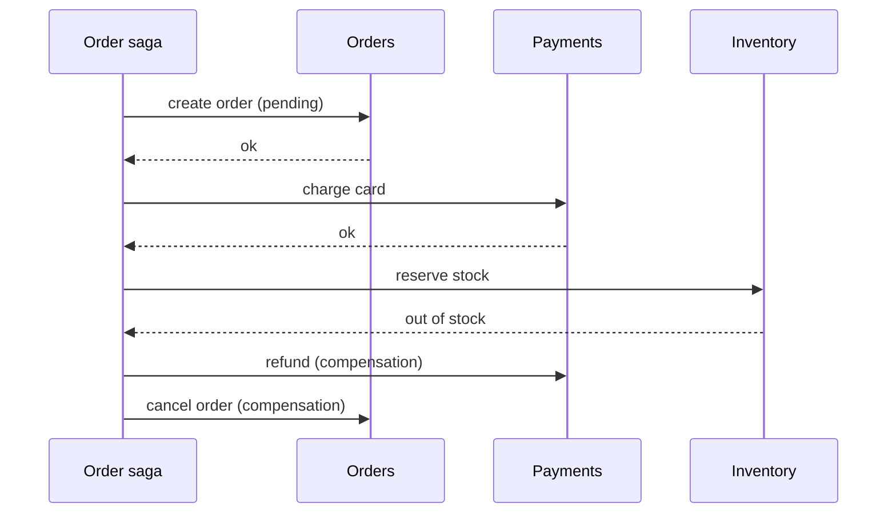

The orchestrator calls each step in order. On failure it walks backwards with compensations.

| | Orchestration | Choreography |
| --- | --- | --- |
| Control | one coordinator knows the flow | each service reacts to events |
| Visibility | easy to see and debug the whole flow | flow is spread over many services |
| Coupling | services know the orchestrator | services know the event names |
| Risk | orchestrator can become a god service | hidden cycles, hard to follow |
| Good for | longer flows, many steps | short flows, two or three services |

**Rules for compensations**
- A compensation is a business undo (refund, release stock), not a database rollback.
- Make every step and compensation idempotent, because messages can repeat.
- Some steps cannot be undone (an email was sent). Put those last or make them tolerant.
- Save the saga state (for example `PENDING, PAID, FAILED`) so it survives a crash.

**Gotcha:** sagas give no isolation. Other users can see the half-done state (a pending order). Design for it with states such as `PENDING`.

**Interview tip:** Say you prefer orchestration once a flow has more than three steps, and that you model saga state as a state machine.

_Module: Data & Consistency · Tags: saga, transactions, consistency_

### 27. What is the transactional outbox pattern, and what problem does it solve?

**Short answer:** The outbox pattern makes "save to the database" and "publish an event" happen together reliably. You write the event into an outbox table in the same database transaction as your business change. A separate relay reads the outbox and publishes to the broker.

The problem is the dual write. If you commit to the database and then publish, a crash between the two loses the event. If you publish first and the commit fails, you sent an event for something that never happened. A database and a broker cannot share one transaction.

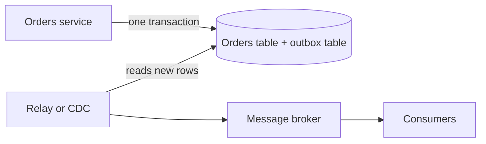

The business row and the event row are committed together. The relay publishes later, and retries until it works.

```sql
BEGIN;
INSERT INTO orders (id, customer_id, status) VALUES ('o-42', 'c-7', 'PLACED');
INSERT INTO outbox (id, aggregate_id, type, payload, created_at)
VALUES (gen_random_uuid(), 'o-42', 'OrderPlaced',
        '{"orderId":"o-42","customerId":"c-7"}', now());
COMMIT;
```

**How the relay works**
- Polling: a worker selects unsent rows, publishes, marks them sent. Use `FOR UPDATE SKIP LOCKED` to run several workers.
- Change data capture (CDC), for example Debezium, tails the database log and publishes. Lower latency, more infrastructure.

**Consequences**
- Delivery is at least once. The relay may publish twice after a crash, so consumers must be idempotent.
- Event order is kept per aggregate if you publish in insert order and use the aggregate id as the partition key.
- Clean up old outbox rows.

**Gotcha:** the outbox table is also a queue. Monitor its size and the age of the oldest unsent row.

**Interview tip:** Name the dual-write problem first. Interviewers look for that phrase.

_Module: Data & Consistency · Tags: outbox, messaging, consistency_

### 28. What is idempotency, and how do idempotency keys make retries safe?

**Short answer:** An operation is idempotent if doing it many times has the same effect as doing it once. Because networks fail and clients retry, services must handle duplicates. An idempotency key is a unique id sent by the client so the server can recognise a repeat and return the first result instead of acting again.

Without it, a timeout on `POST /payments` makes the client retry, and the customer is charged twice. The client does not know whether the first request worked.

**Naturally idempotent:** `PUT /users/7` with a full body, `DELETE /orders/42`, "set status to SHIPPED".
**Not idempotent:** "add 10 to balance", `POST /payments`, "send email".

**How to implement**
1. The client generates a key (a UUID) per logical action and sends it in a header: `Idempotency-Key`.
2. The server stores the key with the result in the same transaction as the work.
3. On a repeat with the same key, it returns the stored result.
4. If the same key arrives with a different body, reject it.
5. Expire keys after a period (for example 24 hours).

```sql
CREATE TABLE idempotency_keys (
  key        text PRIMARY KEY,
  request_hash text NOT NULL,
  response   jsonb,
  created_at timestamptz NOT NULL DEFAULT now()
);
-- insert first; a unique violation means "seen before"
INSERT INTO idempotency_keys (key, request_hash) VALUES ($1, $2)
ON CONFLICT (key) DO NOTHING;
```

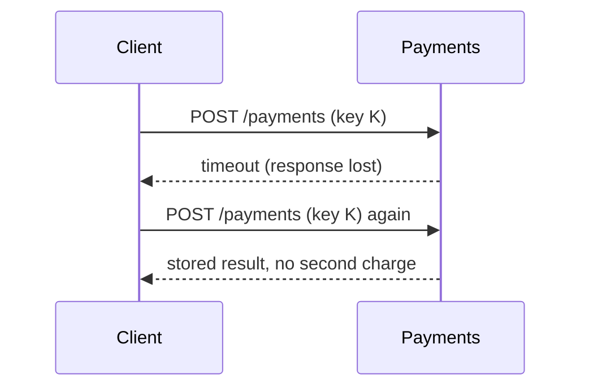

**For message consumers:** keep a table of processed message ids, or make the update itself idempotent (`UPDATE ... WHERE version = ...`).

**Gotcha:** the check and the work must be atomic. Checking a key and then charging in two steps can still double charge with two parallel requests.

**Interview tip:** Mention that retries, outbox relays and brokers all produce duplicates, so every consumer needs this.

_Module: Data & Consistency · Tags: idempotency, retries, reliability_

### 29. What is CQRS, and when is it worth the extra complexity?

**Short answer:** CQRS (Command Query Responsibility Segregation) separates the model that changes data (commands) from the model that reads data (queries). The read side is shaped for fast, simple queries and is updated from the write side, usually through events. It is worth it when reads and writes have very different needs.

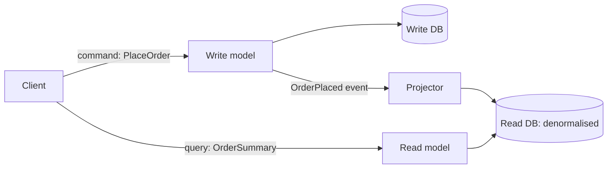

Commands go one way and queries go another. A projector keeps the read database up to date.

**Why use it**
- A screen needs data from many tables. A read model holds exactly that shape, in one lookup.
- Reads vastly outnumber writes, so you scale and tune the read side alone (for example a search index or cache).
- Complex write rules stay clean, free from reporting needs.
- It also solves "queries across services": one service builds a local read model from other services' events.

**Costs**
- Two models and a sync process.
- Eventual consistency: after a command, the read side may be a few milliseconds or seconds behind. The user may not see their change at once.
- More code, more moving parts to monitor.

**Handling stale reads:** return the new state in the command response, show an optimistic UI update, or read from the write model for the user's own recent changes.

```ts
// projector: keep a read model in step with events
async function onOrderPlaced(e: OrderPlaced) {
  await db.query(
    `INSERT INTO order_summary (order_id, customer_name, total)
     VALUES ($1, $2, $3) ON CONFLICT (order_id) DO NOTHING`,
    [e.orderId, e.customerName, e.total]
  );
}
```

**Gotcha:** CQRS does not require event sourcing or two databases. A simple version uses the same database with a separate view.

**Interview tip:** Say "I only add CQRS where a read problem justifies it, not by default for every service".

_Module: Data & Consistency · Tags: cqrs, read-model, patterns_

### 30. What is event sourcing, and what are its benefits and risks?

**Short answer:** In event sourcing you store the sequence of events that happened (for example `ItemAdded`, `ItemRemoved`) instead of only the current state. The current state is calculated by replaying events. You get a full history and the ability to rebuild state, at the cost of more complexity.

A bank statement is a good picture. The balance is not stored as the truth; the list of deposits and withdrawals is. Add them up to get the balance.

```ts
type Event =
  | { type: "Deposited"; amount: number }
  | { type: "Withdrawn"; amount: number };

// state = fold over events
const balance = (events: Event[]) =>
  events.reduce((sum, e) => (e.type === "Deposited" ? sum + e.amount : sum - e.amount), 0);

console.log(balance([
  { type: "Deposited", amount: 100 },
  { type: "Withdrawn", amount: 30 },
])); // prints: 70
```

**Benefits**
- Complete audit trail by design.
- Can answer "what did the state look like last Tuesday?".
- New read models can be built later by replaying history.
- Natural fit with events between services.

**Risks and costs**
- Event design is hard to change. Old events live forever, so you need versioning and upcasting (converting old events to the new shape).
- Replaying long histories is slow. Use snapshots every N events.
- Deleting personal data (privacy rules) conflicts with immutable events. Use encryption keys per person (crypto-shredding) or keep personal data outside events.
- Queries need read models, so it nearly always comes with CQRS.
- Eventual consistency everywhere, and a steep learning curve.

**When to use:** audit-heavy domains (finance, bookings), complex state machines, strong need for history. **When not:** simple CRUD. It is overkill there.

**Gotcha:** do not confuse event sourcing (events are the storage) with event-driven architecture (services send events to each other). You can have the second without the first.

**Interview tip:** If asked, say you used events for integration between services, not as the storage model, and explain why.

_Module: Data & Consistency · Tags: event-sourcing, events, patterns_

### 31. How do timeouts, retries with backoff and jitter, circuit breakers and bulkheads work together?

**Short answer:** These four patterns stop one failing service from taking down others. Timeouts stop waiting forever. Retries with backoff and jitter handle short glitches without causing a storm. A circuit breaker stops calling a service that is clearly failing. Bulkheads isolate resources so one bad dependency cannot use them all.

**Timeout.** Every network call needs one. No timeout means threads and connections pile up. Set it from the latency budget and keep downstream timeouts shorter than upstream ones.

**Retry with exponential backoff and jitter.** Wait longer after each failure (100 ms, 200 ms, 400 ms) and add random jitter so many clients do not retry at the same instant. Retry only safe or idempotent operations, and only on transient errors (timeouts, 503), never on 400 or 404. Set a retry budget so retries cannot multiply load.

```go
package main

import (
	"fmt"
	"math/rand"
	"time"
)

// full jitter: wait a random time between 0 and the exponential cap
func backoff(attempt int, base, max time.Duration) time.Duration {
	d := base << attempt
	if d > max || d <= 0 {
		d = max
	}
	return time.Duration(rand.Int63n(int64(d) + 1))
}

func main() {
	for i := 0; i < 4; i++ {
		fmt.Println("attempt", i, "wait at most", min(100*time.Millisecond<<i, 2*time.Second))
		_ = backoff(i, 100*time.Millisecond, 2*time.Second)
	}
}
```

**Circuit breaker.** It watches failures and has three states.

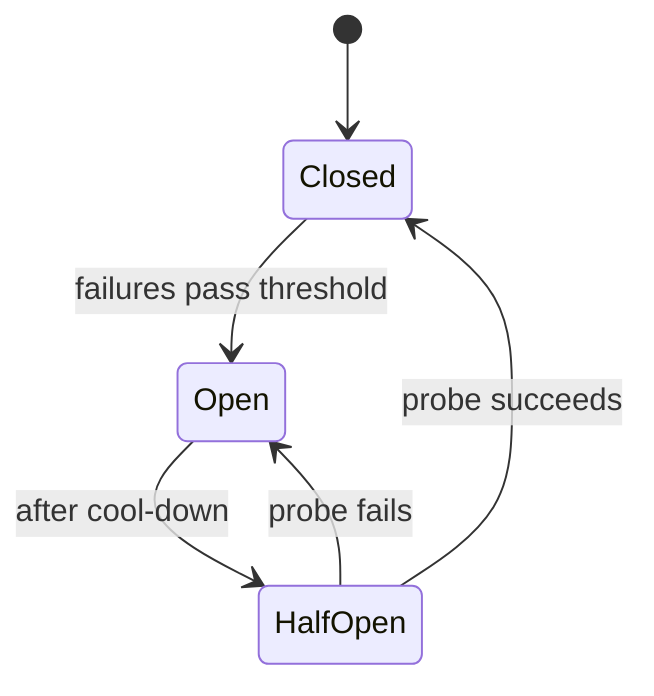

Closed means normal calls. Open means calls fail fast without touching the dependency. Half open lets a few probe calls through to test recovery.

**Bulkhead.** Like the sealed compartments of a ship. Give each dependency its own limited pool of threads, connections or concurrency slots, so a slow payments provider cannot use all workers needed by the catalog.

**Together:** timeout limits a single call, retry covers a blip, the breaker stops hopeless retries, the bulkhead limits the damage radius, and a fallback gives the user something useful.

**Gotcha:** retries at every layer multiply. Three layers with three tries each make 27 calls to the bottom service. Retry at one layer only.

**Interview tip:** Mention a library you used (Polly in .NET, resilience4j in Java, a Go library, or a mesh feature).

_Module: Resilience · Tags: resilience, circuit-breaker, retries, timeouts_

### 32. What are the strategies for API versioning, and which would you choose?

**Short answer:** The common ways are a version in the URL path, in a header, or in a media type. Path versioning is the simplest and most visible, so it is a good default for public APIs. Whichever you pick, prefer backward compatible changes and avoid new versions when you can.

| Strategy | Example | Pros | Cons |
| --- | --- | --- | --- |
| URL path | `/v2/orders/42` | obvious, easy to route and cache, easy to test in a browser | URL changes, version spreads into links |
| Query parameter | `/orders/42?api-version=2` | simple, easy default | easy to forget, cache keys must include it |
| Custom header | `X-Api-Version: 2` | clean URLs | hidden, harder to try by hand |
| Media type | `Accept: application/vnd.shop.v2+json` | pure REST style | harder for clients and tooling |
| No version, evolve | add optional fields only | least work for everyone | needs strict discipline |

**How I choose**
- Public or partner API with many unknown clients: URL path versions, long support windows.
- Internal service to service: avoid versions; use expand and contract plus contract tests, and version only on a true break.
- gRPC and events: follow protobuf or schema rules (add fields, never reuse numbers) and use a schema registry.

**Routing example with a gateway**

```yaml
# gateway route fragment
routes:
  - match: { prefix: "/v1/orders" }
    route: { cluster: orders-v1 }
  - match: { prefix: "/v2/orders" }
    route: { cluster: orders-v2 }
```

**Running two versions.** Prefer one codebase that maps both versions to one internal model, rather than two forks. Keep v1 as a thin adapter over the new logic.

**Gotchas**
- Versioning the whole API for one changed endpoint forces everyone to move. Version per resource if you can.
- Do not retire a version without usage numbers and a published date.

**Interview tip:** "Version the contract, not the code, and try to never need it" is a good one-line summary.

_Module: Communication · Tags: api, versioning, rest_

### 33. How do Kafka, RabbitMQ and Azure Service Bus differ, and what delivery guarantees do brokers give?

**Short answer:** Kafka is a distributed log for high-throughput event streams that consumers can replay. RabbitMQ is a classic broker with flexible routing for task queues. Azure Service Bus is a managed enterprise broker with queues, topics, sessions and dead lettering. Most brokers deliver at least once, so consumers must handle duplicates.

| | Kafka | RabbitMQ | Azure Service Bus |
| --- | --- | --- | --- |
| Model | partitioned append-only log | exchanges and queues | queues and topics with subscriptions |
| Message after read | stays until retention ends, replayable | removed after ack | removed after complete |
| Ordering | per partition | per queue (with caveats) | per session |
| Throughput | very high | high | moderate to high |
| Strong points | streaming, replay, many consumers | routing patterns, low latency | managed, sessions, dead letter, scheduled messages |
| Watch out | operations, partition design | scaling out, big backlogs | cost, vendor lock-in |

**Delivery guarantees**
- **At most once:** send and forget. Messages may be lost, never duplicated.
- **At least once:** retry until acknowledged. Never lost, but may be duplicated. This is the usual choice.
- **Exactly once:** very hard end to end. Kafka offers it inside Kafka (transactions), but side effects such as an email or a database write still need idempotency.

**Consumer flow for at-least-once**

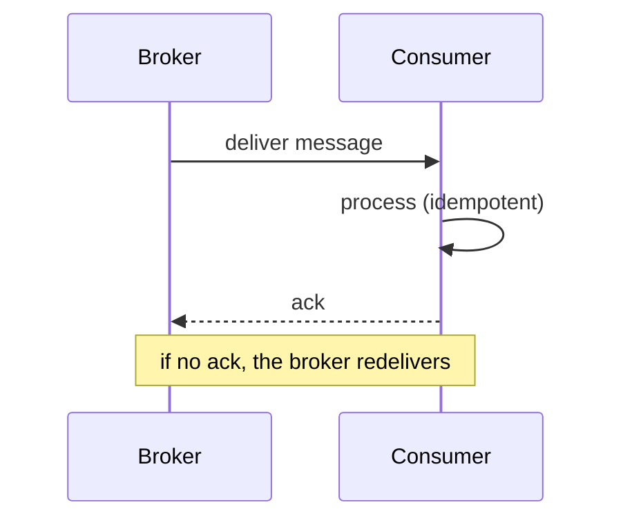

Always process first, then acknowledge. A crash before the ack means redelivery.

**Common features to use:** dead letter queues for poison messages, retry with delay, consumer groups for scaling, and monitoring consumer lag.

**How I choose:** event streams and replay: Kafka. Simple task queues and routing: RabbitMQ. All-in on Azure and want less operations work: Service Bus.

**Gotcha:** a poison message that always fails can block a queue. Move it to a dead letter queue after N attempts and alert.

**Interview tip:** Say what you used, why, and how you watch consumer lag.

_Module: Communication · Tags: messaging, kafka, rabbitmq, service-bus_

### 34. What are the main event-driven architecture patterns, and how do you design good event schemas?

**Short answer:** In event-driven architecture, services publish facts about things that happened, and other services react. The main styles are event notification (small event, consumers call back for details), event-carried state transfer (event contains the data) and event sourcing. Good events are named in the past tense, versioned, and carry a stable contract.

| Style | Event contains | Pros | Cons |
| --- | --- | --- | --- |
| Notification | just ids | small, simple | consumers call back, coupling returns |
| Event-carried state transfer | the changed data | consumers are autonomous, no callbacks | larger events, copies of data |
| Domain events | business meaning (`OrderShipped`) | clear, stable | needs good naming |

**Event versus command.** An event says something happened (`PaymentCaptured`), and the sender does not care who listens. A command asks someone to do something (`CapturePayment`) and has one target.

**Envelope and payload example**

```json
{
  "id": "6f1c1d3e-9b0a-4a3e-8d54-2b0e1f9d7a10",
  "type": "OrderPlaced",
  "version": 2,
  "occurredAt": "2026-10-21T09:15:30Z",
  "correlationId": "c1f4...",
  "data": {
    "orderId": "o-42",
    "customerId": "c-7",
    "total": { "amount": 4999, "currency": "EUR" }
  }
}
```

**Schema design rules**
- Past tense names tied to the business (`OrderPlaced`, not `OrderTableUpdated`).
- Include a unique id (for deduplication), a timestamp, a type, a version, a correlation id.
- Add fields, never remove or reinterpret them. Consumers ignore unknown fields.
- Use a schema registry (Avro, Protobuf, JSON Schema) with compatibility checks in CI.
- Money as integer minor units plus currency, time as UTC ISO 8601.
- Do not leak your internal database model.

**Gotcha:** big hidden chains of events (A triggers B triggers C) are hard to debug. Keep a documented event catalogue and use tracing.

**Interview tip:** Mention the trade-off between small notification events and rich state transfer events, and what you chose and why.

_Module: Communication · Tags: events, event-driven, schema_

### 35. What caching strategies work across microservices, and what are the risks?

**Short answer:** Cache at several layers: browser or CDN, gateway, inside each service (in memory) and in a shared cache like Redis. Use cache-aside as the default, set a time to live (TTL), and decide how stale data is allowed to be. The hard part is invalidation.

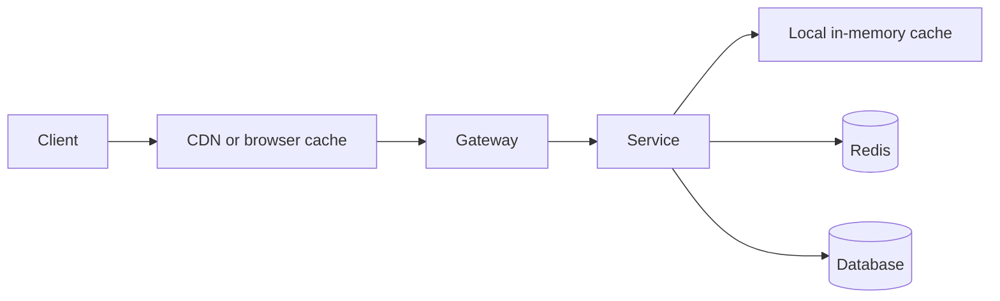

Each layer closer to the user is faster but harder to invalidate.

**Patterns**
- **Cache-aside:** check the cache, on a miss load from the source and store it. Simple and common.
- **Read-through / write-through:** the cache layer loads or writes for you.
- **Write-behind:** write to cache, flush to the database later. Fast but risky.
- **HTTP caching:** `Cache-Control`, `ETag`, `304 Not Modified` for read-heavy public data.

```ts
async function getProduct(id: string) {
  const key = `product:${id}`;
  const hit = await redis.get(key);
  if (hit) return JSON.parse(hit);
  const product = await db.findProduct(id);      // cache miss
  await redis.set(key, JSON.stringify(product), { EX: 300 }); // 5 minute TTL
  return product;
}
```

**Invalidation options:** short TTL (simple), event-based invalidation (the owner publishes `ProductChanged`, caches evict the key), versioned keys.

**Risks**
- **Stale data:** agree what is acceptable per data type.
- **Cache stampede:** a popular key expires and many requests hit the database. Fix with request coalescing (single flight), jittered TTLs, or refresh ahead.
- **Cache as a hard dependency:** if Redis is down, the service should degrade, not die.
- **Caching someone else's data:** the owner service knows the rules. Prefer caching through events or HTTP cache headers.
- **Never cache user-specific or secret data in shared caches** without the user in the key.

**Interview tip:** Say you cache with a TTL plus event-based eviction, and that you measured the hit ratio before and after.

_Module: Data & Consistency · Tags: caching, performance, redis_

### 36. How does distributed tracing with OpenTelemetry work?

**Short answer:** Distributed tracing follows one request across many services. Each unit of work is a span with a start time and duration. Spans share a trace id, and each span knows its parent. A context header carries the ids from service to service. OpenTelemetry (OTel) is the vendor-neutral standard for creating and exporting them.

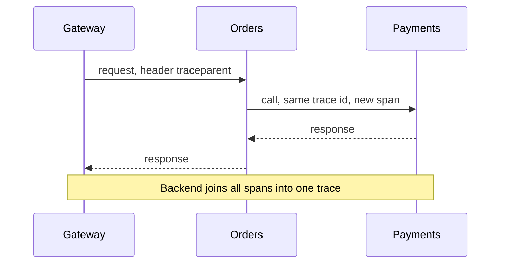

The trace id stays the same for the whole journey. Every hop adds a new span.

**The W3C Trace Context header**

```text
traceparent: 00-4bf92f3577b34da6a3ce929d0e0e4736-00f067aa0ba902b7-01
             ver  trace id (32 hex)               parent span id   flags
```

**How to set it up**
1. Add the OTel SDK to each service (or auto-instrumentation for HTTP, gRPC, database and queue clients).
2. Make sure the context is propagated on outgoing calls and in message headers, so async flows stay connected.
3. Export to a Collector, which forwards to a backend such as Datadog, Jaeger or Tempo.
4. Add useful attributes: `order.id`, `customer.tier`. Avoid personal data.

```go
ctx, span := tracer.Start(ctx, "ChargeCard")
defer span.End()
span.SetAttributes(attribute.String("order.id", orderID))
// pass ctx to every outgoing call so the trace continues
```

**Sampling.** Tracing every request is expensive. Use head sampling (decide at the start, for example 5%) or tail sampling in the Collector (keep all slow or failed traces).

**Uses:** find the slow hop, see unexpected dependencies, link logs by trace id, and spot retry storms.

**Gotchas:** one service that drops the header breaks the trace. Queues need the context copied into message headers. High-cardinality attributes raise cost.

**Interview tip:** Mention that you put the trace id in logs so you can jump from a log line to a trace.

_Module: Observability · Tags: tracing, opentelemetry, observability_

### 37. How do rate limiting and throttling protect services?

**Short answer:** Rate limiting caps how many requests a client can make in a time window. It protects services from abuse, bugs and overload, and keeps usage fair. When a client goes over the limit you reject it quickly with HTTP 429 and tell it when to retry.

**Common algorithms**

| Algorithm | Idea | Behaviour |
| --- | --- | --- |
| Fixed window | N requests per minute, counter resets | simple, allows bursts at the window edge |
| Sliding window | counts over the last N seconds | smoother, more memory |
| Token bucket | tokens refill at a steady rate, a request takes one | allows short bursts, common default |
| Leaky bucket | requests drain at a fixed rate | smooth output, queues bursts |
| Concurrency limit | max in-flight requests | protects slow dependencies |

```go
package main

import (
	"fmt"
	"time"
)

// minimal token bucket (not goroutine safe; add a mutex in real code)
type Bucket struct {
	tokens, capacity float64
	perSec           float64
	last             time.Time
}

func (b *Bucket) Allow(now time.Time) bool {
	b.tokens += now.Sub(b.last).Seconds() * b.perSec
	if b.tokens > b.capacity {
		b.tokens = b.capacity
	}
	b.last = now
	if b.tokens < 1 {
		return false
	}
	b.tokens--
	return true
}

func main() {
	now := time.Now()
	b := &Bucket{tokens: 2, capacity: 2, perSec: 1, last: now}
	fmt.Println(b.Allow(now), b.Allow(now), b.Allow(now)) // prints: true true false
}
```

**Where to apply**
- At the gateway: per API key, per user, per IP.
- Per service: protect yourself from a noisy neighbour.
- For many pods you need a shared counter (Redis) or accept a rough local limit per pod.

**Good practice**
- Return `429 Too Many Requests` with a `Retry-After` header.
- Separate limits for cheap reads and expensive writes.
- Clients should back off using that header.
- Throttling (slowing down) is gentler than rejecting. Load shedding drops low-priority work first when overloaded.

**Gotcha:** rate limits do not replace capacity planning. And a limit per IP can block many users behind one corporate network.

**Interview tip:** Explain the difference between protecting yourself from clients (rate limit) and protecting a dependency from yourself (concurrency limit, circuit breaker).

_Module: Resilience · Tags: rate-limiting, throttling, protection_

### 38. What is graceful degradation, and how do you design fallbacks?

**Short answer:** Graceful degradation means the system keeps giving useful, reduced service when a part fails, instead of failing completely. You decide in advance which features are essential and what each non-essential feature does when its dependency is down.

Example: a movie page needs the movie info (essential), recommendations (nice to have) and "continue watching" (nice to have). If the recommendation service is down, show a generic popular list or hide the row. The page still loads.

**Fallback options**

| Fallback | Example |
| --- | --- |
| Cached data | show the last known recommendations |
| Default value | show a generic popular list |
| Skip the feature | hide the widget |
| Queue for later | accept the order, send the email when the service returns |
| Read-only mode | allow browsing, block purchases |
| Fail fast with a clear message | "Payments are unavailable, try again soon" |

```ts
async function loadHome(userId: string) {
  const [movies, recs] = await Promise.allSettled([
    catalog.getFeatured(),               // essential
    withTimeout(recs.forUser(userId), 200), // optional, short timeout
  ]);
  if (movies.status === "rejected") throw movies.reason;   // cannot degrade
  return {
    movies: movies.value,
    recommendations: recs.status === "fulfilled" ? recs.value : POPULAR_FALLBACK,
  };
}
```

**How to design it**
1. Classify every call as critical or optional.
2. Give optional calls short timeouts and a defined fallback.
3. Combine with circuit breakers so you skip the call quickly when it is down.
4. Use feature flags as a manual kill switch.
5. Test it: switch a dependency off in a test environment or with chaos experiments.

**Gotchas**
- A fallback that has never been tested usually does not work. Run it regularly.
- Do not hide failures. Count and alert on fallback use, or you will not notice the outage.
- Never fall back silently for correctness-critical data such as prices or permissions.

**Interview tip:** Link it to offline-first systems such as an aircraft screen that keeps working with cached content when the link to the ground is lost.

_Module: Resilience · Tags: resilience, degradation, fallback_

### 39. How do feature flags and canary releases make deployments safer?

**Short answer:** Feature flags separate deploying code from releasing a feature: code ships turned off and is enabled later, for a few users first. A canary release sends a small share of traffic to the new version and watches metrics before rolling out further. Both let you reduce risk and undo quickly.

```mermaid
flowchart LR
    U["Traffic"] --> LB["Router"]
    LB -- "95%" --> V1["Version 1 (stable)"]
    LB -- "5%" --> V2["Version 2 (canary)"]
    V2 --> M["Compare error rate and latency"]
    M -- "healthy" --> P["Promote to 25%, 50%, 100%"]
    M -- "worse" --> R["Roll back to version 1"]
```

The canary gets a small share of real traffic. Automatic checks decide whether to promote or roll back.

**Release strategies**

| Strategy | What happens | Rollback |
| --- | --- | --- |
| Rolling | replace pods gradually | roll back the deployment |
| Blue/green | two full environments, switch the router | switch back instantly |
| Canary | small share first, then grow | route back to stable |
| Feature flag | code is live, behaviour is off | flip the flag |

**Feature flag types:** release flags (short life), experiment flags (A/B), ops flags (kill switches), permission flags (long life).

```ts
if (await flags.isEnabled("new-checkout", { userId, region })) {
  return newCheckout(cart);
}
return oldCheckout(cart); // keep until the flag is removed
```

**Good practice**
- Define success metrics before the rollout (error rate, p95, business metric).
- Automate promotion and rollback with a tool (Argo Rollouts, Flagger, or a pipeline).
- Remove flags once done. Old flags are hidden complexity and test combinations.
- Database changes must be backward compatible (expand and contract), so old and new versions can run together.
- Default a flag to the safe value if the flag service is down.

**Gotcha:** a canary with too little traffic gives no signal. Choose the percentage and duration based on request volume.

**Interview tip:** Say a kill switch for risky features is part of your release checklist.

_Module: Delivery & Testing · Tags: feature-flags, canary, release_

### 40. How do you manage secrets and configuration across microservices?

**Short answer:** Keep configuration outside the code and image, so one build runs in every environment. Store secrets in a dedicated secret manager, give each service only the secrets it needs, rotate them, and never log them or commit them to Git.

**Configuration vs secrets**
- Configuration: URLs, feature settings, timeouts. Not sensitive. Environment variables, ConfigMaps, config service.
- Secrets: passwords, API keys, certificates, signing keys. Sensitive. Secret manager.

**Options**

| Option | Notes |
| --- | --- |
| Environment variables | simple, but visible in process dumps and often leaked in logs |
| Kubernetes Secrets | base64 only, so enable encryption at rest and strict RBAC |
| Azure Key Vault / HashiCorp Vault | central store, audit logs, rotation, access by identity |
| CSI Secrets Store driver or External Secrets Operator | sync vault secrets into pods |
| Workload identity (managed identity) | no stored password at all: the pod proves who it is |

```yaml
# pod reads a value from a Secret, not from the image
env:
  - name: DB_PASSWORD
    valueFrom:
      secretKeyRef:
        name: orders-db
        key: password
```

**Best practice**
1. Prefer identity-based access (managed identity) over passwords where possible.
2. Least privilege: one identity per service, read access to its own secrets only.
3. Rotate regularly and automatically. Make the app able to reload without a full restart if you can.
4. Scan repositories and CI logs for leaked secrets. Use pre-commit hooks.
5. Keep CI/CD secrets masked and scoped to protected branches.
6. Audit who read what.

**Config changes:** treat config like code. Keep it in Git (GitOps), review it, and roll it out with the same care.

**Gotchas**
- Secrets in container images or Git history stay there. If leaked, rotate, do not just delete.
- A single shared secret across all services is a big blast radius.

**Interview tip:** Mention a rotation drill: you know exactly how long it takes to replace a leaked database password.

_Module: Security · Tags: secrets, configuration, security, kubernetes_

### 41. What problems does a service mesh solve, and what does it cost?

**Short answer:** A service mesh moves network concerns out of your code and into a layer of proxies. It gives you mTLS, retries, timeouts, traffic splitting and uniform metrics for all service to service calls, without changing each application. The cost is extra complexity, resources and latency.

```mermaid
flowchart LR
    subgraph PA["Pod A"]
        A["Orders app"] --> PX1["Sidecar proxy"]
    end
    subgraph PB["Pod B"]
        PX2["Sidecar proxy"] --> B["Payments app"]
    end
    PX1 -- "mTLS" --> PX2
    CP["Control plane"] -. "config and certificates" .-> PX1
    CP -. "config and certificates" .-> PX2
```

The app talks to its local proxy. Proxies talk to each other with encryption. The control plane pushes rules to them.

**What it solves**
- Encryption and identity for every call (mTLS) with automatic certificate rotation.
- Policy: which service may call which.
- Retries, timeouts and circuit breaking in one place.
- Traffic shifting for canaries (send 5% to v2).
- Uniform metrics and traces for all calls, written in any language.
- Per-request load balancing, which helps gRPC.

```yaml
# Istio: send 10% of traffic to v2
apiVersion: networking.istio.io/v1beta1
kind: VirtualService
metadata:
  name: orders
spec:
  hosts: [orders]
  http:
    - route:
        - destination: { host: orders, subset: v1 }
          weight: 90
        - destination: { host: orders, subset: v2 }
          weight: 10
```

**Costs**
- More components to learn, upgrade and debug. Misconfigurations cause hard-to-see outages.
- Extra CPU and memory per pod for sidecars, and a little latency per hop. Sidecar-less modes (for example Istio ambient mode, Cilium) reduce this.
- Teams may assume the mesh retries are enough and forget the application logic still needs idempotency and timeouts.

**When to use it:** many services, a security need for mTLS everywhere, a polyglot stack, a platform team to run it. **When not:** a handful of services; a library or gateway is enough.

**Interview tip:** Say you would introduce a mesh only when you can name the problem it solves for you, and you have someone who owns it.

_Module: Communication · Tags: service-mesh, istio, networking_

### 42. What is the difference between an API gateway and a service mesh?

**Short answer:** An API gateway manages north-south traffic: requests that come from outside the system into it. A service mesh manages east-west traffic: calls between services inside it. They overlap in features but solve different problems, and many systems use both.

```mermaid
flowchart TD
    C["External clients"] -- "north-south" --> G["API gateway"]
    G --> A["Service A"]
    A -- "east-west via mesh" --> B["Service B"]
    B -- "east-west via mesh" --> D["Service C"]
```

The gateway guards the front door. The mesh handles the hallways between rooms.

| | API gateway | Service mesh |
| --- | --- | --- |
| Traffic | client to system (north-south) | service to service (east-west) |
| Audience | external clients, partners | your own services |
| Typical features | authentication, API keys, rate limits per client, request transformation, caching, API products | mTLS, retries, timeouts, circuit breaking, traffic splitting, internal telemetry |
| Deployment | a few central instances | proxy next to every service |
| Owner | API or platform team | platform team |
| Example tools | Kong, Azure API Management, NGINX, Envoy Gateway | Istio, Linkerd, Cilium |

**Where they overlap:** routing, retries, TLS, observability. Ingress gateways of a mesh can even act as the API gateway. The Kubernetes Gateway API is a common way to configure both.

**Decision guide**
- You have external clients and need auth, quotas, developer portal: you need a gateway.
- You need encrypted, authenticated internal calls and consistent resilience across many services: consider a mesh.
- Small system: a gateway alone is often enough.

**Gotchas**
- Putting business logic in either one is a mistake.
- Do not apply retries in the gateway, the mesh and the code at the same time.

**Interview tip:** Use the "front door versus hallways" picture and the words north-south and east-west.

_Module: Communication · Tags: api-gateway, service-mesh, networking_

## Advanced

### 43. [Tech Lead] How do you migrate data from a monolith database to a new service's own database?

**Short answer:** Move in small reversible steps: copy the data, keep both stores in sync while you verify, switch reads, then switch writes, then retire the old tables. Never do one big cutover. Each step must be safe to roll back.

```mermaid
stateDiagram-v2
    [*] --> Shared
    Shared: Monolith owns data
    Shared --> Copy: backfill and sync
    Copy: New DB filled, old DB still the source
    Copy --> ReadNew: verify, then read from new
    ReadNew: Reads new, writes both
    ReadNew --> WriteNew: switch writes
    WriteNew: New DB is the source of truth
    WriteNew --> [*]: drop old tables
```

Read it as a ladder. At every rung you can step back down.

**Steps**
1. **Create the new service and schema.** Design it for the new model, not a copy of the old tables.
2. **Backfill.** Copy existing data in batches with a script or change data capture (CDC), for example from the transaction log.
3. **Keep in sync.** Use CDC or dual writes. Dual writes can drift, so prefer CDC or an outbox in the monolith.
4. **Verify.** Compare counts and checksums. Run a shadow read: read both, return the old, log differences.
5. **Switch reads** to the new service behind a feature flag. Watch errors and latency.
6. **Switch writes.** Now the new service is the source of truth. The monolith calls its API or listens to its events. Sync back if the old code still needs it.
7. **Stop old writes, wait, archive and drop** the old tables only after a quiet period.

**Hard parts**
- Foreign keys across the boundary: replace with ids and events.
- Joins in reports: use a read model or a warehouse.
- Ids: keep the same ids so references stay valid.
- Large tables: backfill throttled, off peak, resumable.
- Transactions that touched both domains: become sagas.

**Gotcha:** if the old code still writes the same table directly, you do not have ownership yet. Block direct access with database permissions.

**Interview tip:** Say "expand, migrate, contract" and "I can roll back at every step". That is what interviewers want to hear.

_Module: Data & Consistency · Tags: tech-lead, data-migration, zero-downtime_

### 44. What are distributed transactions and two-phase commit, and why do microservices use sagas instead?

**Short answer:** Two-phase commit (2PC) makes several databases commit or abort together using a coordinator. It gives strong atomicity but it blocks and couples services, so it scales and survives failures badly. Microservices usually prefer sagas: local transactions plus compensations, accepting eventual consistency.

**How 2PC works**
1. Prepare: the coordinator asks every participant "can you commit?". Each one locks its data, writes to its log and answers yes or no.
2. Commit: if all said yes, the coordinator tells everyone to commit. If any said no, it tells everyone to abort.

```mermaid
sequenceDiagram
    participant C as Coordinator
    participant A as Orders DB
    participant B as Payments DB
    C->>A: prepare
    C->>B: prepare
    A-->>C: yes (locks held)
    B-->>C: yes (locks held)
    C->>A: commit
    C->>B: commit
```

Read it as two rounds. Between the rounds every participant holds locks and waits.

**Why it hurts in microservices**
- **Blocking:** if the coordinator crashes after prepare, participants keep locks until it returns. Other requests wait.
- **Availability:** all participants must be up at the same time. Availability multiplies down.
- **Latency:** two network round trips plus disk syncs, with locks held throughout.
- **Coupling:** every service and database must support the protocol (XA). Many brokers, REST APIs and NoSQL stores do not.
- **Cross-company calls** cannot join your transaction at all, for example a payment provider.

| | 2PC | Saga |
| --- | --- | --- |
| Consistency | strong, atomic | eventual |
| Isolation | yes, via locks | no, states are visible |
| Failure handling | abort everything | compensate steps |
| Availability | low | high |
| Complexity | in the infrastructure | in the application |

**When 2PC is still fine:** inside one organisation and one database cluster or a few tightly managed databases, with low volume and a strict need for atomicity. Distributed SQL databases hide a form of it inside the engine.

**Practical alternatives:** redesign so one service owns the whole business transaction, use the outbox plus idempotent consumers, or merge two services that are always updated together.

**Gotcha:** compensation is not rollback. A refund is a new fact, and the customer may have seen the charge.

**Interview tip:** Say "I avoid distributed transactions by design: pick boundaries so most business invariants live inside one service".

_Module: Distributed Systems · Tags: two-phase-commit, transactions, saga_

### 45. How do consensus, leader election and Raft work in plain words, and why are distributed locks dangerous?

**Short answer:** Consensus lets several machines agree on one value or one order of operations, even when some fail. Raft is a popular algorithm for it: nodes elect a leader, the leader records changes in a log, and a change counts only when a majority has stored it. Distributed locks built on timeouts can break, so use fencing tokens.

**Raft in short**
- Nodes are followers, candidates or leaders.
- Followers expect heartbeats from the leader. If none arrive for a random time, a follower becomes a candidate and asks for votes for a new term.
- A candidate with votes from a majority becomes leader.
- Clients send writes to the leader. It appends to its log, copies to followers, and commits when a majority has it.
- Why a majority? Any two majorities share at least one node, so a new leader always knows the committed entries.

```mermaid
stateDiagram-v2
    [*] --> Follower
    Follower --> Candidate: no heartbeat, timeout
    Candidate --> Leader: majority of votes
    Candidate --> Follower: another leader wins
    Leader --> Follower: sees a higher term
```

A cluster of 3 survives 1 failure, a cluster of 5 survives 2. This is why etcd, Consul and ZooKeeper-like systems use odd sizes.

**Where you meet it:** etcd behind Kubernetes, Kafka's KRaft controller, Consul, database replication, and leader election for your own singleton jobs (Kubernetes Lease objects).

**Distributed locks: the danger**
A client takes a lock with a lease of 10 seconds, then pauses for 15 seconds (garbage collection or a slow network). The lock expires, another client takes it, and the first client wakes up thinking it still holds the lock. Both write.

```text
Client A: lock (token 33) ... long pause ... write with token 33
Client B: lock (token 34) ... write with token 34
Storage: remembers highest token seen (34), rejects token 33
```

A **fencing token** is a number that grows with each lock grant. The storage rejects any write with an older token.

**Rules of thumb**
- Prefer designs that need no lock: idempotent operations, partitioning by key so one worker owns each key, optimistic concurrency with a version column.
- Use a lock only for efficiency, not for correctness, unless you add fencing.
- Never build your own consensus. Use etcd, a database or a managed service.

**Interview tip:** Mention leader election with a Kubernetes Lease for "only one pod runs this cron-like job".

_Module: Distributed Systems · Tags: consensus, raft, leader-election, locks_

### 46. Why is exactly-once delivery considered a myth, and what do you do instead?

**Short answer:** In a network, a sender cannot tell whether a message was lost or only the acknowledgement was lost. So it must either risk loss (at most once) or retry and risk duplicates (at least once). What you can build is exactly-once effect: at-least-once delivery plus idempotent processing.

The two generals problem shows the limit: no number of confirmations gives both sides certainty. A consumer may process a message, crash before the ack, and receive it again.

```mermaid
sequenceDiagram
    participant B as Broker
    participant C as Consumer
    participant D as Database
    B->>C: message 17
    C->>D: apply change
    Note over C: crash before ack
    B->>C: message 17 again
    C->>D: apply change (must be safe)
```

The second delivery is not a bug. It is how the guarantee works, so processing has to be safe to repeat.

**Techniques for exactly-once effect**
1. **Deduplication table:** store processed message ids and the result in the same transaction as the business change.
2. **Naturally idempotent writes:** "set status to PAID" instead of "add one payment".
3. **Version checks:** `UPDATE ... WHERE version = 7`.
4. **Idempotency keys** on outgoing calls to other systems.
5. **Transactional processing:** read, process and write offsets in one transaction. Kafka transactions do this inside Kafka (read from topic, write to topic, commit offsets), which is why it is called exactly-once semantics. It does not cover an email sent or an external HTTP call.

```sql
BEGIN;
INSERT INTO processed_messages (id) VALUES ('msg-17');   -- fails if seen before
UPDATE accounts SET balance = balance + 50 WHERE id = 'a-1';
COMMIT;
```

If the insert fails because the id exists, the transaction aborts and the duplicate is ignored.

**Gotchas**
- Dedup tables grow. Keep ids for longer than the maximum redelivery window and clean up.
- Idempotency must cover side effects too (email, payment).
- Producers can also duplicate. Use idempotent producers or the outbox with stable event ids.

**Interview tip:** Say "at-least-once plus idempotent consumers" and add that vendor claims of exactly-once usually mean it inside their own system only.

_Module: Distributed Systems · Tags: exactly-once, idempotency, messaging_

### 47. How do ordering, partitions and keys work in a message system?

**Short answer:** To scale, a topic is split into partitions. Order is guaranteed only inside one partition, not across partitions. You choose a partition key (for example the order id) so all events of the same entity go to the same partition and stay in order. Parallelism is limited by the number of partitions.

```mermaid
flowchart LR
    P["Producer"] -- "key = order 7" --> T0["Partition 0"]
    P -- "key = order 8" --> T1["Partition 1"]
    P -- "key = order 9" --> T2["Partition 2"]
    T0 --> C1["Consumer 1"]
    T1 --> C2["Consumer 2"]
    T2 --> C3["Consumer 3"]
```

The key is hashed to choose a partition. Each partition is read by one consumer of a group at a time.

**Rules**
- Same key, same partition, same order. Choose the key to match the business need: the entity whose events must be ordered.
- More partitions means more parallel consumers. Within a consumer group, one partition is read by at most one consumer.
- Changing the number of partitions changes the key to partition mapping, which can break ordering for existing keys. Plan the count early.

**Problems to know**
- **Hot partition:** one key sends huge traffic (a famous customer). Consider a key with a suffix, or splitting the work.
- **Rebalance:** when consumers join or leave, partitions move and processing pauses briefly.
- **Retries break order:** if message 1 fails and goes to a retry queue while message 2 succeeds, order is lost. Either block the partition on failure or make handlers tolerate out-of-order events (use version numbers and ignore older ones).
- **Parallel processing inside a consumer** also breaks order unless you process per key.

```ts
// ignore stale events using a version carried in the event
async function apply(e: { orderId: string; version: number; status: string }) {
  await db.query(
    `UPDATE orders SET status = $2, version = $3
     WHERE id = $1 AND version < $3`,
    [e.orderId, e.status, e.version]
  );
}
```

**Global order** across the whole topic requires one partition, which limits throughput. Ask whether you truly need it. Usually you need order per entity only.

**Interview tip:** Say "I choose the key from the invariant: what must be ordered?" and mention version checks as a safety net.

_Module: Distributed Systems · Tags: ordering, partitions, kafka, scaling_

### 48. How do multi-region and active-active designs work, and what are the data replication trade-offs?

**Short answer:** Multi-region means running the system in more than one geographic region for lower latency and survival of a region outage. Active-passive keeps a standby region. Active-active serves traffic from all regions, which is better for users but needs a plan for conflicting writes. The hard part is always the data.

| Design | How | Pros | Cons |
| --- | --- | --- | --- |
| Single region, multi-zone | spread across zones | simple, protects against a zone loss | region outage means downtime |
| Active-passive | standby region, failover | simpler data, clear writer | failover time, standby cost, untested standby may fail |
| Active-active, partitioned | each user or tenant has a home region | no conflicts, low latency | cross-region users, rebalancing |
| Active-active, global | any region accepts any write | best availability | conflicts, complexity |

**Replication**
- **Synchronous:** a write is confirmed after other regions have it. No data loss, but each write pays the cross-region round trip (tens to hundreds of milliseconds).
- **Asynchronous:** confirmed locally, copied later. Fast, but a failover can lose the last few writes (the RPO is above zero) and reads in other regions can be stale.

Two goals to define: **RTO** (how fast you must recover) and **RPO** (how much data loss is acceptable).

**Handling conflicts in active-active**
- Avoid them: route each entity to one home region.
- Last writer wins with timestamps: simple, can silently lose a write.
- CRDTs or merge rules: counters, sets and carts can merge safely.
- Application level conflict handling, such as "keep both and ask the user".

```mermaid
flowchart LR
    U1["Users EU"] --> R1["Region EU"]
    U2["Users US"] --> R2["Region US"]
    R1 <-- "async replication" --> R2
    DNS["Global traffic manager"] --> R1
    DNS --> R2
```

A global traffic manager routes users to the nearest healthy region. Regions copy data to each other in the background.

**Practical notes**
- Test failover regularly with game days. A failover path that is never exercised does not work.
- Keep stateless services in every region and replicate state through managed databases that support it.
- Remember data residency laws that may restrict where data may live.
- Cache and queue contents also need a plan.

**Interview tip:** Start from the business RTO and RPO, then choose the cheapest design that meets them. Many systems need only active-passive.

_Module: Distributed Systems · Tags: multi-region, replication, availability, active-active_

### 49. What consistency models exist: strong, eventual, causal and read-your-writes?

**Short answer:** A consistency model is a promise about what a reader may see after a write. Strong (linearizable) consistency means everyone sees the latest write immediately. Eventual consistency means copies converge sometime later. Between them are useful middle guarantees, such as causal and read-your-writes consistency.

| Model | Promise | Example behaviour |
| --- | --- | --- |
| Strong (linearizable) | reads see the latest committed write, as if one copy exists | bank balance, inventory last item |
| Sequential | everyone sees operations in the same order | shared log |
| Causal | if B was caused by A, everyone sees A before B | a reply is never shown before its question |
| Read-your-writes | you always see your own writes | after editing your profile you see the edit |
| Monotonic reads | you never go back in time between reads | no flicker between new and old values |
| Eventual | copies agree if writes stop | like counts, search index, caches |

**Why it matters in microservices.** Each service has its own database, and read models are updated by events. By default you have eventual consistency across services. A user who creates an order and then opens "my orders" may not see it, if the list comes from a read model that is still updating.

```mermaid
sequenceDiagram
    participant U as User
    participant W as Write service
    participant R as Read model
    U->>W: create order
    W-->>U: ok, id 42
    U->>R: list my orders
    R-->>U: empty (not updated yet)
    Note over R: event arrives a moment later
```

**Ways to give read-your-writes**
- Return the created object in the command response and show it at once.
- Send a version or position token to the read side: "wait until you have processed at least event 981".
- Route the user's reads to the primary for a few seconds after a write (sticky reads).
- Use optimistic UI updates in the front end.

**Choosing a model.** Pay for strong consistency only where wrong answers cost money or trust (payments, stock, uniqueness checks, permissions). Use eventual elsewhere, and say so in the API documentation.

**Gotcha:** "eventual" has no time bound. Measure the real replication lag and alert if it grows.

**Interview tip:** Name the one place in your system that needs strong consistency, and explain how you kept the rest eventual.

_Module: Data & Consistency · Tags: consistency, replication, distributed-systems_

### 50. How do you evolve event and API schemas safely with Avro or Protobuf?

**Short answer:** Schemas change over time while old producers and consumers are still running. Use a binary format with schema rules (Protobuf or Avro) and a registry with automatic compatibility checks. The safe moves are to add optional fields with defaults, never reuse field numbers, and avoid renaming or changing types.

**Compatibility types**

| Type | Meaning | Deploy order that is safe |
| --- | --- | --- |
| Backward | new schema can read old data | upgrade consumers first |
| Forward | old schema can read new data | upgrade producers first |
| Full | both directions | any order |

For events stored in a log and replayed later, backward compatibility is essential. Full compatibility is the safest default.

**Protobuf rules**
- Field numbers identify fields on the wire, not names. Never change or reuse a number.
- Add new fields with new numbers. Old readers ignore them.
- When you remove a field, mark its number and name as reserved.
- Do not change a field's type, except for compatible pairs.

```proto
message OrderPlaced {
  string order_id = 1;
  string customer_id = 2;
  reserved 3;               // old "coupon" field, removed
  reserved "coupon";
  int64 total_cents = 4;
  string currency = 5;      // added in v2, readers without it see ""
}
```

**Avro rules:** new fields need a default value so old data can still be read. Removing a field is safe only if it had a default.

**Breaking change recipe (expand and contract)**
1. Add the new field and fill both old and new.
2. Update all consumers.
3. Stop writing the old field.
4. Remove it later and reserve the number.

If you really must change meaning, publish a new event type (`OrderPlacedV2`) or a new topic and migrate.

**Process**
- Put schemas in a registry. A producer build fails if its schema is incompatible.
- Keep a changelog and use contract tests for REST and gRPC.
- Version events with a `version` field only as a hint. Compatibility rules are the real protection.

**Gotcha:** the default value of "missing" is not always safe. A missing `currency` that defaults to empty string may be read as zero or free by a careless consumer.

**Interview tip:** Say "numbers never change, fields are only added, removed numbers are reserved, and the registry enforces it in CI".

_Module: Data & Consistency · Tags: schema-evolution, protobuf, avro, compatibility_

### 51. How do backpressure and streaming protect a system under heavy load?

**Short answer:** Backpressure means a slow consumer signals the producer to slow down, instead of letting data pile up until memory runs out. Without it, queues grow without limit, latency explodes and the service crashes. You apply it with bounded buffers, request limits, pull-based consumption and load shedding.

Picture a tap filling a bucket with a small hole. If the bucket has no edge, it overflows. Backpressure is a float valve that closes the tap as the bucket fills.

```mermaid
flowchart LR
    P["Fast producer"] --> B["Bounded buffer"] --> C["Slow consumer"]
    C -. "slow down signal" .-> P
    B -. "full: block, drop or reject" .-> P
```

The buffer has a fixed size. When it is full, the producer must wait, be refused, or drop messages.

**Techniques**
- **Bounded queues:** always set a maximum length. An unbounded queue only hides the problem and moves it to memory.
- **Pull instead of push:** consumers take messages when ready (Kafka polls, `prefetch` in RabbitMQ, credit-based flow in gRPC streaming and HTTP/2).
- **Limit concurrency:** a worker pool of N, no more.
- **Reject early:** return 429 or 503 quickly, so clients back off.
- **Load shedding:** drop low-priority work first.
- **Autoscale on lag or queue depth** (for example KEDA), but know it takes time.

```go
// Go: a bounded channel gives natural backpressure
jobs := make(chan Job, 100) // buffer of 100

select {
case jobs <- job: // accepted
default:
	// full: reject now instead of piling up
	http.Error(w, "busy, retry later", http.StatusServiceUnavailable)
}
```

**Streaming.** For large or continuous data, stream in chunks (gRPC streams, server-sent events, Kafka) and process incrementally, so memory stays flat. Handle slow clients: a streaming server must not buffer forever for a client that reads slowly.

**What to monitor:** queue depth, consumer lag, age of the oldest message, rejected requests, and saturation of worker pools.

**Gotchas**
- Retries from clients add load at the worst moment. Use backoff and jitter.
- Backpressure that passes all the way to the user must be turned into a clear message, not a timeout.

**Interview tip:** Mention an example, such as a data sync job that overloaded a downstream service until you added a bounded worker pool and a rate limit.

_Module: Distributed Systems · Tags: backpressure, streaming, load, queues_

### 52. System design: how would you design cloud to aircraft content sync with intermittent connectivity?

**Short answer:** Treat the aircraft as an edge site that must work fully offline. The cloud publishes versioned content manifests. The aircraft pulls them whenever a link exists (gate wifi, satellite), downloads only the differences in resumable chunks, verifies them, and switches to the new version atomically. Everything must be idempotent and restartable.

**Requirements to clarify first:** how many aircraft, content size (video is large), allowed staleness (hours or days), link types and cost, security, and the rollback needs.

```mermaid
flowchart LR
    subgraph Cloud["Cloud"]
        CMS["Content service"] --> M["Versioned manifest and blobs"]
        M --> CDN["Object storage and CDN"]
    end
    subgraph Aircraft["Aircraft edge server"]
        SY["Sync agent"] --> ST[("Local store")]
        ST --> APP["Entertainment app"]
    end
    SY -- "poll manifest, fetch missing chunks" --> CDN
    SY -- "report status and telemetry" --> CMS
```

The aircraft pulls. The cloud never needs to reach into the aircraft, which is behind firewalls and flaky links.

**Design points**
1. **Pull, not push.** The agent asks "what is the latest manifest for my fleet and tail number?". Aircraft behind restricted links can only call out.
2. **Manifest with versions and hashes.** A list of items with id, version, size and checksum. The agent compares it with its local state and downloads only missing or changed files (delta sync).
3. **Resumable, chunked downloads** with range requests and checksums per chunk. A dropped link resumes where it stopped.
4. **Priorities and bandwidth limits.** Small metadata first, then popular titles. Do not saturate the link needed by operations.
5. **Atomic switch.** Download into a staging area, verify everything, then flip a pointer to the new version. Keep the previous version for rollback.
6. **Idempotent and restartable agent.** A crash at any step leaves a safe state.
7. **Status reporting with a queue.** Events (download progress, version applied) are stored locally and uploaded when online. The cloud keeps a fleet dashboard of which aircraft have which version.
8. **Security:** device identity with certificates, signed manifests so a tampered file is rejected, encrypted storage, and licensing and DRM rules.
9. **Data coming back up:** usage and playback logs buffered on board, sent in batches with ids for deduplication.

```mermaid
stateDiagram-v2
    [*] --> Idle
    Idle --> Checking: link available
    Checking --> Downloading: new manifest
    Downloading --> Downloading: link lost, resume later
    Downloading --> Verifying: all chunks present
    Verifying --> Activating: hashes match
    Activating --> Idle: switched, old version kept
    Verifying --> Downloading: bad chunk, refetch
```

**Trade-offs:** the fleet is eventually consistent, so some aircraft run older content. Use per-content expiry (licence windows) enforced locally, and make the UI work without any cloud call.

**Interview tip:** Stress offline-first, pull-based sync, hashes, atomic switch and rollback. These are the points that show you understand intermittent connectivity.

_Module: System Design Cases · Tags: system-design, offline-first, sync, in-flight_

### 53. System design: how would you design an e-commerce checkout across microservices?

**Short answer:** Make checkout a saga run by an orchestrator. It creates a pending order, reserves stock, takes payment, then confirms the order, with compensations if any step fails. Use idempotency keys at every step, the outbox for events, and show the user clear pending states.

**Services:** Cart, Orders, Inventory, Payments (wrapping a provider), Notifications, Shipping.

```mermaid
sequenceDiagram
    participant U as User
    participant O as Order service (saga)
    participant I as Inventory
    participant P as Payments
    participant N as Notifications
    U->>O: checkout (idempotency key)
    O->>O: create order PENDING
    O->>I: reserve stock
    I-->>O: reserved
    O->>P: authorize payment
    P-->>O: authorized
    O->>O: order CONFIRMED
    O-->>U: confirmed
    O-)N: OrderConfirmed event
    Note over O,P: if payment fails, release stock and cancel order
```

The user-facing part is short. Notifications and shipping happen through events afterwards.

**Key decisions**
- **Idempotency:** the client sends one key per checkout attempt. A double click or a retry never creates two orders or two charges.
- **Stock reservation:** reserve with an expiry (for example 15 minutes), then release automatically. Use a conditional update to avoid overselling: `UPDATE stock SET available = available - 1 WHERE sku = $1 AND available >= 1`.
- **Payment:** authorise first, capture after shipping or on confirmation. Handle unknown results (timeout from the provider) by asking the provider for the status with the same key, never by charging again.
- **Order state machine:** `PENDING`, `STOCK_RESERVED`, `PAID`, `CONFIRMED`, `CANCELLED`. Store it, so a crashed orchestrator resumes.
- **Outbox** so events are never lost, and idempotent consumers.
- **Price:** the price is taken from the server side at checkout, never trusted from the client.

**Failure cases**
- Payment declined: release stock, mark cancelled, tell the user.
- Orchestrator crash: saga state in the database lets another instance continue.
- Provider webhook arrives twice or out of order: verify the signature and use the state machine to ignore stale ones.

**Observability:** a trace across all steps, metrics for conversion, saga failures and compensation counts, and an alert on orders stuck in `PENDING`.

**Interview tip:** Draw the state machine and name the unknown outcome problem. They show you have thought about real failure.

_Module: System Design Cases · Tags: system-design, checkout, saga, payments_

### 54. System design: how would you design a notification service for email, SMS and push?

**Short answer:** Build it as an event-driven pipeline: producers publish notification requests, a service validates them, applies user preferences and templates, then puts messages on per-channel queues. Channel workers send through providers with retries, rate limits, deduplication and delivery tracking.

```mermaid
flowchart LR
    S["Other services"] -- "events or API" --> API["Notification API"]
    API --> PR["Preferences and templates"]
    PR --> Q1["Email queue"]
    PR --> Q2["SMS queue"]
    PR --> Q3["Push queue"]
    Q1 --> W1["Email worker"] --> E["Email provider"]
    Q2 --> W2["SMS worker"] --> SM["SMS provider"]
    Q3 --> W3["Push worker"] --> PU["Push provider"]
    W1 --> ST[("Status store")]
```

Each channel has its own queue and workers, so a slow SMS provider does not block email.

**Requirements to ask:** volume, latency needs (a login code in seconds, a newsletter in hours), guarantees, languages, and legal rules such as consent and quiet hours.

**Design points**
- **Priority:** separate queues or priorities. Security codes must not wait behind a marketing campaign.
- **Idempotency:** each request has a unique id. Deduplicate so a retry never sends two emails.
- **Preferences:** check opt-in, opt-out, channel choice and time zone before sending.
- **Templates:** keep content in a template service with localisation. Services send data, not HTML.
- **Retries:** exponential backoff with jitter, then a dead letter queue. Respect provider limits and use several providers with failover.
- **Rate limiting** per provider and per user to avoid spamming.
- **Delivery tracking:** record sent, delivered, bounced or failed through provider webhooks. Update status idempotently.
- **Scheduling:** a delayed queue or scheduler for later sends.
- **Bulk sends:** fan out in batches from a job, with backpressure.

```json
{
  "requestId": "n-2026-10-21-8841",
  "userId": "c-7",
  "template": "order_shipped",
  "channels": ["push", "email"],
  "priority": "normal",
  "data": { "orderId": "o-42", "eta": "2026-10-24" }
}
```

**Trade-offs:** at-least-once delivery plus dedup is the usual choice. Duplicate email is annoying, a lost security code is worse.

**Metrics:** queue age, send latency, provider error rate, bounce rate and cost per channel.

**Interview tip:** Highlight isolation (a queue per channel and priority), idempotency, and provider failure handling.

_Module: System Design Cases · Tags: system-design, notifications, queues, reliability_

### 55. How do you migrate a live system without downtime?

**Short answer:** Break the migration into small steps where old and new run side by side, every step is backward compatible, and every step can be undone. Use expand and contract for data, feature flags or traffic routing for switching, and verification before the final cut.

**Core ideas**
- **Parallel run:** both versions live at once, so there is never a moment where nothing works.
- **Backward compatible steps:** version N and version N+1 of your code must both work with the database during the rollout.
- **Small and reversible:** each step has a tested way back.
- **Measure before moving on:** error rate, latency, data differences.

**Database change example (rename column `name` to `full_name`)**
1. Expand: add `full_name`. Code still uses `name`.
2. Deploy code that writes both columns and reads `name`.
3. Backfill old rows in small batches.
4. Deploy code that reads `full_name` (behind a flag).
5. Stop writing `name`.
6. Contract: drop `name` after a quiet period.

```sql
-- step 1: safe, no lock for long
ALTER TABLE customers ADD COLUMN full_name text;

-- step 3: backfill in small batches, repeat until 0 rows
UPDATE customers SET full_name = name
WHERE id IN (SELECT id FROM customers WHERE full_name IS NULL LIMIT 1000);
```

**Traffic switching**
- Blue/green: bring up a full copy, test it, flip the router, keep the old one ready.
- Canary: move a few percent, then more.
- Shadow traffic: copy real requests to the new system and compare answers without side effects.

```mermaid
stateDiagram-v2
    [*] --> OldOnly
    OldOnly --> Parallel: deploy new, sync data
    Parallel --> Shadow: compare answers
    Shadow --> Canary: 5 percent real traffic
    Canary --> NewPrimary: 100 percent
    NewPrimary --> Retired: remove old
    Canary --> Parallel: problem found, roll back
```

Each arrow forward is gated by checks. Rolling back always leads to a state where the old system still works.

**Dangers:** long running locks on big tables, incompatible message formats, caches holding old shapes, clients that keep old versions for months (mobile apps, aircraft), and a plan for in-flight work such as running sagas and queued messages.

**Gotcha:** the last step, deleting the old system, is the one people skip. Put it on the plan with a date.

**Interview tip:** Say "expand, migrate, contract" and "I always have a rollback for each step". Add one real example of a migration you ran.

_Module: Architecture & Design · Tags: migration, zero-downtime, deployment, blue-green_

---

## Resources

Where to read more at the source. Official docs and references come first.

**Official docs**

- [Microservices architecture style (Azure Architecture Center)](https://learn.microsoft.com/azure/architecture/microservices/) — Design, decomposition, communication and operations guidance. _(intermediate)_
- [OpenTelemetry documentation](https://opentelemetry.io/docs/) — Traces, metrics and logs: concepts, SDKs and the Collector. _(intermediate)_
- [Apache Kafka documentation](https://kafka.apache.org/documentation/) — Topics, partitions, consumer groups and delivery guarantees. _(intermediate)_
- [gRPC documentation](https://grpc.io/docs/) — Protocol Buffers, service definitions, streaming and deadlines. _(intermediate)_
- [Pact documentation](https://docs.pact.io) — Consumer-driven contract testing between services. _(intermediate)_
- [Istio documentation](https://istio.io/latest/docs/) — Service mesh: traffic management, mTLS and observability. _(intermediate)_

**Reference**

- [Microservices.io pattern language](https://microservices.io/patterns/index.html) — Chris Richardson's catalogue: Saga, Outbox, API gateway, CQRS and more, with trade-offs. _(intermediate)_
- [Cloud design patterns (Azure Architecture Center)](https://learn.microsoft.com/azure/architecture/patterns/) — Retry, circuit breaker, bulkhead, saga and 40 more patterns. _(intermediate)_
- [The Twelve-Factor App](https://12factor.net) — Principles for building stateless, portable, cloud-ready services. _(beginner)_

**Tutorial**

- [RabbitMQ tutorials](https://www.rabbitmq.com/tutorials) — Work queues, pub/sub, routing and RPC patterns step by step. _(beginner)_

**Book**

- [Site Reliability Engineering book (Google)](https://sre.google/sre-book/table-of-contents/) — Free book on SLOs, monitoring, incident response and reliability. _(intermediate)_
- [Designing Data-Intensive Applications](https://dataintensive.net/) — The best single book on replication, partitioning, transactions and consistency. _(advanced)_
- [Building Microservices (Sam Newman)](https://samnewman.io/books/building_microservices_2nd_edition/) — Practical guide to design, migration, testing and deployment. _(intermediate)_

**Article**

- [Microservices (Martin Fowler and James Lewis)](https://martinfowler.com/articles/microservices.html) — The article that defined the style: characteristics and trade-offs. _(beginner)_
- [Saga pattern](https://microservices.io/patterns/data/saga.html) — How sagas keep data consistent across services. _(intermediate)_
- [Transactional outbox](https://microservices.io/patterns/data/transactional-outbox.html) — Publish events reliably together with a database change. _(intermediate)_
- [Circuit Breaker (Martin Fowler)](https://martinfowler.com/bliki/CircuitBreaker.html) — The pattern in plain words, with states and trade-offs. _(intermediate)_
- [Strangler Fig Application](https://martinfowler.com/bliki/StranglerFigApplication.html) — Migrate a monolith piece by piece. _(intermediate)_
- [Timeouts, retries and backoff with jitter (AWS Builders' Library)](https://aws.amazon.com/builders-library/timeouts-retries-and-backoff-with-jitter/) — Practical rules for safe retries from a large production system. _(advanced)_

**Tool**

- [Raft consensus visualisation](https://raft.github.io) — Interactive explanation of leader election and log replication. _(advanced)_
