# Networking & Security

[← Back to index](../README.md) · [⭐ Favorites](favorites.md)

73 questions · 0 favorites · [📚 Resources](#resources)

## Contents

**Basic**

- [1. What is the difference between the OSI model and the TCP/IP model, and what does each layer do?](#1-what-is-the-difference-between-the-osi-model-and-the-tcpip-model-and-what-does-each-layer-do)
- [2. What are IP addresses, subnets, CIDR, ports and NAT, and what is the difference between private and public addresses?](#2-what-are-ip-addresses-subnets-cidr-ports-and-nat-and-what-is-the-difference-between-private-and-public-addresses)
- [3. What is the difference between TCP and UDP, and when do you use each?](#3-what-is-the-difference-between-tcp-and-udp-and-when-do-you-use-each)
- [4. How does the TCP three-way handshake work, and why is it needed?](#4-how-does-the-tcp-three-way-handshake-work-and-why-is-it-needed)
- [5. How does DNS resolution work step by step, and what are the main record types?](#5-how-does-dns-resolution-work-step-by-step-and-what-are-the-main-record-types)
- [6. What happens when you type a URL into the browser and press Enter?](#6-what-happens-when-you-type-a-url-into-the-browser-and-press-enter)
- [7. What are the main HTTP methods, idempotency, status code classes and headers?](#7-what-are-the-main-http-methods-idempotency-status-code-classes-and-headers)
- [8. What are the differences between HTTP/1.1, HTTP/2 and HTTP/3?](#8-what-are-the-differences-between-http11-http2-and-http3)
- [9. How do cookies and sessions work, and what do the HttpOnly, Secure and SameSite flags do?](#9-how-do-cookies-and-sessions-work-and-what-do-the-httponly-secure-and-samesite-flags-do)
- [10. How does HTTP caching work? Explain Cache-Control, ETag and conditional requests.](#10-how-does-http-caching-work-explain-cache-control-etag-and-conditional-requests)
- [11. What is the same-origin policy and CORS, and how does the preflight request work?](#11-what-is-the-same-origin-policy-and-cors-and-how-does-the-preflight-request-work)
- [12. What are the basics of REST, and how do you choose HTTP status codes?](#12-what-are-the-basics-of-rest-and-how-do-you-choose-http-status-codes)
- [13. What does HTTPS and TLS give you: confidentiality, integrity and authentication?](#13-what-does-https-and-tls-give-you-confidentiality-integrity-and-authentication)
- [14. What is the difference between symmetric and asymmetric encryption, and why does TLS use both?](#14-what-is-the-difference-between-symmetric-and-asymmetric-encryption-and-why-does-tls-use-both)
- [15. What is the difference between hashing, encryption, signing and encoding?](#15-what-is-the-difference-between-hashing-encryption-signing-and-encoding)
- [16. What are certificates and certificate authorities, and how does a browser decide to trust a site?](#16-what-are-certificates-and-certificate-authorities-and-how-does-a-browser-decide-to-trust-a-site)
- [17. What do load balancers (L4 and L7), reverse proxies and forward proxies do?](#17-what-do-load-balancers-l4-and-l7-reverse-proxies-and-forward-proxies-do)
- [18. What is a CDN and how does it help performance and security?](#18-what-is-a-cdn-and-how-does-it-help-performance-and-security)
- [19. How do WebSockets, Server-Sent Events and long polling differ at the protocol level?](#19-how-do-websockets-server-sent-events-and-long-polling-differ-at-the-protocol-level)
- [20. What is the CIA triad and what do threat, vulnerability, risk and attack surface mean?](#20-what-is-the-cia-triad-and-what-do-threat-vulnerability-risk-and-attack-surface-mean)

**Intermediate**

- [21. \[Tech Lead\] How do you build a secure development lifecycle in a team (threat modelling, security champions, checklists)?](#21-tech-lead-how-do-you-build-a-secure-development-lifecycle-in-a-team-threat-modelling-security-champions-checklists)
- [22. \[Tech Lead\] How do you run threat modelling with STRIDE? Give a worked example for a login and payment API.](#22-tech-lead-how-do-you-run-threat-modelling-with-stride-give-a-worked-example-for-a-login-and-payment-api)
- [23. \[Tech Lead\] How do you manage vulnerabilities: triage, SLAs, dependency scanning and patching strategy?](#23-tech-lead-how-do-you-manage-vulnerabilities-triage-slas-dependency-scanning-and-patching-strategy)
- [24. \[Tech Lead\] How do you handle a security incident from detection to postmortem?](#24-tech-lead-how-do-you-handle-a-security-incident-from-detection-to-postmortem)
- [25. \[Tech Lead\] What is your policy for secrets management and rotation?](#25-tech-lead-what-is-your-policy-for-secrets-management-and-rotation)
- [26. \[Tech Lead\] What is on your secure code review checklist?](#26-tech-lead-what-is-on-your-secure-code-review-checklist)
- [27. \[Tech Lead\] How do you manage supply-chain risk and dependency policy?](#27-tech-lead-how-do-you-manage-supply-chain-risk-and-dependency-policy)
- [28. \[Tech Lead\] How do you choose an authentication architecture for a product: build or buy, SSO and identity providers?](#28-tech-lead-how-do-you-choose-an-authentication-architecture-for-a-product-build-or-buy-sso-and-identity-providers)
- [29. \[Tech Lead\] How do you approach data classification, encryption at rest and in transit, key management and retention?](#29-tech-lead-how-do-you-approach-data-classification-encryption-at-rest-and-in-transit-key-management-and-retention)
- [30. \[Tech Lead\] How do you add security to CI/CD (SAST, DAST, secret and container scanning) without causing alert fatigue?](#30-tech-lead-how-do-you-add-security-to-cicd-sast-dast-secret-and-container-scanning-without-causing-alert-fatigue)
- [31. \[Tech Lead\] How do you use penetration testing and a bug bounty well?](#31-tech-lead-how-do-you-use-penetration-testing-and-a-bug-bounty-well)
- [32. \[Tech Lead\] What do SOC 2, ISO 27001 and GDPR mean at a basic level, and how does engineering support them?](#32-tech-lead-what-do-soc-2-iso-27001-and-gdpr-mean-at-a-basic-level-and-how-does-engineering-support-them)
- [33. \[Tech Lead\] How do you explain security risk to non-technical stakeholders?](#33-tech-lead-how-do-you-explain-security-risk-to-non-technical-stakeholders)
- [34. How does the TLS handshake work in detail? Compare TLS 1.2 and TLS 1.3, and explain SNI.](#34-how-does-the-tls-handshake-work-in-detail-compare-tls-12-and-tls-13-and-explain-sni)
- [35. What is mutual TLS (mTLS) and where is it used?](#35-what-is-mutual-tls-mtls-and-where-is-it-used)
- [36. How do you manage the certificate lifecycle, avoid expiry outages and use ACME and Let's Encrypt?](#36-how-do-you-manage-the-certificate-lifecycle-avoid-expiry-outages-and-use-acme-and-lets-encrypt)
- [37. What is the difference between authentication and authorisation?](#37-what-is-the-difference-between-authentication-and-authorisation)
- [38. How should you store passwords? Explain salting, bcrypt, scrypt, Argon2 and why SHA-256 alone is wrong.](#38-how-should-you-store-passwords-explain-salting-bcrypt-scrypt-argon2-and-why-sha-256-alone-is-wrong)
- [39. What are the pros and cons of server-side sessions versus tokens?](#39-what-are-the-pros-and-cons-of-server-side-sessions-versus-tokens)
- [40. What is a JWT? Explain its structure, signing algorithms, validation steps and common pitfalls.](#40-what-is-a-jwt-explain-its-structure-signing-algorithms-validation-steps-and-common-pitfalls)
- [41. How do OAuth 2.0 roles and flows work? Explain authorization code with PKCE, client credentials, and why implicit and password grants are discouraged.](#41-how-do-oauth-20-roles-and-flows-work-explain-authorization-code-with-pkce-client-credentials-and-why-implicit-and-password-grants-are-discouraged)
- [42. What is OpenID Connect, how do the ID token and access token differ, and how do SSO and SAML fit?](#42-what-is-openid-connect-how-do-the-id-token-and-access-token-differ-and-how-do-sso-and-saml-fit)
- [43. How do refresh tokens and refresh token rotation work?](#43-how-do-refresh-tokens-and-refresh-token-rotation-work)
- [44. How do MFA, TOTP and WebAuthn passkeys work, and which should you prefer?](#44-how-do-mfa-totp-and-webauthn-passkeys-work-and-which-should-you-prefer)
- [45. What is the difference between RBAC, ABAC and ACLs, and where should authorisation be enforced?](#45-what-is-the-difference-between-rbac-abac-and-acls-and-where-should-authorisation-be-enforced)
- [46. How do you use the OWASP Top 10 as a framework?](#46-how-do-you-use-the-owasp-top-10-as-a-framework)
- [47. What is injection (SQL injection and command injection) and how do you defend against it?](#47-what-is-injection-sql-injection-and-command-injection-and-how-do-you-defend-against-it)
- [48. What is cross-site scripting (XSS), what are the types, and how do you defend against it?](#48-what-is-cross-site-scripting-xss-what-are-the-types-and-how-do-you-defend-against-it)
- [49. What is CSRF and how do you defend against it?](#49-what-is-csrf-and-how-do-you-defend-against-it)
- [50. What is broken access control and IDOR, and how do you prevent them?](#50-what-is-broken-access-control-and-idor-and-how-do-you-prevent-them)
- [51. What is SSRF (server-side request forgery) and how do you prevent it?](#51-what-is-ssrf-server-side-request-forgery-and-how-do-you-prevent-it)
- [52. What is insecure deserialization and how do you avoid it?](#52-what-is-insecure-deserialization-and-how-do-you-avoid-it)
- [53. What is security misconfiguration, and which secure HTTP headers should you set (CSP, HSTS, X-Content-Type-Options, frame-ancestors)?](#53-what-is-security-misconfiguration-and-which-secure-http-headers-should-you-set-csp-hsts-x-content-type-options-frame-ancestors)
- [54. How do you defend against brute force and credential stuffing, and how does rate limiting work?](#54-how-do-you-defend-against-brute-force-and-credential-stuffing-and-how-does-rate-limiting-work)
- [55. What are the risks of file uploads and how do you handle them safely?](#55-what-are-the-risks-of-file-uploads-and-how-do-you-handle-them-safely)
- [56. How do you secure an API? Cover object-level authorisation, mass assignment and excessive data exposure.](#56-how-do-you-secure-an-api-cover-object-level-authorisation-mass-assignment-and-excessive-data-exposure)
- [57. How do you do security logging and monitoring without leaking secrets?](#57-how-do-you-do-security-logging-and-monitoring-without-leaking-secrets)
- [58. What is a DDoS attack and what mitigation layers do you use?](#58-what-is-a-ddos-attack-and-what-mitigation-layers-do-you-use)
- [59. How do VPNs, bastion hosts and zero-trust networking differ?](#59-how-do-vpns-bastion-hosts-and-zero-trust-networking-differ)

**Advanced**

- [60. What cryptography essentials should every engineer know (randomness, nonces, AEAD, key derivation, signatures)?](#60-what-cryptography-essentials-should-every-engineer-know-randomness-nonces-aead-key-derivation-signatures)
- [61. What is Diffie-Hellman key exchange and forward secrecy, in plain words?](#61-what-is-diffie-hellman-key-exchange-and-forward-secrecy-in-plain-words)
- [62. How do PKI and certificate chains work in depth, and what are the trade-offs of certificate pinning?](#62-how-do-pki-and-certificate-chains-work-in-depth-and-what-are-the-trade-offs-of-certificate-pinning)
- [63. What are timing attacks and side channels, and how do you compare secrets in constant time?](#63-what-are-timing-attacks-and-side-channels-and-how-do-you-compare-secrets-in-constant-time)
- [64. What is HTTP request smuggling and desync, conceptually, and how do you reduce the risk?](#64-what-is-http-request-smuggling-and-desync-conceptually-and-how-do-you-reduce-the-risk)
- [65. How do DNS attacks work (cache poisoning, rebinding), and what do DNSSEC and other defences do?](#65-how-do-dns-attacks-work-cache-poisoning-rebinding-and-what-do-dnssec-and-other-defences-do)
- [66. How do you secure container and Kubernetes networking (network policies, service mesh mTLS)?](#66-how-do-you-secure-container-and-kubernetes-networking-network-policies-service-mesh-mtls)
- [67. What are the principles of zero trust architecture, and how would you apply them?](#67-what-are-the-principles-of-zero-trust-architecture-and-how-would-you-apply-them)
- [68. How do you design secure device-to-cloud communication on constrained or intermittent links, such as aircraft or IoT fleets?](#68-how-do-you-design-secure-device-to-cloud-communication-on-constrained-or-intermittent-links-such-as-aircraft-or-iot-fleets)
- [69. How do secure software updates and code signing work?](#69-how-do-secure-software-updates-and-code-signing-work)
- [70. How would you design an authentication system end to end (login, sessions or tokens, refresh, logout, recovery, abuse protection)?](#70-how-would-you-design-an-authentication-system-end-to-end-login-sessions-or-tokens-refresh-logout-recovery-abuse-protection)
- [71. Scenario: "How would you secure this API?" Give a structured answer.](#71-scenario-how-would-you-secure-this-api-give-a-structured-answer)
- [72. Scenario: "A token leaked. What do you do now?" Give a structured answer.](#72-scenario-a-token-leaked-what-do-you-do-now-give-a-structured-answer)
- [73. Scenario: "Design a password reset flow." Give a structured answer.](#73-scenario-design-a-password-reset-flow-give-a-structured-answer)

## Browse by module

| Module | Questions |
| --- | --- |
| API & Infrastructure Security (7) | [56](#56-how-do-you-secure-an-api-cover-object-level-authorisation-mass-assignment-and-excessive-data-exposure) · [57](#57-how-do-you-do-security-logging-and-monitoring-without-leaking-secrets) · [58](#58-what-is-a-ddos-attack-and-what-mitigation-layers-do-you-use) · [59](#59-how-do-vpns-bastion-hosts-and-zero-trust-networking-differ) · [64](#64-what-is-http-request-smuggling-and-desync-conceptually-and-how-do-you-reduce-the-risk) · [66](#66-how-do-you-secure-container-and-kubernetes-networking-network-policies-service-mesh-mtls) · [71](#71-scenario-how-would-you-secure-this-api-give-a-structured-answer) |
| Authentication & Authorization (13) | [28](#28-tech-lead-how-do-you-choose-an-authentication-architecture-for-a-product-build-or-buy-sso-and-identity-providers) · [37](#37-what-is-the-difference-between-authentication-and-authorisation) · [38](#38-how-should-you-store-passwords-explain-salting-bcrypt-scrypt-argon2-and-why-sha-256-alone-is-wrong) · [39](#39-what-are-the-pros-and-cons-of-server-side-sessions-versus-tokens) · [40](#40-what-is-a-jwt-explain-its-structure-signing-algorithms-validation-steps-and-common-pitfalls) · [41](#41-how-do-oauth-20-roles-and-flows-work-explain-authorization-code-with-pkce-client-credentials-and-why-implicit-and-password-grants-are-discouraged) · [42](#42-what-is-openid-connect-how-do-the-id-token-and-access-token-differ-and-how-do-sso-and-saml-fit) · [43](#43-how-do-refresh-tokens-and-refresh-token-rotation-work) · [44](#44-how-do-mfa-totp-and-webauthn-passkeys-work-and-which-should-you-prefer) · [45](#45-what-is-the-difference-between-rbac-abac-and-acls-and-where-should-authorisation-be-enforced) · [54](#54-how-do-you-defend-against-brute-force-and-credential-stuffing-and-how-does-rate-limiting-work) · [70](#70-how-would-you-design-an-authentication-system-end-to-end-login-sessions-or-tokens-refresh-logout-recovery-abuse-protection) · [73](#73-scenario-design-a-password-reset-flow-give-a-structured-answer) |
| DNS & Delivery (4) | [5](#5-how-does-dns-resolution-work-step-by-step-and-what-are-the-main-record-types) · [17](#17-what-do-load-balancers-l4-and-l7-reverse-proxies-and-forward-proxies-do) · [18](#18-what-is-a-cdn-and-how-does-it-help-performance-and-security) · [65](#65-how-do-dns-attacks-work-cache-poisoning-rebinding-and-what-do-dnssec-and-other-defences-do) |
| HTTP & Web (8) | [6](#6-what-happens-when-you-type-a-url-into-the-browser-and-press-enter) · [7](#7-what-are-the-main-http-methods-idempotency-status-code-classes-and-headers) · [8](#8-what-are-the-differences-between-http11-http2-and-http3) · [9](#9-how-do-cookies-and-sessions-work-and-what-do-the-httponly-secure-and-samesite-flags-do) · [10](#10-how-does-http-caching-work-explain-cache-control-etag-and-conditional-requests) · [11](#11-what-is-the-same-origin-policy-and-cors-and-how-does-the-preflight-request-work) · [12](#12-what-are-the-basics-of-rest-and-how-do-you-choose-http-status-codes) · [19](#19-how-do-websockets-server-sent-events-and-long-polling-differ-at-the-protocol-level) |
| Network Fundamentals (4) | [1](#1-what-is-the-difference-between-the-osi-model-and-the-tcpip-model-and-what-does-each-layer-do) · [2](#2-what-are-ip-addresses-subnets-cidr-ports-and-nat-and-what-is-the-difference-between-private-and-public-addresses) · [3](#3-what-is-the-difference-between-tcp-and-udp-and-when-do-you-use-each) · [4](#4-how-does-the-tcp-three-way-handshake-work-and-why-is-it-needed) |
| Secure Design & Threat Modeling (5) | [20](#20-what-is-the-cia-triad-and-what-do-threat-vulnerability-risk-and-attack-surface-mean) · [21](#21-tech-lead-how-do-you-build-a-secure-development-lifecycle-in-a-team-threat-modelling-security-champions-checklists) · [22](#22-tech-lead-how-do-you-run-threat-modelling-with-stride-give-a-worked-example-for-a-login-and-payment-api) · [67](#67-what-are-the-principles-of-zero-trust-architecture-and-how-would-you-apply-them) · [68](#68-how-do-you-design-secure-device-to-cloud-communication-on-constrained-or-intermittent-links-such-as-aircraft-or-iot-fleets) |
| Security Leadership (11) | [23](#23-tech-lead-how-do-you-manage-vulnerabilities-triage-slas-dependency-scanning-and-patching-strategy) · [24](#24-tech-lead-how-do-you-handle-a-security-incident-from-detection-to-postmortem) · [25](#25-tech-lead-what-is-your-policy-for-secrets-management-and-rotation) · [26](#26-tech-lead-what-is-on-your-secure-code-review-checklist) · [27](#27-tech-lead-how-do-you-manage-supply-chain-risk-and-dependency-policy) · [29](#29-tech-lead-how-do-you-approach-data-classification-encryption-at-rest-and-in-transit-key-management-and-retention) · [30](#30-tech-lead-how-do-you-add-security-to-cicd-sast-dast-secret-and-container-scanning-without-causing-alert-fatigue) · [31](#31-tech-lead-how-do-you-use-penetration-testing-and-a-bug-bounty-well) · [32](#32-tech-lead-what-do-soc-2-iso-27001-and-gdpr-mean-at-a-basic-level-and-how-does-engineering-support-them) · [33](#33-tech-lead-how-do-you-explain-security-risk-to-non-technical-stakeholders) · [72](#72-scenario-a-token-leaked-what-do-you-do-now-give-a-structured-answer) |
| TLS & Cryptography (12) | [13](#13-what-does-https-and-tls-give-you-confidentiality-integrity-and-authentication) · [14](#14-what-is-the-difference-between-symmetric-and-asymmetric-encryption-and-why-does-tls-use-both) · [15](#15-what-is-the-difference-between-hashing-encryption-signing-and-encoding) · [16](#16-what-are-certificates-and-certificate-authorities-and-how-does-a-browser-decide-to-trust-a-site) · [34](#34-how-does-the-tls-handshake-work-in-detail-compare-tls-12-and-tls-13-and-explain-sni) · [35](#35-what-is-mutual-tls-mtls-and-where-is-it-used) · [36](#36-how-do-you-manage-the-certificate-lifecycle-avoid-expiry-outages-and-use-acme-and-lets-encrypt) · [60](#60-what-cryptography-essentials-should-every-engineer-know-randomness-nonces-aead-key-derivation-signatures) · [61](#61-what-is-diffie-hellman-key-exchange-and-forward-secrecy-in-plain-words) · [62](#62-how-do-pki-and-certificate-chains-work-in-depth-and-what-are-the-trade-offs-of-certificate-pinning) · [63](#63-what-are-timing-attacks-and-side-channels-and-how-do-you-compare-secrets-in-constant-time) · [69](#69-how-do-secure-software-updates-and-code-signing-work) |
| Web Application Security (9) | [46](#46-how-do-you-use-the-owasp-top-10-as-a-framework) · [47](#47-what-is-injection-sql-injection-and-command-injection-and-how-do-you-defend-against-it) · [48](#48-what-is-cross-site-scripting-xss-what-are-the-types-and-how-do-you-defend-against-it) · [49](#49-what-is-csrf-and-how-do-you-defend-against-it) · [50](#50-what-is-broken-access-control-and-idor-and-how-do-you-prevent-them) · [51](#51-what-is-ssrf-server-side-request-forgery-and-how-do-you-prevent-it) · [52](#52-what-is-insecure-deserialization-and-how-do-you-avoid-it) · [53](#53-what-is-security-misconfiguration-and-which-secure-http-headers-should-you-set-csp-hsts-x-content-type-options-frame-ancestors) · [55](#55-what-are-the-risks-of-file-uploads-and-how-do-you-handle-them-safely) |

## Basic

### 1. What is the difference between the OSI model and the TCP/IP model, and what does each layer do?

**Short answer:** The OSI model is a seven-layer teaching model. The TCP/IP model is the four-layer model the internet actually uses. Both say the same thing: each layer does one job and relies on the layer below it.

Think of posting a parcel. You write the letter (application), put it in an envelope with an address (transport and network), and the postal van carries it over roads (link and physical). Each step only needs to know its own job.

| OSI layer | TCP/IP layer | Job | Examples |
| --- | --- | --- | --- |
| 7 Application | Application | Protocols apps speak | HTTP, DNS, SMTP, gRPC |
| 6 Presentation | Application | Encoding, compression, encryption format | TLS framing, JSON, UTF-8 |
| 5 Session | Application | Dialogue and session state | TLS sessions, RPC sessions |
| 4 Transport | Transport | Process-to-process delivery, ports, reliability | TCP, UDP, QUIC |
| 3 Network | Internet | Addressing and routing between networks | IP, ICMP |
| 2 Data link | Link | Delivery on one local network | Ethernet, Wi-Fi, MAC addresses |
| 1 Physical | Link | Bits on a wire or radio | Cable, fibre, radio |

In daily work people use OSI numbers as shorthand. "L4 load balancer" means it works with TCP and ports. "L7 load balancer" understands HTTP. "L3" means IP routing.

**Gotcha:** Real protocols do not fit the OSI layers neatly. TLS sits between transport and application, and QUIC runs over UDP but does reliability and encryption itself. Do not argue about which exact layer TLS belongs to; say it sits above TCP and below HTTP.

**Interview tip:** Show you can use layers to debug. "Ping works but the page does not load" means layer 3 is fine, so check ports, TLS and HTTP. Interviewers like that more than reciting seven names.

_Module: Network Fundamentals · Tags: osi, tcp-ip, layers_

### 2. What are IP addresses, subnets, CIDR, ports and NAT, and what is the difference between private and public addresses?

**Short answer:** An IP address identifies a machine's network interface. A subnet is a block of addresses written in CIDR form like `10.20.4.0/22`. A port picks the application on that machine. NAT lets many private addresses share one public address.

An IPv4 address has 32 bits. The CIDR number after the slash says how many leading bits are the network part. The rest are host bits. A `/22` leaves 10 host bits, so 1024 addresses. A smaller number after the slash means a bigger network.

```python
import ipaddress
net = ipaddress.ip_network("10.20.4.0/22")
print(net.netmask, net.num_addresses)          # prints: 255.255.252.0 1024
print(net.network_address, net.broadcast_address)  # prints: 10.20.4.0 10.20.7.255
print(ipaddress.ip_address("10.20.7.9") in net)    # prints: True
print(ipaddress.ip_address("10.20.8.1") in net)    # prints: False
print(ipaddress.ip_address("192.168.1.5").is_private, ipaddress.ip_address("8.8.8.8").is_private)  # prints: True False
```

- **Private ranges** (RFC 1918): `10.0.0.0/8`, `172.16.0.0/12`, `192.168.0.0/16`. They are not routed on the public internet.
- **Public addresses** are globally unique and routable.
- **Ports** are numbers from 0 to 65535. A connection is identified by source IP, source port, destination IP and destination port.
- **NAT** (network address translation) rewrites addresses at a gateway. Your laptop at `192.168.1.5` leaves the building with the router's public address, and the router remembers the mapping to send replies back.

Cloud networks use CIDR when you design a virtual network and subnets. Pick ranges that do not overlap with other networks you may connect later, such as on-premises or a partner. Overlap is painful to fix. Kubernetes also needs separate ranges for pods and services.

**Gotcha:** NAT is not a firewall. It happens to block unsolicited inbound traffic, but you still need real firewall rules. IPv6 has so many addresses that NAT is not needed.

**Interview tip:** Be ready to answer "how many hosts in a /24?" It is 256 addresses, and 254 usable in a classic subnet because the first and last are reserved. Cloud providers reserve a few more.

_Module: Network Fundamentals · Tags: ip, cidr, nat, ports_

### 3. What is the difference between TCP and UDP, and when do you use each?

**Short answer:** TCP gives a reliable, ordered stream of bytes using connections, acknowledgements and retransmission. UDP just sends independent datagrams with no guarantees. Use TCP when every byte must arrive in order. Use UDP when speed or timing matters more than perfection, or when you build your own reliability on top.

| | TCP | UDP |
| --- | --- | --- |
| Connection | Handshake first | None |
| Delivery | Reliable, retransmits lost data | Best effort, may lose or reorder |
| Ordering | Guaranteed | Not guaranteed |
| Flow and congestion control | Yes | No (the app must be careful) |
| Overhead | Higher | Lower |
| Typical use | HTTP/1.1, HTTP/2, databases, SSH, TLS | DNS queries, VoIP, video calls, games, QUIC, syslog |

TCP slows down when the network is congested and resends lost packets. That is great for a file download. It is bad for a live video call, where a late packet is useless and retransmitting it only adds delay. That is why real-time media prefers UDP.

TCP has head-of-line blocking: if one packet is lost, later data waits until it is repaired, even if it already arrived. This is a main reason HTTP/3 moved to QUIC, which runs on UDP and handles streams separately.

For aircraft or satellite links, long delay and loss make TCP's default settings slow. Teams tune it or use protocols designed for such links, but you should still measure first.

**Gotcha:** UDP is easy to spoof because there is no handshake. A server that answers small requests with big replies can be abused for amplification attacks. DNS and NTP are classic examples.

**Interview tip:** Mention that "UDP is unreliable" does not mean "bad". It means reliability is the application's choice. QUIC is the best example.

_Module: Network Fundamentals · Tags: tcp, udp, transport_

### 4. How does the TCP three-way handshake work, and why is it needed?

**Short answer:** The client sends SYN, the server replies SYN-ACK, and the client sends ACK. After these three packets both sides agree that the other can send and receive, and they have exchanged starting sequence numbers.

The sequence numbers are the point. TCP numbers every byte so it can detect loss, reorder data and drop duplicates. Each side picks its own starting number, so each side must tell the other and get confirmation. Two messages could not confirm both directions, so three are used: the server's SYN and its ACK of the client's SYN travel together in one packet.

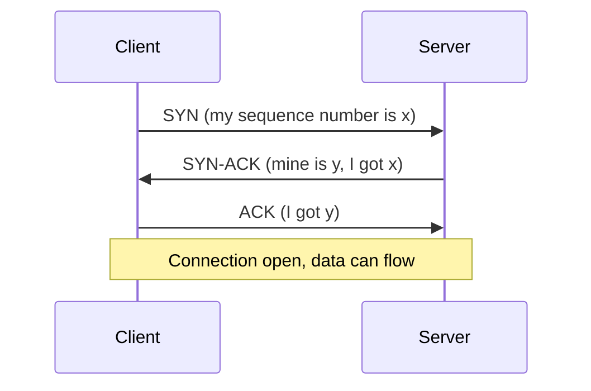

Read it top to bottom: each arrow is one packet. Data can ride on the third packet. Closing a connection uses FIN and ACK packets in each direction.

Cost: one full round trip before the first byte of data. On a satellite link with 600 ms round trip, that is noticeable. TLS adds more round trips on top (one for TLS 1.3, two for TLS 1.2), which is why connection reuse and HTTP/3 matter.

**Security angle:** A SYN flood sends many SYN packets and never completes the handshake, filling the server's half-open connection table. Defences are SYN cookies (the server encodes state in the sequence number and stores nothing), rate limiting and upstream DDoS protection.

**Gotcha:** The handshake does not prove who the client is. It only proves the client can receive packets at its claimed address. Identity needs TLS or authentication.

**Interview tip:** Link the handshake to latency. "Every new connection costs round trips, so we reuse connections with keep-alive and connection pools."

_Module: Network Fundamentals · Tags: tcp, handshake, syn_

### 5. How does DNS resolution work step by step, and what are the main record types?

**Short answer:** DNS turns names like `api.example.com` into IP addresses. Your device asks a recursive resolver, which asks the root servers, then the top-level domain servers, then the domain's authoritative server, and caches the answer for the record's TTL.

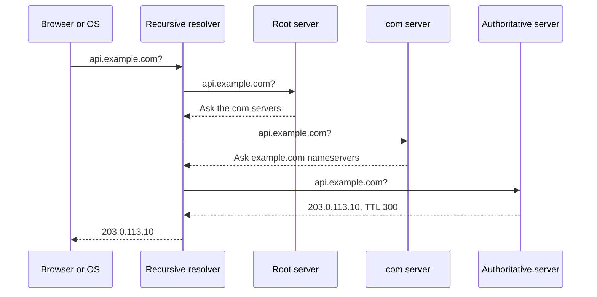

Read it top to bottom. The resolver does the legwork and remembers the result. Many answers come straight from caches: the browser, the operating system, the resolver and sometimes a local agent. In Kubernetes, CoreDNS also answers service names inside the cluster.

| Record | Meaning |
| --- | --- |
| A / AAAA | Name to IPv4 / IPv6 address |
| CNAME | Alias to another name (not allowed at the zone apex) |
| MX | Mail servers for the domain |
| TXT | Free text: domain verification, SPF, DKIM |
| NS | Which servers are authoritative for the zone |
| SRV | Host and port for a named service |
| CAA | Which certificate authorities may issue certificates |
| PTR | Reverse lookup, IP to name |

The TTL (time to live) controls caching. A long TTL reduces load but slows changes. Before a migration, lower the TTL a day ahead.

**Gotcha:** "DNS propagation" is mostly caches expiring. If you cut over with a one-day TTL, some users keep the old address for a day. Also, classic DNS is plain text over UDP, so it can be observed or spoofed unless protected (see the DNS security question).

**Interview tip:** When something is "down" for some users only, suspect DNS caches, TTLs and split-horizon DNS before suspecting the application.

_Module: DNS & Delivery · Tags: dns, records, resolver_

### 6. What happens when you type a URL into the browser and press Enter?

**Short answer:** The browser parses the URL, finds the IP with DNS, opens a TCP (or QUIC) connection, sets up TLS for HTTPS, sends an HTTP request, receives the response, and then parses HTML, loads more resources and renders the page.

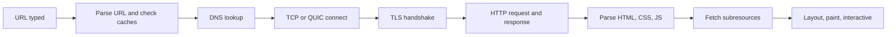

Read it left to right. Each box can be skipped by a cache or a reused connection.

1. **Parse and cache check.** The browser decides if the input is a URL or a search. It may apply an HSTS rule to upgrade `http` to `https`, and it checks its HTTP cache.
2. **DNS.** Browser cache, OS cache, then the recursive resolver (see the DNS question).
3. **Connect.** A TCP three-way handshake, or QUIC over UDP for HTTP/3.
4. **TLS.** Agree on keys, check the server certificate and its hostname. Now the channel is encrypted.
5. **HTTP.** `GET / HTTP/1.1`, with `Host`, cookies and headers. The response may be a redirect, so the browser repeats from step 2 for the new URL.
6. **Render.** The browser builds the DOM and CSSOM, runs JavaScript, fetches images, scripts and API calls (each may reuse the connection), then lays out and paints. A CDN or load balancer often answers on the server side, not your origin.

Where it can go wrong: DNS failure, blocked port, certificate error, slow server, huge JavaScript bundle, or blocking third-party scripts.

**Interview tip:** Pick the part the interviewer cares about and go deeper. For a performance role, talk about round trips and caching. For a security role, talk about HSTS, certificate validation and cookie rules. Always say where you would measure, for example the browser's Network tab timing breakdown.

_Module: HTTP & Web · Tags: browser, http, dns, tls_

### 7. What are the main HTTP methods, idempotency, status code classes and headers?

**Short answer:** HTTP is a request and response protocol. A request has a method, a path, headers and an optional body. A response has a status code, headers and an optional body. Methods say what you want, and status codes say what happened.

| Method | Use | Safe | Idempotent |
| --- | --- | --- | --- |
| GET | Read | Yes | Yes |
| HEAD | Read headers only | Yes | Yes |
| POST | Create or run an action | No | No |
| PUT | Replace a resource | No | Yes |
| PATCH | Partial update | No | Not guaranteed |
| DELETE | Remove | No | Yes |
| OPTIONS | Ask what is allowed (CORS preflight) | Yes | Yes |

"Safe" means it should not change state. "Idempotent" means doing it twice has the same effect as doing it once, so a client may retry after a timeout. POST is not idempotent, which is why payment APIs accept an idempotency key.

Status classes: 1xx informational, 2xx success, 3xx redirect, 4xx the client made a mistake, 5xx the server failed.

Headers carry metadata: `Content-Type`, `Authorization`, `Cookie`, `Cache-Control`, `Accept`, `Location`, `User-Agent`.

```js
// Runs offline against a tiny local server. Prints what the client sees.
const r1 = await fetch(base + '/old', { redirect: 'manual' });
console.log(r1.status, r1.headers.get('location'));   // prints: 301 /new
const r2 = await fetch(base + '/old');
console.log(r2.status, r2.redirected, await r2.text()); // prints: 200 true hello
const r3 = await fetch(base + '/orders', { method: 'POST' });
console.log(r3.status, r3.headers.get('location'));   // prints: 201 /orders/7
```

The server returned 301 with a `Location`, `fetch` followed it, and a successful POST returned 201 with the new resource's URL.

**Gotcha:** HTTP is stateless. Each request stands alone, so identity travels in cookies or tokens on every request.

**Interview tip:** Idempotency is the favourite follow-up. Link it to retries, and explain that "idempotent" is about the effect on the server, not the response body.

_Module: HTTP & Web · Tags: http, methods, status-codes_

### 8. What are the differences between HTTP/1.1, HTTP/2 and HTTP/3?

**Short answer:** HTTP/1.1 is text based and handles one request at a time per connection. HTTP/2 uses a binary format and multiplexes many requests over one TCP connection. HTTP/3 does the same over QUIC, which runs on UDP, so one lost packet no longer stalls every stream.

| | HTTP/1.1 | HTTP/2 | HTTP/3 |
| --- | --- | --- | --- |
| Format | Text | Binary frames | Binary frames |
| Transport | TCP | TCP | QUIC (over UDP) |
| Parallel requests | Several connections, one request each | Many streams on one connection | Many independent streams |
| Header compression | None | HPACK | QPACK |
| Head-of-line blocking | At HTTP level | At TCP level | Mostly removed |
| Encryption | Optional | Practically always TLS in browsers | Always (TLS 1.3 inside QUIC) |

With HTTP/1.1, browsers open about six connections per host to get parallelism, and old tricks like bundling files and domain sharding existed because of that. HTTP/2 makes those tricks unnecessary. But HTTP/2 still sits on one TCP connection: if one packet is lost, TCP holds back all streams until it is fixed. QUIC solves this because lost data only blocks its own stream. QUIC also combines the transport and TLS handshake, so a new connection needs fewer round trips, and it survives a network change such as Wi-Fi to mobile through connection IDs.

Server push existed in HTTP/2 but browsers have removed or disabled it, so do not recommend it.

**Gotcha:** UDP can be blocked or throttled by some corporate networks and firewalls, so clients fall back to HTTP/2. Also, your internal services may speak HTTP/2 through gRPC while the edge speaks HTTP/3. Check what each hop uses.

**Interview tip:** Explain the problem each version solved: HTTP/2 fixed request-level blocking, HTTP/3 fixed TCP-level blocking.

_Module: HTTP & Web · Tags: http2, http3, quic_

### 9. How do cookies and sessions work, and what do the HttpOnly, Secure and SameSite flags do?

**Short answer:** A cookie is a small piece of data the server sets with `Set-Cookie` and the browser sends back on later requests. A session usually stores a random session ID in a cookie while the real data stays on the server. The flags limit how the cookie can be read and sent.

| Flag | What it does | Protects against |
| --- | --- | --- |
| `HttpOnly` | JavaScript cannot read the cookie | Token theft through XSS |
| `Secure` | Sent only over HTTPS | Sniffing on plain HTTP |
| `SameSite=Lax` | Not sent on cross-site subrequests, sent on top-level navigation | Most CSRF |
| `SameSite=Strict` | Never sent on cross-site requests | CSRF, but breaks links from other sites |
| `SameSite=None` | Sent cross-site (needs `Secure`) | Nothing, used for embeds |
| `Max-Age` / `Expires` | Lifetime | Long-lived sessions |
| `Path` / `Domain` | Scope | Over-sharing with subdomains |
| `__Host-` prefix | Forces Secure, Path=/, no Domain | Cookie injection from subdomains |

```js
res.setHeader('Set-Cookie',
  'sid=abc123; Path=/; HttpOnly; Secure; SameSite=Lax; Max-Age=3600');
// client sees: [ 'sid=abc123; Path=/; HttpOnly; Secure; SameSite=Lax; Max-Age=3600' ]
```

A session ID must be long, random and unguessable (at least 128 bits from a secure random source). The server looks it up in a store such as Redis. Rotate the ID on login to prevent session fixation, and destroy it on logout.

Note "same site" is about the registrable domain (`example.com`), while "same origin" includes scheme and port. Browsers now treat cookies without a SameSite attribute as Lax by default, but set it explicitly.

**Gotcha:** `HttpOnly` stops script from reading the cookie but not from making requests that carry it. XSS is still serious.

**Interview tip:** When asked "where do you store the session or token in a browser?", the best default for a normal web app is an `HttpOnly; Secure; SameSite` cookie, plus CSRF protection where needed.

_Module: HTTP & Web · Tags: cookies, sessions, samesite_

### 10. How does HTTP caching work? Explain Cache-Control, ETag and conditional requests.

**Short answer:** The server tells caches how long a response is fresh with `Cache-Control`. When it is stale, the client asks "has it changed?" using `If-None-Match` and the `ETag`, and the server can answer `304 Not Modified` with no body.

Key `Cache-Control` values:

| Value | Meaning |
| --- | --- |
| `max-age=N` | Fresh for N seconds |
| `no-cache` | May store, but must revalidate before use |
| `no-store` | Do not store at all (sensitive data) |
| `private` | Only the user's browser may cache |
| `public` | Shared caches such as a CDN may cache |
| `immutable` | Never changes while fresh (versioned files) |
| `stale-while-revalidate=N` | Serve stale while fetching a new copy |

```js
// server: ETag is a fingerprint of the body
res.writeHead(200, { ETag: etag, 'Cache-Control': 'private, max-age=0, must-revalidate' });
// 1st request prints: 200 "c8a4630b2f23" private, max-age=0, must-revalidate
// 2nd request sends If-None-Match: "c8a4630b2f23" and gets: 304 (empty body)
```

The common strategy: hash the filename of static assets (`app.3f9a1c.js`) and send `max-age=31536000, immutable`. The HTML page is sent with `no-cache` so it always checks for new asset names. APIs that return user data should be `private` or `no-store`.

If the same URL gives different responses by header (for example by language or origin), add `Vary`, such as `Vary: Origin` for CORS responses, so caches do not mix them up.

**Gotchas**
- `no-cache` does not mean "do not cache". `no-store` does.
- Caching a personalised response in a shared cache leaks one user's data to another. Use `private` or `no-store` on anything user specific.
- Putting a token in a URL can leak through caches and logs.

**Interview tip:** Say "revalidation saves bandwidth, not round trips". A 304 still costs one trip, so long `max-age` on versioned assets is what removes the trip.

_Module: HTTP & Web · Tags: caching, etag, cache-control_

### 11. What is the same-origin policy and CORS, and how does the preflight request work?

**Short answer:** The same-origin policy stops a page from one origin reading responses from another origin. An origin is scheme plus host plus port. CORS is how a server opts in to let specific other origins read its responses. It is enforced by the browser, not the server.

For "simple" requests, the browser sends the request with an `Origin` header and the server answers with `Access-Control-Allow-Origin`. For anything else (such as `PUT`, `DELETE`, JSON content type, or an `Authorization` header) the browser first sends a **preflight** `OPTIONS` request to ask permission.

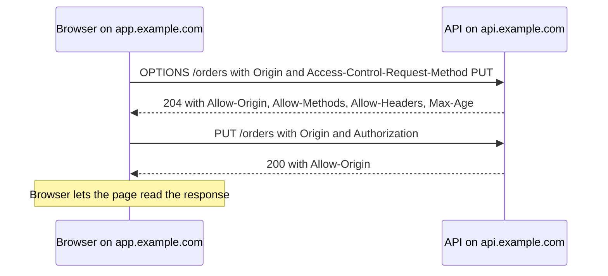

Read it top to bottom. If the preflight answer does not allow the request, the browser never sends the real one.

```js
// Output of a local demo server that allows only https://app.example.com
// https://app.example.com -> 204 https://app.example.com
// https://evil.example.net -> 204 (none)   <- no Allow-Origin, browser blocks the read
const ALLOWED = new Set(['https://app.example.com']);
if (origin && ALLOWED.has(origin)) {
  res.setHeader('Access-Control-Allow-Origin', origin);
  res.setHeader('Vary', 'Origin');
}
```

**Gotchas**
- CORS is not security for your API. `curl` and server-to-server calls ignore it. It only protects users' browsers.
- `Access-Control-Allow-Origin: *` cannot be combined with credentials (cookies). Never reflect any Origin back blindly with credentials on.
- A "CORS error" is often a failing server (5xx) or a missing header on the error response, not a misconfigured browser.
- Cross-origin requests that do not need a preflight, such as a simple form POST, still reach the server. That is why CSRF defences exist.

**Interview tip:** Explain that CORS relaxes the policy, it does not add protection. Then name the fix: an explicit allow-list of origins.

_Module: HTTP & Web · Tags: cors, same-origin, preflight_

### 12. What are the basics of REST, and how do you choose HTTP status codes?

**Short answer:** REST means modelling your API as resources with URLs, using HTTP methods for actions, and returning proper status codes. Use nouns in paths, let the method carry the verb, and make status codes tell the client what to do next.

```text
GET    /orders          list orders
POST   /orders          create an order
GET    /orders/42       read one order
PUT    /orders/42       replace it
PATCH  /orders/42       change some fields
DELETE /orders/42       delete it
```

Picking status codes:

| Situation | Code |
| --- | --- |
| Read worked | 200 |
| Created, with `Location` header | 201 |
| Accepted for background work | 202 |
| Success with no body | 204 |
| Malformed request, validation failed | 400 (or 422 for semantic validation) |
| Not logged in or bad credentials | 401 |
| Logged in but not allowed | 403 |
| Not found (also used to hide existence) | 404 |
| Conflict, version mismatch, duplicate | 409 |
| Too many requests, send `Retry-After` | 429 |
| Server bug | 500 |
| Upstream failed or timed out | 502 / 504 |
| Overloaded or in maintenance | 503 |

The 401 and 403 pair confuses people. 401 really means "unauthenticated": who are you? 403 means "I know who you are, and the answer is no".

Good APIs also use consistent error bodies, pagination, versioning, and idempotency keys for POST when clients may retry.

**Gotcha:** Returning 200 with `{"error": ...}` breaks caches, monitors and retry logic. And do not leak internal details in error messages, such as stack traces or SQL.

**Interview tip:** REST is not the only style. Mention gRPC and GraphQL briefly and say when you would pick them, then return to the question.

_Module: HTTP & Web · Tags: rest, api, status-codes_

### 13. What does HTTPS and TLS give you: confidentiality, integrity and authentication?

**Short answer:** HTTPS is HTTP inside a TLS connection. TLS gives three things: confidentiality (others cannot read the data), integrity (others cannot change it unnoticed) and authentication (you are talking to the real server, proven by its certificate).

- **Confidentiality** comes from encrypting data with a symmetric key that both sides agreed during the handshake.
- **Integrity** comes from authenticated encryption, so any changed byte is detected and the connection fails.
- **Authentication** comes from the server's certificate. The client checks the certificate chain, the expiry and that the hostname matches. Client certificates (mutual TLS) can authenticate the client too.

What TLS does not hide: the server's IP address, the amount and timing of data, and, in many setups, the hostname (SNI is sent in clear text unless Encrypted Client Hello is used). It also does not make the server trustworthy or the application secure. A phishing site can have a perfectly valid certificate for its own domain.

TLS protects data in transit only. Once it reaches the server, the server decrypts it. TLS often ends at a load balancer or gateway, and traffic inside may be plain unless you re-encrypt it.

| Version | Status |
| --- | --- |
| SSL 2.0 / 3.0, TLS 1.0 / 1.1 | Broken or deprecated, disable |
| TLS 1.2 | Still widely used, needs good cipher choices |
| TLS 1.3 | Preferred: faster handshake, only strong ciphers |

**Gotcha:** The padlock means "encrypted to this domain", not "safe site". Also, turning off certificate verification "to make the error go away" removes the authentication part and leaves you open to man-in-the-middle attacks.

**Interview tip:** Always list all three properties, then say what is not covered. That shows you understand it is one layer in a larger defence.

_Module: TLS & Cryptography · Tags: tls, https, encryption_

### 14. What is the difference between symmetric and asymmetric encryption, and why does TLS use both?

**Short answer:** Symmetric encryption uses one shared secret key, and it is very fast. Asymmetric encryption uses a key pair, a public key anyone can have and a private key you keep secret, and it is slow. TLS uses asymmetric methods to agree on a key safely, then symmetric encryption for the actual data.

| | Symmetric | Asymmetric |
| --- | --- | --- |
| Keys | One shared key | Public and private pair |
| Speed | Fast, hardware support | Much slower |
| Problem | How do both sides get the key safely? | Not suitable for bulk data |
| Examples | AES-GCM, ChaCha20-Poly1305 | RSA, ECDSA, Ed25519, X25519 |
| Used for | Encrypting data | Key exchange, signatures, certificates |

The key distribution problem is the heart of it. If you and a server have never met, you cannot just send a secret key over the network. Key exchange (Diffie-Hellman, see the advanced question) lets two parties compute the same secret in public without sending it. Signatures (asymmetric) prove the server really owns the certificate. Then both sides use the shared secret with AES-GCM or ChaCha20-Poly1305 for the traffic.

Analogy: asymmetric is a padlock you hand out freely (public key) that only you can open (private key). Symmetric is a shared house key that is quick to use once you have safely given a copy to your friend.

Practical rules: use well-known libraries and modes (AEAD such as AES-GCM), keep private keys out of source control, and use at least 128-bit symmetric security. Do not use RSA to encrypt large data directly.

**Gotcha:** "Public key encryption is used to sign" is a common slip. Signing uses the private key to create a signature and the public key to verify. Encrypting uses the public key to lock and the private key to unlock.

**Interview tip:** The short pitch: "asymmetric to agree and to prove identity, symmetric to move the data."

_Module: TLS & Cryptography · Tags: symmetric, asymmetric, encryption_

### 15. What is the difference between hashing, encryption, signing and encoding?

**Short answer:** Encoding changes format and is reversible by anyone. Hashing is a one-way fingerprint. Encryption hides data and is reversible with a key. A signature proves who created data and that it was not changed.

| Tool | Reversible? | Key? | Purpose | Example |
| --- | --- | --- | --- | --- |
| Encoding | Yes, by anyone | No | Represent bytes as text | Base64, URL encoding, hex |
| Hashing | No | No | Fingerprint, integrity, lookup | SHA-256 |
| HMAC | No | Shared secret | Integrity plus authenticity | HMAC-SHA256 |
| Encryption | Yes, with key | Yes | Confidentiality | AES-GCM |
| Signature | Verify only | Private key signs, public key verifies | Authenticity, non-repudiation | Ed25519, RSA-PSS, ECDSA |
| Password hashing | No | Salt | Slow on purpose | scrypt, bcrypt, Argon2 |

```js
console.log('base64  :', Buffer.from('hello').toString('base64'));  // prints: aGVsbG8=
console.log('sha256  :', createHash('sha256').update('hello').digest('hex').slice(0, 16));
// prints: 2cf24dba5fb0a30e
// HMAC needs a key; AES-GCM decrypt prints: hello
```

Common confusions:
- Base64 is **not** encryption. Anyone can decode it. A JWT payload is only Base64URL encoded, so do not put secrets in it.
- Encrypting a password is wrong; you never need the original back. Use a slow password hash.
- A plain hash of a file next to the file does not stop an attacker who can change both. Use a signature or HMAC.
- SHA-256 is fast, which is good for fingerprints and bad for passwords.

**Gotcha:** "We encrypt the passwords with SHA-256" is a red-flag sentence in an interview. Say instead "we hash passwords with a salted, slow algorithm such as Argon2id or scrypt".

**Interview tip:** Map each tool to the property it gives: encoding to none, hash to integrity, HMAC and signature to authenticity, encryption to confidentiality.

_Module: TLS & Cryptography · Tags: hashing, encryption, signing, encoding_

### 16. What are certificates and certificate authorities, and how does a browser decide to trust a site?

**Short answer:** A certificate binds a public key to a name such as `www.example.com` and is signed by a certificate authority (CA). A browser trusts it if the signature chain leads to a root CA that is in its trust store, the dates are valid, the name matches and it is not revoked.

The server sends its leaf certificate and any intermediate certificates. The client builds a chain: leaf, signed by an intermediate, signed by a root that was preinstalled in the operating system or browser. Roots rarely sign leaf certificates directly. They sign intermediates, and the root key stays offline.

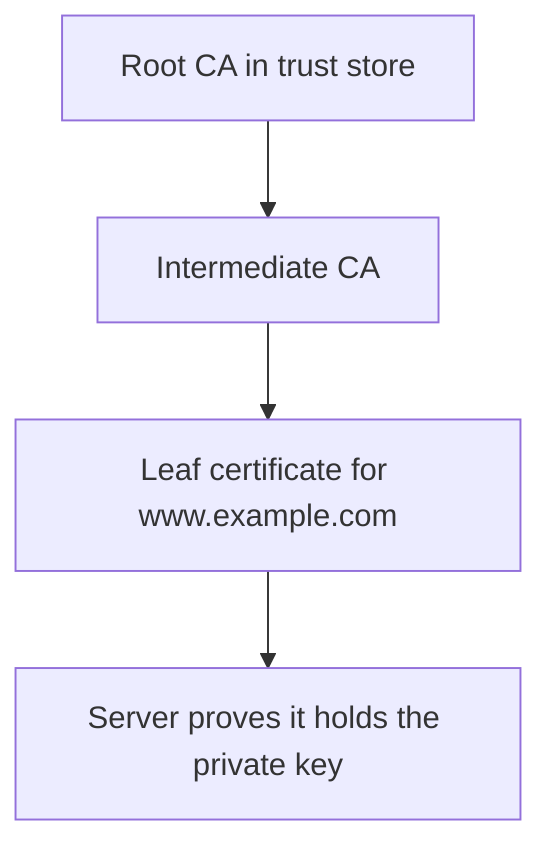

Read it from the top: each certificate is signed by the one above it.

What the client checks:
1. The signature chain up to a trusted root.
2. The validity dates (not before, not after).
3. The hostname matches the Subject Alternative Name list (the old Common Name is not used).
4. Key usage and constraints are right for a server.
5. Revocation or transparency signals, where supported. Browsers also expect the certificate to appear in public Certificate Transparency logs.

Certificate types by validation: domain validated (proves control of the domain, automatic), organisation or extended validation (more paperwork, browsers no longer show special UI). For internal services many companies run a private CA, and clients must trust its root.

**Gotcha:** A valid certificate does not mean a honest site. And a missing intermediate on the server causes "works in browser, fails in curl or Java" errors. Always send the full chain except the root.

**Interview tip:** Explain trust as a chain ending in a pre-trusted root, and mention private CAs for internal systems.

_Module: TLS & Cryptography · Tags: certificates, ca, pki_

### 17. What do load balancers (L4 and L7), reverse proxies and forward proxies do?

**Short answer:** A load balancer spreads traffic across servers. L4 balancers work with TCP or UDP connections and ports. L7 balancers understand HTTP and can route by path, host or header. A reverse proxy stands in front of servers on the server side. A forward proxy stands in front of clients and sends their requests out.

| | L4 load balancer | L7 load balancer |
| --- | --- | --- |
| Sees | IPs and ports | HTTP method, path, headers, cookies |
| Speed | Very fast, little state | More work per request |
| Can do | Spread connections, health checks | Routing by path, TLS termination, retries, rate limits, auth |
| Example | Azure Load Balancer, NLB | Azure Application Gateway, NGINX, Envoy, Ingress controllers |

| | Reverse proxy | Forward proxy |
| --- | --- | --- |
| Acts for | Servers | Clients |
| Who knows about it | Clients often do not | Clients are configured to use it |
| Used for | TLS termination, caching, routing, WAF, hiding backends | Filtering outbound traffic, corporate egress, anonymity |

Algorithms: round robin, least connections, hash by client (sticky). Health checks remove bad servers. Prefer stateless services so you do not need sticky sessions.

Security notes: terminating TLS at the proxy means traffic behind it needs protection, for example re-encryption or mTLS. The proxy sees the client IP, and passes it in `X-Forwarded-For` or the standard `Forwarded` header. Only trust those headers when they are set by your own proxy, or clients can fake their IP.

**Gotcha:** One L7 proxy becomes a single point of failure and a performance bottleneck if you run just one. Run several and monitor them.

**Interview tip:** Map to Kubernetes: a Service is basic L4 balancing, an Ingress or Gateway is L7.

_Module: DNS & Delivery · Tags: load-balancer, reverse-proxy, proxy_

### 18. What is a CDN and how does it help performance and security?

**Short answer:** A content delivery network is a set of servers close to users that cache and serve your content, so requests do not travel to your origin. It lowers latency and origin load and also absorbs attacks.

How it works: DNS or anycast routing sends the user to a nearby edge location. If the edge has the object cached, it replies immediately (a hit). If not, it fetches from your origin, stores it according to `Cache-Control`, and replies (a miss). Static files are the best fit, but CDNs also cache API responses, terminate TLS, compress, and run small functions at the edge.

Benefits:
- **Latency:** shorter distance and warm TLS connections.
- **Offload:** fewer requests reach your servers.
- **Resilience:** extra capacity against traffic spikes and some DDoS attacks.
- **Security:** a WAF, bot filtering, and your origin IP can be hidden.

Things to decide:
1. **Cache keys.** What makes two requests the same: URL, query string, headers, cookies. Too many varying parts means a poor hit rate.
2. **Invalidation.** Use versioned file names so you rarely purge. Purges are slow and global.
3. **Private data.** Never cache personalised responses without a correct key. Send `private` or `no-store`.
4. **Origin protection.** Make the origin accept traffic only from the CDN, or attackers bypass it.

A CDN does not help much for uncacheable, highly dynamic or write-heavy traffic, though it still gives TLS and routing benefits.

**Gotcha:** Cache poisoning and "web cache deception" happen when the cache and origin disagree about what a URL means, so a private page ends up cached publicly. Test your cache rules with an authenticated user.

**Interview tip:** Always mention cache hit ratio as the metric you watch.

_Module: DNS & Delivery · Tags: cdn, caching, edge_

### 19. How do WebSockets, Server-Sent Events and long polling differ at the protocol level?

**Short answer:** Long polling repeats ordinary HTTP requests that the server holds open until it has news. Server-Sent Events (SSE) keep one HTTP response open and stream events one way, server to client. WebSockets upgrade the connection into a two-way message channel.

| | Long polling | SSE | WebSocket |
| --- | --- | --- | --- |
| Direction | Client asks, server answers late | Server to client | Both ways |
| Protocol | Plain HTTP | HTTP with `text/event-stream` | Starts as HTTP, upgrades to WebSocket framing |
| Reconnect | Client loops | Built in, with `Last-Event-ID` | You write it |
| Data | Anything | Text events | Text or binary |
| Proxies | Works everywhere | Usually fine, needs no buffering | Needs proxy support for Upgrade |

A WebSocket starts with a normal HTTP request that has `Upgrade: websocket` and `Connection: Upgrade`. If the server agrees, it answers `101 Switching Protocols` and from then on both sides send frames on the same TCP connection.

```text
GET /chat HTTP/1.1
Host: api.example.com
Upgrade: websocket
Connection: Upgrade
Sec-WebSocket-Key: <random value>
Origin: https://app.example.com

HTTP/1.1 101 Switching Protocols
Upgrade: websocket
Connection: Upgrade
Sec-WebSocket-Accept: <derived from the key>
```

When to use: SSE for notifications and live feeds; WebSocket for chat, collaboration and games; long polling as a fallback.

Security points: WebSockets are not covered by CORS, so **check the `Origin` header on the server** to prevent cross-site WebSocket hijacking. Authenticate on connect (a cookie or a short-lived token, not a long-lived token in the URL because URLs are logged). Re-check authorisation for each message and limit message size and rate. Use `wss://`.

**Gotcha:** Long-lived connections hold server memory and break rolling deploys and idle timeouts on load balancers. Send heartbeats and handle reconnects.

**Interview tip:** Say "pick the simplest tool: if it is only server to client, SSE is often enough".

_Module: HTTP & Web · Tags: websocket, sse, realtime_

### 20. What is the CIA triad and what do threat, vulnerability, risk and attack surface mean?

**Short answer:** The CIA triad lists three goals of security: confidentiality (only the right people see data), integrity (data is not altered wrongly) and availability (the system works when needed). Threat, vulnerability and risk describe what could go wrong, why it could, and how much it matters.

- **Threat:** something or someone that could cause harm, such as a criminal or a failing disk.
- **Vulnerability:** a weakness that a threat can use, such as an unpatched library or a missing access check.
- **Exploit:** a way to use the vulnerability.
- **Risk:** the combination of how likely harm is and how bad the impact would be. A common mental formula is likelihood times impact.
- **Attack surface:** all the places an attacker can touch your system: endpoints, ports, input fields, dependencies, admin tools, people.
- **Asset:** what you protect, such as customer data or the availability of a service.
- **Control (mitigation):** what reduces risk: prevent, detect or respond.

| Goal | Example failure | Example control |
| --- | --- | --- |
| Confidentiality | Leaked customer table | Encryption, access control |
| Integrity | Order total changed in transit | Signatures, TLS, validation |
| Availability | Service flooded by traffic | Rate limits, redundancy, DDoS protection |

Other useful words: authentication (who are you), authorisation (what may you do), accountability (audit trail), least privilege (minimum access), defence in depth (several layers, so one failure is not fatal).

In aviation or other safety-related systems, availability and integrity usually matter at least as much as confidentiality. A trusted but modified software update is worse than a leaked log file.

**Gotcha:** Do not treat every vulnerability as equal. A critical bug on an isolated test box can be lower risk than a medium bug on the internet-facing login.

**Interview tip:** When asked about risk, say you rank by likelihood and impact for your system, not by a scanner's number alone.

_Module: Secure Design & Threat Modeling · Tags: cia-triad, risk, vocabulary_

## Intermediate

### 21. [Tech Lead] How do you build a secure development lifecycle in a team (threat modelling, security champions, checklists)?

**Short answer:** Make security a normal part of delivery, not a final gate. Add small, repeatable steps at each stage: a short threat model at design, a checklist at code review, automated scans in CI, and a way to learn from incidents. Keep it light so people actually do it.

A practical shape, stage by stage:

| Stage | Lightweight practice | Who |
| --- | --- | --- |
| Plan | Classify the data the feature touches; ask "is this a new trust boundary?" | Tech lead, product |
| Design | 30-minute threat model for risky changes (see the STRIDE question) | Team, security champion |
| Build | Secure coding guidelines, approved libraries, secrets never in code | Developers |
| Review | Security checklist in the pull request template | Reviewer |
| Test | SAST, dependency and secret scanning, a few abuse-case tests | CI |
| Release | Signed artefacts, protected branches, rollback ready | Platform |
| Operate | Alerts on auth failures, patch SLAs, incident drills | Team, on-call |
| Learn | Blameless postmortems feed back into checklists | Everyone |

**Security champions** are developers who volunteer to be the first contact for security in each team. They get a bit of training and time (for example two hours a week), join a small community with the security team, and spread practices. They are not the only people responsible.

How to start without a big programme:
1. Pick the top three risks for your product (for example access control, secrets, dependencies).
2. Add one control for each into the existing workflow.
3. Measure something simple: time to fix critical findings, percentage of services scanned.
4. Review every quarter and remove steps that only produce noise.

**Gotchas**
- A long checklist that nobody reads. Keep it to about ten items.
- Making the security team a bottleneck. Give teams self-service tools and clear rules.
- Counting training completion instead of improvements in the code.

**Interview tip:** Say you "shift left" but also "shift right": prevention early, detection and response in production. Give one example from your own team where a design review caught an issue early.

_Module: Secure Design & Threat Modeling · Tags: tech-lead, sdlc, process_

### 22. [Tech Lead] How do you run threat modelling with STRIDE? Give a worked example for a login and payment API.

**Short answer:** Threat modelling asks four questions: what are we building, what can go wrong, what will we do about it, and did we do a good job. STRIDE is a checklist for the second question: Spoofing, Tampering, Repudiation, Information disclosure, Denial of service, Elevation of privilege. You apply it to each data flow that crosses a trust boundary.

Steps: draw the system, mark the trust boundaries (where data moves between different levels of trust), walk each arrow with STRIDE, write down threats, and decide mitigations. Draw on a whiteboard; 30 to 60 minutes is enough for one feature.

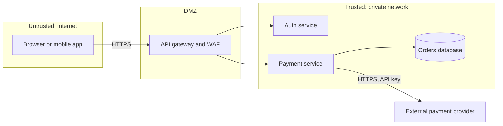

Each arrow that crosses a box is a boundary to examine.

| STRIDE | Example threat here | Mitigation |
| --- | --- | --- |
| Spoofing | Credential stuffing on login; forged payment provider callback | MFA, rate limits, verify webhook signatures |
| Tampering | Client changes the price in the request | Compute price server side, validate input, TLS |
| Repudiation | User denies placing an order | Audit log with user, time, request ID |
| Information disclosure | Card data in logs; IDOR on `/orders/42` | Never log secrets, tokenise cards, object-level checks |
| Denial of service | Login endpoint flooded | Rate limiting, autoscaling, upstream protection |
| Elevation of privilege | Normal user calls an admin endpoint | Role checks on every request, least-privilege service accounts |

Then rank threats by likelihood and impact, create tickets for the important ones, and record accepted risks with an owner.

**Gotchas**
- Doing it once and never updating. Redo it when the architecture changes.
- A diagram that is too detailed. Show processes, stores, external parties and boundaries only.
- Jumping to tools before understanding assets.

**Interview tip:** Mention that card handling is best pushed to a payment provider so raw card numbers never touch your systems. This reduces compliance scope too.

_Module: Secure Design & Threat Modeling · Tags: tech-lead, threat-modeling, stride_

### 23. [Tech Lead] How do you manage vulnerabilities: triage, SLAs, dependency scanning and patching strategy?

**Short answer:** Scan continuously, triage by real risk, fix within agreed deadlines, and make patching routine so it is never an emergency. The goal is not zero findings but that the dangerous ones are fixed fast and the rest are tracked.

**Triage questions** for each finding:
1. Is the vulnerable code actually reachable and used in our service?
2. Is the service internet-facing, and what data does it hold?
3. Is there a known exploit in the wild? (The CISA KEV list and the EPSS score help.)
4. Is there a mitigation already, such as a WAF rule, network block or feature flag?
5. What does the CVSS score say? Use it as input, not the final answer.

**SLA example** (adjust to your risk appetite):

| Severity after triage | Fix within |
| --- | --- |
| Critical, exploited or internet-facing | 24 to 72 hours |
| High | 7 to 14 days |
| Medium | 30 to 60 days |
| Low | Next regular upgrade |

Write the SLA down, assign an owner per service, report overdue items, and allow documented exceptions with an expiry date.

**Patching strategy**
- Keep dependencies current in small steps, using an automated pull-request bot, instead of large upgrades once a year.
- Use lockfiles and reproducible builds.
- Rebuild container images regularly, with minimal base images, so OS patches arrive.
- Have good tests and a fast rollback so patching is not scary.
- For urgent ones, have an emergency path: a hotfix pipeline that skips non-essential steps.

Tools: `npm audit` or `govulncheck` for language dependencies, an image scanner, and a software bill of materials (SBOM) so you can answer "where do we use library X?" within minutes.

**Gotchas**
- Alert fatigue from thousands of low-value findings. Filter by reachability.
- Treating a scanner as proof of safety. It finds known issues only.

**Interview tip:** Use the example of an urgent library bug: you should be able to say how quickly you can list affected services, patch, and deploy.

_Module: Security Leadership · Tags: tech-lead, vulnerabilities, patching_

### 24. [Tech Lead] How do you handle a security incident from detection to postmortem?

**Short answer:** Follow a clear loop: detect and confirm, contain, eradicate and recover, communicate throughout, then learn with a blameless postmortem. Preparation matters most: roles, runbooks and logs must exist before the incident.

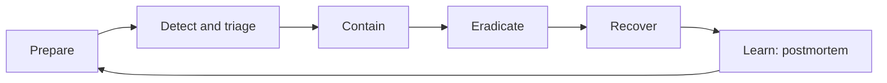

Read it left to right and notice it loops back into preparation.

1. **Detect and triage.** An alert, a customer report, a bug bounty report. Decide quickly: is it real, how big, which data or systems? Open an incident channel, name an **incident commander**, and start a timeline.
2. **Contain.** Stop the damage first: revoke keys and tokens, disable the account, isolate a pod or network segment, block an IP range, turn off a feature. Prefer reversible actions and keep evidence (snapshots, logs) before wiping anything.
3. **Eradicate.** Remove the root cause: patch, rotate every secret that could have been exposed, remove persistence.
4. **Recover.** Restore from known good state, monitor closely, return to normal service in stages.
5. **Communicate.** Keep one source of truth. Update stakeholders on a schedule. Involve legal and privacy early when personal data may be affected, because there can be notification deadlines (which they will confirm). Be honest, specific and calm with customers.
6. **Postmortem.** Within about a week, blameless: what happened, timeline, impact, root cause, what worked, what did not, and actions with owners and dates.

Roles: incident commander (decides), communications lead, technical lead(s), scribe.

**Gotchas**
- Fixing the symptom, not rotating the credentials the attacker may have seen.
- Overwriting logs or rebooting machines, losing evidence.
- Everyone debugging in private chats with no timeline.
- Never rehearsing. Run a tabletop exercise twice a year.

**Interview tip:** Tell a real story if you can: what you contained first and how long detection took. Interviewers listen for calm structure and communication.

_Module: Security Leadership · Tags: tech-lead, incident-response, postmortem_

### 25. [Tech Lead] What is your policy for secrets management and rotation?

**Short answer:** Secrets never live in source code, images or chat. They are stored in a managed secret store, given to workloads at runtime with least privilege, rotated on a schedule and immediately after exposure, and every access is logged.

Rules for the team:
1. **No secrets in Git.** Add pre-commit and CI secret scanning. If one leaks, treat it as compromised: rotate, do not just delete the commit.
2. **Use a secret store.** Examples: Azure Key Vault, HashiCorp Vault, cloud secret managers. On Kubernetes, sync from the store (for example with the External Secrets operator or the CSI driver). Plain Kubernetes Secrets are only base64 encoded; enable encryption at rest and restrict RBAC.
3. **Prefer identity over passwords.** Use workload identity or managed identity so the service proves who it is and no stored secret is needed at all. Short-lived credentials beat long-lived ones.
4. **Least privilege and separation.** One secret per service and environment. Production secrets are not available to developer laptops.
5. **Rotate.** Automate rotation where possible (database passwords, API keys, certificates). Support two valid keys at once during rotation so nothing breaks. Rotate when someone with access leaves.
6. **Do not log them.** Mask secrets in logs, error messages and CI output. Do not pass them as command-line arguments (visible in process lists).
7. **Audit.** Alert on unusual reads.

Rotation steps for an API key:
- create the new key, deploy it, confirm traffic uses it, revoke the old key, check for failures.

**Gotchas**
- Environment variables are convenient but can leak through crash dumps, child processes and debug endpoints. Files mounted from a store are often better.
- Developers sharing secrets in chat "just this once".
- One shared admin credential used by many systems.

**Interview tip:** The best answer to "how do you rotate secrets?" is "we try to not have static secrets; we use short-lived identities, and the few we keep rotate automatically".

_Module: Security Leadership · Tags: tech-lead, secrets, rotation_

### 26. [Tech Lead] What is on your secure code review checklist?

**Short answer:** A short checklist focused on the recurring bugs: input handling, authentication and access control, secrets, error handling, dependencies and logging. Put it in the pull request template so reviewers and authors both see it.

A useful ten-item list:

1. **Authorisation:** is there a server-side check on every endpoint and for each object (not only "is logged in")?
2. **Input:** is all external input validated (type, length, range) and encoded for where it goes (SQL parameters, HTML encoding, no shell strings)?
3. **Output and errors:** no stack traces, SQL or internal addresses in responses. Fail closed.
4. **Authentication:** no custom crypto, passwords hashed with a slow algorithm, tokens validated fully (signature, expiry, audience).
5. **Secrets:** nothing in code, config files, logs or test fixtures.
6. **Data exposure:** responses return only the fields the caller needs. No mass assignment from request bodies.
7. **Outbound calls:** user-supplied URLs are checked (SSRF), timeouts set, TLS verification on.
8. **Dependencies:** new packages are needed, maintained, licensed and not typosquats. Versions pinned.
9. **Logging:** security events are logged, personal data and secrets are not.
10. **Tests:** abuse cases exist, such as "user A cannot read user B's order".

Extra triggers for a deeper review: changes to authentication, payment, crypto, file upload, deserialisation, Dockerfiles, CI pipelines, and infrastructure permissions. These should need a security champion's approval.

Make reviews efficient: small pull requests, automation for style and known patterns (linters, SAST), humans for logic and design.

**Gotchas**
- Reviewing the diff only. A new endpoint may call an old, unprotected function; read the context.
- Treating "tests pass" as "safe".

**Interview tip:** Give a concrete bug you have seen caught in review, such as a missing ownership check, to show the checklist comes from experience.

_Module: Security Leadership · Tags: tech-lead, code-review, checklist_

### 27. [Tech Lead] How do you manage supply-chain risk and dependency policy?

**Short answer:** Most of your code is other people's code. Reduce the risk by knowing what you depend on (SBOM), pinning versions, scanning, limiting what can run at install time, verifying where artefacts come from, and keeping the list small.

Main threats:
- A known vulnerability in a library.
- A malicious package: typosquatting (`reacct`), dependency confusion (a public package with the same name as your private one), or a hijacked maintainer account.
- A compromised build system or base image.
- Install scripts that run code on developer machines and CI.

Policy elements:

| Control | How |
| --- | --- |
| Inventory | Generate an SBOM per build; store it with the release |
| Pin and lock | Commit lockfiles; use exact versions and `npm ci`, not `npm install`, in CI |
| Private registry | Proxy public registries; scope internal names to your registry to stop dependency confusion |
| Review new dependencies | Check maintainers, activity, size, licence, and ask "do we need it?" |
| Scan | Dependency, licence and container scanning on every merge |
| Limit scripts | Disable install scripts where possible (`--ignore-scripts`) and allow-list those that need them |
| Provenance | Build in CI from a clean environment; sign artefacts and images; record build provenance (SLSA is a framework for this) |
| Base images | Use a small, trusted, regularly rebuilt base; pin by digest |
| Update cadence | Automated pull requests grouped weekly; a cooldown of a few days on brand-new releases avoids freshly published malicious versions |

Treat CI credentials as high value: use short-lived tokens, protect the main branch and require review.

**Gotcha:** Pinning without updating is also a risk. You get stability but miss fixes. Pair pinning with a regular update process.

**Interview tip:** Mention a real class of incident without drama: "a popular package gets a malicious version published". Then describe how pinning, a delay on new versions and install-script limits reduce your exposure.

_Module: Security Leadership · Tags: tech-lead, supply-chain, dependencies_

### 28. [Tech Lead] How do you choose an authentication architecture for a product: build or buy, SSO and identity providers?

**Short answer:** Do not build your own identity system unless identity is your product. Use a proven identity provider (Entra ID, Auth0, Keycloak, Cognito or similar) with standard protocols (OpenID Connect and OAuth 2.0), and keep authorisation rules in your own services.

Why buying (or adopting open source) wins: password storage, MFA, account recovery, brute-force protection, session handling, audit logs and compliance are hard to get right and never finished. Standards also give you single sign-on and integration with customers' own directories.

| Option | Good for | Watch out for |
| --- | --- | --- |
| Managed IdP (SaaS) | Fast start, MFA, social login, scale | Cost per user, vendor lock-in, data location |
| Self-hosted open source (Keycloak) | Control, on-prem or air-gapped needs | You run, patch and scale it |
| Cloud directory (Entra ID) | Enterprise customers, staff SSO | Fit for consumer sign-up |
| Build yourself | Very special needs | Security burden for years |

Questions to decide:
1. **Who are the users?** Staff, business customers (they want SSO with their own IdP via OIDC or SAML), or consumers (social login, passkeys)?
2. **Where must it run?** Constrained or disconnected environments, such as aircraft or on-premises sites, may need a self-hosted IdP or offline token validation.
3. **What do we need?** MFA, passkeys, fine-grained roles, multi-tenancy, audit.
4. **Exit plan:** keep your own user ID in your database and use standard protocols, so switching providers is possible.

Architecture tips: the gateway validates tokens, each service checks authorisation for its own data, tokens are short-lived, and the IdP never becomes a place for business rules.

**Gotcha:** Putting every permission into the token makes it grow and go stale. Keep coarse claims (roles, tenant) in the token and fine-grained rules in the service.

**Interview tip:** State the rule: "authenticate with a standard, authorise in your own code".

_Module: Authentication & Authorization · Tags: tech-lead, authentication, identity-provider_

### 29. [Tech Lead] How do you approach data classification, encryption at rest and in transit, key management and retention?

**Short answer:** First classify the data so you know how strongly to protect it. Then encrypt it in transit and at rest, manage keys separately from the data, restrict access, and keep it only as long as needed.

**1. Classify.** A small scheme is enough:

| Class | Examples | Handling |
| --- | --- | --- |
| Public | Marketing pages | No special control |
| Internal | Design docs, internal metrics | Staff only |
| Confidential | Customer data, contracts | Encrypted, access logged, least privilege |
| Restricted | Passwords, payment data, health or biometric data, keys | Strongest controls, tokenise or avoid storing |

**2. In transit.** TLS 1.2 or 1.3 everywhere, including internal traffic (mTLS for service-to-service). Terminating TLS at an edge and sending plain text behind it should be a conscious, documented decision.

**3. At rest.** Disk, database and backup encryption (for example Azure storage encryption, transparent data encryption) protects against stolen disks or backups. It does not protect against a compromised application. For very sensitive fields use application-level encryption.

**4. Keys.** Keep keys in a key management service or hardware security module. Use envelope encryption: a data key encrypts the data, and a master key in the KMS encrypts the data key. Rotate master keys, restrict who can use and who can administer keys, and log every use. Plan for key loss: backups of keys matter as much as backups of data.

**5. Retention and deletion.** Collect less. Define how long each class is kept, delete on schedule, and make sure backups and logs expire too. Privacy rules such as GDPR expect data minimisation and the ability to delete on request.

**Gotcha:** "It is encrypted" is not an answer to "who can read it?" Encryption with a key stored next to the data, or accessible to everybody, gives little protection.

**Interview tip:** Use the phrase "the key is the real asset". The strength of encryption equals the strength of key access control.

_Module: Security Leadership · Tags: tech-lead, data-protection, encryption, key-management_

### 30. [Tech Lead] How do you add security to CI/CD (SAST, DAST, secret and container scanning) without causing alert fatigue?

**Short answer:** Put fast, high-signal checks in the pipeline, make results actionable, and tune them. Block only on findings you trust. Send the rest to a backlog with owners. Too many ignored alerts is worse than few good ones.

| Check | What it finds | When it runs |
| --- | --- | --- |
| Secret scanning | Keys and tokens in code | Pre-commit and every push |
| SAST (static analysis) | Insecure code patterns, injection risks | Every merge request |
| SCA (dependency scanning) | Known vulnerable libraries and licences | Every merge request plus nightly |
| Container and IaC scanning | OS packages, misconfigured Dockerfiles, Kubernetes and Terraform issues | On build, and on a schedule for deployed images |
| DAST | Running app problems: headers, XSS, auth flaws | Against a test environment, nightly or per release |
| Image signing and policy | Only signed, scanned images deploy | Admission control in the cluster |

How to avoid fatigue:
1. **Start small.** Enable a few rules with high precision. Add more over time.
2. **Gate only on severity and confidence.** For example fail the build on new critical findings and on any leaked secret, not on every low issue.
3. **Show results in the merge request,** next to the code, not in a separate portal nobody opens.
4. **Report new findings only,** compared to the main branch, so a team is not blamed for old debt.
5. **Suppress with a reason and an expiry date.** Every ignore is reviewed.
6. **Measure signal.** Track false positive rate and time to fix. Remove rules that are always dismissed.
7. **Keep pipelines fast.** Slow scans move to nightly jobs.

In GitLab CI, many of these are templates you include. The principle is the same in any system.

**Gotcha:** Scanners give a false sense of safety. They do not find broken access control or business-logic flaws; those need design review and tests.

**Interview tip:** Say you treat the pipeline as a product with users: developers. If they route around it, it has failed.

_Module: Security Leadership · Tags: tech-lead, ci-cd, scanning_

### 31. [Tech Lead] How do you use penetration testing and a bug bounty well?

**Short answer:** A penetration test is a time-boxed, scoped attack by hired experts. A bug bounty is an open or invited programme that pays researchers for valid reports. Both are inputs to your security work, not a certificate. The value comes from fixing and learning, not the report itself.

| | Pen test | Bug bounty |
| --- | --- | --- |
| Who | A chosen team | Many independent researchers |
| When | Planned, a few days or weeks | Continuous |
| Scope | Agreed in writing | Published rules and in-scope assets |
| Best for | Major releases, new architecture, compliance evidence | Mature, well-patched products with a triage team |
| Cost | Fixed | Pay per valid finding, plus triage effort |

How to get value:
1. **Prepare.** Define scope, give test accounts and documentation, use a staging environment that mirrors production, and tell the operations team. Share a threat model so testers focus on what matters.
2. **Run a test, not an audit.** Ask for narratives of attack chains, not only a list of scanner results.
3. **Triage and fix.** Rank findings by real risk, assign owners and SLAs. Verify fixes with a retest.
4. **Find root causes.** If you have three injection findings, fix the pattern (a shared data access layer), not just three lines. Add a test or lint rule.
5. **Share lessons** in a short session with the team.

Before launching a bounty, make sure you have: a security contact page (`security.txt`), a triage process with response times, safe-harbour wording written with legal, and capacity to fix what arrives. Otherwise reports pile up and researchers get frustrated.

**Gotchas**
- Testing production without agreement, or without a rollback plan.
- Treating a clean pen test as "we are secure". It is a snapshot.
- Ignoring informational findings that point to design weaknesses.

**Interview tip:** Mention that you would rather find issues earlier through design reviews and automated tests, and use external testers to check what you missed.

_Module: Security Leadership · Tags: tech-lead, pentest, bug-bounty_

### 32. [Tech Lead] What do SOC 2, ISO 27001 and GDPR mean at a basic level, and how does engineering support them?

**Short answer:** SOC 2 and ISO 27001 are ways to show customers that you run security in a consistent, audited way. GDPR is a privacy regulation for personal data of people in the EU. Engineering supports all of them by building good controls and keeping evidence. This is a concept summary, not legal advice.

| Item | What it is | Typical outcome |
| --- | --- | --- |
| SOC 2 | An audit report by an independent auditor against criteria such as security, availability and confidentiality | A report customers can request |
| ISO/IEC 27001 | A standard for an information security management system (policies, risk process, controls) | A certificate after external audit |
| GDPR | EU law on handling personal data: lawful basis, minimisation, rights to access and delete, breach notification, data protection by design | Legal duties, with penalties for failure |

They overlap: both need access control, change management, logging, backups, incident response, vendor management and risk assessments.

What engineering provides:
- **Access control:** single sign-on, MFA, least privilege, access reviews, quick removal when people leave.
- **Change management:** pull requests with reviews, protected branches, CI history. Your Git and pipeline records are evidence.
- **Logging and monitoring:** audit logs of who did what, kept for a defined period and protected from tampering.
- **Backups and recovery:** tested restores.
- **Encryption and key management** as described in the data protection question.
- **Data lifecycle for GDPR:** a map of where personal data lives, ability to export and delete a user's data, retention rules, and a breach process with defined timelines. Your legal or privacy team will advise on specifics.
- **Automation of evidence:** infrastructure as code, policy as code and dashboards so audits are not a yearly scramble.

**Gotchas**
- Compliance is not security. A company can pass an audit and still be breached. Use the standard as a floor.
- Treating it as paperwork that engineering does at the last minute.

**Interview tip:** Say that you make compliance a by-product of good engineering: "if our normal workflow produces the evidence, audits are cheap".

_Module: Security Leadership · Tags: tech-lead, compliance, gdpr_

### 33. [Tech Lead] How do you explain security risk to non-technical stakeholders?

**Short answer:** Speak about business impact, likelihood and options, not jargon. Say what could happen, how likely it is, what it would cost, and what you recommend, with a clear decision for them to make.

A simple structure:
1. **Situation.** One sentence in plain words. "An attacker could read other customers' orders by changing a number in the web address."
2. **Impact.** What the business loses: customer trust, contract penalties, downtime, regulatory exposure, money. Use a rough range, not false precision.
3. **Likelihood.** Explain how easy it is and whether anyone is trying. "This needs no special skill. Public scanners test for it all the time."
4. **Options.** Two or three, with cost, time and what risk remains. For example: fix now (two days, removes the risk), mitigate with a gateway rule today and fix next sprint, or accept with a review date.
5. **Recommendation and decision needed.** "I recommend option two. I need your approval to move the sprint item."

Tips:
- Use analogies: "a door with a lock on the front and an open window at the back".
- Compare to things they know: money, safety, reputation, deadlines.
- Do not frighten without a plan, and do not hide bad news.
- Track risks in a simple register with an owner, a rating and a next review date. Accepted risks are signed by someone with authority.
- Report trends in a few numbers: open critical findings, time to patch, incident count. Avoid raw scanner totals.

| Jargon | Plain version |
| --- | --- |
| Privilege escalation | A normal user becoming an administrator |
| Zero-day | A flaw nobody has a fix for yet |
| Phishing | Fake messages that trick people into giving access |
| Rotation | Changing keys regularly, like changing locks |

**Gotcha:** Saying "it depends" without a recommendation. Leaders want a view and the trade-offs.

**Interview tip:** Practise a 60-second version of a real risk you explained. It shows leadership more than technical depth does.

_Module: Security Leadership · Tags: tech-lead, communication, risk_

### 34. How does the TLS handshake work in detail? Compare TLS 1.2 and TLS 1.3, and explain SNI.

**Short answer:** In the handshake the client and server agree on a protocol version and cipher, the server proves its identity with a certificate, and both compute the same secret session keys using an ephemeral key exchange. TLS 1.3 does this in one round trip, TLS 1.2 needs two.

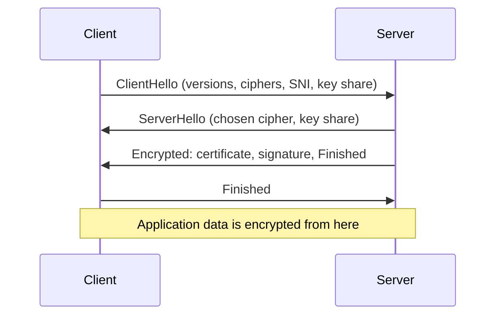

This is TLS 1.3. Read it top to bottom. The client guesses a key exchange group and sends its key share immediately, so the server can answer with everything in one flight.

What happens:
1. **ClientHello.** Supported versions, cipher suites, a random value, the key share (an ephemeral Diffie-Hellman public value, usually X25519), and the **SNI** (Server Name Indication), the hostname it wants. SNI lets one IP address host many sites, because the server must pick the right certificate before encryption starts.
2. **ServerHello.** The server picks the cipher and sends its key share. Both sides can now compute the shared secret and derive keys.
3. **Certificate and proof.** Sent already encrypted in TLS 1.3. The server signs the handshake transcript with its private key. The client validates the chain, the dates and the hostname.
4. **Finished.** Each side confirms the handshake was not tampered with. Then data flows.

| | TLS 1.2 | TLS 1.3 |
| --- | --- | --- |
| Round trips before data | 2 | 1 (0 with resumption, "0-RTT") |
| Key exchange | RSA or (EC)DHE | Ephemeral only, so forward secrecy always |
| Ciphers | Many, some weak | Few, all AEAD |
| Certificate visibility | Sent in clear | Encrypted |
| Removed | | RSA key transport, CBC, RC4, compression, renegotiation |

**0-RTT** lets a returning client send data in the first flight, but that data can be replayed by an attacker, so only allow it for safe, idempotent requests.

**Gotchas**
- SNI is sent in clear text unless Encrypted Client Hello is used, so observers can see which site you visit.
- Disabling certificate checks in a client (`rejectUnauthorized: false`, `InsecureSkipVerify`) removes the authentication step.

**Interview tip:** The three ideas to say: agree on keys with ephemeral Diffie-Hellman, prove identity with a certificate signature, then use symmetric encryption.

_Module: TLS & Cryptography · Tags: tls, handshake, tls-1.3_

### 35. What is mutual TLS (mTLS) and where is it used?

**Short answer:** In normal TLS only the server shows a certificate. In mutual TLS the client shows one too, so each side proves its identity. It is used for service-to-service calls, service meshes, device authentication and some B2B APIs.

The server sends a `CertificateRequest` during the handshake. The client answers with its certificate and a signature made with its private key. The server checks the client certificate against a CA it trusts and can read the identity from it (the subject or a SAN such as a service name or SPIFFE ID).

Where it fits:
- **Service mesh.** Istio or Linkerd sidecars give each workload a short-lived certificate and enforce mTLS between pods automatically. Apps do not change.
- **Zero-trust internal networks.** "Being inside the network" is no longer a reason to trust a caller.
- **Devices and fleets.** Each tablet, gateway or aircraft unit has a unique certificate and private key (ideally held in a TPM or secure element), so the cloud knows exactly which device is calling. This also lets you revoke one device.
- **Partner APIs** where passwords or API keys are not strong enough.

| Compared with | mTLS | API key or bearer token |
| --- | --- | --- |
| Secret leaves the client? | Private key never sent | The secret is sent each time |
| Replay if stolen in transit | Not possible | Possible |
| Operations cost | Needs a CA, issuance, rotation | Simple |
| Identity | Strong machine identity | Weaker, copyable |

Challenges: issuing and rotating many certificates, revocation, load balancers that terminate TLS (they must pass client identity along or re-establish mTLS), debugging handshake failures, and certificate expiry outages.

```bash
# a client presenting its certificate (files are examples, not real)
curl --cert client.pem --key client.key --cacert ca.pem https://127.0.0.1:8443/status
```

**Gotcha:** mTLS proves which machine called, not what that caller is allowed to do. You still need authorisation, for example a policy per service.

**Interview tip:** Pair it with a short-lived certificate and automation (mesh, cert-manager, SPIFFE). Manually managed client certificates are the thing that breaks at 3 am.

_Module: TLS & Cryptography · Tags: mtls, certificates, zero-trust_

### 36. How do you manage the certificate lifecycle, avoid expiry outages and use ACME and Let's Encrypt?

**Short answer:** Certificates expire, and expired ones cause outages. Automate issuance and renewal, monitor expiry as a first-class alert, and prefer short lifetimes. ACME is the protocol that lets a client prove domain control to a CA and get certificates automatically. Let's Encrypt is a free CA that uses it.

Lifecycle: generate a key pair, create a certificate signing request (CSR), the CA validates and issues, you deploy it, renew before expiry, and revoke if the key is compromised.

How ACME works, in plain words:
1. Your ACME client asks the CA for a certificate for `api.example.com`.
2. The CA sets a challenge: put a token at a known HTTP path (HTTP-01), or add a DNS TXT record (DNS-01), or answer on a TLS port (TLS-ALPN-01).
3. If the CA can see the proof, it issues the certificate.
4. The client repeats this before expiry, usually every 60 days or earlier for 90-day certificates. Public certificate lifetimes are getting shorter across the industry, which makes automation mandatory.

DNS-01 is needed for wildcard certificates and works for servers that are not reachable from the internet. The DNS API token it needs is a sensitive secret; scope it tightly.

On Kubernetes, **cert-manager** requests and renews certificates and stores them in Secrets, and ingress controllers reload them.

Avoiding outages:
- Keep an inventory of every certificate, including internal CAs, device certificates and client certificates.
- Alert at 30, 14 and 7 days before expiry, and alert on renewal failures.
- Test renewal in a staging environment, since rate limits apply in production.
- Rotate the private key at renewal when you can.
- For internal CAs, plan CA root rotation years before the expiry of the root.
- Include certificate checks in synthetic monitoring from the outside.

**Gotcha:** Pinning certificates in clients or hard-coding them in devices turns every renewal into a deployment problem.

**Interview tip:** Famous outages from expired certificates are common. Say "if it expires on a calendar, we automate it or we alert on it, never remember it".

_Module: TLS & Cryptography · Tags: certificates, acme, rotation_

### 37. What is the difference between authentication and authorisation?

**Short answer:** Authentication (authn) answers "who are you?" Authorisation (authz) answers "what are you allowed to do?" Authentication must come first, but being authenticated does not mean being allowed.

Analogy: showing your ID at a hotel desk is authentication. The key card that opens only your room is authorisation.

| | Authentication | Authorisation |
| --- | --- | --- |
| Question | Who is this? | May they do this? |
| Proof | Password, passkey, token, certificate | Policy, role, permission, ownership |
| Failure code | 401 | 403 (or 404 to hide existence) |
| Decided | At login or token validation | On every request, for every object |
| Standards | OpenID Connect, SAML, WebAuthn | OAuth 2.0 scopes, RBAC, ABAC |

Common mistakes mix them up:
- **OAuth 2.0 is for authorisation** (delegating access to an API). OpenID Connect adds authentication on top.
- A valid token only proves that someone logged in. The service still decides if that user may read order 42.
- Checking permissions only in the user interface. Hiding a button is not security; the API must enforce it.

Where to enforce authorisation: in the server, close to the data, on every request. Gateways can do coarse checks (is the token valid, is the scope right). The service does fine-grained checks (does this user own this order?).

```js
// ❌ bad: authenticated is treated as authorised
app.get('/orders/:id', requireLogin, async (req, res) => res.json(await db.order(req.params.id)));

// ✅ good: the query includes the owner
app.get('/orders/:id', requireLogin, async (req, res) => {
  const order = await db.orderForUser(req.params.id, req.user.id);
  if (!order) return res.sendStatus(404);
  res.json(order);
});
```

**Gotcha:** Ask what the system does when the policy check itself fails: it should deny.

**Interview tip:** Say the line "authentication gets you through the door, authorisation decides which rooms you can enter, and it is checked at every door".

_Module: Authentication & Authorization · Tags: authentication, authorization, access-control_

### 38. How should you store passwords? Explain salting, bcrypt, scrypt, Argon2 and why SHA-256 alone is wrong.

**Short answer:** Store a salted hash made with a slow, memory-hard password hashing function such as Argon2id, scrypt or bcrypt. Never store passwords in plain text, never encrypt them, and never use a plain fast hash like SHA-256 alone.

Why not plain SHA-256: it is designed to be fast, and a graphics card can test billions of guesses per second. If your database leaks, most passwords fall quickly. Rainbow tables (precomputed hashes) make it even faster when there is no salt.

- **Salt:** a unique random value per user, stored next to the hash. It makes identical passwords produce different hashes and kills precomputed tables. It is not secret.
- **Work factor:** the algorithm is deliberately slow and, for scrypt and Argon2, uses a lot of memory, which is expensive for attackers with GPUs.
- **Pepper (optional):** a secret key kept outside the database (for example in a key vault) and mixed in, so a stolen database alone is not enough.

| Algorithm | Notes |
| --- | --- |
| Argon2id | Current first choice (OWASP recommends it) |
| scrypt | Memory hard, built into Node.js `crypto` |
| bcrypt | Old but still acceptable, 72-byte input limit |
| PBKDF2 | Acceptable when required by standards (FIPS), needs many iterations |
| SHA-256, MD5 | ❌ Not for passwords |

```js
import { scryptSync, randomBytes, timingSafeEqual } from 'node:crypto';
function hashPassword(pw) {
  const salt = randomBytes(16);                       // unique per user
  const hash = scryptSync(pw, salt, 32, { N: 16384, r: 8, p: 1 });
  return `scrypt$16384$8$1$${salt.toString('base64')}$${hash.toString('base64')}`;
}
function verify(pw, stored) {
  const [, N, r, p, s, h] = stored.split('$');
  const want = Buffer.from(h, 'base64');
  const got = scryptSync(pw, Buffer.from(s, 'base64'), want.length, { N: +N, r: +r, p: +p });
  return timingSafeEqual(got, want);                  // constant-time compare
}
// hashing the same password twice gives different strings (different salts)
// verify('correct horse', a) -> true, verify('wrong', a) -> false
```

Tune the parameters so one hash takes about 100 ms on your server. Store the parameters in the string so you can raise them later and re-hash on the next successful login.

**Gotchas**
- Truncating or limiting passwords to short lengths. Allow long passphrases.
- Doing the hash on the main thread of a busy Node server: use the async `scrypt` so it does not block the event loop.
- Writing your own scheme.

**Interview tip:** Add that you also check new passwords against known breached lists and use MFA, since hashing only limits damage after a leak.

_Module: Authentication & Authorization · Tags: passwords, hashing, scrypt_

### 39. What are the pros and cons of server-side sessions versus tokens?

**Short answer:** A server-side session keeps state on the server and gives the client a random ID. A token (like a JWT) carries the state inside it, signed, so the server does not look anything up. Sessions are easy to revoke. Tokens scale easily across services but are hard to revoke.

| | Session ID in cookie | Self-contained token (JWT) |
| --- | --- | --- |
| State | In a store (Redis, database) | In the token |
| Revocation | Delete the session, immediate | Wait for expiry, or keep a deny list |
| Lookup cost | One store read per request | None, only signature check |
| Cross-service use | Needs shared store | Easy: any service with the key can verify |
| Size | Tiny | Hundreds of bytes or more |
| Browser storage | `HttpOnly` cookie | Cookie or memory (avoid `localStorage`) |
| Best for | Browser web apps with one backend | APIs, microservices, mobile apps, third-party access |

Many systems combine them: a short-lived access token (about 5 to 15 minutes) for APIs plus a longer-lived refresh token kept server-side or in an `HttpOnly` cookie, which can be revoked.

"Stateless tokens scale better" is half true. The store lookup for sessions is cheap with Redis, and the revocation and logout you gain are valuable. Pure stateless tokens often grow a revocation list, which makes them stateful again.

For a first-party web app talking to its own backend, a plain session cookie is often the simplest and safest choice. For mobile apps and service-to-service calls, tokens fit better.

**Gotchas**
- A JWT used as a session is easy to implement badly (no logout, long expiry, stored in `localStorage`).
- Sessions need CSRF protection, because the browser attaches cookies automatically.

**Interview tip:** Answer with the question "how fast must I be able to cut off access?" If the answer is "immediately", prefer sessions or short tokens with a revocation path.

_Module: Authentication & Authorization · Tags: sessions, tokens, authentication_

### 40. What is a JWT? Explain its structure, signing algorithms, validation steps and common pitfalls.

**Short answer:** A JSON Web Token has three Base64URL parts separated by dots: header, payload (claims) and signature. The signature proves who issued it and that it was not changed. The payload is only encoded, not encrypted, so anyone can read it.

```text
eyJhbGciOiJIUzI1NiIs...  .  eyJzdWIiOiJ1NDIi...  .  <signature>
 header {"alg":"HS256"}      claims {"sub":"u42","aud":"orders-api","exp":...}
```

Common claims: `iss` (issuer), `sub` (subject), `aud` (audience), `exp` (expiry), `nbf`, `iat`, `jti` (token ID).

| Algorithm | Type | Use |
| --- | --- | --- |
| HS256 | Shared secret (HMAC) | One party issues and verifies. Any verifier could also forge tokens |
| RS256 / ES256 / EdDSA | Public-private key | The issuer signs, many services verify with the public key (often via a JWKS endpoint) |

Prefer asymmetric signing when several services verify tokens.

**Validation steps** (a verifier must do all of them):
1. Pin the allowed algorithm. Never trust the `alg` in the token.
2. Verify the signature with the right key (selected by `kid` from a trusted key set).
3. Check `exp` and `nbf`, allowing small clock skew.
4. Check `iss` and `aud` match what you expect.
5. Then check authorisation: scopes or roles, and ownership of data.

This runnable demo builds HS256 by hand, using Node's core `crypto`:

```js
const sig = createHmac('sha256', SECRET).update(`${head}.${body}`).digest('base64url');
// verify: pin alg, constant-time compare, then check exp and aud
// valid token prints:   { sub: 'u42', aud: 'orders-api', exp: 1700000600 }
// alg "none" token:     alg not allowed
// after expiry:         expired
```

**Pitfalls**
- ❌ Accepting `alg: none` or letting the header choose the algorithm (and the "RS256 public key used as an HS256 secret" confusion attack).
- ❌ Putting secrets or personal data in the payload.
- ❌ Long expiry with no revocation. Keep access tokens short.
- ❌ Storing in `localStorage`: any XSS can read it. Prefer an `HttpOnly` cookie or memory.
- ❌ Skipping the audience check, so a token for service A works on service B.
- Use a maintained library. Writing it by hand is for learning only.

**Interview tip:** Say what a JWT is good at (stateless verification across services) and what it is bad at (instant revocation).

_Module: Authentication & Authorization · Tags: jwt, tokens, signing_

### 41. How do OAuth 2.0 roles and flows work? Explain authorization code with PKCE, client credentials, and why implicit and password grants are discouraged.

**Short answer:** OAuth 2.0 lets an application get limited access to an API on a user's behalf without seeing the user's password. A user (resource owner) approves, an authorisation server issues tokens, a client app uses them, and a resource server (the API) accepts them. Use the authorization code flow with PKCE for apps with users, and client credentials for machine-to-machine.

Roles: **resource owner** (the user), **client** (the app), **authorization server** (login and token issuing), **resource server** (the API).

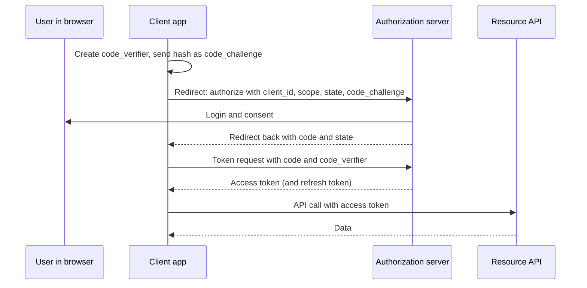

Read it top to bottom. The browser only carries a short-lived code. The tokens are fetched by the client directly from the authorisation server.

**PKCE** (Proof Key for Code Exchange) stops a stolen code from being useful. The client invents a random secret, sends only its hash at the start, and proves it knows the original when exchanging the code. Today PKCE is recommended for all clients, including confidential ones, and mandatory for public clients such as single-page apps and mobile apps. Always check the `state` value to prevent CSRF and use exact redirect URI matching.

| Flow | Use | Notes |
| --- | --- | --- |
| Authorization code + PKCE | Web, SPA, mobile with a user | The default |
| Client credentials | Service to service, no user | Secret kept server side, scopes limited |
| Device code | TVs, CLI, devices with no browser | User approves on another device |
| Refresh token | Get new access tokens | Rotate and protect |
| Implicit | ❌ Tokens in URL fragments, leak and replay | Replaced by code + PKCE |
| Resource owner password | ❌ App handles raw passwords, no MFA | Avoid |

**Gotchas**
- Using an access token as proof of login. That is what OpenID Connect's ID token is for.
- Wildcard redirect URIs: they allow code theft.
- Overly broad scopes.

**Interview tip:** If asked "how would a single page app log in?", answer "authorization code with PKCE, keep tokens out of `localStorage` if you can, or use a backend-for-frontend that holds the tokens and gives the browser a session cookie".

_Module: Authentication & Authorization · Tags: oauth2, pkce, flows_

### 42. What is OpenID Connect, how do the ID token and access token differ, and how do SSO and SAML fit?

**Short answer:** OpenID Connect (OIDC) is a thin identity layer on top of OAuth 2.0. It adds an ID token that tells the application who logged in. The access token is for calling APIs. SSO means one login gives access to many apps. SAML is an older XML-based way to do the same, common in enterprises.

| | ID token | Access token |
| --- | --- | --- |
| Audience | The client app | The API (resource server) |
| Purpose | Prove who the user is, when and how they logged in | Permission to call an API |
| Format | Always a JWT | JWT or opaque string |
| Who reads it | The client | The API, and not the client |
| Sent to APIs? | No | Yes, as `Authorization: Bearer` |

OIDC adds standard pieces: the `openid` scope, a discovery document at `/.well-known/openid-configuration`, a JWKS endpoint for signing keys, a `userinfo` endpoint, and claims such as `sub`, `email` and `nonce`. The client must validate the ID token: signature, `iss`, `aud` (its own client ID), `exp` and `nonce`.

**SSO (single sign-on).** The user logs in once at the identity provider (IdP). Each application (service provider) redirects there and gets proof of login. If the IdP session is active, no password prompt appears. Logging out everywhere is the harder part.

**SAML 2.0** does this with signed XML assertions, passed through browser redirects. It is common for enterprise staff apps and older products. New apps usually choose OIDC. Both do the same job: an IdP vouches for the user.

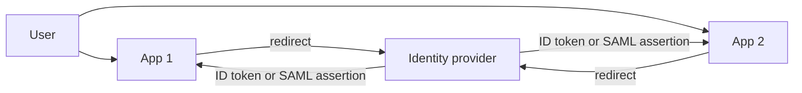

Both apps trust one IdP, so one login covers both.

**Gotchas**
- Using the ID token to call your API. Use the access token with the right audience.
- Trusting the email claim without checking `email_verified` when linking accounts.
- XML signature wrapping bugs in hand-written SAML code: use a maintained library.

**Interview tip:** Distinguish the three questions: OAuth is "may this app call that API", OIDC is "who is the user", SAML is "enterprise SSO in XML".

_Module: Authentication & Authorization · Tags: oidc, sso, saml_

### 43. How do refresh tokens and refresh token rotation work?

**Short answer:** A refresh token lets a client get a new short-lived access token without making the user log in again. Because it is long-lived and powerful, treat it like a password: store it safely, rotate it on every use, and detect reuse.

Why two tokens: access tokens are sent to APIs on every call, so they are exposed more often. Keep them short (5 to 15 minutes). The refresh token is only ever sent to the authorisation server, so it can live longer (days or weeks) with less exposure.

Rotation: every time the client uses a refresh token, the server returns a new access token **and a new refresh token**, and invalidates the old one. If an old refresh token is used again, someone has a copy (the thief or the real client), so the server revokes the whole token family and forces a new login.

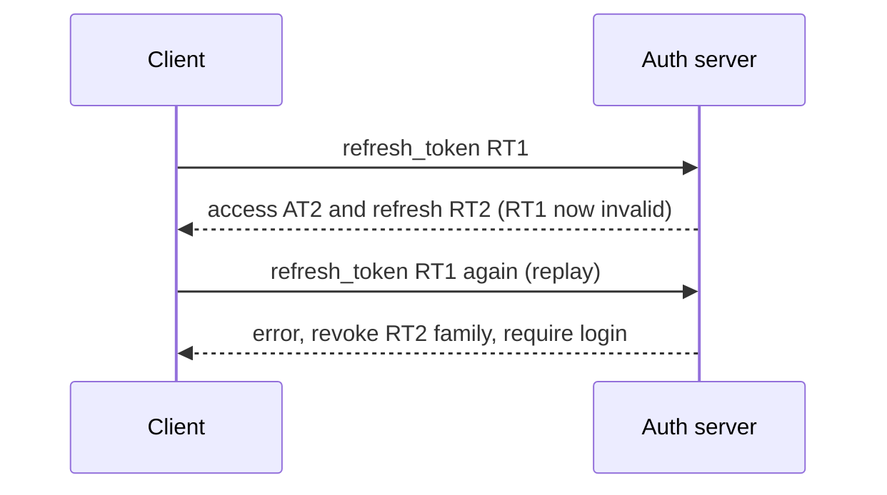

Read it top to bottom: the second use of RT1 is the alarm.

Good practice:
- Store refresh tokens hashed on the server, like passwords, with device, time and IP info.
- Set an absolute lifetime and an idle timeout.
- Bind to the client where possible: public clients use rotation, confidential clients authenticate. Sender-constrained tokens (DPoP, mTLS) make a stolen token useless.
- In browsers keep it in an `HttpOnly; Secure; SameSite` cookie handled by a backend, not in `localStorage`.
- Provide a "sign out of all devices" action that revokes everything.
- Rotate with a short grace window so a network retry does not log users out.

**Gotchas**
- Never rotating and never expiring refresh tokens: one leak gives permanent access.
- Racy parallel refreshes from several browser tabs causing false reuse alarms. Use one refresh queue per client.

**Interview tip:** For "a token leaked, what now?" the answer includes revoking refresh tokens, not only waiting for access tokens to expire.

_Module: Authentication & Authorization · Tags: refresh-token, oauth2, rotation_

### 44. How do MFA, TOTP and WebAuthn passkeys work, and which should you prefer?

**Short answer:** Multi-factor authentication asks for two or more kinds of proof: something you know, something you have, something you are. TOTP codes are a good baseline. WebAuthn passkeys are stronger because they cannot be phished, and they are the best option when supported.

| Method | How | Strength | Weaknesses |
| --- | --- | --- | --- |
| SMS code | Code sent by text | Better than nothing | SIM swap, interception, phishing |
| Email code | Code or link by email | Weak to medium | Depends on email security, phishable |
| TOTP | Authenticator app computes a code from a shared secret and the time | Good | Phishable in real time, the secret is stored on both sides |
| Push approval | Approve on a phone | Good | "MFA fatigue" spam, use number matching |
| WebAuthn / passkey | Public-key signature by device, bound to the website | Best | Recovery and device loss need design |

**TOTP in short:** server and app share a secret. Every 30 seconds both compute `HMAC(secret, floor(time / 30))`, then truncate it to six digits. The server accepts the current code and maybe one step either side for clock drift. The demo below reproduces the RFC 6238 test vector:

```js
const hotp = (secret, counter, digits = 6) => {
  const msg = Buffer.alloc(8); msg.writeBigUInt64BE(BigInt(counter));
  const h = createHmac('sha1', secret).update(msg).digest();
  const off = h[h.length - 1] & 0xf;
  return String((h.readUInt32BE(off) & 0x7fffffff) % 10 ** digits).padStart(digits, '0');
};
// totp(secret, 59) prints: 287082   (6 digits of the RFC test value)
```

**WebAuthn in short:** at registration the device creates a key pair for this website and sends only the public key. At login the server sends a random challenge, and the device signs it after a local check (fingerprint, face, PIN). The browser includes the website origin in what is signed, so a fake site cannot get a valid signature. No shared secret exists to steal. Passkeys are WebAuthn credentials that can sync between a user's devices.

Design details: offer recovery codes, let users register several authenticators, rate limit code attempts, and never let account recovery weaken the strong factor (an email reset that bypasses MFA defeats it).

**Gotcha:** Do not implement TOTP or WebAuthn parsing yourself in production; use a vetted library or your identity provider.

**Interview tip:** Say "phishing-resistant MFA" and name WebAuthn. It is the phrase that signals current knowledge.

_Module: Authentication & Authorization · Tags: mfa, totp, webauthn_

### 45. What is the difference between RBAC, ABAC and ACLs, and where should authorisation be enforced?

**Short answer:** An ACL lists who may access one object. RBAC gives permissions to roles and users get roles. ABAC decides using attributes of the user, the resource and the context. Enforce authorisation on the server for every request, as close to the data as possible.

| Model | Decision based on | Good for | Weakness |
| --- | --- | --- | --- |
| ACL | A list on each resource: alice can read, bob can write | Files, sharing documents | Hard to manage at scale |
| RBAC | User has role `editor`; role has permissions | Most business apps, simple to explain and audit | Role explosion when rules get specific |
| ABAC | Rules such as "user.department == doc.department and time is working hours" | Fine-grained, contextual rules, multi-tenant | Harder to test and understand |
| ReBAC | Relationships: "member of the team that owns the folder" | Sharing and hierarchies (Google Zanzibar style) | Needs a relationship store |

Typical real systems combine them: roles for coarse access, plus ownership or tenant attributes for the fine part.

```js
// RBAC says editors may update orders; ownership narrows it to the right tenant
function canUpdateOrder(user, order) {
  return user.roles.includes('editor') && order.tenantId === user.tenantId;
}
```

Where to enforce:
- **Every request, on the server.** Never rely on the client hiding buttons or sending a role field.
- **Close to the data.** Put the check in the service or the query itself (`WHERE tenant_id = ? AND id = ?`), not only at the gateway.
- **Centralise the logic** in a policy function or policy engine (OPA, Cedar) so rules are consistent and testable. Keep the enforcement point in each service.
- **Default deny.** If no rule says yes, the answer is no.
- **Audit decisions** for sensitive actions.

Use least privilege: give new roles minimal rights and review them periodically.

**Gotchas**
- Trusting a role claim that the client can edit.
- Forgetting indirect paths (a "list" endpoint that has no check while "get" does).
- Admin roles that bypass tenant boundaries by accident.

**Interview tip:** Say that tests for "user A cannot access B's data" belong in the automated suite for every endpoint.

_Module: Authentication & Authorization · Tags: rbac, abac, authorization_

### 46. How do you use the OWASP Top 10 as a framework?

**Short answer:** The OWASP Top 10 is a community-maintained awareness list of the most critical web application security risk categories. Use it as a shared vocabulary and a checklist for design, review and training, not as a complete standard. Check the current edition, because categories and order change between releases.

Categories you will see in recent editions (names vary a little by edition):
- Broken access control
- Cryptographic failures
- Injection (including cross-site scripting in recent lists)
- Insecure design
- Security misconfiguration
- Vulnerable and outdated components
- Identification and authentication failures
- Software and data integrity failures (including insecure deserialisation and supply chain)
- Security logging and monitoring failures
- Server-side request forgery (SSRF)

I am deliberately not quoting rank numbers; they move between editions, so look at the current list when preparing.

How to use it in a team:
1. **Training.** Map each category to a real example from your own stack.
2. **Threat modelling and review.** Ask "which categories apply to this feature?" Add them to the pull request checklist.
3. **Testing.** Write tests and scans per category (access control tests, header checks, dependency scans).
4. **Priorities.** Use it to pick the first controls, then move to deeper standards.

Go beyond it when needed:
- **OWASP ASVS** (Application Security Verification Standard): a detailed requirements list with levels, good for specifying and testing.
- **OWASP API Security Top 10** for APIs.
- **OWASP Cheat Sheet Series** for concrete implementation advice.

| Need | Use |
| --- | --- |
| Awareness, interview vocabulary | Top 10 |
| A testable requirement list | ASVS |
| API-specific risks | API Security Top 10 |
| How-to for one topic | Cheat sheets |

**Gotcha:** "We fixed the Top 10" is not a security strategy. The list is general; your own threat model tells you what matters.

**Interview tip:** Pick two or three categories and explain a real example and its fix for each, instead of reciting all ten.

_Module: Web Application Security · Tags: owasp, web-security, risk_

### 47. What is injection (SQL injection and command injection) and how do you defend against it?

**Short answer:** Injection happens when untrusted input is mixed into a command or query and the interpreter treats part of it as code. The main defence is to keep data and code separate: parameterised queries for SQL, and no shell strings for commands.

SQL injection: if you build a query by pasting user text, input like `x' OR '1'='1` changes the meaning of the query.

```python
import sqlite3
db = sqlite3.connect(":memory:")
db.execute("CREATE TABLE users (name TEXT, role TEXT)")
db.executemany("INSERT INTO users VALUES (?, ?)", [("asha", "admin"), ("ben", "user")])
evil = "x' OR '1'='1"
# ❌ bad: input becomes part of the SQL text
bad = db.execute(f"SELECT name FROM users WHERE name = '{evil}'").fetchall()
print(len(bad))    # prints: 2   (every row matched)
# ✅ good: the value travels separately from the SQL
good = db.execute("SELECT name FROM users WHERE name = ?", (evil,)).fetchall()
print(len(good))   # prints: 0
```

Command injection: passing user input to a shell lets `; rm -rf` style text run.

```js
import { execFile } from 'node:child_process';
const filename = 'report.txt; echo INJECTED';
// ✅ good: no shell, the whole string is ONE argument
execFile('ls', ['-l', filename], (err) => console.log(err ? 'ls failed: no such file' : 'ok'));
// prints: ls failed: no such file   (the text was not run as a command)
```

Defence checklist:
1. **Parameterised queries / prepared statements** or an ORM's bound parameters. Names of tables and columns cannot be parameters, so allow-list them.
2. **Avoid the shell.** Use `execFile` or `spawn` with an argument array, or a library API, instead of `exec` with a string.
3. **Validate input** by type, length and allowed values (an allow-list). Useful, but not a replacement for parameters.
4. **Least privilege** for the database user: no `DROP`, no access to other schemas.
5. **Hide details:** do not return SQL errors to users.

Other injection families: NoSQL operators in JSON (`{"$ne": null}`), LDAP, template injection, header injection (CRLF), log injection.

**Gotchas**
- "Escaping quotes by hand" is fragile. Use the driver's parameters.
- ORMs still allow raw queries; the same rule applies to them.

**Interview tip:** The one-line principle is "never build code from data". Interviewers like it when you say the same fix works for SQL, shell and templates.

_Module: Web Application Security · Tags: injection, sql-injection, command-injection_

### 48. What is cross-site scripting (XSS), what are the types, and how do you defend against it?

**Short answer:** XSS happens when an attacker's script runs inside your page in a victim's browser. The script can act as the user: read page data, call your API and, if tokens are reachable, steal them. Defend by encoding output for its context, avoiding dangerous sinks, using a strict Content Security Policy and using frameworks that escape by default.

| Type | Where the bad data comes from | Example |
| --- | --- | --- |
| Stored | Saved in your database, shown to others | A comment containing a script tag |
| Reflected | In the request (query string) and echoed in the response | A search page printing `?q=` unescaped |
| DOM-based | Client-side code puts data into the DOM unsafely | `element.innerHTML = location.hash` |

```js
const esc = (s) => s.replace(/[&<>"']/g, (c) => ({ '&': '&amp;', '<': '&lt;', '>': '&gt;', '"': '&quot;', "'": '&#39;' }[c]));
const comment = '';
console.log('❌ ' + `<p>${comment}</p>`);      // prints: ❌ <p></p>
console.log('✅ ' + `<p>${esc(comment)}</p>`); // prints: ✅ <p>&lt;img src=x onerror=alert(1)&gt;</p>
```

The escaped version is shown as text, not run. Escaping must match the context: HTML body, attribute, JavaScript string, URL and CSS each need different encoding. Do not hand-roll it; use the template engine.

Defences in layers:
1. **Framework default escaping.** React escapes values in JSX. The danger is `dangerouslySetInnerHTML`, `innerHTML`, `eval`, `javascript:` URLs and unsanitised markdown. If you must render user HTML, sanitise it with a maintained library such as DOMPurify.
2. **Content Security Policy (CSP).** `script-src 'self'` (or nonces) blocks injected inline scripts. It is a safety net, not a replacement for encoding.
3. **`HttpOnly` cookies** so scripts cannot read the session cookie.
4. **Trusted Types** in modern browsers to block unsafe DOM sinks.
5. **Validation and encoding on input** for structure, not as the only defence.

**Gotchas**
- Encoding on input and storing it encoded causes double-escaping bugs. Encode at output.
- Third-party scripts run with full power on your page. Limit and review them, and use Subresource Integrity for static ones.

**Interview tip:** Say "output encoding by context is the main fix, CSP is the second layer, and HttpOnly limits what a successful attack can steal".

_Module: Web Application Security · Tags: xss, csp, web-security_

### 49. What is CSRF and how do you defend against it?

**Short answer:** Cross-site request forgery makes a victim's browser send a request to your site from another site, and the browser automatically attaches the victim's cookies. If your server only checks the cookie, it performs the action. Defend with SameSite cookies, anti-CSRF tokens and checks of the `Origin` header.

Example attack idea: a page on `evil.example` contains a hidden form that posts to `bank.example/transfer`. If the user is logged in to the bank, the cookie goes along and the transfer happens.

CSRF needs: the browser sends credentials automatically (cookies, basic auth), and the action is triggered by a predictable request. APIs that use an `Authorization` header with a token held in JavaScript are not vulnerable to classic CSRF, because other sites cannot add that header.

Defences, strongest combination first:
1. **`SameSite=Lax` or `Strict` on session cookies.** Blocks cookies on cross-site POSTs. A good baseline today, but not complete (for example subdomain and same-site attacks).
2. **Anti-CSRF token** (synchroniser token or double-submit cookie). A random value is placed in the page or a header, and the server verifies it on each state-changing request. Attackers cannot read it because of the same-origin policy.
3. **Verify `Origin` or `Referer`** headers on state-changing requests. Reject when present and wrong.
4. **Custom header requirement** (such as `X-Requested-With`) for JSON APIs: cross-origin custom headers trigger a CORS preflight that fails.
5. **Re-authentication** for very sensitive actions (change password, big transfers).
6. **Never change state with GET.**

```js
// server check for a state-changing request
if (req.headers.origin && req.headers.origin !== 'https://app.example.com') {
  return res.sendStatus(403);                        // wrong site
}
if (req.headers['x-csrf-token'] !== req.session.csrfToken) {
  return res.sendStatus(403);                        // token missing or wrong
}
```

**Gotchas**
- CORS does not stop CSRF. The request is sent anyway; CORS only blocks reading the response.
- XSS defeats CSRF protection, because the script can read the token.
- Login CSRF (forcing a victim to log in as the attacker) also exists.

**Interview tip:** The relation to remember: SameSite cookies and tokens for cookies-based sessions; bearer tokens in headers avoid CSRF but make XSS more dangerous.

_Module: Web Application Security · Tags: csrf, samesite, cookies_

### 50. What is broken access control and IDOR, and how do you prevent them?

**Short answer:** Broken access control means a user can do or see something they should not. IDOR (insecure direct object reference, also called BOLA in API terms) is the common case: the user changes an ID in the request, such as `/orders/42` to `/orders/43`, and the server returns another person's data because it never checked ownership.

It consistently ranks among the most common and most serious web risks because scanners cannot know your business rules. Only tests and review find them.

Typical forms:
- Reading or changing other users' objects by guessing IDs.
- Calling admin endpoints as a normal user (function-level authorisation missing).
- Changing a field the user should not control (`role`, `price`).
- Skipping steps in a flow, for example calling "confirm payment" without paying.
- Path traversal: `../../etc/passwd`.
- Missing tenant filter in multi-tenant systems.

```js
// ❌ bad: any logged-in user can fetch any invoice
app.get('/invoices/:id', auth, async (req, res) => res.json(await db.invoice(req.params.id)));

// ✅ good: ownership is part of the query, and not-found hides existence
app.get('/invoices/:id', auth, async (req, res) => {
  const inv = await db.invoice(req.params.id, { ownerId: req.user.id });
  if (!inv) return res.sendStatus(404);
  res.json(inv);
});
```

Prevention:
1. **Deny by default.** Every endpoint declares who may call it.
2. **Check at the object level on the server,** in the data access layer, so it is hard to forget (`WHERE id = ? AND tenant_id = ?`).
3. **Take identity from the token or session,** never from a request field such as `userId`.
4. **Use unpredictable IDs (UUIDs)** as an extra layer, not as the control. A guessable ID is not the bug; the missing check is.
5. **Test it.** Automated tests log in as user A and try to read and change user B's resources for every endpoint.
6. **Log and alert** on repeated 403 and 404 patterns on object IDs, which look like enumeration.

**Gotcha:** Hiding the link in the UI is not access control.

**Interview tip:** Say the exact test you would write: "user A requests user B's order and must get 404".

_Module: Web Application Security · Tags: access-control, idor, authorization_

### 51. What is SSRF (server-side request forgery) and how do you prevent it?

**Short answer:** SSRF happens when your server fetches a URL that an attacker controls, so the attacker can make your server call internal systems it can reach but they cannot. In the cloud this can expose metadata services that hand out credentials.

Features at risk: "import from URL", webhooks, image fetchers and link previews, PDF generators, and URL-based file upload. The server's network position is the danger: it sits inside your private network.

Targets attackers aim for:
- Cloud instance metadata addresses (the link-local address `169.254.169.254`).
- Internal admin pages, databases, Kubernetes API, `localhost`.
- Other internal services with no authentication because "it is internal".

Defences, layered:
1. **Avoid fetching user URLs at all** when you can. Take an ID or choose from a list.
2. **Allow-list** destinations (hosts and schemes) when possible.
3. **Block private ranges** after DNS resolution: loopback, private, link-local and reserved addresses. Check the final IP, not the text of the URL, and re-check after every redirect (or disable redirects). Beware of DNS rebinding: the name resolves to a safe IP at check time and an internal one at connect time. Connect to the checked IP directly.
4. **Only `https`**, no `file:`, `gopher:` or other schemes.
5. **Network controls.** Egress firewall or network policy so the service cannot reach internal ranges. Put such fetchers in an isolated workload with no secrets.
6. **Metadata hardening.** Use the cloud's v2 or token-required metadata mode, or disable it, and use workload identity.
7. **Limit responses:** timeouts, size limits and no echoing of raw response bodies.

```python
def is_safe(url):
    u = urlparse(url)
    if u.scheme != "https" or not u.hostname: return False
    for info in socket.getaddrinfo(u.hostname, u.port or 443, proto=socket.IPPROTO_TCP):
        ip = ipaddress.ip_address(info[4][0])
        if ip.is_private or ip.is_loopback or ip.is_link_local or ip.is_reserved: return False
    return True
# is_safe("http://example.com/x") -> False (not https)
# is_safe("https://169.254.169.254/latest") -> False (link-local)
# is_safe("https://10.0.0.5:8443/") -> False (private)
```

This helper is a starting point, not a complete defence, because of the rebinding point above.

**Gotcha:** Block lists of "bad hosts" fail; IP addresses have many spellings. Resolve and check the real address.

**Interview tip:** Link SSRF to cloud credentials. That is why it became a headline category.

_Module: Web Application Security · Tags: ssrf, network, cloud_

### 52. What is insecure deserialization and how do you avoid it?

**Short answer:** Deserialization turns bytes back into objects. If the data comes from an untrusted source and the format can create arbitrary objects or run code while loading, an attacker can craft input that executes code, bypasses logic or crashes your service. Prefer plain data formats like JSON and validate the result.

Dangerous in some languages: Java native serialization, Python `pickle`, PHP `unserialize`, .NET `BinaryFormatter`, and YAML loaders that construct arbitrary objects. These formats can instantiate classes chosen by the data. Attackers chain existing classes ("gadgets") in your classpath to get code execution.

```python
import pickle
# ❌ bad: never load pickle data from a user, a queue you do not control, or a cache others can write
# obj = pickle.loads(untrusted_bytes)

# ✅ good: parse plain data, then validate the shape
import json
data = json.loads('{"order_id": 7, "qty": 2}')
assert isinstance(data["order_id"], int) and 0 < data["qty"] <= 100
```

Defences:
1. **Do not deserialize untrusted data with object-capable formats.** Use JSON, Protocol Buffers or similar data-only formats.
2. **Validate with a schema** (JSON Schema, Zod, protobuf types) and reject unknown fields and wrong types.
3. **Sign or authenticate serialized data** you must round-trip through the client (cookies, hidden fields) using HMAC, and verify before parsing.
4. **Restrict types** if the framework allows an allow-list of classes, and keep dependencies patched.
5. **Run with least privilege** so a bug has limited reach.
6. In JavaScript, watch **prototype pollution**: merging untrusted JSON into objects with keys like `__proto__` can change behaviour. Use safe merge utilities, `Object.create(null)` or `Map`.
7. Limit input size and nesting depth to avoid denial of service.

In Node.js, `JSON.parse` is safe from code execution, but `eval`, `vm`, `node-serialize`-style libraries and unsafe YAML loaders are not.

**Gotcha:** Data from "inside" sources, such as a message queue or cache, is untrusted too if any other component or tenant can write to it.

**Interview tip:** Mention integrity: even "safe" formats need schema validation, and anything the client can modify must not be trusted.

_Module: Web Application Security · Tags: deserialization, injection, integrity_

### 53. What is security misconfiguration, and which secure HTTP headers should you set (CSP, HSTS, X-Content-Type-Options, frame-ancestors)?

**Short answer:** Security misconfiguration means defaults and settings that leave doors open: debug mode on, open admin consoles, public storage buckets, verbose errors, default passwords, missing headers. Secure headers are a cheap hardening layer that tell browsers to apply stricter rules for your site.

| Header | What it does |
| --- | --- |
| `Content-Security-Policy` | Whitelists where scripts, styles, frames and connections may load from; blocks injected scripts |
| `Strict-Transport-Security` (HSTS) | Tells browsers to use HTTPS only for this host for a period; stops downgrade and SSL stripping |
| `X-Content-Type-Options: nosniff` | Stops the browser guessing a different content type (script from text) |
| `frame-ancestors` (in CSP) | Controls who may embed your page in a frame; prevents clickjacking. Replaces `X-Frame-Options` |
| `Referrer-Policy` | Limits how much of the URL is sent to other sites |
| `Permissions-Policy` | Turns off browser features you do not use (camera, geolocation) |
| `Cross-Origin-Opener-Policy` and friends | Isolate your page from other windows and origins |

A small server that sets them, tested locally:

```js
const SECURITY_HEADERS = {
  'Content-Security-Policy': "default-src 'self'; script-src 'self'; object-src 'none'; frame-ancestors 'none'; base-uri 'self'",
  'Strict-Transport-Security': 'max-age=31536000; includeSubDomains',
  'X-Content-Type-Options': 'nosniff',
  'Referrer-Policy': 'strict-origin-when-cross-origin',
};
res.writeHead(200, { 'Content-Type': 'text/html; charset=utf-8', ...SECURITY_HEADERS });
// the client prints each header, for example:
// x-content-type-options: nosniff
// strict-transport-security: max-age=31536000; includeSubDomains
```

Roll out CSP with `Content-Security-Policy-Report-Only` first to see what would break. Use nonces or hashes instead of `'unsafe-inline'`. HSTS is sticky: start with a short `max-age`, and add `preload` only after you are sure every subdomain supports HTTPS.

Other misconfiguration checks:
- Disable directory listings, stack traces and debug endpoints.
- Remove default accounts and sample apps.
- Keep cloud storage private by default and scan for public buckets.
- Harden containers: non-root user, read-only filesystem, no extra capabilities.
- Manage configuration as code and review changes to it.

**Gotcha:** Setting `Access-Control-Allow-Origin: *` or a loose CSP "to make errors go away" quietly removes protection.

**Interview tip:** Mention you can test headers in CI with a simple script or a scanner, so they do not regress.

_Module: Web Application Security · Tags: headers, csp, hsts, misconfiguration_

### 54. How do you defend against brute force and credential stuffing, and how does rate limiting work?

**Short answer:** Brute force guesses passwords for one account. Credential stuffing tries leaked email and password pairs from other breaches across many accounts, which works because people reuse passwords. Defend with rate limits, MFA, breached-password checks, bot detection and monitoring, and keep login errors uniform.

Rate limiting caps how many requests a client may make in a time window. A common algorithm is the **token bucket**: a bucket holds tokens, each request takes one, and tokens refill at a steady rate. It allows short bursts but limits the average.

```js
class TokenBucket {
  constructor(capacity, refillPerSec) { this.cap = capacity; this.rate = refillPerSec; this.tokens = capacity; this.last = 0; }
  allow(nowSec) {
    this.tokens = Math.min(this.cap, this.tokens + (nowSec - this.last) * this.rate);
    this.last = nowSec;
    if (this.tokens >= 1) { this.tokens -= 1; return true; }
    return false;
  }
}
const b = new TokenBucket(3, 1);   // burst of 3, then 1 per second
// calls at t = 0, 0, 0, 0, 0.5, 1.2, 2.5 prints: true true true false false true true
```

Other algorithms: fixed window (simple, bursty at edges), sliding window (smoother), leaky bucket (smooth output).

Login-specific defences:
1. **Limit by several keys:** per IP, per account and per device. Per-IP alone fails against botnets; per-account alone lets attackers lock users out on purpose.
2. **Slow down rather than lock.** Progressive delay or a CAPTCHA after failures, with a temporary lock and notification.
3. **MFA**, ideally phishing-resistant, stops almost all stuffing.
4. **Check passwords against breach lists** at sign-up and change.
5. **Uniform responses:** same message and similar timing for "unknown user" and "wrong password". Return `429` with `Retry-After` when limiting.
6. **Bot management and device signals** at the edge.
7. **Monitor:** alert on many failures, many accounts from one source, and spikes in password resets.

Store counters in a shared store (Redis) so limits work across many instances. Enforce at the edge or gateway as well as in the service.

**Gotchas**
- Trusting `X-Forwarded-For` from the client, letting attackers pick their own IP.
- Limiting only the login page and forgetting the password reset and MFA endpoints.

**Interview tip:** Distinguish brute force from credential stuffing. The first is stopped by lockout and throttling, the second needs MFA and breach checks.

_Module: Authentication & Authorization · Tags: rate-limiting, brute-force, credential-stuffing_

### 55. What are the risks of file uploads and how do you handle them safely?

**Short answer:** Uploads let strangers put bytes on your server. Risks include code execution (an uploaded script served as code), path traversal, stored XSS through HTML or SVG files, malware, huge files that exhaust disk or memory, and image or document parsers with bugs. Treat every uploaded file as hostile.

Controls:
1. **Limit size and count** at the proxy and in the application. Stream, do not load the whole file into memory.
2. **Allow-list file types** by extension and by checking the real content (magic bytes), not only the client `Content-Type`. Block executables and scripts.
3. **Never use the client's file name** for storage. Generate a random name, or you invite `../../` path traversal and overwriting.
4. **Store outside the web root,** ideally in object storage (Azure Blob) with private access. Serve through a download endpoint or short-lived signed URLs.
5. **Serve safely:** set the correct `Content-Type`, `X-Content-Type-Options: nosniff` and `Content-Disposition: attachment` for downloads. Serve user content from a separate domain so scripts cannot reach your main origin cookies. Be careful with SVG and HTML, which can contain scripts.
6. **Scan for malware** and process images by re-encoding them (which drops hidden payloads). Run parsers in a sandbox or low-privilege worker.
7. **Authorise downloads:** an uploaded invoice must only be fetched by its owner (IDOR again).

```python
UPLOAD_DIR = "/srv/uploads"
def safe_path(filename: str) -> str:
    ext = os.path.splitext(filename)[1].lower()
    if ext not in {".png", ".jpg", ".pdf"}:
        raise ValueError("type not allowed")
    return os.path.join(UPLOAD_DIR, uuid.uuid4().hex + ext)   # never use the client's name
# safe_path("../../etc/passwd.png").startswith("/srv/uploads/")  -> True
# safe_path("shell.php")                                          -> raises "type not allowed"
```

**Gotchas**
- Trusting the extension alone: a file named `photo.png` can contain something else.
- Zip bombs and image bombs (tiny file, huge decompressed size). Limit decompressed size.
- Direct uploads to storage with signed URLs are good for scale, but still need type, size and scanning controls after upload.

**Interview tip:** Say "random name, private storage, validated type, separate domain, scan, limit".

_Module: Web Application Security · Tags: file-upload, validation, storage_

### 56. How do you secure an API? Cover object-level authorisation, mass assignment and excessive data exposure.

**Short answer:** Secure an API by authenticating every call, authorising at the object and function level, validating input against a schema, returning only needed fields, limiting rates and resources, and logging securely. The OWASP API Security list names the usual failures.

Common API risks:

| Risk | What happens | Fix |
| --- | --- | --- |
| Broken object-level authorisation (BOLA) | Change an ID, read another user's data | Ownership check in every handler or query |
| Broken authentication | Weak tokens, no expiry, keys in URLs | Standard OAuth/OIDC, short tokens, strong validation |
| Broken object property-level authorisation | Mass assignment and excessive data exposure | Allow-list input fields and response fields |
| Unrestricted resource consumption | Huge pages, expensive queries, no limits | Rate limits, pagination caps, timeouts, body size limits |
| Broken function-level authorisation | Normal user calls admin routes | Role check per route, default deny |
| SSRF | API fetches attacker URLs | See SSRF question |
| Security misconfiguration | Open CORS, debug, old versions | Hardened defaults, remove old versions |
| Improper inventory | Forgotten old or test APIs | API catalogue, retire old versions |
| Unsafe consumption of third-party APIs | Trusting upstream data | Validate responses too |

**Mass assignment:** the server copies all request fields into a model, so the client sets fields it should not (`role`, `isVerified`, `price`).

```js
const body = { name: 'Asha', email: 'a@example.com', role: 'admin', isVerified: true };
// ❌ bad: copy everything the client sent
const bad = { ...body };                                        // 4 fields, including role
// ✅ good: allow-list the fields a client may set
const pick = (o, keys) => Object.fromEntries(keys.filter((k) => k in o).map((k) => [k, o[k]]));
console.log(pick(body, ['name', 'email']));   // prints: { name: 'Asha', email: 'a@example.com' }
```

**Excessive data exposure:** returning the full database row and hoping the front end hides sensitive fields. Return explicit response shapes (DTOs).

More controls: use TLS, validate the request against an OpenAPI schema at the gateway, set body size and timeout limits, use idempotency keys, version carefully, return generic errors, and keep an inventory. For GraphQL, also limit query depth and cost and disable introspection where not needed.

**Interview tip:** Answer the classic "how would you secure this API?" in a fixed order: identity, authorisation, input, output, limits, transport, monitoring.

_Module: API & Infrastructure Security · Tags: api-security, owasp-api, authorization_

### 57. How do you do security logging and monitoring without leaking secrets?

**Short answer:** Log security-relevant events with enough context to investigate (who, what, when, from where, result), send them to a central, protected place, alert on suspicious patterns, and never write secrets or sensitive personal data into logs.

What to log:
- Authentication: successes, failures, MFA events, password resets, token refresh and revocation.
- Authorisation failures (403s), especially repeated ones on object IDs.
- Changes to roles, permissions and configuration.
- Admin actions and access to sensitive data.
- Input validation failures and rate limit hits.
- Deployments and secret access in the platform.

Each entry should have a timestamp (UTC), request or correlation ID, user or service identity, source IP, action, resource, outcome. Use structured JSON logs so they can be searched.

What to never log: passwords, tokens, API keys, session IDs, full card numbers, private keys, and unneeded personal data. Also avoid logging full request bodies and `Authorization` headers.

```js
// ❌ bad: logs the whole request, including the Authorization header and password
logger.info({ headers: req.headers, body: req.body });

// ✅ good: log what you need and redact the rest
logger.info({ event: 'login_failed', userId: user?.id ?? null, ip: req.ip, requestId: req.id });
```

Protect the logs:
1. Centralise to a system the application cannot modify (append-only or restricted write), so an attacker cannot erase traces.
2. Restrict who can read, because logs often contain personal data.
3. Set retention to match need and policy.
4. Sanitise newline characters in user-supplied values to stop log injection.
5. Keep clocks synchronised so timelines make sense.

Detect and respond: dashboards and alerts in your observability platform (for example Datadog) for spikes in 401/403/429, logins from new countries, impossible travel, privilege changes, and use of disabled accounts. Test that alerts fire. Tie them to a runbook.

**Gotcha:** Too many alerts become noise. Alert on high-signal events and review the rest regularly.

**Interview tip:** Say "logs are evidence": the question to ask is whether you could reconstruct what an attacker did from your logs after the fact.

_Module: API & Infrastructure Security · Tags: logging, monitoring, observability_

### 58. What is a DDoS attack and what mitigation layers do you use?

**Short answer:** A distributed denial-of-service attack uses many machines to overwhelm your service so real users cannot get through. Defend in layers: absorb volume at the edge, filter bad traffic, limit what reaches the application, and design the system to degrade gracefully.

Attack types:

| Layer | Example | Goal |
| --- | --- | --- |
| Volumetric (L3/L4) | UDP floods, reflection and amplification via DNS or NTP | Fill your bandwidth |
| Protocol | SYN flood | Exhaust connection tables |
| Application (L7) | Many expensive HTTP requests, login or search floods, slow request attacks | Exhaust CPU, database or threads |

Mitigation layers, from outside in:
1. **Provider and network protection:** use your cloud's DDoS service (for example Azure DDoS Protection) or a CDN with large capacity and anycast, which spreads traffic across many locations.
2. **Edge filtering:** WAF rules, bot detection, geo or reputation blocks, challenges for suspicious clients.
3. **Hide the origin:** accept traffic only from the CDN or load balancer, and keep origin addresses private.
4. **Load balancer and proxy limits:** connection limits, request timeouts, header and body size limits, SYN cookies.
5. **Application rate limiting** per client, per token and per endpoint, with stricter limits on expensive endpoints.
6. **Capacity and graceful degradation:** autoscaling, caching, queues, circuit breakers, serving a cheaper page or read-only mode under load.
7. **Make expensive work hard to trigger:** require authentication, pagination caps, query cost limits.

Operations: baseline normal traffic so you can spot attacks, have a runbook (who to call at the provider, how to switch on stricter rules), and test it. Autoscaling alone is not a defence: it can turn a flood into a large bill.

**Gotcha:** Reflective services you run (open DNS resolvers, unauthenticated UDP services) can be abused against others. Close them.

**Interview tip:** Describe the flow: absorb at the edge, filter by behaviour, protect the expensive parts, degrade gracefully. Then mention cost as a risk.

_Module: API & Infrastructure Security · Tags: ddos, availability, mitigation_

### 59. How do VPNs, bastion hosts and zero-trust networking differ?

**Short answer:** A VPN puts a remote user or site onto a private network through an encrypted tunnel. A bastion host is a hardened gateway used to reach private machines. Zero-trust networking removes the idea that being inside the network means being trusted: every request is authenticated, authorised and evaluated by identity and context.

| | VPN | Bastion host | Zero-trust access |
| --- | --- | --- | --- |
| Idea | Join the private network | One guarded entry point | Per-application, per-request decisions |
| Trust given | Often broad network access | Access to what the bastion can reach | Only the specific app, for that user and device |
| Strengths | Simple, well understood, site-to-site links | Central place to audit and restrict admin access | Least privilege, device posture checks, no flat network |
| Weaknesses | Stolen VPN login exposes the whole network (lateral movement) | The bastion is a high-value target and a single point | More moving parts, needs a good identity provider |

Bastion good practice: no public SSH on application servers, access only via the bastion or a managed service (Azure Bastion, session-manager style tools), MFA, short-lived credentials or certificates instead of shared keys, session recording, and patched, minimal images.

Zero-trust principles: verify explicitly (strong identity, device health, location), use least privilege access, assume breach (segment, encrypt internal traffic, log everything). In practice it means identity-aware proxies, mTLS between services, and network policies, instead of a big flat internal network.

Typical migration path: keep the VPN where it is required, add MFA and segmentation, move web applications behind an identity-aware proxy, adopt workload identity and mTLS inside the cluster.

**Gotchas**
- "We are on the VPN" being treated as authentication for internal tools. Add real login and authorisation to internal apps too.
- Flat internal networks where one compromised laptop reaches every database.

**Interview tip:** Contrast "castle and moat" with zero trust. Then give one concrete step you would take: remove standing SSH access in favour of audited, short-lived sessions.

_Module: API & Infrastructure Security · Tags: vpn, bastion, zero-trust_

## Advanced

### 60. What cryptography essentials should every engineer know (randomness, nonces, AEAD, key derivation, signatures)?

**Short answer:** Use well-known libraries, never invent your own algorithms or protocols, get randomness from the operating system, use authenticated encryption (AEAD) such as AES-GCM or ChaCha20-Poly1305 with a unique nonce for every message, derive keys with a proper KDF, and sign with modern signature schemes.

- **Randomness.** Security values (tokens, keys, salts, nonces) must come from a cryptographically secure source: `crypto.randomBytes` in Node, `crypto/rand` in Go, `secrets` in Python. `Math.random()` is predictable and must never be used for security.
- **Nonce / IV.** A number used once per key. With AES-GCM, reusing a nonce with the same key breaks both secrecy and integrity. Use 96-bit random nonces (with limits on the number of messages per key) or a counter that never repeats.
- **AEAD.** Encrypts and authenticates in one step. Any change to the ciphertext, nonce or the associated data (AAD) makes decryption fail. Old modes like unauthenticated CBC need extra care and invite padding oracle attacks.
- **Key derivation.** Passwords are low entropy: use Argon2id or scrypt. High-entropy secrets (such as a Diffie-Hellman result) go through HKDF to make separate keys for separate purposes.
- **Signatures.** Ed25519 or ECDSA P-256 are good defaults. RSA needs PSS padding and 2048-bit or larger keys. Signatures prove origin and integrity without a shared secret.
- **Hashes.** SHA-256 or SHA-3 for integrity. MD5 and SHA-1 are broken for security use.

```js
const key = randomBytes(32);
function seal(plain, aad) {
  const iv = randomBytes(12);                       // new random nonce every message
  const c = createCipheriv('aes-256-gcm', key, iv);
  c.setAAD(Buffer.from(aad));
  const ct = Buffer.concat([c.update(plain, 'utf8'), c.final()]);
  return { iv, ct, tag: c.getAuthTag() };
}
// open(m, 'user=42')  prints: seat 12A upgrade
// open(m, 'user=43')  rejected: Unsupported state or unable to authenticate data
// after flipping one ciphertext bit: rejected: Unsupported state or unable to authenticate data
```

The associated data ("user=42") is not encrypted but is bound to the message, so a ciphertext moved to another context fails.

**Why not roll your own:** subtle mistakes (timing leaks, nonce reuse, padding handling, weak random) are invisible in testing and fatal in practice. Use high-level libraries (libsodium, Tink, the platform crypto) and high-level APIs ("seal this message") rather than primitives.

**Gotchas**
- Hard-coded or derived-from-time keys.
- Encrypting without authenticating.
- Using the same key for different purposes.
- Forgetting key rotation and a plan for algorithm change (crypto agility).

**Interview tip:** If asked to "encrypt data in our service", answer with AEAD, KMS-held keys, unique nonces and AAD, and say you would use a vetted library.

_Module: TLS & Cryptography · Tags: cryptography, aead, aes-gcm_

### 61. What is Diffie-Hellman key exchange and forward secrecy, in plain words?

**Short answer:** Diffie-Hellman lets two parties create a shared secret by exchanging only public values, even if everyone watches. Forward secrecy means that if a server's long-term private key is stolen later, past recorded traffic still cannot be decrypted, because each session used fresh temporary keys.

Plain-words picture: two people each mix a private colour with a public colour and swap the mixtures. Each then adds their own private colour to the other's mixture. Both end with the same final colour, but an observer who saw only the public colour and the two mixtures cannot un-mix them. In real maths the "mixing" is a one-way operation, either modular exponentiation or elliptic-curve point multiplication (X25519 is the common curve).

```js
const a = generateKeyPairSync('x25519'), b = generateKeyPairSync('x25519');
const s1 = diffieHellman({ privateKey: a.privateKey, publicKey: b.publicKey });
const s2 = diffieHellman({ privateKey: b.privateKey, publicKey: a.publicKey });
console.log(s1.equals(s2), s1.length);    // prints: true 32
const key = Buffer.from(hkdfSync('sha256', s1, Buffer.alloc(0), 'session-key', 32));
console.log(key.length);                  // prints: 32
```

Both sides computed the same 32-byte secret without sending it, then derived a session key with HKDF.

Raw DH has no identity: a man in the middle could do one exchange with each side. That is why TLS signs the handshake with the server's certificate key, which proves the key share belongs to the real server.

**Forward secrecy** comes from using **ephemeral** keys (the E in ECDHE): create a new key pair for every handshake and delete it afterwards. Then the long-term certificate key is used only to sign, not to protect the session secret. With old RSA key transport, an attacker who recorded traffic and later obtained the server key could decrypt it all. TLS 1.3 removed that mode, so it always has forward secrecy.

Related ideas: session ticket keys can undermine forward secrecy if they are long-lived and never rotated, and "harvest now, decrypt later" concerns are why post-quantum key exchange hybrids (for example X25519 combined with ML-KEM) are being deployed.

**Gotcha:** DH alone gives secrecy against passive listeners only. It needs authentication on top.

**Interview tip:** Say the benefit in one line: "stealing the key tomorrow does not unlock yesterday's traffic".

_Module: TLS & Cryptography · Tags: diffie-hellman, forward-secrecy, key-exchange_

### 62. How do PKI and certificate chains work in depth, and what are the trade-offs of certificate pinning?

**Short answer:** A public key infrastructure is the set of CAs, certificates, policies and checks that let strangers trust a public key. Clients validate a chain from the leaf certificate up to a trusted root. Pinning means a client accepts only specific certificates or keys, which resists a rogue CA but makes rotation risky.

Chain building details:
- The server sends the leaf and intermediates. Clients may fetch missing intermediates (AIA) but should not have to.
- Each certificate has an issuer, a validity period, extensions (SANs, key usage, basic constraints saying whether it is a CA, name constraints) and a signature.
- Roots are in the trust store of the operating system, browser or app. You can add a private root for internal systems; protect its key offline and keep it separate from issuing intermediates.
- **Cross-signing** lets a new root be trusted through an older one during transitions.

Revocation (what if a key is stolen?):

| Mechanism | How | Problem |
| --- | --- | --- |
| CRL | Download a list of revoked serials | Large, slow |
| OCSP | Ask the CA online | Privacy and availability issues |
| OCSP stapling | Server attaches a fresh signed OCSP answer | Better, needs server support |
| Short-lived certificates | Expire in days | Simplest: little to revoke, needs automation |
| Certificate Transparency | Public append-only logs of issued certificates | Detects mis-issuance, does not prevent it |

Browsers lean on short lifetimes, CT and CRL-style lists pushed to the browser. Use CAA DNS records to limit which CAs may issue for your domain, and monitor CT logs for certificates you did not request.

**Pinning:** the client stores the expected certificate or public key hash and rejects others. Good for: mobile apps and devices talking to one known backend. Costs: a mistake or a forced rotation can brick clients that cannot update. HTTP Public Key Pinning for browsers was removed because of this danger. Safer approaches: pin to the key of an intermediate CA or pin a backup key too, add expiry for pins, ship an update path, and prefer a private CA with mTLS for your own fleet.

**Gotchas**
- Disabling validation in test code that reaches production.
- Wildcard certificates copied to many servers widen the damage of one leak.

**Interview tip:** Say "pinning protects against a CA compromise but you must be able to recover from your own mistakes, so we pin carefully or not at all for web, and use a private CA for devices".

_Module: TLS & Cryptography · Tags: pki, certificate-pinning, revocation_

### 63. What are timing attacks and side channels, and how do you compare secrets in constant time?

**Short answer:** A timing attack learns a secret from how long an operation takes. A normal string comparison stops at the first different byte, so response time reveals how many leading bytes were right. Use a constant-time comparison for secrets such as tokens, MACs and password hashes.

```js
// ❌ bad: returns at the first different byte, so time depends on the secret
const leaky = (a, b) => { for (let i = 0; i < a.length; i++) if (a[i] !== b[i]) return false; return true; };
// ✅ good: compare digests of equal length in constant time
const safe = (a, b) => timingSafeEqual(createHash('sha256').update(a).digest(), createHash('sha256').update(b).digest());

console.log(leaky('secret-token-1', 'secret-token-1'), safe('secret-token-1', 'secret-token-1')); // prints: true true
console.log(safe('secret-token-1', 'secret-token-2'), safe('short', 'a much longer value'));      // prints: false false
// timingSafeEqual on buffers of different length throws ERR_CRYPTO_TIMING_SAFE_EQUAL_LENGTH
```

Hashing both values to a fixed length first avoids the length error and does not leak the length of the secret. Equivalents: `subtle.ConstantTimeCompare` in Go, `hmac.compare_digest` in Python.

Where it matters: API keys and webhook signatures, HMAC and JWT signature checks, password reset tokens, session IDs, any comparison with a secret. Network jitter hides tiny differences, but attackers average many measurements, so assume it is exploitable.

Another timing leak: login responses. "Unknown user" returns fast while "wrong password" runs a slow hash. Do equal work (hash a dummy value) and return the same message, so usernames cannot be enumerated.

**Side channels at concept level:** secrets leak through things other than the answer: timing, cache behaviour, power use, error messages, response sizes (compression attacks such as BREACH combined secrets with attacker input), and shared hardware (speculative execution flaws such as Spectre). The defence is layered: use well-reviewed crypto libraries, avoid secret-dependent branches and lookups in custom code, do not compress secrets together with attacker-controlled text, isolate sensitive workloads from untrusted neighbours, and patch.

**Gotcha:** Constant-time comparisons are useless if the secret is then used in a normal `==` somewhere else, or if a database index lookup on the secret leaks timing. Compare hashes of tokens, and look them up by an unrelated ID.

**Interview tip:** The memorable line: "never use equals on a secret".

_Module: TLS & Cryptography · Tags: timing-attack, side-channel, constant-time_

### 64. What is HTTP request smuggling and desync, conceptually, and how do you reduce the risk?

**Short answer:** Request smuggling happens when a front-end proxy and a back-end server disagree about where one HTTP request ends and the next begins. An attacker hides a second request inside the first, and the back end processes it as if it came from the next user's connection. The result can bypass security checks or poison other users' responses.

Cause: HTTP/1.1 has two ways to say how long a body is, `Content-Length` and `Transfer-Encoding: chunked`. If a message has both, or a header is formatted oddly, two implementations may pick different ones. The proxy thinks the request ends here; the back end thinks it continues, and the leftover bytes are treated as the start of the next request on the reused connection.

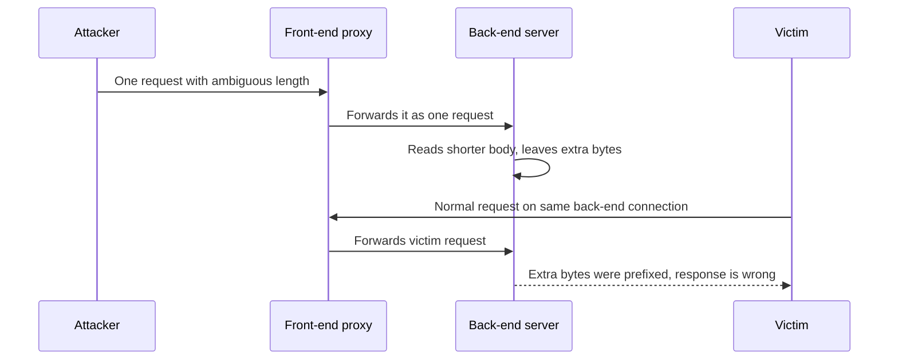

Read it top to bottom. The leftover bytes act as a prefix for the victim's request. Variants include CL.TE, TE.CL, TE.TE and HTTP/2 downgrade desync, where a front end speaks HTTP/2 but rewrites to HTTP/1.1 for the back end.

Impact: bypass of front-end access controls and WAFs, request hijacking, cache poisoning, and credential capture.

Mitigations (concept level):
1. **Use HTTP/2 or HTTP/3 end to end,** including to the back end. Binary framing has unambiguous lengths. Avoid downgrading.
2. **Do not reuse back-end connections** between different clients when possible, or use strict, tested proxies.
3. **Reject ambiguous requests:** both `Content-Length` and `Transfer-Encoding`, duplicated headers, malformed chunking. Configure proxy and server to be strict and the same.
4. **Keep proxies, load balancers and servers patched,** and use the same vendor and version family where you can.
5. **Normalise at the edge,** so the back end sees only well-formed requests.
6. **Test** with a scanner built for desync issues in a safe environment you own.

**Gotcha:** The bug is in the gap between components, so each can pass its own tests. Mixed stacks (CDN, WAF, gateway, ingress, application server) increase risk.

**Interview tip:** You do not need exploit details. Explain "two parsers disagree on message boundaries" and the "use HTTP/2 end to end and reject ambiguity" fix.

_Module: API & Infrastructure Security · Tags: request-smuggling, http, proxies_

### 65. How do DNS attacks work (cache poisoning, rebinding), and what do DNSSEC and other defences do?

**Short answer:** Classic DNS has no built-in authentication, so attackers try to make resolvers or clients accept false answers. DNSSEC signs DNS data so resolvers can verify it. DNS over HTTPS or TLS encrypts the lookup path. Neither protects against every DNS-based attack.

Attacks at concept level:
- **Cache poisoning.** An attacker tricks a resolver into caching a forged answer, sending users to the wrong IP. Defences: random source ports and transaction IDs, which make guessing hard, plus DNSSEC validation.
- **Rebinding.** A malicious site's DNS name first resolves to its own server so the browser loads a page. Later the same name resolves to an internal IP such as `127.0.0.1` or a router. Because the origin (the name) is unchanged, the page script can now talk to internal services. Defences: internal services must authenticate and check the `Host` header, resolvers can drop private addresses from public answers, and servers fetching URLs must pin the checked IP.
- **Hijacking and takeover.** Stolen registrar or DNS provider accounts, or dangling records (a CNAME pointing at a deleted cloud resource that an attacker re-claims). Defences: MFA and registrar lock on the domain, and cleaning up records when you delete resources.
- **Amplification.** Open resolvers used in DDoS. Do not run open resolvers.
- **Tunnelling and exfiltration** over DNS queries: monitor unusual query volumes.

| Defence | What it gives | Limits |
| --- | --- | --- |
| DNSSEC | Signed records, validated up a chain from the root: authenticity and integrity of answers | Does not encrypt; adoption and operations are complex |
| DoH / DoT | Encrypted transport between client and resolver | Hides queries from the path, not from the resolver |
| CAA records | Limit which CAs may issue certificates | Only checked at issuance |
| Registry lock, MFA | Protect the domain itself | Process discipline |
| Split-horizon DNS | Different answers inside and outside | Complexity |

DNSSEC adds records (RRSIG, DNSKEY, DS) so a validating resolver can check the signature chain. If a signature fails, the resolver returns an error instead of a forged answer.

**Gotcha:** HTTPS still protects you if DNS is poisoned, since the attacker lacks a valid certificate for your name. That is why certificate validation matters.

**Interview tip:** Name each attack with its defence in one line, then say DNS is a dependency to monitor, since many outages and takeovers start there.

_Module: DNS & Delivery · Tags: dns, dnssec, dns-rebinding_

### 66. How do you secure container and Kubernetes networking (network policies, service mesh mTLS)?

**Short answer:** By default every pod in a Kubernetes cluster can talk to every other pod. Fix that with default-deny NetworkPolicies and explicit allows, encrypt and authenticate service traffic with mTLS (often through a service mesh), restrict egress, and protect the control plane and secrets. See the Kubernetes topic for the platform basics.

**NetworkPolicy** is a Kubernetes object that restricts pod traffic by labels, namespaces and ports. It only works if the network plugin (CNI) enforces it (for example Calico or Cilium), so check that first.

```yaml
# deny all inbound traffic to pods in the namespace, then allow what is needed
apiVersion: networking.k8s.io/v1
kind: NetworkPolicy
metadata:
  name: default-deny-ingress
  namespace: orders
spec:
  podSelector: {}
  policyTypes: ["Ingress"]
---
apiVersion: networking.k8s.io/v1
kind: NetworkPolicy
metadata:
  name: allow-gateway-to-orders
  namespace: orders
spec:
  podSelector:
    matchLabels: { app: orders }
  ingress:
    - from:
        - namespaceSelector:
            matchLabels: { kubernetes.io/metadata.name: gateway }
      ports:
        - port: 8080
```

Layers to put in place:

| Layer | Control |
| --- | --- |
| Cluster edge | Ingress with TLS, WAF, rate limits; private API server endpoint |
| Namespace and pod | Default-deny NetworkPolicy, allow by label and port |
| Egress | Restrict outbound traffic; block metadata service access from app pods unless needed |
| Service identity | Service mesh (Istio, Linkerd) issues short-lived workload certificates and enforces mTLS and authorisation policy |
| Pod hardening | Run as non-root, read-only root filesystem, drop capabilities, Pod Security admission |
| Access and secrets | RBAC with least privilege, encrypted secrets, workload identity instead of stored cloud keys |
| Supply chain | Signed images, admission policy, scanned base images |

A **mesh** adds a sidecar (or per-node proxy) that handles TLS between services transparently, plus policies such as "only the orders service may call payments". It adds latency, resource cost and operational complexity, so adopt it when you need uniform mTLS, traffic policy and telemetry across many services, not by default.

**Gotchas**
- NetworkPolicy has no effect without a supporting CNI.
- Allowing all namespaces by mistake with an empty selector.
- Forgetting DNS egress when you add egress deny rules (allow traffic to CoreDNS).
- Network rules do not replace application authorisation.

**Interview tip:** Describe the target state "default deny, explicit allow, identity-based mTLS, least-privilege RBAC" and mention how you would roll it out safely, namespace by namespace, starting in an audit mode.

_Module: API & Infrastructure Security · Tags: kubernetes, network-policy, service-mesh_

### 67. What are the principles of zero trust architecture, and how would you apply them?

**Short answer:** Zero trust means no request is trusted because of where it comes from. Every access is authenticated, authorised and checked against context, using least privilege, and you design assuming attackers are already inside.

Core principles:
1. **Verify explicitly.** Use all signals: user identity, device health, location, workload identity, time, risk.
2. **Least privilege.** Give the smallest access for the shortest time (just-in-time elevation, scoped tokens).
3. **Assume breach.** Segment so one compromise cannot spread, encrypt internal traffic, log everything, and limit blast radius.
4. **Identity is the new perimeter.** Strong identity for people (SSO with MFA, passkeys) and for workloads (certificates, workload identity).
5. **Policy decision and enforcement are separate:** a policy engine decides, proxies and services enforce at every hop.

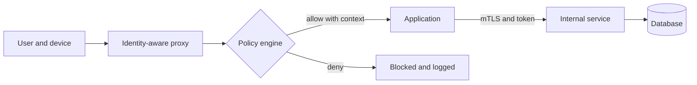

Read it left to right. Every hop asks again; there is no trusted internal zone.

Applying it step by step in a web platform:
- Put SSO and MFA in front of every internal tool, retire shared accounts.
- Use short-lived tokens (OIDC) and validate audience and scope at every service.
- Use mTLS between services (mesh or SPIFFE-style identities).
- Default-deny network policies; no standing admin access; secrets by workload identity.
- Device posture checks for admins.
- Central logs with alerts on anomalous access.

Trade-offs: more identity infrastructure to run and secure, latency from policy checks, and organisational change. Move in stages, starting with the most sensitive systems. It is a direction, not a product you can buy in one go.

**Gotcha:** Dropping the VPN and calling it zero trust, without improving authorisation inside. The VPN was not the only problem.

**Interview tip:** Replace "trusted internal network" with "every request proves itself" and give two concrete changes from your own system.

_Module: Secure Design & Threat Modeling · Tags: zero-trust, architecture, identity_

### 68. How do you design secure device-to-cloud communication on constrained or intermittent links, such as aircraft or IoT fleets?

**Short answer:** Give each device a unique cryptographic identity, authenticate with mutual TLS or signed requests, make security decisions that still work offline, rotate keys and certificates without needing constant connectivity, and deliver software updates that are signed and verifiable. Design for loss, delay and long-lived devices.

Challenges on aircraft, ships or remote sites: links that are slow, expensive, high latency or down for hours; devices that stay deployed for many years; clocks that drift; physical access by many people; certificates that expire mid-flight; and strict safety and certification processes.

Design pieces:

| Area | Approach |
| --- | --- |
| Device identity | Per-device key pair created inside a TPM or secure element, never exported. A device certificate issued at provisioning from a private CA. No shared fleet password |
| Authentication | mTLS to the cloud endpoint. Alternatively signed requests with the device key |
| Offline authorisation | Signed, time-limited tokens or capability certificates that the device or gateway can verify with a cached public key, without calling a server |
| Time | Do not depend only on the system clock. Use signed time sources and allow clock-skew windows. Certificates must be valid long enough, or devices must renew early |
| Rotation | Overlapping validity: new key and certificate arrive before the old one expires. Keep a bootstrap path to recover a device whose certificate expired |
| Revocation | Short-lived certificates where possible. Otherwise a signed deny list distributed with other updates, with a limit on how stale it may be |
| Updates | Signed firmware and containers, version checks to stop rollback, staged rollout, and a safe fallback image |
| Transport | Store and forward: a local queue with retries, small payloads, resumable uploads, idempotent messages using IDs |
| Segmentation | Isolate safety-critical networks from passenger and entertainment systems with strict gateways, one-way flows where required |
| Visibility | Signed audit logs buffered locally and uploaded when connected |

Flow for a message: the device signs it, queues it while offline, sends it over mTLS when a link appears, and the cloud verifies the device certificate, checks the message ID for replay, and applies authorisation rules for that device and fleet.

Provisioning is the weak point. Protect the manufacturing step, the CA keys (offline, in an HSM), and the process that decides which devices exist.

**Gotchas**
- Long-lived certificates with no renewal plan. Hardcoded shared secrets in images.
- Rolling out a new CA root to a fleet that cannot reach a server. Plan trust anchors years ahead and include next-generation roots early.
- Updating without rollback protection.

**Interview tip:** Highlight that you would write down failure modes (offline for a week, clock wrong, certificate expired) and test each one on a bench before the fleet.

_Module: Secure Design & Threat Modeling · Tags: iot, device-identity, offline_

### 69. How do secure software updates and code signing work?

**Short answer:** The publisher signs the update with a private key, and the device or installer verifies it with a trusted public key before applying it. This proves who made it and that it was not changed, no matter how it was delivered. Good update systems also protect against rollback to old vulnerable versions.

```js
const { publicKey, privateKey } = generateKeyPairSync('ed25519');
const firmware = Buffer.from('firmware-v2.4.1 contents');
const sig = sign(null, firmware, privateKey);
console.log(sig.length, verify(null, firmware, publicKey, sig));   // prints: 64 true
console.log(verify(null, Buffer.from('firmware-v2.4.1 tampered'), publicKey, sig)); // prints: false
```

The signature is 64 bytes, and any change to the content makes verification fail.

Design elements:
1. **Trust anchor on the device.** The public key (or a certificate chain to a root) is built into the device or bootloader, so an attacker cannot swap it by serving a different file.
2. **Sign the right thing.** Sign a manifest with the file hash, version, target hardware and expiry, not just the file. This prevents mixing parts from different releases.
3. **Rollback and freeze protection.** The device refuses versions older than the installed one (monotonic counter) and refuses stale metadata so an attacker cannot hold devices on an old release.
4. **Protect the signing key.** Keep it in an HSM or a managed signing service, restricted, with approvals and audit. Use a separate offline root key to sign and rotate online signing keys, so a stolen online key can be replaced. Frameworks such as The Update Framework (TUF) formalise these roles.
5. **Secure boot / verified boot.** Each stage checks the signature of the next, from hardware root of trust up to the application.
6. **Atomic, recoverable updates.** Dual partitions (A/B) and health checks that roll back automatically.
7. **Staged rollout** with telemetry, so a bad update stops after a small group.

For containers and packages: sign images and artefacts in CI (Sigstore cosign and similar), publish provenance, and enforce signature verification in the cluster admission policy. Signing proves the source, not that the code is free of bugs.

**Gotchas**
- Signing in a CI job that every developer can edit. Whoever controls the pipeline controls the signature.
- Verifying a hash that was downloaded from the same untrusted place as the file.
- Never planning key rotation.

**Interview tip:** Mention the three threats: tampered update, old vulnerable update replayed, and stolen signing key. Show a control for each.

_Module: TLS & Cryptography · Tags: code-signing, updates, supply-chain_

### 70. How would you design an authentication system end to end (login, sessions or tokens, refresh, logout, recovery, abuse protection)?

**Short answer:** Prefer an existing identity provider. If you design it, cover the full lifecycle: sign-up, login with strong factors, short-lived access tokens, rotating refresh tokens or revocable sessions, logout everywhere, careful account recovery, and abuse protection with logs and alerts.

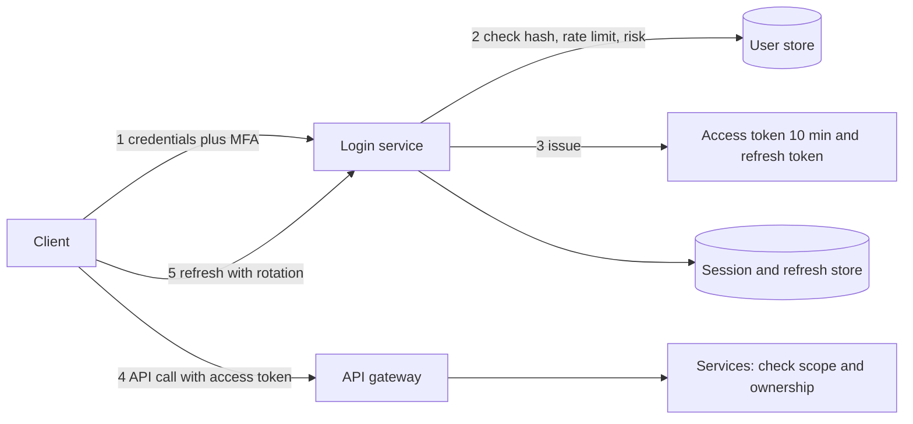

Read it left to right: credentials in, short token out, refresh kept in a store that can revoke.

Component choices:
1. **Sign-up and credentials.** Passwords hashed with Argon2id or scrypt and salt, minimum length not complexity, breached-password check. Offer passkeys. Verify email before trust.
2. **Login.** Rate limit per IP and per account, uniform error messages, MFA step-up for risky logins, notify on new device logins.
3. **Session design.** Browser: session cookie (`HttpOnly`, `Secure`, `SameSite`) or a backend-for-frontend holding tokens. APIs and mobile: access token (JWT or opaque), 5 to 15 minutes, audience-bound. Rotating refresh token stored hashed with reuse detection.
4. **Authorisation.** Not in the login service. Tokens carry identity, tenant and coarse roles. Services check ownership and policy.
5. **Logout.** Delete the session, revoke refresh tokens, clear cookies. "Log out everywhere" revokes the family. Short access tokens limit the stale window; high-risk services may check a revocation signal.
6. **Account recovery.** The most attacked part. Send a single-use, random, short-lived (for example 15 minutes) reset token by email, store only its hash, respond the same whether the account exists or not, rate limit, invalidate all sessions after reset, notify the user, and do not let recovery silently bypass MFA.
7. **Abuse protection.** Bot checks, anomaly detection, lockout with care, audit log of auth events.
8. **Operations.** Key rotation for signing keys (publish keys by `kid` in a JWKS), monitoring, backups of the user store, tested incident steps.

**Trade-offs:** opaque tokens with introspection are easy to revoke but add a lookup; JWTs avoid the lookup but need short expiry. Multi-region needs replicated session stores or stateless tokens.

**Gotcha:** Building this yourself takes years of edge cases. Say so, and keep user IDs portable so you can migrate to a provider.

**Interview tip:** Walk through the lifecycle in order and call out recovery and logout, which candidates forget.

_Module: Authentication & Authorization · Tags: system-design, authentication, sessions_

### 71. Scenario: "How would you secure this API?" Give a structured answer.

**Short answer:** Start by asking what the API does and what data it holds, then secure it in layers: who is calling, what they may do, what they may send, what they get back, how much they can use, how traffic is protected, and how you will detect problems.

Suppose the interviewer shows an orders API used by a web app and by partners. A structured answer:

1. **Clarify and model.** Who are the clients (browser, mobile, partners)? What is sensitive (personal data, payments)? Where are trust boundaries? Quickly list threats with STRIDE.
2. **Transport.** TLS 1.2 or 1.3 only, HSTS for browser clients, mTLS between internal services, certificates automated.
3. **Authentication.** OAuth 2.0 / OIDC with an identity provider. Authorization code with PKCE for users, client credentials for partners and services. Short-lived access tokens, validate signature, issuer, audience and expiry at the gateway and in the service.
4. **Authorisation.** Default deny. Function-level checks per route, object-level checks per resource (ownership and tenant in every query), scopes for partners.
5. **Input.** Validate against a schema (OpenAPI), cap body size, parameterised queries, no mass assignment, allow-listed fields.
6. **Output.** Return explicit response shapes, no stack traces, consistent errors, correct `Cache-Control` for private data.
7. **Abuse and availability.** Rate limits per client and per endpoint, pagination caps, timeouts, idempotency keys, WAF and DDoS protection at the edge.
8. **Browser concerns** if relevant: strict CORS allow-list, CSRF protection for cookies, secure headers.
9. **Secrets and supply chain.** Secrets in a vault, dependency and container scanning, signed images.
10. **Monitoring.** Structured logs of auth and access failures without secrets, alerts on enumeration and spikes, audit trail for sensitive actions.
11. **Process.** Security tests in CI, including "user A cannot read user B's order", a pen test before launch, a runbook for key rotation and incidents.

Then name the **top three risks** for this API, such as object-level authorisation, token handling and rate limiting, and say what you would do first if time is limited.

**Gotcha:** A flat list of buzzwords. Interviewers listen for prioritisation and for "why".

**Interview tip:** Say the order out loud: identity, authorisation, input, output, limits, transport, monitoring. A clear order shows that you have done this before.

_Module: API & Infrastructure Security · Tags: scenario, api-security, interview_

### 72. Scenario: "A token leaked. What do you do now?" Give a structured answer.

**Short answer:** Treat it as a real incident: confirm what leaked and what it can do, contain by revoking and rotating, check what was accessed, fix how it leaked, communicate, and learn. Speed matters most in the first step: cut off the token's power.

1. **Identify the token and its power.** Is it a user access token, a refresh token, an API key, a signing key, a cloud credential or a CI token? What scopes, which tenant, what expiry? A leaked signing key is far worse than a leaked user token because it lets the attacker mint tokens.
2. **Contain immediately.**
   - Revoke the token, or the whole family for refresh tokens.
   - Rotate the secret: create a new key, deploy, remove the old one. For a JWT signing key, publish a new key id, stop accepting the old one, and accept that all sessions are invalidated.
   - If you cannot revoke individual tokens, shorten expiry, add the token ID to a deny list, or block by account while you act.
   - Disable the account or service if abuse is ongoing. Add temporary WAF or rate limit rules.
3. **Preserve evidence.** Save relevant logs before they rotate away.
4. **Scope the damage.** Search logs for use of the token: IPs, user agents, times, endpoints, data touched. Look for follow-on persistence such as new keys, new users or changed permissions.
5. **Find the cause.** Was it in a Git repo, a log file, a URL, a screenshot, a compromised laptop, an XSS bug or an overly permissive CI variable? Fix the root cause, not just the instance. Remove it from Git history if relevant, but still treat it as burned.
6. **Notify.** Inform security, management, and affected users or customers as your incident process and legal guidance require. Be specific about what happened and what they should do.
7. **Harden.** Shorter token lifetimes, audience binding, secret scanning in pre-commit and CI, token binding or sender-constrained tokens (DPoP, mTLS), better redaction in logs, anomaly alerts.
8. **Postmortem,** blameless, with owners for the actions.

**Gotchas**
- Deleting the token from the repository and considering it done.
- Rotating only one environment when the same secret exists in several.
- Forgetting refresh tokens, so the attacker simply renews access.

**Interview tip:** Open with "first I would find out what the token can do, then cut it off". It sounds calm and prioritised.

_Module: Security Leadership · Tags: scenario, incident-response, tokens_

### 73. Scenario: "Design a password reset flow." Give a structured answer.

**Short answer:** Send a random, single-use, short-lived reset token to the user's verified contact, store only its hash, show the same response whether or not the account exists, rate limit everything, and after a reset end all sessions and notify the user. Recovery must not be weaker than login.

Flow:

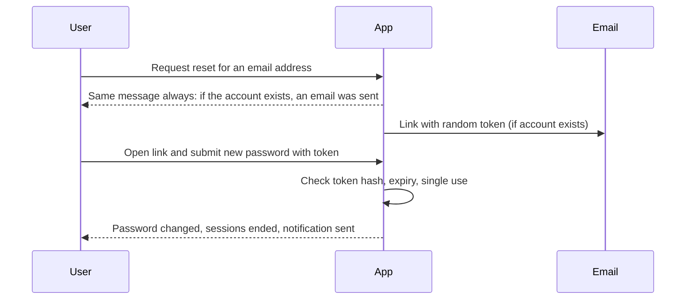

Read it top to bottom. The first answer never reveals whether the account exists.

Design decisions:
1. **Request step.** Accept the email, return a generic message and a similar response time in all cases (do the work asynchronously through a queue). Rate limit by IP, by account and by email address to stop mail bombing and enumeration.
2. **Token.** 32 random bytes from a secure source, encoded in the link. Store a hash (SHA-256 is fine for high-entropy tokens) with user ID, expiry (about 15 to 60 minutes) and a used flag. Only the latest token for a user is valid. Never derive it from user data or time.
3. **Link handling.** Use HTTPS, put the token in the URL path or fragment, and exchange it quickly for a form. Set `Referrer-Policy: no-referrer` on that page so the token does not leak to third-party resources. Do not log full URLs.
4. **Reset step.** Compare the hash in constant time, check expiry and single use, enforce password rules (length, breach list), hash with Argon2id or scrypt, then mark the token used.
5. **After reset.** Invalidate all sessions and refresh tokens, require MFA as before (recovery must not silently remove MFA), send a "your password was changed" email to the old and new addresses, and log the event.
6. **Higher assurance accounts.** Add identity checks, a waiting period, or support-assisted recovery with strong verification. Avoid knowledge questions ("mother's maiden name"), which are guessable.
7. **Abuse and monitoring.** Alert on bursts of reset requests and on resets followed by logins from new places.
8. **Tests.** Token reuse fails, expired token fails, wrong user fails, enumeration cannot be told apart.

**Gotchas**
- Different messages for "no such user", which allows username enumeration.
- Sending the new password by email, or reset links that never expire.
- Letting a reset link log the user in without MFA.
- Using the `Host` header from the request to build the link (host header poisoning). Use a configured base URL.

**Interview tip:** Present it as the security of the weakest recovery path: attackers go there when login is strong, so design it with the same care.

_Module: Authentication & Authorization · Tags: scenario, password-reset, account-recovery_

---

## Resources

Where to read more at the source. Official docs and references come first.

**Official docs**

- [MDN: HTTP](https://developer.mozilla.org/en-US/docs/Web/HTTP) — The best reference for HTTP: methods, headers, caching, CORS, cookies. _(beginner)_
- [MDN: CORS](https://developer.mozilla.org/en-US/docs/Web/HTTP/CORS) — How cross-origin requests and preflights work. _(intermediate)_
- [MDN: Web security](https://developer.mozilla.org/en-US/docs/Web/Security) — Same-origin policy, CSP, secure contexts and more. _(intermediate)_
- [How OpenID Connect works](https://openid.net/developers/how-connect-works/) — Identity layer on top of OAuth 2.0: ID tokens and flows. _(intermediate)_
- [Let's Encrypt documentation](https://letsencrypt.org/docs/) — How free automated certificates and ACME work. _(intermediate)_

**Reference**

- [OWASP Top 10](https://owasp.org/www-project-top-ten/) — The standard list of critical web application security risks. _(beginner)_
- [OWASP Cheat Sheet Series](https://cheatsheetseries.owasp.org/) — Concise defensive guidance for each vulnerability class. _(intermediate)_
- [OWASP API Security Top 10](https://owasp.org/API-Security/) — The main API-specific risks: object-level authorisation, mass assignment, SSRF. _(intermediate)_
- [OWASP ASVS](https://owasp.org/www-project-application-security-verification-standard/) — A checklist standard for verifying application security. _(advanced)_
- [RFC 9110: HTTP Semantics](https://www.rfc-editor.org/rfc/rfc9110) — The standard definition of HTTP methods, status codes and caching. _(advanced)_
- [RFC 8446: TLS 1.3](https://www.rfc-editor.org/rfc/rfc8446) — The TLS 1.3 specification. _(advanced)_
- [Mozilla Web Security guidelines](https://infosec.mozilla.org/guidelines/web_security) — Recommended headers, cookies and TLS settings. _(intermediate)_

**Tutorial**

- [OAuth 2.0 Simplified](https://www.oauth.com) — Clear explanations of OAuth 2.0 flows and pitfalls. _(intermediate)_
- [JSON Web Token introduction](https://jwt.io/introduction) — JWT structure, signing and common use. _(beginner)_
- [How DNS works](https://howdns.works) — A short illustrated story of DNS resolution. _(beginner)_
- [Cloudflare Learning Center](https://www.cloudflare.com/learning/) — Plain explanations of networking, DNS, CDNs, DDoS and TLS. _(beginner)_

**Tool**

- [The Illustrated TLS 1.3 Connection](https://tls13.xargs.org) — Every byte of a TLS 1.3 handshake explained. _(intermediate)_
- [Security Headers](https://securityheaders.com) — Scan a site's HTTP security headers. _(beginner)_
