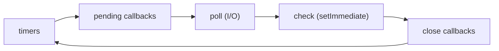
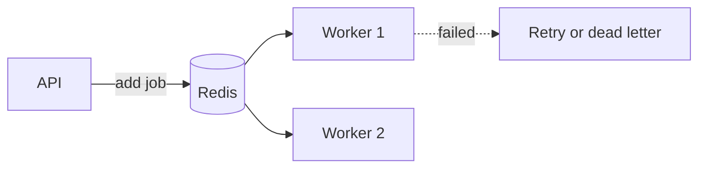
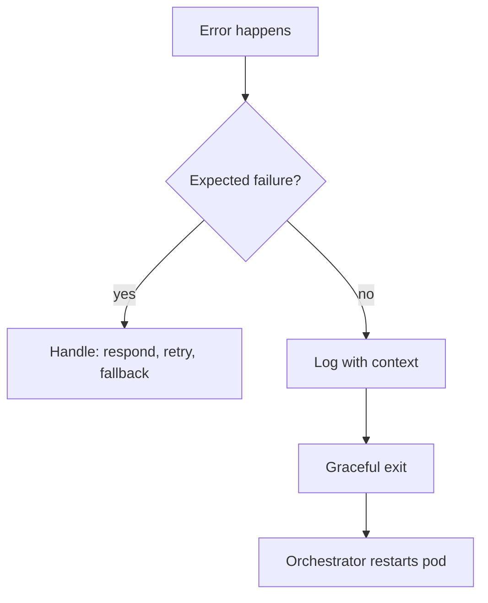
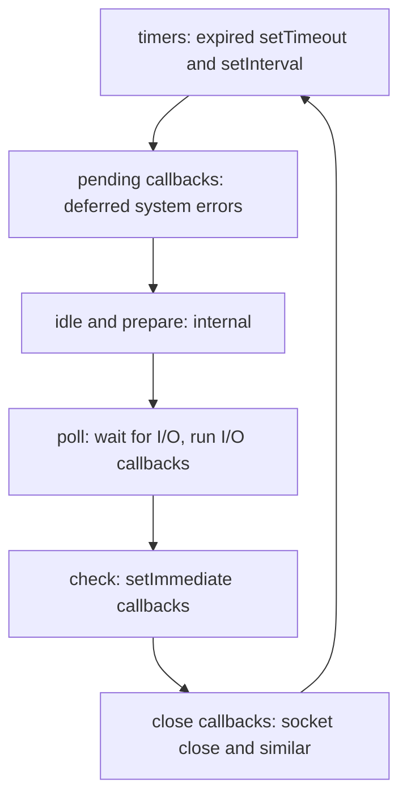
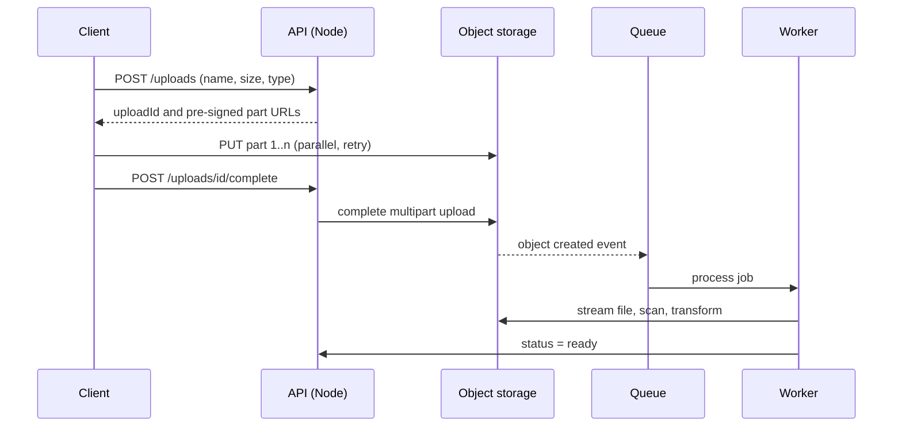

# Node.js

[← Back to index](../README.md) · [⭐ Favorites](favorites.md)

65 questions · 0 favorites · [📚 Resources](#resources)

## Contents

**Basic**

- [1. What is Node.js and how is it different from JavaScript in the browser?](#1-what-is-nodejs-and-how-is-it-different-from-javascript-in-the-browser)
- [2. How does the Node.js event loop work?](#2-how-does-the-nodejs-event-loop-work)
- [3. What is the difference between `process.nextTick`, `setImmediate` and `setTimeout(fn, 0)`?](#3-what-is-the-difference-between-processnexttick-setimmediate-and-settimeoutfn-0)
- [4. What is the difference between CommonJS and ES modules in Node?](#4-what-is-the-difference-between-commonjs-and-es-modules-in-node)
- [5. How do npm, `package.json`, semver and lock files work?](#5-how-do-npm-packagejson-semver-and-lock-files-work)
- [6. How does Node resolve `require()` and `import` specifiers?](#6-how-does-node-resolve-require-and-import-specifiers)
- [7. Which core modules must a Node developer know?](#7-which-core-modules-must-a-node-developer-know)
- [8. How do callbacks, promises and async/await work in Node, and what is `promisify`?](#8-how-do-callbacks-promises-and-asyncawait-work-in-node-and-what-is-promisify)
- [9. How does `EventEmitter` work in Node?](#9-how-does-eventemitter-work-in-node)
- [10. What are Buffers in Node.js and how do encodings work?](#10-what-are-buffers-in-nodejs-and-how-do-encodings-work)
- [11. What are streams in Node.js and why use them?](#11-what-are-streams-in-nodejs-and-why-use-them)
- [12. How do you manage environment variables and configuration in Node.js?](#12-how-do-you-manage-environment-variables-and-configuration-in-nodejs)
- [13. How do you build an HTTP server using only the core `http` module?](#13-how-do-you-build-an-http-server-using-only-the-core-http-module)
- [14. How does Express work: routing, middleware and error handling?](#14-how-does-express-work-routing-middleware-and-error-handling)
- [15. How do `process`, `argv`, exit codes and signals work in Node.js?](#15-how-do-process-argv-exit-codes-and-signals-work-in-nodejs)
- [16. What are error-first callbacks, and what happens with unhandled promise rejections?](#16-what-are-error-first-callbacks-and-what-happens-with-unhandled-promise-rejections)
- [17. How do timers work in Node.js (`setTimeout`, `setInterval`, `setImmediate`)?](#17-how-do-timers-work-in-nodejs-settimeout-setinterval-setimmediate)

**Intermediate**

- [18. \[Tech Lead\] How do you diagnose a slow Node.js service?](#18-tech-lead-how-do-you-diagnose-a-slow-nodejs-service)
- [19. \[Tech Lead\] How do you find and fix memory leaks in a Node.js service?](#19-tech-lead-how-do-you-find-and-fix-memory-leaks-in-a-nodejs-service)
- [20. \[Tech Lead\] How do you scale a Node.js application?](#20-tech-lead-how-do-you-scale-a-nodejs-application)
- [21. \[Tech Lead\] How do you set up observability for Node.js services?](#21-tech-lead-how-do-you-set-up-observability-for-nodejs-services)
- [22. \[Tech Lead\] What is your testing strategy for a Node.js service?](#22-tech-lead-what-is-your-testing-strategy-for-a-nodejs-service)
- [23. \[Tech Lead\] How do you build and ship Node.js services with Docker and CI/CD?](#23-tech-lead-how-do-you-build-and-ship-nodejs-services-with-docker-and-cicd)
- [24. \[Tech Lead\] What API design standards do you set for Node.js services?](#24-tech-lead-what-api-design-standards-do-you-set-for-nodejs-services)
- [25. \[Tech Lead\] How do you upgrade Node.js and major dependencies safely?](#25-tech-lead-how-do-you-upgrade-nodejs-and-major-dependencies-safely)
- [26. \[Tech Lead\] How do you load test and plan capacity for a Node.js service?](#26-tech-lead-how-do-you-load-test-and-plan-capacity-for-a-nodejs-service)
- [27. \[Tech Lead\] What do you check in a code review of a Node.js service?](#27-tech-lead-what-do-you-check-in-a-code-review-of-a-nodejs-service)
- [28. \[Tech Lead\] How do you adopt TypeScript in a Node.js codebase and how strict should it be?](#28-tech-lead-how-do-you-adopt-typescript-in-a-nodejs-codebase-and-how-strict-should-it-be)
- [29. How do streams work in depth: `pipeline`, backpressure, transform streams and `objectMode`?](#29-how-do-streams-work-in-depth-pipeline-backpressure-transform-streams-and-objectmode)
- [30. What is the difference between `worker_threads`, `child_process` and `cluster`?](#30-what-is-the-difference-between-worker_threads-child_process-and-cluster)
- [31. How do you run async work in parallel safely: concurrency limits, `Promise.allSettled` and `AbortController`?](#31-how-do-you-run-async-work-in-parallel-safely-concurrency-limits-promiseallsettled-and-abortcontroller)
- [32. What are middleware patterns in Express and how do you structure them?](#32-what-are-middleware-patterns-in-express-and-how-do-you-structure-them)
- [33. How do you validate input in a Node.js API (Zod, Joi, class-validator)?](#33-how-do-you-validate-input-in-a-nodejs-api-zod-joi-class-validator)
- [34. How do authentication and authorization work in Node APIs (sessions, JWT, refresh tokens, OAuth2, RBAC)?](#34-how-do-authentication-and-authorization-work-in-node-apis-sessions-jwt-refresh-tokens-oauth2-rbac)
- [35. How do you work with databases in Node.js: drivers, ORMs, connection pools, transactions and migrations?](#35-how-do-you-work-with-databases-in-nodejs-drivers-orms-connection-pools-transactions-and-migrations)
- [36. How do you use Redis for caching in a Node.js service?](#36-how-do-you-use-redis-for-caching-in-a-nodejs-service)
- [37. How do you run background jobs and queues in Node.js with BullMQ?](#37-how-do-you-run-background-jobs-and-queues-in-nodejs-with-bullmq)
- [38. How do you handle file uploads and stream large files in Node.js?](#38-how-do-you-handle-file-uploads-and-stream-large-files-in-nodejs)
- [39. What is the difference between WebSockets and Server-Sent Events, and how do you use them in Node.js?](#39-what-is-the-difference-between-websockets-and-server-sent-events-and-how-do-you-use-them-in-nodejs)
- [40. What is GraphQL and how does it compare with REST in a Node.js service?](#40-what-is-graphql-and-how-does-it-compare-with-rest-in-a-nodejs-service)
- [41. What are the building blocks of NestJS: modules, providers, dependency injection, guards, pipes, interceptors and filters?](#41-what-are-the-building-blocks-of-nestjs-modules-providers-dependency-injection-guards-pipes-interceptors-and-filters)
- [42. How do you manage configuration and logging in a NestJS service?](#42-how-do-you-manage-configuration-and-logging-in-a-nestjs-service)
- [43. How do you test a Node.js API with `node:test`, Jest and supertest?](#43-how-do-you-test-a-nodejs-api-with-nodetest-jest-and-supertest)
- [44. How do you make HTTP requests reliably from Node.js (fetch, undici, timeouts, retries)?](#44-how-do-you-make-http-requests-reliably-from-nodejs-fetch-undici-timeouts-retries)
- [45. How do you implement graceful shutdown in a Node.js service?](#45-how-do-you-implement-graceful-shutdown-in-a-nodejs-service)

**Advanced**

- [46. \[Tech Lead\] What is your error-handling and crash strategy for a Node.js service?](#46-tech-lead-what-is-your-error-handling-and-crash-strategy-for-a-nodejs-service)
- [47. \[Tech Lead\] How do you harden the security of a Node.js service?](#47-tech-lead-how-do-you-harden-the-security-of-a-nodejs-service)
- [48. \[Tech Lead\] When do you choose NestJS, Express or Fastify?](#48-tech-lead-when-do-you-choose-nestjs-express-or-fastify)
- [49. \[Tech Lead\] How do you manage a Node.js monorepo and its dependencies?](#49-tech-lead-how-do-you-manage-a-nodejs-monorepo-and-its-dependencies)
- [50. How does libuv work: the thread pool and the event loop phases in detail?](#50-how-does-libuv-work-the-thread-pool-and-the-event-loop-phases-in-detail)
- [51. How do V8 memory and garbage collection work, and how do you tune them?](#51-how-do-v8-memory-and-garbage-collection-work-and-how-do-you-tune-them)
- [52. How does Node resolve `require` and `import`, and how does the module cache work?](#52-how-does-node-resolve-require-and-import-and-how-does-the-module-cache-work)
- [53. What are the common ESM and CommonJS interop problems in Node.js?](#53-what-are-the-common-esm-and-commonjs-interop-problems-in-nodejs)
- [54. What are native addons, N-API and WebAssembly in Node.js, and when would you use them?](#54-what-are-native-addons-n-api-and-webassembly-in-nodejs-and-when-would-you-use-them)
- [55. How do HTTP keep-alive, HTTP/2, connection pools and socket limits affect a Node.js service?](#55-how-do-http-keep-alive-http2-connection-pools-and-socket-limits-affect-a-nodejs-service)
- [56. How does backpressure work inside Node.js streams?](#56-how-does-backpressure-work-inside-nodejs-streams)
- [57. How do you diagnose a production issue with diagnostic reports, `AsyncLocalStorage`, `perf_hooks` and the inspector?](#57-how-do-you-diagnose-a-production-issue-with-diagnostic-reports-asynclocalstorage-perf_hooks-and-the-inspector)
- [58. What is the Node.js permission model, and why is the `vm` module not a sandbox?](#58-what-is-the-nodejs-permission-model-and-why-is-the-vm-module-not-a-sandbox)
- [59. What is your checklist for tuning the performance of a Node.js service?](#59-what-is-your-checklist-for-tuning-the-performance-of-a-nodejs-service)
- [60. How would you implement a minimal `EventEmitter` from scratch?](#60-how-would-you-implement-a-minimal-eventemitter-from-scratch)
- [61. How would you implement a rate limiter in Node.js (token bucket)?](#61-how-would-you-implement-a-rate-limiter-in-nodejs-token-bucket)
- [62. How would you implement a simple HTTP router with path parameters?](#62-how-would-you-implement-a-simple-http-router-with-path-parameters)
- [63. How would you design a service for uploading and processing very large files?](#63-how-would-you-design-a-service-for-uploading-and-processing-very-large-files)
- [64. How would you design a webhook delivery system with retries?](#64-how-would-you-design-a-webhook-delivery-system-with-retries)
- [65. How would you design a job queue with retries and concurrency control?](#65-how-would-you-design-a-job-queue-with-retries-and-concurrency-control)

## Browse by module

| Module | Questions |
| --- | --- |
| Architecture & NestJS (8) | [28](#28-tech-lead-how-do-you-adopt-typescript-in-a-nodejs-codebase-and-how-strict-should-it-be) · [41](#41-what-are-the-building-blocks-of-nestjs-modules-providers-dependency-injection-guards-pipes-interceptors-and-filters) · [42](#42-how-do-you-manage-configuration-and-logging-in-a-nestjs-service) · [48](#48-tech-lead-when-do-you-choose-nestjs-express-or-fastify) · [49](#49-tech-lead-how-do-you-manage-a-nodejs-monorepo-and-its-dependencies) · [63](#63-how-would-you-design-a-service-for-uploading-and-processing-very-large-files) · [64](#64-how-would-you-design-a-webhook-delivery-system-with-retries) · [65](#65-how-would-you-design-a-job-queue-with-retries-and-concurrency-control) |
| Async & Event Loop (7) | [2](#2-how-does-the-nodejs-event-loop-work) · [3](#3-what-is-the-difference-between-processnexttick-setimmediate-and-settimeoutfn-0) · [8](#8-how-do-callbacks-promises-and-asyncawait-work-in-node-and-what-is-promisify) · [16](#16-what-are-error-first-callbacks-and-what-happens-with-unhandled-promise-rejections) · [17](#17-how-do-timers-work-in-nodejs-settimeout-setinterval-setimmediate) · [30](#30-what-is-the-difference-between-worker_threads-child_process-and-cluster) · [31](#31-how-do-you-run-async-work-in-parallel-safely-concurrency-limits-promiseallsettled-and-abortcontroller) |
| Core Runtime (5) | [1](#1-what-is-nodejs-and-how-is-it-different-from-javascript-in-the-browser) · [7](#7-which-core-modules-must-a-node-developer-know) · [9](#9-how-does-eventemitter-work-in-node) · [15](#15-how-do-process-argv-exit-codes-and-signals-work-in-nodejs) · [60](#60-how-would-you-implement-a-minimal-eventemitter-from-scratch) |
| Data & Persistence (3) | [35](#35-how-do-you-work-with-databases-in-nodejs-drivers-orms-connection-pools-transactions-and-migrations) · [36](#36-how-do-you-use-redis-for-caching-in-a-nodejs-service) · [37](#37-how-do-you-run-background-jobs-and-queues-in-nodejs-with-bullmq) |
| HTTP & APIs (10) | [13](#13-how-do-you-build-an-http-server-using-only-the-core-http-module) · [14](#14-how-does-express-work-routing-middleware-and-error-handling) · [24](#24-tech-lead-what-api-design-standards-do-you-set-for-nodejs-services) · [32](#32-what-are-middleware-patterns-in-express-and-how-do-you-structure-them) · [33](#33-how-do-you-validate-input-in-a-nodejs-api-zod-joi-class-validator) · [39](#39-what-is-the-difference-between-websockets-and-server-sent-events-and-how-do-you-use-them-in-nodejs) · [40](#40-what-is-graphql-and-how-does-it-compare-with-rest-in-a-nodejs-service) · [44](#44-how-do-you-make-http-requests-reliably-from-nodejs-fetch-undici-timeouts-retries) · [55](#55-how-do-http-keep-alive-http2-connection-pools-and-socket-limits-affect-a-nodejs-service) · [62](#62-how-would-you-implement-a-simple-http-router-with-path-parameters) |
| Internals (3) | [50](#50-how-does-libuv-work-the-thread-pool-and-the-event-loop-phases-in-detail) · [52](#52-how-does-node-resolve-require-and-import-and-how-does-the-module-cache-work) · [54](#54-what-are-native-addons-n-api-and-webassembly-in-nodejs-and-when-would-you-use-them) |
| Modules & npm (4) | [4](#4-what-is-the-difference-between-commonjs-and-es-modules-in-node) · [5](#5-how-do-npm-packagejson-semver-and-lock-files-work) · [6](#6-how-does-node-resolve-require-and-import-specifiers) · [53](#53-what-are-the-common-esm-and-commonjs-interop-problems-in-nodejs) |
| Operations & Deployment (8) | [12](#12-how-do-you-manage-environment-variables-and-configuration-in-nodejs) · [20](#20-tech-lead-how-do-you-scale-a-nodejs-application) · [21](#21-tech-lead-how-do-you-set-up-observability-for-nodejs-services) · [23](#23-tech-lead-how-do-you-build-and-ship-nodejs-services-with-docker-and-cicd) · [25](#25-tech-lead-how-do-you-upgrade-nodejs-and-major-dependencies-safely) · [45](#45-how-do-you-implement-graceful-shutdown-in-a-nodejs-service) · [46](#46-tech-lead-what-is-your-error-handling-and-crash-strategy-for-a-nodejs-service) · [57](#57-how-do-you-diagnose-a-production-issue-with-diagnostic-reports-asynclocalstorage-perf_hooks-and-the-inspector) |
| Performance & Memory (5) | [18](#18-tech-lead-how-do-you-diagnose-a-slow-nodejs-service) · [19](#19-tech-lead-how-do-you-find-and-fix-memory-leaks-in-a-nodejs-service) · [26](#26-tech-lead-how-do-you-load-test-and-plan-capacity-for-a-nodejs-service) · [51](#51-how-do-v8-memory-and-garbage-collection-work-and-how-do-you-tune-them) · [59](#59-what-is-your-checklist-for-tuning-the-performance-of-a-nodejs-service) |
| Security (4) | [34](#34-how-do-authentication-and-authorization-work-in-node-apis-sessions-jwt-refresh-tokens-oauth2-rbac) · [47](#47-tech-lead-how-do-you-harden-the-security-of-a-nodejs-service) · [58](#58-what-is-the-nodejs-permission-model-and-why-is-the-vm-module-not-a-sandbox) · [61](#61-how-would-you-implement-a-rate-limiter-in-nodejs-token-bucket) |
| Streams & I/O (5) | [10](#10-what-are-buffers-in-nodejs-and-how-do-encodings-work) · [11](#11-what-are-streams-in-nodejs-and-why-use-them) · [29](#29-how-do-streams-work-in-depth-pipeline-backpressure-transform-streams-and-objectmode) · [38](#38-how-do-you-handle-file-uploads-and-stream-large-files-in-nodejs) · [56](#56-how-does-backpressure-work-inside-nodejs-streams) |
| Testing & Quality (3) | [22](#22-tech-lead-what-is-your-testing-strategy-for-a-nodejs-service) · [27](#27-tech-lead-what-do-you-check-in-a-code-review-of-a-nodejs-service) · [43](#43-how-do-you-test-a-nodejs-api-with-nodetest-jest-and-supertest) |

## Basic

### 1. What is Node.js and how is it different from JavaScript in the browser?

**Short answer:** Node.js is a runtime that runs JavaScript outside the browser. It uses the V8 engine for the language and a C library called libuv for files, network and timers. It has no DOM and no `window`, but it has `fs`, `http`, `process` and other server tools.

Node is not a language and not a framework. The language is JavaScript. Node is the program that runs it, plus a standard library for servers and command line tools.

| Topic | Browser | Node.js |
| --- | --- | --- |
| Global object | `window` / `globalThis` | `globalThis` (no `window`) |
| DOM and `document` | Yes | No |
| File system and OS | Blocked for safety | `fs`, `os`, `child_process` |
| Modules | ES modules | CommonJS and ES modules |
| Who controls the version | The user's browser | You (Node 20 or 22 LTS) |
| Security model | Strong sandbox | Full user permissions by default |

Node runs your code on **one main thread** and uses an event loop to handle many connections at once. That makes it very good for I/O-heavy work such as APIs, proxies and chat servers, and weak for long CPU work on the main thread.

Since Node 18 you also get web-style APIs: `fetch`, `AbortController`, `URL`, `TextEncoder` and `structuredClone`. Node 20 and 22 add a built-in test runner (`node:test`) and `--watch` mode.

```js
// A tiny check of where you are running
console.log(typeof window);        // prints: undefined
console.log(typeof process.version); // prints: string
console.log(typeof fetch);         // prints: function (Node 18+)
```

**Gotcha:** code that touches `window`, `document` or `localStorage` fails in Node. Shared code (for example a React app with server rendering) must check the environment first.

**Interview tip:** say "single-threaded for your JavaScript, but not single-threaded overall": libuv has a thread pool and the OS handles network work. This shows you understand the model.

_Module: Core Runtime · Tags: fundamentals, runtime, v8_

### 2. How does the Node.js event loop work?

**Short answer:** The event loop is a loop that picks finished work and runs its callbacks one at a time on the main thread. Slow operations such as network and disk I/O are handed to the operating system or to libuv, so the main thread is never blocked waiting. When the work finishes, its callback is queued and the loop runs it.

Think of a waiter in a restaurant. The waiter takes an order, gives it to the kitchen and serves other tables. When the kitchen rings the bell, the waiter delivers the food. The waiter never stands still waiting for one dish.

The loop moves through phases in order:



Read it left to right and then back to the start. Between every callback Node also drains the `process.nextTick` queue and then the promise microtask queue.

- **timers**: runs `setTimeout` and `setInterval` callbacks that are due.
- **poll**: waits for and runs I/O callbacks (sockets, files).
- **check**: runs `setImmediate` callbacks.
- **close callbacks**: for example `socket.on('close')`.

```js
console.log('1 start');
setTimeout(() => console.log('4 timeout'), 0);
Promise.resolve().then(() => console.log('3 promise'));
console.log('2 end');
// prints: 1 start, 2 end, 3 promise, 4 timeout
```

Synchronous code runs first. Then microtasks (promises). Then the next loop phase runs the timer.

**Gotcha:** a long synchronous loop or a heavy `JSON.parse` blocks everything: no requests, no timers, no health checks.

**Interview tip:** the best follow-up answer is "Node is concurrent, not parallel, for JavaScript code. CPU-heavy work goes to worker threads." Details of the phases are in the advanced section.

_Module: Async & Event Loop · Tags: event-loop, libuv, async_

### 3. What is the difference between `process.nextTick`, `setImmediate` and `setTimeout(fn, 0)`?

**Short answer:** `process.nextTick` runs right after the current operation, before promises and before the loop moves on. `setTimeout(fn, 0)` runs in the timers phase of the next loop. `setImmediate` runs in the check phase, right after the poll (I/O) phase of the current loop.

Order of priority, from first to last: `process.nextTick` queue, promise microtasks, then loop phases.

| API | Queue | Runs | Typical use |
| --- | --- | --- | --- |
| `process.nextTick` | nextTick queue | Before any other async work | Emit events after a constructor returns |
| `Promise.then` | microtask queue | After nextTick, before the loop continues | Normal async code |
| `setTimeout(fn, 0)` | timers phase | Next loop, at least 1 ms | Delay work a little |
| `setImmediate` | check phase | After I/O in the current loop | Run after I/O callbacks |

```js
setTimeout(() => console.log('timeout'), 0);
setImmediate(() => console.log('immediate'));
process.nextTick(() => console.log('nextTick'));
Promise.resolve().then(() => console.log('promise'));
// prints: nextTick, promise, then timeout and immediate
```

From the main module the order of `timeout` and `immediate` is not guaranteed; it depends on how fast the process starts. Inside an I/O callback `setImmediate` is always first.

**Gotcha:** a recursive `process.nextTick` never lets the loop move on, so I/O is starved. If you want to yield to the loop in a long job, use `setImmediate`.

**Interview tip:** mention that the names are confusing (`nextTick` is not the next tick of the loop, `setImmediate` is not immediate) and that Node docs recommend `setImmediate` in most cases.

_Module: Async & Event Loop · Tags: timers, event-loop, microtasks_

### 4. What is the difference between CommonJS and ES modules in Node?

**Short answer:** CommonJS (CJS) uses `require` and `module.exports`, loads files synchronously and is the old Node format. ES modules (ESM) use `import` and `export`, are the JavaScript standard, load asynchronously and support top-level `await`. New code should use ESM, but you will meet CJS everywhere.

Node decides the format per file: `.mjs` is ESM, `.cjs` is CJS, and `.js` follows the nearest `package.json` field `"type": "module"` (ESM) or the default (CJS).

| Feature | CommonJS | ES modules |
| --- | --- | --- |
| Syntax | `require()`, `module.exports` | `import`, `export` |
| Loading | Sync, at runtime | Async, parsed before running |
| Top-level `await` | No | Yes |
| `__dirname`, `__filename` | Yes | No, use `import.meta.dirname` (Node 20.11+) |
| `require` inside | Yes | No (use `createRequire`) |
| Imports are | Copies of values | Live read-only bindings |
| File extension in imports | Optional | Required for relative paths |

```js
// math.mjs
export const add = (a, b) => a + b;

// app.mjs
import { add } from './math.mjs';
console.log(add(2, 3)); // prints: 5
```

Interop: ESM can import CJS easily (you get `module.exports` as the default export). CJS cannot `require` an ES module in older versions; you must use dynamic `import()`. Since Node 22.12 `require(esm)` works when the module has no top-level `await`.

**Gotcha:** forgetting the `.js` extension in `import './util'` gives `ERR_MODULE_NOT_FOUND` in ESM.

**Interview tip:** say you start new services as ESM (or TypeScript compiled to ESM) and only keep CJS where a tool forces it. Many NestJS projects still compile to CJS.

_Module: Modules & npm · Tags: modules, esm, commonjs_

### 5. How do npm, `package.json`, semver and lock files work?

**Short answer:** `package.json` describes your project and its dependencies. npm installs them into `node_modules` using semantic versioning ranges, and the lock file (`package-lock.json`) records the exact versions so every machine and CI run gets the same tree.

Semver is `MAJOR.MINOR.PATCH`. Patch is a bug fix, minor adds features without breaking, major may break.

| Range | Meaning | Allows |
| --- | --- | --- |
| `4.17.21` | exact | only that version |
| `^4.17.21` | compatible (default) | any `4.x.x` at or above 4.17.21 |
| `~4.17.21` | patch updates | `4.17.x` at or above 4.17.21 |
| `*` or `latest` | anything | dangerous |

```json
{
  "name": "orders-api",
  "version": "1.0.0",
  "type": "module",
  "scripts": { "start": "node src/index.js", "test": "node --test" },
  "dependencies": { "express": "^4.19.2" },
  "devDependencies": { "supertest": "^7.0.0" },
  "engines": { "node": ">=20" }
}
```

Key points:
- `dependencies` ship to production. `devDependencies` are for tests and build tools.
- `npm ci` installs exactly what the lock file says and fails if it does not match `package.json`. Use it in CI and Docker. `npm install` may update the lock file.
- Commit the lock file for applications. Never edit it by hand.
- `npm audit` checks known vulnerabilities. `npx` runs a package binary without installing it globally.

**Gotcha:** `^0.2.3` is special: for `0.x` versions the caret only allows patch changes, because 0.x means unstable.

**Interview tip:** mention `engines` plus `.nvmrc` so everyone uses the same Node version, and `npm ci` in pipelines. pnpm and yarn work the same way with their own lock files.

_Module: Modules & npm · Tags: npm, semver, package-json_

### 6. How does Node resolve `require()` and `import` specifiers?

**Short answer:** A relative path (`./user`) is looked up from the current file. A bare name (`express`) is looked up in `node_modules` folders, starting in the current directory and going up to the root. Node also checks the file extension, then a folder with `index.js` or the `main` / `exports` fields in its `package.json`.

For `require('express')` from `/app/src/api/routes.js` Node tries:

1. Built-in module named `express`? No.
2. `/app/src/api/node_modules/express`
3. `/app/src/node_modules/express`
4. `/app/node_modules/express`
5. `/node_modules/express`

For a relative path such as `require('./user')` Node tries `./user`, `./user.js`, `./user.json`, `./user.node`, then `./user/index.js`. In ESM the extension is required and no guessing is done.

Modern packages use the `exports` field to say exactly which files are public:

```json
{
  "name": "shared-utils",
  "exports": {
    ".": { "import": "./dist/index.mjs", "require": "./dist/index.cjs" },
    "./package.json": "./package.json"
  }
}
```

With `exports`, deep imports like `shared-utils/dist/secret.js` are blocked. That is how libraries keep a stable public API.

```js
// See where Node would load a module from
console.log(require.resolve('node:fs')); // prints: node:fs
```

Use `node:` prefix for built-ins (`node:fs`). It is explicit and cannot be confused with an npm package.

**Gotcha:** the same package can be installed twice at different versions in nested `node_modules`. This causes "two copies of a library" bugs such as `instanceof` failing.

**Interview tip:** the module cache is keyed by resolved filename, so a module runs once per process. More on this in the advanced section.

_Module: Modules & npm · Tags: modules, resolution, node-modules_

### 7. Which core modules must a Node developer know?

**Short answer:** Know `fs`, `path`, `os`, `events`, `util`, `http`/`https`, `crypto`, `stream`, `child_process`, `url` and `process`. They cover files, paths, system info, events, helpers, networking, hashing and processes without any npm package.

| Module | What it gives you | Example |
| --- | --- | --- |
| `fs` / `fs/promises` | Read and write files | `readFile`, `createReadStream` |
| `path` | Safe path building | `path.join('a', 'b')` |
| `os` | CPU count, memory, hostname | `os.availableParallelism()` |
| `events` | `EventEmitter` | `emitter.on`, `emit` |
| `util` | `promisify`, `inspect`, `parseArgs` | `util.promisify(fn)` |
| `http`, `https` | Servers and clients | `http.createServer` |
| `crypto` | Hashes, random, HMAC, encryption | `randomUUID`, `createHash` |
| `url` | `URL` parsing | `new URL(str)` |
| `child_process` | Run other programs | `spawn`, `execFile` |

```js
const path = require('node:path');
const crypto = require('node:crypto');

console.log(path.join('/app', 'logs', '..', 'data', 'a.txt'));
// prints: /app/data/a.txt
console.log(crypto.createHash('sha256').update('hello').digest('hex').slice(0, 12));
// prints: 2cf24dba5fb0
console.log(typeof crypto.randomUUID()); // prints: string
```

**Gotchas**
- Use `path.join` or `path.resolve`, never string concatenation, so it works on Windows and Linux.
- Do not use `crypto.createHash('md5')` for passwords. Use `crypto.scrypt` or a library such as argon2 for passwords.
- Use `crypto.randomBytes` or `randomUUID`, never `Math.random`, for tokens.

**Interview tip:** show you know the built-ins before reaching for npm. For example `util.parseArgs`, `fetch` and `node:test` replace small packages.

_Module: Core Runtime · Tags: core-modules, fs, path_

### 8. How do callbacks, promises and async/await work in Node, and what is `promisify`?

**Short answer:** Old Node APIs take a callback `(err, result)`. Promises give you a value that arrives later and can be chained. `async/await` is syntax on top of promises that makes async code read like normal code. `util.promisify` turns a callback API into a promise API, and `fs/promises` already has promise versions.

```js
const fs = require('node:fs');
const fsp = require('node:fs/promises');
const { promisify } = require('node:util');

// 1. callback style
fs.readFile(__filename, 'utf8', (err, text) => {
  if (err) return console.error(err);
  console.log('callback length ok:', text.length > 0); // prints: callback length ok: true
});

// 2. promisified old API
const readFile = promisify(fs.readFile);

// 3. async/await with the built-in promise API
async function main() {
  const a = await readFile(__filename, 'utf8');
  const b = await fsp.readFile(__filename, 'utf8');
  console.log(a === b); // prints: true
}
main().catch(console.error);
```

Rules to remember:
- An `async` function always returns a promise. A thrown error becomes a rejection.
- `await` pauses only that function, not the whole process.
- Run independent work in parallel with `Promise.all`, not one `await` after another.
- Always handle rejections with `try/catch` or `.catch`.

```js
// ❌ sequential: total time is a + b
const user = await getUser(id);
const orders = await getOrders(id);

// ✅ parallel: total time is max(a, b)
const [user2, orders2] = await Promise.all([getUser(id), getOrders(id)]);
```

**Gotcha:** `array.forEach(async ...)` does not wait. Use `for...of` with `await`, or `Promise.all(array.map(...))`.

**Interview tip:** mention that top-level `await` works in ES modules, and that `Promise.allSettled` is useful when one failure must not cancel the others.

_Module: Async & Event Loop · Tags: async, promises, callbacks_

### 9. How does `EventEmitter` work in Node?

**Short answer:** `EventEmitter` is Node's publish/subscribe tool. You register listeners with `on`, and call `emit` with an event name and data to run them in order, synchronously. Streams, HTTP servers and sockets are all emitters.

```js
const { EventEmitter } = require('node:events');

class OrderService extends EventEmitter {
  place(order) {
    // ... save the order
    this.emit('placed', order); // listeners run now, one by one
  }
}

const svc = new OrderService();
svc.on('placed', (o) => console.log('email for', o.id));
svc.once('placed', (o) => console.log('first order only:', o.id));
svc.place({ id: 1 });
svc.place({ id: 2 });
// prints: email for 1
// prints: first order only: 1
// prints: email for 2
```

Key facts:
- `emit` is **synchronous**. If a listener is slow, `emit` is slow.
- `once` removes the listener after the first call. `off` (or `removeListener`) removes one manually.
- If you emit an `'error'` event and nobody listens, Node throws and the process can crash. Always attach an `error` listener to streams and emitters.
- Default maximum is 10 listeners per event. More prints a `MaxListenersExceededWarning`, a hint of a leak (listeners added in a loop and never removed).
- `events.once(emitter, 'name')` returns a promise, handy with `async/await`.

**Gotcha:** an exception thrown inside a listener travels up to the code that called `emit`. It is not caught for you.

**Interview tip:** explain when you would not use it: for work across services use a message broker (RabbitMQ, Kafka, SQS). `EventEmitter` is in-process only and gives no delivery guarantee.

_Module: Core Runtime · Tags: events, emitter, patterns_

### 10. What are Buffers in Node.js and how do encodings work?

**Short answer:** A `Buffer` is a fixed-size chunk of raw bytes, outside the normal JavaScript heap. You use it for files, network data, images and crypto. When you turn bytes into text, you must choose an encoding such as `utf8`, `hex` or `base64`.

A `Buffer` is a subclass of `Uint8Array`, so you can index it and slice it, but it has extra helpers.

```js
const buf = Buffer.from('héllo', 'utf8');
console.log(buf.length);            // prints: 6  (é takes 2 bytes)
console.log('héllo'.length);        // prints: 5
console.log(buf.toString('hex'));   // prints: 68c3a96c6c6f
console.log(buf.toString('base64')); // prints: aMOpbGxv

const joined = Buffer.concat([Buffer.from('ab'), Buffer.from('cd')]);
console.log(joined.toString());     // prints: abcd
console.log(Buffer.alloc(3));       // prints: <Buffer 00 00 00>
```

| Method | Use |
| --- | --- |
| `Buffer.from(string, enc)` | Create from text, array or another buffer |
| `Buffer.alloc(n)` | n zeroed bytes (safe) |
| `Buffer.allocUnsafe(n)` | Faster but may contain old data; fill it before use |
| `buf.toString(enc)` | Decode to text |
| `Buffer.byteLength(str)` | Bytes, not characters |

**Gotchas**
- String length is characters, buffer length is bytes. Use `Buffer.byteLength` when you check a `Content-Length` or size limit.
- When reading a stream in chunks, a multi-byte character can be cut between two chunks. Use `stream.setEncoding('utf8')` or the `string_decoder` module instead of calling `toString` on each chunk.
- `new Buffer(n)` is deprecated and unsafe. Use `Buffer.alloc`.

**Interview tip:** mention that when you read a whole file into a Buffer you load it all in memory. For large files, use streams.

_Module: Streams & I/O · Tags: buffer, encoding, binary_

### 11. What are streams in Node.js and why use them?

**Short answer:** A stream handles data piece by piece instead of all at once. It keeps memory low and starts work as soon as the first chunk arrives. Use streams for big files, uploads, downloads, compression and any data that may not fit in memory.

Imagine moving water through a pipe instead of carrying the whole lake in a bucket.

There are four kinds:

| Kind | Meaning | Example |
| --- | --- | --- |
| Readable | Source of data | `fs.createReadStream`, HTTP request |
| Writable | Destination | `fs.createWriteStream`, HTTP response |
| Duplex | Both, independent | TCP socket |
| Transform | Duplex that changes data | `zlib.createGzip()` |

```js
const fs = require('node:fs');
const zlib = require('node:zlib');
const { pipeline } = require('node:stream/promises');

async function compress(src, dest) {
  // reads chunk by chunk, so a 5 GB file uses only a few MB of memory
  await pipeline(
    fs.createReadStream(src),
    zlib.createGzip(),
    fs.createWriteStream(dest),
  );
}
compress(__filename, '/tmp/self.js.gz').then(() => console.log('done')); // prints: done
```

```js
// ❌ loads the whole file into memory per request
res.end(await fs.promises.readFile('big.zip'));
// ✅ streams it with constant memory
fs.createReadStream('big.zip').pipe(res);
```

Use `pipeline` instead of `.pipe()` because `pipeline` forwards errors and cleans up all streams. Streams also handle **backpressure**: a slow writer tells the reader to pause.

**Interview tip:** since Node 18 you can also iterate a readable with `for await (const chunk of readable)`. Deeper material is in the intermediate section.

_Module: Streams & I/O · Tags: streams, memory, io_

### 12. How do you manage environment variables and configuration in Node.js?

**Short answer:** Read configuration from environment variables through `process.env`, validate it once at start-up, and fail fast if something is missing. Keep secrets out of the code and out of git. This is the twelve-factor way, and it works the same in Docker and Kubernetes.

`process.env` values are always strings (or `undefined`), so convert numbers and booleans yourself.

```js
// config.js
function required(name) {
  const value = process.env[name];
  if (!value) throw new Error(`Missing env var ${name}`);
  return value;
}

const config = Object.freeze({
  port: Number(process.env.PORT ?? 3000),
  dbUrl: required('DATABASE_URL'),
  debug: process.env.DEBUG === 'true', // "false" is a truthy string!
});
module.exports = config;
```

Loading a `.env` file:
- Node 20.6+ has `node --env-file=.env app.js` built in. Node 22 also has `process.loadEnvFile()`.
- Before that people used the `dotenv` package.
- Only for local development. In production the platform injects variables (Kubernetes ConfigMap and Secret, Azure Key Vault, GitLab CI variables).

Good practice:
- One config module, validated with a schema (zod, Joi) at start.
- Different values per environment, same code and same image.
- Never log the whole config. Never commit `.env`; commit `.env.example`.

**Gotcha:** `Boolean(process.env.DEBUG)` is `true` even for the string `"false"`. Compare with `=== 'true'`.

**Interview tip:** tell them you build one image and promote it through environments by changing only configuration. NestJS has `@nestjs/config` for this.

_Module: Operations & Deployment · Tags: config, env, twelve-factor_

### 13. How do you build an HTTP server using only the core `http` module?

**Short answer:** Call `http.createServer(handler)` where the handler gets a request and a response. You read the method and URL from the request, write the status, headers and body on the response, then call `listen`. Frameworks such as Express are small layers on this.

```js
const http = require('node:http');

const server = http.createServer(async (req, res) => {
  const url = new URL(req.url, 'http://localhost');

  if (req.method === 'GET' && url.pathname === '/health') {
    res.writeHead(200, { 'Content-Type': 'application/json' });
    return res.end(JSON.stringify({ status: 'ok' }));
  }

  if (req.method === 'POST' && url.pathname === '/echo') {
    let body = '';
    for await (const chunk of req) body += chunk; // request is a readable stream
    res.writeHead(200, { 'Content-Type': 'application/json' });
    return res.end(JSON.stringify({ you_sent: JSON.parse(body) }));
  }

  res.writeHead(404).end('Not found');
});

server.listen(3000, () => console.log('listening on 3000'));
// curl localhost:3000/health   prints: {"status":"ok"}
```

What you must do yourself without a framework:
- Routing, body parsing, validation and error handling.
- Limit body size, or a client can send gigabytes.
- Catch `JSON.parse` errors (the example above would crash on bad JSON: add try/catch).
- Set timeouts: `server.requestTimeout` and `headersTimeout`.

Request is a Readable stream, response is a Writable stream, and the server is an `EventEmitter`.

**Interview tip:** the point of this question is to see that you know Express is not magic. Then say why you still use a framework: routing, middleware, tested security fixes.

_Module: HTTP & APIs · Tags: http, server, core_

### 14. How does Express work: routing, middleware and error handling?

**Short answer:** Express is a thin web framework. A request travels through a chain of middleware functions `(req, res, next)`. Each one can end the response or call `next()`. Routes match a method and path. An error-handling middleware has four arguments `(err, req, res, next)` and catches errors.

```js
const express = require('express'); // npm i express
const app = express();

app.use(express.json());                      // 1. parse JSON body
app.use((req, res, next) => {                 // 2. simple logger
  console.log(req.method, req.url);
  next();                                     // pass control on
});

app.get('/users/:id', async (req, res) => {   // 3. route with a param
  const user = await findUser(req.params.id);
  if (!user) return res.status(404).json({ error: 'not found' });
  res.json(user);
});

app.use((err, req, res, next) => {            // 4. error handler: LAST, 4 args
  console.error(err);
  res.status(500).json({ error: 'internal error' });
});
app.listen(3000);
```


Read it as a pipeline: the order of `app.use` matters.

**Gotchas**
- Express 4 does not catch rejected promises in async handlers. The request hangs. Wrap handlers, or use Express 5 (stable since 2024), which forwards rejected promises to the error handler.
- Register the error handler **after** all routes.
- Never call `next()` after you sent a response.
- Use `express.Router()` to split routes by feature.

**Interview tip:** be ready to say how you would add auth: a middleware before protected routes that checks the token and sets `req.user`.

_Module: HTTP & APIs · Tags: express, middleware, routing_

### 15. How do `process`, `argv`, exit codes and signals work in Node.js?

**Short answer:** `process` is a global object that represents the running program. `process.argv` has the command line arguments, `process.exit(code)` ends the program (0 means success, anything else means failure), and `process.on('SIGTERM', ...)` lets you react to signals sent by the OS or by Kubernetes.

```js
// run: node tool.js --name=Asha extra
console.log(process.argv.slice(2)); // prints: [ '--name=Asha', 'extra' ]
console.log(process.pid, process.platform);
console.log(Math.round(process.memoryUsage().rss / 1e6) > 0); // prints: true

process.on('SIGINT', () => {          // Ctrl+C
  console.log('closing...');
  process.exit(0);
});
process.on('exit', (code) => console.log('exit with', code));
```

For real argument parsing use `util.parseArgs` (built in since Node 18.3):

```js
const { parseArgs } = require('node:util');
const { values } = parseArgs({
  args: ['--port', '8080', '--verbose'],
  options: { port: { type: 'string' }, verbose: { type: 'boolean' } },
});
console.log(values); // prints: [Object: null prototype] { port: '8080', verbose: true }
```

| Signal | Sent when | Typical action |
| --- | --- | --- |
| `SIGINT` | Ctrl+C | Stop cleanly |
| `SIGTERM` | Kubernetes or Docker asks to stop | Graceful shutdown |
| `SIGKILL` | Forced kill | Cannot be caught |

**Gotchas**
- `process.exit()` stops at once: pending writes and open requests are lost. Prefer setting `process.exitCode = 1` and letting the loop drain.
- A Node process running as PID 1 in a container does not get default signal handling. Handle `SIGTERM` yourself or use `tini` (`docker run --init`).

**Interview tip:** CI tools treat a non-zero exit code as failure, so command line tools must set it correctly.

_Module: Core Runtime · Tags: process, signals, exit-code_

### 16. What are error-first callbacks, and what happens with unhandled promise rejections?

**Short answer:** In the error-first style the callback receives `err` as its first argument, and you must check it before using the result. With promises, a rejection nobody handles is an "unhandled rejection". Since Node 15 this crashes the process by default.

```js
const fs = require('node:fs');

fs.readFile('/missing.txt', 'utf8', (err, data) => {
  if (err) {                       // always check first
    console.log(err.code);         // prints: ENOENT
    return;                        // and stop: do not use data
  }
  console.log(data);
});
```

Promise version:

```js
async function load() {
  throw new Error('db down');
}

// ❌ nobody handles the rejection: Node prints the error and exits with code 1
// load();

// ✅ handle it
load().catch((e) => console.log('handled:', e.message)); // prints: handled: db down
```

Rules:
- Throw `Error` objects, not strings, so you get a stack trace. Add context with `new Error('msg', { cause: err })`.
- A synchronous `throw` inside a callback is not caught by a surrounding `try/catch`. Use promises or `async/await`.
- Use `process.on('unhandledRejection', ...)` only to log and then shut down, not to hide bugs.
- Mixed APIs: never call a callback both synchronously and asynchronously.

**Gotcha:** an `async` function in `setTimeout` or an event listener that throws becomes an unhandled rejection, and nothing awaits it. Wrap the body in `try/catch`.

**Interview tip:** the default `--unhandled-rejections=throw` behaviour (Node 15+) is a good thing: the service restarts instead of continuing in an unknown state.

_Module: Async & Event Loop · Tags: errors, promises, unhandled-rejection_

### 17. How do timers work in Node.js (`setTimeout`, `setInterval`, `setImmediate`)?

**Short answer:** `setTimeout` runs a function once after at least the given delay, `setInterval` repeats it, and `setImmediate` runs it after the current I/O phase. The delay is a minimum, not a guarantee, because the callback must wait for the main thread to be free.

```js
const t0 = Date.now();
setTimeout(() => {
  const late = Date.now() - t0;
  console.log(late >= 100); // prints: true  (never earlier than asked)
}, 100);

// a busy loop delays every timer
const end = Date.now() + 300;
while (Date.now() < end) {} // blocks the thread for 300 ms
// the 100 ms timer above now fires after about 300 ms
```

Useful facts:
- Timers return a `Timeout` object. `clearTimeout(t)` cancels it. `t.unref()` stops a timer from keeping the process alive.
- Promise timers: `const { setTimeout: sleep } = require('node:timers/promises'); await sleep(500);`. They also accept an `AbortSignal`.
- `setInterval` does not wait for the previous run to finish. For async work prefer a loop with `await sleep()` so runs never overlap.
- Maximum delay is about 24.8 days (2^31 - 1 ms); larger values fire after 1 ms with a warning.

```js
const { setTimeout: sleep } = require('node:timers/promises');
(async () => {
  for (let i = 0; i < 3; i++) {
    await sleep(10);          // runs never overlap
    console.log('tick', i);
  }
})();
// prints: tick 0, tick 1, tick 2
```

**Gotcha:** forgetting to clear an interval keeps the process alive forever and leaks memory in tests. In tests use `unref()` or fake timers.

**Interview tip:** say "timer accuracy depends on event loop lag", and that lag is a metric you can monitor.

_Module: Async & Event Loop · Tags: timers, setTimeout, scheduling_

## Intermediate

### 18. [Tech Lead] How do you diagnose a slow Node.js service?

**Short answer:** First find out whether it is slow because of the **event loop** (CPU or blocking code), **waiting** (database, network calls) or **memory pressure** (garbage collection). Measure event loop lag and p95 latency, then profile with `--cpu-prof` or Clinic.js and read the flame graph. Fix the widest bar, measure again.

A process I follow:

1. **Look at the metrics.** Latency percentiles (p50, p95, p99), CPU, memory, event loop lag, GC time, database pool usage. Which one changed, and when? Compare with the last deploy.
2. **Is the event loop blocked?** If CPU is near 100% on one core and lag is high, JavaScript is the bottleneck. If CPU is low and latency is high, you are waiting on something (slow SQL, downstream API, exhausted connection pool).
3. **Profile.** Reproduce under load, then collect a CPU profile.
4. **Fix, then prove it** with the same load test.

```js
// Measure event loop lag with a built-in histogram
const { monitorEventLoopDelay } = require('node:perf_hooks');
const h = monitorEventLoopDelay({ resolution: 10 });
h.enable();

setTimeout(() => {
  const end = Date.now() + 200;
  while (Date.now() < end) {} // simulate blocking code
}, 50);

setTimeout(() => {
  h.disable();
  console.log('max lag ms:', Math.round(h.max / 1e6) > 100); // prints: max lag ms: true
}, 600);
```

Tools:

| Tool | Use |
| --- | --- |
| `node --cpu-prof app.js` | Writes a `.cpuprofile`, open in Chrome DevTools |
| `node --inspect` + Chrome DevTools | Live profiling and heap snapshots |
| `clinic doctor / flame` | Guides you to the type of problem, draws flame graphs |
| `0x` | Simple flame graphs |
| Datadog Continuous Profiler | Always-on profiling in production |

How to read a flame graph: wide boxes are where time goes. Look for JSON parsing of large bodies, regular expressions, synchronous `fs` or `crypto` calls, big loops, logging with heavy serialisation.

Common causes: sync APIs (`readFileSync` in a request), N+1 database queries, missing indexes, unbounded `Promise.all`, no caching, huge JSON responses, `bcrypt` rounds on the main thread.

**Interview tip:** stress that you measure before changing code, and that you add the missing metric (lag, pool wait time) permanently so the next incident is faster.

_Module: Performance & Memory · Tags: tech-lead, performance, profiling_

### 19. [Tech Lead] How do you find and fix memory leaks in a Node.js service?

**Short answer:** Watch memory over time: a heap that grows after each garbage collection and never falls back is a leak. Take two or three heap snapshots, compare them in Chrome DevTools, and find the objects that keep growing and what keeps them alive (the retainers path).

Not all growth is a leak. Node's heap grows then drops after GC. Look at memory **after** GC (or the `heapUsed` trend over hours). A steady upward line that ends in an `out of memory` crash or a Kubernetes `OOMKilled` is a leak.

Steps:
1. Confirm: dashboard of `process.memoryUsage()` (rss, heapUsed, external) or Datadog runtime metrics.
2. Run with `--inspect` (in a container, bind carefully, use `kubectl port-forward`) or write a snapshot with `v8.writeHeapSnapshot()` or `kill -USR2` when started with `--heapsnapshot-signal=SIGUSR2`.
3. Take snapshot A, apply load, take B, apply load, take C. In DevTools use the **Comparison** view and sort by "Delta" or retained size.
4. Open the **Retainers** panel: it shows the chain from a GC root to the object. That points to your code.

Common leak patterns:

```js
// ❌ unbounded cache: grows forever
const cache = new Map();
app.get('/user/:id', async (req, res) => {
  if (!cache.has(req.params.id)) cache.set(req.params.id, await load(req.params.id));
  res.json(cache.get(req.params.id));
});

// ✅ bound it (LRU with max size and TTL, e.g. lru-cache) or use Redis
```

- Event listeners added per request and never removed (`MaxListenersExceededWarning`).
- Closures holding big objects; global arrays used as logs.
- Timers and intervals never cleared.
- Per-request data stored in module-level variables.
- `WeakMap` and `WeakRef` help when the key object should be collectable.

```js
// Write a snapshot from code (open it in Chrome DevTools > Memory)
const v8 = require('node:v8');
console.log(v8.writeHeapSnapshot().endsWith('.heapsnapshot')); // prints: true
```

**Gotcha:** taking a snapshot pauses the process and doubles memory use for a while. Do it on one pod taken out of the load balancer.

**Interview tip:** mention `--max-old-space-size` is a safety net, not a fix. Also native memory (Buffers, `external`) does not show in the JS heap, so watch `rss` too.

_Module: Performance & Memory · Tags: tech-lead, memory, heap_

### 20. [Tech Lead] How do you scale a Node.js application?

**Short answer:** Node runs your JavaScript on one thread, so you scale by running **more processes**: first use all cores of a machine (cluster or one container per core), then add more machines or pods behind a load balancer. This only works if the service is **stateless**. CPU-heavy tasks go to worker threads or a queue.

| Technique | What it does | When to use |
| --- | --- | --- |
| Vertical (bigger box) | More CPU and RAM | Quick win, has a limit |
| `cluster` module | One process per core sharing a port | VM or bare metal |
| Many containers (Kubernetes) | One Node process per pod, scale replicas | Default in cloud |
| `worker_threads` | Threads for CPU work inside one process | Image resize, crypto, parsing |
| Queue + workers | Move slow jobs off the request path | Reports, emails, video |
| Caching and CDN | Do less work | Read-heavy APIs |

In Kubernetes the usual answer is **one process per pod**, set CPU requests and limits, and use the Horizontal Pod Autoscaler on CPU or custom metrics (requests per second, queue length). The cluster module is not needed there, because Kubernetes already spreads and restarts pods.

```js
const cluster = require('node:cluster');
const os = require('node:os');

if (cluster.isPrimary) {
  const n = os.availableParallelism();
  for (let i = 0; i < n; i++) cluster.fork();
  cluster.on('exit', () => cluster.fork()); // restart a dead worker
} else {
  require('node:http').createServer((req, res) => res.end(`pid ${process.pid}`)).listen(3000);
}
```

**Statelessness rules**
- No sessions or caches in process memory: use Redis or a database.
- No local files as storage: use object storage.
- WebSockets need sticky sessions or a pub/sub (Redis) so messages reach all pods.
- Use database connection pooling carefully: pods times pool size must stay below the database limit.

**Gotcha:** Node on a 0.5 CPU limit gets throttled and shows strange latency. Give at least one CPU or measure throttling.

**Interview tip:** answer "what is the bottleneck?" first. Scaling Node horizontally is easy; the shared database is usually what breaks first.

_Module: Operations & Deployment · Tags: tech-lead, scaling, cluster_

### 21. [Tech Lead] How do you set up observability for Node.js services?

**Short answer:** Use the three pillars: **structured logs** (pino), **metrics** (rate, errors, duration, event loop lag, GC) and **traces** (OpenTelemetry), all correlated by a request or trace id. Send them to one backend such as Datadog. Alert on user-facing symptoms (error rate, latency), not on every cause.

**Logs.** JSON, one object per line, with fields you can search: `level`, `time`, `service`, `traceId`, `userId` (no personal data), `route`, `durationMs`. `pino` is very fast because it writes JSON with little work and uses transports in another thread.

```js
// npm i pino
const pino = require('pino');
const logger = pino({ level: process.env.LOG_LEVEL ?? 'info', redact: ['req.headers.authorization', '*.password'] });
const child = logger.child({ traceId: 'abc123' });
child.info({ route: '/orders', durationMs: 42 }, 'request done');
// prints (one line of JSON): {"level":30,"time":...,"traceId":"abc123","route":"/orders","durationMs":42,"msg":"request done"}
```

**Metrics.** For every endpoint: requests per second, error rate, latency p50/p95/p99 (RED method). For the runtime: event loop lag, heap used, GC pauses, active handles, DB pool wait. Use `prom-client` for Prometheus or the Datadog agent (`dd-trace`).

**Traces.** OpenTelemetry auto-instrumentation (`@opentelemetry/sdk-node`) creates spans for HTTP, database and Redis calls, and passes a `traceparent` header between services so you see the whole request path across microservices.

**Health endpoints.** `/health/live` (process is up) and `/health/ready` (dependencies reachable) for Kubernetes probes.

**Gotchas**
- `console.log` of big objects is slow and unstructured.
- High-cardinality metric labels (user id) cost money and slow the backend.
- Initialise tracing **before** other imports, or auto-instrumentation misses modules (`node --require ./tracing.js`).
- Sample traces in high traffic.

**Interview tip:** describe an incident: "an alert on p99 latency, a trace showed the slow database span, the log line with the same trace id showed the query". That story proves you use it.

_Module: Operations & Deployment · Tags: tech-lead, observability, logging_

### 22. [Tech Lead] What is your testing strategy for a Node.js service?

**Short answer:** Many fast unit tests, a good set of integration tests that call the real HTTP layer and a real database in a container, a few contract tests between services, and a small number of end-to-end tests (Cypress) for critical user journeys. Run all of them in CI on every merge request.

The testing pyramid:

| Level | What | Tools | Speed |
| --- | --- | --- | --- |
| Unit | Pure logic, services with mocked I/O | `node:test` or Jest | milliseconds |
| Integration | HTTP route + real DB/Redis | supertest, Testcontainers | seconds |
| Contract | Consumer and provider agree on an API | Pact, OpenAPI checks | seconds |
| End-to-end | Full system through the browser | Cypress, Playwright | minutes |

Choices:
- **Runner.** `node:test` (stable since Node 20) is built in and fast, with `describe`, `it`, mocks and coverage (`node --test --experimental-test-coverage`). Jest is common in NestJS and has rich mocking. Pick one per repo.
- **Mocking.** Mock at the edges (HTTP clients, queues, clock). Do not mock your own database layer in integration tests; use a real Postgres in Docker so SQL bugs show up.
- **Determinism.** Fake timers, fixed seeds, no shared state between tests, parallel safe.

```js
// users.test.js  (run: node --test)
const test = require('node:test');
const assert = require('node:assert/strict');

const slugify = (s) => s.trim().toLowerCase().replace(/\s+/g, '-');

test('slugify joins words', () => {
  assert.equal(slugify('  Hello Node World '), 'hello-node-world');
});
```

Quality gates in CI: lint, type check, unit and integration tests, coverage threshold on changed code, `npm audit`, and a smoke test of the built Docker image. Treat flaky tests as bugs: quarantine and fix within days.

**Interview tip:** say you test behaviour at boundaries instead of chasing 100% coverage, and that for a product such as a CV builder with a headless browser, you keep Cypress for the 5 to 10 flows that earn money.

_Module: Testing & Quality · Tags: tech-lead, testing, ci_

### 23. [Tech Lead] How do you build and ship Node.js services with Docker and CI/CD?

**Short answer:** Build a small image with a multi-stage Dockerfile, run as a non-root user, install with `npm ci --omit=dev`, handle `SIGTERM`, add a health check, and build once then promote the same image through environments. The pipeline runs lint, tests, audit, image scan, then deploys with a safe rollout.

```dockerfile
# ---- build stage: has dev dependencies and the TypeScript compiler
FROM node:22-alpine AS build
WORKDIR /app
COPY package*.json ./
RUN npm ci
COPY . .
RUN npm run build && npm prune --omit=dev

# ---- runtime stage: only what we need
FROM node:22-alpine
ENV NODE_ENV=production
WORKDIR /app
COPY --from=build --chown=node:node /app/node_modules ./node_modules
COPY --from=build --chown=node:node /app/dist ./dist
COPY --from=build --chown=node:node /app/package.json ./
USER node
EXPOSE 3000
HEALTHCHECK --interval=30s --timeout=3s CMD node -e "fetch('http://localhost:3000/health/live').then(r=>process.exit(r.ok?0:1)).catch(()=>process.exit(1))"
CMD ["node", "dist/main.js"]
```

Why it matters:
- **Multi-stage:** compilers and dev dependencies stay out of the final image. Smaller image, fewer vulnerabilities.
- **Layer caching:** copy `package*.json` first so `npm ci` is cached until dependencies change.
- **`node` not `npm start`:** with `CMD ["node", ...]` signals reach Node directly. `npm` does not forward `SIGTERM` well.
- **Non-root** (`USER node`) limits damage from an exploit.
- **`.dockerignore`:** exclude `node_modules`, `.git`, `.env`.
- **Pin the base image** (version or digest). Alpine is small; use Debian slim if a native module needs glibc.
- **Kubernetes probes** are better than `HEALTHCHECK` there; keep one of them.

Pipeline stages: install, lint and type check, unit tests, build image, integration tests against containers, scan (Trivy), push with commit sha tag, deploy to staging, smoke or Cypress tests, manual or automatic promotion to production with rolling update or canary, and automatic rollback on failing probes.

**Gotcha:** `docker build` with a changing timestamp or `COPY . .` before `npm ci` destroys layer caching and slows every pipeline.

**Interview tip:** mention "build once, deploy many" and that the image tag is the git commit, so you can always say what is running.

_Module: Operations & Deployment · Tags: tech-lead, docker, ci-cd_

### 24. [Tech Lead] What API design standards do you set for Node.js services?

**Short answer:** Agree on a short written standard: resource-based REST URLs, correct status codes, one error format, validation on every input, versioning, pagination, idempotency for unsafe retries, and an OpenAPI document generated from code. Enforce it with templates and review, not with meetings.

| Topic | Standard |
| --- | --- |
| URLs | Nouns, plural, lowercase: `GET /v1/orders/42` |
| Methods | GET read, POST create, PUT replace, PATCH partial, DELETE remove |
| Status codes | 200, 201 with `Location`, 204, 400 bad input, 401, 403, 404, 409 conflict, 422, 429, 5xx for our faults |
| Errors | One JSON shape (RFC 9457 problem details): `type`, `title`, `status`, `detail`, `traceId` |
| Validation | Schema at the edge; reject unknown fields |
| Versioning | Version in the path (`/v1`) or header; never break a version, add a new one |
| Pagination | Cursor based for large or changing lists: `?limit=50&cursor=abc`. Offset only for small tables |
| Idempotency | `Idempotency-Key` header on POSTs that charge or create, store result for 24 hours |
| Rate limit | `429` with `Retry-After` |
| Docs | OpenAPI (`@nestjs/swagger`, `@fastify/swagger`), examples included |

```js
// Idempotency sketch: same key returns the same result
const results = new Map(); // use Redis with a TTL in real life
async function createOrder(key, input) {
  if (results.has(key)) return results.get(key);
  const order = { id: results.size + 1, ...input };
  results.set(key, order);
  return order;
}
(async () => {
  const a = await createOrder('k1', { sku: 'A' });
  const b = await createOrder('k1', { sku: 'A' });
  console.log(a === b, a.id); // prints: true 1
})();
```

Backward compatible changes (adding an optional field) do not need a new version. Removing or renaming a field does. Announce deprecations with a `Deprecation` or `Sunset` header and track which clients still call the old version.

**Gotcha:** returning 200 with `{ "success": false }` breaks monitoring, caching and clients. Use real status codes.

**Interview tip:** say you generate client SDKs and contract tests from the OpenAPI spec so the standard is enforced by tooling.

_Module: HTTP & APIs · Tags: tech-lead, rest, api-design_

### 25. [Tech Lead] How do you upgrade Node.js and major dependencies safely?

**Short answer:** Stay on an **LTS** version (even numbers: 20, 22), plan the upgrade before the old one reaches end of life, test in CI with both versions, roll out gradually, and keep dependency updates small and frequent with automated pull requests. The goal is boring upgrades.

Facts to know: Node releases a new major every six months; even-numbered ones become LTS in autumn and are supported for about 30 months. Odd versions are short-lived and not for production. Check the official release schedule for exact end-of-life dates.

Process for a Node major:
1. Read the release notes and breaking changes (removed APIs, OpenSSL changes, default behaviours).
2. Update `.nvmrc`, `engines`, the Docker base image and CI image in one branch.
3. Run the **CI matrix** on the old and new versions for a week, so you find problems without risk.
4. Check native modules (`bcrypt`, `sharp`): they need prebuilt binaries for the new version.
5. Run load tests and compare latency, memory and GC with the old version.
6. Deploy to staging, then a **canary** (one pod or 5% of traffic), then everyone. Keep the old image for rollback.

Dependency upgrades:
- Use Renovate or Dependabot weekly, group minor and patch, review majors one by one.
- Read the changelog, run tests, check bundle or image size.
- Make sure tests are good enough to trust. A weak suite makes every upgrade scary.
- Pin or override a vulnerable transitive dependency with `overrides` in `package.json` while waiting.

**Gotcha:** skipping upgrades for two years creates one huge, risky jump. A little upgrade every month is cheaper.

**Interview tip:** show a rule such as "no service is more than one LTS behind, and security patches go out in days, not months".

_Module: Operations & Deployment · Tags: tech-lead, upgrades, lts_

### 26. [Tech Lead] How do you load test and plan capacity for a Node.js service?

**Short answer:** Write a realistic load test (k6, autocannon, Artillery), run it against a production-like environment, increase load step by step, and watch latency, errors, CPU, memory, event loop lag and database. Find the point where p95 breaks the target (the knee), then plan capacity with headroom, for example 50% utilisation at peak.

Steps:
1. **Define goals.** For example: 500 requests per second at p95 under 300 ms and error rate under 0.1%.
2. **Model real traffic.** Mix of endpoints, realistic payloads and data size, think time, auth. A test that only hits `/health` proves nothing.
3. **Test types.** Smoke (does it work), load (expected peak), stress (find the limit), soak (hours, for leaks), spike (sudden jump).
4. **Measure the right things.** Latency percentiles, throughput, errors, CPU per pod, memory trend, event loop lag, DB connections, queue depth.
5. **Find the bottleneck.** Node CPU, database, a downstream API, or the network. Fix one at a time.
6. **Plan capacity.** If one pod handles 150 requests per second at p95 target, and peak is 500, you need 4 pods; add 50% headroom and zone redundancy, so run 6 to 8. Configure autoscaling from a good metric.

```bash
# quick benchmark with autocannon (npx autocannon)
npx autocannon -c 100 -d 30 http://localhost:3000/orders
# prints a table of latency percentiles and requests per second
```

```js
// k6 script (JavaScript, runs in k6 not Node)
import http from 'k6/http';
export const options = { stages: [{ duration: '2m', target: 200 }, { duration: '5m', target: 200 }], thresholds: { http_req_duration: ['p(95)<300'] } };
export default function () { http.get('http://staging.local/orders'); }
```

**Gotchas**
- The load generator can be the bottleneck. Run it on separate machines.
- Test data that is too small makes caches and indexes look better than production.
- Do not load test shared production dependencies by surprise.

**Interview tip:** results become capacity numbers per pod, which you write in the runbook and re-check after big releases.

_Module: Performance & Memory · Tags: tech-lead, load-testing, capacity_

### 27. [Tech Lead] What do you check in a code review of a Node.js service?

**Short answer:** I check correctness and safety first (error handling, async mistakes, input validation, security), then reliability (timeouts, retries, resources), then performance (blocking code, queries), then tests and readability. Automate what a tool can check so humans discuss design.

A checklist I give the team:

**Async and errors**
- Every promise is awaited or returned; no floating promises (`@typescript-eslint/no-floating-promises`).
- No `async` function passed to `forEach`.
- Errors are handled once, with context, and are not swallowed by an empty `catch`.
- `Promise.all` on a big list is bounded (concurrency limit).

**Blocking the event loop**
- No `*Sync` calls in request paths, no heavy loops or large `JSON.parse` on user data, no CPU-heavy hashing on the main thread.

**Input and security**
- Validation of body, query and params; authorisation checked per resource; parameterised queries; no secrets or personal data in logs.

**Reliability**
- Timeouts on HTTP and DB calls; retries only on idempotent calls; connections released; listeners and timers cleaned up; shutdown handled.

**Data**
- Migrations are backward compatible (add, then migrate, then remove); indexes for new queries; no N+1 queries.

**Tests and docs**
- Tests cover the new behaviour and failure case; OpenAPI and changelog updated.

```js
// ❌ review catches this
items.forEach(async (item) => { await save(item); });
// ✅ and asks for this
await Promise.all(items.map((item) => save(item))); // or a bounded pool for large lists
```

Practical habits: small pull requests (under about 400 changed lines), a pull request template with this checklist, ESLint and Prettier in CI so nobody argues about style, and kind comments that explain the "why".

**Interview tip:** say that review is also teaching. You link to a short team guide instead of repeating the same comment ten times.

_Module: Testing & Quality · Tags: tech-lead, code-review, quality_

### 28. [Tech Lead] How do you adopt TypeScript in a Node.js codebase and how strict should it be?

**Short answer:** Use TypeScript for all new services, enable `strict` from day one, and migrate old JavaScript gradually with `allowJs`. Types find mistakes at build time and make refactoring and onboarding safer. Remember that types disappear at runtime, so validate external input with a schema.

Strictness levels:

| Setting | Effect |
| --- | --- |
| `strict: true` | Turns on `strictNullChecks`, `noImplicitAny`, and others. Aim for this |
| `noUncheckedIndexedAccess` | Array and map access may be `undefined` (catches real bugs) |
| `exactOptionalPropertyTypes` | Stricter optional fields (optional) |
| `any` | Ban with lint (`no-explicit-any`); use `unknown` and narrow |

Migration plan for an existing JS project:
1. Add `tsconfig.json` with `allowJs: true` and `checkJs: false`.
2. Rename files from the edges inward: shared types and utilities first, then routes.
3. Start with loose settings per folder; raise strictness folder by folder (use `// @ts-expect-error` with a ticket, not `// @ts-ignore`).
4. Ratchet in CI: the count of `any` and ignores must never go up.
5. Generate types from the contract (OpenAPI, Prisma, zod schemas) instead of writing them twice.

How Node runs TypeScript:
- Normal way: compile with `tsc` (or `swc`, `esbuild`) and run the JavaScript. Use `tsx` or `ts-node` in development.
- Node 22.6+ can strip types itself behind `--experimental-strip-types` (enabled by default in 23.6+ and in newer 22 releases). It only supports erasable syntax: no `enum`, no parameter properties, no `namespace`.

```ts
import { z } from 'zod';

const CreateOrder = z.object({ sku: z.string(), qty: z.number().int().positive() });
type CreateOrder = z.infer<typeof CreateOrder>; // type comes from the runtime schema

export function parse(input: unknown): CreateOrder {
  return CreateOrder.parse(input); // throws if the data is wrong
}
```

**Gotcha:** `as SomeType` on data from the network is a lie to the compiler. Parse and validate instead.

**Interview tip:** talk about cost and payoff honestly: slower start, much faster refactors, and fewer production null errors. The team needs a short style guide for generics and `any`.

_Module: Architecture & NestJS · Tags: tech-lead, typescript, migration_

### 29. How do streams work in depth: `pipeline`, backpressure, transform streams and `objectMode`?

**Short answer:** Streams move data in chunks. **Backpressure** means a slow consumer tells a fast producer to pause, so memory does not grow. `stream.pipeline` connects streams, handles backpressure and errors, and cleans up. A `Transform` stream changes data on the way, and `objectMode` lets chunks be JavaScript objects instead of bytes.

How backpressure works: `writable.write(chunk)` returns `false` when its internal buffer is above `highWaterMark` (16 KB for bytes before Node 22, 64 KB from Node 22, and 16 objects in objectMode). The producer should stop until the `'drain'` event. `pipe` and `pipeline` do this for you.

```js
const { Readable, Transform, Writable } = require('node:stream');
const { pipeline } = require('node:stream/promises');

// source: objects, not bytes
const source = Readable.from([{ name: 'ann', age: 31 }, { name: 'bo', age: 17 }, { name: 'cy', age: 45 }]);

// transform: keep adults and upper-case the name
const adults = new Transform({
  objectMode: true,
  transform(user, _enc, cb) {
    if (user.age >= 18) this.push({ ...user, name: user.name.toUpperCase() });
    cb(); // tell the stream we are done with this chunk
  },
});

const out = [];
const sink = new Writable({
  objectMode: true,
  write(user, _enc, cb) { out.push(user.name); cb(); },
});

pipeline(source, adults, sink).then(() => console.log(out));
// prints: [ 'ANN', 'CY' ]
```

Modern shortcuts (Node 18+): async generators work in `pipeline`, and readables are async iterable.

```js
const { pipeline } = require('node:stream/promises');
const { Readable } = require('node:stream');

async function* double(src) {
  for await (const n of src) yield n * 2; // a transform without a class
}
pipeline(Readable.from([1, 2, 3]), double, async function (src) {
  const all = [];
  for await (const n of src) all.push(n);
  console.log(all); // prints: [ 2, 4, 6 ]
});
```

**Common mistakes**
- Using `.pipe()` without error handlers: an error in one stream leaves the others open (file descriptor leak). Use `pipeline`.
- Ignoring the `write()` return value when writing manually in a loop.
- Calling `res.write` for a huge response without waiting for `drain`.
- Forgetting to call `cb()` in a transform: the stream hangs.

**Interview tip:** explain that streams are the reason Node can serve a 10 GB download with 50 MB of memory, and mention `highWaterMark` is a hint, not a hard limit.

_Module: Streams & I/O · Tags: streams, backpressure, pipeline_

### 30. What is the difference between `worker_threads`, `child_process` and `cluster`?

**Short answer:** `worker_threads` run extra JavaScript threads **inside the same process** and can share memory; use them for CPU-heavy work. `child_process` starts a **separate program** (Node or any command) and talks over pipes. `cluster` forks several Node processes that **share one server port** to use all CPU cores.

| Feature | worker_threads | child_process | cluster |
| --- | --- | --- | --- |
| Unit | Thread | OS process | OS process (Node) |
| Memory | Own heap, can share `SharedArrayBuffer` | Fully separate | Fully separate |
| Start cost | Low (tens of ms) | Higher | Higher |
| Communication | `postMessage` (structured clone) | stdin/stdout, IPC | IPC |
| Use case | Image resize, parsing, hashing | Run ffmpeg, git, Python script | Use all cores for an HTTP server |
| Crash effect | An uncaught error kills the worker (can be handled) | Child dies, parent lives | Worker dies, others live |

```js
const { Worker, isMainThread, parentPort, workerData } = require('node:worker_threads');

if (isMainThread) {
  const worker = new Worker(__filename, { workerData: 35 });
  worker.on('message', (result) => console.log('fib(35) =', result)); // prints: fib(35) = 9227465
  worker.on('error', console.error);
} else {
  const fib = (n) => (n < 2 ? n : fib(n - 1) + fib(n - 2));
  parentPort.postMessage(fib(workerData)); // runs off the main thread
}
```

```js
const { execFile } = require('node:child_process');
// ✅ execFile with an argument array: no shell, no injection
execFile('node', ['-e', 'console.log(1 + 1)'], (err, stdout) => {
  console.log(stdout.trim()); // prints: 2
});
```

Guidance:
- Do not create a thread per request. Use a **pool** (for example `piscina`) with about as many workers as CPU cores.
- Worker threads are for **CPU** work. For I/O, normal async code is already efficient.
- Use `child_process` to run other languages or tools. With `spawn` you stream output; `exec` buffers it and uses a shell, so avoid it with user input.

**Interview tip:** the key sentence is "workers for CPU in one process, child process for other programs, cluster or pods for more request capacity".

_Module: Async & Event Loop · Tags: worker-threads, child-process, cluster_

### 31. How do you run async work in parallel safely: concurrency limits, `Promise.allSettled` and `AbortController`?

**Short answer:** Run independent tasks with `Promise.all`, but **limit concurrency** when the list is large, otherwise you overload the database or an API. Use `Promise.allSettled` when one failure must not hide the others, and `AbortController` to cancel work or enforce timeouts.

| Tool | Behaviour |
| --- | --- |
| `Promise.all` | Fails fast on the first rejection |
| `Promise.allSettled` | Waits for all, gives status of each |
| `Promise.race` | First settled wins (used for timeouts) |
| `Promise.any` | First fulfilled wins |

A small concurrency limiter (this is what `p-limit` or `p-map` do):

```js
async function mapLimit(items, limit, fn) {
  const results = new Array(items.length);
  let next = 0;
  async function worker() {
    while (next < items.length) {
      const i = next++;          // safe: JS is single threaded
      results[i] = await fn(items[i], i);
    }
  }
  await Promise.all(Array.from({ length: limit }, worker));
  return results;
}

const sleep = (ms) => new Promise((r) => setTimeout(r, ms));
let running = 0, peak = 0;
mapLimit([1, 2, 3, 4, 5, 6], 2, async (n) => {
  running++; peak = Math.max(peak, running);
  await sleep(10);
  running--;
  return n * 10;
}).then((r) => console.log(r, 'peak', peak));
// prints: [ 10, 20, 30, 40, 50, 60 ] peak 2
```

Cancel and timeout with `AbortController`; `fetch`, `fs/promises`, timers and streams accept a `signal`:

```js
async function main() {
  try {
    await fetch('http://10.255.255.1/slow', { signal: AbortSignal.timeout(300) });
  } catch (err) {
    console.log(err.name); // prints: TimeoutError
  }
}
main();
```

`AbortSignal.timeout(ms)` exists since Node 17.3, and `AbortSignal.any([a, b])` since Node 20.3.

**Gotchas**
- `await` inside `for` is sequential. That is right when order or rate matters, wasteful otherwise.
- `Promise.all(hugeArray.map(callApi))` starts everything at once.
- Aborting does not undo work already done on the server; the operation should be idempotent.

**Interview tip:** show you pick the concurrency number from the downstream limit (for example the DB pool size), not by guess.

_Module: Async & Event Loop · Tags: async, concurrency, abortcontroller_

### 32. What are middleware patterns in Express and how do you structure them?

**Short answer:** Middleware is a function `(req, res, next)` that does one small job (log, authenticate, validate, rate limit) and then calls `next()` or ends the response. You compose them in order. Keep each one focused, put cross-cutting concerns in middleware, and keep business logic in services.

Typical order:

1. Request id and logging
2. Security headers (`helmet`), CORS
3. Body parsers with size limits
4. Rate limiter
5. Authentication (who are you)
6. Routes, with per-route authorisation and validation
7. Not-found handler
8. Error handler (last)

```js
const express = require('express');
const app = express();

// factory pattern: configure a middleware
const requireRole = (role) => (req, res, next) =>
  req.user?.roles.includes(role) ? next() : res.status(403).json({ error: 'forbidden' });

// wrap async handlers so rejections reach the error handler (Express 4)
const wrap = (fn) => (req, res, next) => Promise.resolve(fn(req, res, next)).catch(next);

app.use((req, res, next) => { req.user = { roles: ['admin'] }; next(); }); // fake auth
app.get('/admin/stats', requireRole('admin'), wrap(async (req, res) => {
  res.json({ users: 42 });
}));
app.use((req, res) => res.status(404).json({ error: 'not found' }));
app.use((err, req, res, next) => res.status(500).json({ error: 'internal' }));

const server = app.listen(0, async () => {
  const { port } = server.address();
  const r = await fetch(`http://localhost:${port}/admin/stats`);
  console.log(r.status, await r.json()); // prints: 200 { users: 42 }
  server.close();
});
```

Patterns:
- **Factory middleware** such as `requireRole('admin')` for configuration.
- **Per-route middleware** for validation: `app.post('/orders', validate(schema), handler)`.
- **Router-level middleware**: `router.use(auth)` protects a whole feature.
- Write `req.id`, `req.user` through typed extensions (in TypeScript, extend the `Request` type).

**Gotchas**
- Forgetting `next()` hangs the request. Calling it after responding causes "headers already sent".
- Order matters: a body parser placed after the route does nothing.
- Heavy work in global middleware slows every request.

**Interview tip:** compare with NestJS, where the same ideas are split into middleware, guards, pipes, interceptors and filters, each with one job.

_Module: HTTP & APIs · Tags: express, middleware, patterns_

### 33. How do you validate input in a Node.js API (Zod, Joi, class-validator)?

**Short answer:** Validate every request (body, query, params, headers) at the edge, against a schema, before it reaches business code. Reject bad input with 400 and a clear message, strip unknown fields, and use the schema as the single source of truth for types.

| Library | Style | Good for |
| --- | --- | --- |
| Zod | Schema in TypeScript, infers types | New TS code, shared with the front end |
| Joi | Mature schema builder | Express services in JS |
| class-validator | Decorators on classes | NestJS DTOs with `ValidationPipe` |
| Ajv (JSON Schema) | JSON Schema, very fast | Fastify built-in, OpenAPI |

```js
// npm i zod
const { z } = require('zod');

const CreateUser = z.object({
  email: z.string().email(),
  age: z.coerce.number().int().min(18),   // "21" from a query string becomes 21
}).strict();                              // reject unknown keys

const ok = CreateUser.safeParse({ email: 'a@b.com', age: '21' });
console.log(ok.success, ok.data);          // prints: true { email: 'a@b.com', age: 21 }

const bad = CreateUser.safeParse({ email: 'nope', age: 5 });
console.log(bad.success, bad.error.issues.map((i) => i.path.join('.')));
// prints: false [ 'email', 'age' ]
```

Express middleware using it:

```js
const validate = (schema) => (req, res, next) => {
  const r = schema.safeParse(req.body);
  if (!r.success) return res.status(400).json({ errors: r.error.flatten() });
  req.body = r.data; // use the cleaned data, not the raw one
  next();
};
```

NestJS: `app.useGlobalPipes(new ValidationPipe({ whitelist: true, forbidNonWhitelisted: true, transform: true }))`, then put decorators such as `@IsEmail()` and `@Min(18)` on the DTO class.

**Gotchas**
- Validation is not authorisation: valid input can still be forbidden.
- Set limits: string max length, array max size, body size.
- Validating only the body and forgetting query and params.
- Types are erased at runtime, so a TypeScript interface alone validates nothing.

**Interview tip:** say you generate OpenAPI from the same schemas, so docs, validation and types cannot drift apart.

_Module: HTTP & APIs · Tags: validation, zod, security_

### 34. How do authentication and authorization work in Node APIs (sessions, JWT, refresh tokens, OAuth2, RBAC)?

**Short answer:** **Authentication** answers "who are you" and **authorization** answers "what may you do". Use server sessions (cookie) for classic web apps, short-lived JWT access tokens plus rotating refresh tokens for APIs and mobile, OAuth2 / OpenID Connect to log in through a provider, and role-based checks (RBAC) on every protected resource.

| Approach | How | Pros | Cons |
| --- | --- | --- | --- |
| Session cookie | Random id in a cookie, data in Redis | Easy to revoke, simple | Needs a shared store |
| JWT access token | Signed token, no lookup needed | Stateless, works across services | Hard to revoke before expiry |
| Refresh token | Long-lived, stored in DB, rotated on use | Keeps access tokens short | Must be stored safely |
| OAuth2 / OIDC | Redirect to Google, Azure AD, Auth0 | No password handling | More moving parts |

Good JWT practice:
- Access token life 5 to 15 minutes; refresh token days, **rotated** on every use, stored hashed, revoked on logout or reuse.
- Sign with a strong secret or a key pair (RS256/ES256); always **verify** the signature, issuer, audience and expiry; fix the allowed algorithm.
- Put little in the payload: `sub`, `roles`, `exp`. It is signed, not encrypted.
- Store tokens for browsers in `HttpOnly`, `Secure`, `SameSite` cookies rather than `localStorage`, to limit theft by XSS.

```js
const crypto = require('node:crypto');
// minimal HS256 JWT verify to show what a library does (use `jose` in real code)
const b64 = (o) => Buffer.from(JSON.stringify(o)).toString('base64url');
const sign = (payload, secret) => {
  const data = `${b64({ alg: 'HS256', typ: 'JWT' })}.${b64(payload)}`;
  return `${data}.${crypto.createHmac('sha256', secret).update(data).digest('base64url')}`;
};
const verify = (token, secret) => {
  const [h, p, s] = token.split('.');
  const expected = crypto.createHmac('sha256', secret).update(`${h}.${p}`).digest();
  const ok = crypto.timingSafeEqual(expected, Buffer.from(s, 'base64url')); // constant-time compare
  return ok ? JSON.parse(Buffer.from(p, 'base64url')) : null;
};
const t = sign({ sub: 'u1', roles: ['admin'] }, 'dev-secret');
console.log(verify(t, 'dev-secret').roles, verify(t, 'wrong')); // prints: [ 'admin' ] null
```

RBAC: map roles to permissions, check in a guard or middleware, and also check **ownership** ("is this order yours?") to avoid insecure direct object reference bugs.

**Gotcha:** accepting `alg: none` or letting the token choose the algorithm is a classic vulnerability.

**Interview tip:** be ready to explain why JWT revocation is hard and how short life plus refresh rotation answers it.

_Module: Security · Tags: auth, jwt, oauth2, rbac_

### 35. How do you work with databases in Node.js: drivers, ORMs, connection pools, transactions and migrations?

**Short answer:** Use a connection **pool** (never one connection per request), parameterised queries, transactions for multi-step changes, and versioned migrations. Choose between a plain driver (`pg`), a query builder (Knex, Kysely) and an ORM (Prisma, TypeORM, Drizzle) based on how much control and type safety you need.

| Option | Level | Good for |
| --- | --- | --- |
| `pg` / `mysql2` | Raw SQL | Full control, performance |
| Knex, Kysely | Query builder | Dynamic queries, typed (Kysely) |
| Prisma | Schema-first ORM | Fast development, generated types, migrations |
| TypeORM, MikroORM | Decorator ORM | NestJS projects, entities |

```js
// npm i pg
const { Pool } = require('pg');
const pool = new Pool({ connectionString: process.env.DATABASE_URL, max: 10 });

async function transfer(from, to, amount) {
  const client = await pool.connect();          // take a connection from the pool
  try {
    await client.query('BEGIN');
    await client.query('UPDATE accounts SET balance = balance - $1 WHERE id = $2', [amount, from]);
    await client.query('UPDATE accounts SET balance = balance + $1 WHERE id = $2', [amount, to]);
    await client.query('COMMIT');
  } catch (e) {
    await client.query('ROLLBACK');             // undo everything on error
    throw e;
  } finally {
    client.release();                           // ALWAYS give it back
  }
}
```

Points to remember:
- `$1, $2` placeholders prevent SQL injection. Never build SQL with template strings from user input.
- A transaction must use the **same client**. `pool.query` can pick a different connection each time.
- Pool size: pods times `max` must stay below the database's connection limit. Use PgBouncer if needed.
- Migrations (Prisma Migrate, Knex, Flyway) live in git, run in CI or as a job before deploy. Make them backward compatible so old and new code can run together during a rollout.
- Avoid N+1: one query per item in a loop. Use joins or `IN (...)` and eager loading.
- Set `statement_timeout` and pool `connectionTimeoutMillis`.

**Gotcha:** forgetting `client.release()` in an error path slowly drains the pool until every request hangs.

**Interview tip:** mention you monitor pool wait time and slow queries (`pg_stat_statements`). Most "Node is slow" tickets are really database problems.

_Module: Data & Persistence · Tags: database, postgres, pool, transactions_

### 36. How do you use Redis for caching in a Node.js service?

**Short answer:** Redis is a fast in-memory store shared by all instances. The common pattern is **cache-aside**: check Redis, on a miss load from the database and store the result with a time to live (TTL). Pick keys and TTLs carefully, and plan how entries are invalidated.

```js
// npm i ioredis
const Redis = require('ioredis');
const redis = new Redis(process.env.REDIS_URL);

async function getProduct(id) {
  const key = `product:v1:${id}`;
  const cached = await redis.get(key);
  if (cached) return JSON.parse(cached);          // hit

  const product = await db.findProduct(id);       // miss: go to the database
  if (product) await redis.set(key, JSON.stringify(product), 'EX', 300); // TTL 5 minutes
  return product;
}

async function updateProduct(id, data) {
  await db.updateProduct(id, data);
  await redis.del(`product:v1:${id}`);            // invalidate on write
}
```

Design notes:
- **TTL on everything**, with a little random jitter so many keys do not expire together.
- **Key naming:** `service:entity:version:id`. A version in the key lets you invalidate by changing it.
- **Cache stampede:** many requests miss at once and all hit the database. Use a short lock (`SET key val NX PX 5000`), request coalescing (share one in-flight promise), or stale-while-revalidate.
- **Cache null results** briefly so missing ids do not hammer the database.
- Do not cache per-user private data under a shared key.
- Beyond caching: rate limit counters (`INCR`), sessions, locks, pub/sub, queues (BullMQ).

| Strategy | Meaning | Trade-off |
| --- | --- | --- |
| Cache-aside | App loads and fills the cache | Simple; may be stale |
| Write-through | Write to cache and DB together | Fresh; slower writes |
| Write-behind | Write cache, DB later | Fast; risk of loss |

**Gotcha:** an in-process `Map` cache is separate per pod, so pods disagree. Use it only for tiny, rarely changing data, with a bound.

**Interview tip:** say "there are only two hard things: cache invalidation and naming", then explain your invalidation rule for the case in question. Always make sure the system still works when Redis is down.

_Module: Data & Persistence · Tags: redis, caching, performance_

### 37. How do you run background jobs and queues in Node.js with BullMQ?

**Short answer:** Put slow or unreliable work (emails, PDF generation, webhooks, imports) on a queue and process it in a separate worker. The API answers fast, the worker retries failures with back-off, and you can scale workers on their own. BullMQ is the common Node library, using Redis.

```js
// npm i bullmq  (needs Redis)
const { Queue, Worker } = require('bullmq');
const connection = { host: 'localhost', port: 6379 };

// producer (in the API, inside an async function)
const pdfQueue = new Queue('pdf', { connection });
await pdfQueue.add('render', { resumeId: 42 }, {
  attempts: 5,
  backoff: { type: 'exponential', delay: 2000 },
  removeOnComplete: 1000,
  jobId: 'resume-42',            // same id = no duplicate job
});

// consumer (separate process or pod)
new Worker('pdf', async (job) => {
  await renderPdf(job.data.resumeId); // throw to trigger a retry
}, { connection, concurrency: 4 });
```



Read it as: the API only enqueues; workers pull jobs and failed jobs go back for retry.

Design rules:
- Jobs must be **idempotent**. Delivery is "at least once", so a job may run twice.
- Keep the payload small (ids, not whole documents).
- Retries with exponential back-off; a limit of attempts; keep failed jobs for inspection (dead letter).
- Separate queues by priority and by resource (a slow PDF queue must not block emails).
- Handle `SIGTERM`: stop taking jobs and let the running job finish (`await worker.close()`).
- Monitor queue depth, age of oldest job and failure rate. Autoscale workers on queue depth.

**Alternatives:** RabbitMQ, SQS, Azure Service Bus or Kafka for cross-service messaging; Agenda or pg-boss when you want the database as the queue.

**Interview tip:** for a product that makes PDFs with a headless browser, say you would queue the render, cap concurrency to protect memory, and return a job id the client polls or receives by webhook.

_Module: Data & Persistence · Tags: queues, bullmq, redis, background-jobs_

### 38. How do you handle file uploads and stream large files in Node.js?

**Short answer:** Never buffer a whole upload in memory. Parse `multipart/form-data` with a streaming parser (busboy, multer, `@fastify/multipart`), enforce size and type limits, and pipe the stream to disk or to object storage (S3, Azure Blob). For downloads, pipe a read stream to the response and support range requests.

```js
// npm i express busboy
const express = require('express');
const busboy = require('busboy');
const { pipeline } = require('node:stream/promises');
const fs = require('node:fs');
const path = require('node:path');
const crypto = require('node:crypto');

const app = express();
app.post('/upload', (req, res, next) => {
  const bb = busboy({ headers: req.headers, limits: { fileSize: 50 * 1024 * 1024, files: 1 } });
  bb.on('file', async (field, file, info) => {
    if (info.mimeType !== 'application/pdf') { file.resume(); return res.status(415).end(); }
    const target = path.join('/tmp', crypto.randomUUID());   // never trust the user's file name
    try {
      await pipeline(file, fs.createWriteStream(target));    // constant memory
      if (file.truncated) return res.status(413).end();      // limit hit
      res.status(201).json({ id: path.basename(target) });
    } catch (e) { next(e); }
  });
  req.pipe(bb);
});
```

Download with ranges (resume and video seeking): read the `Range` header, answer `206` with `Content-Range`, and use `fs.createReadStream(file, { start, end })`. For public files prefer a CDN or **pre-signed URLs**, so large transfers skip your server entirely.

Checklist:
- Limits: file size, number of files, total body, field count.
- Validate the **content** (magic bytes), not only the extension or header.
- Generate your own file names; store outside the web root; scan for malware when needed.
- Set `Content-Disposition` and `X-Content-Type-Options: nosniff` on downloads.
- For very large files use resumable or chunked uploads (tus protocol, S3 multipart upload).
- Clean up partial files when the client disconnects.

**Gotcha:** `express.json()` and `express.raw()` buffer the body. Do not put them before an upload route.

**Interview tip:** the best architecture for big files is direct-to-storage: the API issues a pre-signed URL, the client uploads to the bucket, a storage event triggers processing.

_Module: Streams & I/O · Tags: uploads, streams, multipart_

### 39. What is the difference between WebSockets and Server-Sent Events, and how do you use them in Node.js?

**Short answer:** **WebSockets** give a full two-way connection between browser and server. **Server-Sent Events (SSE)** are a simple one-way stream from server to browser over normal HTTP. Use SSE for notifications and progress updates, WebSockets for chat, games and collaborative editing.

| Feature | WebSocket | SSE |
| --- | --- | --- |
| Direction | Both ways | Server to client |
| Protocol | Upgrade from HTTP to `ws` | Plain HTTP, `text/event-stream` |
| Reconnect | You build it (or Socket.IO) | Built into `EventSource` |
| Binary data | Yes | Text only |
| Proxies and HTTP/2 | Sometimes tricky | Works like normal HTTP |
| Libraries | `ws`, Socket.IO, `@nestjs/websockets` | None needed |

SSE in plain Node:

```js
const http = require('node:http');

const server = http.createServer((req, res) => {
  res.writeHead(200, {
    'Content-Type': 'text/event-stream',
    'Cache-Control': 'no-cache',
    Connection: 'keep-alive',
  });
  let n = 0;
  const timer = setInterval(() => {
    res.write(`data: ${JSON.stringify({ progress: ++n * 50 })}\n\n`); // blank line ends an event
    if (n === 2) { clearInterval(timer); res.end(); }
  }, 20);
  req.on('close', () => clearInterval(timer)); // client left: stop work
});

server.listen(0, async () => {
  const r = await fetch(`http://localhost:${server.address().port}`);
  console.log((await r.text()).trim().split('\n\n'));
  // prints: [ 'data: {"progress":50}', 'data: {"progress":100}' ]
  server.close();
});
```

Production points:
- **Scaling:** connections are tied to one pod. To message a user connected to another pod, publish through Redis pub/sub (Socket.IO Redis adapter).
- **Authentication:** check the token during the handshake; browsers cannot set custom headers for `WebSocket`, so use a cookie, a short-lived ticket in the URL or a first message.
- Heartbeat (ping/pong) to detect dead connections; backoff on reconnect.
- Limits: max connections per pod, max message size, rate limit messages.
- Graceful shutdown must close sockets, or pods hang during deployments.

**Interview tip:** ask "does the client need to send data frequently?" If not, pick SSE: it is simpler to run and debug.

_Module: HTTP & APIs · Tags: websockets, sse, realtime_

### 40. What is GraphQL and how does it compare with REST in a Node.js service?

**Short answer:** GraphQL is a query language and runtime where the client asks for exactly the fields it needs from a single endpoint, described by a typed schema. It reduces over-fetching and round trips for complex UIs, but adds complexity for caching, security and performance, so it is not always better than REST.

Parts of a GraphQL API: a **schema** (types, queries, mutations, subscriptions), **resolvers** (functions that fetch each field), and a server (Apollo Server, GraphQL Yoga, Mercurius, `@nestjs/graphql`).

```js
// npm i @apollo/server graphql
const { ApolloServer } = require('@apollo/server');
const { startStandaloneServer } = require('@apollo/server/standalone');

const typeDefs = `#graphql
  type Resume { id: ID!, title: String!, owner: User! }
  type User { id: ID!, name: String! }
  type Query { resume(id: ID!): Resume }
`;
const resolvers = {
  Query: { resume: (_, { id }, ctx) => ctx.db.resumes.find(id) },
  Resume: { owner: (resume, _, ctx) => ctx.loaders.user.load(resume.ownerId) }, // batched
};
startStandaloneServer(new ApolloServer({ typeDefs, resolvers }), { listen: { port: 4000 } });
```

| Topic | REST | GraphQL |
| --- | --- | --- |
| Endpoints | Many, one per resource | Usually one |
| Response shape | Fixed by server | Chosen by client |
| Caching | HTTP caching works well | Harder (POST, per-field) |
| Versioning | `/v1`, `/v2` | Evolve schema, deprecate fields |
| File upload, streaming | Easy | Awkward |
| Typical risk | Over/under-fetching | N+1 queries, expensive queries |

Things you must handle:
- **N+1 problem:** each parent triggers a child query. Use **DataLoader** to batch and cache per request.
- **Query cost:** limit depth and complexity, disable introspection in production if needed, use persisted queries.
- **Authorisation** per field and per object, not only per endpoint.
- Error format: GraphQL often returns HTTP 200 with an `errors` array, so monitor it differently.

**Interview tip:** a good lead answer is "REST for simple, public, cacheable APIs; GraphQL when many different clients need flexible data (mobile, web) and we can invest in the tooling".

_Module: HTTP & APIs · Tags: graphql, rest, api_

### 41. What are the building blocks of NestJS: modules, providers, dependency injection, guards, pipes, interceptors and filters?

**Short answer:** NestJS organises code into **modules**. **Providers** (services) hold logic and are injected into **controllers** by the DI container. Around each request there are small, single-purpose pieces: **middleware**, **guards** (can this run?), **interceptors** (wrap and transform), **pipes** (validate and transform input) and **exception filters** (format errors).

| Piece | Question it answers | Example |
| --- | --- | --- |
| Module | What belongs together? | `OrdersModule` |
| Controller | Which route? | `@Get(':id')` |
| Provider | Where is the logic? | `OrdersService` |
| Guard | May this user continue? | `JwtAuthGuard`, roles |
| Pipe | Is the input valid and typed? | `ValidationPipe`, `ParseIntPipe` |
| Interceptor | Do something before and after | logging, caching, timeout |
| Filter | How do we answer an error? | `HttpExceptionFilter` |

Request order: middleware, guards, interceptors (before), pipes, handler, interceptors (after), filters on error.

```ts
@Injectable()
export class OrdersService {
  constructor(private readonly repo: OrdersRepository) {}   // injected, easy to mock
  find(id: number) { return this.repo.findById(id); }
}

@Controller('orders')
@UseGuards(JwtAuthGuard)
export class OrdersController {
  constructor(private readonly orders: OrdersService) {}

  @Get(':id')
  find(@Param('id', ParseIntPipe) id: number) {
    return this.orders.find(id);
  }
}

@Module({
  controllers: [OrdersController],
  providers: [OrdersService, OrdersRepository],
  exports: [OrdersService],            // other modules may inject it
})
export class OrdersModule {}
```

Why DI helps: classes get their dependencies from outside, so in tests you replace the repository with a fake: `Test.createTestingModule({ providers: [{ provide: OrdersRepository, useValue: fake }] })`.

**Gotchas**
- Circular dependencies between modules or services need `forwardRef` and are a design smell.
- Providers are singletons by default. Request-scoped providers are slower and bubble up through the dependency chain.
- Put cross-cutting things (auth, validation, error format) in global guards, pipes and filters, not in every controller.

**Interview tip:** relate it to what you know from Angular and Spring: same ideas, TypeScript decorators, one module per business feature.

_Module: Architecture & NestJS · Tags: nestjs, dependency-injection, architecture_

### 42. How do you manage configuration and logging in a NestJS service?

**Short answer:** Use `@nestjs/config` to load environment variables once, validate them with a schema at start-up, and inject a typed config service. For logging use a structured JSON logger such as `nestjs-pino`, with a request id on every line and secrets redacted.

```ts
// app.module.ts
@Module({
  imports: [
    ConfigModule.forRoot({
      isGlobal: true,
      validate: (env) => EnvSchema.parse(env),     // zod schema: fails fast if invalid
      cache: true,
    }),
    LoggerModule.forRoot({
      pinoHttp: {
        level: process.env.LOG_LEVEL ?? 'info',
        redact: ['req.headers.authorization', 'req.headers.cookie'],
        genReqId: (req) => req.headers['x-request-id'] ?? crypto.randomUUID(),
      },
    }),
  ],
})
export class AppModule {}

// somewhere
@Injectable()
export class PdfService {
  constructor(private readonly config: ConfigService<Env, true>, private readonly log: PinoLogger) {}
  start() {
    const limit = this.config.get('PDF_CONCURRENCY', { infer: true });
    this.log.info({ limit }, 'pdf worker ready');
  }
}
```

Good practice:
- Config comes from env (ConfigMap, Secret, Key Vault). Same image in every environment.
- Group config by feature with `registerAs('db', () => ({ ... }))` for typed namespaces.
- Never read `process.env` all over the code base; read it only in the config layer.
- Feature flags belong in a flag service, not in env if they change at runtime.
- Log levels: `error` for failures needing action, `warn` for recoverable surprises, `info` for business events, `debug` off in production.
- One log line per request (method, route, status, duration, request id), plus business events. Do not log bodies.
- Pass the request id and trace id downstream in headers (`x-request-id`, `traceparent`).

**Gotcha:** logging inside tight loops or logging whole entities adds latency and cost. Sample or summarise.

**Interview tip:** say you can explain a production problem from logs alone, and that the request id lets you follow one user action across services.

_Module: Architecture & NestJS · Tags: nestjs, config, logging_

### 43. How do you test a Node.js API with `node:test`, Jest and supertest?

**Short answer:** Start the app (or create it without listening), send real HTTP requests with `supertest` or the built-in `fetch`, and assert on status and body. Use `node:test` (built in, stable since Node 20) for simple setups and Jest where you need its rich mocking or the NestJS defaults. Mock external services, but use a real database in a container for integration tests.

A self-contained example with only built-ins:

```js
const test = require('node:test');
const assert = require('node:assert/strict');
const http = require('node:http');

const app = http.createServer((req, res) => {
  if (req.url === '/health') return res.end('ok');
  res.statusCode = 404; res.end();
});

test.describe('API', () => {
  let base;
  test.before(() => new Promise((r) => app.listen(0, () => { base = `http://localhost:${app.address().port}`; r(); })));
  test.after(() => app.close());

  test.it('GET /health returns ok', async () => {
    const res = await fetch(`${base}/health`);
    assert.equal(res.status, 200);
    assert.equal(await res.text(), 'ok');
  });

  test.it('unknown route is 404', async () => {
    assert.equal((await fetch(`${base}/nope`)).status, 404);
  });
});
// run: node --test   prints a TAP-like report with 2 passing tests
```

With supertest the same test is shorter: `await request(app).get('/health').expect(200)`. Export an `app` from `app.js` and call `listen` only in `main.js`, so tests do not need a port.

Mocks:

```js
const { mock } = require('node:test');
const sendEmail = mock.fn(async () => ({ ok: true }));
// ... call code under test with sendEmail injected
// assert.equal(sendEmail.mock.callCount(), 1);
```

| Need | `node:test` | Jest |
| --- | --- | --- |
| Install | None | `npm i -D jest` |
| Mocks, spies, fake timers | `mock.fn`, `mock.timers` | Rich and familiar |
| Watch mode | `node --test --watch` | Built in |
| Snapshot tests | Yes (newer versions) | Mature |
| TypeScript | via tsx or loader | `ts-jest` / swc |

Tips: keep tests independent, reset state in `beforeEach`, never depend on test order, use `Testcontainers` for Postgres and Redis, and run with `--test-concurrency` in CI.

**Interview tip:** mention that you test through the HTTP layer so routing, validation and serialisation are covered, and use unit tests for tricky pure logic.

_Module: Testing & Quality · Tags: testing, node-test, supertest, jest_

### 44. How do you make HTTP requests reliably from Node.js (fetch, undici, timeouts, retries)?

**Short answer:** Use the built-in `fetch` (Node 18+, powered by undici) or `undici` directly. Always set a **timeout**, check `res.ok`, retry only safe or idempotent calls with exponential back-off and jitter, reuse connections (keep-alive) and limit concurrency. Never assume the downstream service is fast or healthy.

```js
const sleep = (ms) => new Promise((r) => setTimeout(r, ms));

async function getJson(url, { retries = 3, timeoutMs = 2000 } = {}) {
  for (let attempt = 0; ; attempt++) {
    try {
      const res = await fetch(url, { signal: AbortSignal.timeout(timeoutMs) });
      if (res.status >= 500 || res.status === 429) throw Object.assign(new Error(`HTTP ${res.status}`), { retryable: true });
      if (!res.ok) throw new Error(`HTTP ${res.status}`); // 4xx: do not retry
      return await res.json();
    } catch (err) {
      const retryable = err.retryable || err.name === 'TimeoutError' || err.cause?.code === 'ECONNRESET';
      if (!retryable || attempt >= retries) throw err;
      await sleep(2 ** attempt * 100 + Math.random() * 100); // exponential back-off with jitter
    }
  }
}

// demo against a local flaky server
const http = require('node:http');
let hits = 0;
const s = http.createServer((req, res) => {
  if (++hits < 3) { res.statusCode = 503; return res.end(); }
  res.end('{"ok":true}');
}).listen(0, async () => {
  console.log(await getJson(`http://localhost:${s.address().port}`), 'after', hits, 'calls');
  s.close(); // prints: { ok: true } after 3 calls
});
```

Rules:
- `fetch` does **not** reject on 404 or 500. It rejects only on network errors. Check `res.ok`.
- Timeouts at every layer; the total retry time must fit inside your own request timeout.
- Retry only idempotent requests (GET, PUT, or POST with an idempotency key). Respect `Retry-After`.
- Use a **circuit breaker** (opossum) so a failing service does not take yours down.
- Reuse connections: a shared `undici.Agent` with `connections` and `pipelining` settings; avoid creating a new agent per call.
- Always consume or cancel the response body, or the socket stays busy.
- Pass `traceparent` and request ids downstream.

**Gotcha:** retries multiply load: three retries on every layer of five services can be 243 calls for one request. Retry at one layer.

**Interview tip:** name the failure modes you protect against: slow, down, wrong, and overloaded, and the tool for each (timeout, retry, validation, circuit breaker and bulkhead).

_Module: HTTP & APIs · Tags: http-client, fetch, undici, retries_

### 45. How do you implement graceful shutdown in a Node.js service?

**Short answer:** On `SIGTERM` the service should stop accepting new connections, let in-flight requests finish, close databases, queues and other resources, and then exit, all within a time limit. Kubernetes sends `SIGTERM`, waits `terminationGracePeriodSeconds` (30 s default), then sends `SIGKILL`.

```js
const http = require('node:http');

const server = http.createServer((req, res) => {
  setTimeout(() => res.end('done'), 200); // a slow request
});

let shuttingDown = false;
async function shutdown(signal) {
  if (shuttingDown) return;
  shuttingDown = true;
  console.log(`${signal}: stop accepting connections`);

  const force = setTimeout(() => { console.error('forced exit'); process.exit(1); }, 10_000);
  force.unref(); // the timer itself must not keep the process alive

  server.close(async () => {          // callback runs when all connections have ended
    // await pool.end(); await redis.quit(); await queueWorker.close();
    console.log('clean exit');
    process.exit(0);
  });
  server.closeIdleConnections();      // Node 18.2+: drop idle keep-alive sockets
}
process.on('SIGTERM', () => shutdown('SIGTERM'));
process.on('SIGINT', () => shutdown('SIGINT'));

server.listen(0, async () => {
  const port = server.address().port;
  const pending = fetch(`http://localhost:${port}`).then((r) => r.text());
  setTimeout(() => process.kill(process.pid, 'SIGTERM'), 50); // simulate Kubernetes
  console.log('response:', await pending);
});
// prints: SIGTERM: stop accepting connections
// prints: response: done
// prints: clean exit
```

Order of steps:
1. Fail the **readiness** probe (so the Service stops sending traffic). A short `preStop` sleep of 5 to 10 seconds covers the delay before endpoints update.
2. Stop accepting new connections, close idle keep-alive sockets.
3. Wait for in-flight requests, with a deadline.
4. Close consumers first, then databases and caches.
5. Exit with code 0.

In NestJS call `app.enableShutdownHooks()`, then implement `onModuleDestroy` or `beforeApplicationShutdown` in providers.

**Gotchas**
- `server.close()` waits for keep-alive connections; close idle ones (`closeIdleConnections`) or clients hold the shutdown.
- WebSockets and SSE connections never end by themselves; close them yourself.
- Run `node` directly as PID 1 (or with `tini`), not through `npm start`, or the signal is lost.
- Set the grace period longer than your slowest request or job.

**Interview tip:** this is the answer to "how do you deploy without dropping requests?". Combine it with rolling updates, readiness probes and at least two replicas.

_Module: Operations & Deployment · Tags: shutdown, sigterm, kubernetes_

## Advanced

### 46. [Tech Lead] What is your error-handling and crash strategy for a Node.js service?

**Short answer:** Separate **operational errors** (bad input, timeouts, database down) from **programmer errors** (bugs). Handle the first kind with clear responses and retries. For the second kind, after an `uncaughtException` or `unhandledRejection`, log it, stop taking new work, finish what you can and **exit**, and let the platform restart a clean process.

Why exit? After an uncaught exception the process may be in an unknown state: half-updated objects, locked resources. Continuing can corrupt data. Crash early, restart fast.

Policy I would set for the team:
1. One central error handler (Express error middleware or a NestJS exception filter) that maps errors to status codes and never leaks stack traces to clients.
2. Custom error classes with a `code`, a status and `isOperational`.
3. Timeouts on every outgoing call, retries only for idempotent operations, circuit breakers for flaky downstreams.
4. Global handlers only to log and exit:

```js
process.on('unhandledRejection', (reason) => {
  console.error('unhandledRejection', reason);
  process.exitCode = 1;
  shutdown();                   // stop accepting work, then exit
});
process.on('uncaughtException', (err) => {
  console.error('uncaughtException', err);
  process.exit(1);              // do not try to continue
});
```

5. Restarts by Kubernetes (`restartPolicy`, liveness probe) or a process manager (PM2, systemd).
6. Alert on crash loops and on error rate, not on single errors.



Read it from top: only expected failures are handled in place; surprises lead to a clean restart.

**Gotcha:** if the server handles many requests at once, one crash drops all in-flight requests. This is why a graceful shutdown (stop accepting, drain, close pools, then exit with a timeout) matters, and why you run at least two replicas.

**Interview tip:** the phrase "let it crash, but crash cleanly and observably" shows maturity. Mention Sentry or Datadog Error Tracking for grouping crashes.

_Module: Operations & Deployment · Tags: tech-lead, errors, reliability_

### 47. [Tech Lead] How do you harden the security of a Node.js service?

**Short answer:** Treat every input as hostile, keep the dependency tree small and scanned, run with least privilege, and put sensible defaults in a shared template so every service starts secure. Cover input validation, headers, rate limits, auth, secrets, dependencies and the runtime.

Checklist by layer:

| Area | What to do |
| --- | --- |
| Input | Validate with a schema (zod, Joi, class-validator). Limit body size. Use parameterised queries, never string-built SQL. |
| Headers | `helmet` for security headers, strict CORS allow-list, no wildcard with credentials. |
| Abuse | Rate limiting (`express-rate-limit`, API gateway), request timeouts, payload limits. |
| Auth | Short-lived access tokens, rotate refresh tokens, hash passwords with argon2 or scrypt, check authorisation on every resource (not only login). |
| Secrets | Env vars from Key Vault or Kubernetes Secrets, never in git, rotate regularly. |
| Dependencies | `npm audit` in CI, lock file, `npm ci`, review new packages, Dependabot or Renovate, disable install scripts where you can (`--ignore-scripts`). |
| Runtime | Non-root container user, read-only file system, minimal base image, no debug port exposed. |
| Logging | No passwords, tokens or personal data in logs. |

Node specific attacks:
- **Prototype pollution:** merging user JSON into objects with keys such as `__proto__`. Use schemas that reject unknown keys, `Object.create(null)` for maps, and avoid unsafe deep merge helpers.
- **ReDoS:** a bad regular expression blocks the event loop. Avoid nested quantifiers on user input.
- **SSRF:** a user-supplied URL makes your server call internal addresses (metadata service, internal APIs). Allow-list hosts and block private IP ranges after DNS resolution.
- **Path traversal:** `../../etc/passwd`. Use `path.resolve` and check the result starts with the allowed folder.
- **Command injection:** use `execFile` with an argument array, never `exec` with user text.

```js
const path = require('node:path');
function safePath(root, userPart) {
  const full = path.resolve(root, userPart);
  if (!full.startsWith(path.resolve(root) + path.sep)) throw new Error('bad path');
  return full;
}
console.log(safePath('/srv/files', 'a/b.txt')); // prints: /srv/files/a/b.txt
// safePath('/srv/files', '../etc/passwd') throws: bad path
```

**Interview tip:** mention supply chain risk (typosquatting, compromised maintainers) and what you do: pin versions, use provenance and `npm audit signatures`, and review what a new dependency pulls in.

_Module: Security · Tags: tech-lead, security, owasp_

### 48. [Tech Lead] When do you choose NestJS, Express or Fastify?

**Short answer:** Choose **NestJS** for larger teams and long-lived services that need structure (modules, dependency injection, decorators, built-in testing and OpenAPI). Choose **Fastify** when raw speed and a lean plugin model matter. Choose **Express** for small services, scripts and when the team already knows it. NestJS can run on top of Express or Fastify.

| Aspect | Express | Fastify | NestJS |
| --- | --- | --- | --- |
| Style | Minimal, you decide | Minimal, schema-first | Opinionated, Angular-like |
| Speed | Good enough for most | Often faster in micro benchmarks | Depends on adapter |
| Validation | Add your own | Built-in JSON Schema | `class-validator` pipes |
| Dependency injection | None | Plugin encapsulation | First-class |
| TypeScript | Add-on | Good | Native |
| Learning curve | Low | Low | Medium |
| Structure for a big team | You enforce it | You enforce it | Framework enforces it |

How I decide:
1. **Team size and lifetime.** More than a few developers, many services: NestJS gives one shared shape, so code reviews are faster and onboarding is easier.
2. **Performance needs.** Real bottlenecks are usually the database and downstream calls. Do not choose a framework for 10% more requests per second.
3. **Ecosystem.** Nest has ready modules (config, queues, GraphQL, microservices, Swagger, health checks).
4. **Cost of lock-in.** Decorators and DI tie you to Nest. Keep business logic in plain classes so it can move.
5. **Serverless or tiny functions.** Plain Node with a small router is lighter.

```ts
// NestJS: the shape you get
@Controller('orders')
export class OrdersController {
  constructor(private readonly orders: OrdersService) {} // injected

  @Get(':id')
  find(@Param('id', ParseIntPipe) id: number) {
    return this.orders.find(id);
  }
}
```

**Gotcha:** NestJS startup time and memory are higher; large module graphs can make cold starts slow.

**Interview tip:** give a decision with reasons, not a favourite. "We use Nest for domain services and Fastify for a high-throughput gateway" sounds like a lead.

_Module: Architecture & NestJS · Tags: tech-lead, nestjs, express, fastify_

### 49. [Tech Lead] How do you manage a Node.js monorepo and its dependencies?

**Short answer:** Use a workspace-aware package manager (pnpm, npm or yarn workspaces) with a build tool such as Turborepo or Nx for caching. Share code through internal packages, keep one version of each dependency where possible, pin the Node version and automate updates with Renovate or Dependabot.

Typical layout:

```text
repo/
  apps/
    api/            NestJS service
    worker/         BullMQ consumer
  packages/
    shared-types/   DTOs and Zod schemas
    eslint-config/
    logger/
  package.json      "workspaces": ["apps/*", "packages/*"]
  pnpm-workspace.yaml
```

Why a monorepo: one pull request can change a shared contract and all its users, one CI setup, shared lint and TypeScript config, easy refactoring. Costs: slower CI without caching, one broken main branch affects everyone, access control is coarse.

Practices:
- **Caching and affected builds.** Only build and test what changed (`turbo run test --filter=...[origin/main]`, `nx affected`).
- **Dependency policy.** One version of core libraries (TypeScript, NestJS). pnpm's strict `node_modules` stops "phantom dependencies" (using a package you did not declare).
- **Lock file** committed; install with `pnpm install --frozen-lockfile` in CI.
- **Internal packages** have a clear public API (`exports`) and their own tests. Avoid circular dependencies.
- **Versioning.** For libraries published to npm use Changesets. For apps, version by git sha and image tag.
- **Updates.** Renovate groups minor and patch updates weekly; majors get their own PR with a checklist. `npm audit` and license checks in CI.
- **Remove unused packages** (`depcheck`, `knip`).

**Gotcha:** deep imports into another package's `src` folder break boundaries. Enforce them with ESLint rules (`no-restricted-imports`) or Nx module boundaries.

**Interview tip:** be honest that a monorepo is not always right: if teams deploy independently and rarely share code, separate repos with versioned packages can be simpler.

_Module: Architecture & NestJS · Tags: tech-lead, monorepo, dependencies_

### 50. How does libuv work: the thread pool and the event loop phases in detail?

**Short answer:** libuv is the C library under Node that provides the event loop, async network I/O (using epoll, kqueue or IOCP) and a **thread pool** of four threads by default. Network sockets are handled by the OS without threads. File system calls, `dns.lookup`, `crypto.pbkdf2`, `scrypt`, `randomBytes` and `zlib` use the thread pool, so they can queue up when the pool is busy.

One loop iteration, in order:



Read it top to bottom, then back to the start. After **each** callback Node runs the `process.nextTick` queue, then the promise microtask queue, before the next callback.

How the poll phase decides: if there are `setImmediate` callbacks it does not block and moves to check. If timers are due soon it waits only until then. Otherwise it blocks waiting for I/O. This is why an idle Node process uses no CPU.

Thread pool experiment: run 8 `pbkdf2` calls and look at timing.

```js
const crypto = require('node:crypto');
const start = Date.now();
let done = 0;
for (let i = 0; i < 8; i++) {
  crypto.pbkdf2('pw', 'salt', 300_000, 64, 'sha512', () => {
    console.log(`job ${i} finished after ${Math.round((Date.now() - start) / 100) * 100} ms`);
    if (++done === 8) console.log('with 4 threads the jobs finish in two waves');
  });
}
// With the default pool of 4: jobs 0-3 finish together, then jobs 4-7 about twice as late
```

Change the pool size with `UV_THREADPOOL_SIZE=8` (set before the first use, maximum 1024). Do not just increase it blindly: more threads than cores adds contention.

| Work | Where it runs |
| --- | --- |
| TCP, HTTP, UDP sockets | OS (non-blocking, no thread) |
| `fs.*`, `dns.lookup`, `crypto` async, `zlib` | libuv thread pool |
| Your JavaScript | Main thread (one) |
| `worker_threads` | Separate threads with their own loop |

**Gotcha:** slow `fs` calls on a network disk can fill the 4 threads and delay unrelated DNS lookups, making HTTP calls look slow.

**Interview tip:** explain this when asked "is Node really single-threaded?": JavaScript yes, the runtime no.

_Module: Internals · Tags: libuv, event-loop, thread-pool_

### 51. How do V8 memory and garbage collection work, and how do you tune them?

**Short answer:** V8 splits the heap into a small **young generation** (collected often by a fast scavenger) and a large **old generation** (collected by mark-sweep-compact, mostly in the background). Objects that survive two young collections move to the old generation. You tune with `--max-old-space-size` and watch GC time, because long or frequent GC shows up as latency.

Why generations: most objects die young (request data, temporary arrays). Cleaning a small space is cheap. Long lived data (caches, connection pools) gets checked less often.

| Space | Size (typical) | Collector | Pause |
| --- | --- | --- | --- |
| Young (new) | 16 to 32 MB semi-spaces | Scavenge (copying) | Short, ms |
| Old | Up to the limit | Mark-sweep-compact, incremental and concurrent | Short pauses, more total work |
| Large object | Big arrays and strings | Not copied | n/a |
| External | Buffers, native memory | Counted, not in the heap limit | n/a |

```js
const v8 = require('node:v8');
const { heap_size_limit, used_heap_size } = v8.getHeapStatistics();
console.log(heap_size_limit > used_heap_size); // prints: true
console.log(Math.round(heap_size_limit / 1024 / 1024), 'MB limit'); // depends on machine and Node version
```

Tuning steps:
1. **Set the old-space limit from the container limit.** Be explicit: for a 1 GiB container use `--max-old-space-size=768` (about 75%), leaving room for buffers, stacks and native code. Newer Node versions read the container memory limit when they choose the default, but check `v8.getHeapStatistics()` inside the real pod to see what you got.
2. **Look at GC.** `--trace-gc` prints each collection; `perf_hooks` `PerformanceObserver` with entry type `gc` gives durations and kinds for metrics.
3. **Reduce allocation:** reuse buffers, avoid creating big temporary arrays and strings in hot paths, stream instead of collecting, avoid huge `JSON.stringify` calls.
4. **Larger young generation** (`--max-semi-space-size=64`) can reduce scavenges for allocation-heavy services; measure first. It often gives a real gain at the cost of memory.

**Gotchas**
- Raising `--max-old-space-size` above the container memory ends with `OOMKilled`, not a nice JavaScript error.
- `global.gc()` and `--expose-gc` are for tests, not production tuning.
- Memory outside the heap (`Buffer`, native addons) does not respect the V8 limit.

**Interview tip:** the strongest message is "I measure GC pause and allocation rate first, and I fix allocation in code before I touch flags".

_Module: Performance & Memory · Tags: v8, garbage-collection, memory_

### 52. How does Node resolve `require` and `import`, and how does the module cache work?

**Short answer:** `require` resolves the path, loads and **wraps** the file in a function, runs it once, and stores `module.exports` in a cache keyed by the resolved filename. Later `require` calls return the cached object. This makes modules behave like singletons and gives circular dependencies a half-finished result.

The wrapper (CommonJS) gives each file `exports`, `require`, `module`, `__filename` and `__dirname`; that is why they are not real globals.

```js
const fs = require('node:fs');
const os = require('node:os');
const path = require('node:path');

const dir = fs.mkdtempSync(path.join(os.tmpdir(), 'cache-'));
fs.writeFileSync(path.join(dir, 'counter.js'), 'let n = 0; module.exports = () => ++n; console.log("loaded");');

const a = require(path.join(dir, 'counter.js')); // prints: loaded
const b = require(path.join(dir, 'counter.js')); // cached, nothing printed
console.log(a === b, a(), b());                  // prints: true 1 2  (same instance)

delete require.cache[require.resolve(path.join(dir, 'counter.js'))];
require(path.join(dir, 'counter.js'));           // prints: loaded (fresh copy)
```

Circular dependency: `a.js` requires `b.js` which requires `a.js`. `b` receives the **partial** `module.exports` of `a` (whatever was assigned so far, often `{}`).

```js
// a.js
exports.early = 'ready';
const b = require('./b');      // b runs now, and sees { early: 'ready' } only
exports.late = 'ready too';
// b.js
const a = require('./a');
console.log(a.early, a.late);  // prints: ready undefined
```

Fixes: move shared code to a third module, require inside the function that needs it, or use dependency injection.

ES modules differ: they are parsed first, imports are **live bindings**, loading is asynchronous, and the cache lives in the module map keyed by URL. Circular imports work better because bindings are resolved later, but accessing a binding too early throws a `ReferenceError` (temporal dead zone).

**Gotchas**
- Two paths to the same package (symlinks, nested versions) create two cached copies: singletons break.
- Clearing `require.cache` is for tests and hot reload only; it leaks memory and does not clear dependants.
- With `--preserve-symlinks` or pnpm's layout the resolved path matters.

**Interview tip:** the sentence "modules are singletons per resolved path" explains many bugs, such as an `instanceof` check failing across two copies of the same library.

_Module: Internals · Tags: modules, require-cache, circular-dependencies_

### 53. What are the common ESM and CommonJS interop problems in Node.js?

**Short answer:** ESM can `import` CommonJS (you get `module.exports` as the default export; named imports only work when Node can detect them). CommonJS can only `import()` an ES module asynchronously, except from Node 22.12 where `require(esm)` works for modules without top-level `await`. Most problems come from missing extensions, `__dirname`, JSON, and packages that ship both formats.

| Problem | Cause | Fix |
| --- | --- | --- |
| `ERR_REQUIRE_ESM` | `require` of an ES module on old Node | Use `import()`, upgrade to 22.12+, or ship CJS too |
| `ERR_REQUIRE_ASYNC_MODULE` | `require(esm)` of a module with top-level `await` | Use `import()` |
| `ERR_MODULE_NOT_FOUND` for `./util` | ESM needs the file extension | Write `./util.js` |
| `__dirname is not defined` | Not available in ESM | `import.meta.dirname` (Node 20.11+) or `fileURLToPath(import.meta.url)` |
| `require is not defined` | Same | `createRequire(import.meta.url)` |
| Named import fails from a CJS package | Exports not statically detectable | `import pkg from 'x'; const { name } = pkg;` |
| JSON import | Needs an attribute | `import data from './d.json' with { type: 'json' }` (Node 20.10+/22) |
| Two copies of a library | Package loaded once as ESM and once as CJS | Make the package CJS only or ESM only, or use the `exports` conditions carefully (dual package hazard) |

Runnable demo (save as `.mjs`):

```js
import { createRequire } from 'node:module';
import { writeFileSync, mkdtempSync } from 'node:fs';
import { tmpdir } from 'node:os';
import { join } from 'node:path';

const dir = mkdtempSync(join(tmpdir(), 'interop-'));
writeFileSync(join(dir, 'legacy.cjs'), 'module.exports = { greet: (n) => `hi ${n}` };');

const legacy = await import(join(dir, 'legacy.cjs'));   // ESM importing CJS
console.log(legacy.default.greet('Asha'));               // prints: hi Asha

const require = createRequire(import.meta.url);          // get require in ESM
console.log(require(join(dir, 'legacy.cjs')).greet('Bo')); // prints: hi Bo
console.log(typeof import.meta.dirname);                 // prints: string (Node 20.11+)
```

The **top-level `await`** in the example is only allowed in ES modules.

**Gotcha:** `"type": "module"` in `package.json` turns every `.js` file in the package into ESM, so old `require` scripts, Jest configs or `.eslintrc.js` break. Rename them to `.cjs`.

**Interview tip:** the safest strategy for a team is "ESM for new code, TypeScript `module: nodenext`, and wrap legacy CJS only at the edges". Mention you check the Node version before depending on `require(esm)`.

_Module: Modules & npm · Tags: esm, commonjs, interop_

### 54. What are native addons, N-API and WebAssembly in Node.js, and when would you use them?

**Short answer:** A **native addon** is compiled C, C++ or Rust code loaded into Node (a `.node` file) for speed or to reach a system library. **N-API** (Node-API) is the stable C interface that keeps addons working across Node versions. **WebAssembly** runs portable compiled code safely inside V8, with no native build.

| Option | What it is | Pros | Cons |
| --- | --- | --- | --- |
| JavaScript | Normal code | Easiest, JIT is fast | Slow for number crunching |
| Native addon (N-API) | Compiled `.node` module | Full speed, system libraries | Build per platform, crashes kill the process |
| WebAssembly | `.wasm` binary | Portable, sandboxed, no build on install | Copying data in and out, no direct I/O |
| `worker_threads` | JS on another thread | Parallel CPU work | Same JS speed |

Real examples: `sharp` (image processing with libvips, native), `bcrypt` and `argon2` (native), `better-sqlite3` (native), `esbuild` and `swc` (Go and Rust binaries), `@napi-rs` packages (Rust with N-API).

Loading WebAssembly is built in:

```js
// Smallest valid wasm module exporting add(i32, i32) -> i32
const bytes = new Uint8Array([
  0,97,115,109,1,0,0,0, 1,7,1,96,2,127,127,1,127, 3,2,1,0,
  7,7,1,3,97,100,100,0,0, 10,9,1,7,0,32,0,32,1,106,11,
]);
WebAssembly.instantiate(bytes).then(({ instance }) => {
  console.log(instance.exports.add(2, 3)); // prints: 5
});
```

When to use:
- Reach for a native solution when profiling shows a CPU-bound hot spot that a worker thread cannot fix, or you need a library that exists only in C or Rust.
- Prefer WebAssembly when you need portability or isolation (plugins, parsers).
- Do not rewrite for small gains: crossing the JavaScript boundary has a cost, and for tiny calls it can be slower.

**Operational risks:** native packages download or compile at install time, break on Alpine (musl) or new Node versions, and need build tools in Docker (`python3`, `make`, `g++`). Choose packages that ship **prebuilt binaries** and test the Docker image on the target platform.

**Interview tip:** say you check `npm ls` for native dependencies before a Node upgrade, as they are the most common blockers.

_Module: Internals · Tags: napi, wasm, native-addons_

### 55. How do HTTP keep-alive, HTTP/2, connection pools and socket limits affect a Node.js service?

**Short answer:** Opening a TCP and TLS connection is expensive, so clients should reuse connections (**keep-alive**). Servers close idle connections after a timeout, and mismatched timeouts cause random connection resets. HTTP/2 multiplexes many requests over one connection. Pools and sockets have limits, and hitting them looks like latency.

Key defaults you should know:
- Since Node 19 the global HTTP agent uses keep-alive by default. In Node 18 and earlier, you create an agent with `keepAlive: true`.
- Server `keepAliveTimeout` is 5 seconds. `headersTimeout` is 60 seconds and `requestTimeout` is 300 seconds (Node 18+).
- `http.Agent` has no default limit on `maxSockets` (Infinity), but `fetch`/undici has its own pool with limits per origin.
- Each connection uses a file descriptor: `ulimit -n` matters at high connection counts.

```js
const http = require('node:http');
// a client agent that reuses sockets and limits concurrency to one origin
const agent = new http.Agent({ keepAlive: true, maxSockets: 50, maxFreeSockets: 10, timeout: 5000 });
// use it: http.get(url, { agent }, cb)

const server = http.createServer((req, res) => res.end('ok'));
server.keepAliveTimeout = 65_000; // longer than the load balancer idle timeout (often 60 s)
server.headersTimeout = 66_000;   // must be greater than keepAliveTimeout
console.log(server.keepAliveTimeout, server.headersTimeout); // prints: 65000 66000
```

**The classic bug:** a load balancer with a 60 second idle timeout and a Node server with 5 seconds. Node closes the connection just as the balancer sends a new request on it, and you see sporadic `502` or `ECONNRESET`. Fix: Node's keep-alive timeout must be **longer** than the balancer's.

HTTP/2:
- Node has the `http2` module, with `createSecureServer` and a client `connect`. Multiplexing removes head-of-line blocking at the HTTP layer and cuts connection count; headers are compressed.
- Usually TLS and HTTP/2 end at the ingress or load balancer, and Node speaks HTTP/1.1 behind it. gRPC needs HTTP/2.
- Global `fetch` uses HTTP/1.1 by default; undici can enable HTTP/2 with `allowH2: true`.

**Gotchas**
- Not reading a response body leaves the socket unusable by the pool.
- A new `Agent` per request means no reuse and port exhaustion (`EADDRNOTAVAIL`).
- Too many pods times sockets can overload a database or upstream.

**Interview tip:** "random 502s every few minutes behind a load balancer" is a favourite question; the answer is the keep-alive timeout order.

_Module: HTTP & APIs · Tags: keep-alive, http2, sockets, performance_

### 56. How does backpressure work inside Node.js streams?

**Short answer:** Each writable stream has an internal buffer with a limit, `highWaterMark`. When the buffer is full, `write()` returns `false`. The producer should stop and wait for the `'drain'` event. A readable stream has the mirror image: when its buffer is full, it stops reading from the source. `pipe` and `pipeline` connect these signals automatically.

Readable modes: **paused** (you call `read()`) and **flowing** (data arrives in `'data'` events). `pipe` switches the source to flowing, and calls `pause()` when the destination says `false`, then `resume()` on `drain`.

```js
const { Writable } = require('node:stream');
const { once } = require('node:events');

// a slow destination with a small buffer
const slow = new Writable({
  highWaterMark: 4,                      // bytes, to see the effect quickly
  write(chunk, enc, cb) { setTimeout(cb, 5); },
});

async function produce() {
  let pauses = 0;
  for (let i = 0; i < 6; i++) {
    const ok = slow.write('abc');        // 3 bytes
    if (!ok) {                           // buffer is over the limit: wait
      pauses++;
      await once(slow, 'drain');
    }
  }
  slow.end();
  console.log('paused', pauses > 0, 'times');   // prints: paused true times
}
produce();
```

Without the `if (!ok)` check, all six chunks sit in memory. With a fast producer and a slow client (a phone on a poor network), memory per connection grows until the process is killed.

```js
// ❌ ignores backpressure: unbounded memory
for (const row of rows) res.write(JSON.stringify(row) + '\n');
// ✅ let streams handle it
await pipeline(Readable.from(rows), toNdjson, res);
```

Facts:
- Default `highWaterMark`: 16 KiB for byte streams before Node 22 and 64 KiB from Node 22, and 16 objects in `objectMode`. File read streams always used 64 KiB.
- `writable.writableLength` shows how much is buffered, `writableNeedDrain` tells whether a drain is awaited.
- Backpressure also exists beyond Node: TCP receive window, the OS socket buffer.
- `for await (const chunk of readable)` only pulls the next chunk when you ask, so the reading side is safe.

**Gotcha:** transform streams that call `this.push()` many times in one `transform` can overfill their readable side; check the `push` return value or generate in smaller pieces.

**Interview tip:** describe it as a conversation: "I'm full" (false), "ready again" (drain). It is the reason streams scale.

_Module: Streams & I/O · Tags: streams, backpressure, flow-control_

### 57. How do you diagnose a production issue with diagnostic reports, `AsyncLocalStorage`, `perf_hooks` and the inspector?

**Short answer:** Use Node's built-in tools: a **diagnostic report** (a JSON snapshot of the process on crash or signal), `AsyncLocalStorage` to carry a request id through async code, `perf_hooks` for timing and event loop metrics, and the **inspector** (`--inspect`) for profiles and heap snapshots, reached safely through port-forwarding.

**Diagnostic report.** Start with `--report-on-fatalerror --report-on-signal --report-uncaught-exception`. The report holds JavaScript and native stacks, heap numbers, open handles and libuv state. Trigger it manually with `kill -SIGUSR2 <pid>` or `process.report.writeReport()`. It is ideal for "the pod hung and was killed".

**AsyncLocalStorage.** Store data per request without passing it through every function. Logs and database calls can then add the request id.

```js
const { AsyncLocalStorage } = require('node:async_hooks');
const als = new AsyncLocalStorage();
const sleep = (ms) => new Promise((r) => setTimeout(r, ms));

const log = (msg) => console.log(`[${als.getStore()?.reqId ?? '-'}] ${msg}`);

async function handle(reqId) {
  await als.run({ reqId }, async () => {
    log('start');
    await sleep(Math.random() * 20);   // context survives await
    log('end');
  });
}
Promise.all([handle('r1'), handle('r2')]).then(() => log('after'));
// prints (order of lines can vary): [r1] start, [r2] start, [r1] end, [r2] end, [-] after
```

`AsyncLocalStorage` is stable and the base of tracing libraries and `nestjs-cls`. It adds a small cost.

**perf_hooks.** `performance.now()`, `performance.mark/measure`, `monitorEventLoopDelay`, `eventLoopUtilization()` (how busy the loop is), and `PerformanceObserver` for GC and HTTP timings.

**Inspector.**
- `node --inspect=0.0.0.0:9229` in a container is dangerous: anyone who reaches the port can run code. Prefer `kubectl port-forward pod/x 9229` with `--inspect=127.0.0.1`, or send `SIGUSR1` to turn the inspector on in a running process (`kill -USR1 1`).
- In Chrome, open `chrome://inspect`, then take CPU profiles and heap snapshots.
- Treat it as a break-glass tool, on one pod removed from traffic.

**Also useful:** `--heapsnapshot-signal`, `--cpu-prof`, `--trace-warnings`, `--trace-uncaught`, `NODE_DEBUG=http,net`, `--stack-trace-limit`, `ulimit -c` core dumps, and eBPF or Datadog profiler for always-on profiling.

**Interview tip:** list what you set up **before** an incident (report flags, metrics, request ids) because you cannot add them during one.

_Module: Operations & Deployment · Tags: diagnostics, async-local-storage, inspector, perf-hooks_

### 58. What is the Node.js permission model, and why is the `vm` module not a sandbox?

**Short answer:** The **permission model** (Node 20 `--experimental-permission`, renamed `--permission` in newer releases) restricts what the current process may do: read or write files, spawn processes, use workers. It is a safety belt for code you run, not a security boundary against malicious code. The `vm` module only creates separate JavaScript contexts and gives no security isolation.

Using the permission model:

```bash
# deny everything except reading the app folder (Node 22.13+ or 23.5+; use --experimental-permission on Node 20)
node --permission --allow-fs-read=/app app.js

# writing a file now fails with ERR_ACCESS_DENIED
# ask in code whether something is allowed
node --permission --allow-fs-read=/app -e "console.log(process.permission.has('fs.write'))"
# prints: false
```

Flags include `--allow-fs-read`, `--allow-fs-write`, `--allow-child-process`, `--allow-worker`, and (in newer versions) `--allow-addons` and `--allow-wasi`. Without `--allow-fs-read=*` even reading files outside the allowed paths fails.

Limits to remember: it protects the Node API layer, not native addons or a compromised process with other tricks; it is still evolving; the network is not controlled by it. Use containers, a non-root user, seccomp and network policies as the real boundary.

**Why `vm` is not a sandbox**

```js
const vm = require('node:vm');
const sandbox = {};
const result = vm.runInNewContext('this.constructor.constructor("return process")()', sandbox);
console.log(typeof result.version); // prints: string  (the code reached the real process object)
```

Code in a `vm` context can climb through prototypes (`constructor.constructor`) back to the main context's `Function`, reach `process`, and run anything. Node's own docs say it is not a security mechanism. Also an infinite loop in the "sandbox" blocks your process, unless you pass a `timeout`.

| Need | Use |
| --- | --- |
| Run untrusted code | Separate container or microVM (gVisor, Firecracker), or a hardened isolate service |
| Evaluate trusted templates or config | `vm` with a timeout is fine |
| Limit what a script can touch | Permission model plus OS controls |
| Run user logic in an embedded isolate | `isolated-vm` (separate V8 isolate), still needs care |

**Interview tip:** the sentence "`vm` is for separating globals, not for security" is what interviewers want to hear.

_Module: Security · Tags: permission-model, vm, sandbox_

### 59. What is your checklist for tuning the performance of a Node.js service?

**Short answer:** Measure first, then fix in this order: remove waiting (queries, network calls, caching), remove blocking (CPU on the event loop), reduce work per request (payload size, serialisation), reduce memory and GC pressure, and only then tune the runtime and infrastructure. Verify each change with a load test.

1. **Baseline.** p50/p95/p99, throughput, CPU, memory, event loop lag, GC time, DB time per request. Record them.
2. **I/O first.**
   - Fix slow and N+1 queries, add indexes, use pools of the right size.
   - Run independent calls in parallel with `Promise.all` (with a limit).
   - Cache with Redis or in-memory LRU, add HTTP caching (`ETag`, `Cache-Control`), use a CDN.
   - Reuse connections (keep-alive agents).
3. **Event loop.**
   - Remove `*Sync` calls and big `JSON.parse` and `JSON.stringify` on large data; stream or paginate.
   - Move CPU work to worker threads or a queue.
   - Check regular expressions for catastrophic backtracking.
4. **Serialisation and payload.** Return only needed fields, compress responses (at the proxy), consider `fast-json-stringify` (Fastify) with schemas, use pagination.
5. **Memory and GC.** Fix leaks, avoid giant arrays and string concatenation in loops, set `--max-old-space-size` relative to the container.
6. **Framework and logging.** Use a fast logger (pino) with async transports, avoid logging in hot loops; Fastify gives more throughput than Express when the framework is the bottleneck.
7. **Runtime and platform.** Current LTS Node (V8 improves each release), one process per CPU or per pod with proper CPU requests, `UV_THREADPOOL_SIZE` for crypto or fs heavy loads, avoid CPU throttling.
8. **Prove it.** Re-run the load test, compare against the baseline, and keep the result in the pull request.

```js
// micro-benchmark helper: measure, do not guess
function bench(name, fn, n = 1e5) {
  const start = process.hrtime.bigint();
  for (let i = 0; i < n; i++) fn();
  const ms = Number(process.hrtime.bigint() - start) / 1e6;
  console.log(`${name}: ${ms > 0 ? 'measured' : 'too fast'}`); // prints: join: measured
}
bench('join', () => ['a', 'b', 'c'].join('-'));
```

**Gotcha:** micro-benchmarks in isolation often lie because of JIT warm-up and dead-code removal. Trust end-to-end load tests and production profiles.

**Interview tip:** the ordering is the point. People who start with flags and micro-optimisations before looking at the database sound junior.

_Module: Performance & Memory · Tags: performance, tuning, checklist_

### 60. How would you implement a minimal `EventEmitter` from scratch?

**Short answer:** Keep a map from event name to an array of listener functions. `on` pushes to the array, `off` removes one, `once` wraps the listener so it removes itself, and `emit` calls a copy of the array synchronously in order with the arguments. Return `true` if there were listeners.

```js
class MiniEmitter {
  #events = new Map();

  on(name, fn) {
    const list = this.#events.get(name) ?? [];
    list.push(fn);
    this.#events.set(name, list);
    return this;                       // allow chaining
  }

  off(name, fn) {
    const list = this.#events.get(name);
    if (!list) return this;
    // remove only one match, and also match the wrapper made by once()
    const i = list.findIndex((l) => l === fn || l.original === fn);
    if (i !== -1) list.splice(i, 1);
    return this;
  }

  once(name, fn) {
    const wrapper = (...args) => {
      this.off(name, wrapper);
      fn(...args);
    };
    wrapper.original = fn;             // so off(name, fn) still works
    return this.on(name, wrapper);
  }

  emit(name, ...args) {
    const list = this.#events.get(name);
    if (!list || list.length === 0) {
      if (name === 'error') throw args[0] instanceof Error ? args[0] : new Error('Unhandled error event');
      return false;
    }
    for (const fn of [...list]) fn(...args); // copy: listeners may remove themselves
    return true;
  }
}

const e = new MiniEmitter();
e.once('hi', (n) => console.log('once', n));
e.on('hi', (n) => console.log('on', n));
console.log(e.emit('hi', 1)); // prints: once 1, on 1, true
console.log(e.emit('hi', 2)); // prints: on 2, true
console.log(e.emit('nobody')); // prints: false
```

Why the details matter:
- **Copy the array** before looping, otherwise removing a listener during `emit` skips the next one.
- `emit` is synchronous and in registration order, like the real one.
- The special `'error'` event throws when nobody listens, as Node does.
- Real `EventEmitter` also has `prependListener`, `listenerCount`, `setMaxListeners` and `captureRejections`.

**Gotcha:** an async listener does not make `emit` wait, and its errors become unhandled rejections unless `captureRejections` is on.

**Interview tip:** interviewers look for the copy-before-iterate detail and the `once` wrapper. Say it before they ask.

_Module: Core Runtime · Tags: events, implementation, coding_

### 61. How would you implement a rate limiter in Node.js (token bucket)?

**Short answer:** A **token bucket** gives each client a bucket that fills at a steady rate up to a maximum. Each request takes one token; if the bucket is empty the request gets `429 Too Many Requests`. It allows short bursts and a steady average rate. Calculate refill lazily from the elapsed time, so no timers are needed.

```js
class TokenBucket {
  constructor({ capacity, refillPerSec, now = () => Date.now() }) {
    this.capacity = capacity;
    this.refillPerSec = refillPerSec;
    this.now = now;                    // injectable clock makes it testable
    this.buckets = new Map();          // key -> { tokens, last }
  }

  take(key, cost = 1) {
    const t = this.now();
    const b = this.buckets.get(key) ?? { tokens: this.capacity, last: t };
    // 1. refill for the time that passed
    b.tokens = Math.min(this.capacity, b.tokens + ((t - b.last) / 1000) * this.refillPerSec);
    b.last = t;
    // 2. spend if possible
    const allowed = b.tokens >= cost;
    if (allowed) b.tokens -= cost;
    this.buckets.set(key, b);
    return { allowed, retryAfterSec: allowed ? 0 : Math.ceil((cost - b.tokens) / this.refillPerSec) };
  }
}

let clock = 0;
const limiter = new TokenBucket({ capacity: 2, refillPerSec: 1, now: () => clock });
console.log(limiter.take('ip1').allowed); // prints: true
console.log(limiter.take('ip1').allowed); // prints: true
console.log(limiter.take('ip1'));         // prints: { allowed: false, retryAfterSec: 1 }
clock += 1000;                            // one second later
console.log(limiter.take('ip1').allowed); // prints: true
```

As Express middleware: `const r = limiter.take(req.ip); if (!r.allowed) return res.set('Retry-After', r.retryAfterSec).status(429).end();`.

| Algorithm | Behaviour | Note |
| --- | --- | --- |
| Fixed window | Count per minute | Simple; double burst at the window edge |
| Sliding window log or counter | Smoother | More memory or maths |
| Token bucket | Burst plus average rate | Good default |
| Leaky bucket | Constant output rate | Smooths traffic for downstream |

Production concerns:
- The `Map` above is per process and grows forever. Several pods need a shared store: Redis with an atomic Lua script (or `INCR` plus `EXPIRE`), or limit at the API gateway or ingress.
- Evict idle keys (TTL or LRU).
- Choose the key carefully: user id, API key, or IP. Behind a proxy use the trusted `X-Forwarded-For` (`app.set('trust proxy', ...)`), or everyone shares one IP.
- Return `Retry-After` and rate limit headers.

**Interview tip:** mention "lazy refill with an injectable clock" and the distributed version using Redis, which is the usual follow-up.

_Module: Security · Tags: rate-limiting, token-bucket, coding_

### 62. How would you implement a simple HTTP router with path parameters?

**Short answer:** Store routes as `{ method, regex, keys, handler }`. Turn a path such as `/users/:id` into a regular expression with named parts when you register it. On each request find the first route with the same method whose regex matches, and pass the captured parameters to the handler. Return 404 if none matches and 405 if the path matches under another method.

```js
class Router {
  routes = [];

  add(method, path, handler) {
    const keys = [];
    const pattern = path.replace(/:([A-Za-z_]\w*)/g, (_, key) => { keys.push(key); return '([^/]+)'; });
    this.routes.push({ method, keys, handler, regex: new RegExp(`^${pattern}/?$`) });
    return this;
  }
  get(path, h) { return this.add('GET', path, h); }
  post(path, h) { return this.add('POST', path, h); }

  match(method, pathname) {
    let pathMatched = false;
    for (const r of this.routes) {
      const m = r.regex.exec(pathname);
      if (!m) continue;
      pathMatched = true;
      if (r.method !== method) continue;
      const params = Object.fromEntries(r.keys.map((k, i) => [k, decodeURIComponent(m[i + 1])]));
      return { handler: r.handler, params };
    }
    return { status: pathMatched ? 405 : 404 };
  }
}

const router = new Router()
  .get('/users/:id', ({ params }) => `user ${params.id}`)
  .post('/users', () => 'created');

const hit = router.match('GET', '/users/42');
console.log(hit.handler({ params: hit.params })); // prints: user 42
console.log(router.match('DELETE', '/users/42'));  // prints: { status: 405 }
console.log(router.match('GET', '/nope'));         // prints: { status: 404 }
```

Wire it to `http.createServer`: parse `new URL(req.url, 'http://x').pathname`, call `match`, and answer with the status. Real routers (find-my-way in Fastify, `path-to-regexp` in Express) do the same idea faster, using a **radix tree** so lookup time does not grow with the number of routes.

Improvements to mention:
- Order and priority: static routes before parameter routes.
- Wildcards, optional parameters, nested routers with prefixes.
- Escaping regex characters in static parts of the path.
- Decode parameters carefully; a bad `%` sequence makes `decodeURIComponent` throw, so catch it and return 400.

**Gotcha:** building a regex from user data or a loose pattern invites ReDoS. Here the parameter part `[^/]+` cannot backtrack badly.

**Interview tip:** after the code, explain why a linear scan is fine for 20 routes but a radix tree wins for thousands.

_Module: HTTP & APIs · Tags: router, implementation, coding_

### 63. How would you design a service for uploading and processing very large files?

**Short answer:** Do not send big files through your Node servers. The API creates an upload session and hands the client **pre-signed URLs** for a multipart upload straight to object storage (S3, Azure Blob). The client uploads parts in parallel, can resume, and tells the API when done. A storage event puts a job on a queue, and workers validate, scan and process the file.



Read it top to bottom: the heavy bytes only go between client and storage.

Design decisions:
- **Limits and validation up front:** max size, allowed types, per-user quota. Check magic bytes in the worker, since the client can lie about the type.
- **Chunking:** 5 to 100 MB parts, so a failed part is retried alone and the upload resumes after a lost connection (the tus protocol is an open standard for this).
- **State:** a table `uploads(id, user, status, parts, created_at)` with states `pending`, `uploaded`, `processing`, `ready`, `failed`. Expire and clean up abandoned multipart uploads with a storage lifecycle rule.
- **Processing:** workers read the object as a **stream** (never `readFile`), so memory stays flat. Run the virus scan and thumbnails in separate queues and containers with limited CPU and memory.
- **Idempotency:** the same object event may arrive twice; processing must be safe to repeat.
- **Security:** short-lived URLs bound to one key and size, files stored under generated names, private bucket, download via signed URLs, malware scan before a file becomes visible.
- **Observability:** upload success rate, time to process, queue age, bytes per day, cost.

| Alternative | When |
| --- | --- |
| Proxy upload through Node with `busboy` | Small files, simple needs, you must inspect bytes inline |
| Direct-to-storage (above) | Large files, many users, cost and scale matter |

**Interview tip:** start by asking sizes, number of users, resumability and compliance needs, then state the trade-off: more moving parts in exchange for scale and cheap Node servers.

_Module: Architecture & NestJS · Tags: system-design, uploads, object-storage_

### 64. How would you design a webhook delivery system with retries?

**Short answer:** Store every event in the database with an **outbox**, a worker sends it to each subscriber with a short timeout, signs the body with HMAC, and retries failures with exponential back-off and jitter until it succeeds or goes to a dead-letter list. The receiver must be able to deduplicate using an event id, because delivery is at least once.


The event is written in the same database transaction as the business change, so it cannot be lost. A queue worker delivers and retries.

Design rules:
1. **Payload:** event id, type, created time, data (or a link to fetch it). Keep it small.
2. **Signature:** `HMAC-SHA256(secret, timestamp + "." + body)` sent in a header. The receiver checks it and rejects old timestamps, to stop replay.
3. **Timeout and status handling:** 5 to 10 seconds. 2xx is success. 4xx (except 408 and 429) is a permanent failure. 5xx, timeouts and network errors are retried.
4. **Backoff:** for example 10 s, 1 min, 10 min, 1 h, 6 h, up to about 3 days, with random jitter. Disable an endpoint after many consecutive days of failure and email the owner.
5. **Isolation:** one slow subscriber must not delay others. Use a queue and concurrency limit per endpoint.
6. **Ordering:** usually **not guaranteed**; include a sequence number or timestamp if order matters.
7. **SSRF protection:** subscribers give you URLs. Allow only https, resolve DNS and block private, loopback and link-local addresses, and do not follow redirects blindly.
8. **Visibility:** a delivery log with status, response time and a "resend" button.

```js
const crypto = require('node:crypto');
const sign = (secret, ts, body) => crypto.createHmac('sha256', secret).update(`${ts}.${body}`).digest('hex');

const body = JSON.stringify({ id: 'evt_1', type: 'order.paid' });
const ts = 1700000000;
const header = sign('whsec_demo', ts, body);

// receiver side
const expected = sign('whsec_demo', ts, body);
const valid = crypto.timingSafeEqual(Buffer.from(header), Buffer.from(expected));
console.log(valid); // prints: true
```

**Gotcha:** verifying a signature against a re-serialised JSON object fails; sign and verify the **raw** body bytes.

**Interview tip:** the phrase "at least once delivery, idempotent receivers" summarises the contract.

_Module: Architecture & NestJS · Tags: system-design, webhooks, retries, reliability_

### 65. How would you design a job queue with retries and concurrency control?

**Short answer:** A job queue needs durable storage of jobs, workers that pick one job at a time with a **lease** (visibility timeout), retries with back-off, a concurrency limit, and a dead-letter state. In production use BullMQ, SQS or RabbitMQ. Building a small in-memory version shows the mechanics interviewers ask about.

```js
class JobQueue {
  #jobs = [];
  #running = 0;
  failed = [];                                   // dead-letter list

  constructor(handler, { concurrency = 2, maxAttempts = 3, backoffMs = 10 } = {}) {
    Object.assign(this, { handler, concurrency, maxAttempts, backoffMs });
  }

  add(data) { this.#jobs.push({ data, attempts: 0, readyAt: Date.now() }); this.#pump(); }

  #pump() {
    while (this.#running < this.concurrency) {
      const i = this.#jobs.findIndex((j) => j.readyAt <= Date.now());
      if (i === -1) return;
      const job = this.#jobs.splice(i, 1)[0];
      this.#running++;
      this.#run(job).finally(() => { this.#running--; this.#pump(); });
    }
  }

  async #run(job) {
    try {
      job.attempts++;
      await this.handler(job.data);
    } catch (err) {
      if (job.attempts >= this.maxAttempts) return void this.failed.push({ ...job, err: err.message });
      job.readyAt = Date.now() + this.backoffMs * 2 ** job.attempts;   // exponential back-off
      this.#jobs.push(job);
      setTimeout(() => this.#pump(), this.backoffMs * 2 ** job.attempts + 1);
    }
  }
}

const tries = {};
const q = new JobQueue(async (n) => {
  tries[n] = (tries[n] ?? 0) + 1;
  if (n === 2 && tries[n] < 3) throw new Error('flaky');   // job 2 fails twice
  if (n === 3) throw new Error('always fails');            // job 3 never works
});
[1, 2, 3].forEach((n) => q.add(n));
setTimeout(() => console.log(tries, q.failed.map((f) => f.data)), 300);
// prints: { '1': 1, '2': 3, '3': 3 } [ 3 ]
```

What a durable, distributed version adds:
- **Persistence:** Redis lists with Lua scripts, or a database table using `SELECT ... FOR UPDATE SKIP LOCKED`, so many workers never take the same job.
- **Lease and heartbeat:** a job taken by a worker that dies must reappear after a timeout. This gives **at-least-once** delivery, so handlers must be idempotent.
- **Delayed and scheduled jobs**, priorities, rate limits per queue.
- **Visibility:** counts by state, oldest job age, retries, failure reasons, a retry-from-dead-letter tool.
- **Graceful shutdown:** stop taking jobs, finish the current one, release the rest.
- **Poison jobs:** limit attempts so a bad job cannot loop forever.

| Guarantee | Meaning | Cost |
| --- | --- | --- |
| At most once | Never retried, may be lost | Simple |
| At least once | Retried, may run twice | Needs idempotent handlers |
| Exactly once | Not really possible end to end | Approximate with idempotency keys |

**Interview tip:** the follow-up is always "what if the worker crashes mid-job?". Answer with lease expiry, retry and an idempotent handler.

_Module: Architecture & NestJS · Tags: system-design, queues, concurrency, coding_

---

## Resources

Where to read more at the source. Official docs and references come first.

**Official docs**

- [Node.js API documentation](https://nodejs.org/docs/latest/api/) — Complete reference for every core module. _(beginner)_
- [The Node.js event loop, timers and process.nextTick](https://nodejs.org/en/learn/asynchronous-work/event-loop-timers-and-nexttick) — The phases of the event loop explained by the Node team. _(intermediate)_
- [Don't block the event loop](https://nodejs.org/en/learn/asynchronous-work/dont-block-the-event-loop) — How to keep a server responsive: partitioning and offloading work. _(intermediate)_
- [Node.js diagnostics guides](https://nodejs.org/en/learn/diagnostics/user-journey) — Profiling, memory leaks, flame graphs and live debugging. _(intermediate)_
- [Node.js security best practices](https://nodejs.org/en/learn/getting-started/security-best-practices) — Threat model and practical hardening steps. _(intermediate)_
- [Node.js test runner](https://nodejs.org/api/test.html) — The built-in node:test module: tests, mocks and coverage. _(intermediate)_
- [NestJS documentation](https://docs.nestjs.com) — Modules, providers, guards, pipes, interceptors and testing. _(intermediate)_
- [Express documentation](https://expressjs.com) — Routing, middleware and error handling. _(beginner)_
- [Fastify documentation](https://fastify.dev/docs/latest/) — Fast framework with schemas, plugins and hooks. _(intermediate)_
- [BullMQ documentation](https://docs.bullmq.io) — Redis-backed queues: jobs, retries, rate limits and flows. _(intermediate)_
- [Pino logger](https://getpino.io) — Fast structured JSON logging for Node. _(intermediate)_

**Reference**

- [Node.js release schedule](https://nodejs.org/en/about/previous-releases) — Which versions are Current, Active LTS or end of life. _(intermediate)_
- [libuv design overview](https://docs.libuv.org/en/v1.x/design.html) — How the event loop and thread pool work underneath Node. _(advanced)_
- [OWASP Node.js Security Cheat Sheet](https://cheatsheetseries.owasp.org/cheatsheets/Nodejs_Security_Cheat_Sheet.html) — Focused checklist for securing Node apps. _(intermediate)_

**Tutorial**

- [Learn Node.js](https://nodejs.org/en/learn) — Official guides: getting started, asynchronous work, diagnostics, TypeScript. _(beginner)_

**Article**

- [V8 blog](https://v8.dev/blog) — How the engine behind Node works: GC, JIT and new features. _(advanced)_

**Repository**

- [Node.js best practices (community)](https://github.com/goldbergyoni/nodebestpractices) — A very large, well-organised checklist for structure, errors, security and production. _(intermediate)_
