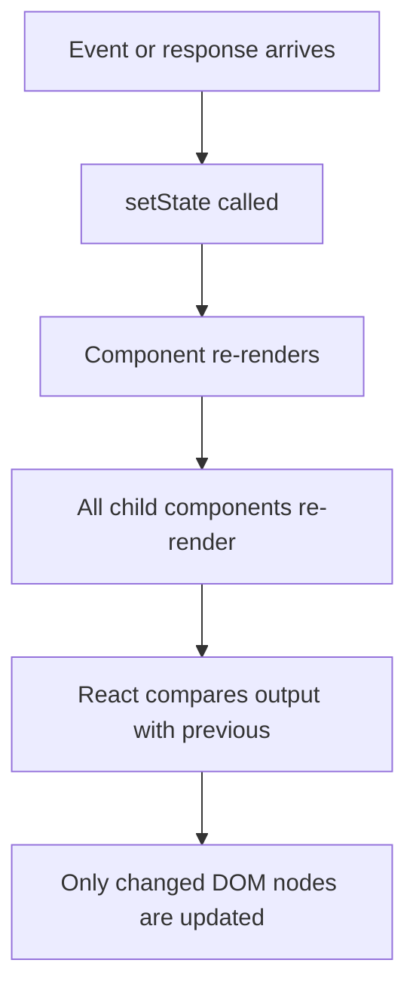
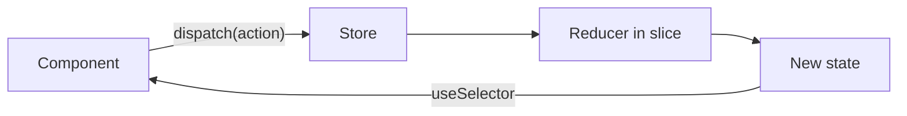
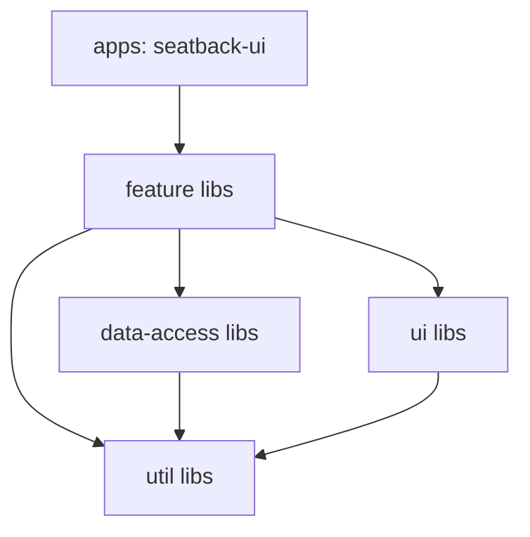
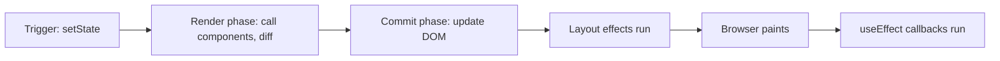
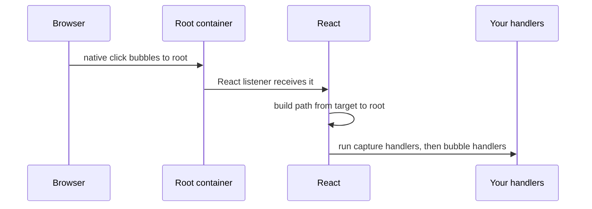

# React

[← Back to index](../README.md) · [⭐ Favorites](favorites.md)

57 questions · 0 favorites · [📚 Resources](#resources)

## Contents

**Basic**

- [1. What is React, and what does "declarative" mean?](#1-what-is-react-and-what-does-declarative-mean)
- [2. What is JSX and how does it compile to JavaScript?](#2-what-is-jsx-and-how-does-it-compile-to-javascript)
- [3. What are props, and how do `children` and composition work?](#3-what-are-props-and-how-do-children-and-composition-work)
- [4. How does state work in React, and why are state updates asynchronous?](#4-how-does-state-work-in-react-and-why-are-state-updates-asynchronous)
- [5. What causes a React component to render or re-render?](#5-what-causes-a-react-component-to-render-or-re-render)
- [6. What is the virtual DOM and how does reconciliation work?](#6-what-is-the-virtual-dom-and-how-does-reconciliation-work)
- [7. Why do list items need a stable `key`, and why is the array index a bad key?](#7-why-do-list-items-need-a-stable-key-and-why-is-the-array-index-a-bad-key)
- [8. How does `useState` work in detail (functional updates, lazy init, objects and arrays)?](#8-how-does-usestate-work-in-detail-functional-updates-lazy-init-objects-and-arrays)
- [9. How does `useEffect` work, and when should you not use it?](#9-how-does-useeffect-work-and-when-should-you-not-use-it)
- [10. What are the Rules of Hooks and why do they exist?](#10-what-are-the-rules-of-hooks-and-why-do-they-exist)
- [11. How do you do conditional rendering and render lists in React?](#11-how-do-you-do-conditional-rendering-and-render-lists-in-react)
- [12. How do events and synthetic events work in React?](#12-how-do-events-and-synthetic-events-work-in-react)
- [13. What is the difference between controlled and uncontrolled components?](#13-what-is-the-difference-between-controlled-and-uncontrolled-components)
- [14. What does "lifting state up" mean?](#14-what-does-lifting-state-up-mean)
- [15. What is React.StrictMode and why do components render twice in development?](#15-what-is-reactstrictmode-and-why-do-components-render-twice-in-development)

**Intermediate**

- [16. \[Tech Lead\] How do you diagnose a slow React app?](#16-tech-lead-how-do-you-diagnose-a-slow-react-app)
- [17. \[Tech Lead\] How do you set a performance budget and use Core Web Vitals?](#17-tech-lead-how-do-you-set-a-performance-budget-and-use-core-web-vitals)
- [18. \[Tech Lead\] How do you use code splitting and lazy loading in React?](#18-tech-lead-how-do-you-use-code-splitting-and-lazy-loading-in-react)
- [19. \[Tech Lead\] How do you handle very long lists (virtualisation)?](#19-tech-lead-how-do-you-handle-very-long-lists-virtualisation)
- [20. \[Tech Lead\] How do you handle errors in production with error boundaries and monitoring?](#20-tech-lead-how-do-you-handle-errors-in-production-with-error-boundaries-and-monitoring)
- [21. \[Tech Lead\] How do you make accessibility a team standard in a React app?](#21-tech-lead-how-do-you-make-accessibility-a-team-standard-in-a-react-app)
- [22. \[Tech Lead\] What is your testing strategy for a React application?](#22-tech-lead-what-is-your-testing-strategy-for-a-react-application)
- [23. \[Tech Lead\] What are the main security risks in a React app and how do you reduce them?](#23-tech-lead-what-are-the-main-security-risks-in-a-react-app-and-how-do-you-reduce-them)
- [24. \[Tech Lead\] What is on your code review checklist for React pull requests?](#24-tech-lead-what-is-on-your-code-review-checklist-for-react-pull-requests)
- [25. How do `useRef` and `forwardRef` work?](#25-how-do-useref-and-forwardref-work)
- [26. When do `useMemo`, `useCallback` and `React.memo` actually help?](#26-when-do-usememo-usecallback-and-reactmemo-actually-help)
- [27. How does `useContext` work and what are its re-render pitfalls?](#27-how-does-usecontext-work-and-what-are-its-re-render-pitfalls)
- [28. How does `useReducer` work and when is it better than `useState`?](#28-how-does-usereducer-work-and-when-is-it-better-than-usestate)
- [29. How do you design a good custom hook?](#29-how-do-you-design-a-good-custom-hook)
- [30. How do you fetch data in React safely, and what is a race condition in an effect?](#30-how-do-you-fetch-data-in-react-safely-and-what-is-a-race-condition-in-an-effect)
- [31. What is TanStack Query (React Query) and how do caching and invalidation work?](#31-what-is-tanstack-query-react-query-and-how-do-caching-and-invalidation-work)
- [32. What are Suspense and `React.lazy`, and how does Suspense handle loading?](#32-what-are-suspense-and-reactlazy-and-how-does-suspense-handle-loading)
- [33. What are portals and when do you use them?](#33-what-are-portals-and-when-do-you-use-them)
- [34. How do higher-order components, render props and hooks compare?](#34-how-do-higher-order-components-render-props-and-hooks-compare)
- [35. How do you handle forms and validation with React Hook Form?](#35-how-do-you-handle-forms-and-validation-with-react-hook-form)
- [36. How do React Router basics work: nested routes, loaders and protected routes?](#36-how-do-react-router-basics-work-nested-routes-loaders-and-protected-routes)
- [37. How does data flow in Redux Toolkit (slice, thunk, RTK Query)?](#37-how-does-data-flow-in-redux-toolkit-slice-thunk-rtk-query)
- [38. What is the difference between `useLayoutEffect` and `useEffect`?](#38-what-is-the-difference-between-uselayouteffect-and-useeffect)
- [39. What are derived state anti-patterns and the "key to reset state" trick?](#39-what-are-derived-state-anti-patterns-and-the-key-to-reset-state-trick)
- [40. What is a stale closure in hooks and how do you fix it?](#40-what-is-a-stale-closure-in-hooks-and-how-do-you-fix-it)
- [41. How do you choose a styling approach: CSS Modules, Tailwind or CSS-in-JS (MUI)?](#41-how-do-you-choose-a-styling-approach-css-modules-tailwind-or-css-in-js-mui)
- [42. What are `useId` and `useSyncExternalStore` for?](#42-what-are-useid-and-usesyncexternalstore-for)
- [43. How do you type props, events, hooks and generics in TypeScript with React?](#43-how-do-you-type-props-events-hooks-and-generics-in-typescript-with-react)

**Advanced**

- [44. \[Tech Lead\] How do you decide between local state, Context, Redux Toolkit and server-state libraries?](#44-tech-lead-how-do-you-decide-between-local-state-context-redux-toolkit-and-server-state-libraries)
- [45. \[Tech Lead\] How do you structure a large TypeScript React codebase or Nx monorepo?](#45-tech-lead-how-do-you-structure-a-large-typescript-react-codebase-or-nx-monorepo)
- [46. \[Tech Lead\] How do you choose between CSR, SSR and SSG?](#46-tech-lead-how-do-you-choose-between-csr-ssr-and-ssg)
- [47. \[Tech Lead\] Design systems and micro-frontends: what are the trade-offs?](#47-tech-lead-design-systems-and-micro-frontends-what-are-the-trade-offs)
- [48. \[Tech Lead\] How do you upgrade React and major dependencies safely?](#48-tech-lead-how-do-you-upgrade-react-and-major-dependencies-safely)
- [49. What is React Fiber, and what are the render and commit phases?](#49-what-is-react-fiber-and-what-are-the-render-and-commit-phases)
- [50. How does concurrent rendering work, and what do `useTransition` and `useDeferredValue` do?](#50-how-does-concurrent-rendering-work-and-what-do-usetransition-and-usedeferredvalue-do)
- [51. What are React Server Components, streaming SSR and hydration?](#51-what-are-react-server-components-streaming-ssr-and-hydration)
- [52. Why must React rendering be pure, and what does that mean for effects and state?](#52-why-must-react-rendering-be-pure-and-what-does-that-mean-for-effects-and-state)
- [53. What is the React Compiler and what does it automate?](#53-what-is-the-react-compiler-and-what-does-it-automate)
- [54. How does React's event system work (delegation, capture and bubble)?](#54-how-does-reacts-event-system-work-delegation-capture-and-bubble)
- [55. Coding exercise: how do you write `useDebounce`, `usePrevious` and `useLocalStorage`?](#55-coding-exercise-how-do-you-write-usedebounce-useprevious-and-uselocalstorage)
- [56. Coding exercise: how do you approach common React interview tasks (todo, autocomplete, infinite scroll, modal, accordion, star rating)?](#56-coding-exercise-how-do-you-approach-common-react-interview-tasks-todo-autocomplete-infinite-scroll-modal-accordion-star-rating)
- [57. How do you test custom hooks and components that use them?](#57-how-do-you-test-custom-hooks-and-components-that-use-them)

## Browse by module

| Module | Questions |
| --- | --- |
| Architecture & Quality (11) | [20](#20-tech-lead-how-do-you-handle-errors-in-production-with-error-boundaries-and-monitoring) · [21](#21-tech-lead-how-do-you-make-accessibility-a-team-standard-in-a-react-app) · [22](#22-tech-lead-what-is-your-testing-strategy-for-a-react-application) · [23](#23-tech-lead-what-are-the-main-security-risks-in-a-react-app-and-how-do-you-reduce-them) · [24](#24-tech-lead-what-is-on-your-code-review-checklist-for-react-pull-requests) · [34](#34-how-do-higher-order-components-render-props-and-hooks-compare) · [45](#45-tech-lead-how-do-you-structure-a-large-typescript-react-codebase-or-nx-monorepo) · [46](#46-tech-lead-how-do-you-choose-between-csr-ssr-and-ssg) · [47](#47-tech-lead-design-systems-and-micro-frontends-what-are-the-trade-offs) · [48](#48-tech-lead-how-do-you-upgrade-react-and-major-dependencies-safely) · [57](#57-how-do-you-test-custom-hooks-and-components-that-use-them) |
| Coding Exercises (2) | [55](#55-coding-exercise-how-do-you-write-usedebounce-useprevious-and-uselocalstorage) · [56](#56-coding-exercise-how-do-you-approach-common-react-interview-tasks-todo-autocomplete-infinite-scroll-modal-accordion-star-rating) |
| Core Concepts (9) | [1](#1-what-is-react-and-what-does-declarative-mean) · [2](#2-what-is-jsx-and-how-does-it-compile-to-javascript) · [3](#3-what-are-props-and-how-do-children-and-composition-work) · [4](#4-how-does-state-work-in-react-and-why-are-state-updates-asynchronous) · [7](#7-why-do-list-items-need-a-stable-key-and-why-is-the-array-index-a-bad-key) · [11](#11-how-do-you-do-conditional-rendering-and-render-lists-in-react) · [12](#12-how-do-events-and-synthetic-events-work-in-react) · [15](#15-what-is-reactstrictmode-and-why-do-components-render-twice-in-development) · [33](#33-what-are-portals-and-when-do-you-use-them) |
| Data Fetching (2) | [30](#30-how-do-you-fetch-data-in-react-safely-and-what-is-a-race-condition-in-an-effect) · [31](#31-what-is-tanstack-query-react-query-and-how-do-caching-and-invalidation-work) |
| Forms & Routing (3) | [13](#13-what-is-the-difference-between-controlled-and-uncontrolled-components) · [35](#35-how-do-you-handle-forms-and-validation-with-react-hook-form) · [36](#36-how-do-react-router-basics-work-nested-routes-loaders-and-protected-routes) |
| Hooks (10) | [8](#8-how-does-usestate-work-in-detail-functional-updates-lazy-init-objects-and-arrays) · [9](#9-how-does-useeffect-work-and-when-should-you-not-use-it) · [10](#10-what-are-the-rules-of-hooks-and-why-do-they-exist) · [25](#25-how-do-useref-and-forwardref-work) · [27](#27-how-does-usecontext-work-and-what-are-its-re-render-pitfalls) · [28](#28-how-does-usereducer-work-and-when-is-it-better-than-usestate) · [29](#29-how-do-you-design-a-good-custom-hook) · [38](#38-what-is-the-difference-between-uselayouteffect-and-useeffect) · [40](#40-what-is-a-stale-closure-in-hooks-and-how-do-you-fix-it) · [42](#42-what-are-useid-and-usesyncexternalstore-for) |
| Internals (6) | [6](#6-what-is-the-virtual-dom-and-how-does-reconciliation-work) · [49](#49-what-is-react-fiber-and-what-are-the-render-and-commit-phases) · [50](#50-how-does-concurrent-rendering-work-and-what-do-usetransition-and-usedeferredvalue-do) · [51](#51-what-are-react-server-components-streaming-ssr-and-hydration) · [52](#52-why-must-react-rendering-be-pure-and-what-does-that-mean-for-effects-and-state) · [54](#54-how-does-reacts-event-system-work-delegation-capture-and-bubble) |
| Rendering & Performance (8) | [5](#5-what-causes-a-react-component-to-render-or-re-render) · [16](#16-tech-lead-how-do-you-diagnose-a-slow-react-app) · [17](#17-tech-lead-how-do-you-set-a-performance-budget-and-use-core-web-vitals) · [18](#18-tech-lead-how-do-you-use-code-splitting-and-lazy-loading-in-react) · [19](#19-tech-lead-how-do-you-handle-very-long-lists-virtualisation) · [26](#26-when-do-usememo-usecallback-and-reactmemo-actually-help) · [32](#32-what-are-suspense-and-reactlazy-and-how-does-suspense-handle-loading) · [53](#53-what-is-the-react-compiler-and-what-does-it-automate) |
| State Management (4) | [14](#14-what-does-lifting-state-up-mean) · [37](#37-how-does-data-flow-in-redux-toolkit-slice-thunk-rtk-query) · [39](#39-what-are-derived-state-anti-patterns-and-the-key-to-reset-state-trick) · [44](#44-tech-lead-how-do-you-decide-between-local-state-context-redux-toolkit-and-server-state-libraries) |
| Styling & TypeScript (2) | [41](#41-how-do-you-choose-a-styling-approach-css-modules-tailwind-or-css-in-js-mui) · [43](#43-how-do-you-type-props-events-hooks-and-generics-in-typescript-with-react) |

## Basic

### 1. What is React, and what does "declarative" mean?

**Short answer:** React is a JavaScript library for building user interfaces from small reusable components. It is declarative: you describe what the screen should look like for the current data, and React works out how to update the browser to match.

In the older imperative style you write the steps: find this element, change its text, add that class, remove this node. As the app grows, the steps get tangled and the screen drifts away from the data. In React you write a function that takes data and returns a description of the UI. When the data changes, you call that function again and React updates only the parts of the DOM that changed.

The core idea is a simple formula: **UI = f(state)**. Given the same props and state, a component should return the same result. This makes bugs easier to find, because you only ask "what was the state?" and not "what sequence of clicks got us here?".

```tsx
type CounterProps = { initial?: number };

export function Counter({ initial = 0 }: CounterProps) {
  const [count, setCount] = useState(initial);
  // We never touch the DOM. We say what to show for the current count.
  return <button onClick={() => setCount(count + 1)}>Clicked {count} times</button>;
}
// After three clicks the button text is "Clicked 3 times".
```

The example shows a button that always renders the current count. The click handler only changes state. React redraws the text.

**Remember:** React is a library, not a full framework. It handles the view layer. Routing, data fetching and builds come from other tools (React Router, TanStack Query, Vite, Next.js).

**Interview tip:** Say "UI is a function of state" and contrast imperative and declarative. Interviewers like it when you also mention that React manages the DOM for you, but you can still reach the DOM with refs when you must.

_Module: Core Concepts · Tags: fundamentals, declarative_

### 2. What is JSX and how does it compile to JavaScript?

**Short answer:** JSX is a syntax extension that lets you write markup-like code inside JavaScript. It is not understood by browsers. A compiler (Babel, SWC, esbuild or the TypeScript compiler) turns each JSX tag into a plain function call that creates a React element.

A React element is just a small object that describes what to render, such as its type, props and children. Since React 17 the new JSX transform compiles to calls of `jsx()` imported automatically from `react/jsx-runtime`, so you no longer need `import React` in every file. Older code compiled to `React.createElement`.

```tsx
// What you write
const title = <h1 className="big">Hello, {user.name}</h1>;

// Roughly what the compiler produces (React 17+ runtime)
const title2 = jsx("h1", { className: "big", children: ["Hello, ", user.name] });
// Both give an object like { type: "h1", props: { className: "big", ... } }
```

The prose version: a tag becomes a function call, attributes become a props object, and anything in curly braces is a normal JavaScript expression.

Rules worth knowing:
- A component returns one root element. Use a fragment `<>...</>` if you do not want an extra wrapper node.
- Use `className` and `htmlFor` because `class` and `for` are reserved words in JavaScript.
- Curly braces take expressions, not statements. You can use a ternary, but not an `if` statement.
- Component names start with a capital letter. Lowercase names are treated as HTML tags.
- JSX escapes text by default, which protects against most XSS.

**Gotcha:** `{0 && <List />}` renders the number `0` on screen, because `0` is a valid thing to render. Use `{items.length > 0 && <List />}` instead.

**Interview tip:** Explain that JSX is only syntax sugar and that you could write React without it. This shows you understand that elements are plain objects.

_Module: Core Concepts · Tags: jsx, fundamentals_

### 3. What are props, and how do `children` and composition work?

**Short answer:** Props are the inputs a parent passes to a child component. They are read-only. `children` is a special prop that holds whatever you put between the opening and closing tags, and it is the main tool for composing components.

A component is like a function and props are its arguments. A child must never change its props. If the child needs to tell the parent something, the parent passes down a callback function as a prop. Data flows down, events flow up.

React prefers composition over inheritance. Instead of creating a base class and extending it, you build a general component and fill the gaps with props and `children`. This is how a `Card`, `Modal` or layout component can be reused with any content.

```tsx
import type { ReactNode } from "react";

type CardProps = { title: string; footer?: ReactNode; children: ReactNode };

function Card({ title, footer, children }: CardProps) {
  return (
    <section className="card">
      <h2>{title}</h2>
      <div>{children}</div>
      {footer && <footer>{footer}</footer>}
    </section>
  );
}

// The Card does not know what it contains.
const view = (
  <Card title="Seat 14A" footer={<button>Order</button>}>
    <p>Meal choice: vegetarian</p>
  </Card>
);
```

The example shows a Card that fills three slots: a text title, a children area and an optional footer element. The caller decides the content.

**Common mistakes**
- Changing props directly, such as `props.items.push(x)`. This mutates the parent's data.
- Copying props into state without a reason. It goes out of date when the prop changes.
- Passing too many props down many levels. Use composition (pass the finished element) or context.

**Interview tip:** Say "composition over inheritance" and give the Card or Modal example. In TypeScript, mention that `children` is typed as `ReactNode`.

_Module: Core Concepts · Tags: props, composition_

### 4. How does state work in React, and why are state updates asynchronous?

**Short answer:** State is data a component remembers between renders. Calling a setter does not change the variable right away. It asks React to schedule a re-render, and the new value appears in the next render. React also batches several updates into one render for speed.

Each render is a snapshot. Inside one render, `count` has one fixed value, even if you call `setCount` three times. The new value is only visible in the next render.

```tsx
function Demo() {
  const [count, setCount] = useState(0);

  function handleClick() {
    setCount(count + 1);
    setCount(count + 1);
    setCount(count + 1);
    console.log(count); // prints: 0 (still the old snapshot)
  }
  // After one click, count becomes 1, not 3.
  return <button onClick={handleClick}>{count}</button>;
}
```

All three calls used `count` from the same snapshot, which is 0, so each one asks for 1. To build on the previous value, use the functional form: `setCount(c => c + 1)` three times gives 3.

Batching: React 17 batched updates only inside React event handlers. React 18 added automatic batching, so updates in timeouts, promises and native events are also grouped into one render. If you truly need the DOM updated at once, `flushSync` exists, but it is rarely needed.

**Why it is designed this way:** one render per event is faster, and the UI never shows half-finished state.

**Gotcha:** After `setUser(newUser)` you cannot read the new value on the next line. Compute it first in a variable and use that variable for both the setter and the next step.

**Interview tip:** The "three setCount calls" question is a classic. Answer with the snapshot idea and the functional update.

_Module: Core Concepts · Tags: state, batching_

### 5. What causes a React component to render or re-render?

**Short answer:** A component renders on first mount, and re-renders when its own state changes, when its parent re-renders, or when a context it reads changes. A prop change alone is not a separate trigger. The parent re-rendering is what passes new props.

"Render" means React calls your function to get the new description of the UI. It does not mean the DOM changed. After rendering, React compares the result with the previous one and only touches the DOM where something differs.



Read the diagram top to bottom: a state change re-renders the component and by default all its children, then React updates only the differences in the DOM.

Key rules:
- By default, when a parent re-renders, all its children re-render too, even if their props did not change.
- `React.memo` lets a child skip re-render if its props are shallow equal.
- Setting state to the same value (compared with `Object.is`) usually skips the re-render.
- A component reading a context re-renders when that context value changes.
- Changing a plain variable or a ref does not trigger a render.

A re-render is often cheap and harmless. It only becomes a problem when the render is expensive or happens very often.

**Gotcha:** Creating a new object or function in the parent on every render, then passing it to a memoized child, makes the memo useless because the reference is new each time.

**Interview tip:** Interviewers ask "does re-render mean the DOM is updated?" The answer is no. Render is calculation, commit is the DOM update.

_Module: Rendering & Performance · Tags: rendering, performance_

### 6. What is the virtual DOM and how does reconciliation work?

**Short answer:** The virtual DOM is a lightweight tree of JavaScript objects (React elements) that describes the UI. When state changes, React builds a new tree, compares it with the old one (reconciliation), and applies only the minimal changes to the real DOM.

Touching the real DOM is slow compared with plain JavaScript work. So React does the comparison in memory and then does a small batch of DOM writes. Note that the virtual DOM is not magic fast. Its value is that you can write declarative code and still get reasonable updates.

The diffing algorithm uses two practical assumptions:
- Two elements of different types produce different trees. If a div becomes a span, or a Form component becomes a Table component, React destroys the old subtree (and its state) and builds a new one.
- Within a list, `key` tells React which item is which across renders.

If the type is the same, React keeps the instance and updates only the changed props. Then it goes down to the children.

```tsx
function Panel({ editing }: { editing: boolean }) {
  // Same type at the same position: the input keeps its text
  return editing ? <input className="edit" /> : <input className="view" readOnly />;
}
```

In this example, switching `editing` keeps the same `input` instance, so React only updates the attributes and the typed text stays.

**Gotcha:** Defining a component inside another component creates a new component type on each render. React then unmounts and remounts it every time, so it loses state and focus.

**Interview tip:** Do not say "the virtual DOM makes React fast". Say it enables declarative UI with efficient updates, and explain the two diff rules. Mention that Fiber is the modern implementation (see the advanced section).

_Module: Internals · Tags: virtual-dom, reconciliation_

### 7. Why do list items need a stable `key`, and why is the array index a bad key?

**Short answer:** A `key` lets React identify each list item between renders, so it can move, add or remove the right DOM nodes and keep the right state. A key should be unique among siblings and stable. The array index is a bad key when the list can be reordered, filtered or inserted into, because the index points to a different item after the change.

Think of keys as name tags at a conference. Without a tag, React guesses by position. With a tag, it knows who moved.

```tsx
type Todo = { id: string; text: string };

function TodoList({ todos }: { todos: Todo[] }) {
  return (
    <ul>
      {todos.map((t) => (
        // ✅ good: id belongs to the data
        <li key={t.id}>
          <input defaultValue={t.text} />
        </li>
      ))}
    </ul>
  );
}
```

Suppose you used `key={index}` and delete the first todo. The item that was second now has index 0, so React reuses the first DOM node and its input. Because the input is uncontrolled, the old typed text stays in the wrong row. With `t.id` the correct node is removed.

Rules:
- Keys only need to be unique among siblings, not globally.
- Use an id from your data. Generate ids when the item is created, not during render.
- Never use `Math.random()` as a key. It changes every render, so every item is remounted.
- Index is acceptable only for static lists that never reorder or change.

**Trick:** Changing the `key` of a component forces React to throw away its state and start fresh. This is a useful way to reset a form.

**Interview tip:** Give the concrete bug: state or input text jumping to the wrong row. That shows you understand it, not just recite it.

_Module: Core Concepts · Tags: lists, keys, reconciliation_

### 8. How does `useState` work in detail (functional updates, lazy init, objects and arrays)?

**Short answer:** `useState(initial)` returns the current value and a setter. Use the functional form `setX(prev => ...)` when the new value depends on the old one. Pass a function as the initial value for expensive setup. For objects and arrays, always create a new copy instead of mutating.

React compares the new state with the old using `Object.is`. If you mutate an array and set the same array, the reference is the same, so React thinks nothing changed and may skip the render.

```tsx
type Seat = { id: string; taken: boolean };

function SeatMap() {
  // Lazy init: the function runs only on the first render
  const [seats, setSeats] = useState<Seat[]>(() => buildSeats(300));

  function toggle(id: string) {
    // ✅ new array, new object for the changed item
    setSeats((prev) => prev.map((s) => (s.id === id ? { ...s, taken: !s.taken } : s)));
  }

  function badToggle(id: string) {
    const seat = seats.find((s) => s.id === id)!;
    seat.taken = !seat.taken; // ❌ bad: mutates state
    setSeats(seats); // same reference, may not re-render
  }
  return <button onClick={() => toggle("1A")}>Toggle 1A</button>;
}

declare function buildSeats(n: number): Seat[];
```

Immutable update patterns:

| Task | Pattern |
| --- | --- |
| Add to array | `[...list, item]` |
| Remove | `list.filter(x => x.id !== id)` |
| Change one item | `list.map(x => x.id === id ? { ...x, done: true } : x)` |
| Update nested object | `{ ...obj, address: { ...obj.address, city } }` |

Writing `useState(buildSeats(300))` without the arrow still calls `buildSeats` on every render, even though only the first result is used. The arrow avoids that wasted work.

For deep nested state, the Immer library (used inside Redux Toolkit) lets you write "mutating" code that produces immutable results.

**Interview tip:** Mention that the state setter is stable, so it does not need to be listed in effect dependencies.

_Module: Hooks · Tags: hooks, state_

### 9. How does `useEffect` work, and when should you not use it?

**Short answer:** `useEffect` runs code after React has painted the screen, to synchronise your component with something outside React, such as a network call, a subscription or a timer. The dependency array decides when it re-runs, and the returned cleanup function undoes the previous run. Do not use it for things you can calculate during render or do in an event handler.

Dependency array:
- No array: runs after every render.
- `[]`: runs after the first render only. Cleanup runs on unmount.
- `[a, b]`: runs after the first render and again when `a` or `b` changes (compared with `Object.is`).

On each re-run, React first calls the cleanup from the previous run, then runs the effect again.

```tsx
function useWindowWidth() {
  const [width, setWidth] = useState(window.innerWidth);
  useEffect(() => {
    const onResize = () => setWidth(window.innerWidth);
    window.addEventListener("resize", onResize);
    return () => window.removeEventListener("resize", onResize); // cleanup
  }, []);
  return width;
}
// Without cleanup, each mount would leave an extra listener behind.
```

The example subscribes to the resize event and removes the listener when the component unmounts.

**You might not need an effect** for these cases:

| Situation | Better approach |
| --- | --- |
| Value derived from props or state | Calculate it during render |
| Reaction to a user click | Put the logic in the event handler |
| Reset state when a prop changes | Use `key` on the component |
| Fetching data | A data library such as TanStack Query (or at least handle races) |

**Gotchas**
- Listing every value the effect uses is the rule. The lint rule `react-hooks/exhaustive-deps` helps.
- Setting state inside an effect that depends on that same state can cause an infinite loop.
- In development StrictMode runs the effect twice. This is on purpose to catch missing cleanup.

**Interview tip:** The phrase "effects are for synchronising with external systems" scores well.

_Module: Hooks · Tags: hooks, effects_

### 10. What are the Rules of Hooks and why do they exist?

**Short answer:** There are two rules. Call hooks only at the top level of a component or custom hook, never inside conditions, loops or nested functions. And call hooks only from React function components or other hooks. The reason is that React remembers hook state by the order of the calls.

React does not know hook names. It keeps a list of slots for each component. The first `useState` call uses slot one, the second uses slot two, and so on. If the order changes between renders, state ends up in the wrong slot.

```tsx
function Profile({ loggedIn }: { loggedIn: boolean }) {
  if (loggedIn) {
    const [name, setName] = useState(""); // ❌ bad: sometimes called, sometimes not
  }
  const [theme, setTheme] = useState("dark"); // slot number shifts when loggedIn changes
  return null;
}

function ProfileFixed({ loggedIn }: { loggedIn: boolean }) {
  const [name, setName] = useState(""); // ✅ always called
  if (!loggedIn) return null; // early return AFTER all hooks is fine
  return <p>{name}</p>;
}
```

In the bad version, when `loggedIn` flips, the second hook reads the first one's slot and React throws an error or returns wrong data.

How to follow the rules:
- Put the condition inside the hook (for example inside `useEffect`) rather than around it.
- Do all hook calls before any early `return`.
- Install `eslint-plugin-react-hooks`. It enforces both rules and the dependency rule.
- Name custom hooks with the `use` prefix so the linter can check them.

**Interview tip:** If asked "why", say "hooks are stored as an ordered list per component, so the call order must be the same every render". That one sentence is the expected answer.

_Module: Hooks · Tags: hooks, rules_

### 11. How do you do conditional rendering and render lists in React?

**Short answer:** In JSX you use ordinary JavaScript: `&&`, the ternary `? :`, early returns, and `array.map()` for lists. Each item in a mapped list needs a `key`.

```tsx
type Flight = { id: string; from: string; to: string; delayed: boolean };

function FlightList({ flights, loading }: { flights: Flight[]; loading: boolean }) {
  if (loading) return <p>Loading...</p>; // early return

  if (flights.length === 0) return <p>No flights found.</p>;

  return (
    <ul>
      {flights.map((f) => (
        <li key={f.id}>
          {f.from} to {f.to}
          {f.delayed ? <strong> (delayed)</strong> : null}
        </li>
      ))}
    </ul>
  );
}
// With three flights it renders three list items, one marked delayed.
```

The example shows three states: loading, empty and with data. Early returns keep each state easy to read.

Choices:

| Pattern | Use when |
| --- | --- |
| Early `return` | The whole component differs by state |
| Ternary | Two alternatives inside JSX |
| `cond && <X />` | Show or hide one piece |
| Lookup object | Many variants, for example a status badge |

React does not render `true`, `false`, `null` or `undefined`, but it does render `0` and empty strings.

**Gotchas**
- `{count && <Badge />}` prints `0` when count is zero. Use `count > 0 && ...`.
- Deeply nested ternaries are hard to read. Extract a small component instead.
- Filtering and sorting large lists on every render can be slow. Memoize with `useMemo` if you measured a problem.

**Interview tip:** Mention that switching between two branches that render the same component type at the same position keeps its state, which surprises many people.

_Module: Core Concepts · Tags: jsx, lists, conditional_

### 12. How do events and synthetic events work in React?

**Short answer:** You attach handlers with props like `onClick`, using camelCase and passing a function. React wraps the browser event in a `SyntheticEvent`, which has the same API across browsers. Since React 17 the handlers are attached to the root container, not to the document, and React 17 removed the old event pooling.

You pass a function, not a call. `onClick={handle}` is right. `onClick={handle()}` calls it during render and passes the result.

```tsx
function SearchBox() {
  const [text, setText] = useState("");

  function handleChange(e: React.ChangeEvent<HTMLInputElement>) {
    setText(e.target.value);
  }

  function handleSubmit(e: React.FormEvent<HTMLFormElement>) {
    e.preventDefault(); // stop the browser from reloading the page
    console.log("search for", text);
  }

  return (
    <form onSubmit={handleSubmit}>
      <input value={text} onChange={handleChange} />
      <button type="submit">Go</button>
    </form>
  );
}
```

The form calls `preventDefault` so the page does not reload, then logs the text. The types come from React, such as `React.ChangeEvent<HTMLInputElement>`.

Useful facts:
- `e.preventDefault()` stops the default browser action. `e.stopPropagation()` stops the event bubbling to parent handlers.
- Most events bubble. Use the `onClickCapture` form to listen in the capture phase.
- `onChange` in React fires on every keystroke, unlike the native `change` event.
- You can reach the native event with `e.nativeEvent`.
- Handlers run inside React's batching, so state updates inside them are grouped.

**Gotcha:** Returning `false` from a handler does not stop the default behaviour in React. You must call `preventDefault`.

**Interview tip:** Mention event delegation at the root, and that it is why you rarely need to remove listeners manually.

_Module: Core Concepts · Tags: events_

### 13. What is the difference between controlled and uncontrolled components?

**Short answer:** In a controlled component React state is the single source of truth: the input's `value` comes from state and `onChange` updates it. In an uncontrolled component the DOM keeps the value, and you read it when needed with a ref or `FormData`.

| | Controlled | Uncontrolled |
| --- | --- | --- |
| Value lives in | React state | The DOM |
| Read the value | From state, any time | From a ref or form on submit |
| Re-renders per keystroke | Yes | No |
| Good for | Live validation, formatting, dependent fields | Simple forms, file inputs, big forms where speed matters |

```tsx
function Controlled() {
  const [email, setEmail] = useState("");
  // The input shows exactly what state says
  return <input value={email} onChange={(e) => setEmail(e.target.value.trim())} />;
}

function Uncontrolled() {
  const ref = useRef<HTMLInputElement>(null);
  return (
    <>
      <input ref={ref} defaultValue="" />
      <button onClick={() => alert(ref.current?.value)}>Read</button>
    </>
  );
}
```

The first input trims spaces as the user types because state decides the displayed value. The second leaves the typing to the browser and reads the value only when the button is clicked.

**Common mistakes**
- Setting `value` without `onChange` makes a read-only field and React warns you.
- Switching from `value={undefined}` to a string changes an input from uncontrolled to controlled, which gives a warning. Start with `""`.
- `<input type="file" />` is always uncontrolled.

In large forms, controlled inputs re-render the whole form on each key. Libraries such as React Hook Form use uncontrolled inputs with refs to avoid that.

**Interview tip:** Say when you would choose each. Interviewers want a trade-off, not a definition.

_Module: Forms & Routing · Tags: forms, controlled_

### 14. What does "lifting state up" mean?

**Short answer:** When two components need the same data, you move the state to their closest common parent and pass it down as props, with callbacks to change it. This keeps one source of truth.

Imagine a seat picker and a price summary. Both need the selected seats. If each kept its own copy, they could disagree. Instead the parent owns `selected` and passes it to both.

```tsx
function Booking() {
  const [selected, setSelected] = useState<string[]>([]);

  const toggle = (seat: string) =>
    setSelected((prev) => (prev.includes(seat) ? prev.filter((s) => s !== seat) : [...prev, seat]));

  return (
    <>
      <SeatPicker selected={selected} onToggle={toggle} />
      <PriceSummary count={selected.length} />
    </>
  );
}

declare function SeatPicker(p: { selected: string[]; onToggle: (s: string) => void }): JSX.Element;
declare function PriceSummary(p: { count: number }): JSX.Element;
```

The example shows both children receive data from the parent, and the picker reports clicks through `onToggle`. When a seat is clicked, state changes in `Booking`, and both children update.

Guidelines:
- Put state as low as possible, but as high as needed. The closest common parent is the right place.
- If passing props through many levels gets painful (prop drilling), use composition (pass elements as children) or context, or a store.
- Do not lift state "just in case". More lifted state means more re-renders of the parent subtree.

**Interview tip:** Mention the opposite move too: if only one component uses a piece of state, keep it local.

_Module: State Management · Tags: state, composition_

### 15. What is React.StrictMode and why do components render twice in development?

**Short answer:** `StrictMode` is a development-only wrapper that helps find bugs. It renders components twice and, since React 18, also mounts, unmounts and mounts every component once to check that effects clean up correctly. It has no effect in production builds.

React expects render functions to be pure and effects to be cleaned up. Running things twice exposes code that breaks those rules.

What it checks:
- Double invocation of component bodies, state initialisers and reducers, to find impure code.
- In React 18 and later, a simulated unmount and remount, so an effect runs, cleans up and runs again.
- Warnings for deprecated APIs.

```tsx
import { StrictMode, useEffect } from "react";
import { createRoot } from "react-dom/client";

function Chat({ room }: { room: string }) {
  useEffect(() => {
    const conn = connect(room);
    return () => conn.close(); // if you forget this, StrictMode shows two open connections
  }, [room]);
  return null;
}

createRoot(document.getElementById("root")!).render(
  <StrictMode>
    <Chat room="seat-12" />
  </StrictMode>
);

declare function connect(room: string): { close(): void };
```

In development you will see connect, close, connect. That is not a bug in React. It shows that your cleanup works.

**Common reaction:** "My effect runs twice, so I will remove StrictMode." Do not. Fix the effect instead. Make it idempotent and clean up properly.

For one-time work like analytics, use an event handler or accept that dev logs twice. Do not use a `ref` flag to hack around it unless you understand why.

**Interview tip:** Say it is a development tool that checks purity and cleanup, and that production runs once.

_Module: Core Concepts · Tags: strict-mode, debugging_

## Intermediate

### 16. [Tech Lead] How do you diagnose a slow React app?

**Short answer:** Measure first, then fix. Reproduce the slowness, record it with the React DevTools Profiler and the browser Performance panel, find which components render too often or too long, and fix the biggest cause. Then measure again to prove the gain.

Guessing leads to wrapping everything in `useMemo`, which adds complexity and often changes nothing.

**A repeatable process**
1. Define the symptom: slow first load, slow typing, slow scrolling, or slow screen change. Each has different causes.
2. Use a production build for numbers. Development mode is much slower.
3. Record in the React DevTools Profiler. Turn on "Record why each component rendered". Look at the flame chart for wide bars (slow) and many repeated bars (too many renders).
4. Use the browser Performance panel to see long tasks over 50 ms, layout work and network waits. Not every slowness is React.
5. Fix the cause, then re-record.

**Common causes and fixes**

| Cause | Fix |
| --- | --- |
| State too high, so many children re-render | Move state down, or split components |
| New object or function props breaking `React.memo` | Stable references with `useMemo` or `useCallback` |
| Context value changing often | Split contexts, or use a store with selectors |
| Huge lists in the DOM | Virtualise the list |
| Expensive calculation each render | `useMemo`, or move it off the main thread |
| Big JavaScript bundle | Code splitting, remove heavy libraries |
| Typing lag in a heavy screen | `useDeferredValue` or `useTransition` |

```tsx
import { Profiler } from "react";

// Log slow commits in a dev or staging build
<Profiler
  id="SeatMap"
  onRender={(id, phase, actualDuration) => {
    if (actualDuration > 16) console.warn(`${id} ${phase} took ${actualDuration.toFixed(1)} ms`);
  }}
>
  <SeatMap />
</Profiler>;
```

The snippet prints a warning whenever a commit of the SeatMap takes longer than one frame (about 16 ms).

**In production:** collect real-user data (Web Vitals, Datadog RUM) so you see what users on slow devices see. Seat-back screens in flight entertainment are often much slower than a developer laptop, so test with CPU throttling.

**Interview tip:** Start your answer with "I would measure". Then give two or three real examples you fixed with the numbers before and after.

_Module: Rendering & Performance · Tags: tech-lead, performance, profiling_

### 17. [Tech Lead] How do you set a performance budget and use Core Web Vitals?

**Short answer:** A performance budget is an agreed limit, such as maximum bundle size or maximum Largest Contentful Paint, that the team checks in CI. Core Web Vitals are the user-focused metrics: LCP for loading, INP for responsiveness and CLS for visual stability. You track them with real-user data, not only with lab tests.

**The three metrics (good thresholds)**

| Metric | What it measures | Good value |
| --- | --- | --- |
| LCP (Largest Contentful Paint) | When the main content appears | 2.5 seconds or less |
| INP (Interaction to Next Paint) | How fast the page reacts to clicks and keys | 200 ms or less |
| CLS (Cumulative Layout Shift) | How much the layout jumps | 0.1 or less |

INP replaced the older FID metric in March 2024.

**How to put it into practice**
- Pick budgets that match your users. For a device with a weak CPU, set tighter JavaScript limits than for a desktop web app.
- Budget items: initial JS size (for example under 200 KB gzipped), LCP, INP, number of requests.
- Enforce in CI. A bundle size check (for example `size-limit` or a bundle analyzer step) fails the merge request if the limit is crossed. Lighthouse CI can check lab scores.
- Measure real users with the `web-vitals` library and send values to your monitoring tool.

```ts
import { onLCP, onINP, onCLS } from "web-vitals";

function send(metric: { name: string; value: number }) {
  navigator.sendBeacon("/metrics", JSON.stringify(metric)); // fire-and-forget
}
onLCP(send);
onINP(send);
onCLS(send);
```

This reports each metric once the browser has the final value.

**Typical React fixes:** reduce JS by code splitting, preload the LCP image, reserve space for images to avoid layout shifts, and break long tasks so interactions stay fast.

**Interview tip:** Say lab data tells you why, and field data tells you what real users feel. Use both, and show you would block regressions in CI rather than fix them in a "performance sprint".

_Module: Rendering & Performance · Tags: tech-lead, performance, web-vitals_

### 18. [Tech Lead] How do you use code splitting and lazy loading in React?

**Short answer:** Code splitting breaks the JavaScript bundle into smaller chunks that are loaded when needed. In React you use `React.lazy` with dynamic `import()` and wrap the lazy component in `Suspense`. The best place to split is at route level, then at heavy features such as charts, editors and maps.

Without splitting, a user downloads the whole app just to see the login screen.

```tsx
import { lazy, Suspense } from "react";
import { Routes, Route } from "react-router-dom";

// Each lazy() becomes its own chunk, loaded on first visit
const Dashboard = lazy(() => import("./Dashboard"));
const Reports = lazy(() => import("./Reports")); // must have a default export

export function App() {
  return (
    <Suspense fallback={<p>Loading...</p>}>
      <Routes>
        <Route path="/" element={<Dashboard />} />
        <Route path="/reports" element={<Reports />} />
      </Routes>
    </Suspense>
  );
}
```

While a chunk downloads, the fallback is shown. After that, the page appears.

**What to split**
- Routes (first and biggest win).
- Heavy widgets used rarely: chart library, rich text editor, PDF viewer, map.
- Admin or rarely used areas.

**Tips**
- Prefetch likely next pages, for example on link hover, so users do not wait: call `import("./Reports")` early.
- Use a bundle analyzer to find big dependencies. Replace them with lighter ones (for example `date-fns` instead of a large date library) or import only what you need.
- Add an error boundary. A chunk can fail to load, especially after a new deployment removes old files.
- Avoid too many tiny chunks. Each is a request.
- In an Nx monorepo, make sure lazy-loaded libraries have clear boundaries so they really become separate chunks.

**Gotcha:** `React.lazy` works only with default exports. For named exports, re-export as default or map it: `lazy(() => import("./x").then(m => ({ default: m.X })))`.

**Interview tip:** Mention the stale chunk problem after deployments and how you handle it (error boundary with a reload prompt).

_Module: Rendering & Performance · Tags: tech-lead, performance, code-splitting_

### 19. [Tech Lead] How do you handle very long lists (virtualisation)?

**Short answer:** Render only the rows that are visible on screen plus a small buffer, and keep the rest out of the DOM. This is called virtualisation or windowing. Libraries such as TanStack Virtual, react-window and react-virtuoso do it for you.

A browser slows down with thousands of DOM nodes. Rendering 10,000 rows means many components, much memory and slow scrolling. With virtualisation you draw about 20 rows, and the list container just has the full height so the scrollbar looks right.

```tsx
import { useRef } from "react";
import { useVirtualizer } from "@tanstack/react-virtual";

export function MovieList({ titles }: { titles: string[] }) {
  const parentRef = useRef<HTMLDivElement>(null);
  const virtualizer = useVirtualizer({
    count: titles.length,
    getScrollElement: () => parentRef.current,
    estimateSize: () => 36, // row height guess in px
  });

  return (
    <div ref={parentRef} style={{ height: 400, overflow: "auto" }}>
      <div style={{ height: virtualizer.getTotalSize(), position: "relative" }}>
        {virtualizer.getVirtualItems().map((row) => (
          <div
            key={row.key}
            style={{ position: "absolute", top: 0, transform: `translateY(${row.start}px)`, height: row.size }}
          >
            {titles[row.index]}
          </div>
        ))}
      </div>
    </div>
  );
}
```

For 50,000 titles only about a dozen rows exist in the DOM at any time. The tall inner div gives a correct scrollbar.

**Trade-offs**
- Browser find (Ctrl+F) cannot see rows that are not rendered.
- Variable row heights are harder. Measure rows or give a good estimate.
- Accessibility needs care: use correct roles and keyboard focus handling.
- Focus and scroll position must be kept when data changes.

**Before virtualising, try simpler options:** pagination, "load more", server-side filtering, or limiting the list. Virtualisation adds complexity, so use it when the list is genuinely long. Also use `React.memo` on row components and stable keys.

**Interview tip:** Mention a real use, like a catalogue with thousands of titles on a seat-back screen with a weak CPU.

_Module: Rendering & Performance · Tags: tech-lead, performance, lists_

### 20. [Tech Lead] How do you handle errors in production with error boundaries and monitoring?

**Short answer:** Wrap the app and important sections in error boundaries so a crash in one widget shows a fallback instead of a blank page. Send every caught error, with context, to a monitoring tool such as Datadog or Sentry, and use source maps so stack traces are readable.

Error boundaries catch errors thrown while rendering, in lifecycle methods and in constructors of child components. They do not catch errors in event handlers, in async code (promises, timers) or in server rendering, so those need their own `try/catch` or global handlers.

```tsx
import { Component, type ErrorInfo, type ReactNode } from "react";

type Props = { fallback: ReactNode; children: ReactNode };

export class ErrorBoundary extends Component<Props, { failed: boolean }> {
  state = { failed: false };

  static getDerivedStateFromError() {
    return { failed: true };
  }

  componentDidCatch(error: Error, info: ErrorInfo) {
    reportError(error, { componentStack: info.componentStack }); // to monitoring
  }

  render() {
    return this.state.failed ? this.props.fallback : this.props.children;
  }
}

declare function reportError(e: Error, ctx: Record<string, unknown>): void;
```

When a child throws during render, the boundary swaps its content for the fallback and sends a report.

**What a lead sets up**
- Boundaries at several levels: whole app, each route, and risky widgets such as a map or video player.
- A "try again" action in the fallback that resets the boundary.
- Global handlers for `window.onerror` and `unhandledrejection`.
- Upload source maps in CI (not served publicly) so stack traces point to real files.
- Release tags and user/session ids so you can link an error to a release and a flight or device.
- Alerts based on error rate per release, and a rollback path.
- Treat failed lazy chunk loads as a special case: offer a page reload.

**Gotcha:** Error boundaries must be class components. The `react-error-boundary` package gives a ready hook-friendly wrapper.

**Interview tip:** Mention that you track the error rate after each release and block or roll back when it jumps.

_Module: Architecture & Quality · Tags: tech-lead, errors, observability_

### 21. [Tech Lead] How do you make accessibility a team standard in a React app?

**Short answer:** Build accessibility into the process, not as a late audit: use semantic HTML, accessible design-system components, automated checks in lint and CI, a manual keyboard and screen-reader check in the definition of done, and training for the team.

Accessibility (a11y) matters legally and morally, and in a device with remote or touch-only input, focus handling is essential.

**Practical layers**
1. **Semantic HTML first.** Use `button` for actions, `a` for navigation, real headings and labels. A `div` with `onClick` is not focusable and has no role.
2. **Design system.** Build or choose components with keyboard and ARIA support (MUI and Radix are good bases). Fixing one component fixes the whole app.
3. **Automated checks.** `eslint-plugin-jsx-a11y` in lint, `axe` (for example `jest-axe` or Playwright with axe) in tests. These catch around a third to half of the issues.
4. **Manual checks.** Tab through every new screen: can you reach and use everything, is focus visible, is the order logical? Try one screen reader pass for important flows.
5. **Definition of done and review checklist.** A pull request that adds UI includes the a11y checklist.

```tsx
// ❌ bad: not focusable, no role, no label
<div onClick={save}>Save</div>

// ✅ good: keyboard and screen-reader support for free
<button type="button" onClick={save}>Save</button>

// Icon-only buttons need a name
<button type="button" aria-label="Close dialog" onClick={close}>
  <CloseIcon />
</button>
```

The second form can be used with Enter and Space and is announced as a button. The third gets a spoken name from `aria-label`.

**Key topics:** focus management in modals and route changes, colour contrast (4.5 to 1 for normal text in WCAG AA), visible focus, form errors linked with `aria-describedby`, live regions for status messages, and respecting reduced motion.

**Interview tip:** Say that no ARIA is better than bad ARIA, and that you aim for WCAG 2.1 AA. Describe how you would add it to CI, not only to the code.

_Module: Architecture & Quality · Tags: tech-lead, accessibility, standards_

### 22. [Tech Lead] What is your testing strategy for a React application?

**Short answer:** Test behaviour the way a user sees it. Use many fast unit tests for pure logic and hooks, component tests with React Testing Library for most UI behaviour, mocked network with MSW, a few end-to-end tests for critical journeys, and optional visual regression for the design system.

**The layers**

| Layer | Tool | What it covers |
| --- | --- | --- |
| Unit | Vitest or Jest | Pure functions, reducers, selectors |
| Component / integration | React Testing Library | Screens: click, type, see result |
| API mocking | MSW (Mock Service Worker) | Realistic responses and errors, same in tests and Storybook |
| End to end | Playwright or Cypress | Login, booking, payment: the few journeys you must never break |
| Visual regression | Storybook with Chromatic or Playwright snapshots | UI looks unchanged |
| Accessibility | axe in tests | Obvious a11y issues |

**Principles**
- Query like a user: `getByRole`, `getByLabelText`, `getByText`. Avoid test ids unless nothing else works.
- Do not test implementation details such as internal state or calling `setState`. Tests should survive a refactor.
- Mock at the network edge (MSW) instead of mocking your own hooks. The code under test then runs for real.
- Keep end-to-end tests few and stable. Each one is slow and can be flaky.

```tsx
import { render, screen } from "@testing-library/react";
import userEvent from "@testing-library/user-event";

test("shows an error when the email is empty", async () => {
  render(<LoginForm />);
  await userEvent.click(screen.getByRole("button", { name: /sign in/i }));
  expect(await screen.findByText(/email is required/i)).toBeInTheDocument();
});
// The test reads like a user story and does not care how LoginForm is built.
```

**Team standards:** coverage as a signal not a target, tests run in CI on affected projects only (Nx), flaky tests are fixed or removed within a set time, and each bug fix starts with a failing test.

**Interview tip:** Describe the "testing trophy": most value from integration tests. Show you balance cost against confidence.

_Module: Architecture & Quality · Tags: tech-lead, testing, quality_

### 23. [Tech Lead] What are the main security risks in a React app and how do you reduce them?

**Short answer:** The biggest risk is cross-site scripting (XSS). React escapes values in JSX by default, but `dangerouslySetInnerHTML`, unsafe URLs and third-party scripts can bypass this. Also protect tokens, keep dependencies patched, and remember that anything in the browser is public.

**Main risks and defences**

| Risk | Defence |
| --- | --- |
| XSS through `dangerouslySetInnerHTML` | Avoid it. If you must, sanitise with DOMPurify first |
| `javascript:` URLs in `href` from user data | Validate that URLs start with `http`, `https` or `mailto` |
| Token theft | Prefer short-lived access tokens in memory and refresh tokens in `HttpOnly`, `Secure`, `SameSite` cookies. Avoid `localStorage` for long-lived tokens |
| CSRF (when using cookies) | `SameSite` cookies and anti-CSRF tokens on state-changing requests |
| Vulnerable packages | `npm audit` or Dependabot in CI, lock files, review new dependencies |
| Secrets in the bundle | Never put API secrets in front-end code or `VITE_`/`REACT_APP_` variables. They are public |
| Third-party scripts | Content Security Policy, subresource integrity, minimal scripts |

```tsx
import DOMPurify from "dompurify";

function Description({ html }: { html: string }) {
  // ❌ bad: <div dangerouslySetInnerHTML={{ __html: html }} />
  // ✅ good: sanitise untrusted HTML first
  return <div dangerouslySetInnerHTML={{ __html: DOMPurify.sanitize(html) }} />;
}
```

The sanitiser strips scripts and event attributes, so the markup is safe to inject.

**Other points:** authorisation must be checked on the server. Hiding a button is only user experience, not security. Set a strict Content Security Policy. Do not log tokens or personal data to monitoring.

**Interview tip:** The localStorage versus cookie question is very common. Give the trade-off: localStorage is readable by any script (XSS risk), cookies are sent automatically (CSRF risk) so they need SameSite and tokens.

_Module: Architecture & Quality · Tags: tech-lead, security, xss_

### 24. [Tech Lead] What is on your code review checklist for React pull requests?

**Short answer:** I check correctness first, then state and effects, performance traps, types, accessibility, tests and readability. I keep the checklist short, automate what a linter can catch, and use reviews to teach, not to block.

**Checklist**

| Area | Questions to ask |
| --- | --- |
| State | Is it in the right place? Is any state derived and could be calculated instead? Is data mutated? |
| Effects | Is an effect really needed? Are dependencies complete? Is there cleanup? Any race condition in fetching? |
| Rendering | New object or function props passed to memoised children? Keys stable? Components defined inside components? |
| Types | No `any`. Props typed. Events and hooks typed. Discriminated unions for states |
| Data | Uses the shared query client or API layer, handles loading, empty and error states |
| Accessibility | Semantic elements, labels, keyboard use, focus handling |
| Tests | Behaviour tested through user actions, bug fixes have a regression test |
| Structure | Right library and boundaries (Nx rules), no deep imports, small components |
| Security | No `dangerouslySetInnerHTML` without sanitising, no secrets or tokens logged |
| Readability | Clear names, no dead code, comments explain why |

```tsx
// Typical review comment: effect used for derived data
// ❌ bad
const [fullName, setFullName] = useState("");
useEffect(() => setFullName(`${first} ${last}`), [first, last]);

// ✅ good: calculate during render
const fullName2 = `${first} ${last}`;
```

The second version has one fewer render and cannot go out of sync.

**Team practices**
- Automate formatting, lint and type checks so humans review design.
- Keep pull requests small. Large ones get weaker reviews.
- Ask questions instead of giving orders. Mark comments as "must fix" or "suggestion".
- Review within an agreed time (for example one working day).

**Interview tip:** Mention that you review for what the linter cannot see, such as state placement and naming, and that you turn repeated comments into lint rules or docs.

_Module: Architecture & Quality · Tags: tech-lead, code-review, team-practices_

### 25. How do `useRef` and `forwardRef` work?

**Short answer:** `useRef` gives you a box (`ref.current`) that survives re-renders and does not cause a re-render when changed. You use it to reach a DOM element or to keep a mutable value such as a timer id. `forwardRef` lets a parent pass a ref through a component to a DOM node inside it. In React 19 function components can take `ref` as a normal prop, so `forwardRef` is no longer needed there.

```tsx
import { forwardRef, useRef, useEffect } from "react";

// React 18 style: forward the ref to the inner input
const TextField = forwardRef<HTMLInputElement, { label: string }>(function TextField(
  { label },
  ref
) {
  return (
    <label>
      {label} <input ref={ref} />
    </label>
  );
});

export function SearchPage() {
  const inputRef = useRef<HTMLInputElement>(null);

  useEffect(() => {
    inputRef.current?.focus(); // the DOM node is available after mount
  }, []);

  return <TextField ref={inputRef} label="Search" />;
}
// When the page opens, the input already has focus.
```

The page creates a ref, hands it to the field, and focuses the real input after the first render.

**Two uses**
- DOM access: focus, scroll, measure, play a video, integrate a non-React library.
- Instance values: previous value, timer or interval id, a flag that must not trigger a render.

**Rules**
- Do not read or write `ref.current` during rendering (except for lazy initialisation). Do it in effects or handlers.
- Changing a ref does not re-render. If the screen must change, use state.
- With `forwardRef` you can limit what the parent can do with `useImperativeHandle`, for example expose only `focus()`.

**Gotcha:** A ref to a function component without `forwardRef` (React 18) is `null` and logs a warning.

**Interview tip:** Contrast state and ref: state is for what the screen shows, refs are for things React does not need to know about.

_Module: Hooks · Tags: hooks, refs_

### 26. When do `useMemo`, `useCallback` and `React.memo` actually help?

**Short answer:** They help when they save real work. `useMemo` caches a calculated value, `useCallback` caches a function reference, and `React.memo` lets a component skip re-rendering when its props are shallow equal. They matter most when a memoised child receives stable props from the parent. Otherwise they only add overhead and complexity.

| Tool | What it caches | Useful when |
| --- | --- | --- |
| `useMemo(fn, deps)` | The result of `fn` | The calculation is expensive (sorting thousands of items), or you need a stable object reference |
| `useCallback(fn, deps)` | The function itself | The function goes to a `React.memo` child or to a hook dependency array |
| `React.memo(Component)` | The rendered output | The component is costly to render and often gets the same props |

```tsx
import { memo, useCallback, useMemo, useState } from "react";

const Row = memo(function Row({ name, onSelect }: { name: string; onSelect: (n: string) => void }) {
  return <li onClick={() => onSelect(name)}>{name}</li>;
});

export function Passengers({ names }: { names: string[] }) {
  const [query, setQuery] = useState("");
  const [picked, setPicked] = useState<string | null>(null);

  const visible = useMemo(() => names.filter((n) => n.toLowerCase().includes(query.toLowerCase())), [names, query]);
  const onSelect = useCallback((n: string) => setPicked(n), []); // stable reference

  return (
    <>
      <input value={query} onChange={(e) => setQuery(e.target.value)} />
      <p>Picked: {picked}</p>
      <ul>{visible.map((n) => <Row key={n} name={n} onSelect={onSelect} />)}</ul>
    </>
  );
}
```

Because `onSelect` is stable and `Row` is memoised, typing in the search box re-renders only rows whose props changed. Without `useCallback`, every row would re-render each keystroke, as the function would be new each time.

**When it does not help**
- Cheap components. Comparing props can cost as much as rendering.
- Props that change every time (new objects, arrays or inline functions) without being stabilised.
- Using `useMemo` for everything "just in case".

**Process:** profile first, then memoise the proven hot spot. The React Compiler (see the advanced section) can add much of this automatically.

**Interview tip:** Say that `useMemo` is a performance hint, not a semantic guarantee. React may drop the cache, so your code must work without it.

_Module: Rendering & Performance · Tags: performance, memoization, hooks_

### 27. How does `useContext` work and what are its re-render pitfalls?

**Short answer:** Context lets you share a value with a whole subtree without passing props at every level. A component that calls `useContext(MyContext)` re-renders whenever the provider's value changes, even if it uses only a small part of it. Context is good for values that change rarely, such as theme, locale and current user.

```tsx
import { createContext, useContext, useMemo, useState, type ReactNode } from "react";

type Theme = "light" | "dark";
type ThemeCtx = { theme: Theme; toggle: () => void };

const ThemeContext = createContext<ThemeCtx | null>(null);

export function ThemeProvider({ children }: { children: ReactNode }) {
  const [theme, setTheme] = useState<Theme>("dark");
  // memoise so consumers do not re-render when the provider re-renders for other reasons
  const value = useMemo(
    () => ({ theme, toggle: () => setTheme((t) => (t === "dark" ? "light" : "dark")) }),
    [theme]
  );
  return <ThemeContext.Provider value={value}>{children}</ThemeContext.Provider>;
}

export function useTheme() {
  const ctx = useContext(ThemeContext);
  if (!ctx) throw new Error("useTheme must be used inside ThemeProvider");
  return ctx;
}
```

The custom hook gives a typed, safe value and a clear error if the provider is missing.

**Pitfalls**
- A new object in `value={{ a, b }}` is created on every render, so all consumers re-render each time. Memoise it.
- Context has no selectors. A component that needs only `user.name` still re-renders when `user.age` changes.
- Putting fast-changing data (mouse position, form input) in context makes big trees slow.

**Fixes**
- Split into several contexts: one for state, one for actions (the actions never change).
- Keep state close to where it is used.
- For frequently changing global state, use a store with selectors (Redux, Zustand) or `useSyncExternalStore`.
- Pass `children` from a parent above the provider so they are not re-created when state changes.

**Interview tip:** The expected answer to "does context replace Redux?" is: context is a transport for values, not a state management tool. It has no selectors or devtools, and re-renders all consumers.

_Module: Hooks · Tags: hooks, context, performance_

### 28. How does `useReducer` work and when is it better than `useState`?

**Short answer:** `useReducer(reducer, initial)` keeps state and a `dispatch` function. You send actions that describe what happened, and a pure reducer function calculates the next state. It is better than `useState` when state has several related fields or many transitions that follow rules.

A reducer is a function `(state, action) => newState`. It must be pure: no side effects, no mutation.

```tsx
import { useReducer } from "react";

type State = { step: "seat" | "meal" | "done"; seat?: string; meal?: string };
type Action =
  | { type: "pickSeat"; seat: string }
  | { type: "pickMeal"; meal: string }
  | { type: "reset" };

const initial: State = { step: "seat" };

function reducer(state: State, action: Action): State {
  switch (action.type) {
    case "pickSeat":
      return { ...state, seat: action.seat, step: "meal" };
    case "pickMeal":
      return { ...state, meal: action.meal, step: "done" };
    case "reset":
      return initial;
  }
}

export function Wizard() {
  const [state, dispatch] = useReducer(reducer, initial);
  return (
    <div>
      <p>Step: {state.step}</p>
      <button onClick={() => dispatch({ type: "pickSeat", seat: "14A" })}>Pick 14A</button>
    </div>
  );
}
// Clicking the button moves the step from "seat" to "meal".
```

The discriminated union makes TypeScript check each action and its payload.

**Why use it**
- All transitions are in one place, easy to test without React.
- `dispatch` has a stable identity, so you can pass it down or to effects safely.
- Fits naturally with context for shared state in a feature.

| | `useState` | `useReducer` |
| --- | --- | --- |
| Best for | Single simple values | Complex or related state, rule-based transitions |
| Logic location | In handlers | In the reducer |
| Testing | Through the component | Reducer is a plain function |

**Interview tip:** Mention that Redux uses the same idea, and Redux Toolkit just adds Immer and conventions.

_Module: Hooks · Tags: hooks, state, reducer_

### 29. How do you design a good custom hook?

**Short answer:** A custom hook is a function whose name starts with `use` and that calls other hooks. It lets you reuse stateful logic, not UI. A good hook has one clear job, a typed and small API, cleans up after itself, and keeps its dependencies correct.

Each call gets its own separate state. Two components using the same hook do not share state, unless the hook reads from a shared source such as context or a store.

```tsx
import { useCallback, useState } from "react";

export function useToggle(initial = false) {
  const [on, setOn] = useState(initial);
  const toggle = useCallback(() => setOn((v) => !v), []);
  const set = useCallback((v: boolean) => setOn(v), []);
  return { on, toggle, set } as const;
}

// Usage: const { on: open, toggle } = useToggle();
// Calling toggle() flips open from false to true.
```

The hook hides the state and returns stable functions, so callers can pass them to memoised children.

**Design guidelines**
- Name by intent: `useSeatSelection`, not `useData2`.
- Return an object for more than two values and a tuple for two (like `useState`). Objects are easier to extend.
- Keep returned functions stable with `useCallback` if consumers might depend on them.
- Accept options as one object when there are several parameters.
- Do not hide side effects the caller cannot see. Document them.
- Make it testable: no hard-coded globals, accept things like `fetch` or storage as parameters when it helps.
- Extract a hook when logic repeats or when a component mixes too many concerns, not before.

**Gotchas**
- The Rules of Hooks apply inside custom hooks too.
- Objects created in the hook and returned each render break memoisation for consumers. Memoise them.
- A hook is not a way to share state between components. Use context or a store for that.

**Interview tip:** Offer two or three hooks you have written (for example `useDebounce`, `useLocalStorage`, `useMediaQuery`) and explain the API choices.

_Module: Hooks · Tags: hooks, custom-hooks, design_

### 30. How do you fetch data in React safely, and what is a race condition in an effect?

**Short answer:** Fetching inside `useEffect` works but needs care. Handle loading and error states, and cancel or ignore old requests. A race condition happens when an older request finishes after a newer one and overwrites the newer data. Use `AbortController` or an `ignore` flag in the cleanup. In most apps a library such as TanStack Query handles this for you.

Example of the bug: a user types "a", then "ab". Two requests start. If the response for "a" arrives last, the screen shows the wrong results.

```tsx
import { useEffect, useState } from "react";

type User = { id: string; name: string };

export function useUser(id: string) {
  const [user, setUser] = useState<User | null>(null);
  const [error, setError] = useState<Error | null>(null);
  const [loading, setLoading] = useState(true);

  useEffect(() => {
    const controller = new AbortController();
    setLoading(true);
    setError(null);

    fetch(`/api/users/${id}`, { signal: controller.signal })
      .then((res) => {
        if (!res.ok) throw new Error(`HTTP ${res.status}`); // fetch does not reject on 404 or 500
        return res.json() as Promise<User>;
      })
      .then(setUser)
      .catch((e: Error) => {
        if (e.name !== "AbortError") setError(e); // ignore our own cancellations
      })
      .finally(() => {
        if (!controller.signal.aborted) setLoading(false);
      });

    return () => controller.abort(); // cleanup cancels the stale request
  }, [id]);

  return { user, error, loading };
}
```

When `id` changes, the cleanup aborts the old request, so its result can never overwrite the new one.

**Things a hand-written version still misses:** caching, de-duplicating requests from several components, retries, refetch on focus, pagination, and optimistic updates. That is why teams use TanStack Query or RTK Query.

**Gotchas**
- `fetch` only rejects on network failure. Check `res.ok`.
- Do not make the effect function itself `async`. Define an inner async function or use promises.
- In StrictMode the effect runs twice in development, so you will see two requests. Cancelling handles this.

**Interview tip:** Explain the race, then the fix with `AbortController`, then say you would prefer a query library in production.

_Module: Data Fetching · Tags: data-fetching, effects, race-condition_

### 31. What is TanStack Query (React Query) and how do caching and invalidation work?

**Short answer:** TanStack Query manages server state: it fetches, caches, de-duplicates and refreshes data for you. Each query has a key that identifies its cache entry. Data is served from the cache while it is fresh, refetched in the background when it is stale, and marked outdated by invalidation after a change.

```tsx
import { useMutation, useQuery, useQueryClient } from "@tanstack/react-query";

type Movie = { id: string; title: string };

async function getMovies(genre: string): Promise<Movie[]> {
  const res = await fetch(`/api/movies?genre=${genre}`);
  if (!res.ok) throw new Error("Failed to load movies");
  return res.json();
}

export function Movies({ genre }: { genre: string }) {
  const queryClient = useQueryClient();

  const { data, isPending, error } = useQuery({
    queryKey: ["movies", genre], // part of the key = part of the cache identity
    queryFn: () => getMovies(genre),
    staleTime: 60_000, // treat data as fresh for one minute
  });

  const addMovie = useMutation({
    mutationFn: (title: string) => fetch("/api/movies", { method: "POST", body: JSON.stringify({ title, genre }) }),
    onSuccess: () => queryClient.invalidateQueries({ queryKey: ["movies"] }), // refetch all movie lists
  });

  if (isPending) return <p>Loading...</p>;
  if (error) return <p>Something went wrong</p>;
  return (
    <>
      <ul>{data.map((m) => <li key={m.id}>{m.title}</li>)}</ul>
      <button onClick={() => addMovie.mutate("New film")}>Add</button>
    </>
  );
}
```

Changing `genre` creates a new cache entry, so going back to a genre shows its data instantly. After adding a movie, invalidation marks all queries whose key starts with `["movies"]` as stale and refetches those on screen.

**Key ideas**
- `staleTime`: how long data counts as fresh. `gcTime` (called `cacheTime` in v4): how long unused data stays in memory.
- Query keys must include every variable the function uses.
- Mutations change server data. Then invalidate, or update the cache directly for optimistic UI.
- Built in: retries, request de-duplication, refetch on window focus, pagination helpers.

**Interview tip:** Say that server state is different from client state: it is owned by the server and can become stale, and that is why a cache library fits better than Redux for it.

_Module: Data Fetching · Tags: data-fetching, tanstack-query, caching_

### 32. What are Suspense and `React.lazy`, and how does Suspense handle loading?

**Short answer:** `Suspense` lets a component tree wait for something, such as a lazy-loaded chunk or data from a Suspense-enabled library, and shows a fallback in the meantime. The nearest `Suspense` boundary above the waiting component shows its fallback until the content is ready.

A component "suspends" by throwing a promise internally (you do not do this by hand). React catches it at the nearest boundary, shows the fallback, and retries when the promise settles.

```tsx
import { lazy, Suspense } from "react";

const MapView = lazy(() => import("./MapView"));

export function FlightPage() {
  return (
    <section>
      <h1>Flight progress</h1>
      <Suspense fallback={<p>Loading map...</p>}>
        <MapView />
      </Suspense>
    </section>
  );
}
// The heading shows at once. The map area shows "Loading map..." until its code arrives.
```

The heading is outside the boundary, so it is not blocked by the map.

**Data with Suspense**
- TanStack Query offers `useSuspenseQuery`. Relay and some frameworks work this way too.
- In React 19 the `use(promise)` hook can read a promise inside render and suspend. The promise should be created outside the render (for example in a parent or cache), not new on every render.
- Combine with an error boundary to handle failures.

**Design tips**
- Place boundaries around meaningful sections, not one for the whole app and not one for each button.
- Use skeleton fallbacks that match the final layout to avoid layout shifts.
- Combined with `useTransition`, React can keep the old screen visible while the new one loads, instead of flashing the fallback.
- Suspense also powers streaming server rendering.

**Interview tip:** Say that Suspense is about declaring loading states in the tree rather than writing `if (loading)` in every component.

_Module: Rendering & Performance · Tags: suspense, lazy, loading_

### 33. What are portals and when do you use them?

**Short answer:** A portal renders a component's children into a different DOM node, such as `document.body`, while keeping them in the same place in the React tree. You use it for modals, tooltips, dropdowns and toasts that must escape clipping or stacking rules of their parent.

A parent with `overflow: hidden` or its own stacking context can cut off or hide a modal. Rendering the modal at the body level avoids that.

```tsx
import { createPortal } from "react-dom";
import type { ReactNode } from "react";

export function Modal({ open, onClose, children }: { open: boolean; onClose: () => void; children: ReactNode }) {
  if (!open) return null;
  return createPortal(
    <div role="dialog" aria-modal="true" className="backdrop" onClick={onClose}>
      <div className="panel" onClick={(e) => e.stopPropagation()}>
        {children}
        <button onClick={onClose}>Close</button>
      </div>
    </div>,
    document.body
  );
}
```

In the browser the dialog markup is a child of `body`. In React it is still a child of whoever rendered `Modal`.

**What stays the same through a portal**
- Context still works, because the React tree is unchanged.
- Events bubble through the React tree. A click inside the portal reaches the React parent's `onClick`, even though the DOM parent is different.

**What you must still do for a good modal**
- Move focus into the dialog and return it on close.
- Trap Tab inside while it is open, and close on Escape.
- Set `aria-modal` and a label. Prevent the page behind from scrolling.
- Use a tested library (MUI `Modal`, Radix Dialog, the HTML `dialog` element) instead of writing all this yourself.

**Interview tip:** Mention event bubbling through the React tree. It is a common follow-up.

_Module: Core Concepts · Tags: portals, dom_

### 34. How do higher-order components, render props and hooks compare?

**Short answer:** All three reuse logic between components. A higher-order component (HOC) is a function that takes a component and returns an enhanced one. A render prop is a prop that is a function returning UI. Hooks reuse stateful logic directly inside function components, and today they are the default choice.

| Pattern | Shape | Drawbacks |
| --- | --- | --- |
| HOC | `withAuth(Page)` | Wrapper nesting, prop name clashes, harder TypeScript typing, hides data flow |
| Render prop | `<Mouse>{(pos) => <Cursor pos={pos} />}</Mouse>` | Callback nesting, harder to read |
| Hook | `const pos = useMouse()` | Only for function components, must follow hook rules |

```tsx
import { useEffect, useState } from "react";

// As a hook: simple and flat
function useOnline() {
  const [online, setOnline] = useState(navigator.onLine);
  useEffect(() => {
    const on = () => setOnline(true);
    const off = () => setOnline(false);
    window.addEventListener("online", on);
    window.addEventListener("offline", off);
    return () => {
      window.removeEventListener("online", on);
      window.removeEventListener("offline", off);
    };
  }, []);
  return online;
}

export function StatusBadge() {
  const online = useOnline();
  return <span>{online ? "Online" : "Offline"}</span>;
}
```

The badge reads the logic through one line, without wrappers.

**Where HOCs and render props still make sense**
- HOCs: cross-cutting wrappers that must wrap a whole component, such as `connect` in old Redux code, `withRouter` in old code, or error tracking wrappers. You will meet them in legacy code.
- Render props: when a component must give control of rendering to the caller, such as list virtualisation or headless UI components.
- Composition with `children` often removes the need for either.

**Interview tip:** Explain that hooks won because they do not add layers to the tree and compose better. Then show you can still read HOC code.

_Module: Architecture & Quality · Tags: patterns, hoc, render-props_

### 35. How do you handle forms and validation with React Hook Form?

**Short answer:** React Hook Form (RHF) keeps form values mostly in uncontrolled inputs registered by refs, so typing does not re-render the whole form. You pair it with a schema validator such as Zod through a resolver, and read typed values on submit.

```tsx
import { useForm } from "react-hook-form";
import { zodResolver } from "@hookform/resolvers/zod";
import { z } from "zod";

const schema = z.object({
  email: z.string().email("Enter a valid email"),
  seats: z.coerce.number().int().min(1, "At least one seat").max(9),
});
type FormValues = z.infer<typeof schema>;

export function BookingForm({ onSave }: { onSave: (v: FormValues) => void }) {
  const {
    register,
    handleSubmit,
    formState: { errors, isSubmitting },
  } = useForm<FormValues>({ resolver: zodResolver(schema) });

  return (
    <form onSubmit={handleSubmit(onSave)} noValidate>
      <input {...register("email")} placeholder="Email" aria-invalid={!!errors.email} />
      {errors.email && <p role="alert">{errors.email.message}</p>}

      <input type="number" {...register("seats")} />
      {errors.seats && <p role="alert">{errors.seats.message}</p>}

      <button disabled={isSubmitting}>Book</button>
    </form>
  );
}
```

The schema is the single source of truth: it validates the data and gives the TypeScript type. If the email is invalid, `onSave` is not called and the message appears.

**Patterns**
- Use `Controller` (or `useController`) to connect controlled UI components such as MUI fields.
- Show server errors with `setError`.
- Validate on blur or on submit by default. Use `mode: "onChange"` only when you need live feedback.
- Use `useFieldArray` for repeating groups such as passengers.
- Share the same Zod schema with the back end where possible.

**Gotcha:** Number inputs return strings, so use `z.coerce.number()` or `valueAsNumber`.

**Interview tip:** Mention that RHF wins on performance for large forms because fields are uncontrolled, while Formik re-renders on each change.

_Module: Forms & Routing · Tags: forms, react-hook-form, validation_

### 36. How do React Router basics work: nested routes, loaders and protected routes?

**Short answer:** React Router maps URLs to components. Nested routes render child routes inside a parent layout through `Outlet`. In version 6.4 and later, with a data router, each route can have a `loader` to fetch data before rendering. Protected routes are layout routes that redirect when the user is not allowed.

```tsx
import { createBrowserRouter, RouterProvider, Outlet, Navigate, useLoaderData } from "react-router-dom";

function RequireAuth() {
  const user = useAuth(); // your hook: returns user or null
  return user ? <Outlet /> : <Navigate to="/login" replace />;
}

function Layout() {
  return (
    <>
      <nav>Menu</nav>
      <Outlet /> {/* child route renders here */}
    </>
  );
}

function Flight() {
  const flight = useLoaderData() as { id: string; status: string };
  return <p>{flight.id}: {flight.status}</p>;
}

const router = createBrowserRouter([
  {
    element: <Layout />,
    children: [
      { path: "login", element: <p>Login page</p> },
      {
        element: <RequireAuth />, // everything below needs a login
        children: [
          {
            path: "flights/:flightId",
            element: <Flight />,
            loader: async ({ params }) => (await fetch(`/api/flights/${params.flightId}`)).json(),
          },
        ],
      },
    ],
  },
]);

export const App = () => <RouterProvider router={router} />;
declare function useAuth(): { name: string } | null;
```

Visiting `/flights/AB12` without a login sends the user to `/login`. After login, the loader runs and the page gets data with `useLoaderData`.

**Useful pieces**
- `useParams` for URL parameters, `useSearchParams` for query strings, `useNavigate` for code navigation.
- `Link` and `NavLink` instead of plain anchors, to avoid full page loads.
- Loaders start fetching in parallel with code loading, avoiding "render then fetch" waterfalls. Pair with `lazy` route modules.
- Errors in loaders go to a route `errorElement`.

**Security note:** a client-side guard only improves user experience. The API must still check permissions.

**Interview tip:** Mention that you keep filters and pagination in the URL so pages are shareable and the back button works.

_Module: Forms & Routing · Tags: routing, react-router_

### 37. How does data flow in Redux Toolkit (slice, thunk, RTK Query)?

**Short answer:** In Redux Toolkit (RTK) a slice defines state and its reducers with `createSlice`. Components `dispatch` actions, the store runs reducers to produce new state, and components read it with `useSelector`. Async work uses `createAsyncThunk`, or better RTK Query, which generates endpoints, caching and hooks for server data.



Read it left to right: a component dispatches an action, the reducer returns new state, and selectors give the component its updated data.

```tsx
import { configureStore, createSlice, type PayloadAction } from "@reduxjs/toolkit";
import { createApi, fetchBaseQuery } from "@reduxjs/toolkit/query/react";

const cartSlice = createSlice({
  name: "cart",
  initialState: { ids: [] as string[] },
  reducers: {
    added(state, action: PayloadAction<string>) {
      state.ids.push(action.payload); // looks like mutation, Immer makes it immutable
    },
  },
});
export const { added } = cartSlice.actions;

export const api = createApi({
  reducerPath: "api",
  baseQuery: fetchBaseQuery({ baseUrl: "/api" }),
  endpoints: (b) => ({
    getMovies: b.query<{ id: string; title: string }[], void>({ query: () => "movies" }),
  }),
});
export const { useGetMoviesQuery } = api; // generated hook with caching

export const store = configureStore({
  reducer: { cart: cartSlice.reducer, [api.reducerPath]: api.reducer },
  middleware: (gdm) => gdm().concat(api.middleware),
});
export type RootState = ReturnType<typeof store.getState>;
export type AppDispatch = typeof store.dispatch;
```

Components call `useGetMoviesQuery()` for server data and `useSelector` plus `dispatch(added("m1"))` for client state.

**Tips**
- Use typed hooks: `useAppSelector` and `useAppDispatch` built from `RootState` and `AppDispatch`.
- Select the smallest piece of state you need so the component re-renders less.
- Keep only client state in slices. Server data lives in RTK Query.
- Use `createAsyncThunk` for custom async flows that are not simple requests.

**Interview tip:** Explain that Immer is why the "mutating" code in reducers is safe, and that you never mutate state outside reducers.

_Module: State Management · Tags: redux, redux-toolkit, rtk-query_

### 38. What is the difference between `useLayoutEffect` and `useEffect`?

**Short answer:** `useEffect` runs after the browser has painted the screen. `useLayoutEffect` runs after React updates the DOM but before the browser paints, and it blocks painting until it finishes. Use `useLayoutEffect` only when you must measure or change the layout before the user sees it, to avoid a flicker.

| | `useEffect` | `useLayoutEffect` |
| --- | --- | --- |
| Timing | After paint | After DOM update, before paint |
| Blocks painting | No | Yes |
| Typical use | Fetching, subscriptions, logging | Measuring DOM size, positioning tooltips |
| SSR | Fine | Warns on the server in older React versions |

```tsx
import { useLayoutEffect, useRef, useState } from "react";

export function Tooltip({ text }: { text: string }) {
  const ref = useRef<HTMLDivElement>(null);
  const [left, setLeft] = useState(0);

  useLayoutEffect(() => {
    const box = ref.current!.getBoundingClientRect();
    // shift left if the tooltip overflows the right edge
    if (box.right > window.innerWidth) setLeft(window.innerWidth - box.right);
  }, [text]);

  return <div ref={ref} style={{ position: "absolute", transform: `translateX(${left}px)` }}>{text}</div>;
}
```

The tooltip is measured and moved before the first paint, so the user never sees it in the wrong place. With `useEffect` there could be a visible jump.

**Rules**
- Default to `useEffect`. Use `useLayoutEffect` only for a real flicker problem.
- Keep the work inside it short, because it delays the next paint.
- On the server it does not run, and React warned about it in older versions. Libraries often use a "isomorphic layout effect" fallback.

**Interview tip:** Give the visual explanation: layout effect equals "before the user sees anything", normal effect equals "after the user already saw it".

_Module: Hooks · Tags: hooks, effects, layout_

### 39. What are derived state anti-patterns and the "key to reset state" trick?

**Short answer:** Derived state is state you can calculate from props or other state. Copying it into `useState` creates two sources of truth that drift apart. Calculate it during render instead. When you really need to reset a component's internal state when an input changes, give the component a `key` so React recreates it.

```tsx
// ❌ bad: copy of a prop, never updates when the prop changes
function Name({ initialName }: { initialName: string }) {
  const [name, setName] = useState(initialName);
  return <input value={name} onChange={(e) => setName(e.target.value)} />;
}

// ❌ bad: derived value stored in state and synced by an effect
function Total({ items }: { items: { price: number }[] }) {
  const [total, setTotal] = useState(0);
  useEffect(() => setTotal(items.reduce((s, i) => s + i.price, 0)), [items]);
  return <p>{total}</p>;
}

// ✅ good: calculate while rendering
function TotalGood({ items }: { items: { price: number }[] }) {
  const total = items.reduce((s, i) => s + i.price, 0);
  return <p>{total}</p>;
}
```

The first component shows the first name forever, even if the parent passes another user later. The second shows a stale total for one render and renders twice.

**Reset with a key**

```tsx
function ProfilePage({ userId }: { userId: string }) {
  // when userId changes, the old Name is discarded and a new one starts fresh
  return <Name key={userId} initialName={lookupName(userId)} />;
}
declare function lookupName(id: string): string;
```

Different key, different component instance, so the internal state resets without any effect.

**Rules of thumb**
- If you can compute it, do not store it.
- If you must store a copy, name the prop `initialX` so the intent is clear.
- If an expensive calculation is the worry, use `useMemo`.
- Prefer `key` over `useEffect(() => reset(), [id])`. The effect version shows one render with stale data first.

**Interview tip:** "You might not need an effect" is a well-known guide. Quote its main idea: do not use effects to transform data.

_Module: State Management · Tags: state, anti-patterns, key_

### 40. What is a stale closure in hooks and how do you fix it?

**Short answer:** Each render creates new functions that capture that render's values. If a callback, a timer or an effect keeps running from an older render, it still sees the old values. That is a stale closure. Fix it by listing the right dependencies, using functional state updates, or reading the latest value from a ref.

```tsx
import { useEffect, useState } from "react";

export function Ticker() {
  const [count, setCount] = useState(0);

  useEffect(() => {
    const id = setInterval(() => {
      setCount(count + 1); // ❌ bad: count is always 0 inside this closure
    }, 1000);
    return () => clearInterval(id);
  }, []); // empty deps: the effect ran once and captured count = 0
  // The screen shows 1 and stays at 1.

  return <p>{count}</p>;
}

export function TickerFixed() {
  const [count, setCount] = useState(0);
  useEffect(() => {
    const id = setInterval(() => setCount((c) => c + 1), 1000); // ✅ uses the latest value
    return () => clearInterval(id);
  }, []);
  return <p>{count}</p>;
}
```

The first version captured `count` from the first render. The fixed version asks React for the latest value through the updater function.

**Fixes**
1. Add the value to the dependency array. The effect re-runs with fresh values (the timer is reset each time, which may be fine).
2. Use a functional update `setX(prev => ...)` when you only need the previous state.
3. Keep the latest value in a ref when a long-lived callback needs it without re-subscribing:

```tsx
const latest = useRef(value);
useEffect(() => {
  latest.current = value; // always up to date
});
// long-lived listeners read latest.current
```

4. In React 19.2 and later, `useEffectEvent` is the official way to read the latest values inside an effect without making them dependencies.

**Gotcha:** Turning off the `exhaustive-deps` lint warning hides the problem instead of solving it.

**Interview tip:** The interval example is the standard question. Describe the snapshot idea: each render has its own props and state.

_Module: Hooks · Tags: hooks, closures, bugs_

### 41. How do you choose a styling approach: CSS Modules, Tailwind or CSS-in-JS (MUI)?

**Short answer:** There is no single best choice. CSS Modules give scoped plain CSS with no runtime cost. Tailwind gives fast, consistent utility classes with a small final CSS file. Runtime CSS-in-JS (MUI with Emotion, styled-components) gives dynamic, theme-aware styles but has a runtime cost. Choose by team skills, design system needs and performance targets.

| Approach | Strengths | Weaknesses |
| --- | --- | --- |
| CSS Modules | Real CSS, scoped class names, zero runtime, simple | Dynamic styles need class toggling or CSS variables; theming is manual |
| Tailwind | Fast to write, design tokens built in, tiny CSS output, no naming | Long class lists, learning the utilities, needs discipline to extract components |
| MUI / CSS-in-JS | Ready accessible components, theme, dynamic styles from props | Runtime cost in render, bigger bundle, SSR setup, style injection order issues |

```tsx
// Tailwind: variants through classes, compose with a helper like clsx
function Badge({ tone }: { tone: "ok" | "warn" }) {
  const color = tone === "ok" ? "bg-green-100 text-green-800" : "bg-amber-100 text-amber-800";
  return <span className={`rounded px-2 py-1 text-sm ${color}`}>{tone}</span>;
}

// MUI: use the theme and the sx prop
// <Button sx={{ mt: 2, bgcolor: "primary.main" }}>Save</Button>
```

**Mixed setups are common.** A team may use MUI components for complex controls (dialogs, date pickers, data grids) and Tailwind for layout and spacing. Then you must manage style order (use MUI's `StyledEngineProvider injectFirst` or Tailwind's layers) and keep one source of design tokens so colours do not diverge.

**Performance notes:** runtime CSS-in-JS recalculates styles in JavaScript during render, which matters on slow devices. Zero-runtime options (CSS Modules, Tailwind, vanilla-extract, Pigment CSS for MUI) avoid that.

**Interview tip:** Answer with trade-offs and your constraints (weak target hardware, existing MUI investment), not with a favourite.

_Module: Styling & TypeScript · Tags: styling, tailwind, mui_

### 42. What are `useId` and `useSyncExternalStore` for?

**Short answer:** `useId` generates a unique, stable id string that matches between server and client, so you can link labels to inputs without hydration mismatches. `useSyncExternalStore` lets a component subscribe to a store that lives outside React, such as `window.matchMedia`, Redux or Zustand, without tearing in concurrent rendering. Both arrived in React 18.

```tsx
import { useId, useSyncExternalStore } from "react";

export function EmailField() {
  const id = useId(); // for example ":r1:", same on server and client
  return (
    <>
      <label htmlFor={id}>Email</label>
      <input id={id} type="email" />
    </>
  );
}

function subscribe(callback: () => void) {
  window.addEventListener("online", callback);
  window.addEventListener("offline", callback);
  return () => {
    window.removeEventListener("online", callback);
    window.removeEventListener("offline", callback);
  };
}

export function useOnlineStatus() {
  return useSyncExternalStore(
    subscribe, // how to listen for changes
    () => navigator.onLine, // current value in the browser
    () => true // value to use on the server
  );
}
```

The first part gives each field its own id even when the component is used many times. The second part reads the network status and re-renders when it changes.

**Why not `Math.random()` for ids?** The server and the browser would produce different ids, which causes hydration warnings. `useId` is deterministic across both. Do not use it for list keys.

**Why not `useEffect` plus `useState` for external stores?** In concurrent rendering a render can pause and resume, so different components could read different versions of the store in the same render (tearing). `useSyncExternalStore` forces a consistent read and renders synchronously on change.

**Interview tip:** Say that you rarely call it yourself. State libraries like Redux and Zustand use it inside, and it is good to know why.

_Module: Hooks · Tags: hooks, react-18, ssr_

### 43. How do you type props, events, hooks and generics in TypeScript with React?

**Short answer:** Type props with a `type` or `interface`, let inference work for `useState` where possible, use React's event types for handlers, and use generics for reusable components such as lists and selects. Avoid `any` and avoid `React.FC` unless you want its behaviour.

```tsx
import { useState, type ChangeEvent, type ComponentProps, type ReactNode } from "react";

// Props with optional field and children
type ButtonProps = { variant?: "primary" | "ghost"; children: ReactNode } & ComponentProps<"button">;

export function Button({ variant = "primary", children, ...rest }: ButtonProps) {
  return <button className={variant} {...rest}>{children}</button>; // native props pass through
}

// Generic list: T is chosen by the caller
type ListProps<T> = { items: T[]; getKey: (item: T) => string; render: (item: T) => ReactNode };

export function List<T>({ items, getKey, render }: ListProps<T>) {
  return <ul>{items.map((i) => <li key={getKey(i)}>{render(i)}</li>)}</ul>;
}

// Hook typing: a union that inference cannot guess
type Status = "idle" | "loading" | "error";

export function Search() {
  const [status, setStatus] = useState<Status>("idle");
  const [selected, setSelected] = useState<string | null>(null);

  function onChange(e: ChangeEvent<HTMLInputElement>) {
    setSelected(e.target.value);
    setStatus("loading");
  }
  return <input onChange={onChange} aria-busy={status === "loading"} value={selected ?? ""} />;
}
```

`List` is used as `<List items={movies} getKey={(m) => m.id} render={(m) => m.title} />`, and TypeScript infers `T` as the movie type.

**Handy patterns**
- `ComponentProps<"button">` or `ComponentProps<typeof MyComp>` borrows existing prop types.
- Discriminated unions make impossible states impossible: `{ status: "success"; data: T } | { status: "error"; error: Error }`.
- `useRef<HTMLDivElement>(null)` for DOM refs, `useRef<number>(0)` for mutable values.
- `ReactNode` for anything renderable, `ReactElement` for a single element, `JSX.Element` is also common.
- `satisfies` checks an object against a type without widening it.

**Gotcha:** In a `.tsx` file a generic arrow function needs a trailing comma or constraint, such as `<T,>(x: T) => x`, to avoid being read as JSX.

**Interview tip:** Mention that you derive types from a source of truth (Zod schemas, OpenAPI client) rather than duplicate them.

_Module: Styling & TypeScript · Tags: typescript, types, generics_

## Advanced

### 44. [Tech Lead] How do you decide between local state, Context, Redux Toolkit and server-state libraries?

**Short answer:** First separate the kinds of state. Server data (from an API) belongs in a server-state library such as TanStack Query or RTK Query. Local UI state belongs in `useState`. Shared client state that changes often belongs in Redux Toolkit or a small store. Context is best for rarely changing values like theme or the current user.

Most "we need Redux" problems really are "we are storing server data by hand". Fixing that removes most global state.

| Kind of state | Example | Tool |
| --- | --- | --- |
| Local UI | Is a dropdown open? Form input | `useState`, `useReducer` |
| Server data | Flight list, user profile | TanStack Query or RTK Query |
| Shared client state | Cart, filters shared between screens, wizard steps | Redux Toolkit, Zustand |
| Rarely changing global | Theme, locale, auth user | Context |
| URL state | Page number, filters, selected tab | Router search params |
| Form state | Fields and errors | React Hook Form |

**How I decide**
1. Start local. Lift state only when two components need it.
2. Ask: does it come from the server? Use a query library for caching, refetching and loading states.
3. Ask: how often does it change and how many components read it? Frequent changes with many readers should use a store with selectors, not Context, because every consumer of a context re-renders on any change.
4. Ask: does the team need tooling? Redux Toolkit gives time-travel debugging, middleware, strict patterns and a consistent structure across a large team. That consistency is often the main reason to choose it.
5. Put things that should survive reload or be shared as a link in the URL.

**Costs:** Redux has more boilerplate than Zustand. Context has re-render pitfalls. Query libraries add a dependency but remove a lot of code.

**Communicating the decision:** write a short ADR (architecture decision record) listing the rule above, so new developers do not debate it in every pull request.

**Interview tip:** Use the table and say "state category first, tool second". Mention that you already use Redux and explain what you moved out of it into query caching.

_Module: State Management · Tags: tech-lead, state-management, architecture_

### 45. [Tech Lead] How do you structure a large TypeScript React codebase or Nx monorepo?

**Short answer:** Split code into apps and libraries with clear types (feature, UI, data-access, utilities), and enforce which types may import which. Keep apps thin, put logic in libraries, and let tooling such as Nx module-boundary lint rules and affected builds protect the structure as the team grows.

**A common layout**

```text
apps/
  seatback-ui/          thin shell: routing, providers
libs/
  feature/booking/      screens and logic for one business area
  feature/catalog/
  ui/components/        shared presentational components (MUI wrappers)
  data-access/api/      API clients, RTK Query or TanStack Query hooks
  util/formatting/      pure helpers
```

**Rules that matter**
- Dependency direction: apps depend on features, features on ui, data-access and util. UI libraries never import features. Features should not import other features directly.
- Enforce it with tags and the `@nx/enforce-module-boundaries` lint rule, so violations fail in CI.
- Each library exposes a small public API through `index.ts`. Other code may not deep-import internals.
- Organise by feature (business area), not by technical type (all components in one folder).
- Use strict TypeScript (`strict: true`), and share types between front end and back end through a generated API client (OpenAPI) where possible.



Read it as: arrows show who may import whom. Nothing points back up, so there are no cycles.

**Benefits and costs:** Nx caches builds and runs tests only for affected projects, so CI time stays low as the repo grows. The cost is more config and a learning curve. Too many tiny libraries are hard to navigate, so create a library when there is a real boundary or reuse.

**Interview tip:** Talk about enforcement. Rules that are only in a wiki get broken. Rules in lint and CI stay true.

_Module: Architecture & Quality · Tags: tech-lead, architecture, nx_

### 46. [Tech Lead] How do you choose between CSR, SSR and SSG?

**Short answer:** Choose based on who the users are, how fast first content must appear, whether pages need SEO, and how dynamic the data is. Client-side rendering (CSR) is simple and fine for logged-in apps. Server-side rendering (SSR) helps first paint and SEO for dynamic pages. Static generation (SSG) is best for content that rarely changes.

| Approach | How it works | Good for | Cost |
| --- | --- | --- | --- |
| CSR | Browser downloads JS and renders | Dashboards, internal tools, apps behind login | Slower first paint, weak SEO without extra work |
| SSR | Server renders HTML per request, then hydrates | Public pages with personal or fresh data | Server cost, more complexity, hydration issues |
| SSG | HTML built at build time | Docs, marketing, catalogues that change rarely | Rebuild needed on change |
| ISR | SSG pages refreshed in the background | Large catalogues with periodic updates | Framework specific |

**Questions I ask**
- Does a search engine or link preview need the content? If not, CSR is often enough.
- Is the user on a slow device or network? Pre-rendered HTML shows content sooner, but hydration still needs JS and CPU.
- Is the app mostly behind authentication? Then SEO is irrelevant and CSR with code splitting is the simplest.
- Do we have a Node server we can run and scale, or only static hosting?
- Can the team own the extra complexity: cache rules, hydration errors, server and client environment differences?

**For an in-flight entertainment platform,** the app often runs on an embedded device with a local server and no public SEO need. CSR with strong code splitting, caching and offline support is a sensible default. A public marketing or help site could be SSG.

**Trend:** Frameworks such as Next.js mix these per route, and React Server Components reduce client JS by rendering parts only on the server.

**Interview tip:** Avoid saying "SSR is always better". Show that you pick per page and per audience, and that you account for the operational cost.

_Module: Architecture & Quality · Tags: tech-lead, rendering, architecture_

### 47. [Tech Lead] Design systems and micro-frontends: what are the trade-offs?

**Short answer:** A design system gives all teams consistent, accessible components and low maintenance cost per screen. Micro-frontends let independent teams deploy parts of the UI separately, but they add runtime complexity, duplicated dependencies and consistency risks. Start with a shared design system and a modular monorepo. Adopt micro-frontends only when team and release independence is a real need.

**Design system**
- What it contains: tokens (colour, spacing, type), components (built on MUI or Radix and Tailwind tokens), documentation in Storybook, and usage rules.
- Benefits: consistency, speed, accessibility fixes in one place.
- Costs: it needs owners, versioning, and a way to take contributions. A system with no owner decays.
- Governance: semantic versioning, changelog, deprecation window, visual regression tests.

**Micro-frontends**
Each team builds and deploys a part of the UI (for example with Module Federation), and a shell composes them at runtime.

| Aspect | Monolith / monorepo | Micro-frontends |
| --- | --- | --- |
| Deploy independence | Low (one release train) | High |
| Performance | Best, one shared bundle | Risk of duplicate libraries, more requests |
| Consistency | Easy | Needs a strong design system |
| Version conflicts | Rare | Shared React and MUI versions must be coordinated |
| Complexity | Low | High: routing, shared state, error isolation, local setup |
| Fit | One or a few teams | Many autonomous teams or acquired products |

**My rule:** micro-frontends solve an organisation problem, not a technical one. If you have two teams in one monorepo with CI that only builds affected projects, you probably do not need them. A well-governed Nx monorepo gives most of the benefits.

**If you do adopt them:** keep contracts small (events or props, not shared global state), share React as a singleton, wrap each remote in an error boundary, and monitor each one separately.

**Interview tip:** Say you would try the cheaper option first and name the signal that would make you switch.

_Module: Architecture & Quality · Tags: tech-lead, design-system, micro-frontends_

### 48. [Tech Lead] How do you upgrade React and major dependencies safely?

**Short answer:** Upgrade in small, reversible steps. Read the release notes, fix deprecation warnings first, upgrade one major thing at a time, rely on tests and a staged rollout, and keep the ability to roll back. Use codemods where available.

**A practical plan**
1. **Inventory.** List the React version, and libraries that depend on it (MUI, React Router, Redux, testing libraries). Check their compatibility tables. Many upgrade blockers are third-party packages.
2. **Prepare on the current version.** Turn on `StrictMode`, fix warnings, remove deprecated APIs, and bring the test suite to a good state. For React 17 to 18 this includes switching to `createRoot`. For React 18 to 19 this includes checking removed APIs (such as `propTypes` checks, `defaultProps` on function components, string refs and legacy context) and using the official codemods.
3. **Upgrade in a branch with one change at a time.** Core first (React and types), then dependent libraries. Do not mix with feature work.
4. **Verify.** Run unit and end-to-end tests, check the bundle size, profile the main screens, and test on the slowest target device.
5. **Roll out gradually.** Deploy to a test environment, then a small percentage of devices or a pilot fleet, with error monitoring watching the release. Keep a rollback.
6. **Communicate.** Share a short migration note for the team and a deadline for old patterns.

```bash
# Example: official React 19 codemods (check the upgrade guide for the current list)
npx codemod@latest react/19/migration-recipe
```

**Ongoing habits:** automate dependency updates (Renovate or Dependabot) in small weekly batches so you never face a huge jump. In Nx, `nx migrate` applies the workspace migrations for you.

**Risks:** hidden breaking changes in typing, behaviour differences in effects (StrictMode), and peer-dependency conflicts. Test those first.

**Interview tip:** The theme is small steps, test coverage and rollback. Mention a past upgrade and what surprised you.

_Module: Architecture & Quality · Tags: tech-lead, upgrades, migration_

### 49. What is React Fiber, and what are the render and commit phases?

**Short answer:** Fiber is React's reconciliation engine, introduced in React 16. It represents each component as a small work unit (a fiber) in a linked tree, so React can split rendering into pieces, pause, resume or throw away work. Each update has two phases: the render phase, which calculates changes and can be interrupted, and the commit phase, which applies them to the DOM and cannot be interrupted.

Before Fiber, React rendered a whole update in one uninterrupted recursive pass. A big update could block the main thread and freeze the page. Fiber turned the recursion into a loop over fibers, so React can stop between units and let the browser handle input.



Read it left to right. Everything before "Commit" is pure calculation and may be paused or restarted. From commit on, React changes the DOM in one go.

**Render phase**
- React calls your components and builds a work-in-progress tree, comparing it with the current tree.
- It must be pure, because React may run it more than once or abandon it (this is also why StrictMode double-renders).
- No DOM changes happen here.

**Commit phase**
- React applies the list of changes to the DOM, attaches refs, and runs layout effects.
- It runs synchronously, so the screen never shows a half-updated state.
- After paint, passive effects (`useEffect`) run.

**Two trees:** React keeps the current tree (on screen) and the work-in-progress tree. When commit finishes, the work-in-progress tree becomes current. This is called double buffering.

**Why it matters in practice:** it explains concurrent features, why render functions must be pure, why `useLayoutEffect` blocks paint, and why logging in render can print twice.

**Interview tip:** You do not need fiber field names. Explain "interruptible render, atomic commit" and why purity follows from it.

_Module: Internals · Tags: fiber, internals, rendering_

### 50. How does concurrent rendering work, and what do `useTransition` and `useDeferredValue` do?

**Short answer:** Concurrent rendering (React 18) lets React prepare a new screen in the background and interrupt that work if something more urgent arrives, like typing. `useTransition` marks a state update as non-urgent. `useDeferredValue` gives you a lagging copy of a value. Both keep the UI responsive while heavy updates catch up.

Updates have priority. Urgent ones (typing, clicking) are handled first. Transition updates are lower priority and can be interrupted and restarted. React 18 also batches updates automatically, even inside promises and timeouts.

```tsx
import { useDeferredValue, useState, useTransition, memo } from "react";

const Results = memo(function Results({ query }: { query: string }) {
  // pretend this is slow: thousands of rows
  const rows = Array.from({ length: 5000 }, (_, i) => `${query} ${i}`);
  return <ul>{rows.map((r) => <li key={r}>{r}</li>)}</ul>;
});

export function Search() {
  const [text, setText] = useState("");
  const deferred = useDeferredValue(text); // lags behind during heavy work
  const stale = text !== deferred;

  return (
    <>
      <input value={text} onChange={(e) => setText(e.target.value)} />
      <div style={{ opacity: stale ? 0.5 : 1 }}>
        <Results query={deferred} />
      </div>
    </>
  );
}

export function Tabs() {
  const [tab, setTab] = useState("home");
  const [isPending, startTransition] = useTransition();
  return (
    <button onClick={() => startTransition(() => setTab("reports"))}>
      {isPending ? "Loading..." : `Tab: ${tab}`}
    </button>
  );
}
```

In `Search`, the input updates at once, while the slow list updates a moment later and is dimmed meanwhile. In `Tabs`, the tab switch is a transition, so the current screen stays usable and `isPending` shows progress.

| Tool | Use when |
| --- | --- |
| `useTransition` | You own the state update and can wrap the setter |
| `useDeferredValue` | You only receive a value (a prop) and want a lagging version |

**Limits**
- They do not make slow code fast. They keep input responsive by yielding.
- Wrap the heavy child in `React.memo`, otherwise the deferred value gives no gain.
- Do not use transitions for controlled input state itself.

**Interview tip:** Say "urgent versus non-urgent updates" and show you know it is scheduling, not threading. JavaScript is still single threaded.

_Module: Internals · Tags: concurrent, react-18, transitions_

### 51. What are React Server Components, streaming SSR and hydration?

**Short answer:** Server rendering sends HTML first and then hydration attaches event handlers in the browser. Streaming SSR sends HTML in chunks as parts become ready, using Suspense boundaries. React Server Components (RSC, stable in React 19 through frameworks such as Next.js) are components that run only on the server and send no JavaScript to the client.

**Hydration:** the server sends HTML. The browser shows it at once. React then loads the JavaScript, builds its component tree, and "hydrates", which means it attaches handlers to the existing HTML. The first render on the client must produce the same markup as the server, otherwise you get a hydration mismatch.

**Streaming:** with `renderToPipeableStream` (React 18) the server sends the shell at once, with a fallback where a Suspense boundary waits for data. When data is ready, the server streams the real content, and React swaps it in. React 18 also hydrates boundaries selectively, so a part the user clicks first is hydrated first.

**Server Components**

| | Server Component | Client Component |
| --- | --- | --- |
| Runs on | Server only (build or request) | Browser (and also server for first HTML) |
| Can use | `async/await`, databases, secrets | State, effects, event handlers, browser APIs |
| JS sent to browser | None for its own code | Yes |
| Marked with | Default in frameworks like Next.js app router | `"use client"` at the top of the file |

```tsx
// Server Component: runs on the server only, can fetch directly
export default async function Catalogue() {
  const movies: { id: string; title: string }[] = await db.movies.list();
  return (
    <ul>
      {movies.map((m) => <li key={m.id}>{m.title} <LikeButton id={m.id} /></li>)}
    </ul>
  );
}
declare const db: { movies: { list(): Promise<{ id: string; title: string }[]> } };
declare function LikeButton(p: { id: string }): JSX.Element; // a "use client" component
```

The list is built on the server and no data-fetching code ships to the browser. Only the interactive `LikeButton` is client JavaScript.

**Common pitfalls**
- Hydration mismatch from `Date.now()`, `Math.random()`, or checking `window` during render. Move such code into an effect or use `useId`.
- Passing non-serialisable props (functions, class instances) from a Server to a Client Component.
- Making everything `"use client"` and losing the benefit.

**When not to use:** a client-only app behind login with no Node server gains little. RSC needs a framework or bundler support.

**Interview tip:** State clearly: SSR is about first HTML, RSC is about what code ships. They work together.

_Module: Internals · Tags: rsc, ssr, hydration_

### 52. Why must React rendering be pure, and what does that mean for effects and state?

**Short answer:** A component should be a pure function of its props, state and context: same inputs, same output, and no side effects while rendering. React may call render more than once, pause it or throw it away (StrictMode, concurrent rendering, offscreen work), so side effects in render lead to bugs. Side effects belong in event handlers and effects.

**What counts as impure in render**
- Mutating variables outside the component, props or state.
- Writing to refs, the DOM, `localStorage`, or starting network requests.
- Reading unstable values such as `Math.random()` or `Date.now()` and using them for output.

```tsx
let renders = 0; // module-level variable

// ❌ bad: shared mutable data changes during render
function Bad({ name }: { name: string }) {
  renders += 1; // StrictMode runs this twice, so the count is wrong
  return <p>{name} {renders}</p>;
}

// ✅ good: pure render, side effect in an effect
function Good({ name }: { name: string }) {
  useEffect(() => {
    analytics.track("viewed", name);
  }, [name]);
  return <p>{name}</p>;
}
declare const analytics: { track(e: string, n: string): void };
```

The bad version prints different numbers depending on how often React calls it. The good version renders the same output every time.

**Local mutation is fine:** creating an array inside render and pushing into it is pure, because it is not shared.

**Why this makes React possible**
- The render phase can be paused, resumed, repeated or abandoned (concurrent features).
- Memoisation and the React Compiler assume purity: they skip calls when inputs did not change.
- Server rendering calls components with no browser.

**State rules:** never mutate state objects. Always set new ones. The updater passed to `setState` must also be pure.

**Where to put side effects**

| Need | Place |
| --- | --- |
| Respond to a click or submit | Event handler |
| Sync with an external system after render | `useEffect` |
| Measure DOM before paint | `useLayoutEffect` |
| Read an external store | `useSyncExternalStore` |

**Interview tip:** Link purity to StrictMode: double rendering is a free purity test.

_Module: Internals · Tags: purity, rendering, rules_

### 53. What is the React Compiler and what does it automate?

**Short answer:** The React Compiler is a build-time tool that analyses your components and automatically adds memoisation, so you rarely need to write `useMemo`, `useCallback` or `React.memo` by hand. It reached a stable 1.0 release in late 2025 and works as a Babel plugin or via build tool integrations. It relies on your code following the Rules of React.

The compiler rewrites components so values and JSX are cached when their inputs did not change. This works at a finer level than `React.memo`, it can even memoise parts of a component after an early return, which hooks cannot do.

```tsx
// You write plain code
function Cart({ items, onPay }: { items: { price: number }[]; onPay: () => void }) {
  const total = items.reduce((s, i) => s + i.price, 0);
  return <button onClick={onPay}>Pay {total}</button>;
}
// The compiler output caches `total` until `items` changes and reuses the JSX
// when neither `items` nor `onPay` changed. You do not see this in your source.
```

The source stays clean while the compiled output skips work.

**What it needs**
- Pure render and no mutation of props, state or values after creating them.
- Correct Rules of Hooks. Code that breaks the rules is skipped and left as it was, not broken.
- `eslint-plugin-react-hooks` has rules (and `react-compiler-healthcheck` exists) to check readiness.

**What changes for the team**
- You can stop adding memoisation as a habit. Keep `useMemo` or `useCallback` for cases where identity must be stable, for example effect dependencies.
- Adopt gradually: enable it per directory or with an opt-in annotation.
- Measure before and after with the Profiler. It reduces re-renders but is not magic: expensive algorithms and large lists still need design work.

**Not automatic:** it does not fix state in the wrong place, big bundles, waterfalls in data fetching, or effects that should not exist.

**Interview tip:** Say the idea is "write simple code, let the compiler optimise", and that hand-written memoisation does not go away entirely. State the version only if you are sure, as the project has been changing quickly.

_Module: Rendering & Performance · Tags: react-compiler, memoization, react-19_

### 54. How does React's event system work (delegation, capture and bubble)?

**Short answer:** React does not attach a listener to every element. It attaches one listener per event type on the root container, and when an event bubbles up, React finds the target fiber and runs the matching handlers itself in the right order. Since React 17 the root is the container you passed to `createRoot`, not `document`.

**Flow of one click**



Read it top to bottom: the browser event reaches the root, React rebuilds the component path and calls your handlers in capture then bubble order.

**Consequences**
- Efficient memory use, with thousands of items and only one listener.
- Handlers run in the order of the React tree, which can differ from the DOM tree when portals are used.
- `e.stopPropagation()` in React stops React propagation. A native listener on `document` may still fire, because the native event already reached the root. Use `e.nativeEvent.stopImmediatePropagation()` in the rare case you need to stop other native listeners attached on the root.
- Mixing React handlers and native `addEventListener` on parents can run in surprising order.

**Capture and bubble**

```tsx
function Demo() {
  return (
    <div onClickCapture={() => console.log("1 capture parent")} onClick={() => console.log("3 bubble parent")}>
      <button onClick={() => console.log("2 target")}>Go</button>
    </div>
  );
}
// Clicking the button prints: 1 capture parent, 2 target, 3 bubble parent
```

Capture handlers go from the top down, then the target, then bubble handlers go from the bottom up.

**Other details**
- Events are wrapped as synthetic events with a cross-browser API. Event pooling was removed in React 17, so you can read `e` in async code.
- Some events, like `scroll` in older versions and media events, do not bubble the same way. `onFocus` and `onBlur` bubble in React (they use `focusin` and `focusout`).

**Interview tip:** The React 17 change (root instead of document) is a favourite detail. It matters when several React versions or apps share a page.

_Module: Internals · Tags: events, delegation, internals_

### 55. Coding exercise: how do you write `useDebounce`, `usePrevious` and `useLocalStorage`?

**Short answer:** These three hooks are common interview tasks. `useDebounce` delays a value until the user pauses. `usePrevious` remembers the value from the last render using a ref. `useLocalStorage` mirrors state into browser storage. Each uses effects with correct cleanup.

```tsx
import { useEffect, useRef, useState } from "react";

// 1. useDebounce: the returned value changes only after `delay` ms of quiet
export function useDebounce<T>(value: T, delay = 300): T {
  const [debounced, setDebounced] = useState(value);
  useEffect(() => {
    const id = setTimeout(() => setDebounced(value), delay);
    return () => clearTimeout(id); // a new keystroke cancels the previous timer
  }, [value, delay]);
  return debounced;
}

// 2. usePrevious: returns the value from the previous render
export function usePrevious<T>(value: T): T | undefined {
  const ref = useRef<T>();
  useEffect(() => {
    ref.current = value; // runs after render, so the render still sees the old one
  });
  return ref.current;
}

// 3. useLocalStorage: state that survives reload
export function useLocalStorage<T>(key: string, initial: T) {
  const [value, setValue] = useState<T>(() => {
    try {
      const raw = localStorage.getItem(key);
      return raw ? (JSON.parse(raw) as T) : initial;
    } catch {
      return initial; // storage blocked or invalid JSON
    }
  });
  useEffect(() => {
    try {
      localStorage.setItem(key, JSON.stringify(value));
    } catch {
      /* ignore quota errors */
    }
  }, [key, value]);
  return [value, setValue] as const;
}
```

Typing "abc" quickly with `useDebounce(text, 300)` leaves the debounced value at the old text until 300 ms after the last key. `usePrevious(count)` returns 1 when count has just become 2. `useLocalStorage("theme", "dark")` restores the saved theme after reload.

**Points to explain**
- The cleanup is what makes debounce correct. Without it, every keystroke would fire later.
- In `usePrevious` the effect has no dependency array, so it runs after every render. `useRef<T>()` with no argument is typed as `MutableRefObject<T | undefined>` in React 18 types. In React 19 types you must pass an argument: `useRef<T | undefined>(undefined)`.
- `useLocalStorage` reads lazily (function in `useState`) so storage is read only once. Server rendering needs a guard because `localStorage` does not exist there.
- A debounce of a value is different from a debounce of a callback. For search-as-you-type use the value version and put the request in a query keyed by the debounced value.

**Interview tip:** Talk through the timeline of keystrokes and the cleanup. Mention edge cases: unmount cancels the timer, delay changes, storage errors.

_Module: Coding Exercises · Tags: custom-hooks, exercises, coding_

### 56. Coding exercise: how do you approach common React interview tasks (todo, autocomplete, infinite scroll, modal, accordion, star rating)?

**Short answer:** In a live coding round, clarify requirements, choose the state shape first, build the simplest version that works, then add accessibility, edge cases and tests. Interviewers watch how you think, not how fast you type.

**General approach**
1. Ask: what features, which data source, any library limits?
2. Name the state: what changes over time, and what can be derived?
3. Build a working version, then polish. Say what you would improve.
4. Mention keys, accessibility, loading and error states, and cleanup.

**Task notes**

| Task | State | Key points |
| --- | --- | --- |
| Todo list | `todos: {id, text, done}[]`, input text | Immutable updates, stable ids, key by id, filter is derived (do not store it) |
| Autocomplete | query, results, highlighted index | Debounce the query, ignore stale responses (AbortController), keyboard arrows and Enter, `role="listbox"`, close on blur or Escape |
| Infinite scroll | pages, hasMore, loading | `IntersectionObserver` on a sentinel element at the end, guard against double loading, cleanup the observer; or TanStack Query `useInfiniteQuery` |
| Modal | open flag | Portal, Escape and backdrop close, focus trap and return, `aria-modal`, lock page scroll |
| Accordion | `openId` (single) or a set of ids (multiple) | Buttons with `aria-expanded` and `aria-controls`, one source of state in the parent |
| Star rating | `rating`, `hover` | Hover state separate from value, keyboard support (radio inputs are the simplest accessible choice), controlled and uncontrolled variants |

```tsx
import { useState } from "react";

export function StarRating({ max = 5, onChange }: { max?: number; onChange?: (n: number) => void }) {
  const [rating, setRating] = useState(0);
  const [hover, setHover] = useState(0);

  return (
    <div role="radiogroup" aria-label="Rating">
      {Array.from({ length: max }, (_, i) => i + 1).map((n) => (
        <button
          key={n}
          type="button"
          role="radio"
          aria-checked={rating === n}
          aria-label={`${n} star${n > 1 ? "s" : ""}`}
          onMouseEnter={() => setHover(n)}
          onMouseLeave={() => setHover(0)}
          onClick={() => {
            setRating(n);
            onChange?.(n);
          }}
        >
          {n <= (hover || rating) ? "★" : "☆"}
        </button>
      ))}
    </div>
  );
}
// Hovering the third star fills three stars. Clicking saves 3.
```

The component keeps the saved rating and the hover preview in two separate states. Stars up to the larger of the two are filled.

**Things that impress:** derived state instead of duplicated state, cleanup of timers and observers, accessible markup, a short test plan, and naming trade-offs out loud.

**Interview tip:** If time is short, say what you skipped (for example full keyboard navigation) and how you would do it.

_Module: Coding Exercises · Tags: coding, exercises, interview_

### 57. How do you test custom hooks and components that use them?

**Short answer:** Test a hook through a tiny component when the hook is tied to UI, or with `renderHook` from React Testing Library when it is a standalone hook. Wrap updates in `act`, use fake timers for time-based hooks, and provide any providers (query client, router, store) through a wrapper.

```tsx
import { act, renderHook } from "@testing-library/react";
import { vi } from "vitest";
import { useDebounce } from "./useDebounce";

test("useDebounce waits for the delay", () => {
  vi.useFakeTimers();
  const { result, rerender } = renderHook(({ v }) => useDebounce(v, 300), {
    initialProps: { v: "a" },
  });
  expect(result.current).toBe("a"); // initial value is returned at once

  rerender({ v: "ab" });
  expect(result.current).toBe("a"); // still old: timer has not fired

  act(() => {
    vi.advanceTimersByTime(300); // time passes inside act so React updates
  });
  expect(result.current).toBe("ab"); // now updated
  vi.useRealTimers();
});
```

The test changes the input, shows the output has not changed yet, then moves the clock forward and checks it changed. In Jest, replace `vi` with `jest`.

**Providers through a wrapper**

```tsx
import { QueryClient, QueryClientProvider } from "@tanstack/react-query";
import type { ReactNode } from "react";

export function createWrapper() {
  const client = new QueryClient({ defaultOptions: { queries: { retry: false } } }); // new client per test
  return ({ children }: { children: ReactNode }) => (
    <QueryClientProvider client={client}>{children}</QueryClientProvider>
  );
}
// renderHook(() => useMovies("action"), { wrapper: createWrapper() })
```

Creating a fresh client for each test avoids shared cache between tests, and turning off retries makes failures quick.

**Good practice**
- Prefer testing behaviour through the component when the hook is only used by one component.
- Use `renderHook` for reusable hooks with a clear API.
- For async hooks use `waitFor` or `findBy` queries, and mock the network with MSW.
- Test cleanup: unmount and check no timers or listeners remain (`unmount()` from `renderHook`).
- Do not assert internal state or how many times a render happened.

**Interview tip:** Mention that `renderHook` was moved into React Testing Library core in version 13.1. The older separate package `@testing-library/react-hooks` does not support React 18.

_Module: Architecture & Quality · Tags: testing, custom-hooks, rtl_

---

## Resources

Where to read more at the source. Official docs and references come first.

**Official docs**

- [React documentation](https://react.dev) — The official docs: learn, reference, blog. Start here for any React question. _(beginner)_
- [Using TypeScript with React](https://react.dev/learn/typescript) — Typing props, state, events and hooks. _(intermediate)_
- [TanStack Query docs](https://tanstack.com/query/latest) — Server-state caching, invalidation and mutations. _(intermediate)_
- [React Router docs](https://reactrouter.com) — Routing, nested routes, loaders and actions. _(intermediate)_
- [Redux Toolkit docs](https://redux-toolkit.js.org) — The modern way to write Redux: slices, thunks, RTK Query. _(intermediate)_
- [React Testing Library](https://testing-library.com/docs/react-testing-library/intro/) — Test components the way users use them. _(intermediate)_
- [Nx documentation](https://nx.dev/getting-started/intro) — Monorepo tooling: project graph, caching, module boundaries. _(intermediate)_
- [Material UI docs](https://mui.com/material-ui/getting-started/) — Component library, theming and styling system. _(beginner)_
- [Tailwind CSS docs](https://tailwindcss.com/docs) — Utility-first CSS: setup, responsive design and customisation. _(beginner)_

**Reference**

- [React API reference](https://react.dev/reference/react) — Every hook and API with parameters, caveats and examples. _(intermediate)_
- [WAI-ARIA Authoring Practices Guide](https://www.w3.org/WAI/ARIA/apg/) — Accessible patterns for dialogs, tabs, menus and more. _(intermediate)_

**Tutorial**

- [Learn React](https://react.dev/learn) — The official course: components, state, effects, thinking in React. _(beginner)_
- [Tutorial: Tic-Tac-Toe](https://react.dev/learn/tutorial-tic-tac-toe) — Build a small game and learn the core ideas by doing. _(beginner)_

**Article**

- [Thinking in React](https://react.dev/learn/thinking-in-react) — How to break a UI into components and decide where state lives. _(beginner)_
- [You Might Not Need an Effect](https://react.dev/learn/you-might-not-need-an-effect) — When not to use useEffect and what to do instead. Required reading. _(intermediate)_
- [Synchronizing with Effects](https://react.dev/learn/synchronizing-with-effects) — How effects, dependencies and cleanup really work. _(intermediate)_
- [React blog](https://react.dev/blog) — Release notes and announcements (React 19, Compiler, Server Components). _(intermediate)_
- [A Complete Guide to useEffect (Overreacted)](https://overreacted.io/a-complete-guide-to-useeffect/) — Dan Abramov's deep dive into effects, closures and dependencies. _(advanced)_
- [Core Web Vitals (web.dev)](https://web.dev/articles/vitals) — LCP, INP and CLS: what they measure and how to improve them. _(intermediate)_
