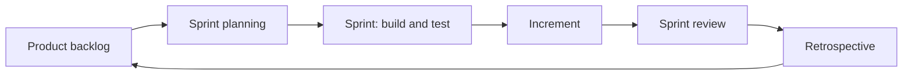

# SDLC & Agile

[← Back to index](../README.md) · [⭐ Favorites](favorites.md)

20 questions · 0 favorites

## Contents

**Basic**

- [1. What is the software development life cycle (SDLC), and what are its phases?](#1-what-is-the-software-development-life-cycle-sdlc-and-what-are-its-phases)
- [2. What is the waterfall model, and when does it still make sense?](#2-what-is-the-waterfall-model-and-when-does-it-still-make-sense)
- [3. What is Agile, and what do the Agile values and principles say?](#3-what-is-agile-and-what-do-the-agile-values-and-principles-say)
- [4. What is Scrum? Explain the roles, events and artifacts.](#4-what-is-scrum-explain-the-roles-events-and-artifacts)
- [5. What are user stories, acceptance criteria and the Definition of Done?](#5-what-are-user-stories-acceptance-criteria-and-the-definition-of-done)
- [6. What is Kanban, and how does it differ from Scrum?](#6-what-is-kanban-and-how-does-it-differ-from-scrum)
- [7. What is the difference between waterfall and Agile? When would you choose each?](#7-what-is-the-difference-between-waterfall-and-agile-when-would-you-choose-each)
- [8. What are the main XP and engineering practices behind agile delivery (TDD, CI/CD, pair programming, refactoring)?](#8-what-are-the-main-xp-and-engineering-practices-behind-agile-delivery-tdd-cicd-pair-programming-refactoring)
- [9. What is technical debt, and how do you manage it?](#9-what-is-technical-debt-and-how-do-you-manage-it)
- [10. What is the difference between Scrum, Kanban, XP and Lean, and how do they relate?](#10-what-is-the-difference-between-scrum-kanban-xp-and-lean-and-how-do-they-relate)

**Intermediate**

- [11. How do you estimate work in agile: story points, velocity and why estimates are hard?](#11-how-do-you-estimate-work-in-agile-story-points-velocity-and-why-estimates-are-hard)
- [12. How do you run a good retrospective and sprint review?](#12-how-do-you-run-a-good-retrospective-and-sprint-review)
- [13. How do you split a large feature into small deliverable slices?](#13-how-do-you-split-a-large-feature-into-small-deliverable-slices)
- [14. What are DORA metrics, and how do they measure delivery performance?](#14-what-are-dora-metrics-and-how-do-they-measure-delivery-performance)
- [15. \[Tech Lead\] How do you choose between waterfall, Agile and a hybrid for a project?](#15-tech-lead-how-do-you-choose-between-waterfall-agile-and-a-hybrid-for-a-project)
- [16. \[Tech Lead\] How do you help a team improve its process without imposing a framework?](#16-tech-lead-how-do-you-help-a-team-improve-its-process-without-imposing-a-framework)
- [17. \[Tech Lead\] How do you manage scope, deadlines and quality when stakeholders push for more?](#17-tech-lead-how-do-you-manage-scope-deadlines-and-quality-when-stakeholders-push-for-more)

**Advanced**

- [18. What are the risks of Agile at scale, and how do frameworks such as SAFe, LeSS and the Spotify model address them?](#18-what-are-the-risks-of-agile-at-scale-and-how-do-frameworks-such-as-safe-less-and-the-spotify-model-address-them)
- [19. What is Conway's law, and how do team structure and architecture affect each other?](#19-what-is-conways-law-and-how-do-team-structure-and-architecture-affect-each-other)
- [20. How do feature flags, trunk-based development and progressive delivery support agile releases?](#20-how-do-feature-flags-trunk-based-development-and-progressive-delivery-support-agile-releases)

## Browse by module

| Module | Questions |
| --- | --- |
| Agile & Scrum (4) | [3](#3-what-is-agile-and-what-do-the-agile-values-and-principles-say) · [4](#4-what-is-scrum-explain-the-roles-events-and-artifacts) · [5](#5-what-are-user-stories-acceptance-criteria-and-the-definition-of-done) · [12](#12-how-do-you-run-a-good-retrospective-and-sprint-review) |
| Engineering Practices (4) | [8](#8-what-are-the-main-xp-and-engineering-practices-behind-agile-delivery-tdd-cicd-pair-programming-refactoring) · [9](#9-what-is-technical-debt-and-how-do-you-manage-it) · [14](#14-what-are-dora-metrics-and-how-do-they-measure-delivery-performance) · [20](#20-how-do-feature-flags-trunk-based-development-and-progressive-delivery-support-agile-releases) |
| Kanban & Lean (2) | [6](#6-what-is-kanban-and-how-does-it-differ-from-scrum) · [10](#10-what-is-the-difference-between-scrum-kanban-xp-and-lean-and-how-do-they-relate) |
| Leadership & Delivery (5) | [15](#15-tech-lead-how-do-you-choose-between-waterfall-agile-and-a-hybrid-for-a-project) · [16](#16-tech-lead-how-do-you-help-a-team-improve-its-process-without-imposing-a-framework) · [17](#17-tech-lead-how-do-you-manage-scope-deadlines-and-quality-when-stakeholders-push-for-more) · [18](#18-what-are-the-risks-of-agile-at-scale-and-how-do-frameworks-such-as-safe-less-and-the-spotify-model-address-them) · [19](#19-what-is-conways-law-and-how-do-team-structure-and-architecture-affect-each-other) |
| Planning & Estimation (2) | [11](#11-how-do-you-estimate-work-in-agile-story-points-velocity-and-why-estimates-are-hard) · [13](#13-how-do-you-split-a-large-feature-into-small-deliverable-slices) |
| SDLC Models (3) | [1](#1-what-is-the-software-development-life-cycle-sdlc-and-what-are-its-phases) · [2](#2-what-is-the-waterfall-model-and-when-does-it-still-make-sense) · [7](#7-what-is-the-difference-between-waterfall-and-agile-when-would-you-choose-each) |

## Basic

### 1. What is the software development life cycle (SDLC), and what are its phases?

**Short answer:** The SDLC is the set of steps a team follows to take software from an idea to a running, maintained product. The usual phases are requirements, design, implementation, testing, deployment and maintenance. Process models such as waterfall and agile differ in how they order and repeat these phases, not in whether they exist.

| Phase | Question it answers | Typical output |
| --- | --- | --- |
| Requirements | What should we build and why? | user stories, acceptance criteria |
| Design | How will it work? | architecture, data model, API contracts |
| Implementation | Build it | code, code reviews |
| Testing | Does it work and is it safe? | automated tests, bug reports |
| Deployment | Put it in front of users | release, rollout, monitoring |
| Maintenance | Keep it healthy | fixes, upgrades, support |

In a modern team these phases overlap. A developer might refine a requirement, write a test and deploy to production in a single day.

**Remember:** a model is a way to manage uncertainty. The less you know up front, the shorter the feedback loop you want.

**Interview tip:** say that the phases never go away. What changes is how big each batch is and how fast you learn from users.

_Module: SDLC Models · Tags: sdlc, process_

### 2. What is the waterfall model, and when does it still make sense?

**Short answer:** Waterfall is a sequential model. You finish requirements, then design, then build, then test, then release, and each phase ends with sign-off before the next starts. It gives clear plans, documents and contracts, but it learns from real users very late, so change is expensive.

**Strengths**
- Easy to understand, plan and track. Fixed scope, cost and date can go into a contract.
- Good documentation and traceability.
- Fits work where requirements are stable and well understood.

**Weaknesses**
- Feedback arrives at the end, when changes are most costly.
- Requirements are guessed up front and often wrong or outdated.
- Testing is squeezed into the end, so quality problems are found late.
- Hard to react to market change.

**Where it still fits**
- Safety-critical or regulated work such as avionics, medical devices and automotive, where certification demands documented requirements and traceability. Even there, teams often work in iterations inside the plan.
- Fixed-price construction-like projects, hardware with long lead times, and migrations with a clear target.

**Gotcha:** "waterfall" is often used as a insult. In practice many companies use a hybrid: a stable plan and compliance documents at the top, with agile delivery in the teams.

**Interview tip:** show balance. Say waterfall fits stable, high-risk-of-failure-to-certify work, and that you have used iterative delivery within regulated constraints.

_Module: SDLC Models · Tags: waterfall, sdlc_

### 3. What is Agile, and what do the Agile values and principles say?

**Short answer:** Agile is a way of building software in small steps, getting feedback often, and adapting to change. The Agile Manifesto (2001) states four values: individuals and interactions over processes and tools, working software over comprehensive documentation, customer collaboration over contract negotiation, and responding to change over following a plan. The items on the right still matter, the items on the left matter more.

**Principles in everyday terms**
- Deliver working software early and often, in weeks, not months.
- Welcome changing requirements, even late.
- Business people and developers work together daily.
- Build around motivated people and trust them.
- Face-to-face conversation is the best way to share information.
- Working software is the main measure of progress.
- Keep a sustainable pace.
- Technical excellence and simple design improve agility.
- The team regularly reflects and adjusts (the retrospective).

**Agile is not**
- No planning or no documentation.
- A specific framework. Scrum, Kanban and XP are ways to practise it.
- A reason to skip design or testing.

**Gotcha:** "doing Agile" with daily stand-ups and sprints but with long approval chains and no real feedback from users is often called cargo cult agile.

**Interview tip:** explain Agile by its outcome: shorter feedback loops. Then give one example from your team where a short loop saved rework.

_Module: Agile & Scrum · Tags: agile, manifesto_

### 4. What is Scrum? Explain the roles, events and artifacts.

**Short answer:** Scrum is an agile framework that works in fixed-length iterations called sprints, usually one to four weeks. A small team delivers a usable increment each sprint, and inspects and adapts after each one. It has three accountabilities, five events and three artifacts.

| Part | Items |
| --- | --- |
| Accountabilities | Product Owner (what and why, owns the backlog), Scrum Master (helps the team use Scrum and removes blockers), Developers (build the increment) |
| Events | Sprint, Sprint Planning, Daily Scrum, Sprint Review, Sprint Retrospective |
| Artifacts | Product Backlog, Sprint Backlog, Increment |



Read it as a loop. Each sprint takes the highest-value backlog items, delivers an increment, then reviews the product and the way of working.

**Quick meaning of each event**
- Planning: choose a sprint goal and the work for it.
- Daily Scrum: 15 minutes for the developers to plan the next day.
- Review: show the increment to stakeholders and gather feedback.
- Retrospective: the team improves how it works.

**Gotcha:** the Scrum Master is not a project manager. The Product Owner decides priority, and the team decides how to build.

**Interview tip:** the Scrum Guide has evolved, so say the names you use. Mention that the sprint goal gives focus, not a list of tasks.

_Module: Agile & Scrum · Tags: scrum, agile_

### 5. What are user stories, acceptance criteria and the Definition of Done?

**Short answer:** A user story describes a need from the user's point of view: "As a customer, I want to see my order status, so that I know when it will arrive." Acceptance criteria are the checks that say this story works. The Definition of Done is the team-wide quality bar that every item must meet before it counts as finished.

**Good stories (INVEST)**
- Independent, Negotiable, Valuable, Estimable, Small, Testable.

**Acceptance criteria** often use Given, When, Then:

```text
Given an order that was shipped yesterday
When the customer opens the order page
Then they see "Shipped" and the tracking link
```

**Definition of Done example**
- Code reviewed and merged.
- Automated tests pass in the pipeline.
- No new critical security findings.
- Deployed to staging, and observable (logs, metrics, alerts).
- Documentation or runbook updated.

| Item | Scope |
| --- | --- |
| Acceptance criteria | one story |
| Definition of Done | every story, same for the whole team |

**Gotchas**
- Stories that are tasks in disguise ("create table orders") have no user value.
- A weak Definition of Done leads to "done but not deployed", which hides work in progress.

**Interview tip:** say that stories are a conversation starter, and the written criteria capture what the conversation agreed.

_Module: Agile & Scrum · Tags: user-stories, backlog, definition-of-done_

### 6. What is Kanban, and how does it differ from Scrum?

**Short answer:** Kanban is a way to visualise work on a board and limit how much is in progress at once. Work flows continuously, with no fixed sprints. The key rule is work-in-progress (WIP) limits, which expose bottlenecks and push the team to finish before starting.

**Core practices**
- Visualise the workflow as columns (To do, In progress, Review, Done).
- Limit WIP per column.
- Manage flow: measure how long work takes (cycle time) and how much finishes per week (throughput).
- Make policies explicit and improve continuously.

| | Scrum | Kanban |
| --- | --- | --- |
| Cadence | fixed sprints | continuous flow |
| Roles | defined | none required |
| Planning | per sprint | when capacity frees up |
| Change mid-iteration | discouraged | allowed any time |
| Key metric | velocity, sprint goal | cycle time, throughput |
| Fits | product development with planning rhythm | support, operations, mixed or interrupt-driven work |

Teams often combine them, a practice called Scrumban.

**Gotcha:** a Kanban board without WIP limits is just a to-do list. The limits are the point.

**Interview tip:** for a platform or on-call team with unpredictable requests, say you would use Kanban with a WIP limit and an expedite lane.

_Module: Kanban & Lean · Tags: kanban, wip-limits, lean_

### 7. What is the difference between waterfall and Agile? When would you choose each?

**Short answer:** Waterfall plans everything up front and delivers at the end. Agile delivers in small slices and plans as it learns. Choose waterfall when requirements are fixed and change is costly or regulated. Choose Agile when requirements are uncertain and fast feedback has value. Many real projects use a mix.

| | Waterfall | Agile |
| --- | --- | --- |
| Plan | fixed, detailed, up front | adaptive, rolling |
| Delivery | one big release | frequent small releases |
| Change | costly, needs formal change control | expected and welcome |
| Customer involvement | at the start and end | throughout |
| Risk | found late | found early |
| Documentation | heavy | lighter, just enough |
| Progress measure | phase completion | working software |

**Decision hints**
- Unknown or evolving requirements, a product with users: Agile.
- Fixed contract, regulation, certification evidence, hardware dependencies: more plan-driven, possibly with iterative delivery inside.
- Hybrid: a roadmap and compliance documents at the program level, sprints in the teams.

**Gotcha:** switching process labels does not fix problems such as unclear goals, slow decisions or no testing.

**Interview tip:** answer with the type of uncertainty. "Where requirements and risks are unknown I want short loops. Where the cost of a mistake is high I want more up-front analysis and evidence."

_Module: SDLC Models · Tags: waterfall, agile, comparison_

### 8. What are the main XP and engineering practices behind agile delivery (TDD, CI/CD, pair programming, refactoring)?

**Short answer:** Extreme Programming (XP) names engineering habits that make frequent change safe: test-driven development, continuous integration, refactoring, pair programming, simple design and small releases. Without these habits, short iterations pile up technical debt and slow down.

| Practice | What it is | Why it helps |
| --- | --- | --- |
| TDD | write a failing test, make it pass, then clean up (red, green, refactor) | design feedback, safety net |
| Continuous integration | merge to the main branch often, with a build and tests on every change | small, early conflict resolution |
| Continuous delivery | the main branch is always releasable, deployment is routine | low-risk releases |
| Refactoring | improve structure without changing behaviour, in small steps | keeps change cheap |
| Pair or mob programming | two or more people on one task | knowledge sharing, fewer defects |
| Code review | peers read changes before merge | quality and learning |
| Small batches and feature flags | ship small, hide unfinished work behind flags | lower risk, faster feedback |

**How they connect:** short iterations need frequent releases. Frequent releases need automated tests and pipelines. Automated tests need code that is easy to test, which refactoring and simple design provide.

**Gotchas**
- A long-lived branch is the opposite of continuous integration.
- Coverage numbers are not the goal. Fast, reliable tests that catch regressions are.

**Interview tip:** connect practices to outcomes the business sees: lead time, change failure rate, time to restore.

_Module: Engineering Practices · Tags: xp, tdd, ci-cd_

### 9. What is technical debt, and how do you manage it?

**Short answer:** Technical debt is the extra future cost created by choosing a quick or messy solution now. Like financial debt it has interest: every later change takes longer. Some debt is a smart, deliberate choice. Unmanaged debt slows a team down until delivery nearly stops.

**Kinds**
- Deliberate: "we ship the simple version now and fix it next month".
- Accidental: we learned a better design later.
- Bit rot: libraries, frameworks and the environment moved on.

**Managing it**
- Make it visible: keep a debt list in the backlog, with the cost of leaving it (slower features, incidents).
- Pay a steady amount: for example reserve 10 to 20 percent of capacity, or fix debt in the area you are already changing (the boy scout rule).
- Prioritise by pain: debt in code that changes often matters most. Ignore stable code nobody touches.
- Prevent it: code review, tests, Definition of Done, architecture decisions written down.
- Replace big rewrites with incremental change, for example the strangler pattern.

**Gotcha:** "we have no time for cleanup" is how teams end up with a rewrite. Show the business the cost in lead time and incident counts, not in code smells.

**Interview tip:** say debt is a tool when taken on purpose with a plan to repay it, and harmful when hidden.

_Module: Engineering Practices · Tags: technical-debt, refactoring_

### 10. What is the difference between Scrum, Kanban, XP and Lean, and how do they relate?

**Short answer:** They are different layers. Agile is the mindset. Scrum is a framework for planning and inspecting work. Kanban is a flow method with WIP limits. XP is a set of engineering practices. Lean is a philosophy of removing waste and delivering value fast, which influenced both Kanban and Agile.

| Name | Focus | Answers |
| --- | --- | --- |
| Agile | values and principles | why short feedback loops |
| Scrum | team rhythm and roles | how we plan and inspect each sprint |
| Kanban | flow and WIP | how work moves and where it stalls |
| XP | engineering | how we build with quality |
| Lean | waste and value stream | what slows value down |

**Lean's seven kinds of waste in software:** partially done work, extra features, relearning, handoffs, task switching, delays and defects.

A common good setup: Scrum or Kanban for the process, XP practices for the code, and Lean thinking to improve the flow.

**Interview tip:** say you pick practices that solve a problem you have, and drop the ones that do not.

_Module: Kanban & Lean · Tags: scrum, kanban, xp, lean_

## Intermediate

### 11. How do you estimate work in agile: story points, velocity and why estimates are hard?

**Short answer:** Many agile teams estimate in story points, a relative measure of size that combines effort, complexity and uncertainty. Velocity is the number of points a team finishes per sprint, used only to forecast that team's own future capacity. Estimates are hard because software has unknowns, so good teams keep them rough and re-plan often.

**How it works**
- Pick a reference story and size others against it (planning poker with a Fibonacci scale: 1, 2, 3, 5, 8, 13).
- Big stories get split instead of estimated in detail.
- Velocity is the average of recent sprints. It forecasts, for example, "about 30 points a sprint, so about six sprints for this 180 point backlog".

**Alternatives**
- No estimates: split work into similar small pieces and count items per week (flow metrics, throughput).
- Probabilistic forecasts: use historical cycle times to give ranges ("85 percent chance in 6 to 8 weeks").
- T-shirt sizes for early, rough planning.

**Pitfalls**
- Comparing velocity across teams. Points mean different things in different teams.
- Using velocity as a target. People inflate points.
- Treating an estimate as a promise. It is a forecast with a range.
- Ignoring unplanned work such as bugs and support.

**Interview tip:** show you can give a range with confidence, say what would change it, and push to reduce uncertainty with a small spike.

_Module: Planning & Estimation · Tags: estimation, story-points, velocity_

### 12. How do you run a good retrospective and sprint review?

**Short answer:** The sprint review shows the increment to stakeholders to get feedback on the product. The retrospective is for the team to improve how it works. A good retrospective ends with one or two concrete experiments with owners, not a long list of complaints.

**Sprint review**
- Demonstrate working software, not slides.
- Invite the people who use or pay for it.
- Collect feedback and update the product backlog on the spot.

**Retrospective**
- Safe space: focus on the process, not on people. Use the Prime Directive idea: everyone did the best they could with what they knew.
- Gather data: a timeline of the sprint, metrics (cycle time, escaped bugs), mood.
- Pick one or two issues, find root causes (five whys) and decide small experiments ("try pairing on risky tickets", "limit WIP to 3").
- Assign owners and check the results at the next retrospective.
- Vary the format (start, stop, continue; sailboat; 4Ls) so it stays fresh.

**Signs of a broken retro**
- Same issues every sprint with no action.
- Manager dominates, or people stay silent.
- Actions that depend on other departments only.

**Interview tip:** mention that you track retro actions like backlog items. Improvement that nobody follows up is not improvement.

_Module: Agile & Scrum · Tags: retrospective, sprint-review, feedback_

### 13. How do you split a large feature into small deliverable slices?

**Short answer:** Split by user value, not by technical layer. A vertical slice goes through UI, API and database and delivers something a user can try. A horizontal slice (only the database, then only the API) delivers nothing usable until the end and hides risk. Small slices give faster feedback and earlier releases.

**Splitting techniques**
- By workflow step: first "create an order", then "pay", then "track".
- By rule or variation: card payment first, then wallet, then bank transfer.
- By data: one currency, then many.
- By happy path first, then errors and edge cases.
- By quality: a basic version first, then performance and polish.
- Spike: a short time-boxed investigation to remove an unknown.

**Example:** "Checkout" becomes (1) guest checkout with one card type and a confirmation page, (2) saved addresses, (3) coupons, (4) refunds. Each slice can go live behind a feature flag.

| Horizontal slicing | Vertical slicing |
| --- | --- |
| Database, then API, then UI | one thin path through all layers |
| Nothing to show until late | demo every sprint |
| Integration surprises at the end | integration from day one |

**Gotcha:** very thin slices still need a Definition of Done. A slice that is not tested and deployable is not a real slice.

**Interview tip:** use the MVP idea carefully. The minimum viable product is the smallest thing that teaches you something, not the smallest thing you can build.

_Module: Planning & Estimation · Tags: story-splitting, mvp, vertical-slices_

### 14. What are DORA metrics, and how do they measure delivery performance?

**Short answer:** DORA metrics are four measures of software delivery: deployment frequency, lead time for changes, change failure rate and time to restore service. They come from long-running research on high-performing teams. They show both speed and stability, so you cannot "win" by going fast and breaking things.

| Metric | Question | Direction |
| --- | --- | --- |
| Deployment frequency | How often do we release to production? | higher is better |
| Lead time for changes | How long from commit to production? | lower is better |
| Change failure rate | What share of releases cause an incident or rollback? | lower is better |
| Time to restore | How fast do we recover from a failure? | lower is better |

(Recent versions of the research also discuss a rework rate. Check the current report for details.)

**How to use them**
- Measure the system, not people. Never use them for individual performance reviews.
- Collect from tools you already have: Git, CI/CD and incident tracking.
- Compare with your own past, not with other teams.
- Use them to find constraints: slow review, flaky tests, manual approvals, big batches.

**Gotchas**
- Gaming: splitting deployments to raise frequency without value.
- Averages hide long tails. Look at the median and the 90th percentile.

**Interview tip:** connect them to practices: small batches, trunk-based development, automated tests and fast rollbacks improve all four.

_Module: Engineering Practices · Tags: dora, metrics, delivery_

### 15. [Tech Lead] How do you choose between waterfall, Agile and a hybrid for a project?

**Short answer:** I decide from the type of uncertainty and the cost of change. If requirements are clear and a mistake is costly or must be certified, I use more up-front planning with checkpoints. If we are discovering what users need, I use short iterations. Most real programs end up hybrid, and I say clearly where each part applies.

**Questions I ask**
- How stable are the requirements, and who can change them?
- Is there a fixed date, budget or contract?
- Are there regulations that require documents and evidence?
- Can we release often, or does hardware, approval or an installation limit releases?
- How experienced is the team with the domain and the technology?

**A hybrid that works**
- Program level: a roadmap, milestones, risks, compliance documents and stage gates.
- Team level: sprints or Kanban, working software at each review, with the documents produced as part of the work and kept in version control.
- Integration: regular cross-team integration builds so that integration risk shows up early.

**Communicating with stakeholders:** replace "percent complete" with working software, burn-up charts and risk lists. Give ranges, not single dates, and review them every sprint.

**Gotcha:** a hybrid that takes the paperwork of waterfall and the uncertainty of agile gives the worst of both. Keep the rules explicit.

**Interview tip:** give a concrete example from regulated or long-lead work where you kept iterations inside a plan.

_Module: Leadership & Delivery · Tags: tech-lead, process, decision_

### 16. [Tech Lead] How do you help a team improve its process without imposing a framework?

**Short answer:** I start from a real problem the team feels, measure it, try one small change and review the result. Frameworks are tools. People adopt practices they understand and chose, and reject ones handed down.

**Steps**
1. Listen: one-to-ones and a retrospective to find the biggest pain (slow reviews, unclear requirements, flaky tests, many interruptions).
2. Measure: cycle time, review wait time, escaped bugs, deployment frequency. Even a simple board and a spreadsheet will do.
3. Pick one experiment with a clear hypothesis: "limiting WIP to 3 will cut cycle time".
4. Run it for a few weeks, then look at the numbers and the team's view.
5. Keep, change or drop it. Write the working agreement down (for example in the repository).

**Typical high-value changes**
- Smaller pull requests and a review time target.
- A clear Definition of Ready and Definition of Done.
- Trunk-based development with feature flags.
- A single owner for each priority question (a product owner).
- Protected time for focus and for debt.

**Leading behaviours:** model the habit yourself, explain the why, make it easy (templates, automation), and celebrate the improvement.

**Gotchas**
- Changing five things at once means you cannot tell what worked.
- Metrics that become targets get gamed.

**Interview tip:** share a story with a number: "review wait fell from two days to four hours after we agreed on a 24 hour target and smaller PRs".

_Module: Leadership & Delivery · Tags: tech-lead, team-practices, improvement_

### 17. [Tech Lead] How do you manage scope, deadlines and quality when stakeholders push for more?

**Short answer:** I make the trade-offs visible. Time, scope and quality are linked. If the date is fixed and scope grows, something must give. I keep quality steady and negotiate scope, using a prioritised backlog and early demos, so the stakeholders choose with facts.

**Practical approach**
- Agree the goal and what "done" means, then rank the work: must have, should have, could have, will not have now.
- Slice into small releases so the most valuable parts ship first.
- Show a forecast range based on real throughput. Update it every sprint.
- When new work arrives, ask what moves out, or what date moves.
- Protect quality with the Definition of Done. Cutting tests moves cost to the future, in bugs and incidents.
- Raise risks early with options: reduce scope, add time, add a person (with the cost of onboarding), or accept the risk.
- Record decisions and their reasons.

**What to avoid**
- Silent overtime. It hides the real capacity and burns people.
- Adding people late to a late project.
- Saying yes to everything and surprising people at the end.

**Language that helps:** "We can do A and B by the date, or A, B and C two weeks later. Which do you prefer?"

**Interview tip:** show that you bring options and data, not just a refusal.

_Module: Leadership & Delivery · Tags: tech-lead, scope, stakeholders_

## Advanced

### 18. What are the risks of Agile at scale, and how do frameworks such as SAFe, LeSS and the Spotify model address them?

**Short answer:** When many teams build one product, the problems are dependencies, alignment and shared architecture. Scaling frameworks add coordination structures. Be careful: more process can bring back the slowness that agile tried to remove. The strongest scaling tools are often architectural (loosely coupled services, clear ownership) and simple routines.

| Approach | Idea | Watch for |
| --- | --- | --- |
| SAFe | Program increments (about 10 weeks), release trains, planning events with many teams, roles at several levels | heavy, can feel like waterfall in agile clothes |
| LeSS | Scrum rules with several teams sharing one backlog and one product owner, minimal extra roles | needs a strong culture and few layers |
| Nexus, Scrum of Scrums | a small coordination layer over Scrum teams | needs real authority to resolve dependencies |
| Spotify style (squads, tribes, guilds) | autonomous cross-functional squads, alignment through culture | a description of one company at one time, not a recipe |

**What matters regardless**
- Team structure follows the architecture (Conway's law). Prefer teams that own a service or product end to end.
- Reduce cross-team dependencies instead of managing them.
- Shared goals and a visible roadmap.
- Regular integration of all teams' work.
- Platform teams that treat internal developers as customers.

**Gotcha:** adopting a framework to fix an organisational problem like unclear ownership.

**Interview tip:** say you would first try to reduce dependencies and align on goals, and add coordination events only where they are needed.

_Module: Leadership & Delivery · Tags: scaling-agile, safe, less_

### 19. What is Conway's law, and how do team structure and architecture affect each other?

**Short answer:** Conway's law says that organisations produce designs that copy their communication structure. If you have separate front end, back end and database teams, you tend to get a layered system with handoffs. The "inverse Conway manoeuvre" means you shape the teams to get the architecture you want.

**What it means in practice**
- Three teams building a compiler tend to produce a three-pass compiler.
- Microservices work best when each service has a clear owner team that can build, deploy and run it. Many services owned by one team are just a distributed monolith.
- Cross-team changes slow down. Every handoff adds waiting time.

**Team Topologies** (a popular model) names four team types:
- Stream-aligned teams that deliver a flow of work for a business area.
- Platform teams that give other teams self-service tools.
- Enabling teams that help others adopt new skills.
- Complicated-subsystem teams for deep specialist areas.

It also names three interaction modes: collaboration, X-as-a-service and facilitating.

**Using it as a tech lead**
- Draw the dependency map. Where do teams constantly wait for each other? That boundary may be wrong.
- Align service boundaries with business domains and ownership.
- Keep team cognitive load manageable. A team should not own more than it can understand.

**Gotcha:** changing the org chart without changing the code, or the reverse, keeps the friction.

**Interview tip:** give an example: "we moved reporting into the same team as orders and the weekly cross-team tickets disappeared".

_Module: Leadership & Delivery · Tags: conways-law, team-topologies, architecture_

### 20. How do feature flags, trunk-based development and progressive delivery support agile releases?

**Short answer:** Trunk-based development means everyone merges small changes to the main branch at least daily. Feature flags let unfinished or risky code be deployed but switched off. Progressive delivery (canary, percentage rollout, blue-green) releases to a few users first and watches the metrics. Together they separate deploying code from releasing a feature, which makes releases small and low risk.

**How they fit**
1. Commit small changes to trunk with tests passing.
2. Hide new behaviour behind a flag, default off.
3. Deploy often. Nothing changes for users yet.
4. Turn the flag on for staff, then 1 percent, 10 percent, 100 percent, watching error rate and latency.
5. If something breaks, switch the flag off. That is faster than a rollback.
6. Remove the flag and dead code once the feature is fully on.

| Technique | Purpose |
| --- | --- |
| Feature flag | decouple release from deployment |
| Canary release | send a small share of traffic to the new version |
| Blue-green | two environments, switch traffic between them |
| Dark launch | run new code in production without showing results |

**Risks**
- Flags that never get removed become permanent complexity and test combinations.
- Database changes must be backward compatible (expand and contract) so old and new code can both run.
- Needs good observability, so you notice a bad rollout quickly.

**Interview tip:** tell the story of turning a flag off to end an incident in a minute, and the cleanup rule that every flag has an owner and an expiry date.

_Module: Engineering Practices · Tags: feature-flags, trunk-based, progressive-delivery_
