# Software Testing

[← Back to index](../README.md) · [⭐ Favorites](favorites.md)

84 questions · 0 favorites · [📚 Resources](#resources)

## Contents

**Basic**

- [1. Why do we test software, and what exactly is a test?](#1-why-do-we-test-software-and-what-exactly-is-a-test)
- [2. What are the test pyramid and the testing trophy?](#2-what-are-the-test-pyramid-and-the-testing-trophy)
- [3. What is the difference between unit, integration, end-to-end, contract, smoke, regression and acceptance tests?](#3-what-is-the-difference-between-unit-integration-end-to-end-contract-smoke-regression-and-acceptance-tests)
- [4. What makes a good unit test? Explain FIRST and Arrange-Act-Assert.](#4-what-makes-a-good-unit-test-explain-first-and-arrange-act-assert)
- [5. What are test doubles? Explain dummy, stub, spy, mock and fake.](#5-what-are-test-doubles-explain-dummy-stub-spy-mock-and-fake)
- [6. What is TDD, and how is it different from BDD?](#6-what-is-tdd-and-how-is-it-different-from-bdd)
- [7. How do you test pure functions compared with code that has side effects?](#7-how-do-you-test-pure-functions-compared-with-code-that-has-side-effects)
- [8. How do you test asynchronous code and code that depends on time?](#8-how-do-you-test-asynchronous-code-and-code-that-depends-on-time)
- [9. What is code coverage, and why is 100 percent not the goal?](#9-what-is-code-coverage-and-why-is-100-percent-not-the-goal)
- [10. How should you name and structure tests so they are easy to read?](#10-how-should-you-name-and-structure-tests-so-they-are-easy-to-read)
- [11. How do you manage test data and fixtures?](#11-how-do-you-manage-test-data-and-fixtures)
- [12. Which edge cases should you always test?](#12-which-edge-cases-should-you-always-test)
- [13. What are equivalence partitioning and boundary value analysis?](#13-what-are-equivalence-partitioning-and-boundary-value-analysis)
- [14. What should you not test?](#14-what-should-you-not-test)
- [15. What is a flaky test, and why do flaky tests happen?](#15-what-is-a-flaky-test-and-why-do-flaky-tests-happen)
- [16. What is the difference between manual, automated and exploratory testing?](#16-what-is-the-difference-between-manual-automated-and-exploratory-testing)
- [17. What is the bug life cycle, and how do you write a good bug report?](#17-what-is-the-bug-life-cycle-and-how-do-you-write-a-good-bug-report)
- [18. When do tests run in a CI pipeline?](#18-when-do-tests-run-in-a-ci-pipeline)
- [19. How do you test floating-point numbers and money?](#19-how-do-you-test-floating-point-numbers-and-money)
- [20. What is the difference between black-box, white-box and static testing?](#20-what-is-the-difference-between-black-box-white-box-and-static-testing)

**Intermediate**

- [21. \[Tech Lead\] How do you design a test strategy for a product?](#21-tech-lead-how-do-you-design-a-test-strategy-for-a-product)
- [22. \[Tech Lead\] How do you shift quality left and make it the whole team's job?](#22-tech-lead-how-do-you-shift-quality-left-and-make-it-the-whole-teams-job)
- [23. \[Tech Lead\] How does the test pyramid change in a microservices system?](#23-tech-lead-how-does-the-test-pyramid-change-in-a-microservices-system)
- [24. \[Tech Lead\] What quality gates and definition of done would you set?](#24-tech-lead-what-quality-gates-and-definition-of-done-would-you-set)
- [25. \[Tech Lead\] How do you handle flaky tests as a team?](#25-tech-lead-how-do-you-handle-flaky-tests-as-a-team)
- [26. \[Tech Lead\] How do you make a test suite fast?](#26-tech-lead-how-do-you-make-a-test-suite-fast)
- [27. \[Tech Lead\] How do you manage test data and test environments?](#27-tech-lead-how-do-you-manage-test-data-and-test-environments)
- [28. \[Tech Lead\] How do you measure whether your tests are effective?](#28-tech-lead-how-do-you-measure-whether-your-tests-are-effective)
- [29. \[Tech Lead\] What do you automate and what do you leave manual?](#29-tech-lead-what-do-you-automate-and-what-do-you-leave-manual)
- [30. \[Tech Lead\] How do you bring tests to a legacy codebase that has none?](#30-tech-lead-how-do-you-bring-tests-to-a-legacy-codebase-that-has-none)
- [31. \[Tech Lead\] How do you hire and grow QA and SDET skills, and set testing standards?](#31-tech-lead-how-do-you-hire-and-grow-qa-and-sdet-skills-and-set-testing-standards)
- [32. \[Tech Lead\] What is on your code review checklist for tests?](#32-tech-lead-what-is-on-your-code-review-checklist-for-tests)
- [33. \[Tech Lead\] How do you report quality to stakeholders?](#33-tech-lead-how-do-you-report-quality-to-stakeholders)
- [34. How do you write unit tests in JavaScript with Jest or Vitest?](#34-how-do-you-write-unit-tests-in-javascript-with-jest-or-vitest)
- [35. What does the built-in Node.js test runner offer?](#35-what-does-the-built-in-nodejs-test-runner-offer)
- [36. How do you test React components with React Testing Library?](#36-how-do-you-test-react-components-with-react-testing-library)
- [37. How do you test custom React hooks?](#37-how-do-you-test-custom-react-hooks)
- [38. How do you mock network calls in tests with MSW?](#38-how-do-you-mock-network-calls-in-tests-with-msw)
- [39. How do you write unit tests in Go: table-driven tests, subtests and httptest?](#39-how-do-you-write-unit-tests-in-go-table-driven-tests-subtests-and-httptest)
- [40. How do you write unit tests in Python with unittest and pytest?](#40-how-do-you-write-unit-tests-in-python-with-unittest-and-pytest)
- [41. How do you write unit tests in .NET with xUnit, NUnit and Moq?](#41-how-do-you-write-unit-tests-in-net-with-xunit-nunit-and-moq)
- [42. How do you test REST APIs, and what should you assert?](#42-how-do-you-test-rest-apis-and-what-should-you-assert)
- [43. How does contract testing with Pact work?](#43-how-does-contract-testing-with-pact-work)
- [44. What are schema-based and OpenAPI contract tests, and when do you choose them over Pact?](#44-what-are-schema-based-and-openapi-contract-tests-and-when-do-you-choose-them-over-pact)
- [45. How do you write integration tests with real databases?](#45-how-do-you-write-integration-tests-with-real-databases)
- [46. How do you test message-driven systems such as Kafka or RabbitMQ consumers?](#46-how-do-you-test-message-driven-systems-such-as-kafka-or-rabbitmq-consumers)
- [47. When should you use mocks and when should you use fakes? What is over-mocking?](#47-when-should-you-use-mocks-and-when-should-you-use-fakes-what-is-over-mocking)
- [48. How do you test time, randomness and concurrency?](#48-how-do-you-test-time-randomness-and-concurrency)
- [49. How does Selenium WebDriver work with JavaScript: locators, waits, page objects and Grid?](#49-how-does-selenium-webdriver-work-with-javascript-locators-waits-page-objects-and-grid)
- [50. How does Cypress work, and what are its strengths and limits?](#50-how-does-cypress-work-and-what-are-its-strengths-and-limits)
- [51. How does Playwright work: auto-waiting, tracing and parallel contexts?](#51-how-does-playwright-work-auto-waiting-tracing-and-parallel-contexts)
- [52. How do you choose between Selenium, Cypress and Playwright?](#52-how-do-you-choose-between-selenium-cypress-and-playwright)
- [53. How do you do cross-browser and device testing with BrowserStack Automate?](#53-how-do-you-do-cross-browser-and-device-testing-with-browserstack-automate)
- [54. How does visual regression testing work with Percy or Chromatic?](#54-how-does-visual-regression-testing-work-with-percy-or-chromatic)
- [55. How do you test accessibility?](#55-how-do-you-test-accessibility)
- [56. How do you do performance and load testing with tools like k6, JMeter and Gatling?](#56-how-do-you-do-performance-and-load-testing-with-tools-like-k6-jmeter-and-gatling)
- [57. What are the basics of security testing: SAST, DAST, dependency scanning and fuzzing?](#57-what-are-the-basics-of-security-testing-sast-dast-dependency-scanning-and-fuzzing)
- [58. What is mutation testing, and what does it tell you?](#58-what-is-mutation-testing-and-what-does-it-tell-you)
- [59. What is property-based testing?](#59-what-is-property-based-testing)
- [60. What are test pyramid anti-patterns such as the ice cream cone and the hourglass?](#60-what-are-test-pyramid-anti-patterns-such-as-the-ice-cream-cone-and-the-hourglass)
- [61. How do you run tests in GitLab CI: reports, artifacts, parallelism and retries?](#61-how-do-you-run-tests-in-gitlab-ci-reports-artifacts-parallelism-and-retries)
- [62. How do you manage test environments, test data and feature flags together?](#62-how-do-you-manage-test-environments-test-data-and-feature-flags-together)
- [63. How do you test configuration and infrastructure such as Helm charts, Kubernetes manifests and Terraform?](#63-how-do-you-test-configuration-and-infrastructure-such-as-helm-charts-kubernetes-manifests-and-terraform)

**Advanced**

- [64. \[Tech Lead\] How do you build release confidence: canary releases, feature flags and testing in production?](#64-tech-lead-how-do-you-build-release-confidence-canary-releases-feature-flags-and-testing-in-production)
- [65. \[Tech Lead\] How do you run tests in a large front-end monorepo with affected-only testing?](#65-tech-lead-how-do-you-run-tests-in-a-large-front-end-monorepo-with-affected-only-testing)
- [66. How do you design a robust end-to-end test framework?](#66-how-do-you-design-a-robust-end-to-end-test-framework)
- [67. How do you make tests deterministic by controlling time, randomness, network and ordering?](#67-how-do-you-make-tests-deterministic-by-controlling-time-randomness-network-and-ordering)
- [68. How do you test distributed systems: chaos engineering, fault injection and game days?](#68-how-do-you-test-distributed-systems-chaos-engineering-fault-injection-and-game-days)
- [69. How do you test event-driven and eventually consistent systems?](#69-how-do-you-test-event-driven-and-eventually-consistent-systems)
- [70. How do you design test architecture for a monorepo: affected testing, caching and sharding?](#70-how-do-you-design-test-architecture-for-a-monorepo-affected-testing-caching-and-sharding)
- [71. What are synthetic monitoring and production verification?](#71-what-are-synthetic-monitoring-and-production-verification)
- [72. How do you scale consumer-driven contracts and handle versioning?](#72-how-do-you-scale-consumer-driven-contracts-and-handle-versioning)
- [73. How do you test machine-learning or LLM-based features?](#73-how-do-you-test-machine-learning-or-llm-based-features)
- [74. How do you analyse flaky tests with data?](#74-how-do-you-analyse-flaky-tests-with-data)
- [75. How do you prioritise tests and testing effort with a risk-based approach?](#75-how-do-you-prioritise-tests-and-testing-effort-with-a-risk-based-approach)
- [76. What are state-transition testing, decision tables and pairwise testing?](#76-what-are-state-transition-testing-decision-tables-and-pairwise-testing)
- [77. How do you practise TDD in real projects, and when does it hurt?](#77-how-do-you-practise-tdd-in-real-projects-and-when-does-it-hurt)
- [78. How do you test legacy code with seams and approval tests?](#78-how-do-you-test-legacy-code-with-seams-and-approval-tests)
- [79. How would you review and refactor a bad test suite?](#79-how-would-you-review-and-refactor-a-bad-test-suite)
- [80. How do you plan and run exploratory testing sessions with charters?](#80-how-do-you-plan-and-run-exploratory-testing-sessions-with-charters)
- [81. How do SLOs and error budgets shape your testing approach?](#81-how-do-slos-and-error-budgets-shape-your-testing-approach)
- [82. Interview exercise: how would you write tests for a given function?](#82-interview-exercise-how-would-you-write-tests-for-a-given-function)
- [83. Interview exercise: how would you design a test plan for login, search or checkout?](#83-interview-exercise-how-would-you-design-a-test-plan-for-login-search-or-checkout)
- [84. Interview exercise: how do you find the bug in a flaky test?](#84-interview-exercise-how-do-you-find-the-bug-in-a-flaky-test)

## Browse by module

| Module | Questions |
| --- | --- |
| Advanced Techniques (9) | [30](#30-tech-lead-how-do-you-bring-tests-to-a-legacy-codebase-that-has-none) · [58](#58-what-is-mutation-testing-and-what-does-it-tell-you) · [59](#59-what-is-property-based-testing) · [68](#68-how-do-you-test-distributed-systems-chaos-engineering-fault-injection-and-game-days) · [69](#69-how-do-you-test-event-driven-and-eventually-consistent-systems) · [73](#73-how-do-you-test-machine-learning-or-llm-based-features) · [76](#76-what-are-state-transition-testing-decision-tables-and-pairwise-testing) · [78](#78-how-do-you-test-legacy-code-with-seams-and-approval-tests) · [82](#82-interview-exercise-how-would-you-write-tests-for-a-given-function) |
| Contract Testing (3) | [43](#43-how-does-contract-testing-with-pact-work) · [44](#44-what-are-schema-based-and-openapi-contract-tests-and-when-do-you-choose-them-over-pact) · [72](#72-how-do-you-scale-consumer-driven-contracts-and-handle-versioning) |
| End-to-End & Browser Testing (6) | [49](#49-how-does-selenium-webdriver-work-with-javascript-locators-waits-page-objects-and-grid) · [50](#50-how-does-cypress-work-and-what-are-its-strengths-and-limits) · [51](#51-how-does-playwright-work-auto-waiting-tracing-and-parallel-contexts) · [52](#52-how-do-you-choose-between-selenium-cypress-and-playwright) · [53](#53-how-do-you-do-cross-browser-and-device-testing-with-browserstack-automate) · [66](#66-how-do-you-design-a-robust-end-to-end-test-framework) |
| Flaky Tests & CI (11) | [15](#15-what-is-a-flaky-test-and-why-do-flaky-tests-happen) · [18](#18-when-do-tests-run-in-a-ci-pipeline) · [25](#25-tech-lead-how-do-you-handle-flaky-tests-as-a-team) · [26](#26-tech-lead-how-do-you-make-a-test-suite-fast) · [48](#48-how-do-you-test-time-randomness-and-concurrency) · [61](#61-how-do-you-run-tests-in-gitlab-ci-reports-artifacts-parallelism-and-retries) · [65](#65-tech-lead-how-do-you-run-tests-in-a-large-front-end-monorepo-with-affected-only-testing) · [67](#67-how-do-you-make-tests-deterministic-by-controlling-time-randomness-network-and-ordering) · [70](#70-how-do-you-design-test-architecture-for-a-monorepo-affected-testing-caching-and-sharding) · [74](#74-how-do-you-analyse-flaky-tests-with-data) · [84](#84-interview-exercise-how-do-you-find-the-bug-in-a-flaky-test) |
| Integration & API Testing (7) | [27](#27-tech-lead-how-do-you-manage-test-data-and-test-environments) · [38](#38-how-do-you-mock-network-calls-in-tests-with-msw) · [42](#42-how-do-you-test-rest-apis-and-what-should-you-assert) · [45](#45-how-do-you-write-integration-tests-with-real-databases) · [46](#46-how-do-you-test-message-driven-systems-such-as-kafka-or-rabbitmq-consumers) · [62](#62-how-do-you-manage-test-environments-test-data-and-feature-flags-together) · [63](#63-how-do-you-test-configuration-and-infrastructure-such-as-helm-charts-kubernetes-manifests-and-terraform) |
| Performance & Security Testing (3) | [56](#56-how-do-you-do-performance-and-load-testing-with-tools-like-k6-jmeter-and-gatling) · [57](#57-what-are-the-basics-of-security-testing-sast-dast-dependency-scanning-and-fuzzing) · [71](#71-what-are-synthetic-monitoring-and-production-verification) |
| Test Doubles & Design (3) | [5](#5-what-are-test-doubles-explain-dummy-stub-spy-mock-and-fake) · [47](#47-when-should-you-use-mocks-and-when-should-you-use-fakes-what-is-over-mocking) · [77](#77-how-do-you-practise-tdd-in-real-projects-and-when-does-it-hurt) |
| Test Strategy & Leadership (15) | [21](#21-tech-lead-how-do-you-design-a-test-strategy-for-a-product) · [22](#22-tech-lead-how-do-you-shift-quality-left-and-make-it-the-whole-teams-job) · [23](#23-tech-lead-how-does-the-test-pyramid-change-in-a-microservices-system) · [24](#24-tech-lead-what-quality-gates-and-definition-of-done-would-you-set) · [28](#28-tech-lead-how-do-you-measure-whether-your-tests-are-effective) · [29](#29-tech-lead-what-do-you-automate-and-what-do-you-leave-manual) · [31](#31-tech-lead-how-do-you-hire-and-grow-qa-and-sdet-skills-and-set-testing-standards) · [32](#32-tech-lead-what-is-on-your-code-review-checklist-for-tests) · [33](#33-tech-lead-how-do-you-report-quality-to-stakeholders) · [60](#60-what-are-test-pyramid-anti-patterns-such-as-the-ice-cream-cone-and-the-hourglass) · [64](#64-tech-lead-how-do-you-build-release-confidence-canary-releases-feature-flags-and-testing-in-production) · [75](#75-how-do-you-prioritise-tests-and-testing-effort-with-a-risk-based-approach) · [79](#79-how-would-you-review-and-refactor-a-bad-test-suite) · [81](#81-how-do-slos-and-error-budgets-shape-your-testing-approach) · [83](#83-interview-exercise-how-would-you-design-a-test-plan-for-login-search-or-checkout) |
| Testing Fundamentals (11) | [1](#1-why-do-we-test-software-and-what-exactly-is-a-test) · [2](#2-what-are-the-test-pyramid-and-the-testing-trophy) · [3](#3-what-is-the-difference-between-unit-integration-end-to-end-contract-smoke-regression-and-acceptance-tests) · [6](#6-what-is-tdd-and-how-is-it-different-from-bdd) · [9](#9-what-is-code-coverage-and-why-is-100-percent-not-the-goal) · [13](#13-what-are-equivalence-partitioning-and-boundary-value-analysis) · [14](#14-what-should-you-not-test) · [16](#16-what-is-the-difference-between-manual-automated-and-exploratory-testing) · [17](#17-what-is-the-bug-life-cycle-and-how-do-you-write-a-good-bug-report) · [20](#20-what-is-the-difference-between-black-box-white-box-and-static-testing) · [80](#80-how-do-you-plan-and-run-exploratory-testing-sessions-with-charters) |
| Unit Testing (14) | [4](#4-what-makes-a-good-unit-test-explain-first-and-arrange-act-assert) · [7](#7-how-do-you-test-pure-functions-compared-with-code-that-has-side-effects) · [8](#8-how-do-you-test-asynchronous-code-and-code-that-depends-on-time) · [10](#10-how-should-you-name-and-structure-tests-so-they-are-easy-to-read) · [11](#11-how-do-you-manage-test-data-and-fixtures) · [12](#12-which-edge-cases-should-you-always-test) · [19](#19-how-do-you-test-floating-point-numbers-and-money) · [34](#34-how-do-you-write-unit-tests-in-javascript-with-jest-or-vitest) · [35](#35-what-does-the-built-in-nodejs-test-runner-offer) · [36](#36-how-do-you-test-react-components-with-react-testing-library) · [37](#37-how-do-you-test-custom-react-hooks) · [39](#39-how-do-you-write-unit-tests-in-go-table-driven-tests-subtests-and-httptest) · [40](#40-how-do-you-write-unit-tests-in-python-with-unittest-and-pytest) · [41](#41-how-do-you-write-unit-tests-in-net-with-xunit-nunit-and-moq) |
| Visual & Accessibility Testing (2) | [54](#54-how-does-visual-regression-testing-work-with-percy-or-chromatic) · [55](#55-how-do-you-test-accessibility) |

## Basic

### 1. Why do we test software, and what exactly is a test?

**Short answer:** We test to find out, quickly and cheaply, whether the code does what we think it does, and to be able to change it later without fear. A test is a small program that runs the code with a known input and checks that the result matches an expected result.

Testing does not prove that software has no bugs. It gives evidence. Each passing test says "for this input, the behaviour is still right". A good suite turns fear into confidence: you refactor, run the tests, and know within minutes if you broke something.

A test has three parts: a known starting state, an action, and a check. If the check fails, the test fails and the team gets a signal.

Tests give you four things:
- **Fast feedback** while you write code, before a user sees the bug.
- **A safety net** for refactoring and upgrades.
- **Living documentation** of what the code is supposed to do.
- **A design pressure**: code that is hard to test is usually too tightly coupled.

```js
import { test } from 'node:test';
import assert from 'node:assert/strict';

const total = (prices) => prices.reduce((a, b) => a + b, 0);

test('total adds all prices', () => {
  assert.equal(total([10, 20, 5]), 35); // known input, expected result
});
// prints: ✔ total adds all prices
```

**Gotcha:** A test that cannot fail is worse than no test, because it gives false comfort. When you write a test, make it fail once on purpose (break the code or the expectation) to see that it really checks something.

**Interview tip:** Say that tests are about confidence and speed of change, not about hitting a number. A senior answer also names the cost: tests are code, and they need maintenance, so every test must earn its place.

_Module: Testing Fundamentals · Tags: fundamentals, testing_

### 2. What are the test pyramid and the testing trophy?

**Short answer:** The test pyramid says: write many small fast unit tests, fewer integration tests, and very few slow end-to-end tests. The testing trophy is a front-end variation that puts most of the weight on integration tests, with static analysis at the base and a few end-to-end tests on top.

The pyramid is about cost and speed. A unit test runs in milliseconds and points at one function. An end-to-end test runs in seconds or minutes, needs a browser and a deployed system, and fails for many reasons. So you want most of your confidence from the cheap layers.

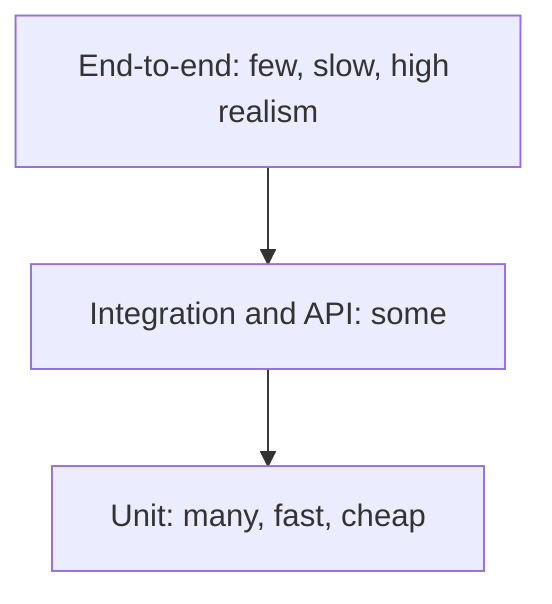

The trophy comes from the front-end world. Its argument is that for UI code, a test that renders a whole component with its children and fake network tells you more than a unit test of one helper. So it asks for:
- **Static checks** at the bottom: TypeScript, ESLint.
- **A few unit tests** for pure logic.
- **Most tests as integration tests**: render the screen, click, assert on what the user sees.
- **A few end-to-end tests** on the top for critical journeys.

The shapes are guides, not laws. What matters is the idea behind both: put each check at the cheapest level that can still catch the bug, and keep the slow, flaky layer small.

**Gotcha:** Teams often draw an "ice cream cone" by accident: lots of manual and UI tests, few unit tests. It is slow and brittle.

**Interview tip:** Do not defend one shape. Say "I pick the layer by where the risk is and what the feedback cost is", then give an example, such as pricing rules in unit tests and the checkout journey in two end-to-end tests.

_Module: Testing Fundamentals · Tags: test-pyramid, strategy_

### 3. What is the difference between unit, integration, end-to-end, contract, smoke, regression and acceptance tests?

**Short answer:** The names describe different things. Unit, integration, end-to-end and contract describe the scope of a test. Smoke, regression and acceptance describe the purpose. A single test can have both a scope and a purpose, for example "a regression test written as an integration test".

| Type | What it checks | Typical speed |
| --- | --- | --- |
| Unit | One function or class in isolation | Milliseconds |
| Integration | Several parts working together, such as service plus database | Seconds |
| End-to-end (E2E) | A whole user journey through the real system | Seconds to minutes |
| Contract | That a consumer and a provider agree on the API shape | Seconds |
| Smoke | A tiny set of checks that the build is alive at all | Seconds |
| Regression | That something that worked before still works | Varies |
| Acceptance | That the feature meets the business requirement | Varies |

Some more detail on the purpose-based ones:
- **Smoke tests** run right after a deploy. If login or the health endpoint fails, you stop. They answer "is it worth testing further?".
- **Regression tests** protect old behaviour. Every fixed bug should leave behind a test that would have caught it.
- **Acceptance tests** are written from the business view, often in given, when, then style, and are agreed with the product owner.

**Common mistakes**
- Calling a test "unit" when it needs a database or the network. It is an integration test, and it will be slow and flaky.
- Treating E2E as the only "real" testing. It is the most realistic but the most expensive.

**Interview tip:** If asked to define them, give one concrete example per type from your own project. For a lead, add which team owns each type and where in the pipeline it runs.

_Module: Testing Fundamentals · Tags: test-types, terminology_

### 4. What makes a good unit test? Explain FIRST and Arrange-Act-Assert.

**Short answer:** A good unit test is fast, independent, repeatable, self-checking and written in time. It has one clear reason to fail, and it is easy to read in the Arrange, Act, Assert shape.

FIRST stands for:
- **Fast**: milliseconds, so people run it all the time.
- **Isolated** (or independent): no test depends on another test or on run order.
- **Repeatable**: same result on every machine and every run, no clock or network.
- **Self-validating**: it passes or fails by itself, with no human reading logs.
- **Timely**: written close to the code, ideally just before or just after.

Arrange-Act-Assert gives the body a clear shape: set up the data, run one action, check the outcome.

```js
import { test } from 'node:test';
import assert from 'node:assert/strict';

function applyDiscount(price, percent) {
  if (price < 0 || percent < 0 || percent > 100) throw new RangeError('invalid input');
  return Math.round(price * (100 - percent)) / 100;
}

test('applies a 10 percent discount', () => {
  const price = 200;                         // Arrange
  const result = applyDiscount(price, 10);   // Act
  assert.equal(result, 180);                 // Assert
});
// prints: ✔ applies a 10 percent discount
```

"One reason to fail" means a test checks one behaviour. It can have several asserts if they describe the same behaviour, but it should not check pricing, email and logging together. When it fails you want the name alone to tell you what broke.

**Gotcha:** Putting logic (loops, ifs) inside a test. Then the test itself can have bugs. Keep tests flat and boring.

**Interview tip:** Mention that tests should check behaviour, not implementation. A test that breaks every time you refactor, without any real bug, is a cost, not an asset.

_Module: Unit Testing · Tags: unit-testing, best-practices_

### 5. What are test doubles? Explain dummy, stub, spy, mock and fake.

**Short answer:** A test double is a stand-in for a real dependency during a test. The five kinds are dummy (only fills a parameter), stub (returns canned answers), spy (records how it was called), mock (has built-in expectations that fail the test) and fake (a simple working version, like an in-memory database).

| Double | What it does | Example |
| --- | --- | --- |
| Dummy | Is passed but never used | A logger object that is never called |
| Stub | Returns fixed data | Payment service that always says "approved" |
| Spy | Stub plus a record of calls | Mailer that remembers who was emailed |
| Mock | Verifies expected calls itself | "send must be called once with these args" |
| Fake | Real logic, simplified | In-memory user repository |

People often say "mock" for all of them. Be precise in interviews: the difference is whether you check **state** (what the result is) or **interaction** (which calls were made).

```js
import { test, mock } from 'node:test';
import assert from 'node:assert/strict';

class OrderService {
  constructor(payments, mailer) { this.payments = payments; this.mailer = mailer; }
  async checkout(order) {
    const r = await this.payments.charge(order.total);
    if (!r.ok) return { status: 'failed' };
    await this.mailer.send(order.email, 'Paid');
    return { status: 'paid' };
  }
}

test('paid order sends one email', async () => {
  const payments = { charge: async () => ({ ok: true }) }; // stub
  const mailer = { send: mock.fn(async () => {}) };        // spy
  const res = await new OrderService(payments, mailer).checkout({ total: 50, email: 'a@x.com' });
  assert.equal(res.status, 'paid');
  assert.equal(mailer.send.mock.callCount(), 1);
  // prints: ✔ paid order sends one email
});
```

**Gotcha:** Over-checking interactions locks the test to the current implementation. Prefer stubs and fakes, and verify calls only for real side effects such as "an email left the system".

**Interview tip:** Mention that you only double things you do not own or that are slow: network, clock, payment gateway. You do not mock the class under test or simple value objects.

_Module: Test Doubles & Design · Tags: test-doubles, mocking_

### 6. What is TDD, and how is it different from BDD?

**Short answer:** TDD, test-driven development, is a coding loop: write a failing test (red), write the least code to pass (green), then clean up (refactor). BDD, behaviour-driven development, is a way to describe behaviour in business language, usually as Given, When, Then, so that product, QA and developers share the same examples.

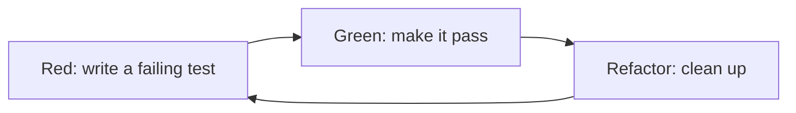

In TDD the test comes first, so you design the API from the caller's side. Small steps keep you honest and leave a regression suite as a by-product. The refactor step is where the design improves, protected by the green tests.

In BDD the focus is conversation. A scenario reads like this:
- **Given** a customer with an empty cart,
- **When** they add a book priced at 20,
- **Then** the cart total is 20.

Tools like Cucumber turn such text into runnable tests, but the real value is the shared language. Many teams do the workshop part (example mapping) and write the tests in plain code.

| | TDD | BDD |
| --- | --- | --- |
| Main audience | Developers | Whole team |
| Level | Usually unit | Feature or acceptance |
| Output | Code and tests | Shared examples and tests |

**Gotcha:** BDD tools used only by testers, with long scripts, become a second slow codebase that nobody reads.

**Interview tip:** Be honest that you use TDD where the rules are clear (pricing, parsing, state machines) and not for exploratory UI work. Pragmatism sounds more senior than dogma.

_Module: Testing Fundamentals · Tags: tdd, bdd_

### 7. How do you test pure functions compared with code that has side effects?

**Short answer:** A pure function depends only on its inputs and returns a result, so you just call it and assert. Code with side effects, such as database writes, network calls, clock or random, needs its dependencies passed in, so tests can replace them.

Pure functions are the easiest thing to test: no setup, no cleanup, no doubles. That is why a good design pushes decisions into pure functions and keeps side effects at the edge.

```js
// ❌ hard to test: reads the clock and writes to the database inside
async function closeOrder(id) {
  const o = await db.find(id);
  o.closedAt = new Date();
  await db.save(o);
}

// ✅ easy to test: decision is pure, effects are injected
function closeOrderData(order, now) {
  return { ...order, closedAt: now };
}
async function closeOrder(id, { db, clock }) {
  const o = await db.find(id);
  await db.save(closeOrderData(o, clock.now()));
}
```

With the second shape you unit test `closeOrderData` with plain values, and test `closeOrder` once with a fake database and a fixed clock.

This is often called "functional core, imperative shell". The core holds the logic and has many fast tests. The shell is thin glue and has a few integration tests.

**Remember:** Passing dependencies as parameters or constructor arguments (dependency injection) is the main trick. It needs no framework.

**Interview tip:** Link testability to design. Saying "when a class is hard to test I treat it as a design smell, usually too many responsibilities or hidden dependencies" is a strong senior line.

_Module: Unit Testing · Tags: unit-testing, design_

### 8. How do you test asynchronous code and code that depends on time?

**Short answer:** For async code, return or await the promise so the test runner waits for it. For time, never really wait: pass in a clock or use fake timers, so a five-second timeout becomes an instant, controlled step.

A common bug is forgetting to `await`. The test finishes before the promise settles, passes by mistake, and the failure shows up later as a random error in another test.

```js
import { test } from 'node:test';
import assert from 'node:assert/strict';

test('rejects with a clear error', async () => {
  await assert.rejects(async () => { throw new Error('boom'); }, /boom/);
});

test('timer fires after 5 seconds, without waiting', (t) => {
  t.mock.timers.enable({ apis: ['setTimeout'] });
  let fired = false;
  setTimeout(() => { fired = true; }, 5000);
  assert.equal(fired, false);
  t.mock.timers.tick(5000);   // move the fake clock
  assert.equal(fired, true);
});
// prints: ✔ rejects with a clear error
// prints: ✔ timer fires after 5 seconds, without waiting
```

Options for time:
- **Inject a clock** (`clock.now()`) so the code never calls `Date.now()` directly.
- **Fake timers** in the test framework (Jest, Vitest and the Node runner all have them).
- **Poll with a timeout** when you must wait for a real event: check a condition every few milliseconds, fail after a limit.

**Gotchas**
- `sleep(2000)` in a test is slow when the system is fast and flaky when it is slow.
- Fake timers do not move `Date` unless you enable that too. Check your tool's options.

**Interview tip:** Say "I never use fixed sleeps. I either control the clock or wait for an observable condition." Interviewers listen for exactly this.

_Module: Unit Testing · Tags: async, time, unit-testing_

### 9. What is code coverage, and why is 100 percent not the goal?

**Short answer:** Code coverage is the share of your code that ran while the tests ran. It shows which code is definitely not tested, but it cannot show that the tested code is checked well. Chasing 100 percent leads to weak tests that run code without asserting anything.

Common kinds of coverage:
- **Line or statement**: was this line executed?
- **Branch**: was each side of every `if` taken?
- **Function**: was each function called?
- **Condition/path**: stricter forms, rarely used in web teams.

Coverage can only prove absence of testing. A test with no assertion still gives coverage.

```js
const isAdult = (age) => age >= 18;

// ✅ 100% coverage, and a real check at the boundary
// assert.equal(isAdult(18), true); assert.equal(isAdult(17), false);

// ❌ 100% coverage of the line, but it would also pass if >= became >
// assert.equal(isAdult(30), true); assert.equal(isAdult(5), false);
```

Useful ways to use coverage:
- Look at the **uncovered lines** of a change, not the global number.
- Set a modest gate on **new code** (for example, 80 percent), so it cannot only go down.
- Combine with **mutation testing** to find tests that run code but do not check it.

**Gotcha:** When coverage becomes a target, people write tests for getters and skip the hard logic. The number goes up and quality does not.

**Interview tip:** A good sentence: "Coverage is a smoke detector for untested code, not a measure of test quality."

_Module: Testing Fundamentals · Tags: coverage, metrics_

### 10. How should you name and structure tests so they are easy to read?

**Short answer:** Name a test after the behaviour and the condition, so a failure message reads like a sentence. Keep files next to the code they test, group tests with `describe` or subtests, and keep each test short and independent.

Good names say what, when and the result:
- `rejects a discount above 100 percent`
- `returns an empty list when the user has no orders`
- `retries twice then gives up when the gateway times out`

Weak names are `test1`, `works`, `testApplyDiscount`. When CI shows a red test called `works`, someone has to open the code to learn what broke.

```js
import { describe, it } from 'node:test';
import assert from 'node:assert/strict';

describe('applyDiscount', () => {
  it('returns the same price for 0 percent', () => assert.equal(applyDiscount(100, 0), 100));
  it('returns 0 for 100 percent', () => assert.equal(applyDiscount(100, 100), 0));
  it('throws for a percentage above 100', () => assert.throws(() => applyDiscount(100, 101), RangeError));
});
```

Structure tips:
- **One behaviour per test**, one scenario per name.
- **Order tests simple to complex**: happy path, edge cases, errors.
- **Hide noise in helpers** (builders, factories), but keep the important values visible in the test.
- **Do not share mutable state** between tests.

**Gotcha:** Over-clever shared setup. If a reader must scroll to a 100-line `beforeEach` to understand a three-line test, the test is not readable.

**Interview tip:** Mention that tests are documentation. A new joiner should learn the rules of the module by reading test names alone.

_Module: Unit Testing · Tags: naming, readability_

### 11. How do you manage test data and fixtures?

**Short answer:** Create the data each test needs inside the test or through a small builder, keep it minimal, and make every value that matters visible. Avoid big shared fixtures and production data copies, because they hide intent and cause hidden coupling between tests.

Options, from the best default down:
- **Inline values** for tiny cases.
- **Builders or factories** with sensible defaults: `anOrder({ total: 0 })` overrides only what the test cares about.
- **Fixtures files** (JSON, SQL) for large read-only inputs like a sample invoice.
- **Seeded random data** for volume, with the seed printed so a failure can be replayed.

```ts
type Order = { id: string; total: number; country: string; vip: boolean };

// builder: defaults are valid, tests override only what matters
const anOrder = (over: Partial<Order> = {}): Order =>
  ({ id: 'o-1', total: 100, country: 'IN', vip: false, ...over });

// the test shows the only important fact: the order is VIP
const vipOrder = anOrder({ vip: true });
```

Rules that save pain:
- **Each test owns its data.** No test should need another to run first.
- **Never use real personal data.** Use synthetic values, or masked copies if you must.
- **Clean up** or isolate: transaction rollback, unique ids per test, or a fresh database.

**Gotcha:** A giant shared fixture that "has every case". Change one field to fix one test and ten others fail in strange ways.

**Interview tip:** Say you prefer data created through the same public API the product uses. It keeps fixtures valid when the schema evolves.

_Module: Unit Testing · Tags: test-data, fixtures_

### 12. Which edge cases should you always test?

**Short answer:** Test the boundaries and the unusual inputs: empty, one item, the largest and smallest values, null or missing, wrong types, duplicates, and error paths. Most production bugs live at these edges, not in the happy path.

A checklist you can say aloud:
- **Boundaries**: just below, on, and just above every limit (17, 18, 19 for an age rule).
- **Empty and single**: empty string, empty list, list with one element.
- **Null, undefined, missing fields** and wrong types.
- **Duplicates and ordering**: same id twice, unsorted input.
- **Large input**: very long string, huge number, big list.
- **Special values**: zero, negative, decimals, NaN, unicode, emoji, time zones.
- **Failures**: the dependency throws, times out, returns garbage.

```js
import { test } from 'node:test';
import assert from 'node:assert/strict';

const average = (nums) => {
  if (nums.length === 0) throw new Error('no numbers');
  return nums.reduce((a, b) => a + b, 0) / nums.length;
};

test('average edge cases', () => {
  assert.equal(average([5]), 5);            // single element
  assert.equal(average([-2, 2]), 0);        // negatives cancel
  assert.throws(() => average([]), /no numbers/); // empty: defined behaviour
});
// prints: ✔ average edge cases
```

Without the empty-list case, the function would return `NaN` silently, and the bug would appear far away.

**Gotcha:** Testing only inputs the author already thought about. Ask "what would a tired user, a hostile user or a slow network do here?".

**Interview tip:** When asked to test a function in an interview, spend the first minute listing edge cases aloud. It shows method before typing.

_Module: Unit Testing · Tags: edge-cases, unit-testing_

### 13. What are equivalence partitioning and boundary value analysis?

**Short answer:** Equivalence partitioning splits all possible inputs into groups that the code treats the same way, then tests one value from each group. Boundary value analysis adds tests at the edges of those groups, because off-by-one mistakes cluster there.

Take a rule: "ages 18 to 60 can apply, others cannot". There are three groups:
- below 18: invalid
- 18 to 60: valid
- above 60: invalid

One value from each group is enough to represent it, for example 10, 30 and 70. That is far better than trying every age.

Then add the boundaries: 17, 18, 60 and 61. These are where a `>` that should be `>=` shows up.

| Technique | Question it answers | Values for the age rule |
| --- | --- | --- |
| Equivalence partitioning | Which groups behave differently? | 10, 30, 70 |
| Boundary value analysis | Where do groups meet? | 17, 18, 60, 61 |

Also include invalid kinds of input as their own groups: negative, not a number, missing.

**Why it matters:** these two ideas give you a small, justified set of tests. You can explain why each test exists and what you skipped on purpose.

**Gotcha:** Boundaries hide in places other than numbers: dates (month end, leap day, daylight saving change), string length limits, page sizes, and list sizes of 0, 1 and many.

**Interview tip:** In a "test this form field" question, name both techniques and apply them. It turns a random list into a structured answer.

_Module: Testing Fundamentals · Tags: test-design, techniques_

### 14. What should you not test?

**Short answer:** Do not test code you do not own, trivial code with no logic, and private implementation details. Test your own behaviour through the public interface, and spend effort where failure is costly or likely.

Things that usually are not worth a dedicated test:
- **Framework and library behaviour**: you do not need a test that `Array.sort` sorts. Test your use of it.
- **Plain getters, setters and constants** with no logic.
- **Private methods directly.** Reach them through the public method. If a private method is complex enough to need its own tests, it may want to be its own class.
- **Generated code** and pure configuration that is checked by the compiler.
- **Exact wording and styling** in many places. It makes tests brittle.
- **Things better checked by other tools**: types, linters, schema validators.

The test of a test is the cost-benefit question: how likely is this to break, how bad is it if it does, and how cheap is the test to keep? A pricing rule is high on all three. A button colour is low on all three.

**Gotcha:** "Do not test private methods" does not mean "do not test their cases". It means the cases are covered via public behaviour, so you can refactor internals freely.

**Interview tip:** This question checks judgement. Show that you test by risk, not by count, and that you see maintenance cost as real.

_Module: Testing Fundamentals · Tags: strategy, best-practices_

### 15. What is a flaky test, and why do flaky tests happen?

**Short answer:** A flaky test sometimes passes and sometimes fails on the same code. The usual causes are timing, shared state, test order, random or time-based data, and uncontrolled external services. They are harmful because the team stops trusting red builds.

Common causes:
- **Timing and async**: fixed sleeps, race conditions, an assertion before the UI or message has settled.
- **Shared state**: a database, file or global variable changed by another test.
- **Order dependence**: test B only passes because test A ran first.
- **Time, locale and randomness**: "today", time zones, random ids.
- **External dependencies**: real network calls, third-party sandbox down.
- **Environment**: slow CI machine, parallel runs fighting over a port.

A flaky test is a bug in the test or in the code. Sometimes it has found a real race condition in production code, so do not treat all flakiness as noise.

What to do first:
- **Reproduce**: run the test many times, in parallel, in random order.
- **Do not just rerun** until green. Retries hide the problem and slow the pipeline.
- **Quarantine** a proven-flaky test so it stops blocking, but keep a ticket and an owner.

**Gotcha:** Adding `sleep(5000)` "to make it stable". It lowers the failure rate for a week, then it returns, and the suite is slower for ever.

**Interview tip:** Mention that you treat flakiness as a defect with an owner and a deadline. The detailed process is in the Tech Lead part of this topic.

_Module: Flaky Tests & CI · Tags: flaky-tests, reliability_

### 16. What is the difference between manual, automated and exploratory testing?

**Short answer:** Automated tests are scripts that run the same checks every time. Manual testing is a person following steps. Exploratory testing is a person learning the product and designing tests while doing them. A healthy team uses all three, for different jobs.

| Approach | Best for | Weak at |
| --- | --- | --- |
| Automated | Repeated checks, regression, fast feedback, many data variations | Judging look and feel, finding unknown problems |
| Scripted manual | Rare, hard-to-automate checks, audits | Slow, human error, does not scale |
| Exploratory | New features, risky areas, finding surprises | Not repeatable by design, depends on skill |

Machines are good at checking what you already know. People are good at noticing what you did not think of: a confusing label, a strange state after pressing back, a slow screen.

Exploratory testing is not random clicking. The tester follows a **charter**, such as "explore the checkout with expired cards and slow network, for 45 minutes", takes notes, and turns findings into bugs or new automated tests.

A good rule: if you do the same manual check twice and it is stable and valuable, automate it. If you have not seen the feature before, explore it first and automate later.

**Gotcha:** Automating everything, including unstable features, creates maintenance work and still misses the experience problems.

**Interview tip:** Say that automation frees people to do exploratory work, not that it replaces them.

_Module: Testing Fundamentals · Tags: manual-testing, exploratory-testing, automation_

### 17. What is the bug life cycle, and how do you write a good bug report?

**Short answer:** A bug moves from new, to assigned, to fixed, to verified and closed, with side exits for rejected, duplicate and reopened. A good report lets a stranger reproduce the problem in two minutes: clear title, steps, expected result, actual result, environment and evidence.

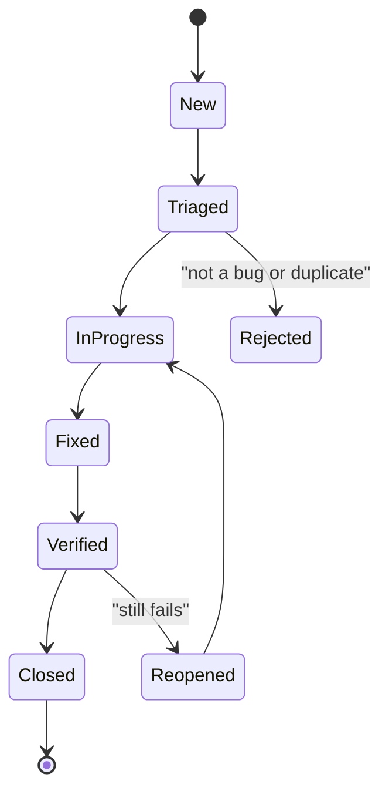

Read it left to right. Triage decides severity and priority. Severity is the impact on the user. Priority is how soon the team will fix it. A typo on the home page is low severity but may be high priority.

A good report has:
- **Title** that states the symptom: "Checkout button disabled after applying a coupon on mobile".
- **Steps to reproduce**, numbered, from a known start.
- **Expected** and **actual** result.
- **Environment**: build or commit, browser and version, device, user role, data used.
- **Evidence**: screenshot, short video, console or network log, request id.
- **Frequency**: always, or one in five times.

**Gotcha:** "It does not work" or bundling three problems in one ticket. One bug per ticket keeps triage and verification clean.

**Interview tip:** Add that you turn each fixed bug into an automated regression test, so the same bug cannot return quietly.

_Module: Testing Fundamentals · Tags: bug-reporting, process_

### 18. When do tests run in a CI pipeline?

**Short answer:** Fast tests run on every commit or merge request, slower ones run after merge or on a schedule, and a few smoke checks run after each deploy. The goal is the fastest possible feedback with the strongest checks you can afford at each step.

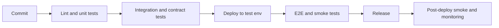

Read the picture as a funnel. Each stage is slower and more expensive than the one before, so a cheap failure stops the pipeline early.

Typical placement:
- **On every merge request**: lint, type check, unit tests, quick integration tests, contract checks. Keep it under about ten minutes.
- **After merge to main**: the full integration set and the main E2E journeys.
- **Nightly**: long suites, cross-browser matrix, load and security scans.
- **After deploy**: smoke tests against the real environment.

The pipeline should block the merge when required checks fail, and it should publish reports (test results, coverage) so people can see why.

**Gotcha:** One huge job that does everything. When it is red, nobody knows where, and when it is slow, people stop waiting for it.

**Interview tip:** If you can say "my merge request pipeline is ten minutes and I fail on the cheapest checks first", you show you care about developer experience, not only about coverage.

_Module: Flaky Tests & CI · Tags: ci, pipeline_

### 19. How do you test floating-point numbers and money?

**Short answer:** Never compare floating-point results with exact equality when rounding is involved. Compare with a small tolerance, or avoid floats for money by storing integer minor units such as paise or cents.

Computers store most decimals in binary, so some values are only close. The classic example is that adding 0.1 and 0.2 gives 0.30000000000000004. A test that expects exactly 0.3 fails, and a rounding rule can also flip at a half cent.

```js
import { test } from 'node:test';
import assert from 'node:assert/strict';

test('float traps', () => {
  assert.equal(0.1 + 0.2 === 0.3, false);              // exact compare fails
  assert.ok(Math.abs(0.1 + 0.2 - 0.3) < 1e-9);         // ✅ tolerance
  // price 19.99 with 50 percent off: 19.99 * 50 is 999.4999..., rounds to 999
  assert.equal(Math.round(19.99 * 50) / 100, 9.99);     // not 10, a surprise
});
// prints: ✔ float traps
```

The last line shows why money is special. I first expected 10, and the real result was 9.99 because the product is just below the half-way point. Only a test with such a value finds it.

Good practice:
- **Store money as integers** (1999 for 19.99) and format at the edge.
- **Test rounding rules explicitly** at the half-way values and with negative amounts.
- Use a **decimal library** if you must handle fractions.
- In assertions use a **tolerance** (`assert.closeTo` style helpers, or your own).

**Interview tip:** Mentioning that you test the rounding rule at exact half values, and that the business must define it, shows real-world experience.

_Module: Unit Testing · Tags: edge-cases, numbers_

### 20. What is the difference between black-box, white-box and static testing?

**Short answer:** Black-box testing checks behaviour from the outside, without looking at the code. White-box testing designs tests using knowledge of the code structure. Static testing finds problems without running the code at all, through reviews, linters and type checks.

| Approach | Looks at | Example |
| --- | --- | --- |
| Black-box | Inputs and outputs only | Testing an API against its spec |
| White-box | Branches, paths, internals | Writing a test so each `if` side is taken |
| Grey-box | Mostly outside, some inside knowledge | Using database access to check data after an API call |
| Static | Code or documents, not running | ESLint, TypeScript, code review, SAST |

Black-box tests are less tied to the implementation, so they survive refactoring. They can miss paths that the spec did not mention. White-box tests reach those paths and are the basis of coverage, but they can lock in the internals.

Static checks are the cheapest layer. A type error caught in the editor costs seconds, the same bug in production costs hours. That is why the testing trophy puts static analysis at the base.

Most real suites mix them: unit tests are written with knowledge of the code (white-box), and acceptance tests from the requirement (black-box).

**Gotcha:** Treating static checks as optional style. Strict TypeScript and a clean linter remove a whole class of tests you no longer have to write.

**Interview tip:** Give one example of each from your project, and say which layer catches bugs the cheapest.

_Module: Testing Fundamentals · Tags: test-design, terminology_

## Intermediate

### 21. [Tech Lead] How do you design a test strategy for a product?

**Short answer:** I start from risk, not from tools. I list the user journeys and failure modes that would hurt the business most, decide the cheapest layer that can catch each one, agree owners and quality gates, and review the strategy every quarter using real defect data.

My process:
- **Understand the product and the risk.** Which flows make money or are legally sensitive (payments, login, data export)? What has broken before? Which parts change most?
- **Map risks to layers.** Business rules go to unit tests, service and database behaviour to integration tests, service boundaries to contract tests, and only the critical journeys to end-to-end tests.
- **Define non-functional checks.** Performance, security, accessibility, and cross-browser needs, each with a trigger (every merge, nightly, before release).
- **Decide ownership.** Developers own unit, integration and contract tests. QA or SDET engineers help design them, own the E2E framework and exploratory work.
- **Set gates and metrics.** What blocks a merge, what blocks a release.
- **Plan environments and data.**

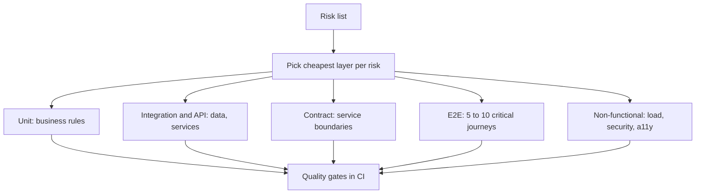

Read it as: every risk is assigned a layer, and the layers feed one set of pipeline gates.

Write the strategy in one or two pages that the team can actually read: what we test where, who owns it, what blocks a release, and what we deliberately do not test.

**Gotcha:** A strategy made of tool names ("we use Cypress and Jest") is not a strategy. Tools are the last decision.

**Interview tip:** Open with "risk first, cheapest layer second, tools last". Then give a real example with numbers: for instance how many E2E tests you kept and why.

_Module: Test Strategy & Leadership · Tags: tech-lead, strategy, test-pyramid_

### 22. [Tech Lead] How do you shift quality left and make it the whole team's job?

**Short answer:** Shifting left means finding problems earlier, when they are cheap: in requirements, design and code review, not in a final test phase. Quality becomes a team responsibility when developers write and own tests, and QA engineers act as coaches and risk thinkers, not as a gate at the end.

Concrete practices:
- **Three amigos** before work starts: product, developer and tester agree examples and edge cases, and write acceptance criteria in testable form.
- **Definition of ready**: a story is not started until it has clear acceptance criteria.
- **Developers write tests with the code**, in the same merge request. No "tests later" tickets.
- **QA joins design and review**: they ask "how will we know it works, and what could go wrong?" early.
- **Fast feedback**: static checks and unit tests in the editor and pre-commit, pipeline results within minutes.
- **Shared dashboards** for escaped defects and flaky tests, discussed in the team retro.

| Old model | Shifted-left model |
| --- | --- |
| Dev builds, then QA tests | Dev and QA work on the same story from day one |
| QA owns quality | The whole team owns it, QA brings expertise |
| Bugs found at the end | Bugs prevented in design and found in minutes |
| Test phase before release | Continuous testing, release when green |

**Gotcha:** "Shift left" without leaving the right side. You still need exploratory testing and monitoring in production, because some failures only appear there.

**Interview tip:** Tell a short story: a bug caught in a refinement meeting because the tester asked "what happens at midnight in another time zone?". It makes the idea concrete.

_Module: Test Strategy & Leadership · Tags: tech-lead, shift-left, quality_

### 23. [Tech Lead] How does the test pyramid change in a microservices system?

**Short answer:** In microservices the risky part is between services, so you add a contract-testing layer and keep full end-to-end tests very few. Each service gets strong unit and component tests, contract tests guard the boundaries, and production monitoring covers what cannot be tested before release.

Layers I use for one service:
- **Unit tests** for business rules.
- **Component tests**: the service runs for real with its own database in a container, and its neighbours are stubbed.
- **Contract tests**: consumer-driven contracts (Pact) or OpenAPI checks, so a provider knows who depends on which field.
- **A few cross-service E2E or synthetic tests** for the top journeys.
- **Observability and canary release** as the last safety layer.

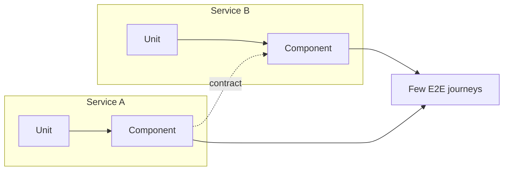

Read it as: each service is tested alone, contracts connect them, and only a thin E2E layer spans all of them.

Why not many E2E tests? A full environment needs every service in a compatible version. It is slow, shared by many teams, and one broken neighbour fails everyone's pipeline. Contract tests give most of the integration confidence without deploying everything together.

**Trade-off:** contracts do not check behaviour across a whole business flow, such as an order moving through five services. That is the job of the few E2E tests and production monitoring.

**Interview tip:** Mention "can I deploy this service now?" as the question that contract tests and a broker answer, and say it replaces the old "release train" with shared test environments.

_Module: Test Strategy & Leadership · Tags: tech-lead, microservices, test-pyramid_

### 24. [Tech Lead] What quality gates and definition of done would you set?

**Short answer:** A quality gate is an automatic rule that blocks a merge or release when a measurable check fails. I keep gates few, fast and meaningful: build and tests green, lint and types clean, coverage on new code, no critical security findings, and agreed performance budgets. The definition of done adds the human parts.

Gates per stage:
- **Merge request**: compile, type check, lint, unit and component tests pass; coverage on the changed lines is at least a set level (say 80 percent); no new critical or high vulnerability in dependencies and static analysis; at least one review.
- **Before release**: contract checks pass (`can-i-deploy`), main E2E journeys pass, no open blocker bugs, performance within budget.
- **After deploy**: smoke tests pass, error rate and latency stay within the SLO during canary.

Definition of done, beyond the gates:
- Acceptance criteria met and demoed.
- Tests added for new behaviour and for bug fixes.
- Docs, runbook and dashboards or alerts updated if behaviour changed.
- Feature flag and rollback plan agreed for risky changes.

| Gate | Good signal | Weak signal |
| --- | --- | --- |
| Coverage on new code | Stops regressions in fresh code | Global percentage target |
| Mutation score (optional, on core modules) | Shows tests that check something | Used on the whole repo |
| Security scan | New critical findings block | Old findings block everyone |

**Gotcha:** Too many strict gates mean people bypass them. Start with a few, make them reliable, and tighten with the team's agreement.

**Interview tip:** Say that a gate must be trusted. A flaky gate is worse than none, because the team learns to ignore red.

_Module: Test Strategy & Leadership · Tags: tech-lead, quality-gates, definition-of-done_

### 25. [Tech Lead] How do you handle flaky tests as a team?

**Short answer:** Detect them with data, quarantine them quickly so they stop blocking others, assign an owner and a deadline to fix them, and track the flake rate as a team metric. Retries are only a temporary bandage, never the fix.

A simple process:
- **Detect.** CI stores results per test. A test that fails and then passes on the same commit, or that fails on main without code change, is flagged automatically. Run suspected tests 50 to 100 times in a loop to confirm.
- **Quarantine.** Move the confirmed flaky test to a separate non-blocking job, with a ticket. The suite stays trustworthy, and the problem stays visible.
- **Diagnose.** Group by cause: timing, shared state, order, environment, real bug. Use traces, videos and logs captured on failure.
- **Fix or delete.** If the test is low value and costly, delete it. If it guards something important, fix the root cause, then return it to the main job.
- **Prevent.** Review checklist (no sleeps, isolated data), random test order in CI, and a rule that a new test must pass many repeated runs before merge.

Metrics worth publishing:
- **Flake rate**: share of pipeline runs that failed and passed on retry.
- **Time to fix** quarantined tests, and the size of the quarantine.
- **Pipeline re-run count** per week.

**Trade-off:** automatic retry (for example once, only for E2E) keeps work moving but hides problems. If you use it, report every retried test, so it still gets fixed.

**Interview tip:** Say that flakiness is a trust problem. When developers say "just re-run it", the suite is already losing its value.

_Module: Flaky Tests & CI · Tags: tech-lead, flaky-tests, ci_

### 26. [Tech Lead] How do you make a test suite fast?

**Short answer:** Measure first, then attack the biggest costs: run tests in parallel and shard them across machines, run only the tests affected by a change, replace slow dependencies with fakes where the realism is not needed, and reuse expensive setup such as containers and caches.

Steps in the order I would do them:
- **Measure**: get the slowest 20 tests and the time per stage from CI reports. Often a few tests or a slow setup dominate.
- **Parallelise**: run test files in parallel workers, and split the suite across CI jobs (sharding), balanced by past duration.
- **Test selection**: run only tests affected by the changed files on merge requests (Nx affected, Jest `--onlyChanged`), and the full set on main or nightly.
- **Push down the pyramid**: move checks from E2E to integration or unit when the browser adds nothing.
- **Cheaper dependencies**: in-memory fakes for slow, non-critical dependencies. Use real databases in containers where the behaviour matters, started once per run, not once per test.
- **Cache** dependencies and build outputs.
- **Faster hardware** is often cheaper than engineer time.

| Technique | Gain | Cost or risk |
| --- | --- | --- |
| Parallel workers | Big | Needs isolated data |
| Sharding | Big | Needs good balancing |
| Affected-only | Big in monorepos | A wrong dependency graph skips tests |
| Fakes instead of real DB | Medium | Fake can drift from reality |

**Gotcha:** Speeding up by skipping tests silently. Always run the complete suite somewhere, for example on main, and alert on failures.

**Interview tip:** Give a number: "we went from 35 to 9 minutes by sharding E2E into 8 jobs and moving 40 checks down to API level". Concrete results are convincing.

_Module: Flaky Tests & CI · Tags: tech-lead, performance, ci_

### 27. [Tech Lead] How do you manage test data and test environments?

**Short answer:** I make each test create the data it needs through an API or a builder, give every pipeline run an isolated environment where possible, and keep shared environments for a narrow purpose. Production data is never copied raw. If it is needed, it is masked or synthetic.

Principles:
- **Tests own their data.** They create what they need, with unique ids, and do not depend on a "golden" shared database state.
- **Ephemeral environments** per merge request or per run (containers, namespaces), so there are no fights over a shared test server.
- **Seed only reference data** (countries, plans, roles) through migrations or seed scripts.
- **Synthetic and masked data** only. Personal data in lower environments is a compliance risk.
- **Environment parity**: same container images, same configuration shape, same database version as production.
- **Third parties**: use sandboxes, or stubs recorded and replayed for stable runs, plus a few scheduled tests against the real sandbox.

| Environment | Purpose | Data |
| --- | --- | --- |
| Local / CI ephemeral | Fast feedback per change | Created by tests |
| Shared integration (dev) | Cross-team integration | Seeded reference data |
| Staging / pre-prod | Final check, performance | Masked or synthetic copy |
| Production | Smoke tests, synthetic monitoring | Special test accounts |

**Gotcha:** One long-lived shared QA environment that everyone deploys to. Tests fail because somebody else's build is half deployed, and nobody can tell if the failure is real.

**Interview tip:** Mention test data as code: versioned, reviewed and cleaned up. Also mention the cost, because ephemeral environments need good automation to be worth it.

_Module: Integration & API Testing · Tags: tech-lead, test-data, environments_

### 28. [Tech Lead] How do you measure whether your tests are effective?

**Short answer:** I measure outcomes, not activity: how many defects escape to production, how often deployments cause failures, how fast we recover, and how well the tests would catch a deliberate bug. I avoid vanity numbers like test count or global coverage.

Useful measures:
- **Defect escape rate**: bugs found in production divided by all bugs found, for a period. Falling is good.
- **Change failure rate**: share of deployments that cause an incident or rollback. It is one of the DORA delivery metrics.
- **Time to restore** and **lead time for changes**: the other DORA metrics. Good tests shorten both.
- **Mutation score** on core modules: the share of small code changes (mutants) that the tests catch.
- **Flake rate** and **pipeline duration**: the health of the feedback loop.
- **Escaped bug analysis**: for each production bug, ask "which test should have caught it, and why did it not?". This is the most useful measure of all.

Vanity or risky measures:
- Number of tests, or tests per developer.
- Global coverage percentage as a target.
- Bugs found per tester, which rewards the wrong behaviour.

**Gotcha:** Metrics get gamed when they become targets. Use them to start conversations and find weak spots, not to rank people.

**Interview tip:** Pair every metric with the decision it supports. "Escape rate is rising in billing, so we add contract tests and mutation checks there" is the senior answer.

_Module: Test Strategy & Leadership · Tags: tech-lead, metrics, quality_

### 29. [Tech Lead] What do you automate and what do you leave manual?

**Short answer:** I automate checks that are repeated, stable, important and deterministic. I leave manual the checks that need human judgement, change often, or run rarely. Before automating, I estimate the cost of writing and maintaining the test against the cost of running it by hand.

Good candidates to automate:
- Regression of critical flows (login, payment, core CRUD).
- Business rules with many input combinations.
- API and contract checks.
- Cross-browser smoke checks.
- Anything run on every release.

Better left manual, at least for now:
- Brand new or fast-changing UI.
- Visual quality, usability and feel (though visual diff tools help with layout drift).
- One-off migration checks.
- Complex setups that cost more to automate than to run.
- Exploratory testing, by definition.

A quick scoring helps decide: how often will it run, how stable is the feature, how costly is a miss, how hard is it to automate. A high-frequency, stable, high-risk, easy-to-automate check is an obvious yes.

Also decide the **level**: automate at the lowest layer that gives the confidence. Many UI checks can be API or component tests.

**Gotcha:** An automation target such as "90 percent automated" encourages many low-value UI tests. Aim at risk coverage instead.

**Interview tip:** Say you track automation as an investment with return, and delete tests whose maintenance cost exceeds their value.

_Module: Test Strategy & Leadership · Tags: tech-lead, automation, strategy_

### 30. [Tech Lead] How do you bring tests to a legacy codebase that has none?

**Short answer:** Do not try to cover everything. Add characterisation tests that pin down what the code does today, around the areas you must change, then refactor safely under that net. Grow coverage from the edges where bugs and change happen.

Steps:
- **Pick the hot spots.** Use version history and bug reports to find files that change often and break often.
- **Write characterisation tests.** Call the code with realistic inputs, record what it returns now, and assert exactly that. You are not judging correctness yet, you are freezing behaviour.
- **Find seams.** A seam is a place where you can change behaviour without editing the code under test: pass a dependency in, extract a method, wrap a global.
- **Refactor in small steps** with the tests green, then improve the tests.
- **Add the "boy scout" rule**: every touched file leaves with more tests than before. Every bug fix starts with a failing test.
- **Add a few end-to-end smoke tests** first if the code cannot be unit tested at all. They are a rough net while you create seams.

```js
// characterisation test: records today's behaviour, even if it looks odd
import { test } from 'node:test';
import assert from 'node:assert/strict';
const legacyPrice = (q) => (q > 10 ? q * 9 : q * 10) + (q === 7 ? 1 : 0);

test('pins current behaviour', () => {
  assert.equal(legacyPrice(7), 71);  // odd rule, but production depends on it
  assert.equal(legacyPrice(11), 99);
});
// prints: ✔ pins current behaviour
```

**Gotcha:** Fixing "obvious bugs" while writing characterisation tests. Ask the business first, because someone may rely on the odd behaviour.

**Interview tip:** Mention Michael Feathers' book "Working Effectively with Legacy Code" as the source of the seam idea, and say you sell the work to management as risk reduction on the next features, not as "adding tests".

_Module: Advanced Techniques · Tags: tech-lead, legacy, characterisation-tests_

### 31. [Tech Lead] How do you hire and grow QA and SDET skills, and set testing standards?

**Short answer:** I hire for testing mindset and engineering skill: curiosity about how things fail, ability to code, and clear communication. I then grow people with pairing, shared standards, and a path that values quality engineering as much as feature work.

What I look for in an SDET or QA engineer:
- **Risk thinking**: can they break a simple feature on paper (a login form) and prioritise what to test?
- **Coding ability**: they can write maintainable automation, not just record scripts.
- **Understanding of the stack**: HTTP, databases, browsers, CI.
- **Communication**: a clear bug report and the courage to say "this is not ready".

Growing the team:
- **Pair** developers with QA on test design, and QA with developers on code.
- **Shared standards document** (short): naming, selectors, no sleeps, data rules, how to review tests. Update it from retro lessons.
- **Guilds or a testing chapter** across squads for tools and patterns.
- **Learning goals**: contract testing, performance, accessibility, security basics.
- **Career path**: SDET and quality engineering as a real technical track, with the same seniority levels as developers.

Standards to set early:
- Tests are reviewed like production code.
- Every bug fix includes a regression test.
- A flaky test is a defect with an owner.
- Page objects or helpers have a defined structure.

**Gotcha:** Treating QA as a separate service team that receives work over the wall. It keeps feedback slow and ownership unclear.

**Interview tip:** Mention that you measure the team by outcomes (escape rate, pipeline health), not by tickets closed.

_Module: Test Strategy & Leadership · Tags: tech-lead, hiring, team-practices_

### 32. [Tech Lead] What is on your code review checklist for tests?

**Short answer:** I review tests as carefully as production code. I check that they test behaviour, that they would fail if the code were wrong, that they are independent and deterministic, and that they are readable and cheap to maintain.

My checklist:
- **Does it test the right thing?** Behaviour through the public interface, not private details or the mock itself.
- **Would it fail for the right reason?** Is there an assertion, and is it specific? Try breaking the code in your head, or actually.
- **Edge cases and errors** covered, not just the happy path.
- **Independent**: no order dependence, no shared mutable state, unique data.
- **Deterministic**: no sleeps, no real clock, no randomness without a seed, no real network.
- **Level is right**: could this be a unit test instead of E2E?
- **Readable**: clear name, Arrange-Act-Assert, the important values visible.
- **Not over-mocked**: if the test only verifies that mocks were called, it proves little.
- **Cleanup and speed**: closes resources, runs fast.
- **Bug fix?** A test that failed before the fix.

| Smell | Meaning |
| --- | --- |
| No assertion | Test only gives coverage |
| `sleep` or retries | Flaky waiting |
| Many mocks, one assert | Tests the wiring, not the behaviour |
| Copy-paste blocks | Needs a helper or table |
| Commented-out tests | Delete or fix |

**Interview tip:** Say "the most useful review question is: what bug would make this test fail?". If you cannot answer, the test is weak.

_Module: Test Strategy & Leadership · Tags: tech-lead, code-review, best-practices_

### 33. [Tech Lead] How do you report quality to stakeholders?

**Short answer:** I report in business terms: risk, trend and decision needed. I show a small set of stable indicators, explain what they mean for release and customers, and avoid raw test counts.

What I include, on one page or dashboard:
- **Release readiness**: green, amber or red with the reason, and the open risks in plain words.
- **Customer impact**: production incidents, escaped defects by severity, and the trend.
- **Delivery health**: change failure rate, lead time, pipeline duration and flake rate.
- **Coverage of risk**: which critical journeys are automated, which are manual, which have gaps.
- **Quality debt**: quarantined tests, known issues, and the plan to pay them down.
- **Asks**: a decision or a resource I need, such as time for a framework upgrade.

How I present:
- **Trend, not snapshot**: a number alone means little.
- **Different audiences**: executives want risk and cost, product wants readiness per feature, engineers want details and links.
- **Honest about uncertainty**: "we have not tested on older Android" is better than silence.
- **Regular rhythm**: a short weekly note, and a go or no-go summary before each release.

**Gotcha:** A report of 4,200 passing tests. It sounds impressive and says nothing about risk.

**Interview tip:** Tell the interviewer you phrase a release risk as "if we ship now, this is what could go wrong, how likely, and how we would detect and undo it".

_Module: Test Strategy & Leadership · Tags: tech-lead, reporting, communication_

### 34. How do you write unit tests in JavaScript with Jest or Vitest?

**Short answer:** Jest and Vitest share almost the same API: `describe`, `it` or `test`, `expect(...).toBe(...)`, plus built-in mocks, spies, fake timers and snapshots. Vitest is Vite-native and fast, and keeps a Jest-compatible API, so most tests move across with few changes.

Core pieces:
- **Matchers**: `toBe` for primitives (same value), `toEqual` for deep equality, `toThrow`, `toContain`, `toHaveBeenCalledWith`, `resolves` and `rejects` for promises.
- **Mocks**: `jest.fn()` or `vi.fn()` creates a function that records calls. `mockReturnValue` sets what it returns.
- **Spies**: `jest.spyOn(obj, 'method')` wraps a real method so you can watch it, and restore it later.
- **Module mocks**: `jest.mock('./mailer')` or `vi.mock('./mailer')` replaces a whole module.
- **Fake timers**: `jest.useFakeTimers()` then `jest.advanceTimersByTime(5000)`.

```js
// read-only example: needs Jest 29+ (Vitest uses vi instead of jest)
import { sendWelcome } from './welcome';

test('sends one welcome mail', async () => {
  const mailer = { send: jest.fn().mockResolvedValue(undefined) };
  await sendWelcome({ email: 'a@x.com' }, mailer);
  expect(mailer.send).toHaveBeenCalledTimes(1);
  expect(mailer.send).toHaveBeenCalledWith('a@x.com', expect.stringContaining('Welcome'));
});

test('debounce waits 300 ms', () => {
  jest.useFakeTimers();
  const fn = jest.fn();
  const d = debounce(fn, 300);
  d(); d();
  jest.advanceTimersByTime(300);
  expect(fn).toHaveBeenCalledTimes(1);
  jest.useRealTimers();
});
```

**Snapshots** store the output the first time and compare later. They are cheap to write and easy to misuse: huge snapshots get approved without reading, and any change breaks them. Use small, inline snapshots (`toMatchInlineSnapshot`) for stable output such as error messages, and assert on specific values for the rest.

**Gotchas**
- Forgetting to reset mocks between tests (`clearMocks`, `restoreMocks` in config) leaks state.
- `toBe` on objects compares references, not content.

**Interview tip:** Mention that you pick Vitest for Vite projects and Jest for older React or Node codebases, and that the habits (AAA, no sleeps, small snapshots) matter more than the tool.

_Module: Unit Testing · Tags: jest, vitest, javascript_

### 35. What does the built-in Node.js test runner offer?

**Short answer:** Node ships `node:test` and `node:assert`, so you can write and run tests with no extra package. It supports `describe` and `it`, hooks, mocks, fake timers, subtests, a watch mode and coverage, which is enough for libraries and many services.

It is stable in current Node versions. Run it with `node --test`, which finds files named `*.test.js` and similar.

```js
import { test, mock } from 'node:test';
import assert from 'node:assert/strict';

test('table of cases', async (t) => {
  for (const [price, pct, want] of [[100, 10, 90], [20, 50, 10], [0, 20, 0]]) {
    await t.test(`${price} at ${pct}%`, () => {
      assert.equal(Math.round(price * (100 - pct)) / 100, want);
    });
  }
});

test('spy counts calls', () => {
  const send = mock.fn();
  send('a'); send('b');
  assert.equal(send.mock.callCount(), 2);
});
// prints: ✔ table of cases, ✔ spy counts calls
```

Commands:
- `node --test` runs everything.
- `node --test --watch` re-runs on change.
- `node --experimental-test-coverage --test` prints a coverage report.
- With TypeScript files you can use `--experimental-strip-types` (Node 22.6 and later; on by default from 23.6).

| | `node:test` | Jest or Vitest |
| --- | --- | --- |
| Install | None | Dev dependency |
| Module mocking | Limited, still evolving | Rich |
| Snapshots, JSDOM | Basic or missing | Built in or plugin |
| Best for | Libraries, small services, scripts | Front-end and large apps |

**Gotcha:** Use `node:assert/strict`, otherwise `assert.equal` uses loose `==`.

**Interview tip:** Saying "zero dependencies, fewer supply-chain risks and faster install" is a good reason to choose it for backend packages.

_Module: Unit Testing · Tags: nodejs, node-test, tooling_

### 36. How do you test React components with React Testing Library?

**Short answer:** React Testing Library renders a component into a test DOM and lets you interact with it the way a user does: find things by role and visible text, click and type with `user-event`, and assert on what appears. It deliberately gives no access to state or implementation.

Query priority, best first:
- `getByRole('button', { name: /save/i })`: what screen readers see.
- `getByLabelText` for form fields.
- `getByText` and `getByPlaceholderText` next.
- `getByTestId` only as a last resort.

Query families: `getBy` throws if missing, `queryBy` returns null (use it to assert absence), and `findBy` waits for the element to appear (it is async).

```tsx
// read-only example: React Testing Library 14+, user-event 14, Vitest or Jest with jest-dom
import { render, screen } from '@testing-library/react';
import userEvent from '@testing-library/user-event';
import { Counter } from './Counter';

test('increments when the button is clicked', async () => {
  const user = userEvent.setup();
  render(<Counter />);
  await user.click(screen.getByRole('button', { name: /add/i }));
  expect(screen.getByText('Count: 1')).toBeInTheDocument();
});

test('shows data after loading', async () => {
  render(<OrderList />);
  expect(await screen.findByText('Order #1001')).toBeInTheDocument(); // waits
});
```

What to avoid:
- Testing state, props or hook internals. Test what the user sees.
- Snapshots of whole components.
- `waitFor` wrapped around a single `getBy`: use `findBy`.
- Wrapping every call in `act` by hand. The library already does it.
- Shallow rendering. Render real children and fake the network.

**Gotcha:** A test that passes because it queried a test id, while the real button has no accessible name. Role queries also check accessibility for free.

**Interview tip:** Quote the guiding idea: "the more your tests resemble the way your software is used, the more confidence they give". It is the library's own principle.

_Module: Unit Testing · Tags: react, react-testing-library, frontend_

### 37. How do you test custom React hooks?

**Short answer:** Use `renderHook` from React Testing Library to run the hook inside a small test component, call its returned functions inside `act`, and check the result. If the hook only exists for one component, it is often simpler to test the component instead.

`renderHook` returns `result.current`, which always holds the latest returned value, and `rerender` to change props. Updates that change state go inside `act` so React finishes rendering before you assert.

```tsx
// read-only example: @testing-library/react 13.1+ (renderHook is built in)
import { renderHook, act } from '@testing-library/react';
import { useCounter } from './useCounter';

test('counts up and resets', () => {
  const { result } = renderHook(() => useCounter(5));
  expect(result.current.count).toBe(5);

  act(() => result.current.increment());
  expect(result.current.count).toBe(6);

  act(() => result.current.reset());
  expect(result.current.count).toBe(5);
});

test('works with a provider', () => {
  const wrapper = ({ children }) => <ThemeProvider>{children}</ThemeProvider>;
  const { result } = renderHook(() => useTheme(), { wrapper });
  expect(result.current.mode).toBe('light');
});
```

Tips:
- For hooks that fetch data, mock the network (see MSW) and use `waitFor` on `result.current`.
- For timers, use fake timers and advance them inside `act`.
- Pass context through the `wrapper` option, the same way the app does.

| Test the hook directly when | Test through a component when |
| --- | --- |
| It is a shared, reusable hook | It is used by one component |
| It has tricky logic (debounce, reducers) | The behaviour is about what the user sees |

**Gotcha:** Asserting on the old `result.current` captured in a variable. Always read `result.current` after the update.

**Interview tip:** Say you prefer user-level tests, and use `renderHook` for library-style hooks where the contract is the return value.

_Module: Unit Testing · Tags: react, hooks, testing_

### 38. How do you mock network calls in tests with MSW?

**Short answer:** MSW, Mock Service Worker, intercepts HTTP requests at the network level and answers them with handlers you write. The application code uses the real `fetch` or axios, so tests are closer to reality than mocking the client function. The same handlers work in tests, Storybook and the browser.

In Node tests it patches the request layer through `setupServer`. In the browser it uses a Service Worker. Because the code under test is unchanged, you do not mock your own API module, and you can test loading, error and empty states easily.

```ts
// read-only example: msw 2.x (the v2 API with http and HttpResponse)
import { http, HttpResponse } from 'msw';
import { setupServer } from 'msw/node';

const server = setupServer(
  http.get('/api/orders', () => HttpResponse.json([{ id: 1, total: 40 }])),
);

beforeAll(() => server.listen({ onUnhandledRequest: 'error' }));
afterEach(() => server.resetHandlers());
afterAll(() => server.close());

test('shows an error when the API fails', async () => {
  server.use(http.get('/api/orders', () => new HttpResponse(null, { status: 500 })));
  render(<OrderList />);
  expect(await screen.findByText(/something went wrong/i)).toBeInTheDocument();
});
```

Why it helps:
- **Realistic**: your client code, headers and parsing all run.
- **Reusable** handlers for tests, local development and Storybook.
- **Per-test overrides** with `server.use` for errors, slow responses, odd payloads.
- `onUnhandledRequest: 'error'` fails loudly if a test hits a URL you did not mock.

**Gotchas**
- MSW v1 used `rest.get` and `res(ctx.json())`. The v2 API is different, so check your version.
- Handlers can drift from the real API. Keep them honest with contract tests or shared OpenAPI types.

**Interview tip:** Explain the trade-off: MSW is a stub of the server, not a replacement for a contract or integration test against the real API.

_Module: Integration & API Testing · Tags: msw, mocking, network_

### 39. How do you write unit tests in Go: table-driven tests, subtests and httptest?

**Short answer:** Go has testing built in. The standard style is table-driven tests: a slice of cases, run each as a named subtest with `t.Run`. For HTTP handlers you use `net/http/httptest`, and for dependencies you write small hand-made fakes against an interface.

Test files end in `_test.go` and live next to the code. Run them with `go test ./...`. Add `-race` to detect data races and `-cover` for coverage.

```go
func TestDivide(t *testing.T) {
	tests := []struct {
		name    string
		a, b    int
		want    int
		wantErr bool
	}{
		{"normal", 10, 2, 5, false},
		{"truncates", 7, 2, 3, false},
		{"zero divisor", 1, 0, 0, true},
	}
	for _, tc := range tests {
		t.Run(tc.name, func(t *testing.T) {
			got, err := Divide(tc.a, tc.b)
			if (err != nil) != tc.wantErr {
				t.Fatalf("err = %v, wantErr %v", err, tc.wantErr)
			}
			if got != tc.want {
				t.Errorf("got %d, want %d", got, tc.want)
			}
		})
	}
}

func TestHealth(t *testing.T) {
	rec := httptest.NewRecorder()
	Health(rec, httptest.NewRequest(http.MethodGet, "/health", nil))
	if rec.Code != 200 {
		t.Fatalf("status %d", rec.Code)
	}
}
// go test -v prints: --- PASS: TestDivide/zero_divisor, --- PASS: TestHealth, ok
```

I ran this with Go 1.22. The table makes adding a case a one-line change, and each subtest has its own name in the output, so `go test -run TestDivide/zero` runs just one case.

Practical tips:
- Define small interfaces where you use them, so a fake is easy.
- Use `t.Helper()` in helpers, `t.Cleanup` for teardown, `t.TempDir()` for files.
- Use `httptest.NewServer` to test a real HTTP client against a local server.
- Libraries like testify give nicer assertions, but the standard library is enough.

**Gotcha:** In Go before 1.22 the loop variable was shared, so parallel subtests needed `tc := tc`. From Go 1.22 each iteration has its own copy.

**Interview tip:** Mention `-race` in CI as a cheap way to catch concurrency bugs, and `go test -count=1` to bypass the test cache.

_Module: Unit Testing · Tags: golang, unit-testing, table-driven_

### 40. How do you write unit tests in Python with unittest and pytest?

**Short answer:** `unittest` is in the standard library and uses classes with `assert` methods. pytest is a popular third-party runner with plain `assert`, fixtures and parametrisation, and it also runs unittest tests. Both use `unittest.mock` for doubles.

Standard library example (I ran this with Python 3.11):

```python
import unittest
from unittest import mock

def is_leap(y):
    return y % 4 == 0 and (y % 100 != 0 or y % 400 == 0)

def total(items, tax_client):
    return round(sum(items) * (1 + tax_client.rate("IN")), 2)

class LeapTests(unittest.TestCase):
    def test_years(self):
        for year, want in [(2024, True), (1900, False), (2000, True), (2023, False)]:
            with self.subTest(year=year):          # each case reported separately
                self.assertEqual(is_leap(year), want)

class TotalTests(unittest.TestCase):
    def test_total_uses_rate(self):
        tax = mock.Mock()
        tax.rate.return_value = 0.18               # stub
        self.assertEqual(total([100, 50], tax), 177.0)
        tax.rate.assert_called_once_with("IN")     # interaction check

# python3.11 -m unittest -v  -> Ran 3 tests ... OK
```

What pytest adds (read-only here, not installed):
- Plain `assert x == y`, with detailed failure output.
- **Fixtures**: `@pytest.fixture` gives reusable setup with scopes (function, module, session) and teardown after `yield`.
- **Parametrize**: `@pytest.mark.parametrize("year,want", [(2024, True), (1900, False)])`.
- Built-in fixtures such as `tmp_path` and `monkeypatch`.
- A large plugin ecosystem, for example `pytest-cov` and `pytest-xdist` for parallel runs.

**Gotcha:** `mock.patch` must target where the name is looked up, not where it is defined. Patch `mymodule.requests`, not `requests`, if `mymodule` imported it.

**Interview tip:** Say you use pytest on new projects for readability and fixtures, and you can explain the unittest equivalents, because many companies still have unittest suites.

_Module: Unit Testing · Tags: python, unittest, pytest_

### 41. How do you write unit tests in .NET with xUnit, NUnit and Moq?

**Short answer:** In .NET the common runners are xUnit and NUnit. Tests are methods marked with attributes, and data-driven tests use `[Theory]` with `[InlineData]` in xUnit or `[TestCase]` in NUnit. Moq, or NSubstitute, creates test doubles for interfaces.

This is a read-only example (xUnit 2.x, Moq 4.x), written from the API:

```csharp
public class PriceServiceTests
{
    [Theory]
    [InlineData(100, 10, 90)]
    [InlineData(100, 0, 100)]
    [InlineData(0, 50, 0)]
    public void ApplyDiscount_returns_expected(decimal price, int pct, decimal expected)
    {
        var sut = new PriceService(Mock.Of<ILogger<PriceService>>());
        Assert.Equal(expected, sut.ApplyDiscount(price, pct));
    }

    [Fact]
    public async Task Checkout_sends_one_email_when_payment_succeeds()
    {
        var payments = new Mock<IPaymentGateway>();
        payments.Setup(p => p.ChargeAsync(50m)).ReturnsAsync(true);   // stub
        var mailer = new Mock<IMailer>();

        var sut = new OrderService(payments.Object, mailer.Object);
        await sut.CheckoutAsync(new Order(50m, "a@x.com"));

        mailer.Verify(m => m.SendAsync("a@x.com", It.IsAny<string>()), Times.Once);
    }
}
```

Key points:
- **xUnit** creates a new test class instance per test, so there is no shared state by accident. Setup goes in the constructor, cleanup in `IDisposable`.
- **NUnit** has `[SetUp]`, `[TearDown]` and a richer constraint syntax (`Assert.That(x, Is.EqualTo(y))`).
- **Integration tests** for ASP.NET Core use `WebApplicationFactory<Program>` to host the app in memory.
- **FluentAssertions** (check its licence for your version) or Shouldly give readable asserts.
- Use `decimal`, not `double`, for money.

**Gotcha:** Mocking concrete classes or too many dependencies. If the constructor needs eight mocks, the class has too many responsibilities.

**Interview tip:** Name one tool in each role (runner, mocking, assertions) and explain how you would test an ASP.NET controller with `WebApplicationFactory` against a test database.

_Module: Unit Testing · Tags: dotnet, xunit, moq_

### 42. How do you test REST APIs, and what should you assert?

**Short answer:** Call the API over HTTP (or in-process), and assert more than the status code: the response body shape, headers, error format, side effects in the data store, and behaviour such as idempotency and authorisation. Tools include supertest in Node, Postman with Newman in CI, and REST Assured in Java.

What to assert, as a checklist:
- **Status code**: 200, 201 with `Location`, 204, 400, 401, 403, 404, 409, 422.
- **Body**: required fields, types and values, validated against a schema (JSON Schema or OpenAPI).
- **Headers**: `Content-Type`, caching headers, security headers, rate-limit headers.
- **Error contract**: a stable error shape with a code and message, and no stack traces.
- **Side effects**: the record was created, the event was published.
- **Idempotency**: repeating a `PUT`, `DELETE` or a `POST` with an idempotency key does not change the result a second time.
- **Authorisation**: user A cannot read user B's order (test this explicitly).
- **Pagination, filtering, sorting** with edge cases.
- **Performance sanity**: a response-time budget on key calls.

```js
// read-only example: supertest with an Express app, Node test runner or Jest
import request from 'supertest';
import { app } from './app';

test('creates an order', async () => {
  const res = await request(app)
    .post('/orders')
    .set('Authorization', 'Bearer test-token')
    .send({ sku: 'BOOK-1', qty: 2 })
    .expect(201)
    .expect('Content-Type', /json/);
  expect(res.body).toMatchObject({ sku: 'BOOK-1', qty: 2 });
  expect(res.headers.location).toMatch(/\/orders\/\w+/);
});
```

| Tool | Style | Good for |
| --- | --- | --- |
| supertest | Code, in-process | Node services |
| Postman and Newman | Collections, CLI in CI | Shared exploratory plus regression |
| REST Assured | Java DSL | Java teams |

**Gotcha:** Only the happy path with status 200. The bugs are in 4xx handling and authorisation.

**Interview tip:** Add that API tests are the best value layer in the pyramid for most back-end teams: faster and steadier than UI, closer to the user than unit tests.

_Module: Integration & API Testing · Tags: api-testing, rest, supertest_

### 43. How does contract testing with Pact work?

**Short answer:** In consumer-driven contract testing the consumer writes down what it needs from a provider API (a pact file). The provider replays those requests against its real code to prove it still honours them. A Pact Broker stores the contracts and answers "can I deploy?" before a release.

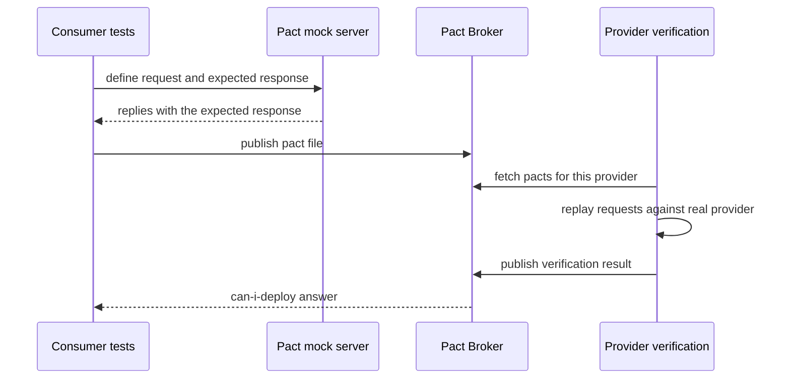

Read it as two halves. First the consumer's own unit tests run against a mock server, which records the contract. Then the provider's pipeline replays that contract against real code and publishes the result.

Read-only sketch with pact-js (PactV3):

```ts
const provider = new PactV3({ consumer: 'web-ui', provider: 'orders-api' });

provider
  .given('order 42 exists')
  .uponReceiving('a request for order 42')
  .withRequest({ method: 'GET', path: '/orders/42' })
  .willRespondWith({ status: 200, body: { id: MatchersV3.integer(42), total: MatchersV3.decimal(19.99) } });

await provider.executeTest(async (mock) => {
  const order = await new OrdersClient(mock.url).get(42); // real client code
  expect(order.id).toBe(42);
});
```

Key terms:
- **Provider state** (`given`) prepares data on the provider side before replay.
- **Matchers** check types and shapes, not exact values.
- **`can-i-deploy`** asks the broker whether this version is compatible with what is in the target environment.
- **Pending pacts** stop a new consumer contract from failing the provider build before the provider has seen it.

**Gotcha:** Pact checks the contract the consumer uses, not all of the provider behaviour, and not business flows. Keep contracts to what the consumer really depends on.

**Interview tip:** Say it replaces most cross-service E2E tests, and give the benefit: a provider team learns before merging that removing a field breaks a named consumer.

_Module: Contract Testing · Tags: pact, contract-testing, microservices_

### 44. What are schema-based and OpenAPI contract tests, and when do you choose them over Pact?

**Short answer:** Schema-based contract tests use an OpenAPI or JSON Schema document as the contract. You check that the provider's real responses match the spec, and that the consumer's calls and mocks follow it. This works well when the provider team publishes a public spec, while Pact is stronger when you need to know exactly which consumer uses which field.

Typical ways to use an OpenAPI spec:
- **Provider conformance**: run requests against the real service and validate responses against the spec (Schemathesis, Dredd, or a validator in your supertest tests).
- **Consumer-side mocks** generated from the spec (Prism), so front-end tests use shapes that match the spec.
- **Breaking-change detection** in CI: compare the new spec with the old one (tools like oasdiff or openapi-diff) and fail on removed fields or tightened types.
- **Generated types and clients**, so the compiler catches drift.

| | Pact (consumer-driven) | OpenAPI (provider-driven) |
| --- | --- | --- |
| Contract written by | Each consumer | The provider |
| Knows who uses what | Yes | No, only the whole spec |
| Good for | Internal services with a few known consumers | Public or many-consumer APIs |
| Effort | Per-consumer tests and broker | One spec, tooling in CI |
| Finds | "Removing this field breaks service X" | "Response does not match the documented shape" |

You can combine them: the spec is the public contract and the source of generated types, and Pact covers the critical internal consumers.

**Gotcha:** A spec that is out of date is worse than none. Validate real responses against it in CI so the spec cannot drift.

**Interview tip:** A clear answer states that OpenAPI describes what the provider offers, and Pact captures what consumers actually need, so each answers a different question.

_Module: Contract Testing · Tags: openapi, contract-testing, api_

### 45. How do you write integration tests with real databases?

**Short answer:** Run the same database engine as production in a container (Testcontainers), apply the real migrations, and isolate each test with a transaction rollback, unique data, or a separate schema or database per parallel worker. This catches SQL, constraint and migration bugs that in-memory fakes cannot.

Why not an in-memory database such as SQLite in place of PostgreSQL? Different SQL dialect, types, locking and index behaviour. Tests pass and production fails.

Ways to isolate tests:
- **Transaction per test**: begin in setup, roll back in teardown. Fast, but cannot test code that commits by itself.
- **Truncate tables** between tests. Simple, slower.
- **Database or schema per worker** so parallel test workers do not collide.
- **Template database**: create once with migrations, copy per test (fast in PostgreSQL).

```ts
// read-only example: @testcontainers/postgresql with node:test, run once for the whole file
import { PostgreSqlContainer } from '@testcontainers/postgresql';
import { Client } from 'pg';

let container, db;
before(async () => {
  container = await new PostgreSqlContainer('postgres:16').start(); // needs Docker
  db = new Client({ connectionString: container.getConnectionUri() });
  await db.connect();
  await migrate(db);                        // real migrations
});
after(async () => { await db.end(); await container.stop(); });

test('unique email constraint is enforced', async () => {
  await db.query("insert into users(email) values ('a@x.com')");
  await assert.rejects(db.query("insert into users(email) values ('a@x.com')"), /unique/);
});
```

Tips:
- Start the container **once per suite**, not per test.
- In GitLab CI use the `services:` keyword or Docker-in-Docker for Testcontainers.
- Test migrations: apply to an empty database and to a copy of the previous schema with data.
- Keep a few such tests per repository class, focused on queries, constraints and transactions.

**Gotcha:** Tests that depend on row order without `ORDER BY`, or on auto-increment ids. They pass locally and fail in parallel.

**Interview tip:** Mention the trade-off: slower than fakes, so use them for the data layer only and keep unit tests fast.

_Module: Integration & API Testing · Tags: integration-testing, database, testcontainers_

### 46. How do you test message-driven systems such as Kafka or RabbitMQ consumers?

**Short answer:** Test the handler logic as a plain function with unit tests, then test the real wiring with a broker in a container. Because delivery is asynchronous and can repeat, assert with polling and timeouts instead of sleeps, and test idempotency and failure paths explicitly.

Layers:
- **Unit**: the handler takes a message and returns a result or calls a port. No broker.
- **Integration**: start Kafka or RabbitMQ with Testcontainers, publish a message, and wait until the effect appears (a row in the database, a follow-up event).
- **Contract**: the message schema is a contract between producer and consumer (schema registry, Pact message pacts).

What to cover:
- **Idempotency**: the same message delivered twice changes state once. At-least-once delivery makes duplicates normal.
- **Ordering**: events for one key stay in order.
- **Poison messages**: a bad payload goes to a dead-letter queue instead of blocking the partition.
- **Retries and backoff**.
- **Eventual consistency**: the result is not immediate, so wait for it.

```ts
// idempotent consumer, verified with node --experimental-strip-types --test
const seen = new Set<string>(); let balance = 0;
const handle = (msg: { id: string; amount: number }) => {
  if (seen.has(msg.id)) return;           // duplicate: ignore
  seen.add(msg.id); balance += msg.amount;
};
handle({ id: 'm1', amount: 10 }); handle({ id: 'm1', amount: 10 });
// balance is 10, not 20
```

Waiting without sleeps: write a small `waitFor(condition, timeout)` helper that checks every few milliseconds and fails with a clear message when time runs out (Java teams use Awaitility). The test is as fast as the system and never longer than the limit.

**Gotcha:** `sleep(5000)` after publishing. It is slow on a good day and flaky on a bad day.

**Interview tip:** Say that you assert on the observable outcome, not on "message was sent", and always include a duplicate-delivery test.

_Module: Integration & API Testing · Tags: kafka, messaging, integration-testing_

### 47. When should you use mocks and when should you use fakes? What is over-mocking?

**Short answer:** Use a fake, a lightweight working version, when the dependency has real behaviour that your logic relies on (a repository, a queue). Use a stub or mock for simple one-way effects (send an email). Over-mocking is when tests mirror the implementation with mocks, so they break on every refactor and prove little.

| Double | Strength | Weakness |
| --- | --- | --- |
| Mock with call checks | Easy; proves a side effect happened | Tied to implementation, brittle |
| Stub | Simple canned data | No behaviour |
| Fake | Realistic behaviour; tests state, not calls | Takes effort; can drift from the real thing |

A fake repository is a good example. It keeps rows in a map, so the test saves a user, renames it, and reads it back. It does not care how many times `find` was called.

```ts
class InMemoryUserRepo {
  private rows = new Map<string, { id: string; name: string }>();
  async save(u: { id: string; name: string }) { this.rows.set(u.id, u); }
  async find(id: string) { return this.rows.get(id); }
}
// test: save u1, call rename(repo, 'u1', 'Asha K'), then find('u1') has the new name.
// A missing id rejects with "not found". Checked by state, no mocks at all.
```

Signs of over-mocking:
- Many mocks and a single assert that the mocks were called.
- A refactor that keeps behaviour but breaks ten tests.
- Mocking things you own deep inside the same module.
- The test passes while the real integration is broken.

Remedies: use fakes for owned dependencies, mock only at the system boundary (network, clock, payment provider), and add a few integration tests with the real thing.

**Gotcha:** A fake that is wrong. Run the same contract tests against the fake and the real implementation so they stay equal.

**Interview tip:** Quote the idea "mock roles, not objects": test the behaviour the collaborator has to provide, and keep the checks at the edges of the system.

_Module: Test Doubles & Design · Tags: mocking, test-doubles, design_

### 48. How do you test time, randomness and concurrency?

**Short answer:** Make them inputs. Pass a clock and a random generator into the code so tests control them, seed random data and print the seed, and test concurrency with deterministic hooks, small timeouts and race detectors rather than hoping a race shows up.

**Time.** Inject a clock (`clock.now()`), or use fake timers. Test the boundaries: exactly at expiry, one millisecond before, midnight, month end, daylight saving change, and different time zones. Never depend on the machine's date.

```ts
type Clock = { now(): number };
export const isExpired = (expiresAt: number, clock: Clock) => clock.now() >= expiresAt;

// test: with a fixed clock returning 1000
// isExpired(1000, clock) is true  (boundary)
// isExpired(1001, clock) is false
```

**Randomness.** Use a seeded generator in tests. If a random test fails, the printed seed reproduces it exactly. Property-based tools do this for you.

**Concurrency.** Races depend on timing, so a single green run proves little.
- Run with a race detector (`go test -race`, ThreadSanitizer).
- Run the test many times in parallel (`go test -count=100`).
- Replace sleeps with synchronisation: latches, channels, or a waitFor helper.
- Make shared code testable by injecting the scheduler, or by testing the logic without threads and the thread-safety with a stress test.
- In Node, order of async events is deterministic if you await correctly. Unawaited promises are the usual bug.

| Source of flakiness | Fix |
| --- | --- |
| `Date.now()` in code | Inject clock |
| `Math.random()` | Inject seeded generator |
| Sleep for async | Wait for condition with timeout |
| Shared global state | Reset in hooks, avoid globals |
| Parallel tests on one port | Port zero (OS picks a free port) |

**Interview tip:** Say that you remove nondeterminism at the source instead of adding retries.

_Module: Flaky Tests & CI · Tags: determinism, concurrency, flaky-tests_

### 49. How does Selenium WebDriver work with JavaScript: locators, waits, page objects and Grid?

**Short answer:** Selenium WebDriver drives a real browser through a driver (ChromeDriver, GeckoDriver) using the W3C WebDriver protocol. Your script finds elements with locators, interacts with them, and must wait for the page with explicit waits. The page object pattern keeps locators in one place, and Selenium Grid runs many browsers in parallel.

Flow: test script, then the WebDriver client library, then the browser driver over HTTP, then the browser.

**Locators**, best first: `By.id`, then a stable `By.css` (preferably a `data-testid` or role-style attribute), then link text. Use XPath only when CSS cannot express it. Avoid long chains tied to layout.

**Waits.** An **implicit wait** is a global polling time for finding elements. An **explicit wait** waits for a specific condition. Use explicit waits, and do not mix the two, because the timeouts can add up in confusing ways.

```js
// read-only example: selenium-webdriver 4.x for Node
const { Builder, By, until } = require('selenium-webdriver');

class LoginPage {
  constructor(driver) { this.driver = driver; }
  async open() { await this.driver.get('https://staging.example.com/login'); }
  async login(user, pass) {
    await this.driver.findElement(By.css('[data-testid="email"]')).sendKeys(user);
    await this.driver.findElement(By.css('[data-testid="password"]')).sendKeys(pass);
    await this.driver.findElement(By.css('[data-testid="submit"]')).click();
  }
}

(async () => {
  const driver = await new Builder().forBrowser('chrome').build();
  try {
    const page = new LoginPage(driver);
    await page.open();
    await page.login('qa@example.com', process.env.QA_PASSWORD);
    await driver.wait(until.elementLocated(By.css('[data-testid="dashboard"]')), 5000);
  } finally {
    await driver.quit();   // always release the browser
  }
})();
```

**Page Object Model:** one class per page or component, exposing actions (`login`) and not raw elements. When the UI changes, you fix one file.

**Selenium Grid 4:** a hub or router sends sessions to nodes with different browsers and operating systems. Use `usingServer(url)` on the builder to point at it. Cloud grids such as BrowserStack provide the same idea as a service.

**Gotcha:** `Thread.sleep` style delays, and stale element errors after the page re-renders. Re-find the element, or wait for a condition.

**Interview tip:** Say you would choose Selenium for wide browser and language support, and Playwright or Cypress for faster, less flaky authoring in modern JavaScript projects.

_Module: End-to-End & Browser Testing · Tags: selenium, e2e, javascript_

### 50. How does Cypress work, and what are its strengths and limits?

**Short answer:** Cypress runs the test code inside the browser, next to your app, which gives fast feedback, automatic waiting through retry-ability, a time-travel debugger, and easy network control with `cy.intercept`. Its limits are around multiple tabs, a narrower browser range than Selenium, and the fact that tests are written in JavaScript or TypeScript only.

Architecture in one line: a Node process (the Cypress runner) controls the browser, while the spec runs in the same browser as the application under test. That is why it can observe and stub network traffic and DOM changes directly.

**Commands are queued and retried.** `cy.get('button')` does not return the element. It enqueues a command. Queries and assertions are retried until they pass or time out (default about four seconds), so you usually write no explicit waits.

```js
// read-only example: Cypress 12 or later
describe('orders page', () => {
  it('shows orders returned by the API', () => {
    cy.intercept('GET', '/api/orders', { fixture: 'orders.json' }).as('getOrders');
    cy.visit('/orders');
    cy.wait('@getOrders');                       // waits for the request, not a timer
    cy.findByRole('row').should('have.length.greaterThan', 1);
    cy.contains('Order #1001').should('be.visible');
  });

  it('shows an error on a server failure', () => {
    cy.intercept('GET', '/api/orders', { statusCode: 500 });
    cy.visit('/orders');
    cy.contains(/something went wrong/i).should('be.visible');
  });
});
```

| Strength | Limit to know |
| --- | --- |
| Auto-retry, clear errors, screenshots and video | No multi-tab; one browser window per test |
| Great network stubbing | Cross-origin steps need `cy.origin` (Cypress 9.6 and later) |
| Component testing mode | Commands are not real promises, so `async/await` does not work the usual way |
| Easy local setup | Parallel runs need the paid Cloud or your own sharding |

**Gotchas**
- Mixing `await` with `cy` commands. Use `.then()` or chain commands.
- Using `cy.wait(3000)` as a delay.
- Logging in through the UI before every test. Log in through the API with `cy.session` instead.

**Interview tip:** Name retry-ability as the key idea, and say you keep the suite small, with API setup and network stubs for speed.

_Module: End-to-End & Browser Testing · Tags: cypress, e2e, frontend_

### 51. How does Playwright work: auto-waiting, tracing and parallel contexts?

**Short answer:** Playwright controls Chromium, Firefox and WebKit through one API. It auto-waits for elements to be actionable before each action, isolates every test in its own browser context, runs test files in parallel workers, and records traces you can replay after a failure.

Key ideas:
- **Auto-waiting.** Before a click, Playwright checks that the element is attached, visible, stable, enabled and not covered. Web-first assertions such as `expect(locator).toBeVisible()` retry until the timeout.
- **Locators** by user-facing meaning: `getByRole`, `getByLabel`, `getByText`, then `getByTestId`.
- **Browser contexts**: a context is like a fresh incognito profile, cheap to create. Each test gets one, so cookies and storage never leak between tests, and you can simulate two users in one test.
- **Parallelism**: workers run files in parallel; `--shard=1/4` splits the suite across CI machines.
- **Trace viewer**: a recording of every step with DOM snapshots, network and console. Enable `trace: 'on-first-retry'` and open the trace from CI artifacts.

```ts
// read-only example: @playwright/test 1.4x
import { test, expect } from '@playwright/test';

test('user can add a book to the cart', async ({ page }) => {
  await page.route('**/api/recommendations', r => r.fulfill({ json: [] })); // stub noise
  await page.goto('/books/clean-code');
  await page.getByRole('button', { name: 'Add to cart' }).click();
  await expect(page.getByTestId('cart-count')).toHaveText('1');
});
```

Playwright also offers API testing (`request` fixture), component testing (experimental), device emulation, and codegen to record a first draft.

| Playwright | Compared with Cypress |
| --- | --- |
| Multi-tab and multi-user in one test | Not possible in Cypress |
| WebKit and Firefox supported | Firefox supported, WebKit experimental |
| Any async code works with `await` | Command queue style |
| Built-in sharding and trace | Time-travel UI is its own strength |

**Gotcha:** Using `page.waitForTimeout`. It is a sleep. Wait for a locator or a response instead.

**Interview tip:** Say that auto-waiting plus isolated contexts remove most of the flakiness that older Selenium suites had.

_Module: End-to-End & Browser Testing · Tags: playwright, e2e, frontend_

### 52. How do you choose between Selenium, Cypress and Playwright?

**Short answer:** Choose by constraints: browser and language needs, team skills, existing investment, debugging experience and CI cost. For a new JavaScript or TypeScript project, Playwright is usually the best default. Cypress suits front-end teams that value its developer experience. Selenium is right when you need many languages, real devices or an existing grid.

| Need | Selenium | Cypress | Playwright |
| --- | --- | --- | --- |
| Languages | Java, JS, Python, C#, Ruby and more | JS and TS | JS/TS, Python, Java, .NET |
| Browsers | Everything with a driver, via grids and clouds | Chromium family, Firefox, WebKit experimental | Chromium, Firefox, WebKit |
| Auto-wait | Manual explicit waits | Built-in retries | Built-in actionability checks |
| Multi-tab and multi-user | Yes | No | Yes |
| Speed and parallelism | Depends on grid | Needs dashboard or custom sharding | Built-in workers and shards |
| Debugging | Logs, screenshots | Time-travel runner | Trace viewer, UI mode |
| Real mobile devices | Via Appium and clouds | Limited | Emulation; real devices via clouds |

Decision steps I use:
- **What must we cover?** Safari on real iPhones points to a cloud grid such as BrowserStack. Only modern desktop browsers points to Playwright.
- **Who writes the tests?** If QA engineers know Java, Selenium or Playwright for Java keeps skills reusable.
- **What exists today?** Migrating a stable 800-test Selenium suite has a real cost. Move new tests first, if at all.
- **Stability record:** run a proof of concept with ten real tests and measure flake rate, duration and debug time.

**Gotcha:** Picking by popularity or a blog post. A tool change does not fix badly designed tests, such as shared data and UI-driven setup.

**Interview tip:** Show you decided by evidence: "we ran a two-week spike on three tools with the same ten journeys and compared flake rate and time to debug".

_Module: End-to-End & Browser Testing · Tags: selenium, cypress, playwright, tool-choice_

### 53. How do you do cross-browser and device testing with BrowserStack Automate?

**Short answer:** BrowserStack Automate gives you a cloud Selenium (and Playwright, Cypress) grid with real browsers, operating systems and real mobile devices. You connect with your credentials, send capabilities that say which browser and device you want, run several sessions in parallel, and use BrowserStack Local to test an app that is not on the public internet.

How it works with Selenium:
- Point the driver at BrowserStack's hub URL and send `bstack:options` with your username, access key and the build or session names.
- Each test opens one session on the requested browser, OS and version. The dashboard shows video, logs and screenshots per session.
- **Parallel sessions** are limited by your plan, so shard tests to match.
- **Local testing**: start the BrowserStack Local binary, set `local: true` in the options, and the cloud browser reaches your localhost or staging behind a firewall.
- Mark each session passed or failed through the API so the dashboard is correct.

```js
// read-only example: selenium-webdriver with W3C capabilities; check current BrowserStack docs for option names
const { Builder } = require('selenium-webdriver');

const caps = {
  browserName: 'Safari',
  browserVersion: 'latest',
  'bstack:options': {
    os: 'OS X', osVersion: 'Sonoma',
    projectName: 'storefront', buildName: `ci-${process.env.CI_PIPELINE_ID}`,
    sessionName: 'checkout smoke',
    local: 'false',
    userName: process.env.BROWSERSTACK_USERNAME,
    accessKey: process.env.BROWSERSTACK_ACCESS_KEY,
  },
};
const driver = await new Builder()
  .usingServer('https://hub-cloud.browserstack.com/wd/hub')
  .withCapabilities(caps).build();
```

Practical strategy:
- Run the **full suite on one fast browser** in every merge request.
- Run a **small smoke set across the browser matrix** (Chrome, Safari, Firefox, Edge, a few real devices) nightly or before release.
- Choose the matrix from **analytics** of real users, not from a guess.
- Keep credentials in CI secrets, never in the repo.

**Gotcha:** Running the whole suite on every browser on every commit. It is slow and expensive, and most failures are the same bug repeated.

**Interview tip:** Mention that real devices find touch, keyboard and Safari-specific bugs that emulators miss, and that cloud sessions add network latency, so use generous explicit waits.

_Module: End-to-End & Browser Testing · Tags: browserstack, cross-browser, selenium_

### 54. How does visual regression testing work with Percy or Chromatic?

**Short answer:** Visual regression tools take snapshots of pages or components, compare them with an approved baseline, and show the pixel differences for a person to approve or reject. Percy (from BrowserStack) works with your E2E tests, and Chromatic works with Storybook components. They catch layout and styling bugs that functional assertions miss.

How the flow works with Percy:
- Your existing test calls a snapshot function at the right moment.
- Percy captures the DOM and assets, then renders them in its own browsers and widths. This is more stable than comparing screenshots taken on your CI machine.
- The first approved build becomes the **baseline**. Later builds are compared against the baseline of the target branch.
- Changes appear in a review UI. A person approves intended changes, which update the baseline, or rejects them as bugs.

```js
// read-only example: @percy/cli with @percy/selenium-webdriver; run with: npx percy exec -- node test.js
const percySnapshot = require('@percy/selenium-webdriver');

await driver.get('https://staging.example.com/pricing');
await percySnapshot(driver, 'Pricing page', { widths: [375, 1280] });
// PERCY_TOKEN must be set in the environment
```

Chromatic does the same per Storybook story, so every state of a component (empty, loading, error) is checked without a full browser journey.

**Common sources of false differences, and fixes**
- **Animations and transitions**: disable them in test mode, or wait until finished.
- **Dynamic data**: dates, random ids, ads. Mock them or hide them with Percy CSS.
- **Fonts and images loading late**: wait for fonts, use local fonts in tests.
- **Carousels, videos, cursors blinking**: freeze or hide them.
- **Different rendering between machines**: use the cloud rendering of the tool, not local screenshots.

| Strengths | Weaknesses |
| --- | --- |
| Finds CSS regressions, overlapped text, broken responsive layouts | Needs human review of diffs |
| Covers many widths and browsers cheaply | Noise if the page is not deterministic |

**Interview tip:** Say that approval is part of the workflow, so assign a reviewer (often design plus developer) and keep the snapshot set focused on key pages and components.

_Module: Visual & Accessibility Testing · Tags: percy, chromatic, visual-testing_

### 55. How do you test accessibility?

**Short answer:** Combine automated checks (axe-core), keyboard testing, screen reader checks and design review. Automation finds only part of the problems, mostly the machine-detectable ones like missing labels and low contrast, so manual testing is still needed.

Layers:
- **Static linting**: `eslint-plugin-jsx-a11y` catches missing alt text and bad ARIA while coding.
- **Automated scans in tests**: run axe on a rendered page or component. Packages exist for Playwright (`@axe-core/playwright`), Cypress (`cypress-axe`) and Jest (`jest-axe`). Fail the build on new serious violations.
- **Keyboard testing**: can you reach and use everything with Tab, Shift+Tab, Enter, Space and Escape? Is the focus order logical and the focus ring visible? Does a modal trap focus and return it on close?
- **Screen reader checks** with VoiceOver on macOS, NVDA on Windows, TalkBack on Android. Check names, roles and announcements for dynamic updates.
- **Visual checks**: contrast, zoom to 200 percent, reduced motion, no information by colour alone.

```ts
// read-only example: @axe-core/playwright
import AxeBuilder from '@axe-core/playwright';
test('home page has no serious a11y violations', async ({ page }) => {
  await page.goto('/');
  const results = await new AxeBuilder({ page }).withTags(['wcag2a', 'wcag2aa']).analyze();
  expect(results.violations).toEqual([]);
});
```

Using role-based queries in React Testing Library gives some accessibility checking for free: if you cannot find the button by role and name, a screen reader user cannot either.

The standard to quote is WCAG 2.1 or 2.2, level AA. Say that automated tools detect only a minority of issues, so do not claim a page is accessible because axe passed.

**Gotcha:** Adding ARIA attributes to fix a div that should have been a button. Prefer native elements first.

**Interview tip:** Mention you make a11y part of the definition of done and the component library, so it is fixed once and reused.

_Module: Visual & Accessibility Testing · Tags: accessibility, a11y, axe_

### 56. How do you do performance and load testing with tools like k6, JMeter and Gatling?

**Short answer:** Load testing sends realistic traffic to a system and measures latency percentiles, throughput and errors against agreed targets. The main variants are load, stress, soak and spike tests. Tools include k6 (JavaScript scripts), JMeter (GUI and XML) and Gatling (Scala, Java or Kotlin DSL).

| Test | Question it answers | Shape |
| --- | --- | --- |
| Load | Does it meet the target at expected traffic? | Steady expected level |
| Stress | Where does it break, and how does it fail? | Ramp beyond capacity |
| Soak (endurance) | Are there leaks or slow degradation over hours? | Moderate load, long time |
| Spike | Does it survive a sudden jump and recover? | Sharp rise and drop |

Measure with **percentiles**, not averages. An average of 200 ms can hide that 1 in 20 requests takes 3 seconds. Track p95 and p99, error rate, and throughput, plus server-side CPU, memory, database and queue depth.

Realism matters: model **think time** (users pause), realistic data variety, caches warm and cold, and the real mix of endpoints. Prefer an **open model** (a fixed arrival rate) over a closed model for web traffic, otherwise a slow server hides its own problems by slowing the test clients.

```js
// read-only example: k6 script, run with: k6 run script.js
import http from 'k6/http';
import { check, sleep } from 'k6';

export const options = {
  stages: [{ duration: '2m', target: 50 }, { duration: '5m', target: 50 }, { duration: '1m', target: 0 }],
  thresholds: { http_req_duration: ['p(95)<500'], http_req_failed: ['rate<0.01'] },
};

export default function () {
  const res = http.get('https://staging.example.com/api/products');
  check(res, { 'status is 200': (r) => r.status === 200 });
  sleep(1); // think time
}
```

Thresholds make the test pass or fail, so it can run in CI as a gate on a small scale, with the big runs scheduled.

**Gotcha:** Testing a tiny environment and extrapolating, or testing from one laptop whose network is the limit. Use a production-like system and distributed load generators.

**Interview tip:** Mention you set targets from the SLO first (for example p95 under 500 ms at 300 requests a second) and test against them.

_Module: Performance & Security Testing · Tags: performance, load-testing, k6_

### 57. What are the basics of security testing: SAST, DAST, dependency scanning and fuzzing?

**Short answer:** Security testing mixes several automated checks: SAST scans your source code, DAST attacks the running app from outside, dependency and container scanning finds known vulnerable libraries, secret scanning finds leaked keys, and fuzzing feeds odd inputs to find crashes. Manual review and penetration tests cover what tools miss.

| Technique | What it checks | Examples |
| --- | --- | --- |
| SAST | Source code patterns (injection, unsafe functions) | Semgrep, CodeQL, GitLab SAST |
| DAST | A running app, as an attacker (XSS, missing headers) | OWASP ZAP |
| Dependency scanning (SCA) | Known CVEs in libraries | npm audit, Dependabot, Trivy, Snyk |
| Container and IaC scanning | Image and config issues | Trivy, Checkov |
| Secret scanning | Keys and tokens in the repo | Gitleaks, platform scanners |
| Fuzzing | Crashes from random or mutated input | Go native fuzzing (1.18+), libFuzzer |

Where they fit in the pipeline:
- **Merge request**: SAST, secret scan, dependency scan with a gate on new critical findings.
- **Nightly**: full DAST against a test environment, container scans.
- **Release**: penetration test for major changes.

Also write ordinary tests for security rules: user A cannot read user B's data, expired tokens are rejected, rate limits work, input with quotes and script tags is handled.

```go
// read-only: a Go fuzz test (Go 1.18 and later), run with: go test -fuzz=FuzzParse
func FuzzParse(f *testing.F) {
	f.Add("2024-02-29")
	f.Fuzz(func(t *testing.T, s string) {
		_, _ = ParseDate(s) // must never panic, whatever the input
	})
}
```

**Gotchas**
- Tool noise: hundreds of old findings make people ignore the report. Gate on new issues and triage the rest.
- DAST against production can cause harm. Use a test environment.

**Interview tip:** Link it to the OWASP Top 10 as a checklist for what to test, and say security is shared between developers and the security team.

_Module: Performance & Security Testing · Tags: security, sast, dast_

### 58. What is mutation testing, and what does it tell you?

**Short answer:** Mutation testing checks the quality of your tests. A tool makes small changes to your code (mutants), like changing `>=` to `>`, and runs the tests. If the tests still pass, the mutant survived, which shows a gap. The mutation score is the share of mutants the tests killed.

Coverage only says a line ran. Mutation testing says whether a test would notice if the line were wrong.

```js
const isAdult = (age) => age >= 18;

// weak tests: pass for both >= and >, so the mutant (age > 18) survives
//   isAdult(30) is true,  isAdult(5) is false
// boundary tests kill it:
//   isAdult(18) is true,  isAdult(17) is false
```

I ran both sets: the weak pair passes with the original code and would also pass with `>`, while the boundary pair would fail on the mutant. That is exactly what a mutation tool automates.

Tools: Stryker (JavaScript, TypeScript, .NET), PIT (Java), mutmut (Python), and go-mutesting for Go.

How to use it well:
- **Run on core modules** (pricing, permissions), not on the whole repo, because it is slow: the tests run once per mutant.
- **Run incrementally** on changed files in CI, or nightly.
- **Look at survivors** one by one. Some are equivalent mutants (a change that does not alter behaviour) and can be ignored.
- **Set a threshold** for important packages, such as 70 percent, rather than 100.

| Metric | Tells you |
| --- | --- |
| Line coverage | Which code ran |
| Mutation score | Which code is actually checked |

**Gotcha:** Using mutation score as a company-wide target. It becomes a game, and time is wasted on trivial mutants.

**Interview tip:** Say it is a diagnostic for critical logic, and a great way to show a team why "100 percent coverage" is not enough.

_Module: Advanced Techniques · Tags: mutation-testing, test-quality, stryker_

### 59. What is property-based testing?

**Short answer:** Instead of writing specific examples, you state a property that must hold for all inputs, and the tool generates many random inputs to try to break it. When it finds a failure, it shrinks the input to the smallest counter-example. It finds edge cases you would not think of.

Examples of properties:
- **Round trip**: decoding an encoded value gives the original.
- **Idempotence**: sorting a sorted list changes nothing.
- **Invariant**: the sorted output has the same length and each item is not smaller than the previous one.
- **Oracle**: a fast implementation equals a slow, obviously correct one.

Libraries: fast-check (JavaScript and TypeScript), Hypothesis (Python), jqwik (Java), FsCheck (.NET), and `testing/quick` or native fuzzing in Go.

Here is a hand-rolled version using a seeded random generator (it ran with the Node test runner):

```ts
const sortNums = (a: number[]) => [...a].sort((x, y) => x - y);

for (let i = 0; i < 200; i++) {
  const arr = randomArray(rnd);                 // seeded generator, seed 42
  const out = sortNums(arr);
  assert.equal(out.length, arr.length);                          // same size
  for (let j = 1; j < out.length; j++) assert.ok(out[j - 1] <= out[j]); // ordered
  assert.deepEqual(sortNums(out), out);                           // idempotent
}
```

With fast-check (read-only), the same idea is shorter and adds shrinking:

```ts
fc.assert(fc.property(fc.array(fc.integer()), (a) => {
  const out = sortNums(a);
  return out.length === a.length && out.every((v, i) => i === 0 || out[i - 1] <= v);
}));
```

**When it fits:** parsers, serialisers, algorithms, state machines, and pricing rules. **When it does not:** UI flows and code with heavy external effects.

**Gotcha:** A property that merely repeats the implementation proves nothing. Choose properties that describe results from a different angle.

**Interview tip:** Say that you keep a few example tests for documentation and add property tests for the tricky parts. Always print the seed so failures can be replayed.

_Module: Advanced Techniques · Tags: property-based-testing, fast-check, hypothesis_

### 60. What are test pyramid anti-patterns such as the ice cream cone and the hourglass?

**Short answer:** The ice cream cone has many slow UI and manual tests and few unit tests. The hourglass has many unit and E2E tests but almost nothing in the middle. Both give slow feedback and hard debugging. The fix is to move checks down to the cheapest layer that can catch the bug.

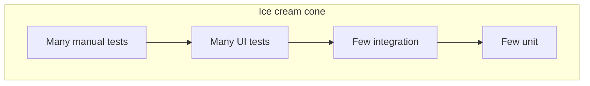

Anti-patterns and their symptoms:
- **Ice cream cone**: the suite takes hours, is flaky, and nobody can tell which layer broke. Usually born where QA tests through the UI because developers do not write tests.
- **Hourglass**: unit tests of tiny pieces plus E2E, but nobody tests that the service, database and queue work together. Bugs in wiring, SQL and serialisation reach staging.
- **Inverted by tools**: a team that chose Selenium first and now tests business rules through the browser.
- **Duplicate coverage**: the same rule tested at unit, API and UI level. Three places to update.
- **Test per method**: unit tests that mirror the class structure, so refactoring breaks them.

How to fix, step by step:
- Pick the 5 to 10 critical journeys and keep those as E2E. Delete or move the rest.
- Move rule checks to unit tests and data checks to integration tests with a real database.
- Add contract tests at service boundaries.
- Track where bugs are found, and add tests at the cheapest layer that would have caught them.

**Gotcha:** Moving tests down just to hit a shape. If a UI behaviour only appears in a real browser, it needs a browser test.

**Interview tip:** Say that the pyramid is a description of cost, not a rule, and that you review the shape with escaped-defect data.

_Module: Test Strategy & Leadership · Tags: test-pyramid, anti-patterns, strategy_

### 61. How do you run tests in GitLab CI: reports, artifacts, parallelism and retries?

**Short answer:** In GitLab CI you split tests into jobs and stages, publish JUnit reports so failures show in the merge request, keep logs and traces as artifacts, run a job on several machines with `parallel`, and use `retry` only for infrastructure failures. Caches speed up installs.

```yaml
# .gitlab-ci.yml (read-only; the GitLab keywords are standard, adjust images and scripts)
stages: [test, e2e]

unit:
  stage: test
  image: node:22
  cache:
    key: { files: [package-lock.json] }
    paths: [node_modules/]
  script:
    - npm ci
    - npm test -- --reporters=default --reporters=jest-junit
  coverage: '/All files[^|]*\|[^|]*\s+([\d.]+)/'
  artifacts:
    when: always
    reports:
      junit: junit.xml

e2e:
  stage: e2e
  image: mcr.microsoft.com/playwright:v1.47.0-jammy
  parallel: 4                                   # 4 jobs, each gets CI_NODE_INDEX / CI_NODE_TOTAL
  script:
    - npm ci
    - npx playwright test --shard=$CI_NODE_INDEX/$CI_NODE_TOTAL
  retry:
    max: 1
    when: [runner_system_failure, stuck_or_timeout_failure]   # not for test failures
  artifacts:
    when: always
    expire_in: 7 days
    paths: [playwright-report/, test-results/]
    reports: { junit: results.xml }
```

Why these pieces matter:
- **JUnit report**: failed tests are listed in the merge request widget, with history.
- **`artifacts: when: always`** keeps traces and screenshots from failed runs.
- **`parallel` and sharding** divide the work. Balance shards by duration if you can.
- **`coverage` regex or a Cobertura report** shows coverage in the merge request.
- **`rules` and `only: changes`** run jobs only when relevant files change.
- **`needs`** lets jobs start as soon as their dependencies finish, instead of waiting for the whole stage.
- **Services** (`services: [postgres:16]`) provide databases for integration tests.

**Retry policy:** retry infrastructure failures automatically. Do not retry test failures silently. If you do, record them and treat retried passes as flaky.

**Interview tip:** Mention the pipeline budget: unit and lint under ten minutes, full pipeline under thirty, and what you do when it grows.

_Module: Flaky Tests & CI · Tags: gitlab-ci, ci, reports_

### 62. How do you manage test environments, test data and feature flags together?

**Short answer:** Use a small set of well-defined environments, make each test create its own data, and control feature flags explicitly in tests so results do not depend on flag state in a shared system. Flags let you test new code paths early but they also multiply the combinations you must cover.

Environment practice:
- **Ephemeral per merge request** for integration and E2E where you can. Deploy the branch to a namespace, run tests, destroy it.
- **A stable shared staging** for pre-release checks, with data reset on a schedule.
- **Configuration through environment variables** and the same images across environments.

Flag practice in tests:
- **Set flags in the test**, not by hoping the environment has the right value. A local or file-based flag provider for tests, or the flag service API to set the value for the test user.
- **Test both states** of a new flag when the old path is still live. After rollout, delete the flag and the old tests.
- **Name an owner and a removal date** for every flag. Stale flags are hidden complexity.
- **Combination control**: you cannot test all combinations of ten flags. Test the production defaults and each flag alone against the defaults.

```ts
// idea: the test decides the flag, so it never depends on the environment
const flags = new InMemoryFlags({ 'new-checkout': true });
const app = buildApp({ flags });
// run checkout tests against app, then again with { 'new-checkout': false }
```

**Data practice:** create data through APIs with unique prefixes (`qa-${runId}-...`), clean it up after, and have a job that removes leftovers older than a day.

**Gotcha:** E2E tests on a shared environment where someone toggles a flag in the dashboard mid-run. The failure is random and unexplainable.

**Interview tip:** Say that deploy and release are separate, flags carry the release, and tests must state the flags they assume.

_Module: Integration & API Testing · Tags: environments, feature-flags, test-data_

### 63. How do you test configuration and infrastructure such as Helm charts, Kubernetes manifests and Terraform?

**Short answer:** Test infrastructure as code in layers: lint and validate files, render templates and check the output against schemas and policies, then deploy to a throwaway cluster or account and run smoke checks. The cheap static layers catch most mistakes.

Layers for Kubernetes and Helm:
- **Lint**: `helm lint` checks chart structure.
- **Render and validate**: `helm template ./chart -f values-prod.yaml` outputs manifests. Pass them to a schema validator like kubeconform to catch wrong fields and API versions.
- **Policy checks**: Conftest (OPA) or Kyverno tests for rules such as "every container has resource limits, no `latest` tag, no root user".
- **Server-side dry run**: `kubectl apply --dry-run=server` asks the real API server to validate.
- **Deploy tests**: install the chart into a kind or ephemeral cluster, wait for rollout, then run smoke tests. Helm has `helm test` hooks for in-cluster checks.

```bash
helm lint ./charts/orders
helm template orders ./charts/orders -f values-prod.yaml | kubeconform -strict -summary
helm template orders ./charts/orders | conftest test -p policy/ -
# kubeconform prints a summary such as: Summary: 7 resources found - Valid: 7, Invalid: 0
```

Terraform and cloud IaC:
- `terraform validate` and `terraform fmt -check`.
- `terraform plan` reviewed in the merge request, and checked by policy tools (Checkov, Trivy config scanning, OPA).
- Native `terraform test` (Terraform 1.6 and later) or Terratest (Go) for real deployments in a sandbox account.

Also test **application configuration**: a unit test that loads each environment's config file and checks that required keys exist and values have the right types, so a missing variable fails in CI instead of at startup in production.

**Gotcha:** A chart that renders fine with default values and breaks with the production values file. Always render with every real values file.

**Interview tip:** Say that these checks belong in the same pipeline as application tests, and that policy as code replaces long review checklists.

_Module: Integration & API Testing · Tags: iac, helm, kubernetes, terraform_

## Advanced

### 64. [Tech Lead] How do you build release confidence: canary releases, feature flags and testing in production?

**Short answer:** Pre-release tests cannot catch everything, so I combine them with safe release practices: ship behind feature flags, roll out gradually with a canary, watch error rate and latency against the SLO, and roll back automatically. Testing in production is safe when exposure is small, reversible and observable.

The layers of confidence:
- **Before merge**: automated tests and review.
- **Before release**: contract checks, E2E journeys, performance check.
- **At release**: canary to a small share of traffic (say 5 percent), with automatic comparison to the old version.
- **After release**: synthetic checks and dashboards, then widen the rollout.

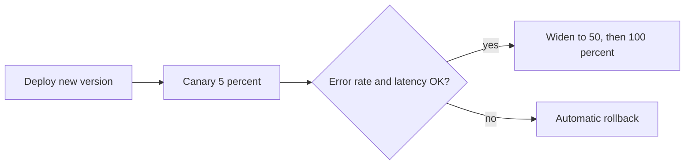

Safe production testing techniques:
- **Feature flags** separate deploy from release. Turn on for staff first, then a small group.
- **Dark launch / shadow traffic**: send a copy of real requests to the new version and compare, without returning its answer.
- **Synthetic monitoring**: scripted checks with test accounts run every minute.
- **Kill switch** that does not need a deploy.

**Trade-offs:** flags add code paths that must be tested and cleaned up. Canary needs good metrics and enough traffic to detect a problem in minutes.

**Gotcha:** Test accounts and data in production polluting reports or payments. Mark them clearly and exclude them from analytics.

**Interview tip:** Say "confidence is the sum of pre-release tests and fast, safe rollback". It shows you understand that not all risk can be removed.

_Module: Test Strategy & Leadership · Tags: tech-lead, release, feature-flags, canary_

### 65. [Tech Lead] How do you run tests in a large front-end monorepo with affected-only testing?

**Short answer:** Build a dependency graph of the projects, and on each merge request run tests only for the projects affected by the changed files, plus use caching so unchanged work is never repeated. Keep a full run on main or nightly as a safety net.

How it works with a tool like Nx (Turborepo and Bazel are similar):
- The tool knows that `checkout-ui` depends on `shared-ui` and `api-client`.
- When `shared-ui` changes, everything that depends on it is "affected".
- The command compares your branch with the base branch and runs only those targets.
- **Remote cache**: if the same inputs were already tested on another machine, the result is reused.
- **Distribution**: the work is split across CI agents, or sharded by test file.

```bash
# run unit tests only for projects touched since main
npx nx affected -t test --base=origin/main

# split a long Jest or Playwright suite across 4 CI jobs (job 2 of 4)
npx jest --shard=2/4
```

Things to get right:
- **Correct inputs.** If a config file, lockfile or a shared script is not part of the graph, changes there skip tests wrongly. Treat them as "affects everything".
- **Full run on main** and nightly, so graph mistakes are caught.
- **E2E affected tests**: map journeys to the apps they exercise.
- **Shared lib ownership**: a change to a core library triggers many tests, so keep its API small and stable.

**Gotcha:** A shallow git clone in CI makes "changed since base" wrong. Fetch enough history.

**Interview tip:** Give the trade-off clearly: speed from selection against the risk of a missed dependency, covered by a periodic full run.

_Module: Flaky Tests & CI · Tags: tech-lead, monorepo, nx, ci_

### 66. How do you design a robust end-to-end test framework?

**Short answer:** A robust E2E framework keeps tests short and readable, hides browser details in a thin layer, creates data through APIs instead of the UI, isolates every test, and gives clear failure evidence. It is designed for stability and diagnosis first, speed second.

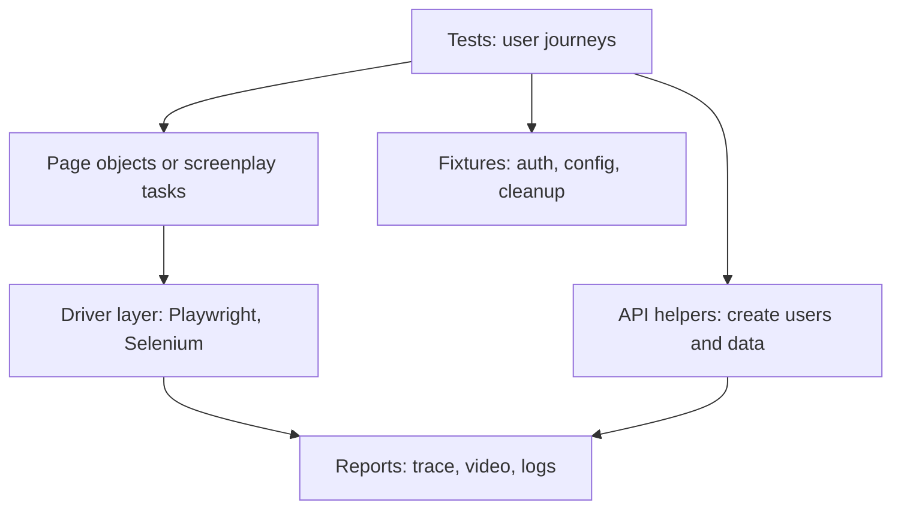

Read it as: tests talk to a business-level layer, not to selectors, and set up state through APIs.

Design decisions:
- **Abstraction.** Page objects group locators and actions per page or component: `checkout.payWithCard()`. The Screenplay pattern models actors, tasks and questions, and scales better when many roles and flows exist. Either way, assertions belong in the test, not hidden in the page.
- **Selectors strategy.** Agree on stable hooks with developers: roles and labels first, `data-testid` where needed. Never rely on layout, generated class names or text that marketing edits.
- **Data setup via API.** Log in by token and create orders through the back end. Use the UI only for the journey under test. This is faster and removes shared failure points.
- **Isolation.** Each test uses its own user and data, no ordering, safe to run in parallel.
- **Parallelism and sharding** from day one, so the data rules are respected.
- **Retries policy.** At most one retry in CI, with the retried test reported as flaky. Locally, none.
- **Reporting.** Trace, video and screenshot on failure, plus network and console logs, attached to the CI job. Add a request id to every call so a failure maps to server logs.
- **Config.** Environment, base URL and credentials from variables.

**Trade-off:** the page layer must stay thin. A page object that grows business logic becomes a second application.

**Gotcha:** Giant "God" page objects and tests that call each other. Prefer small components and composition.

**Interview tip:** Lead with "stable selectors, API setup, isolation". These three remove most flakiness.

_Module: End-to-End & Browser Testing · Tags: e2e, framework-design, page-object_

### 67. How do you make tests deterministic by controlling time, randomness, network and ordering?

**Short answer:** A deterministic test gives the same result every run because every uncontrolled input has been turned into a controlled one. You inject or fake the clock, seed randomness, stub the network, avoid shared state, and make ordering explicit.

Sources of non-determinism and how I control them:
- **Time**: inject a clock, or use fake timers. For browsers, Playwright can set a fixed clock, and Cypress has `cy.clock()`. Test time zones by setting the zone in the test process, for example `TZ=Asia/Kolkata` and `TZ=America/Los_Angeles`.
- **Randomness**: pass a seeded generator. Log the seed on failure. For ids, inject an id generator.
- **Network**: stub third parties (MSW, WireMock, route interception). Allow only your own services. Fail on unexpected outbound calls.
- **Ordering**: do not rely on object key order, unordered query results, or async tasks finishing in a given order. Sort before comparing, or compare sets.
- **Shared state**: unique data per test, reset caches, no global singletons surviving between tests. Run the suite in random order in CI to expose hidden dependencies.
- **Environment**: pin versions of browsers, runtime and fonts using containers. Use the same locale.
- **Concurrency**: replace sleeps with waits on events, and use the race detector.

```js
// order dependence caught by running tests in isolation: B fails when A ran first
let counter = 0;
const next = () => ++counter;
test('A', () => assert.equal(next(), 1));  // passes
test('B', () => assert.equal(next(), 1));  // fails: 2 !== 1 (verified with node --test)
// fix: create a fresh counter inside each test
```

A useful check: run each new test 20 times, and the whole suite in random order, before it joins the main branch.

**Gotcha:** Freezing time globally and forgetting that some libraries use their own timers or `performance.now`. Verify the fake covers what the code uses.

**Interview tip:** Say you treat nondeterminism as a design problem: make dependencies explicit and the tests follow.

_Module: Flaky Tests & CI · Tags: determinism, flaky-tests, test-design_

### 68. How do you test distributed systems: chaos engineering, fault injection and game days?

**Short answer:** Unit and integration tests prove the happy path. For distributed systems you also need to test failure: slow networks, crashed nodes, partial outages, duplicate messages. Fault injection in tests, chaos experiments in production-like environments, and rehearsed game days show whether timeouts, retries and fallbacks really work.

Techniques from small to large:
- **Fault injection in tests.** Use a proxy such as Toxiproxy between your service and its dependency to add latency, drop connections or cut off a response. Assert that timeouts fire, retries back off, and a circuit breaker opens.
- **Dependency failure tests.** Stub a dependency to return 500, to hang, to return malformed data. Check the user-facing behaviour: a fallback, a clear error, no data loss.
- **Chaos experiments.** Follow the scientific loop: define the steady state (for example error rate under 1 percent), form a hypothesis ("we survive losing one pod"), inject the failure with a small blast radius, observe, and fix. Tools include Chaos Mesh, Litmus and Azure Chaos Studio.
- **Game days.** A planned session where the team simulates an outage (database failover, region loss) and practises detection, communication and recovery. They test people and runbooks as much as software.
- **Jepsen-style testing.** Jepsen tests databases and queues under network partitions and clock skew, then checks the recorded history for consistency violations. Use the idea for your own critical stores.
- **Contracts plus synthetic monitoring.** Contract tests catch interface drift, and synthetic checks in production catch what only real environments show.

What to verify:
- Idempotency under retries, so duplicate delivery is safe.
- No lost writes after failover.
- Graceful degradation: the product page loads without the recommendation service.

**Gotcha:** Running chaos in production without observability, an abort button and agreement from the owners. Start in staging, then limit the blast radius.

**Interview tip:** Say that you start with one hypothesis and one dependency, and that success is a learning, either "it held" or "we found a gap before customers did".

_Module: Advanced Techniques · Tags: chaos-engineering, distributed-systems, resilience_

### 69. How do you test event-driven and eventually consistent systems?

**Short answer:** Assert on the final observable state with polling and a timeout, not on immediate results. Test each handler with duplicates, reordering and failures, and test the flow across services with correlation ids and a small number of end-to-end checks.

Principles:
- **Eventually means "within a bound".** Replace "assert immediately" with "wait until true, up to N seconds". Choose N from your SLO.
- **Design for testability.** Include a correlation id in every event, so a test can follow one business flow through logs and read models.
- **Handlers as pure as possible.** Given state and event, return new state. Test these exhaustively without a broker.
- **Test the hard cases on purpose.**
  - Duplicate delivery gives the same result (idempotency).
  - Out-of-order events: the read model ignores older versions.
  - A failing handler retries and then goes to a dead-letter queue.
  - A saga step failing triggers the compensating action.
- **Schema evolution.** Old consumers must tolerate new optional fields. Test with samples of old and new messages.
- **Replay.** Rebuilding a read model from the event log gives the same result.

```ts
// poll for the outcome instead of sleeping (verified with node --experimental-strip-types)
async function waitFor(check: () => boolean, timeoutMs = 500, stepMs = 10) {
  const end = Date.now() + timeoutMs;
  while (Date.now() < end) { if (check()) return; await new Promise(r => setTimeout(r, stepMs)); }
  throw new Error('condition not met in time');
}
// test: publish an event, then await waitFor(() => readModel.has('order-1'))
```

| Layer | What it proves |
| --- | --- |
| Handler unit tests | Logic, idempotency, ordering rules |
| Broker integration tests | Wiring, serialisation, retry and DLQ |
| Contract or schema tests | Producers and consumers agree on events |
| Few E2E flows plus tracing | The saga completes end to end |

**Gotcha:** Making the test fast by calling the handler directly, and never testing the real broker configuration, such as consumer group or retry settings.

**Interview tip:** Mention that production observability, such as lag and DLQ alerts, is part of the test strategy for async flows.

_Module: Advanced Techniques · Tags: event-driven, eventual-consistency, testing_

### 70. How do you design test architecture for a monorepo: affected testing, caching and sharding?

**Short answer:** Model the monorepo as a graph of projects with declared dependencies, test only what a change affects, cache results by input hash, and spread long suites across machines. Keep a periodic full run as a safety net. The architecture matters as much as the tool.

Building blocks:
- **Project graph.** Each app and library declares its dependencies (Nx, Turborepo, Bazel). Enforce module boundaries with lint rules, so the graph reflects reality and shared libraries do not become tangled.
- **Affected selection.** On a merge request, compute changed files against the base, find affected projects, and run `test`, `lint` and `build` only for them.
- **Computation cache.** The task hash covers source, dependencies, config and tool versions. A hit replays logs and outputs. A remote cache shares hits between developers and CI.
- **Sharding and distribution.** Split slow suites (Jest, Playwright, Cypress) across CI agents using `--shard=n/m`, balanced by past duration. Some tools distribute tasks across agents for you.
- **Test layering per project.** Libraries have unit tests, apps have component tests and a few E2E journeys, and a shared E2E project covers cross-app flows.
- **Ownership.** A CODEOWNERS file maps projects to teams, and failures are routed to the owner.

```bash
npx nx affected -t lint test build --base=origin/main --parallel=3
npx playwright test --shard=3/8            # CI job 3 of 8
```

Safety and trade-offs:
- Files outside the graph (root config, lockfile, CI scripts) must be marked as "affects all".
- Nightly or main-branch full runs catch graph mistakes and cache poisoning.
- Remote caches need trust: make sure only CI writes to them.
- Flaky tests are worse in a monorepo because one flake blocks many teams; keep quarantine tooling.

**Gotcha:** A shallow git clone makes the changed-file list wrong. Fetch the base branch history.

**Interview tip:** Quantify: "merge request pipelines dropped from 40 to 12 minutes, and a nightly full run keeps us honest".

_Module: Flaky Tests & CI · Tags: monorepo, nx, caching, sharding_

### 71. What are synthetic monitoring and production verification?

**Short answer:** Synthetic monitoring runs scripted user journeys against production on a schedule, from several locations, and alerts when they fail or become slow. Production verification, or post-deploy smoke tests, checks right after a release that the key paths work. Both complement pre-release tests, because production has real data, config and dependencies.

What they cover:
- **Availability and journey checks**: login, search, add to cart, with a dedicated test account.
- **API checks**: key endpoints with expected status, latency and payload fields.
- **Third-party health**: payment sandbox, identity provider.
- **Certificates and DNS** expiry.
- **Performance from the outside**: page load time by region.

Tools: Datadog Synthetic Monitoring, Azure Application Insights availability tests, Checkly, or Playwright scripts run from a scheduler.

How they connect with the pipeline and observability:
- After each deploy, the pipeline runs a **small smoke suite** against the new version. If it fails, the canary stops or rolls back.
- The same scripts run **every minute or five** in production as monitors, and page the on-call person.
- Results link to traces and logs, using a header that marks synthetic traffic, so you can jump from a failed check to the exact request in your observability tool.
- They feed the **SLO**: a synthetic availability check is one data source for the error budget.

| Aspect | Pre-release E2E | Synthetic monitoring |
| --- | --- | --- |
| Environment | Test or staging | Production |
| Frequency | Per change | Continuous |
| Goal | Block a bad release | Detect real-world breakage fast |
| Data | Created for the test | Dedicated test accounts |

**Gotchas**
- Synthetic orders and users polluting business reports. Tag them and exclude them.
- Checks that are flaky cause alert fatigue. Make them few, stable, and retried once before alerting.

**Interview tip:** Say that synthetic checks answer "is the product working for users right now" while unit tests answer "is the code correct".

_Module: Performance & Security Testing · Tags: synthetic-monitoring, observability, smoke-tests_

### 72. How do you scale consumer-driven contracts and handle versioning?

**Short answer:** At scale, automate everything around the broker: publish contracts and verification results from CI with the git commit and branch, tag environments, gate deployments with can-i-deploy, and use pending and work-in-progress pacts so new contracts do not break a provider's build. Evolve APIs by adding, not removing, and retire fields with data from the contracts.

Practices:
- **Version by git commit.** Each consumer publishes pacts with the commit sha and branch. The broker keeps the matrix of which consumer version works with which provider version.
- **Record deployments.** Tell the broker which version is live in each environment (`record-deployment`), so `can-i-deploy` compares with what is really running.
- **Can-I-Deploy as a gate** in both pipelines, before deploying to each environment.
- **Pending pacts**: a new consumer contract that the provider has not verified yet does not fail the provider build. **Work-in-progress pacts** do the same for contracts on feature branches, so provider teams hear about them early without being blocked.
- **Webhooks**: when a consumer publishes a changed pact, trigger the provider's verification job automatically.
- **Provider states** managed through a shared helper, not copied per team.
- **Message pacts** for events and queues, not only HTTP.

Evolving an API without breaking consumers (expand and contract):
- Add new fields as optional. Old consumers ignore them.
- Never rename or remove a field in one step. Add the new field, move consumers (verified by contracts), then remove the old one when no pact uses it.
- Use the broker to answer "which consumers still read `legacyId`?".

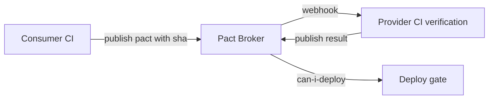

**Trade-off:** many consumers mean many contracts to verify. Keep contracts small, and test only what consumers rely on.

**Gotcha:** Over-specific matchers, such as exact values and ordering. Contracts then fail for harmless changes. Match types and shapes.

**Interview tip:** Show you see it as a collaboration tool: it makes breaking changes visible to the right team before merge.

_Module: Contract Testing · Tags: pact, contract-testing, versioning_

### 73. How do you test machine-learning or LLM-based features?

**Short answer:** Outputs are not deterministic or exactly right, so test with evaluation sets instead of single assertions. Build a golden dataset of inputs with expected qualities, score outputs automatically (rules, similarity or an LLM judge, calibrated by humans), track the score over time, and keep ordinary tests for the code around the model.

Layers:
- **Normal software tests** for everything that is not the model: parsing, prompt building, tool calls, retries, validation of structured output, error handling. Use a fake model client that returns fixed answers.
- **Golden sets / evals.** A versioned set of cases: input, what a good answer must contain or must not contain, plus tricky and adversarial cases. Run it on every change to the prompt, model or retrieval settings.
- **Scoring.** Cheap checks first: JSON schema valid, required facts present, banned content absent, length limits. Then semantic checks, and an LLM as judge for fuzzy qualities, with the judge itself spot-checked by humans.
- **Regression tracking.** Store scores per version. A drop on a key slice blocks the change.
- **Safety and robustness**: prompt injection attempts, personal data leakage, off-topic requests.
- **Non-functional**: latency percentiles, cost per request, token limits.
- **Online monitoring**: sampled production outputs reviewed, user feedback and thumbs-down rates.

| Kind of check | Example |
| --- | --- |
| Deterministic | Output parses as the JSON schema |
| Rule-based | Answer cites at least one source id |
| Model-graded | Is the answer faithful to the retrieved text? |
| Human review | Weekly sample of 50 answers |

**Gotcha:** Testing with one example that happens to pass. Quality is a rate over many cases, and a changed model version can shift it silently.

**Interview tip:** Keep it general and honest: "I treat prompts as code, with evals in CI, and I never rely only on an LLM judge".

_Module: Advanced Techniques · Tags: llm, evals, ml-testing_

### 74. How do you analyse flaky tests with data?

**Short answer:** Store every test result with its commit, job, shard, duration, retry and error message, then query for tests that flip between pass and fail on the same code. Group flakes by root cause, show them in a dashboard with owners, and use the trends to decide where to invest.

Data to collect from CI (JUnit XML is enough to start):
- Test id, result, duration, error text and stack.
- Commit sha, branch, job and shard, runner type, date and time.
- Retry count and whether the retry passed.

Signals of flakiness:
- **Same commit, different results**: a retry passes, or a rerun passes.
- **Failing on main** with no relevant change.
- **High variance in duration**, which hints at timing issues.
- **Failures cluster by runner, shard or time of day**, which points to environment or resource problems.

A simple root-cause taxonomy for labelling:
- Timing or race in the test
- Shared state or order dependence
- Test data collision
- Environment or infrastructure (out of memory, port in use)
- External dependency
- Real product bug (a race in production code)
- Test code defect (wrong selector or assertion)

Dashboard ideas:
- Top 10 flaky tests by failure count, with owner.
- Flake rate per week, and per suite.
- Quarantine size and age. Alert when a test stays quarantined for more than two weeks.
- Share of pipelines that needed a rerun, and the minutes wasted.

Many CI vendors and open-source tools provide flaky-test detection, and you can build a first version with a script and a spreadsheet.

**Trade-off:** perfect classification costs more than it returns. Label the top offenders by hand, and let the data show the dominant cause.

**Gotcha:** Using automatic retries without recording them. You lose the data that finds the problems.

**Interview tip:** Say that when the biggest bucket is "timing in tests" you fix helpers and rules, not 50 individual tests.

_Module: Flaky Tests & CI · Tags: flaky-tests, metrics, root-cause_

### 75. How do you prioritise tests and testing effort with a risk-based approach?

**Short answer:** Rate each feature or change by the likelihood of failure and the impact if it fails, then spend testing effort in proportion. High-risk areas get deeper, more automated and more frequent testing. Low-risk areas get light checks. The same idea orders tests in a pipeline: run the ones most likely to catch bugs first.

Scoring risk:
- **Impact**: money, safety, legal exposure, number of users, reputation.
- **Likelihood**: how complex the code is, how new it is, how often it changes, past defect history, number of integrations, team experience.

| | Low impact | High impact |
| --- | --- | --- |
| High likelihood | Medium effort | Most effort, automate and explore |
| Low likelihood | Minimal | Targeted checks plus monitoring |

Practices:
- Run a short **risk workshop** at the start of a feature. List what could go wrong and rank it.
- **Change-based risk**: a large diff in a payment module raises effort. A copy change lowers it.
- **Test impact analysis**: run the tests that cover the changed code first, then the rest.
- **Historical prioritisation**: run tests that failed recently or that often catch bugs first, to fail fast.
- **Release decision**: list the known untested areas openly. Risk accepted by the product owner is a decision, not an oversight.

For a regulated or safety-critical domain, such as avionics software, the required rigor is set by standards and criticality levels, so effort is not a free choice. For normal products, a light risk register and judgement are enough.

**Gotcha:** Risk assessed once and forgotten. Update it after incidents and large changes.

**Interview tip:** Give a worked example: "payment capture: high impact, medium likelihood, so unit, API, contract, one E2E and synthetic monitoring. Settings page colour: one visual snapshot."

_Module: Test Strategy & Leadership · Tags: risk-based-testing, prioritisation, strategy_

### 76. What are state-transition testing, decision tables and pairwise testing?

**Short answer:** These are structured ways to design tests when behaviour has states or many rule combinations. State-transition testing walks a state machine. Decision tables list every combination of conditions and the expected action. Pairwise testing covers every pair of parameter values with far fewer cases than all combinations.

**State-transition testing.** Draw the states and the allowed events. Test each valid transition, and try invalid ones too.

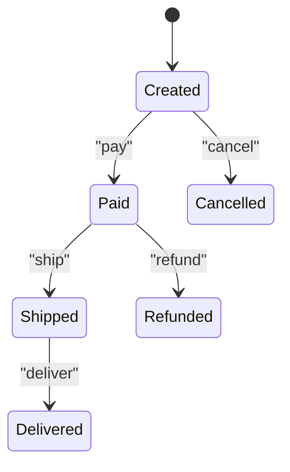

Tests: every arrow works. Negative tests: shipping a cancelled order must be rejected, refund after delivery follows the rule, paying twice does not charge twice.

**Decision table.** For a discount rule with conditions "member", "order over 100" and "coupon":

| Member | Over 100 | Coupon | Result |
| --- | --- | --- | --- |
| yes | yes | yes | 15 percent (best applies) |
| yes | yes | no | 10 percent |
| no | yes | no | 5 percent |
| no | no | no | none |

Each row becomes a test, and gaps in the table reveal rules nobody defined.

**Pairwise (all-pairs).** With four parameters of three values each (browser, OS, language, plan), all combinations are 81 tests. A pairwise set covers every pair of values in about 9 to 10 tests, because most bugs come from the interaction of two parameters. Tools such as PICT or AllPairs generate the set.

| Technique | Use when |
| --- | --- |
| State-transition | Workflows, order status, connection lifecycle |
| Decision table | Business rules with several conditions |
| Pairwise | Configuration matrices with many options |

**Gotcha:** Pairwise misses bugs that need three values to interact. For high-risk combinations, add them by hand.

**Interview tip:** Pick the technique by the shape of the problem and say why. It shows method.

_Module: Advanced Techniques · Tags: test-design, techniques, pairwise_

### 77. How do you practise TDD in real projects, and when does it hurt?

**Short answer:** In practice I use TDD where the rules are clear and the design is still open, such as business logic, parsers and algorithms. I do not force it on exploratory UI, throwaway spikes or glue code. Done well it gives small steps and a testable design. Done badly it creates brittle, mock-heavy tests.

How I do it:
- **Start with a list** of behaviours, pick the simplest, write one failing test, make it pass with the least code, refactor.
- **Small steps.** If a step takes more than ten minutes, the test was too big.
- **Triangulate.** Use a second example to force a general solution instead of a hard-coded return.
- **Refactor with green tests**, including the tests themselves.
- **Two styles:** the classic or Chicago style uses real collaborators and checks state. The London or mockist style mocks collaborators and checks interactions, and drives the design outside-in. The classic style gives less brittle tests, the mockist style is good for discovering roles and boundaries.

Where it helps:
- Pricing, tax, validation, scheduling, state machines.
- Bug fixes: first a failing test that reproduces the bug.
- Learning a new code area: tests as a safety net.

Where it hurts:
- **Exploring unknown APIs or UI layouts** where the shape changes every hour.
- **Highly coupled legacy code** that needs seams first.
- **Mock-heavy tests** that mirror the implementation and slow refactoring.
- **Dogmatic coverage of trivial code.**
- **Teams without the habit**: forced TDD gives poor tests and resentment. Start with pairing and katas.

The evidence is mixed on productivity, but strong on design feedback. Be honest about it.

**Gotcha:** Writing the test after the code and calling it TDD. Test-after is fine, just do not claim the design benefits.

**Interview tip:** Say "TDD is a design tool first and a regression tool second". It sounds experienced and balanced.

_Module: Test Doubles & Design · Tags: tdd, design, trade-offs_

### 78. How do you test legacy code with seams and approval tests?

**Short answer:** A seam is a place where you can change behaviour without editing the code you want to test, so you can get it under test. An approval (golden master) test records the current output of a complex piece of code and compares future runs to that approved output. Together they let you refactor code nobody understands.

Kinds of seams:
- **Object seam**: pass a dependency through the constructor or a setter, then substitute it in the test.
- **Parameterise the function**: add a parameter with the old behaviour as the default.
- **Extract and override**: pull a hard call (clock, file, network) into a small method and override it in a test subclass.
- **Link or module seam**: replace a module at import time (module mock, dependency injection container).
- **Wrap a global or static** in an adapter you can swap.

```js
// before: hidden dependency on the clock
function isHappyHour() { return new Date().getHours() === 17; }
// after: a seam with a default, behaviour unchanged for callers
function isHappyHour(now = () => new Date()) { return now().getHours() === 17; }
```

**Approval tests.** Run the legacy code over many representative inputs, capture the output (text, JSON, a rendered report) in a file, and review it once. Save it as the approved file. After every refactoring step, run again and diff against the approved file. A diff means behaviour changed, so either you made a mistake or you found something to discuss. Tools: ApprovalTests libraries, or Jest and Vitest snapshots used carefully.

Approach:
- Add a seam with a tiny, safe change.
- Capture a golden master over a wide set of inputs, including real anonymised samples.
- Refactor in small steps, diffing each time.
- Replace the golden master with proper unit tests for the new structure.
- Keep the approved file small enough to review.

**Gotcha:** Approving output you did not read. The golden master may include existing bugs, which is fine as a start, but write them down.

**Interview tip:** Name "characterisation tests" and "seams", and tell a short story of untangling a function this way.

_Module: Advanced Techniques · Tags: legacy, seams, approval-testing_

### 79. How would you review and refactor a bad test suite?

**Short answer:** First measure what is wrong: speed, flakiness, failures that are not real bugs, and bugs that escape. Then fix the cheapest, highest-impact problems in small steps: delete useless tests, make slow ones faster, stabilise flaky ones, and move checks to the right layer. Do not rewrite everything.

Assessment, with data:
- **Time per stage** and the slowest 20 tests.
- **Flake rate** and the most unstable tests.
- **False-failure rate**: how many red builds are not product bugs.
- **Escaped defects**: which production bugs had no test, and which tests exist that never fail.
- **Shape**: count of tests per layer, to see an ice cream cone.
- **Smells** found by reading a sample: no assertions, many mocks, huge setups, copy-paste, sleeps, commented-out tests, shared fixtures.

Plan, in order of return:
- **Delete** tests that duplicate others, test nothing, or cost more than they protect. Fewer, trusted tests beat many ignored ones.
- **Stabilise** the top flaky tests. Fix helpers once (waiting, data creation).
- **Speed up**: parallelise, shard, replace sleeps, share expensive setup.
- **Fix the shape** gradually: for each E2E that checks a rule, add a unit test and remove the E2E.
- **Introduce standards** and a review checklist, so new tests are good.
- **Use mutation testing** on core modules to find tests that do not check anything.
- **Protect the gains**: a flake budget, a duration budget in CI, and a rule that bug fixes include tests.

Rules for refactoring tests:
- Keep the suite green while changing it, in small commits.
- Refactor tests and production code in separate commits.
- Never change both and trust the result.

**Gotcha:** A "big rewrite" of the suite. It stops feature work, loses hidden knowledge in old tests, and often repeats the same mistakes.

**Interview tip:** Say you "make it visible, then fix the top three causes". Leaders are judged on focus.

_Module: Test Strategy & Leadership · Tags: refactoring, test-quality, tech-lead_

### 80. How do you plan and run exploratory testing sessions with charters?

**Short answer:** Exploratory testing is simultaneous learning, test design and execution. To keep it focused and reportable, use session-based test management: a time-boxed session guided by a charter, followed by notes and a short debrief.

A charter is a one-sentence mission. A common template: **Explore** a target, **with** resources or conditions, **to discover** information. Examples:
- Explore the checkout flow with expired and international cards to discover payment error handling problems.
- Explore the search page with very slow network and large result sets to discover loading and pagination problems.
- Explore the role editor with a limited user to discover permission leaks.

Running a session:
- **Time-box** it, 60 to 90 minutes, with no interruptions.
- **Take notes** as you go: what you tried, what you saw, questions, bugs, ideas for new tests.
- **Use heuristics** to generate ideas. Examples are tour types (feature tour, data tour, interruption tour), boundaries, "CRUD" for each entity, changing sequence, using the browser back button, multiple tabs, offline, different time zone and locale.
- **Pair** a tester with a developer or product person for fresh viewpoints.
- **Debrief** for ten minutes: bugs, risks, coverage, what to automate.

What you get:
- Bugs that scripted tests cannot find, such as confusing flows or inconsistent states.
- A list of candidates for automation.
- Information about product risk for release decisions.

Where in the process: after a feature is first working in a test environment, before a major release, and after incidents in that area.

**Gotcha:** Exploring without notes. Nothing is reproducible, and you cannot tell the team what was covered.

**Interview tip:** Say that exploratory testing is a skill with technique, not random clicking, and that you ask developers to join sessions for their own features.

_Module: Testing Fundamentals · Tags: exploratory-testing, charters, session-based_

### 81. How do SLOs and error budgets shape your testing approach?

**Short answer:** An SLO is a reliability target, for example 99.9 percent of requests succeed in under 500 ms. The error budget is the allowed failure, so it tells you how much risk you can take. Testing effort is set by the SLO: tighter targets need stronger pre-release checks and faster detection, and an exhausted budget shifts work from features to reliability.

How SLOs drive tests:
- **Performance tests use SLO numbers** as thresholds. A load test passes only if p95 stays under the target at the planned traffic.
- **Canary analysis** compares the new version with the baseline on the SLI metrics, and rolls back on a regression.
- **Synthetic monitors** produce SLI data for critical journeys.
- **Resilience tests and game days** verify that the system meets the SLO even when a dependency fails.
- **Alerting on burn rate** (how fast the budget is being spent) catches problems earlier than static thresholds.

Error budget policy:
- Budget healthy: ship, experiment, take reasonable risk.
- Budget burning fast: slow down releases, add testing in the weak area, review recent changes.
- Budget exhausted: freeze risky changes until reliability work is done. This must be agreed in advance with product, or it will not be respected.

A tiny example: SLO 99.9 percent over 30 days allows about 43 minutes of unavailability. If last month's incident used 30 minutes, the team decides whether a risky migration is acceptable this month.

| Question | How SLO helps |
| --- | --- |
| How much testing is enough? | Enough to protect the target, not more |
| Release or hold? | Look at the remaining budget |
| Which tests to add after an incident? | Those that would have detected the burn |

**Gotcha:** Choosing SLOs that nobody measures or that do not reflect user experience. Start with a few user-facing SLIs, such as availability and latency of key journeys.

**Interview tip:** Say that SLOs make quality a shared, numeric conversation with product instead of an argument.

_Module: Test Strategy & Leadership · Tags: slo, error-budget, reliability_

### 82. Interview exercise: how would you write tests for a given function?

**Short answer:** Clarify the behaviour, list the equivalence classes and edge cases aloud, write the simplest happy-path test first, then cover boundaries, errors and side effects. Say what you leave out and why. Below are three worked examples, all of which I ran with the Node test runner.

**Example 1: `slugify(text)`.** Ask: what about accents, repeated spaces, symbols, empty input? Then test each.

```js
test('slugify', () => {
  assert.equal(slugify('Hello World'), 'hello-world');       // happy path
  assert.equal(slugify('  Café   au lait!  '), 'cafe-au-lait'); // accents, spaces, symbols
  assert.equal(slugify(''), '');                              // empty
  assert.equal(slugify('---'), '');                           // only separators
  assert.equal(slugify('A_B C'), 'a-b-c');                    // underscore becomes dash
});
```

**Example 2: `mergeIntervals(list)`.** Cases: empty, single, overlapping, touching, contained, unsorted, and that the input is not mutated.

```js
assert.deepEqual(mergeIntervals([]), []);
assert.deepEqual(mergeIntervals([[1, 3], [2, 6], [8, 10]]), [[1, 6], [8, 10]]);
assert.deepEqual(mergeIntervals([[1, 4], [4, 5]]), [[1, 5]]);   // touching merges (a decision to confirm)
assert.deepEqual(mergeIntervals([[1, 10], [2, 3]]), [[1, 10]]); // contained
```

**Example 3: a rate limiter that allows 2 calls per 1000 ms.** The trick is the clock. Inject it, then control it.

```js
let t = 0; const limiter = new Limiter(2, 1000, () => t);
assert.equal(limiter.allow(), true);
assert.equal(limiter.allow(), true);
assert.equal(limiter.allow(), false);   // third call in the window
t = 999;  assert.equal(limiter.allow(), false);  // still inside
t = 1000; assert.equal(limiter.allow(), true);   // window moved on: boundary
```

A good flow to say aloud:
- Restate the requirement and confirm ambiguous rules.
- Name the groups of input, then the boundaries.
- Test behaviour through the public interface.
- Mention what is not covered (performance, concurrency) and how you would cover it.

**Gotcha:** Writing the code and tests silently. The interviewer wants to hear your reasoning.

**Interview tip:** Ask one clarifying question before you test, such as "do touching intervals merge?". It shows you find rules, not only bugs.

_Module: Advanced Techniques · Tags: interview-exercise, unit-testing, edge-cases_

### 83. Interview exercise: how would you design a test plan for login, search or checkout?

**Short answer:** State the scope and risks, then cover functional cases, negative and edge cases, security, usability and accessibility, performance, compatibility and monitoring. Assign each group to a test layer, and say what you automate. Keep it organised, not a random list.

A structure that works for any feature:
- **Clarify**: users, platforms, business rules, dependencies.
- **Risks**: money, security, data loss, drop-off.
- **Test ideas by group**, then **layer and automation** for each.

**Login**
- Happy path, remember me, logout, session expiry.
- Wrong password, unknown user, locked account after repeated failures, error messages that do not reveal whether the user exists.
- Password reset links expire and work once.
- Security: rate limiting, SQL injection and script input, session fixation, secure cookies, multi-factor flow.
- Accessibility: labels, keyboard, screen reader messages.
- Compatibility: password managers, mobile browsers.
- Layers: unit for validation, API tests for auth rules, a few E2E, synthetic monitor.

**Search**
- Exact, partial, case, accents, multiple words, empty query, special characters, very long query.
- Ranking, filters, sorting, pagination edges (last page, page beyond range).
- Zero results message, typo tolerance, language.
- Performance: p95 latency with a large index, concurrency.
- Data freshness: a new item appears after indexing delay.
- Layers: API tests for relevance on a fixed data set, E2E for the main flow.

**Checkout**
- Cart changes, coupons, tax and shipping rules, rounding, multiple currencies.
- Payment success, declined card, timeout, double click, back button, retry without double charge (idempotency).
- Stock running out during checkout, price change mid-session.
- Order emails, confirmation, inventory and payment events.
- Security and compliance: no card data stored, authorisation checks.
- Layers: unit for pricing, contract tests with the payment provider, E2E happy path and one failure path, canary and monitoring.

**Gotcha:** Listing only UI clicks. Strong plans include data, security, failure and monitoring.

**Interview tip:** Offer a priority order. Say "if I only had an hour, I would run these five first".

_Module: Test Strategy & Leadership · Tags: interview-exercise, test-plan, strategy_

### 84. Interview exercise: how do you find the bug in a flaky test?

**Short answer:** Reproduce it first by running it many times, alone and with the full suite, in random order and in parallel. Then look for the usual suspects: shared state, order dependence, time, randomness, waiting by sleep, and external services. Fix the cause, not the symptom.

Here is a small example that fails only when it runs after another test. I ran it with `node --test`:

```js
let counter = 0;
const next = () => ++counter;                       // shared module-level state

test('A uses the counter', () => assert.equal(next(), 1)); // passes
test('B assumes a fresh counter', () => assert.equal(next(), 1));
// ✖ B: 2 !== 1   (passes when B runs alone, fails after A)
```

The test is flaky in the sense that its result depends on what ran before it. The cure is to remove the shared state:

```js
function makeCounter() { let n = 0; return () => ++n; }
test('B with its own counter', () => assert.equal(makeCounter()(), 1)); // ✅ independent
```

A method to follow aloud:
- **Reproduce.** Loop it 100 times. Run it alone, then with the whole file, then with the whole suite. If it fails only in the suite, suspect order or shared state. If it fails only in CI, suspect timing, resources or environment.
- **Read the failure.** Is it a timeout, a wrong value, or an element not found? Look at traces, screenshots and logs.
- **Check the checklist.**
  - Sleeps or tight timeouts?
  - Assertions before the async work finished (missing `await`)?
  - Shared data, fixed ids, fixed ports?
  - Clock, time zone, random values?
  - Third-party network?
  - Parallel workers touching the same resource?
- **Isolate and prove.** Make the test fail reliably by adding a delay or forcing the order, then show the fix removes the failure.
- **Check if it is a real bug.** A race condition in the product code is a defect, not a test problem.
- **Add a guard.** Run the repaired test many times in CI once, and add a rule or helper that stops the same mistake.

**Gotcha:** Adding a retry or a longer timeout and calling it fixed. The failure rate just moves.

**Interview tip:** Talk through the method before guessing the cause. Interviewers score the process more than the answer.

_Module: Flaky Tests & CI · Tags: interview-exercise, flaky-tests, debugging_

---

## Resources

Where to read more at the source. Official docs and references come first.

**Official docs**

- [Node.js test runner](https://nodejs.org/api/test.html) — Built-in node:test: describe/it, mocks, fake timers, coverage. _(beginner)_
- [Jest documentation](https://jestjs.io/docs/getting-started) — Matchers, mocks, timers and snapshots. _(beginner)_
- [Vitest documentation](https://vitest.dev/guide/) — Vite-native test runner with a Jest-compatible API. _(beginner)_
- [Testing Library: guiding principles](https://testing-library.com/docs/guiding-principles) — Test the way users use your app; query by role. _(beginner)_
- [Mock Service Worker](https://mswjs.io/docs/) — Mock the network at the request level in tests and the browser. _(intermediate)_
- [Pact documentation](https://docs.pact.io/) — Consumer-driven contract testing, the broker and can-i-deploy. _(intermediate)_
- [Testcontainers](https://testcontainers.com/) — Real databases and brokers in throwaway containers for integration tests. _(intermediate)_
- [Playwright documentation](https://playwright.dev/docs/intro) — Auto-waiting, tracing and parallel browser tests. _(intermediate)_
- [Cypress documentation](https://docs.cypress.io/) — Architecture, retry-ability, intercepts and best practices. _(intermediate)_
- [Selenium documentation](https://www.selenium.dev/documentation/) — WebDriver, waits, page objects and Grid. _(intermediate)_
- [BrowserStack Percy docs](https://www.browserstack.com/docs/percy) — Visual testing: snapshots, baselines and review. _(intermediate)_
- [Grafana k6 documentation](https://grafana.com/docs/k6/latest/) — Load, stress and soak tests written in JavaScript. _(intermediate)_

**Article**

- [Martin Fowler: The Practical Test Pyramid](https://martinfowler.com/articles/practical-test-pyramid.html) — The classic guide to test layers, with real examples of each. _(beginner)_
- [Martin Fowler: Mocks Aren't Stubs](https://martinfowler.com/articles/mocksArentStubs.html) — Test doubles explained, and classicist vs mockist testing. _(intermediate)_
- [Kent C. Dodds: The Testing Trophy](https://kentcdodds.com/blog/the-testing-trophy-and-testing-classifications) — Why integration tests give the best return for UI code. _(beginner)_
- [Google Testing Blog: Flaky tests at Google](https://testing.googleblog.com/2016/05/flaky-tests-at-google-and-how-we.html) — Where flakiness comes from and how a large org handles it. _(advanced)_

**Tool**

- [Stryker mutator](https://stryker-mutator.io/) — Mutation testing for JavaScript, C# and Scala. _(advanced)_

**Repository**

- [axe-core](https://github.com/dequelabs/axe-core) — The accessibility rules engine used by most automated a11y tests. _(intermediate)_
