# System Design

[← Back to index](../README.md) · [⭐ Favorites](favorites.md)

67 questions · 0 favorites · [📚 Resources](#resources)

## Contents

**Basic**

- [1. What does a system design interview test, and what step-by-step framework should you follow?](#1-what-does-a-system-design-interview-test-and-what-step-by-step-framework-should-you-follow)
- [2. What is the difference between functional and non-functional requirements, and which non-functional ones matter most?](#2-what-is-the-difference-between-functional-and-non-functional-requirements-and-which-non-functional-ones-matter-most)
- [3. How do you do back-of-the-envelope estimation for QPS, storage and bandwidth?](#3-how-do-you-do-back-of-the-envelope-estimation-for-qps-storage-and-bandwidth)
- [4. Which latency numbers should every engineer know when designing systems?](#4-which-latency-numbers-should-every-engineer-know-when-designing-systems)
- [5. What is the difference between vertical and horizontal scaling?](#5-what-is-the-difference-between-vertical-and-horizontal-scaling)
- [6. How do load balancers work, and what is the difference between L4 and L7?](#6-how-do-load-balancers-work-and-what-is-the-difference-between-l4-and-l7)
- [7. How does caching work, and what are the common write strategies and eviction policies?](#7-how-does-caching-work-and-what-are-the-common-write-strategies-and-eviction-policies)
- [8. What is a CDN, and when should you use one?](#8-what-is-a-cdn-and-when-should-you-use-one)
- [9. How do you choose between SQL and NoSQL databases?](#9-how-do-you-choose-between-sql-and-nosql-databases)
- [10. How does database replication work, and when do you add read replicas?](#10-how-does-database-replication-work-and-when-do-you-add-read-replicas)
- [11. What are partitioning and sharding, and how do you choose a shard key?](#11-what-are-partitioning-and-sharding-and-how-do-you-choose-a-shard-key)
- [12. What are strong and eventual consistency, and what does the CAP theorem say in plain words?](#12-what-are-strong-and-eventual-consistency-and-what-does-the-cap-theorem-say-in-plain-words)
- [13. Why use message queues, and what problems do they solve?](#13-why-use-message-queues-and-what-problems-do-they-solve)
- [14. What is a stateless service, and how do you handle sessions in a scalable system?](#14-what-is-a-stateless-service-and-how-do-you-handle-sessions-in-a-scalable-system)
- [15. What are the basics of good API design: REST, pagination, idempotency and versioning?](#15-what-are-the-basics-of-good-api-design-rest-pagination-idempotency-and-versioning)
- [16. How do you calculate availability, and how do nines and SLA composition work?](#16-how-do-you-calculate-availability-and-how-do-nines-and-sla-composition-work)
- [17. What is a single point of failure, and how do you find and remove them?](#17-what-is-a-single-point-of-failure-and-how-do-you-find-and-remove-them)

**Intermediate**

- [18. \[Tech Lead\] How do you run an effective design review?](#18-tech-lead-how-do-you-run-an-effective-design-review)
- [19. \[Tech Lead\] How do you write a design document or RFC, and what should a good template contain?](#19-tech-lead-how-do-you-write-a-design-document-or-rfc-and-what-should-a-good-template-contain)
- [20. \[Tech Lead\] How do you make and record architecture decisions with ADRs, and handle disagreement?](#20-tech-lead-how-do-you-make-and-record-architecture-decisions-with-adrs-and-handle-disagreement)
- [21. \[Tech Lead\] How do you evaluate build versus buy and compare technology choices?](#21-tech-lead-how-do-you-evaluate-build-versus-buy-and-compare-technology-choices)
- [22. \[Tech Lead\] How do you design for evolvability without over-engineering?](#22-tech-lead-how-do-you-design-for-evolvability-without-over-engineering)
- [23. \[Tech Lead\] How do you estimate effort and risk for a system design?](#23-tech-lead-how-do-you-estimate-effort-and-risk-for-a-system-design)
- [24. \[Tech Lead\] How do capacity planning and load testing feed into a design?](#24-tech-lead-how-do-capacity-planning-and-load-testing-feed-into-a-design)
- [25. \[Tech Lead\] How do you design for observability and operability from day one?](#25-tech-lead-how-do-you-design-for-observability-and-operability-from-day-one)
- [26. \[Tech Lead\] How do you explain a system design to executives versus engineers?](#26-tech-lead-how-do-you-explain-a-system-design-to-executives-versus-engineers)
- [27. What is consistent hashing, and why is it used for distributing data and cache keys?](#27-what-is-consistent-hashing-and-why-is-it-used-for-distributing-data-and-cache-keys)
- [28. What database sharding strategies exist, and how do you handle hot partitions?](#28-what-database-sharding-strategies-exist-and-how-do-you-handle-hot-partitions)
- [29. What replication topologies exist, and how does failover work?](#29-what-replication-topologies-exist-and-how-does-failover-work)
- [30. How does leader election work, and what do ZooKeeper or etcd provide?](#30-how-does-leader-election-work-and-what-do-zookeeper-or-etcd-provide)
- [31. How do rate limiting algorithms work at system level, and where should rate limits be placed?](#31-how-do-rate-limiting-algorithms-work-at-system-level-and-where-should-rate-limits-be-placed)
- [32. What is an API gateway, and what is the Backend for Frontend (BFF) pattern?](#32-what-is-an-api-gateway-and-what-is-the-backend-for-frontend-bff-pattern)
- [33. How do you generate unique IDs in a distributed system: UUID, ULID and Snowflake?](#33-how-do-you-generate-unique-ids-in-a-distributed-system-uuid-ulid-and-snowflake)
- [34. How do you do pagination and infinite scroll at scale?](#34-how-do-you-do-pagination-and-infinite-scroll-at-scale)
- [35. How does search work with an inverted index, and how would you build typeahead?](#35-how-does-search-work-with-an-inverted-index-and-how-would-you-build-typeahead)
- [36. How do pub/sub and event streaming (Kafka concept) work, and what delivery guarantees exist?](#36-how-do-pubsub-and-event-streaming-kafka-concept-work-and-what-delivery-guarantees-exist)
- [37. How do idempotency and exactly-once effects work in distributed systems?](#37-how-do-idempotency-and-exactly-once-effects-work-in-distributed-systems)
- [38. What caching patterns does Redis enable, and how do you handle cache stampede and hot keys?](#38-what-caching-patterns-does-redis-enable-and-how-do-you-handle-cache-stampede-and-hot-keys)
- [39. What CDN and edge caching strategies matter for dynamic and personalised content?](#39-what-cdn-and-edge-caching-strategies-matter-for-dynamic-and-personalised-content)
- [40. When do you use long polling, WebSockets or Server-Sent Events?](#40-when-do-you-use-long-polling-websockets-or-server-sent-events)
- [41. How do you design file and blob storage with chunked uploads?](#41-how-do-you-design-file-and-blob-storage-with-chunked-uploads)
- [42. How would you store and query time-series data and metrics?](#42-how-would-you-store-and-query-time-series-data-and-metrics)
- [43. How do timeouts, retries, circuit breakers, bulkheads and graceful degradation protect a system?](#43-how-do-timeouts-retries-circuit-breakers-bulkheads-and-graceful-degradation-protect-a-system)
- [44. How do sagas, the outbox pattern and two-phase commit keep data consistent, and why is 2PC usually avoided?](#44-how-do-sagas-the-outbox-pattern-and-two-phase-commit-keep-data-consistent-and-why-is-2pc-usually-avoided)
- [45. What is the difference between fan-out on write and fan-out on read (push versus pull)?](#45-what-is-the-difference-between-fan-out-on-write-and-fan-out-on-read-push-versus-pull)
- [46. How do geo-distribution and multi-region deployments work?](#46-how-do-geo-distribution-and-multi-region-deployments-work)

**Advanced**

- [47. \[Tech Lead\] How do you plan the migration and rollout of a redesign: strangler, dual writes and shadow traffic?](#47-tech-lead-how-do-you-plan-the-migration-and-rollout-of-a-redesign-strangler-dual-writes-and-shadow-traffic)
- [48. System design: how would you design a URL shortener?](#48-system-design-how-would-you-design-a-url-shortener)
- [49. System design: how would you design a rate limiter service?](#49-system-design-how-would-you-design-a-rate-limiter-service)
- [50. System design: how would you design a notification system for email, SMS and push?](#50-system-design-how-would-you-design-a-notification-system-for-email-sms-and-push)
- [51. System design: how would you design a chat or messaging system?](#51-system-design-how-would-you-design-a-chat-or-messaging-system)
- [52. System design: how would you design a news feed or timeline?](#52-system-design-how-would-you-design-a-news-feed-or-timeline)
- [53. System design: how would you design a distributed key-value store?](#53-system-design-how-would-you-design-a-distributed-key-value-store)
- [54. System design: how would you design a distributed cache?](#54-system-design-how-would-you-design-a-distributed-cache)
- [55. System design: how would you design a distributed unique ID generator service?](#55-system-design-how-would-you-design-a-distributed-unique-id-generator-service)
- [56. System design: how would you design a web crawler?](#56-system-design-how-would-you-design-a-web-crawler)
- [57. System design: how would you design file storage and sync like Dropbox or Google Drive?](#57-system-design-how-would-you-design-file-storage-and-sync-like-dropbox-or-google-drive)
- [58. System design: how would you design a video streaming platform, and how does it relate to in-flight entertainment?](#58-system-design-how-would-you-design-a-video-streaming-platform-and-how-does-it-relate-to-in-flight-entertainment)
- [59. System design: how would you design a connected in-flight entertainment content distribution system with intermittent connectivity?](#59-system-design-how-would-you-design-a-connected-in-flight-entertainment-content-distribution-system-with-intermittent-connectivity)
- [60. System design: how would you design an e-commerce checkout and inventory system?](#60-system-design-how-would-you-design-an-e-commerce-checkout-and-inventory-system)
- [61. System design: how would you design a payment system?](#61-system-design-how-would-you-design-a-payment-system)
- [62. System design: how would you design a ride-hailing or location-based service?](#62-system-design-how-would-you-design-a-ride-hailing-or-location-based-service)
- [63. System design: how would you design a metrics and monitoring system?](#63-system-design-how-would-you-design-a-metrics-and-monitoring-system)
- [64. System design: how would you design a ticket or seat booking system?](#64-system-design-how-would-you-design-a-ticket-or-seat-booking-system)
- [65. System design: how would you design an API gateway?](#65-system-design-how-would-you-design-an-api-gateway)
- [66. System design: how would you design typeahead or autocomplete at scale?](#66-system-design-how-would-you-design-typeahead-or-autocomplete-at-scale)
- [67. How do you recover when you get stuck in a system design interview, and what are the common pitfalls?](#67-how-do-you-recover-when-you-get-stuck-in-a-system-design-interview-and-what-are-the-common-pitfalls)

## Browse by module

| Module | Questions |
| --- | --- |
| API & Communication (4) | [15](#15-what-are-the-basics-of-good-api-design-rest-pagination-idempotency-and-versioning) · [32](#32-what-is-an-api-gateway-and-what-is-the-backend-for-frontend-bff-pattern) · [34](#34-how-do-you-do-pagination-and-infinite-scroll-at-scale) · [40](#40-when-do-you-use-long-polling-websockets-or-server-sent-events) |
| Approach & Estimation (5) | [1](#1-what-does-a-system-design-interview-test-and-what-step-by-step-framework-should-you-follow) · [2](#2-what-is-the-difference-between-functional-and-non-functional-requirements-and-which-non-functional-ones-matter-most) · [3](#3-how-do-you-do-back-of-the-envelope-estimation-for-qps-storage-and-bandwidth) · [4](#4-which-latency-numbers-should-every-engineer-know-when-designing-systems) · [67](#67-how-do-you-recover-when-you-get-stuck-in-a-system-design-interview-and-what-are-the-common-pitfalls) |
| Case Studies (19) | [48](#48-system-design-how-would-you-design-a-url-shortener) · [49](#49-system-design-how-would-you-design-a-rate-limiter-service) · [50](#50-system-design-how-would-you-design-a-notification-system-for-email-sms-and-push) · [51](#51-system-design-how-would-you-design-a-chat-or-messaging-system) · [52](#52-system-design-how-would-you-design-a-news-feed-or-timeline) · [53](#53-system-design-how-would-you-design-a-distributed-key-value-store) · [54](#54-system-design-how-would-you-design-a-distributed-cache) · [55](#55-system-design-how-would-you-design-a-distributed-unique-id-generator-service) · [56](#56-system-design-how-would-you-design-a-web-crawler) · [57](#57-system-design-how-would-you-design-file-storage-and-sync-like-dropbox-or-google-drive) · [58](#58-system-design-how-would-you-design-a-video-streaming-platform-and-how-does-it-relate-to-in-flight-entertainment) · [59](#59-system-design-how-would-you-design-a-connected-in-flight-entertainment-content-distribution-system-with-intermittent-connectivity) · [60](#60-system-design-how-would-you-design-an-e-commerce-checkout-and-inventory-system) · [61](#61-system-design-how-would-you-design-a-payment-system) · [62](#62-system-design-how-would-you-design-a-ride-hailing-or-location-based-service) · [63](#63-system-design-how-would-you-design-a-metrics-and-monitoring-system) · [64](#64-system-design-how-would-you-design-a-ticket-or-seat-booking-system) · [65](#65-system-design-how-would-you-design-an-api-gateway) · [66](#66-system-design-how-would-you-design-typeahead-or-autocomplete-at-scale) |
| Data & Storage (10) | [9](#9-how-do-you-choose-between-sql-and-nosql-databases) · [10](#10-how-does-database-replication-work-and-when-do-you-add-read-replicas) · [11](#11-what-are-partitioning-and-sharding-and-how-do-you-choose-a-shard-key) · [12](#12-what-are-strong-and-eventual-consistency-and-what-does-the-cap-theorem-say-in-plain-words) · [28](#28-what-database-sharding-strategies-exist-and-how-do-you-handle-hot-partitions) · [29](#29-what-replication-topologies-exist-and-how-does-failover-work) · [33](#33-how-do-you-generate-unique-ids-in-a-distributed-system-uuid-ulid-and-snowflake) · [35](#35-how-does-search-work-with-an-inverted-index-and-how-would-you-build-typeahead) · [41](#41-how-do-you-design-file-and-blob-storage-with-chunked-uploads) · [42](#42-how-would-you-store-and-query-time-series-data-and-metrics) |
| Design Leadership (10) | [18](#18-tech-lead-how-do-you-run-an-effective-design-review) · [19](#19-tech-lead-how-do-you-write-a-design-document-or-rfc-and-what-should-a-good-template-contain) · [20](#20-tech-lead-how-do-you-make-and-record-architecture-decisions-with-adrs-and-handle-disagreement) · [21](#21-tech-lead-how-do-you-evaluate-build-versus-buy-and-compare-technology-choices) · [22](#22-tech-lead-how-do-you-design-for-evolvability-without-over-engineering) · [23](#23-tech-lead-how-do-you-estimate-effort-and-risk-for-a-system-design) · [24](#24-tech-lead-how-do-capacity-planning-and-load-testing-feed-into-a-design) · [25](#25-tech-lead-how-do-you-design-for-observability-and-operability-from-day-one) · [26](#26-tech-lead-how-do-you-explain-a-system-design-to-executives-versus-engineers) · [47](#47-tech-lead-how-do-you-plan-the-migration-and-rollout-of-a-redesign-strangler-dual-writes-and-shadow-traffic) |
| Messaging & Streaming (2) | [13](#13-why-use-message-queues-and-what-problems-do-they-solve) · [36](#36-how-do-pubsub-and-event-streaming-kafka-concept-work-and-what-delivery-guarantees-exist) |
| Reliability & Resilience (7) | [16](#16-how-do-you-calculate-availability-and-how-do-nines-and-sla-composition-work) · [17](#17-what-is-a-single-point-of-failure-and-how-do-you-find-and-remove-them) · [30](#30-how-does-leader-election-work-and-what-do-zookeeper-or-etcd-provide) · [31](#31-how-do-rate-limiting-algorithms-work-at-system-level-and-where-should-rate-limits-be-placed) · [37](#37-how-do-idempotency-and-exactly-once-effects-work-in-distributed-systems) · [43](#43-how-do-timeouts-retries-circuit-breakers-bulkheads-and-graceful-degradation-protect-a-system) · [44](#44-how-do-sagas-the-outbox-pattern-and-two-phase-commit-keep-data-consistent-and-why-is-2pc-usually-avoided) |
| Scaling Building Blocks (10) | [5](#5-what-is-the-difference-between-vertical-and-horizontal-scaling) · [6](#6-how-do-load-balancers-work-and-what-is-the-difference-between-l4-and-l7) · [7](#7-how-does-caching-work-and-what-are-the-common-write-strategies-and-eviction-policies) · [8](#8-what-is-a-cdn-and-when-should-you-use-one) · [14](#14-what-is-a-stateless-service-and-how-do-you-handle-sessions-in-a-scalable-system) · [27](#27-what-is-consistent-hashing-and-why-is-it-used-for-distributing-data-and-cache-keys) · [38](#38-what-caching-patterns-does-redis-enable-and-how-do-you-handle-cache-stampede-and-hot-keys) · [39](#39-what-cdn-and-edge-caching-strategies-matter-for-dynamic-and-personalised-content) · [45](#45-what-is-the-difference-between-fan-out-on-write-and-fan-out-on-read-push-versus-pull) · [46](#46-how-do-geo-distribution-and-multi-region-deployments-work) |

## Basic

### 1. What does a system design interview test, and what step-by-step framework should you follow?

**Short answer:** A system design interview tests how you think, not whether you know one "right" design. The interviewer watches how you clarify an unclear problem, make estimates, choose trade-offs and explain them. Use a fixed framework so you never freeze: requirements, estimates, API, data model, high-level design, deep dive, bottlenecks, wrap-up.

The problem is deliberately vague ("design a chat app"). Your first job is to make it smaller and clearer. A strong candidate talks for the whole hour, but asks questions, states assumptions and checks in with the interviewer.

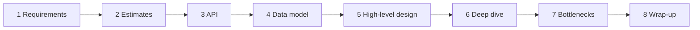

Read the diagram left to right. Each step feeds the next, and you can loop back when a new fact changes an earlier choice.

| Step | What you do | Rough time |
| --- | --- | --- |
| Requirements | Ask who uses it, what it must do, what is out of scope, and the non-functional goals | 5 min |
| Estimates | Users, requests per second, storage, bandwidth | 5 min |
| API | Main endpoints or events | 5 min |
| Data model | Entities, keys, which database type and why | 5 min |
| High-level design | Boxes and arrows for the main flow | 10 min |
| Deep dive | Go deep on the one or two hardest parts the interviewer cares about | 15 min |
| Bottlenecks | Single points of failure, hot spots, scaling limits | 5 min |
| Wrap-up | Trade-offs, what you would monitor, what you would improve | 5 min |

**What interviewers score**
- Clear thinking and structure.
- Good questions and sensible assumptions.
- Knowing building blocks (cache, queue, shard) and when not to use them.
- Honest trade-offs: "this costs us X, we accept it because Y".
- For a lead: the operational side, such as rollout, monitoring and team ownership.

**Common mistakes**
- Jumping into boxes and databases before asking a single question.
- Adding Kafka, Kubernetes and ten microservices for a small problem.
- Never stating a number, so no choice can be justified.
- Staying silent while thinking. Think aloud.

**Interview tip:** Say the plan out loud in the first minute ("I will clarify requirements, estimate scale, then sketch the API and the design, and we can deep dive where you prefer"). It shows control and lets the interviewer steer you to what they care about.

_Module: Approach & Estimation · Tags: framework, interview, fundamentals_

### 2. What is the difference between functional and non-functional requirements, and which non-functional ones matter most?

**Short answer:** Functional requirements say what the system does ("a user can post a message"). Non-functional requirements say how well it must do it: speed, availability, consistency, durability, scalability and cost. Non-functional goals drive the architecture far more than the features do.

Two systems with the same features can look completely different. A chat app for 1,000 office users and a chat app for 500 million people have the same functions but very different designs.

| Quality | Question to ask | Typical design impact |
| --- | --- | --- |
| Latency | How fast must a response be (p95, p99)? | Caches, CDN, closer regions |
| Availability | How much downtime is acceptable? | Redundancy, failover, multi-zone |
| Consistency | Can users see stale data for a moment? | Choice of database and replication |
| Durability | Can we ever lose data? | Replication, backups, write-ahead logs |
| Scalability | How many users, and how fast will it grow? | Sharding, stateless services, queues |
| Cost | What is the budget? | Storage tiers, fewer regions, simpler design |

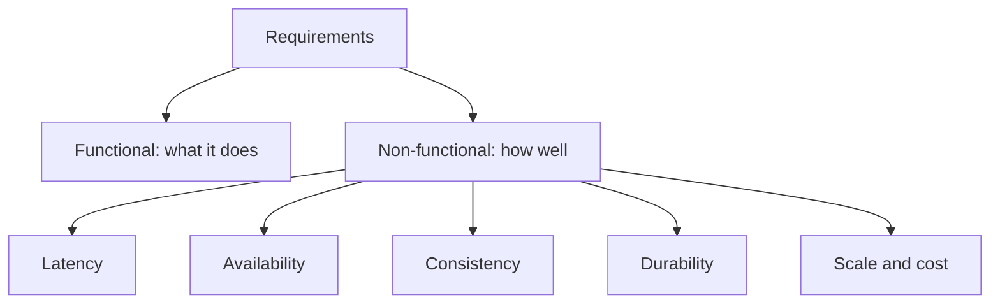

**How to ask in the interview**
- "How many daily users? Read heavy or write heavy?"
- "Is it acceptable if a new post appears after two seconds on another phone?"
- "Is losing one message ever acceptable?" (A like count: yes. A payment: never.)
- "Which matters more if we must choose: always responding, or always being correct?"

**Gotcha:** Not all parts of one system need the same level. In a shopping site the product catalogue can be eventually consistent and cached, while the payment must be strongly consistent and durable. Say this out loud; it shows maturity.

**Interview tip:** Write the top three non-functional goals on the board and refer back to them whenever you justify a choice ("because we chose availability over strict consistency here").

_Module: Approach & Estimation · Tags: requirements, non-functional, fundamentals_

### 3. How do you do back-of-the-envelope estimation for QPS, storage and bandwidth?

**Short answer:** Start from daily users, multiply by actions per user, divide by about 86,400 seconds in a day to get average requests per second, then multiply by a peak factor of two to five. Do the same for storage (items times size times retention, times replicas) and bandwidth (requests per second times response size). The numbers are rough; the goal is the right order of magnitude.

Rounding is encouraged. Use 100,000 seconds per day if it makes mental maths easier.

#### Worked example: a photo-sharing feed (rough, rounded figures)

| Item | Assumption | Result |
| --- | --- | --- |
| Daily active users | 10 million | |
| Feed views per user per day | 20 | 200 million reads per day |
| Average read QPS | 200 million divided by 86,400 | about 2,300 per second |
| Peak read QPS | times 3 | about 7,000 per second |
| New photos per day | 1 million at 500 KB | 500 GB per day |
| Storage per year | 500 GB times 365 | about 180 TB, times 3 replicas is about 550 TB |
| Read bandwidth | 7,000 per second times 100 KB average response | about 700 MB per second at peak |

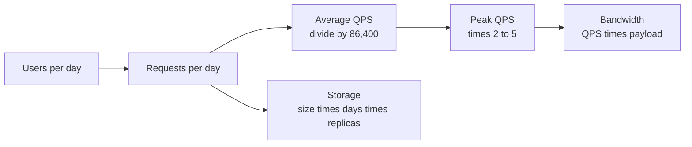

**What the numbers tell you**
- A few thousand reads per second: one good database with a cache can almost do it; you need replicas and caching for safety.
- Hundreds of terabytes: one machine cannot hold it, so you need object storage and sharding.
- 700 MB per second out: you must use a CDN; an origin server alone is too expensive.
- Read to write ratio of 200 to 1: optimise reads with caches.

**Common mistakes**
- Using average QPS for sizing. Systems fail at the peak.
- Forgetting replicas and growth. Add a growth factor for the next one to three years.
- Spending ten minutes on exact arithmetic. Say "roughly" and move on.

**Interview tip:** State the assumptions first and ask the interviewer to confirm them. Then use the result to make a decision aloud, for example "7,000 reads per second means one database is not comfortable, so I add a cache and read replicas".

_Module: Approach & Estimation · Tags: estimation, capacity, qps_

### 4. Which latency numbers should every engineer know when designing systems?

**Short answer:** Memory is about a thousand times faster than SSD, SSD is about a hundred times faster than a cross-continent network call, and a network call inside one data centre costs around half a millisecond. Knowing these rough ratios tells you why we cache, batch, and keep data close to users.

These are rounded, order-of-magnitude figures. Real hardware varies, so quote them as "about".

| Operation | Rough time |
| --- | --- |
| CPU cache or register access | about 1 nanosecond |
| Main memory read | about 100 nanoseconds |
| Read 1 MB sequentially from memory | tens of microseconds |
| SSD random read | about 100 microseconds |
| Round trip inside one data centre | about 0.5 milliseconds |
| Read 1 MB sequentially from SSD | about 1 millisecond |
| Spinning disk seek | about 10 milliseconds |
| Round trip between continents | 100 to 200 milliseconds |

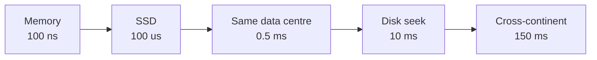

Each step to the right is a large jump in cost. Design so most requests stay on the left side.

**What you learn from them**
- A cache hit in Redis (one network hop, so about a millisecond) is far cheaper than a database query that touches disk.
- Sequential reads are much faster than random reads, so logs and append-only storage are fast.
- Chatty services hurt. Ten sequential calls at 0.5 ms each is already 5 ms before any work is done.
- Users in India calling a database in Virginia pay at least 150 ms on every round trip, so use CDNs, regional replicas and fewer round trips.
- Compressing data before sending it is usually worth the CPU time.

**Gotcha:** Averages hide trouble. Always talk about p95 and p99 latency. One slow dependency in a chain of ten calls will dominate the tail.

**Interview tip:** You do not need to recite exact numbers. Say "memory is nanoseconds, SSD is microseconds, a network hop is a millisecond, a cross-region hop is a hundred milliseconds", and use them to justify a cache or a regional deployment.

_Module: Approach & Estimation · Tags: latency, estimation, performance_

### 5. What is the difference between vertical and horizontal scaling?

**Short answer:** Vertical scaling (scale up) means a bigger machine: more CPU, memory and disk. Horizontal scaling (scale out) means more machines behind a load balancer. Vertical is simple but has a ceiling and a single point of failure. Horizontal scales much further and survives machine loss, but the application must be designed for it.

| | Vertical (scale up) | Horizontal (scale out) |
| --- | --- | --- |
| How | Bigger server | More servers |
| Code change | Usually none | Often needed: stateless services, shared storage |
| Limit | Largest machine you can buy | Practically very high |
| Failure | One machine, one failure point | Lose a node, others continue |
| Cost curve | Gets expensive at the top end | Roughly linear with commodity machines |
| Good for | Databases at first, quick fixes | Web and API tiers, workers |

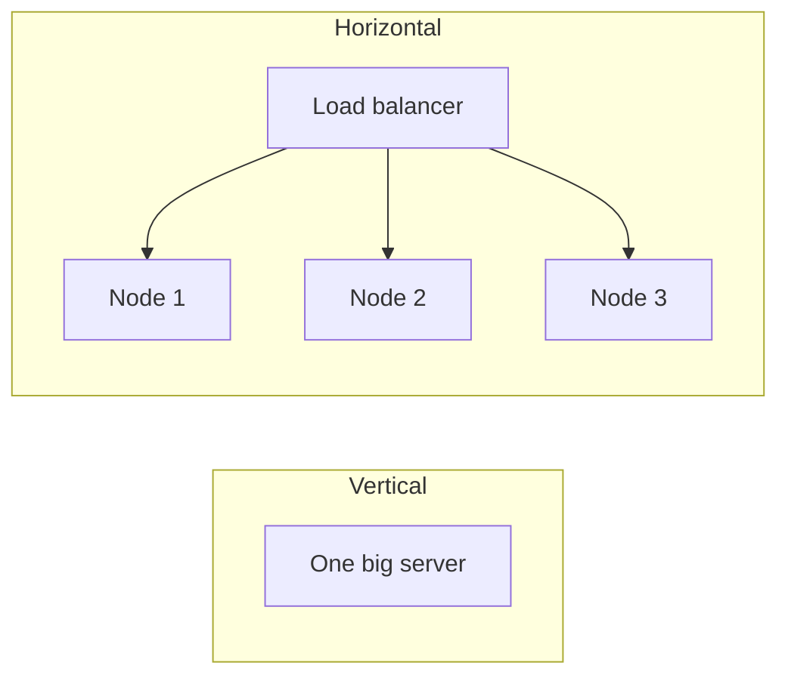

On the left, one machine grows. On the right, many equal machines share the traffic.

**What makes horizontal scaling hard**
- State: sessions, files and caches living on one server break when requests land on another. Move state to shared stores.
- Data: a database cannot just be copied. You need replication and sharding.
- Coordination: more nodes mean more network calls and more partial failures.

**Practical advice:** scale the stateless tiers horizontally from day one, because it is cheap to do. Scale the database vertically as long as it is comfortable, then add read replicas, then caching, and shard only when needed. Sharding adds permanent complexity.

**Gotcha:** Autoscaling adds nodes only if the bottleneck is the thing you scale. If every node waits on one database, more web servers make it worse.

**Interview tip:** Say "vertical first for the database, horizontal for stateless services, and I would find the real bottleneck before adding anything".

_Module: Scaling Building Blocks · Tags: scaling, fundamentals_

### 6. How do load balancers work, and what is the difference between L4 and L7?

**Short answer:** A load balancer spreads incoming traffic across several servers, removes unhealthy ones, and gives clients one stable address. A layer 4 balancer routes by IP address and port without reading the request. A layer 7 balancer reads the HTTP request and can route by path, header or cookie.

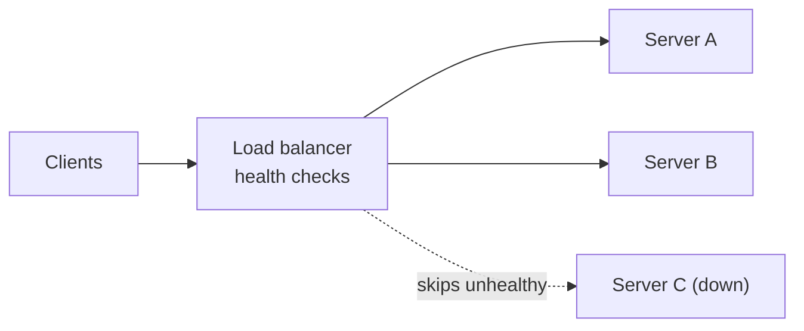

The balancer sends traffic only to servers that pass health checks.

| | L4 (transport) | L7 (application) |
| --- | --- | --- |
| Sees | IP, port, TCP or UDP | URL, headers, cookies, gRPC methods |
| Speed | Very fast, little CPU | Slower, needs to parse requests |
| Features | Simple spreading | Path routing, TLS termination, rate limits, retries, canary splits |
| Use for | Raw TCP, databases, very high throughput | Web and API traffic, microservices |

**Common algorithms**
- Round robin: take turns. Fine when requests cost the same.
- Weighted round robin: bigger servers get more.
- Least connections: send to the server with the fewest active requests. Better for uneven requests.
- IP or key hash: the same client reaches the same server. Useful for caches and sticky sessions.
- Power of two choices: pick two servers at random and send to the less loaded one. Simple and works well at scale.

**Health checks**
- Active: the balancer calls `/healthz` every few seconds.
- Passive: the balancer notices errors and timeouts from real traffic.
- Keep the check cheap and meaningful. A check that only returns 200 while the database is down hides real problems; a check that calls the database can take everything down if the database blips.

**Gotchas**
- The load balancer itself must not be a single point of failure: run several, with DNS or anycast in front, or use a managed one.
- Sticky sessions make scaling and failover harder. Prefer stateless servers.
- Long-lived connections (WebSockets) need least-connections and a graceful drain on deploy.

**Interview tip:** Mention that you can put balancers at several layers: DNS or global balancing between regions, then an L7 balancer per region, then service-to-service balancing inside the cluster.

_Module: Scaling Building Blocks · Tags: load-balancer, networking, scaling_

### 7. How does caching work, and what are the common write strategies and eviction policies?

**Short answer:** A cache keeps copies of frequently used data in a fast store so you avoid slow work. Caches can live in the browser, CDN, application memory, or a shared store like Redis. The common read pattern is cache-aside: check the cache, on a miss read the database and fill the cache. The hard part is keeping the cache fresh, and the standard tools are expiry (TTL) and explicit invalidation.

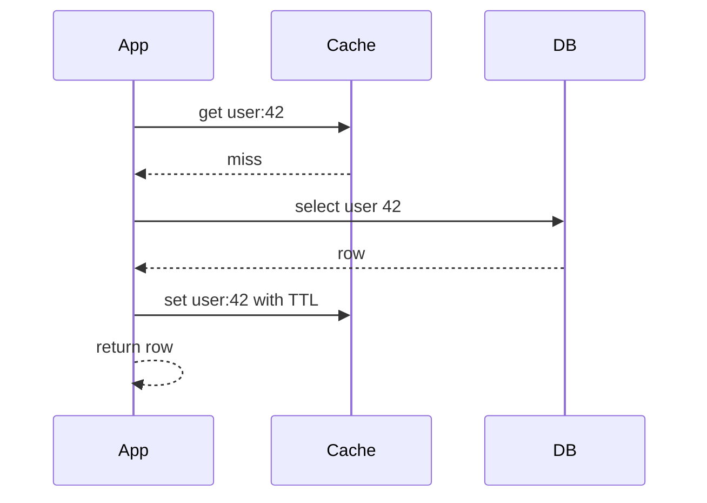

This is cache-aside. The application controls the cache; the database does not know about it.

| Strategy | How writes work | Good for | Risk |
| --- | --- | --- | --- |
| Cache-aside | App writes DB, then deletes or updates the cache | General use | Brief stale reads |
| Write-through | Write goes to cache and DB together | Data read right after write | Slower writes |
| Write-back | Write goes to cache, DB later in batches | Very write-heavy, tolerates loss | Data loss if cache dies |
| Write-around | Write to DB only, cache fills on read | Data rarely re-read | First read is a miss |

**Eviction policies:** when the cache is full, something must go.
- LRU: remove the least recently used. A good default.
- LFU: remove the least frequently used. Good when popularity is stable.
- FIFO and random are simple but rarely best.
- TTL: every entry expires after a set time, which also limits staleness.

**What to cache:** read-heavy, expensive to compute, rarely changing data: profiles, product pages, config, rendered fragments. **Do not cache:** data that must be exactly right every time, such as account balances during a payment, or data that is rarely re-read.

**Gotchas**
- Stale data: pick a TTL from the business, not from habit.
- Cache stampede when a hot key expires and thousands of requests hit the database.
- A cache is not a source of truth. The system must still work, slowly, when the cache is empty or down.

**Interview tip:** Say "cache-aside with a TTL and delete-on-write" as the default, then name the problem it creates (staleness or stampede) before the interviewer asks.

_Module: Scaling Building Blocks · Tags: caching, performance, fundamentals_

### 8. What is a CDN, and when should you use one?

**Short answer:** A content delivery network is a set of servers around the world that keep copies of your content close to users. Users download from a nearby edge server instead of your faraway origin. It cuts latency, reduces load and bandwidth on your servers, and absorbs traffic spikes.

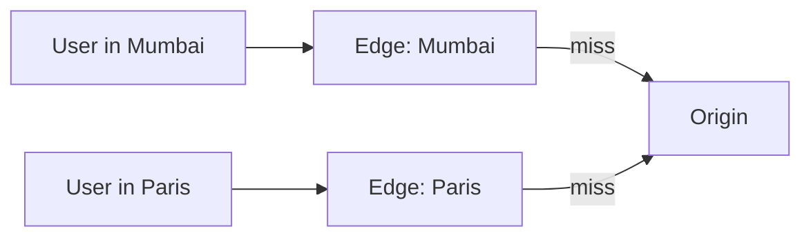

On a hit the edge answers at once. On a miss it fetches from the origin, stores a copy, and serves later users from it.

**Good fits**
- Static files: images, JavaScript, CSS, fonts.
- Video segments and large downloads.
- Public API responses that change slowly.
- Protection: many CDNs also give TLS termination and basic attack filtering.

**Pull vs push**

| Model | How content arrives | Use when |
| --- | --- | --- |
| Pull | Edge fetches from origin on first request | Most websites, simple |
| Push | You upload content to the CDN ahead of time | Big files released at known times, such as a video release |

**Controlling freshness**
- Set `Cache-Control` headers with a max age.
- Put a content hash in file names (`app.3f9a1c.js`) so every release has a new URL and old copies simply stop being used.
- Purge (invalidate) by URL for urgent fixes. It is slow and sometimes costly, so avoid depending on it.

**Gotchas**
- Do not cache personal or private responses on a shared edge by mistake. Use `private` or no-store for those.
- Cost: egress is cheaper than your origin, but not free. Check cache hit ratio.
- Low hit ratio means the CDN adds a hop and no value.

**Interview tip:** Link it to numbers: "700 MB per second at peak is impossible from origin, so static assets and video go through a CDN, and the origin only sees misses."

_Module: Scaling Building Blocks · Tags: cdn, caching, edge_

### 9. How do you choose between SQL and NoSQL databases?

**Short answer:** Choose by access pattern and consistency needs, not by fashion. Relational (SQL) databases give joins, transactions and a strict schema, and are the right default. NoSQL databases trade some of that for easier horizontal scale, flexible data shape or very fast simple lookups. Many systems use both.

| Type | Examples (concept) | Strength | Weakness |
| --- | --- | --- | --- |
| Relational | PostgreSQL, MySQL, SQL Server | Transactions, joins, constraints, mature tooling | Harder to scale writes horizontally |
| Key-value | Redis, DynamoDB-style stores | Very fast lookups by key, easy sharding | No rich queries |
| Document | MongoDB-style stores | Flexible nested data, one read per object | Joins and cross-document transactions are weaker |
| Wide-column | Cassandra-style stores | Huge write throughput, time-ordered data | Must design tables around queries |
| Graph | Neo4j-style stores | Relationship queries | Niche, harder to scale |
| Search | Elasticsearch-style engines | Text search, filtering | Not a primary store |

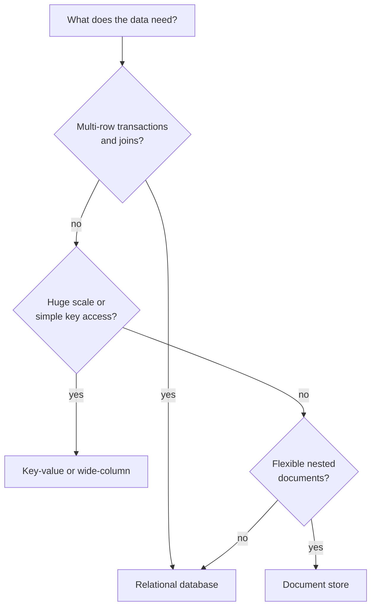

**Rules of thumb**
- Start with a relational database unless you have a reason not to. One well-tuned PostgreSQL handles far more than most people expect.
- Choose NoSQL when you know the queries in advance, need write scale beyond one node, or the data is naturally a document or a time series.
- Money, orders, inventory: relational with transactions.
- Sessions, counters, caches: key-value.
- Do not pick a database only because "it scales". Sharding a relational database is possible, and some NoSQL stores are painful when requirements change.

**Gotcha:** "NoSQL means no schema" is false. The schema simply lives in your code, and migrations become your problem.

**Interview tip:** Name the access pattern first ("lookup by id, 50 to 1 reads, no joins"), then the database, then the trade-off you accept. Mention polyglot persistence: right store for each job.

_Module: Data & Storage · Tags: database, sql, nosql_

### 10. How does database replication work, and when do you add read replicas?

**Short answer:** Replication copies data from one database node (the primary or leader) to others (replicas or followers). Replicas give you extra read capacity and a standby for failover. The price is replication lag: a replica may be slightly behind the primary.

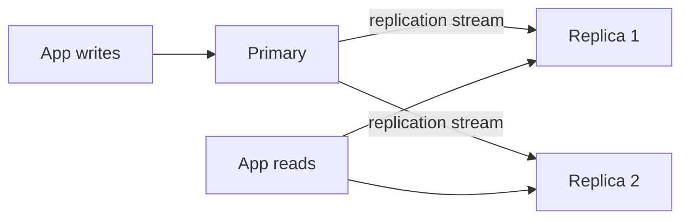

All writes go to the primary. Reads can be spread over replicas.

| Mode | How it behaves | Trade-off |
| --- | --- | --- |
| Asynchronous | Primary confirms the write, replicas catch up later | Fast, but a crash can lose the last writes and replicas are stale |
| Synchronous | Primary waits for at least one replica | No loss on failover, slower writes, blocked if replica is down |
| Semi-synchronous | One replica synchronous, others async | Common balance |

**When to add read replicas**
- The workload is read heavy and the primary is busy with reads.
- You want reports and analytics off the primary.
- You want a warm standby in another zone or region.

**Problems you must handle**
- Read-your-writes: a user saves a profile, the next read hits a lagging replica and shows old data. Fix by reading from the primary for a short time after a write, or by tracking a version.
- Failover: promote a replica when the primary dies, and make sure the old primary does not come back as a second leader (split brain).
- Replicas do not help with write scale. For that you need sharding.

**Gotcha:** Replication is not a backup. A bad `DELETE` is copied to every replica within moments. You still need point-in-time backups.

**Interview tip:** Mention lag explicitly and say which user flows need the primary: "after checkout, the order page reads from the primary; the product listing reads from replicas."

_Module: Data & Storage · Tags: replication, database, availability_

### 11. What are partitioning and sharding, and how do you choose a shard key?

**Short answer:** Partitioning splits a big dataset into smaller pieces. When the pieces live on different machines it is called sharding. It lets storage and write traffic scale beyond one machine. The shard key decides which piece each row lives in, and a bad key creates hot spots.

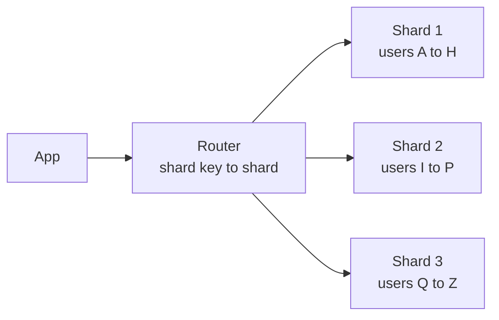

The router uses the key (for example user id) to find the right shard.

| Method | How | Good | Bad |
| --- | --- | --- | --- |
| Range | Key ranges per shard | Range queries are cheap | Hot ranges (newest ids, popular names) |
| Hash | Hash of key mod N or consistent hashing | Even spread | Range queries touch all shards |
| Directory | A lookup table maps key to shard | Flexible, can move tenants | The lookup is a new dependency |

**Choosing a shard key**
- High cardinality: many distinct values, so data spreads evenly.
- Matches the main access pattern: most queries should hit one shard.
- Does not create hot spots: a timestamp key sends all new writes to one shard.
- Stable: changing a key later means moving data.

**What gets harder after sharding**
- Joins and transactions across shards.
- Secondary indexes (a query by email when you sharded by user id).
- Re-sharding when you outgrow the shard count. Plan it early; consistent hashing or many small logical shards help.
- Operations: backups, schema changes and monitoring multiply.

**Gotcha:** Do not shard too early. Try a bigger machine, indexes, caching and read replicas first. Sharding is a one-way door.

**Interview tip:** Always state the shard key and say what query becomes expensive because of it. For a multi-tenant product, "shard by tenant id" is often the answer, and a very large tenant becomes the hot-shard problem to discuss.

_Module: Data & Storage · Tags: sharding, partitioning, database_

### 12. What are strong and eventual consistency, and what does the CAP theorem say in plain words?

**Short answer:** Strong consistency means every read sees the latest write. Eventual consistency means replicas may disagree for a short time but will converge if no new writes arrive. The CAP theorem says that when a network partition happens, a distributed system must choose between staying consistent (refuse some requests) or staying available (answer, maybe with stale data).

Partitions are not optional: networks do fail, so the real choice is what to give up during a failure. When there is no partition you can usually have both consistency and availability.

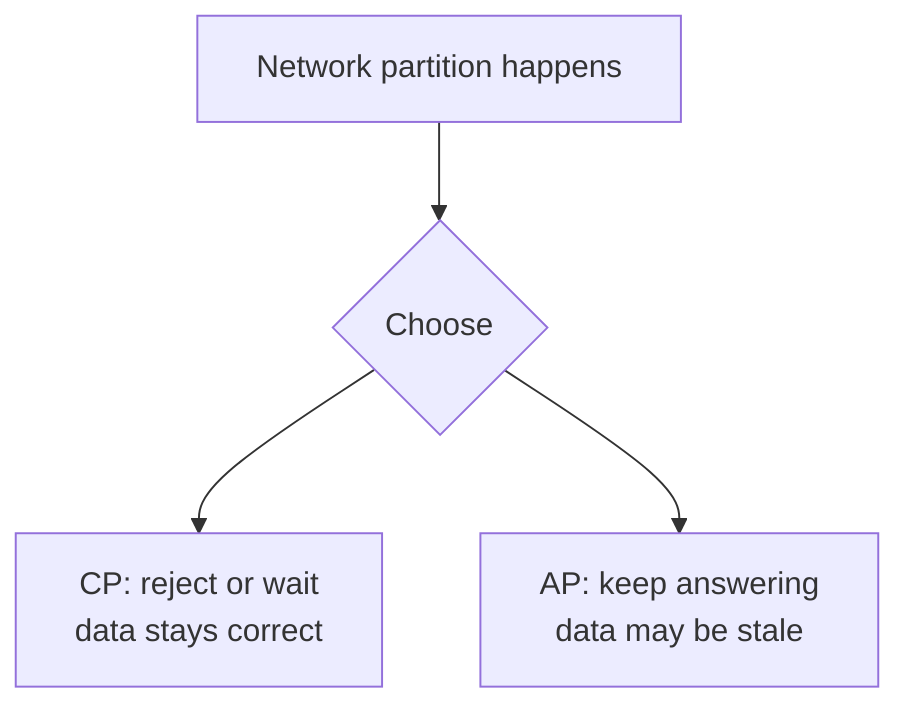

| | CP style | AP style |
| --- | --- | --- |
| During a partition | Some requests fail or wait | Every node answers |
| Data | Always the latest | May be stale, merged later |
| Fits | Payments, inventory counts, leader election, locks | Feeds, likes, product catalogue, shopping cart |

**Consistency levels in practice**
- Strong (linearizable): behaves like a single copy. Costs latency because nodes must coordinate.
- Read-your-writes: you see your own updates, others may lag.
- Eventual: fastest and most available, needs conflict handling (last write wins, version vectors, merge rules).

Example: a like counter can be a few seconds behind, so eventual is fine. A seat booking must never sell the same seat twice, so choose strong.

**Gotcha:** CAP is often misquoted as "pick any two". Consistency here means a strict single-copy view, not the "C" of database ACID. The latency trade-off (even without partitions, strong consistency is slower) is covered by the PACELC idea.

**Interview tip:** Do not announce "I choose AP" for the whole system. Say which operations need strong consistency and which can be eventual, as the earlier shopping example shows.

_Module: Data & Storage · Tags: consistency, cap, distributed-systems_

### 13. Why use message queues, and what problems do they solve?

**Short answer:** A message queue sits between a producer and a consumer so that work can be done asynchronously. It decouples services, absorbs traffic bursts, lets consumers work at their own speed, and allows retries. The cost is extra complexity and eventual results instead of instant ones.

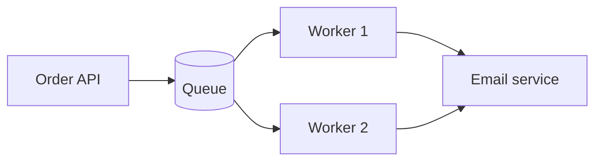

The API returns quickly after putting a message on the queue. Workers process messages in the background.

**What you gain**
- Spike smoothing: 10,000 sign-ups in a minute are queued and processed steadily.
- Decoupling: the producer does not need the consumer to be up.
- Retries and dead-letter queues: failed messages are retried and then parked for a human to inspect.
- Scaling workers independently from the API.

| | Queue (work distribution) | Pub/sub topic (broadcast) |
| --- | --- | --- |
| Each message goes to | One consumer in the group | Every subscriber |
| Example | Resize an image | "Order placed" read by billing and email |

**Delivery guarantees**
- At most once: may lose messages.
- At least once: never loses, but may deliver twice. This is the common default, so consumers must be idempotent.
- Exactly once: really means at-least-once plus idempotent processing.

**Gotchas**
- Ordering is usually guaranteed only within a partition or queue, not globally.
- A growing queue is a symptom. Monitor queue depth and message age, and alert.
- Poison messages that always fail can block a queue. Use a retry limit and a dead-letter queue.

**Interview tip:** Say when you would not use one: when the user needs the result in the same request and the work is fast, a direct call is simpler.

_Module: Messaging & Streaming · Tags: queue, messaging, async_

### 14. What is a stateless service, and how do you handle sessions in a scalable system?

**Short answer:** A stateless service keeps no user-specific data in its own memory between requests. Any instance can serve any request, so you can add, remove or restart instances freely. Session data moves to a shared store, or into a signed token held by the client.

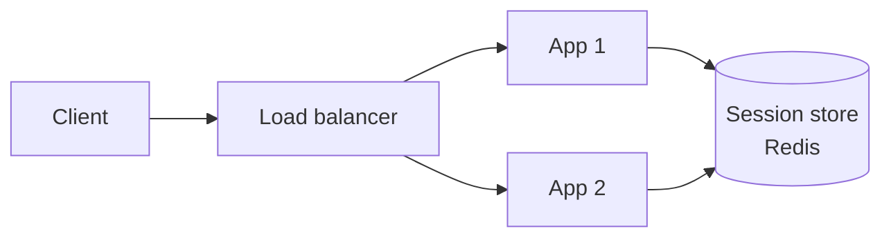

Both instances read the same session store, so it does not matter which one gets the request.

| Option | How | Pros | Cons |
| --- | --- | --- | --- |
| Sticky sessions | Balancer pins a user to one server | No code change | Uneven load, lost sessions when a server dies |
| Shared session store | Session id in a cookie, data in Redis or a database | Simple, easy to revoke | One more dependency, a network hop |
| Signed token (JWT) | Claims signed and kept by the client | No lookup, scales well | Hard to revoke early, larger requests, secrets must be guarded |

**What else must not live on the instance**
- Uploaded files: use object storage.
- In-memory caches that must be consistent: use a shared cache, or accept per-instance caching for harmless data.
- Scheduled jobs: use a single scheduler or leader election so ten instances do not run the job ten times.
- Local disk state: containers can disappear at any time.

**Why it matters:** statelessness gives easy horizontal scaling, rolling deploys, autoscaling and simple failure recovery. Kubernetes assumes it for Deployments.

**Gotcha:** Not everything can be stateless. Databases, caches and WebSocket gateways hold state. The design goal is to keep state in a few well-understood places.

**Interview tip:** If asked about JWT versus sessions, say you would use short-lived access tokens with a refresh token so that revocation is possible within minutes.

_Module: Scaling Building Blocks · Tags: stateless, sessions, scaling_

### 15. What are the basics of good API design: REST, pagination, idempotency and versioning?

**Short answer:** Good APIs are consistent, predictable and safe to retry. Use nouns for resources, the right HTTP verbs and status codes, cursor-based pagination for large lists, idempotency keys for operations that must not run twice, and a clear versioning plan so you can change without breaking clients.

**Resources and verbs**
- `GET /orders/42` reads, `POST /orders` creates, `PUT` replaces, `PATCH` changes part, `DELETE` removes.
- `GET`, `PUT` and `DELETE` are idempotent by definition. `POST` is not.
- Use correct status codes: 200, 201, 204, 400, 401, 403, 404, 409 for a conflict, 429 for rate limits, 5xx for server faults.

**Pagination**

| Style | How | Problem |
| --- | --- | --- |
| Offset and limit | `?offset=1000&limit=20` | Slow for deep pages, shifts when rows are added |
| Cursor (keyset) | `?after=<opaque token>&limit=20` | Cannot jump to page 50, but fast and stable |

**Idempotency:** the client sends `Idempotency-Key: <uuid>` on a `POST /payments`. The server stores the key with the result. If the network fails and the client retries, the server returns the stored result instead of charging twice.

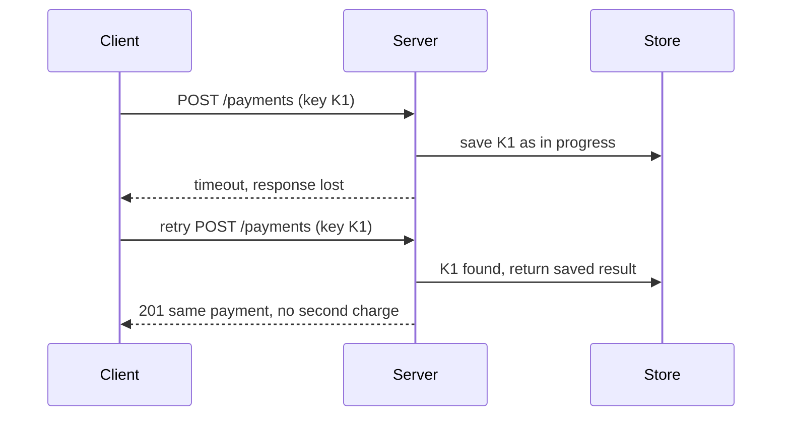

**Versioning**
- Put the version in the path (`/v1/orders`) or a header. Path is easiest to see and route.
- Prefer additive changes: new optional fields do not break clients. Never remove or change the meaning of a field without a new version.
- Announce deprecation with dates and measure who still calls the old version.

**Other habits:** consistent error body with a code and message, request ids in responses for tracing, rate limit headers, and input validation at the edge.

**Gotcha:** Offset pagination on a growing table gives duplicated or missing items between pages. Use a cursor on a stable sort key.

**Interview tip:** When the interviewer says "design the API", write three or four endpoints with request and response fields. That is enough to show you can think in contracts.

_Module: API & Communication · Tags: api, rest, pagination, idempotency_

### 16. How do you calculate availability, and how do nines and SLA composition work?

**Short answer:** Availability is the percentage of time a service works. Each extra nine cuts allowed downtime by ten. When services depend on each other in a chain, their availabilities multiply, so the whole is worse than any single part. Redundancy in parallel improves availability.

| Availability | Downtime per year (about) | Per month (about) |
| --- | --- | --- |
| 99% | 3.7 days | 7 hours |
| 99.9% | 8.8 hours | 43 minutes |
| 99.99% | 53 minutes | 4.3 minutes |
| 99.999% | 5 minutes | 26 seconds |

**In series (a chain):** if a request needs the gateway (99.9%), the service (99.9%) and the database (99.9%), the result is about 0.999 times 0.999 times 0.999, so roughly 99.7%. That is about 26 hours of downtime a year, from three "three nines" parts.

**In parallel (redundant copies):** two independent copies each at 99% give 1 minus 0.01 times 0.01, which is 99.99%, if failures are truly independent and failover works.

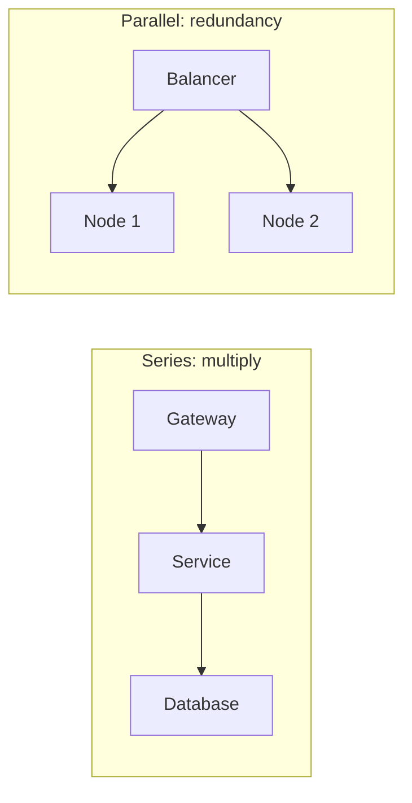

**How to raise availability**
- Remove single points of failure with replicas in several zones.
- Make non-critical dependencies optional (graceful degradation), so they leave the chain.
- Use timeouts, retries and circuit breakers.
- Reduce time to recover: automated failover, quick rollbacks, good alerts. Availability is also mean time to repair, not only how rarely things break.

**Terms to know:** SLI is a measured indicator (percentage of requests under 300 ms and not failing), SLO is your internal target for it, SLA is the contract with customers, often with refunds. Set the SLO tighter than the SLA.

**Gotcha:** Planned maintenance, bad deploys and expired certificates cause more outages than hardware. Count them.

**Interview tip:** Do the series multiplication aloud. It shows why a system with many microservices needs fallbacks.

_Module: Reliability & Resilience · Tags: availability, sla, reliability_

### 17. What is a single point of failure, and how do you find and remove them?

**Short answer:** A single point of failure (SPOF) is any component whose failure takes down the whole system. You find them by walking through the request path and asking "what if this dies?" You remove them with redundancy, failover and by removing hard dependencies.

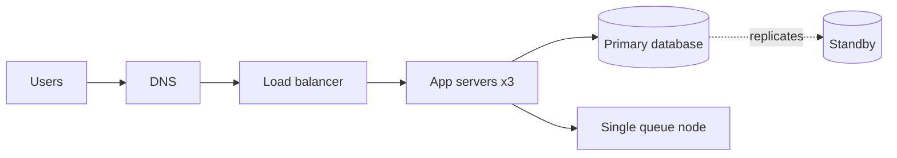

In this picture the single queue node and the lone primary are SPOFs. The app servers are not, because there are three.

**How to find them**
- Draw the full request path including DNS, certificates, the identity provider, secrets store, CI pipeline and the one engineer who knows the system.
- Ask "what if this is down for ten minutes? For an hour?"
- Run game days and chaos tests: switch one thing off in staging, then in production when safe.

**How to remove them**

| SPOF | Fix |
| --- | --- |
| One server | Several instances behind a balancer, in different zones |
| One load balancer | Managed or paired balancers, anycast or DNS failover |
| One database | Replica with automatic failover; multi-zone |
| One zone | Spread across zones; one region failing is a business decision |
| Shared dependency (auth, config) | Cache its data locally, fail open or degrade where safe |
| Manual step | Automate with runbooks and tested scripts |

**Gotchas**
- Redundancy that was never tested is not redundancy. Failover must be practised.
- Hidden shared fate: two "independent" replicas on the same disk array or the same cloud zone fail together.
- Redundancy has a cost, so match it to the business value. Not every service needs three regions.
- Coordination services (leader election, locks) are small but critical. Protect them.

**Interview tip:** After drawing your design, circle your own SPOFs and say how you would remove each. Interviewers love hearing you attack your own diagram.

_Module: Reliability & Resilience · Tags: spof, redundancy, reliability_

## Intermediate

### 18. [Tech Lead] How do you run an effective design review?

**Short answer:** A good design review finds risks early, spreads knowledge and leaves the author with clear decisions, not bruises. Share the written design first, ask reviewers to comment before the meeting, spend the meeting only on the hard questions, and end with recorded decisions and owners.

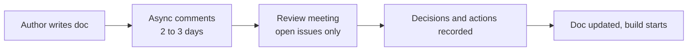

**Before the meeting**
- Author states the problem, goals, non-goals and options considered.
- Invite the people who will build it, run it, secure it and depend on it. Keep the group small, four to six people.
- Reviewers read first and leave comments. The meeting is not a reading session.

**In the meeting**
- Start with a two-minute summary by the author.
- Go through open comments by risk, biggest first.
- Review the design, not the person. Use "what happens if the queue is down?" not "you forgot the queue".
- Time-box each debate. If two people disagree after ten minutes, record both views and decide who owns the call.

**What a lead asks**
- Is the problem clear, and is this the simplest design that solves it?
- What are the failure modes, the scale limits and the data ownership?
- How will we test, deploy, monitor and roll back?
- What does this cost to run and to maintain?
- What would make us change our mind?

| Smell | Better habit |
| --- | --- |
| Review after the code is written | Review at the design stage, and again for risky changes |
| Loudest voice wins | Written comments first, a named decision owner |
| Nitpicking names and diagrams | Focus on risks, interfaces and irreversible choices |
| No follow up | Action list with owners in the doc |

**Gotcha:** Too many reviews slow teams. Keep a light path for small changes (a short note in the pull request) and a full review for new services, data models, public APIs and anything hard to reverse.

**Interview tip:** Say that you review designs the way you want yours reviewed: written, kind, specific, and focused on trade-offs. Mention that you ask juniors to present so they learn.

_Module: Design Leadership · Tags: tech-lead, design-review, process_

### 19. [Tech Lead] How do you write a design document or RFC, and what should a good template contain?

**Short answer:** A design doc is a short, structured argument that explains the problem, the proposed solution, the alternatives and the risks, so others can challenge it before code is written. It should be readable in ten to fifteen minutes and kept alongside the code.

#### A practical template

```text
Title, author, reviewers, status (draft, in review, approved), date

1. Context and problem     Why now? Who is affected? Link to data or incidents.
2. Goals and non-goals     What success looks like, and what we will NOT do.
3. Requirements            Functional, plus numbers: QPS, latency, availability, data size.
4. Proposed design         Diagram, API, data model, main flows.
5. Alternatives considered Each with pros, cons, and why rejected.
6. Trade-offs and risks    What could go wrong, how we detect and recover.
7. Security and privacy    Data classification, access, secrets.
8. Rollout plan            Phases, feature flags, migration, rollback.
9. Observability           Metrics, logs, alerts, dashboards, SLOs.
10. Open questions         What we still do not know, and who will find out.
```

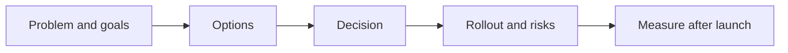

**What makes it good**
- Non-goals prevent scope creep. They are the most underused section.
- Real numbers. "Fast" is not a requirement; "p95 under 300 ms at 2,000 requests per second" is.
- Honest alternatives, including "do nothing". If you only list straw men, reviewers notice.
- One diagram of the main flow and one of the data model.
- Short. Link to details instead of pasting them.

**Common mistakes**
- Writing it after the code to justify the decision.
- Describing the solution without the problem.
- Hiding risks. Naming them builds trust.
- Never updating the doc, so it lies. Mark it superseded when the design changes.

**Interview tip:** Say you write a doc when a change is hard to reverse, touches several teams, or costs more than a few weeks. For smaller work a paragraph in the ticket is enough. Writing is thinking: many flaws show up while drafting.

_Module: Design Leadership · Tags: tech-lead, design-doc, rfc_

### 20. [Tech Lead] How do you make and record architecture decisions with ADRs, and handle disagreement?

**Short answer:** An Architecture Decision Record (ADR) is a short note that captures one decision: the context, the options, the choice, and the consequences. It explains the "why" long after people have forgotten it. For disagreements, gather facts, name the decision owner, commit to the decision, and set a date to review the outcome.

#### A short ADR

```text
ADR-014: Use Postgres for the order service
Status: accepted   Date: 2026-03-02   Deciders: platform team

Context: Orders need transactions and reporting joins. Expected 500 writes per second.
Options: 1) Postgres  2) DynamoDB-style store  3) MongoDB-style store
Decision: Postgres on managed service, single primary with two replicas.
Consequences: Good: transactions, team knows it. Bad: write scale limit
(revisit at 5,000 writes per second). Reversible with effort: medium.
```

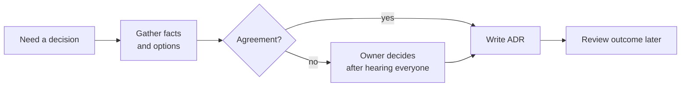

**Handling disagreement**
- Separate facts from opinions. Can a quick test, a prototype or a number settle it?
- Ask each side to state the other's argument fairly. It lowers heat.
- Decide on criteria first (cost, time, team skill, risk), then score the options.
- Classify the decision: easy to reverse (decide quickly, one person) or hard to reverse (more discussion).
- Use "disagree and commit": once the owner decides, everyone supports it. Record the dissent in the ADR.
- Set a trigger to revisit: "if latency exceeds X or cost passes Y, we reopen this".

**When to write one:** database or messaging choice, framework or language, API style, deployment model, anything a new joiner will ask "why did we do this?" about.

**Gotchas**
- ADRs are immutable history. When a decision changes, write a new ADR that supersedes the old one.
- Do not write them for trivial choices; the habit dies from noise.
- Store them in the repository next to the code so that they are found.

**Interview tip:** Mention a time you changed your mind because of evidence. Leads who can say "I was wrong, here is what the data showed" are trusted more.

_Module: Design Leadership · Tags: tech-lead, adr, decision-making_

### 21. [Tech Lead] How do you evaluate build versus buy and compare technology choices?

**Short answer:** Build what makes your product different; buy or reuse what is a commodity. Compare options against explicit criteria, count the full cost over several years including operations and people, test the finalists with a small proof of concept, and plan an exit.

| Criterion | Questions |
| --- | --- |
| Fit | Does it meet the must-have requirements and scale numbers? |
| Differentiation | Is this core to our value, or plumbing? |
| Total cost | Licence, hosting, engineers to run it, on-call, training, upgrades |
| Time to value | Weeks to adopt versus months to build |
| Risk | Vendor viability, security, compliance, data residency |
| Lock-in | How hard is it to leave? Open formats and standard APIs help |
| Team skills | Can we hire for it and operate it at 3 a.m.? |
| Ecosystem | Community, support, release health |

```mermaid
flowchart TD
    A["Need a capability"] --> B{"Core to our<br/>differentiation?"}
    B -- yes --> C["Lean toward build"]
    B -- no --> D{"Good off-the-shelf<br/>or managed option?"}
    D -- yes --> E["Buy or use managed"]
    D -- no --> C
    C --> F["Proof of concept<br/>and exit plan"]
    E --> F
```

**Method**
1. Write the requirements and the must-haves versus nice-to-haves.
2. Shortlist two or three options, plus "build".
3. Run a time-boxed proof of concept on the riskiest part, with real data shapes.
4. Score against the criteria, and write an ADR with the decision.
5. Define the exit: how would we migrate away, and what is the trigger?

**Hidden costs people forget**
- A built system needs a team forever: security patches, upgrades, on-call.
- A bought product needs integration, configuration and vendor management, and prices can rise.
- Self-hosting an open-source tool (for example a message broker) often costs more than the managed service.

**Gotchas**
- Resume-driven development: choosing a trendy tool nobody on the team can run.
- Underestimating "we can build that in a month".
- Ignoring the boring option that already works.

**Interview tip:** Give one example from your own work, such as choosing a managed Kubernetes service on Azure over running the control plane yourself, and say what you used to decide.

_Module: Design Leadership · Tags: tech-lead, build-vs-buy, technology-choice_

### 22. [Tech Lead] How do you design for evolvability without over-engineering?

**Short answer:** Keep flexible the things that are expensive to change later: data formats, public contracts, boundaries between components. Stay simple everywhere else and build what you need now (YAGNI, "you aren't going to need it"). Aim for easy to change, not for "supports everything".

**Hard to change later, so design carefully**
- Public APIs and event schemas, because other teams depend on them.
- Data model and identifiers: renaming a column on a billion rows is a project.
- Service boundaries and who owns which data.
- Security and tenancy model.

**Easy to change later, so keep it simple**
- Internal implementation of one service.
- Choice of library, as long as it is wrapped at the edge.
- Scale features such as sharding or multi-region before you need them, if the design does not block them.

```mermaid
flowchart LR
    A["Decision"] --> B{"Cost to change later?"}
    B -- high --> C["Invest now:<br/>contracts, IDs, boundaries"]
    B -- low --> D["Keep simple,<br/>decide later"]
```

**Techniques that buy flexibility cheaply**
- Versioned and additive APIs and schemas.
- Use opaque IDs (UUIDs or ULIDs), not meaningful ones.
- Put third-party providers behind a small interface (payments, email) so swapping is possible. Do not build a full abstraction layer for providers you will never swap.
- Feature flags to decouple deploy from release.
- Keep a path to scale: stateless services, a shard-friendly key, but no sharding yet.
- Small, deployable steps instead of big-bang rewrites.

**Signs of over-engineering:** plugin systems with one plugin, config for every option, three layers of abstraction around a database call, generic "frameworks" built before the second use case. A rule of thumb: abstract on the third repetition, not the first.

**Gotcha:** The opposite fault also hurts: hard-coding tenant ids or airline names so that adding the second customer needs a rewrite. Model the dimension (tenant, region, customer) even if you only have one value today.

**Interview tip:** Say "I make the one-way doors careful and the two-way doors quick". It shows judgement about reversibility.

_Module: Design Leadership · Tags: tech-lead, evolvability, yagni_

### 23. [Tech Lead] How do you estimate effort and risk for a system design?

**Short answer:** Break the work into small pieces, estimate each as a range, add the unknowns explicitly, and attack the riskiest assumptions first with spikes. Give the range and your confidence, not a single date. Re-estimate as you learn.

```mermaid
flowchart LR
    A["Break down work"] --> B["Estimate each as a range"] --> C["List risks and unknowns"] --> D["Spike the riskiest"] --> E["Commit to a range with confidence"] --> F["Re-estimate at milestones"]
```

**Steps**
1. Split by deliverable, not by layer: a thin working path first (walking skeleton), then breadth.
2. For each item give best, likely and worst case. A wide range means "I do not know yet", which is information.
3. Add work people forget: testing, migration, observability, security review, documentation, on-call training, rollout.
4. Add a buffer for integration and unknown unknowns, often 20 to 40 percent for new areas.
5. Identify the risks: new technology, external dependencies, data migration, performance targets, unclear requirements.
6. Run time-boxed spikes (one to three days) on the scariest items. A spike answers a question; it is not production code.

| Risk type | Example | Mitigation |
| --- | --- | --- |
| Technical | Can the database take 5,000 writes per second? | Load test a prototype |
| Dependency | Another team's API is not ready | Contract and a stub early |
| Requirements | Product is unsure | Ship a smaller first version |
| People | One expert on the topic | Pair, document, spread knowledge |
| Rollout | Migration could corrupt data | Shadow run, dual write, rollback plan |

**How to communicate**
- "Three to five weeks, 70 percent confident. The big unknown is the vendor API; after a two-day spike I will narrow it."
- Show assumptions so that a change in scope explains a change in date.
- Use a milestone plan with demos so that slips show up early.

**Gotchas:** Estimates are not commitments, but leaders often hear them that way, so be explicit. Do not pad silently; show the buffer. Doing the easy parts first hides risk until late.

**Interview tip:** Mention that you track estimate versus actual to improve, and that you de-risk first.

_Module: Design Leadership · Tags: tech-lead, estimation, risk_

### 24. [Tech Lead] How do capacity planning and load testing feed into a design?

**Short answer:** Capacity planning turns expected traffic into the resources you need and the point where you must act. Load testing checks the numbers against reality. Together they turn a design from a guess into a measured one, and they tell you the limits and the cost.

```mermaid
flowchart LR
    A["Traffic forecast<br/>and peaks"] --> B["Estimate resources"] --> C["Load test<br/>against targets"] --> D["Find bottleneck"] --> E["Fix or scale"] --> C
    C --> F["Set limits, alerts,<br/>autoscaling rules"]
```

**Capacity planning steps**
- Start with the business forecast: users, events such as a sale, a new airline launch, or a software release day.
- Convert to requests per second at peak, with a headroom factor (often 30 to 50 percent spare).
- Measure cost per request: CPU, memory, database calls, to size instances.
- Plan the lead times: some capacity (cloud quotas, hardware, new regions) takes weeks.
- Revisit every quarter, and before big events.

**Types of load tests**

| Test | Goal |
| --- | --- |
| Load | Verify behaviour at expected peak |
| Stress | Push until it breaks; find the limit and how it fails |
| Soak | Run for hours to find leaks and slow degradation |
| Spike | Sudden jump; test autoscaling and queues |
| Capacity | Find requests per second per instance for planning |

**Good practice**
- Use production-like data volume and shape. A tiny test database hides slow queries.
- Model realistic traffic mix and think time, not one endpoint in a loop.
- Test dependencies or use stubs that mimic their latency.
- Watch p95 and p99 latency, error rate, saturation (CPU, connection pools, queue depth), not only averages.
- Automate a smaller version in the delivery pipeline to catch regressions.

**Design inputs you get:** the instance count, the database size, where caching is needed, the autoscaling thresholds, rate limits, and the graceful-degradation plan when over capacity.

**Gotchas:** Testing in an environment that is much smaller than production and extrapolating linearly. Forgetting that connection pools and file descriptors saturate before CPU does. Testing once and never again.

**Interview tip:** Say you want to know the breaking point and the failure mode, "we shed load at 2x peak and return 429, instead of falling over".

_Module: Design Leadership · Tags: tech-lead, capacity-planning, load-testing_

### 25. [Tech Lead] How do you design for observability and operability from day one?

**Short answer:** Treat observability as a feature of the design, not a task for after launch. Every service should emit metrics, structured logs and traces, have health checks and alerts tied to user impact, and come with a runbook. If you cannot see it and cannot operate it, you have not finished it.

```mermaid
flowchart LR
    S["Service"] --> M["Metrics"]
    S --> L["Structured logs"]
    S --> T["Traces"]
    M --> D["Dashboards and SLO alerts"]
    L --> D
    T --> D
    D --> O["On-call and runbooks"]
```

**The three signals**
- Metrics: numbers over time (request rate, errors, latency percentiles, queue depth, saturation). Good for alerts.
- Logs: events with context (request id, user or tenant id, error). Use structured JSON and avoid secrets.
- Traces: follow one request across services. A correlation id passed in headers is the minimum.

**What to build in**
- The four golden signals: latency, traffic, errors, saturation.
- Health endpoints: liveness (is the process alive) and readiness (can it take traffic).
- Business metrics: orders per minute, sync success rate, not only CPU.
- SLOs with error budgets, and alerts on symptoms users feel, not on every CPU spike.
- Runbooks: for each alert, what it means and the first three actions.
- Dashboards per service and one for the whole user journey.

**Operability features**
- Feature flags and kill switches.
- Safe, scripted deploys and fast rollback.
- Configuration changes that are audited and need no rebuild.
- Graceful shutdown and startup, so rolling updates do not drop requests.
- Dead-letter queues and replay tools.
- Admin tools to inspect or repair state without database surgery.

**Gotchas:** High-cardinality labels (user id on a metric) explode cost. Alert fatigue makes people ignore pages. Logging everything at debug level is expensive. Tracing sampling must keep the errors.

**Interview tip:** Give the example of a design review rule: "no new service goes live without a dashboard, an SLO, an alert, and a runbook".

_Module: Design Leadership · Tags: tech-lead, observability, operability_

### 26. [Tech Lead] How do you explain a system design to executives versus engineers?

**Short answer:** Executives want the problem, the options in business terms, cost, risk and timeline, and the decision you need from them. Engineers want the details: interfaces, data, failure modes and trade-offs. Use the same design but a different level of zoom, and lead with what each audience must decide or do.

| | Executives | Engineers |
| --- | --- | --- |
| Starts with | Business problem and outcome | Requirements and constraints |
| Shows | One simple picture, three to five boxes | Detailed diagrams, APIs, data model |
| Talks about | Cost, risk, time, customer impact, options | Scale, failure modes, trade-offs, rollout |
| Needs from you | A decision or approval, a clear recommendation | A clear contract, review, ownership |
| Avoids | Jargon and internal detail | Marketing language and vagueness |

```mermaid
flowchart TD
    A["Same design"] --> B["Zoom out: executives"]
    A --> C["Zoom in: engineers"]
    B --> B1["Problem, options, cost,<br/>risk, ask"]
    C --> C1["Components, APIs, data,<br/>failure, rollout"]
```

**For executives**
- Lead with the answer: "I recommend option B. It costs X, takes Y weeks, and reduces outage risk by Z."
- Give two or three options with a recommendation and the consequence of doing nothing.
- Translate technical terms: not "eventual consistency", but "a seat may show as free for two seconds, and we handle the rare clash at booking".
- Use numbers and ranges, and say what you are unsure about.
- Tie to goals: revenue, customer satisfaction, compliance, time to market.
- End with the specific ask.

**For engineers**
- Share the document before the meeting, with a diagram of the main flow.
- Show alternatives you rejected and why.
- Be open about unknowns and invite challenge.
- Make ownership and the rollout plan clear.

**For both:** keep one narrative so that the story does not change by audience. Executives should never hear a promise that engineers know is impossible.

**Gotchas:** Hiding risk to look confident, drowning executives in architecture, or giving engineers only slides.

**Interview tip:** Offer a one-sentence version of the design ("an offline-first sync service so aircraft get content updates even with poor connectivity") and then expand on request. Interviewers test whether you can do both.

_Module: Design Leadership · Tags: tech-lead, communication, stakeholders_

### 27. What is consistent hashing, and why is it used for distributing data and cache keys?

**Short answer:** Consistent hashing places both servers and keys on a circle (a hash ring). A key belongs to the first server found going clockwise. When a server is added or removed, only the keys next to it move, about one over N of all keys, instead of almost everything as happens with `hash(key) mod N`.

With modulo, going from 3 to 4 servers remaps roughly three quarters of the keys. For a cache that means a flood of misses and a database under attack. Consistent hashing avoids that.

```mermaid
flowchart LR
    K["Key: hash on the ring"] --> N["Walk clockwise"] --> S["First server point found owns the key"]
```

```mermaid
flowchart TD
    subgraph RING["Hash ring"]
        A1["Server A"] --> B1["Server B"] --> C1["Server C"] --> A1
    end
    D["New server D lands between B and C"] --> M["Only keys between B and D move to D"]
```

**Virtual nodes:** with only a few points the load is uneven, and a removed server dumps all its keys onto one neighbour. Each server therefore gets many points (for example 100 to 200 virtual nodes). Load spreads evenly, and a failed server's keys are shared by all the others. Bigger machines can get more virtual nodes.

#### A small ring

```ts
function hash(s: string): number {
  let h = 2166136261; // FNV-1a, 32 bit
  for (let i = 0; i < s.length; i++) {
    h ^= s.charCodeAt(i);
    h = Math.imul(h, 16777619) >>> 0;
  }
  h ^= h >>> 16; // final mixing so similar strings spread out
  h = Math.imul(h, 2246822507) >>> 0;
  h ^= h >>> 13;
  h = Math.imul(h, 3266489909) >>> 0;
  h ^= h >>> 16;
  return h >>> 0;
}

class Ring {
  private points: { pos: number; node: string }[] = [];
  private vnodes: number;
  constructor(vnodes = 100) {
    this.vnodes = vnodes;
  }
  add(node: string) {
    for (let i = 0; i < this.vnodes; i++) {
      this.points.push({ pos: hash(`${node}#${i}`), node });
    }
    this.points.sort((a, b) => a.pos - b.pos);
  }
  get(key: string): string {
    const h = hash(key);
    // first point clockwise from the key; wrap to the start
    return (this.points.find((x) => x.pos >= h) ?? this.points[0]).node;
  }
}

const keys = Array.from({ length: 10000 }, (_, i) => `user:${i}`);
const ring = new Ring();
["A", "B", "C"].forEach((n) => ring.add(n));
const before = keys.map((k) => ring.get(k));
ring.add("D");
const moved = keys.filter((k, i) => ring.get(k) !== before[i]).length;
console.log(`moved ${((moved / keys.length) * 100).toFixed(0)}% of keys`); // prints: moved 25% of keys
```

The example adds a fourth server to three and about a quarter of the keys move, which is the ideal result. A production ring would use binary search instead of `find`.

**Where it is used:** distributed caches (client side routing to cache nodes), Dynamo-style key-value stores, sharded databases, load balancing by key, and CDN request routing.

**Gotchas**
- Replication: store each key on the next few distinct servers on the ring, not only the first.
- Hot keys are not solved by hashing. One popular key still lives on one server.
- Keep membership information consistent; clients with different views of the ring send keys to the wrong place.

**Interview tip:** Draw the circle, add a node, and show that only one arc of keys moves. Then mention virtual nodes unprompted.

_Module: Scaling Building Blocks · Tags: consistent-hashing, sharding, distributed-systems_

### 28. What database sharding strategies exist, and how do you handle hot partitions?

**Short answer:** Common strategies are range, hash, directory (lookup) and geographic sharding. A hot partition is a shard that receives far more traffic or data than the others, because a key is popular or the shard key skews the load. You fix it by choosing a better key, splitting the hot key, caching, or isolating the large tenant.

| Strategy | Placement rule | Pros | Cons |
| --- | --- | --- | --- |
| Range | By key range, such as date or alphabet | Range scans stay local | Newest range gets all writes |
| Hash | Hash of key picks the shard | Even distribution | Range queries scatter |
| Directory | Lookup table maps key to shard | Move tenants freely | Lookup service is critical |
| Geographic | Shard by region | Low latency, data residency | Uneven regions, cross-region queries |

```mermaid
flowchart LR
    Q["Request for key"] --> R["Shard router"]
    R --> H["Hot shard<br/>celebrity or big tenant"]
    R --> S2["Shard 2"]
    R --> S3["Shard 3"]
    H --> X["Split, cache or isolate"]
```

**Causes of hot partitions**
- Time-based keys: all new writes go to the latest range.
- Celebrity or viral item: one key gets millions of reads.
- One huge tenant in a multi-tenant system.
- Poor hash: low cardinality keys such as country or status.

**Fixes**

| Problem | Fix |
| --- | --- |
| Time-ordered writes | Prefix the key with a hash or bucket number so writes spread, then merge on read |
| Hot read key | Cache it, replicate it, or keep local copies in each app server |
| Hot write key (like counter) | Split the key into N sub-keys (`likes:42:0..N`) and sum them on read; or batch updates |
| Huge tenant | Give it its own shard or database |
| Skew in general | Many small logical shards that you move between machines |

**Resharding:** use many more logical shards than machines (for example 256 logical on 8 machines). Moving a logical shard is a copy, then switch, then delete, with no rehash of keys. Use dual writes or change data capture during the move.

**Gotchas**
- A cross-shard query or transaction becomes slow and complex. Design the key so the main queries touch one shard.
- Global unique constraints (unique email) need a separate index or lookup table.
- Monitor per-shard load, not only the average.

**Interview tip:** Always name the hot-key case in your design, for example "a celebrity's feed", and give the specific mitigation.

_Module: Data & Storage · Tags: sharding, hot-partition, database_

### 29. What replication topologies exist, and how does failover work?

**Short answer:** The main topologies are single-leader (one writer, many readers), multi-leader (several writers, usually one per region) and leaderless (any node accepts writes, with quorum rules). Failover means detecting that the leader is dead, picking a new one, and sending clients to it, without ending up with two leaders.

| Topology | How it works | Strength | Weakness |
| --- | --- | --- | --- |
| Single-leader | All writes to the leader, followers copy | Simple, strong ordering | Leader is write bottleneck; failover needed |
| Multi-leader | Each region has a leader; they sync | Local writes, survives region loss | Write conflicts must be resolved |
| Leaderless (quorum) | Write to W nodes, read from R nodes, with W plus R above N | No failover step, high availability | Complex repair, possible stale reads |

```mermaid
sequenceDiagram
    participant M as Monitor
    participant L as Leader
    participant F1 as Follower 1
    participant F2 as Follower 2
    M->>L: heartbeat
    L--xM: no answer
    M->>M: wait timeout, confirm with others
    M->>F1: promote to leader
    M->>F2: follow F1
    Note over L: old leader fenced if it returns
```

**Failover steps**
1. Detect failure with heartbeats and a timeout. Too short causes false alarms, too long means long downtime.
2. Elect the new leader, usually the most up-to-date follower.
3. Reconfigure followers and clients, often via a proxy or service discovery.
4. Fence the old leader so it cannot accept writes when it returns (split brain).

**Risks**
- Async replication loses the last few writes on failover. Decide if that is acceptable.
- Split brain: two leaders accept writes and the data diverges. Prevent with quorum voting and fencing tokens.
- Failover storms: a slow leader causes failover, which causes more load, which causes more failover.

**Conflict handling in multi-leader and leaderless**
- Last write wins: simple, loses data.
- Version vectors: detect concurrent updates and keep both.
- CRDTs or domain merge rules: counters, sets, carts.
- Avoid conflicts by routing the same user always to the same region.

**Interview tip:** Say that you would automate failover, test it regularly, and measure the recovery time. Mention that a managed database service usually does this for you.

_Module: Data & Storage · Tags: replication, failover, availability_

### 30. How does leader election work, and what do ZooKeeper or etcd provide?

**Short answer:** Leader election picks one node to act as the single owner of a job (for example the scheduler or database primary). Systems use a small, strongly consistent coordination service, such as ZooKeeper or etcd, which runs a consensus protocol (Raft or similar). Nodes compete for a lease or lock, and the winner must keep renewing it.

```mermaid
sequenceDiagram
    participant A as Node A
    participant B as Node B
    participant E as etcd or ZooKeeper
    A->>E: create lock with lease (10s)
    E-->>A: you are leader
    B->>E: create lock
    E-->>B: taken, watch it
    A->>E: renew lease
    A--xE: crash, lease expires
    E-->>B: lock released, you are leader
```

**What the coordination service gives you**
- A small replicated store (usually three or five nodes) with strong consistency.
- Leases and ephemeral keys that vanish when the owner stops renewing.
- Watches: be told when a key changes.
- Use cases: leader election, distributed locks, service discovery, configuration, membership.

**Important: fencing tokens.** A leader that was slow (long garbage collection pause) may still believe it is the leader after its lease expired. Each new leader gets a higher number (token). Storage rejects writes with an older token.

| Pitfall | Effect | Defence |
| --- | --- | --- |
| Lease too short | Leader flaps | Sensible timeouts, renew early |
| Pause after lock | Two active leaders | Fencing token on writes |
| Coordinator down | No new leader | Run 3 or 5 nodes across zones |
| Using it for data | Overload | Keep it for small metadata only |

**Alternatives**
- Kubernetes: a Lease object in the API server, used by controllers.
- A database row lock or conditional write for simple cases.
- Redis locks are fine for efficiency (avoid duplicate work) but not for correctness unless fencing is used.

**Gotchas:** Do not write your own consensus. Do not run election for work that can be made idempotent and safely done twice. Often "partition the work" is simpler than "elect a leader".

**Interview tip:** When someone says "use a distributed lock", ask what happens if the lock holder pauses. The fencing token is the answer that shows depth.

_Module: Reliability & Resilience · Tags: leader-election, coordination, consensus_

### 31. How do rate limiting algorithms work at system level, and where should rate limits be placed?

**Short answer:** A rate limiter allows each caller a certain number of requests per time window and rejects the rest with HTTP 429. At system level the key questions are which algorithm, what to limit by (user, API key, IP, tenant), and where to enforce it. Put coarse limits at the edge and finer limits near the resource.

| Algorithm | Idea | Burst | Memory |
| --- | --- | --- | --- |
| Fixed window | Counter per minute | Double burst at the edge of two windows | Tiny |
| Sliding window log | Store timestamps | Accurate | Large |
| Sliding window counter | Weighted blend of two windows | Close to accurate | Small |
| Token bucket | Tokens refill steadily, each request takes one | Allows controlled bursts | Tiny |
| Leaky bucket | Queue drains at a fixed rate | Smooths output | Small |

Token bucket is the most common default. For deeper algorithm code see the Go rate limiting questions in this bank; here we look at the system view.

```mermaid
flowchart LR
    C["Client"] --> E["Edge or gateway<br/>per IP and API key"]
    E --> S["Service<br/>per tenant and endpoint"]
    S --> D["Dependency<br/>concurrency limit"]
    E --> R[("Shared counters<br/>Redis")]
    S --> R
```

**Where to enforce**
- Edge or CDN: blocks abuse and bots cheaply.
- API gateway: per key plans (free versus paid) and per route.
- Service: protects itself from a noisy neighbour.
- Client side: SDK backs off after 429, honours `Retry-After`.

**Distributed counting options**
- Central Redis with atomic increment or a small script. Accurate, adds a hop, and Redis becomes critical.
- Local counters per node with a share of the limit. No network hop, but the limit is approximate.
- Hybrid: local counters, synced to Redis every few hundred milliseconds.

**Decisions**
- Fail open or fail closed if the limiter store is down? Usually fail open for user traffic, closed for expensive or abusive routes.
- Return `429`, `Retry-After`, and headers showing the remaining quota.
- Different limits for reads and writes, and for authenticated versus anonymous.
- Prefer load shedding of low-priority work over random rejection when overloaded.

**Gotcha:** Limiting by IP punishes users behind one company network or mobile carrier gateway. Combine IP with user id.

**Interview tip:** Say the limiter must be fast (sub-millisecond) and must not become a single point of failure. The full case study appears in the advanced section.

_Module: Reliability & Resilience · Tags: rate-limiting, protection, gateway_

### 32. What is an API gateway, and what is the Backend for Frontend (BFF) pattern?

**Short answer:** An API gateway is the single entry point for clients. It handles cross-cutting jobs such as authentication, routing, rate limiting and TLS, so each service does not repeat them. A Backend for Frontend (BFF) is a separate backend built for one kind of client (web, mobile, seat-back screen) that shapes data for exactly that client.

```mermaid
flowchart LR
    W["Web app"] --> BW["BFF: web"]
    M["Mobile app"] --> BM["BFF: mobile"]
    BW --> G["API gateway"]
    BM --> G
    G --> S1["Orders"]
    G --> S2["Catalog"]
    G --> S3["Users"]
```

**Gateway responsibilities**
- Routing and path rewriting to services.
- Authentication and token validation, coarse authorization.
- Rate limiting, quotas, request size limits.
- TLS termination, CORS, compression.
- Observability: access logs, metrics, trace ids.
- Optional: response caching, request transformation, canary routing.

**BFF responsibilities**
- Aggregate several service calls into one response (one round trip for a screen).
- Trim and reshape payloads for each client (a mobile client needs fewer fields).
- Handle client-specific logic such as pagination style or offline behaviour.
- Owned by the same team as the client, so the screen and its API change together.

| | Gateway | BFF |
| --- | --- | --- |
| Number | One logical entry (may be several instances) | One per client type |
| Content | Generic cross-cutting rules | Client-specific shaping |
| Owner | Platform team | Frontend team |
| Business logic | None | Presentation logic only |

**Gotchas**
- A gateway full of business logic becomes a monolith in front of your microservices.
- A gateway is a single point of failure and a latency hop: scale it, keep it thin, monitor it.
- Do not create a BFF for every tiny difference. Start with one, split when clients really diverge.
- Do not use the gateway for service-to-service traffic inside the cluster; use a mesh or direct calls.

**Interview tip:** Mention GraphQL as an alternative way to let clients shape data, and say its costs: caching and rate limiting are harder.

_Module: API & Communication · Tags: api-gateway, bff, microservices_

### 33. How do you generate unique IDs in a distributed system: UUID, ULID and Snowflake?

**Short answer:** Auto-increment IDs break with several database nodes. Common alternatives are UUIDs (random 128-bit, no coordination, poor index locality), ULIDs (time-ordered and unique), and Snowflake-style IDs (64-bit numbers made from time, worker id and sequence). Choose by whether you need ordering, size and coordination-free generation.

| Option | Size | Sortable by time | Coordination | Notes |
| --- | --- | --- | --- | --- |
| Database auto-increment | 64 bit | Yes | Central DB | Simple, single bottleneck |
| UUID v4 | 128 bit | No | None | Random inserts hurt B-tree indexes |
| UUID v7 and ULID | 128 bit | Yes (millisecond prefix) | None | Good default for new systems |
| Snowflake | 64 bit | Yes | Worker id assignment | Compact, fast, needs clock care |
| Ticket server / range allocation | 64 bit | Roughly | Central, but called rarely | Each node reserves blocks of IDs |

```mermaid
flowchart LR
    subgraph ID["64-bit Snowflake id"]
        T["41 bits<br/>milliseconds since epoch"] --> W["10 bits<br/>worker id"] --> Q["12 bits<br/>sequence per ms"]
    end
```

Each worker can create 4,096 IDs per millisecond because the sequence has 12 bits. The time bits first make IDs sort by creation time.

```ts
const EPOCH = 1700000000000n; // custom epoch in ms
function makeId(nowMs: bigint, worker: bigint, seq: bigint): bigint {
  return ((nowMs - EPOCH) << 22n) | (worker << 12n) | seq;
}
const a = makeId(1700000001000n, 5n, 0n);
const b = makeId(1700000001000n, 5n, 1n);
const c = makeId(1700000001001n, 5n, 0n);
console.log(a < b && b < c); // prints: true  (IDs sort by time, then sequence)
console.log((a >> 12n) & 1023n); // prints: 5n  (the worker id can be read back)
```

**Things to handle in a Snowflake generator**
- Clock moving backwards (NTP correction): wait, or refuse to generate until time catches up.
- Sequence overflow in one millisecond: wait for the next millisecond.
- Unique worker ids: assign through a coordination service or from a Kubernetes StatefulSet ordinal.

**Why sortability matters:** inserting increasing keys keeps the B-tree index append-friendly, makes "latest first" queries cheap, and lets you page by id.

**Gotchas**
- IDs that expose time or counts leak information. Do not use sequential public IDs where guessing matters.
- Do not use IDs as security tokens.
- JavaScript numbers lose precision above 2 to the power 53, so send 64-bit ids as strings in JSON.

**Interview tip:** Offer UUID v7 or ULID as the pragmatic default and Snowflake when you need 64-bit numbers or very high throughput.

_Module: Data & Storage · Tags: unique-id, snowflake, uuid_

### 34. How do you do pagination and infinite scroll at scale?

**Short answer:** Offset pagination (`LIMIT 20 OFFSET 100000`) gets slower as pages go deeper and shows duplicates when data changes. At scale use keyset (cursor) pagination: remember the last item's sort key and ask for items after it. It is fast with an index and stable.

```sql
-- ❌ bad: the database reads and throws away 100,000 rows
SELECT * FROM posts ORDER BY created_at DESC LIMIT 20 OFFSET 100000;

-- ✅ good: jump straight to the position with an index on (created_at, id)
SELECT * FROM posts
WHERE (created_at, id) < ('2026-03-01T10:00:00Z', 9812)
ORDER BY created_at DESC, id DESC
LIMIT 20;
```

The pair `(created_at, id)` makes the order unique, so rows with the same time are not skipped.

```mermaid
sequenceDiagram
    participant C as Client
    participant A as API
    participant D as Database
    C->>A: GET /posts?limit=20
    A->>D: query newest 20
    D-->>A: rows
    A-->>C: items and next_cursor
    C->>A: GET /posts?limit=20&cursor=abc
    A->>D: query after the cursor values
    D-->>A: rows
    A-->>C: items and next_cursor
```

**Design the cursor**
- Make it opaque (base64 of the sort key and id) so you can change the internals later.
- Include a sort and filter identity, so a cursor from one query is not reused with another.
- Return `next_cursor` as null at the end.

| Style | Pros | Cons |
| --- | --- | --- |
| Offset | Jump to page N, simple | Slow when deep, unstable under writes |
| Keyset cursor | Fast, stable | No random jump, needs a unique sort key |
| Search engine scroll / search_after | Works with large results | Different API, snapshots expire |
| Fixed snapshot | Consistent browsing | Storage and complexity |

**Infinite scroll specifics**
- The client asks for the next page when near the end, and prefetches one page ahead.
- Cap the page size and the total depth. Nobody needs result 50,000.
- Deduplicate on the client by id, because new items shift the list.
- For feeds, "new posts available" banners avoid the list jumping.
- Counting total rows is expensive. Show "more" instead of "page 1 of 8,000".

**Gotcha:** Sorting by a column with no index makes every approach slow. Also, deletes during paging can still produce small gaps; that is normal.

**Interview tip:** Name offset's two problems (cost and instability) and show the keyset query. It is a short, strong answer.

_Module: API & Communication · Tags: pagination, cursor, performance_

### 35. How does search work with an inverted index, and how would you build typeahead?

**Short answer:** A search engine builds an inverted index: a map from each word to the list of documents that contain it. A query looks up the words and combines the lists, then ranks the results. Typeahead (autocomplete) suggests completions while the user types, usually with a prefix structure such as a trie or an edge n-gram index, plus popularity ranking.

```mermaid
flowchart LR
    D["Documents"] --> A["Analyze<br/>lowercase, split, stem"] --> I[("Inverted index<br/>word to doc ids")]
    Q["Query"] --> A2["Same analysis"] --> I --> R["Rank and return"]
```

**Example index**

| Word | Documents |
| --- | --- |
| aircraft | 1, 4, 7 |
| movie | 2, 4 |
| offline | 4, 9 |

Query "offline movie" intersects the lists for both words: document 4. Ranking (for example BM25 or TF-IDF) puts the best match first.

**Search architecture**
- The primary database stays the source of truth.
- Changes are sent to the search engine through a queue or change data capture, so the index is eventually consistent.
- The index is sharded; a query goes to all shards and the results are merged. Replicas add read capacity.
- Elasticsearch, OpenSearch and Solr are built on Lucene, which uses this model.

**Typeahead design**
- Latency target: results in under about 100 ms per keystroke.
- Data: a trie of popular queries with their counts, or a prefix index. Store the top N suggestions at each prefix so lookup is one read.
- Build offline from query logs (hourly or daily), then load into a cache or in-memory store.
- Client: debounce typing (wait 100 to 200 ms), cache results by prefix, cancel old requests.
- Personalisation and trending: blend global counts with recent and user history.

| Choice | Option A | Option B |
| --- | --- | --- |
| Prefix index | Trie with top-K per node | Search engine edge n-gram |
| Freshness | Rebuild periodically | Stream updates |
| Spelling | Fuzzy match, edit distance | Skip for first version |

**Gotchas**
- The search index is not a primary database. Be ready to rebuild it from scratch.
- Reindexing needs a plan: write to a new index, switch an alias.
- Do not filter offensive or private suggestions as an afterthought.

**Interview tip:** Draw the pipeline (database, change stream, indexer, search cluster) and say "eventually consistent, rebuildable".

_Module: Data & Storage · Tags: search, inverted-index, typeahead, elasticsearch_

### 36. How do pub/sub and event streaming (Kafka concept) work, and what delivery guarantees exist?

**Short answer:** In pub/sub, producers publish events to a topic and every subscriber group receives them. In an event streaming platform such as Kafka, the topic is a durable, ordered log split into partitions. Consumers track their own position (offset), so they can replay old events. Order is guaranteed only inside one partition.

```mermaid
flowchart LR
    P["Producer"] -- key: orderId --> T
    subgraph T["Topic: orders"]
        P0["Partition 0"]
        P1["Partition 1"]
        P2["Partition 2"]
    end
    P0 --> C1["Billing group<br/>consumer 1"]
    P1 --> C2["Billing group<br/>consumer 2"]
    P2 --> C2
    T --> E["Email group<br/>own offsets"]
```

**Key ideas**
- Partition by key (such as order id): all events for one key stay in order on one partition.
- A consumer group shares the partitions among its consumers. More consumers than partitions leaves some idle, so the partition count limits parallelism.
- Each group has its own offset, so billing and email read independently at their own speed.
- Retention keeps events for days or weeks, allowing replay for a new service or a bug fix.

| | Queue (task queue) | Event log (streaming) |
| --- | --- | --- |
| After read | Message removed | Message stays until retention ends |
| Replay | No | Yes |
| Ordering | Per queue, loose | Per partition |
| Fits | Background jobs | Event sourcing, analytics, data pipelines |

**Delivery guarantees**
- At most once: commit the offset before processing. A crash loses the message.
- At least once: commit after processing. A crash causes reprocessing, so duplicates occur. Most common.
- Exactly once effect: at least once delivery plus idempotent processing or transactional writes.

**Producer side:** use acknowledgements from enough replicas, and retries with idempotent producers, so a message is not lost or duplicated by the producer.

**Gotchas**
- Hot partitions when one key is very popular.
- Slow consumer lag: monitor lag and alert.
- Changing the partition count changes key placement and breaks ordering during the change.
- Poison messages need a dead-letter topic.
- Event schemas need versioning rules.

**Interview tip:** Say "I pick the partition key based on the ordering I need" and "consumers are idempotent because delivery is at least once".

_Module: Messaging & Streaming · Tags: pub-sub, kafka, event-streaming, delivery-guarantees_

### 37. How do idempotency and exactly-once effects work in distributed systems?

**Short answer:** Networks lose replies, so clients and queues retry, and the same request can arrive twice. An operation is idempotent if running it many times has the same effect as running it once. True exactly-once delivery is not practical, so we build exactly-once effects: at-least-once delivery plus idempotent processing.

```mermaid
sequenceDiagram
    participant P as Producer
    participant Q as Queue
    participant C as Consumer
    participant D as Database
    P->>Q: message id m1
    Q->>C: deliver m1
    C->>D: begin: insert m1 into processed, apply change
    D-->>C: commit
    C--xQ: ack lost
    Q->>C: redeliver m1
    C->>D: insert m1 fails, already processed
    C->>Q: ack, skip work
```

**Techniques**

| Technique | How | Example |
| --- | --- | --- |
| Idempotency key | Client sends a unique key; server stores key and result | Payments API |
| Dedup table | Consumer records processed message ids in the same transaction as the effect | Order events |
| Natural idempotency | Set state instead of changing it | `SET status = 'shipped'` not `counter + 1` |
| Conditional write | Update only if version matches | Optimistic locking |
| Upsert | Insert or update by unique key | Sync jobs |

```sql
-- the dedup row and the business change commit together or not at all
BEGIN;
INSERT INTO processed_messages (message_id) VALUES ('m1');  -- fails on a duplicate
UPDATE accounts SET balance = balance + 50 WHERE id = 7;
COMMIT;
```

If the insert fails because `m1` exists, the whole transaction stops, so the balance is not added twice.

**Design details**
- The idempotency key must be created by the caller before the first attempt and reused for every retry.
- Store the key with the original response so that retries get the same answer.
- Keep keys for a limited time, such as 24 hours, and handle "in progress" requests (return 409 or wait).
- Side effects outside your database (email, third-party calls) need the third party's idempotency support, or an outbox with a sent-flag.

**Gotchas**
- Dedup in memory is lost on restart.
- Checking "was it processed?" and then doing the work as two steps leaves a race. Make it one atomic step.
- Increments, appends and sends are not idempotent by default.

**Interview tip:** Say "exactly-once delivery is a myth in a network, exactly-once effect is achievable", and show the dedup in the same transaction.

_Module: Reliability & Resilience · Tags: idempotency, exactly-once, reliability_

### 38. What caching patterns does Redis enable, and how do you handle cache stampede and hot keys?

**Short answer:** Redis is an in-memory store used for cache-aside caching, sessions, counters, leaderboards, rate limits, locks and queues. The two big risks are a cache stampede (many requests rebuild an expired key at once) and a hot key (one key overloads one node). Fix them with request coalescing, jittered TTLs, and local or replicated copies.

```mermaid
flowchart LR
    A["App servers"] --> L["Local in-process cache<br/>very hot keys"]
    L --> R[("Redis cluster")]
    R --> D[("Database")]
```

Layered caches protect Redis from the hottest keys, and Redis protects the database.

**Cache stampede**
A popular key expires. A thousand requests miss at once and all query the database.

| Defence | How |
| --- | --- |
| Request coalescing | Only one caller rebuilds, the others wait for the same result |
| Jittered TTL | Add random seconds so keys do not expire together |
| Stale-while-revalidate | Serve the old value while one worker refreshes it |
| Early refresh | Refresh a little before expiry, probabilistically |
| Lock per key | Short lock, losers wait or serve stale |

```ts
// One in-flight load per key inside a single server process
const inflight = new Map<string, Promise<string>>();

function getCoalesced(key: string, load: (k: string) => Promise<string>): Promise<string> {
  const existing = inflight.get(key);
  if (existing) return existing; // join the load that is already running
  const p = load(key).finally(() => inflight.delete(key));
  inflight.set(key, p);
  return p;
}
// With 1000 concurrent callers for "hot", the database sees 1 call.
```

This works per process. Across many servers you also add a jittered TTL or a short distributed lock.

**Hot keys**
- Keep a small local cache (a few seconds) in each app server.
- Replicate the key under several names (`product:42:r0..r3`) and read a random one.
- Use read replicas of the Redis node for reads.
- Detect them: sample commands or use monitoring of key access counts.

**Other things to design**
- Eviction policy (for example least recently used) and a memory limit.
- Persistence: a cache can be empty after restart, so the system must work without it. For data you cannot lose use another store.
- Cache penetration: requests for keys that never exist. Cache "not found" for a short time, or use a Bloom filter.
- Cluster sharding by hash slot, as with consistent hashing.

**Gotcha:** Redis is single-threaded for command execution, so one slow command (like `KEYS *` on a big keyspace) blocks everyone.

**Interview tip:** Name stampede and hot key yourself when you add a cache to a design, with one fix each.

_Module: Scaling Building Blocks · Tags: redis, caching, stampede, hot-key_

### 39. What CDN and edge caching strategies matter for dynamic and personalised content?

**Short answer:** Static files are easy to cache at the edge. For dynamic content you split the page into cacheable and personal parts, cache API responses for short times, use stale-while-revalidate, and cache by a well-chosen key. The goal is a high hit ratio without leaking private data.

```mermaid
flowchart LR
    U["User"] --> E["Edge cache"]
    E -- hit --> U
    E -- miss --> S["Origin shield<br/>regional cache"]
    S -- miss --> O["Origin"]
```

An origin shield is a middle cache layer, so that many edge locations do not all hit the origin for the same miss.

**Strategies**

| Strategy | What it does | Use for |
| --- | --- | --- |
| Long TTL plus hashed file names | Cache forever, new name each release | JavaScript, CSS, images |
| Short TTL (seconds) on APIs | Absorb bursts for popular public data | Product lists, top charts |
| Stale-while-revalidate | Serve old copy, refresh in background | Pages where a few seconds old is fine |
| Stale-if-error | Serve old copy when origin is down | Resilience |
| Cache key design | Include only what changes the response (path, language), ignore tracking parameters | Higher hit ratio |
| Edge compute | Small code at the edge for A/B tests, redirects, auth checks | Personalisation without origin trip |
| Tag or surrogate-key purge | Invalidate all pages for one product | Content updates |

**Personalised pages**
- Cache the public shell at the edge, and load personal parts with a separate API call.
- Use `Cache-Control: private` or `no-store` for responses that belong to a user.
- Use the `Vary` header carefully. `Vary: Cookie` makes nearly every request unique.

**Large files and video**
- Split into small segments or chunks so that caches store pieces.
- Range requests allow resumable downloads.
- Pre-warm the cache before a big release.

**Gotchas**
- Caching an error response for a long time. Use short TTLs for errors.
- Purge storms and cost. Prefer versioned URLs over purging.
- Leaking one user's response to another because the cache key ignored the authorisation header.

**Interview tip:** Always say how you would measure it: cache hit ratio, origin offload, and time to first byte by region.

_Module: Scaling Building Blocks · Tags: cdn, edge, caching_

### 40. When do you use long polling, WebSockets or Server-Sent Events?

**Short answer:** Use WebSockets for two-way, low-latency messaging such as chat or games. Use Server-Sent Events (SSE) when the server only pushes updates to the client, such as notifications or live scores. Use long polling as a simple fallback when neither works. For rare updates, plain polling is often enough.

| Option | Direction | Connection | Strength | Weakness |
| --- | --- | --- | --- | --- |
| Short polling | Client asks repeatedly | New request each time | Trivial | Wasteful, delayed |
| Long polling | Client asks, server holds until data | Request reopened after each reply | Works everywhere | Many open requests, overhead |
| SSE | Server to client | One long HTTP response | Simple, auto-reconnect, works through HTTP infrastructure | One direction only, limits on connections per browser in HTTP/1.1 |
| WebSocket | Both ways | Upgraded persistent TCP | Lowest latency, flexible | Stateful, harder to load balance and scale |

```mermaid
sequenceDiagram
    participant C as Client
    participant G as Gateway node
    participant B as Message bus
    C->>G: open WebSocket
    G->>B: register user 42 on this node
    B-->>G: message for user 42
    G-->>C: push message
    C->>G: send message
    G->>B: publish
```

**Scaling real-time connections**
- Each connection holds memory on a gateway node; one node holds tens of thousands. Plan capacity per node.
- The gateway is stateful. Keep a map of user to node in Redis, and route messages through a pub/sub bus so any service can reach the right node.
- Make connections cheap: send heartbeats, close idle ones, limit message sizes.
- Handle reconnection: clients reconnect with backoff and send the last event id so the server can replay what was missed.
- Drain nodes gracefully on deploy to avoid a reconnect storm. Add jitter to reconnects.

**Choosing**
- Notifications and dashboards: SSE.
- Chat, collaboration, gaming: WebSocket.
- Mobile in the background: push notifications through the operating system, not a socket.
- Environments that block upgrades or have strict proxies: long polling.

**Gotcha:** A load balancer with a short idle timeout kills quiet connections. Configure timeouts and heartbeats together. Also authenticate at connection time and re-check permissions on long-lived sessions.

**Interview tip:** Mention the reconnect storm: after an outage, a million clients reconnect at once. Backoff with jitter and connection rate limits protect you.

_Module: API & Communication · Tags: websockets, sse, long-polling, realtime_

### 41. How do you design file and blob storage with chunked uploads?

**Short answer:** Store large files in object storage (blob storage), not in the database. Keep only metadata (name, owner, size, location) in a database. For big uploads, split the file into chunks, let the client upload them directly to storage with pre-signed URLs, and resume after failures.

```mermaid
sequenceDiagram
    participant C as Client
    participant A as API
    participant S as Object storage
    participant D as Metadata DB
    C->>A: start upload (name, size)
    A->>D: create record (pending)
    A-->>C: upload id and signed URLs per chunk
    C->>S: PUT chunk 1..N (parallel, retry each)
    C->>A: complete (list of chunk hashes)
    A->>S: assemble and verify
    A->>D: mark ready
```

The file bytes never pass through your API servers, so they do not become a bottleneck.

**Why chunk**
- A failed connection costs one chunk, not the whole file.
- Parallel chunks use more bandwidth.
- Pause and resume, important for mobile and aircraft-like networks.
- Chunk hashes allow integrity checks and deduplication.

| Concern | Approach |
| --- | --- |
| Large files | Chunks of a few MB, upload in parallel |
| Security | Short-lived pre-signed URLs, scoped to one object |
| Integrity | Checksum per chunk and for the whole file |
| Cleanup | Lifecycle rule deletes abandoned incomplete uploads |
| Cost | Tiers: hot, cool, archive by age |
| Durability | Provider replicates across zones; add versioning for protection against deletes |
| Downloads | Serve through a CDN, use range requests |

**Metadata versus blob**
- The metadata database holds file id, owner, state, checksum, size, storage key, and permissions.
- Blob keys should be unguessable ids, not user file names.
- Treat the state as a machine: `pending`, `uploaded`, `scanning`, `ready`, `failed`.

**Processing after upload:** emit an event (`file.uploaded`) so workers can scan for viruses, generate thumbnails or transcode. Do not process inside the upload request.

**Gotchas**
- Orphans: metadata with no blob, or a blob with no metadata. Run a reconciliation job.
- Public buckets by mistake. Block public access by default.
- Large numbers of small files cost more per object than expected; batch them if possible.

**Interview tip:** Say "pre-signed URLs let the client talk to storage directly, my servers handle only metadata".

_Module: Data & Storage · Tags: blob-storage, upload, object-storage_

### 42. How would you store and query time-series data and metrics?

**Short answer:** Time-series data is append-mostly: many writes of (timestamp, series, value), read as ranges and aggregates. Use a store designed for it, or a wide-column or partitioned table keyed by series and time. Design for high write rate, compression, downsampling and retention, and keep the number of distinct series (cardinality) under control.

```mermaid
flowchart LR
    S["Sources<br/>agents, devices"] --> I["Ingest queue"] --> W["Writers<br/>batch and compress"] --> H[("Recent data<br/>full resolution")]
    H --> D["Downsample job"] --> L[("Older data<br/>1 min and 1 hour rollups")]
    Q["Dashboards and alerts"] --> H
    Q --> L
```

**Data model**
- A series is a metric name plus labels, for example `cpu_usage{host="a1", region="eu"}`.
- Each point is a timestamp and a number.
- Partition by time bucket (day) and by series hash, so a query touches a few partitions.

**Techniques**

| Technique | Why |
| --- | --- |
| Batch writes | Fewer I/O operations, better compression |
| Delta and run-length encoding | Timestamps and values change slowly, compress very well |
| Downsampling | Keep 10-second data for days, 1-minute for months, 1-hour for years |
| Retention policy | Delete old data automatically |
| Pre-aggregation | Compute totals ahead for common dashboards |
| Hot and cold tiers | Recent in fast storage, old in cheap object storage |

**Cardinality** is the number of unique label combinations. Putting a user id or request id in a label creates millions of series and breaks indexes and budgets. Keep high-cardinality values in logs or traces.

**Options (concept)**
- Purpose-built time-series databases and monitoring systems.
- PostgreSQL with time partitioning, or an extension for time-series, for modest scale.
- Wide-column stores for very high write rates.
- Columnar stores for analytical queries.

**Reads:** dashboards want the last hour fast, alerts evaluate every minute, and reports scan large ranges. Separate hot reads from long scans.

**Gotchas**
- Out-of-order and late data, especially from devices that were offline and upload a batch later. Accept timestamps from the event, not the arrival time.
- Clock differences between devices.
- Counting vs gauges: rates need counter-reset handling.

**Interview tip:** Use the aircraft telemetry example: devices upload buffered readings after landing, so the pipeline must accept late data and still produce correct aggregates.

_Module: Data & Storage · Tags: time-series, metrics, storage_

### 43. How do timeouts, retries, circuit breakers, bulkheads and graceful degradation protect a system?

**Short answer:** These patterns stop one failing dependency from taking everything down. Timeouts bound the wait, retries with backoff and jitter handle brief faults, circuit breakers stop calling a service that is failing, bulkheads isolate resources, and graceful degradation keeps the core function working when a part is down.

```mermaid
stateDiagram-v2
    [*] --> Closed
    Closed --> Open: failures above threshold
    Open --> HalfOpen: wait period over
    HalfOpen --> Closed: trial calls succeed
    HalfOpen --> Open: trial call fails
```

A circuit breaker is closed (normal), opens after many failures (calls fail fast), then lets a few trial calls through to test recovery.

| Pattern | What it does | Watch out for |
| --- | --- | --- |
| Timeout | Gives up after a limit | Set it from the dependency's p99, and below the caller's own timeout |
| Retry with exponential backoff and jitter | Tries again after growing, randomised delays | Retry only idempotent calls; cap attempts |
| Circuit breaker | Fails fast while a dependency is unhealthy | Needs a sensible fallback |
| Bulkhead | Separate thread pools, connection pools or instances per dependency | A bit of wasted capacity |
| Rate limit / load shedding | Rejects excess work early | Choose what to shed (low priority first) |
| Fallback | Cached value, default, or reduced feature | Make sure the fallback itself is safe |
| Hedged requests | Send a second request after a short wait to cut tail latency | Extra load |

**Retry storms:** if three layers each retry three times, one failure becomes 27 calls. Retry at one layer only, use a retry budget (for example at most ten percent extra traffic), and honour `Retry-After`.

**Graceful degradation examples**
- Recommendations service down: show popular items.
- Search is slow: show cached results with a banner.
- Payment provider A fails: try provider B, or queue the order for later.
- Aircraft has no link: serve the local cached catalogue.

**Gotchas**
- Missing timeouts: the default of "wait forever" exhausts threads and causes cascading failure.
- A retry on a non-idempotent call can create duplicates.
- A breaker without metrics or alerts hides an outage.
- Test the fallback path. Chaos tests show whether it works.

**Interview tip:** Walk through a cascading failure: slow database, threads pile up, gateway times out, clients retry, load increases. Then show where each pattern cuts the chain.

_Module: Reliability & Resilience · Tags: resilience, retries, circuit-breaker, bulkhead_

### 44. How do sagas, the outbox pattern and two-phase commit keep data consistent, and why is 2PC usually avoided?

**Short answer:** When one business action spans several services or databases, you cannot use a single ACID transaction. Two-phase commit (2PC) can coordinate them but blocks and couples systems. Most designs use a saga (a chain of local transactions with compensations) plus the outbox pattern so that a state change and its event are never out of sync.

**Two-phase commit**
A coordinator asks all participants to prepare, then tells them to commit. If the coordinator dies after prepare, participants hold locks and wait. It needs every system to support it, reduces availability, and does not scale well across services and the internet.

**Saga:** each service commits locally and emits an event or receives a command. If a step fails, compensating actions undo earlier steps (refund payment, release stock).

**Outbox pattern:** the problem is "update the database and publish an event" as two separate actions; a crash between them loses the event or publishes a false one. Fix: write the event into an `outbox` table in the same local transaction as the change. A relay process (or change data capture) reads the table and publishes to the broker, at least once.

```sql
BEGIN;
UPDATE orders SET status = 'PAID' WHERE id = 42;
INSERT INTO outbox (id, topic, payload)
VALUES ('e-91', 'order.paid', '{"orderId":42}');
COMMIT;  -- a relay publishes outbox rows afterwards and marks them sent
```

```mermaid
flowchart LR
    A["Order service"] --> T[("Orders table<br/>+ outbox table<br/>one transaction")]
    T --> R["Relay or CDC"] --> B["Message broker"] --> P["Payment service"]
    P --> B2["Message broker"] --> A
```

| Approach | Consistency | Availability | Complexity |
| --- | --- | --- | --- |
| Single database transaction | Strong | Good | Low, but one database only |
| 2PC | Strong | Poor under failure | High |
| Saga + outbox | Eventual with compensation | Good | Medium: need idempotency and state tracking |

**Rules**
- Consumers must be idempotent, since the relay delivers at least once.
- Save the saga state so a crash can resume.
- Show users honest intermediate states (`PENDING`).
- Keep the number of steps small; avoid long sagas.
- Consider changing boundaries: if two things must always be consistent, they may belong in one service.

**Gotcha:** compensation is not rollback. A sent email cannot be unsent, so order steps so that irreversible ones come last.

**Interview tip:** Say "I avoid distributed transactions: local transaction plus outbox, saga for the workflow". Then name the cost, which is eventual consistency.

_Module: Reliability & Resilience · Tags: saga, outbox, two-phase-commit, consistency_

### 45. What is the difference between fan-out on write and fan-out on read (push versus pull)?

**Short answer:** Fan-out on write (push) copies a new item into every follower's feed when it is created, so reads are fast but writes are expensive. Fan-out on read (pull) builds the feed when someone opens it by gathering recent items from everyone they follow, so writes are cheap but reads are expensive. Most large systems use a hybrid.

```mermaid
flowchart TD
    subgraph PUSH["Push: on write"]
        W1["New post"] --> F1["Write to each follower's feed cache"]
        R1["Read feed"] --> C1["Read one cache list"]
    end
    subgraph PULL["Pull: on read"]
        W2["New post"] --> S2["Store once"]
        R2["Read feed"] --> G2["Fetch recent posts from N followed users and merge"]
    end
```

| | Push (write time) | Pull (read time) |
| --- | --- | --- |
| Write cost | High: one post times followers | Low: one write |
| Read cost | Low: precomputed | High: many lookups and a merge |
| Freshness | Delayed if fan-out queue lags | Always current |
| Storage | Duplicated per follower | Single copy |
| Bad case | Celebrity with 50 million followers | User following thousands of accounts |
| Best when | Reads far outnumber writes | Few followers, or inactive users |

**Hybrid approach**
- Push for normal users: posts are written into followers' feed lists (store only post ids).
- Pull for celebrities: do not fan out; at read time merge the celebrity's recent posts into the precomputed feed.
- Skip fan-out for inactive users; build their feed when they return.

**Details**
- Fan-out runs in the background through a queue, so the post call returns fast.
- Keep each feed as a capped list (for example the latest 800 ids) in a cache.
- Hydrate: after getting ids, fetch post content, authors and counts from caches in a batch.
- Ranking can sit on top of either approach.

**Gotchas**
- Deleted posts and blocked users must be removed or filtered at read time.
- Queue lag during a celebrity post can delay everyone.
- A threshold ("more than 100,000 followers means pull") is a tuning decision, so measure.

**Interview tip:** This question opens the news feed case study. State the hybrid early, and justify the celebrity exception with numbers.

_Module: Scaling Building Blocks · Tags: fan-out, feed, push-vs-pull_

### 46. How do geo-distribution and multi-region deployments work?

**Short answer:** Multi-region deployment runs your system in more than one geographic region to reduce latency for users, survive a region outage, and meet data-residency rules. The hard part is data: you must choose between a single write region, regional ownership of data, or multi-writer replication with conflict handling.

```mermaid
flowchart TD
    U["Users"] --> G["Global routing<br/>DNS or anycast, latency-based"]
    G --> R1["Region A<br/>full stack"]
    G --> R2["Region B<br/>full stack"]
    R1 <-. async replication .-> R2
```

**Patterns**

| Pattern | How | Pros | Cons |
| --- | --- | --- | --- |
| Active-passive | One region serves, another is a warm standby | Simple, clear writes | Standby costs money, failover must be tested, some data loss on async replication |
| Active-active, partitioned | Each user has a home region that owns their data | Low latency, clean writes | Cross-region access and moving users are tricky |
| Active-active, multi-writer | Every region accepts writes to the same data | Highest availability | Conflicts: need merge rules, CRDTs or last write wins |
| Read replicas in regions | Writes in one region, local reads elsewhere | Easy for read-heavy | Stale reads, write latency for far users |

**Decisions to state**
- Recovery objectives: RTO (how fast we recover) and RPO (how much data we may lose).
- Traffic routing: latency-based DNS, anycast or a global load balancer, with health checks.
- Data: which stores replicate, how, and what consistency users see.
- Stateless services are easy to duplicate; databases and queues are the hard part.
- Config, secrets and deployments must be consistent across regions. Deploy region by region, not all at once.
- Cost: network egress between regions and doubled infrastructure.

**Data residency:** some data (personal data, regulated content) must stay in a country or region. Shard by region and keep a small global directory of which region owns which user.

**Gotchas**
- A shared dependency (global database, identity provider) hides a single point of failure.
- Failover that was never practised often fails. Run game days.
- Clock differences and write conflicts cause subtle bugs.
- Failing back to the primary region needs a plan too.

**Interview tip:** Start with "do we need multi-region at all?" Many products need only multi-zone. If yes, begin with active-passive and explain RTO and RPO.

_Module: Scaling Building Blocks · Tags: multi-region, geo-distribution, availability_

## Advanced

### 47. [Tech Lead] How do you plan the migration and rollout of a redesign: strangler, dual writes and shadow traffic?

**Short answer:** Never replace a live system in one big switch. Move in small, reversible steps: put a routing layer in front, build the new system beside the old one (strangler fig), copy data with dual writes or change data capture, compare results with shadow traffic, then shift users gradually and keep rollback until the old system is retired.

```mermaid
flowchart LR
    C["Clients"] --> R["Routing layer<br/>feature flag"]
    R -- "most traffic" --> O["Old system"]
    R -- "small percent" --> N["New system"]
    O -. mirrored requests .-> N
    O --> D1[("Old data")]
    N --> D2[("New data")]
    D1 -. CDC or dual write .-> D2
```

The routing layer decides who goes where. Mirrored traffic lets the new system prove itself without affecting users.

**Phases**
1. Define success: correctness, latency, cost, and a rollback trigger.
2. Add the routing layer (proxy, gateway or flag) in front of the old system.
3. Build the new path for one slice (one endpoint, one tenant, one airline).
4. Move data: backfill history, then keep in sync with dual writes or change data capture. Decide which side is the source of truth at each phase.
5. Shadow traffic: send copies of real requests to the new system, compare responses and ignore its output. Fix differences.
6. Canary: move one percent of users, then five, twenty-five, fifty, all. Watch error rates and business metrics at each step.
7. Switch the source of truth, keep the old system read-only for a while, then decommission.

| Technique | Use | Risk |
| --- | --- | --- |
| Strangler | Replace piece by piece | Two systems to run for a long time |
| Dual write | Keep two stores in sync from the app | Partial failure leaves them different; needs reconciliation |
| CDC (change data capture) | Stream database changes to the new store | Lag, schema mapping |
| Shadow traffic | Test with real load safely | Must not cause side effects (no emails, no charges) |
| Feature flag and canary | Gradual exposure | Needs good metrics to judge |

**Gotchas**
- Dual writes without a reconciliation job drift silently. Compare counts and checksums on a schedule.
- Shadow requests that write or send must be suppressed or sandboxed.
- Keep the rollback path tested until the very end. Schema changes should be backward compatible (expand, migrate, contract).
- Plan the communication: who is told, when, and what the freeze rules are.

**Interview tip:** Say "make each step boring and reversible, and move users, not data, last". Mention that the long tail (odd clients, rarely used features) usually takes longer than the main path.

_Module: Design Leadership · Tags: tech-lead, migration, rollout_

### 48. System design: how would you design a URL shortener?

**Short answer:** Generate a short unique code for each long URL, store the mapping in a key-value store, and answer redirects from a cache. It is a read-heavy system, so the design centres on fast lookups, unique code generation without collisions, and a CDN or cache in front.

#### Requirements
- Create a short link from a long URL. Redirect a short link to the long URL quickly.
- Optional: custom alias, expiry, click analytics.
- Non-functional: very high availability for redirects, low latency (under about 50 ms), links should not be guessable in order, durable mappings.

#### Estimates (rough, rounded)
- 100 million new links per month is about 40 per second on average.
- Reads 100 times more: about 4,000 redirects per second average, maybe 12,000 at peak.
- Storage: 100 million per month times 12 months times 5 years is 6 billion links, at 500 bytes each about 3 TB. Fits in a sharded store.
- Code length: 7 characters in base62 gives about 3.5 trillion codes, enough.

#### API
```text
POST /v1/links   { "url": "https://...", "alias": "optional", "expires_at": "optional" }  ->  { "code": "aZ3k9Qx" }
GET  /{code}     ->  301 or 302 with Location header
```
Use 302 if you need every click to reach you for analytics, 301 if browsers may cache the redirect.

#### Data model
Key-value: `code -> { long_url, owner, created_at, expires_at }`. Lookups are by code only, so a key-value or wide-column store (or a sharded relational table with code as primary key) works well.

```mermaid
flowchart LR
    C["Client"] --> CDN["CDN or edge cache"]
    CDN --> LB["Load balancer"] --> A["Redirect service"]
    A --> R[("Redis cache")]
    R --> D[("Key-value store<br/>sharded by code")]
    W["Create service"] --> G["ID generator"]
    W --> D
    A -. click events .-> Q["Queue"] --> AN["Analytics"]
```

Reads go through cache layers first. Writes need a unique code. Clicks are sent to analytics asynchronously.

#### Deep dive: generating the code
| Approach | How | Trade-off |
| --- | --- | --- |
| Hash the URL and take 7 characters | MD5 or SHA, truncate | Collisions must be detected and retried; same URL gives same code, which is useful |
| Random code, check existence | Pick random, insert if absent | Simple; collision chance rises as the table fills |
| Counter then base62 | Unique number from an ID service, encode it | No collisions; sequential, so scramble or shuffle bits if guessing matters |
| Pre-generated key pool | A service fills a table of unused codes | Fast and simple; extra component |

A good choice: a distributed counter handing out ranges of numbers to each app server (each server keeps a block of 1,000), encoded in base62.

#### Bottlenecks and scaling
- Read path: cache hit ratio is high because popular links dominate. Add a local cache and the CDN for hot links.
- Writes are low volume, so one primary per shard is enough.
- Hot key: a viral link is served from the CDN and local caches.
- Expiry: lazy delete on read plus a background cleaner.

#### Trade-offs
- 301 versus 302: caching speed versus analytics accuracy.
- Same long URL returning the same code saves space but leaks that the URL was shortened by someone else; many services create a new code each time.
- Abuse: validate URLs, block malware domains, rate limit creation per user.

#### What I would improve
Add link preview checks, regional replicas for lower latency, and a data pipeline for click analytics.

**Interview tip:** Spend the time on code generation and the read path, and say clearly why it is read-heavy and cache-friendly.

_Module: Case Studies · Tags: case-study, url-shortener, caching_

### 49. System design: how would you design a rate limiter service?

**Short answer:** A rate limiter service answers "is this request allowed?" in under a millisecond. Use a token bucket or sliding window counter per key, store counters in a fast shared store such as Redis using atomic operations, enforce at the gateway, and decide up front whether to fail open or closed when the store is down.

#### Requirements
- Limit by user id, API key, IP and route, with different rules per plan.
- Return 429 with remaining quota and `Retry-After`.
- Non-functional: adds very little latency (under about 2 ms), works across many gateway nodes, highly available, rules changeable without redeploy.

#### Estimates
- 50,000 requests per second at peak across the platform, one limiter check each.
- Ten million active keys, each counter about 100 bytes: around 1 GB, fits in memory.
- A single Redis node handles very roughly tens to a hundred thousand simple operations per second, so shard by key across a few nodes.

#### API (internal)
```text
POST /v1/check  { "key": "user:42", "rule": "api-read", "cost": 1 }
-> { "allowed": true, "remaining": 87, "reset_ms": 12000 }
```
Most designs embed this as a library or gateway filter, avoiding an extra network hop.

```mermaid
sequenceDiagram
    participant C as Client
    participant G as Gateway
    participant R as Redis shard
    participant S as Service
    C->>G: request
    G->>R: atomic token bucket update (key)
    R-->>G: allowed, remaining
    alt allowed
        G->>S: forward request
        S-->>G: response
        G-->>C: 200 with limit headers
    else limit exceeded
        G-->>C: 429 Retry-After
    end
```

#### Data model
Per key: `tokens` (number) and `last_refill` (timestamp). On each check compute the refill since last time, cap at capacity, subtract the cost. The read, compute and write must be one atomic step (a Lua script in Redis, or a compare-and-set loop) or concurrent gateways will overspend.

```mermaid
flowchart LR
    RL["Rule store<br/>config service"] --> G["Gateway nodes<br/>cache the rules"]
    G --> R1[("Redis shard 1")]
    G --> R2[("Redis shard 2")]
    G --> L["Local fallback limiter"]
    G --> M["Metrics: allowed, denied"]
```

#### Deep dive
- Sharding: hash the key to choose the Redis shard (consistent hashing), so all checks for one user hit one shard.
- Algorithm: token bucket allows bursts and uses tiny memory. Sliding window counter is smoother for strict per-minute rules.
- Race conditions: atomic scripts remove them.
- Rules: stored centrally, cached in gateways for seconds, pushed on change.
- Latency: keep Redis in the same zone as gateways.
- Reduce load: each gateway can keep a local token allowance and sync in batches. The limit becomes approximate, which is usually fine.

#### Failure handling
- Redis down: fail open for normal API traffic (accept the risk), fail closed for expensive or abusive endpoints. Fall back to a local per-node limiter at a lower rate.
- Clock differences: use the Redis server clock, not the gateways'.

#### Trade-offs
Accuracy versus latency (central exact counters versus local approximate). Fairness per user versus protecting the system as a whole (also add a global limit and load shedding).

#### What I would improve
Dynamic limits based on system load, per-tenant quotas with burst credits, and abuse detection that tightens limits for bad actors.

**Interview tip:** Say that the atomic update is the heart of the design, and name fail-open as a deliberate choice.

_Module: Case Studies · Tags: case-study, rate-limiter, redis_

### 50. System design: how would you design a notification system for email, SMS and push?

**Short answer:** Accept notification requests through one API, apply user preferences and templates, put each message on a queue per channel, and let channel workers send through providers with retries, rate limits and de-duplication. The main concerns are reliability, no duplicates, respecting preferences, and not overloading providers.

#### Requirements
- Send transactional (receipt, one-time code), marketing (campaigns) and alert messages over email, SMS and mobile push.
- User preferences and opt-out, quiet hours, templates and languages.
- Non-functional: transactional messages in seconds, millions of marketing messages per hour, at-least-once with de-duplication, delivery tracking.

#### Estimates
- 10 million users, 5 messages per user per day is 50 million per day, about 600 per second on average.
- A marketing blast of 5 million emails in one hour is about 1,400 per second, which dominates the peak.
- Separate priority lanes so a campaign does not delay a login code.

#### API
```text
POST /v1/notifications
{ "user_id": "u42", "type": "order_shipped", "data": {...}, "idempotency_key": "ord-9-shipped" }
-> 202 Accepted { "id": "n-123" }
```

```mermaid
flowchart LR
    S["Services"] --> A["Notification API"]
    A --> P["Preference and template service"]
    P --> Q1["Queue: high priority"]
    P --> Q2["Queue: bulk"]
    Q1 --> W["Channel workers<br/>email, SMS, push"]
    Q2 --> W
    W --> V["Providers<br/>email, SMS gateway, APNs, FCM"]
    V -. callbacks .-> T[("Status store")]
    W --> T
```

The API only validates and enqueues. Workers do the slow external work.

#### Data model
- `preferences(user_id, channel, type, enabled, quiet_hours)`
- `templates(id, channel, locale, body)`
- `notifications(id, user_id, type, channel, status, provider_id, created_at)`
- `device_tokens(user_id, platform, token)`

#### Deep dive
- Idempotency: the idempotency key de-duplicates retries from callers. Workers also record "sent" before and after calling the provider, so a crash is recoverable (some duplicates remain possible; providers rarely support exactly-once).
- Retries: exponential backoff with jitter, a maximum attempt count, then a dead-letter queue and alert.
- Provider limits: rate limit per provider; fall back to a second provider if the first fails.
- Priority: separate queues and worker pools so bulk cannot starve transactional.
- Fan-out: a campaign is expanded by a batch job into per-user messages in chunks, not in one request.
- Feedback: provider webhooks report delivered, bounced, complained. Update status and suppress bad addresses and expired push tokens.
- Compliance: unsubscribe links, consent records, quiet hours by user time zone.

#### Bottlenecks
Database writes for status updates (batch them), provider throttling, and template rendering at campaign scale (render in workers, cache templates).

#### Trade-offs
At-least-once with occasional duplicates is chosen over possible loss. Marketing latency is relaxed for throughput. Using third-party providers speeds delivery but adds dependency and cost.

#### What I would improve
User-level frequency caps so people are not spammed, A/B testing, scheduled sends, and a delivery-time optimiser.

**Interview tip:** Call out priority isolation and idempotency; they are the two things that go wrong in real notification systems.

_Module: Case Studies · Tags: case-study, notifications, queues_

### 51. System design: how would you design a chat or messaging system?

**Short answer:** Clients keep a WebSocket connection to a chat gateway. Messages are written durably, then delivered to online recipients through a pub/sub layer, and to offline users via push notifications and later sync. Use per-conversation ordering, message ids for idempotency, and a store partitioned by conversation.

#### Requirements
- One-to-one and group chat (up to a few hundred members), delivery status (sent, delivered, read), online presence, message history, media.
- Non-functional: low latency (under a second), messages never lost, ordered within a conversation, works on bad networks.

#### Estimates
- 50 million daily users, 40 messages each is 2 billion per day, about 23,000 per second average and maybe 70,000 at peak.
- Message size 200 bytes of text plus metadata: about 400 GB per day, so tens of terabytes per month. Needs a scalable partitioned store.
- Concurrent connections: maybe 20 million. With 50,000 connections per gateway node, about 400 nodes.

#### API
WebSocket events: `send {conversation_id, client_msg_id, body}`, `ack {message_id}`, `receipt {message_id, state}`. REST for history: `GET /conversations/{id}/messages?before=<cursor>`.

```mermaid
sequenceDiagram
    participant A as Alice
    participant GA as Gateway A
    participant M as Chat service
    participant DB as Message store
    participant B as Bus
    participant GB as Gateway B
    participant Bo as Bob
    A->>GA: send (client_msg_id)
    GA->>M: forward
    M->>DB: save with conversation sequence number
    M-->>A: ack (sent)
    M->>B: publish to Bob
    B->>GB: route to Bob's gateway
    GB->>Bo: deliver
    Bo-->>GB: delivered receipt
```

#### Data model
- Messages partitioned by `conversation_id`, clustered by a sequence number or time-ordered id. A wide-column or key-value store fits.
- `conversations(id, members)`, `memberships(user_id, conversation_id, last_read)`.
- A session map `user_id -> gateway node` in Redis.

```mermaid
flowchart LR
    C["Clients"] --> G["WebSocket gateways"]
    G --> S["Chat service"]
    S --> DB[("Message store<br/>by conversation")]
    S --> BUS["Pub/sub"]
    BUS --> G
    S --> P["Push service for offline users"]
    G --> R[("Presence and routing: Redis")]
```

#### Deep dive
- Ordering: assign a per-conversation sequence number on the server; clients display in that order.
- Idempotency: `client_msg_id` makes a resend after a lost ack harmless.
- Offline users: store messages, send a push notification, and on reconnect the client asks "give me everything after sequence N".
- Groups: for small groups fan out on write to members' inboxes or just publish to online members; for very large channels use pull.
- Presence: heartbeat to Redis with a short TTL. Do not broadcast every status change to every friend; send presence only to people viewing the contact.
- Media: upload to object storage using signed URLs; the message carries a link and thumbnail.
- End-to-end encryption changes where search and server-side features can work; mention it as a requirement to confirm.

#### Bottlenecks
Gateway connection count, hot group conversations, reconnect storms after a gateway failure (use jittered backoff), and history reads on very old conversations (cache recent, tier old).

#### Trade-offs
Per-conversation ordering is cheap, global ordering is not needed. At-least-once delivery with dedup is chosen over exactly-once.

#### What I would improve
Multi-device sync, message search, and regional gateways closer to users.

**Interview tip:** Explain the offline path and reconnect with "give me after sequence N"; it shows you understand unreliable networks.

_Module: Case Studies · Tags: case-study, chat, websockets_

### 52. System design: how would you design a news feed or timeline?

**Short answer:** Use a hybrid fan-out. When a normal user posts, write the post id into their followers' feed lists in a cache (push). For celebrities, do not fan out; merge their recent posts at read time (pull). Serve feeds from a cache of ids, then hydrate the posts in a batch and apply ranking.

#### Requirements
- Users post, follow others and see a ranked feed of recent posts. Support likes and comments counts.
- Non-functional: feed load under about 300 ms, new posts visible within seconds, highly available, eventually consistent is fine.

#### Estimates
- 100 million daily users, 10 feed loads each is 1 billion per day, about 12,000 reads per second average and about 40,000 at peak.
- 10 million posts per day is about 120 writes per second; with 200 followers on average, fan-out is about 24,000 feed inserts per second.
- Feed cache: 100 million users times 500 ids times 8 bytes is about 400 GB. Fits in a Redis cluster.

#### API
```text
POST /v1/posts            { "text": "...", "media_ids": [] }
GET  /v1/feed?cursor=...  ->  { "items": [...], "next_cursor": "..." }
POST /v1/follow/{user_id}
```

```mermaid
flowchart LR
    P["Post service"] --> DB[("Posts store")]
    P --> K["Queue"]
    K --> F["Fan-out workers"]
    F --> G["Graph service<br/>followers"]
    F --> FC[("Feed cache<br/>list of post ids per user")]
    R["Feed service"] --> FC
    R --> DB
    R --> CE["Celebrity posts<br/>pulled at read time"]
    R --> RK["Ranking"]
```

Writers fan out in the background. The feed service reads the ids, merges celebrity posts, hydrates and ranks.

#### Data model
- `posts(id, author_id, text, created_at)` sharded by author, with time-ordered ids.
- `follows(follower_id, followee_id)` stored both ways for lookup.
- Feed: per-user capped list of post ids in the cache.
- Counters (likes, comments) in a separate fast store, updated asynchronously.

#### Deep dive
- Fan-out workers read followers in pages and push to feeds; large accounts are skipped.
- Read path: get ids, add recent posts from celebrity accounts the user follows, hydrate in one multi-get, filter deleted and blocked content, rank, return.
- Ranking: start with reverse chronological; later add a model using affinity, recency and engagement features.
- Pagination: cursor based on post id so scrolling is stable.
- Cold start and inactive users: build the feed on demand, then cache.

#### Bottlenecks
Celebrity posts, cache memory, queue lag, and hydration cost (use caches for posts and users). Failure of the cache must fall back to the pull path.

#### Trade-offs
Storage and write cost versus read speed. Freshness delay of seconds is accepted. A pure chronological feed is simple, ranking is more engaging but harder to explain and debug.

#### What I would improve
Better ranking, a feature store, regional feed caches, and deleting posts without scanning every feed.

**Interview tip:** Put the number on the board (fan-out of 24,000 inserts per second) to justify the hybrid.

_Module: Case Studies · Tags: case-study, news-feed, fan-out_

### 53. System design: how would you design a distributed key-value store?

**Short answer:** Partition keys across nodes with consistent hashing, replicate each key to N nodes, and use quorum reads and writes (W plus R above N) for tunable consistency. Handle failures with hinted handoff, repair data with read repair and anti-entropy, and detect failures with gossip. This is the Dynamo-style design.

#### Requirements
- `put(key, value)`, `get(key)`, `delete(key)`. Values up to a few hundred KB.
- Non-functional: always writable (high availability), low latency (single-digit ms), scale horizontally, tunable consistency, no single point of failure.

#### Estimates
- 100 TB of data, 100,000 operations per second, replication factor 3. Raw storage 300 TB, so with 4 TB per node about 75 nodes plus headroom.

#### API
```text
put(key, value, [context]) -> ok
get(key) -> value(s) and context
```

```mermaid
flowchart TD
    C["Client"] --> CO["Coordinator node<br/>any node can be one"]
    CO --> N1["Replica 1"]
    CO --> N2["Replica 2"]
    CO --> N3["Replica 3"]
    N1 <-. gossip .-> N2
    N2 <-. gossip .-> N3
```

The coordinator is the node that receives the request; it forwards to the replicas on the ring.

#### Deep dive
- Partitioning: consistent hashing with virtual nodes. The key's replicas are the next N distinct nodes on the ring.
- Replication and quorum: with N = 3, W = 2, R = 2 each read overlaps each write at one node, giving read-your-latest-write in the absence of failures. W = 1 favours speed, R = 1 favours reads.
- Conflicts: concurrent writes can create versions. Use version vectors to detect them and either return both to the client or apply last-write-wins (simple, may lose data).
- Failure handling: if a replica is down, write to another node with a hint and hand the data back later (hinted handoff, sloppy quorum).
- Repair: read repair fixes stale replicas during reads; anti-entropy compares Merkle trees in the background.
- Failure detection: gossip protocol exchanges membership state; no central master.
- Local storage engine: write-ahead log, an in-memory table, flush to sorted files, background compaction (LSM tree design). Bloom filters avoid reading files that cannot contain the key.

```mermaid
sequenceDiagram
    participant C as Client
    participant Co as Coordinator
    participant R1 as Replica 1
    participant R2 as Replica 2
    participant R3 as Replica 3
    C->>Co: put k=v
    Co->>R1: write
    Co->>R2: write
    Co->>R3: write
    R1-->>Co: ok
    R2-->>Co: ok
    Co-->>C: success after W=2 acks
```

#### Bottlenecks
Hot keys, compaction I/O spikes, tombstones from deletes, and rebalancing when nodes join (move only some virtual nodes slowly, with rate limits).

#### Trade-offs
Availability and latency over strict consistency (an AP design). Choose a strongly consistent design (Raft per partition) if you need linearizability, at the cost of availability during partitions.

#### What I would improve
Secondary indexes, TTLs, multi-region replication, and better hot-key handling.

**Interview tip:** Walk the write path and then say what changes if one replica is down. That shows you understand the failure modes.

_Module: Case Studies · Tags: case-study, key-value, replication, consistency_

### 54. System design: how would you design a distributed cache?

**Short answer:** Run a cluster of in-memory nodes. Route each key to a node with consistent hashing, store entries with TTLs and an eviction policy such as LRU, replicate hot or critical data, and make clients tolerate misses. Treat it as a performance layer, never as the source of truth.

#### Requirements
- `get`, `set` with TTL, `delete`. Sub-millisecond to low-millisecond latency.
- 1 million operations per second, 5 TB of cached data.
- High availability, and the system must still work if the cache is cold or down.

#### Estimates
- With 100 GB usable memory per node, 5 TB needs about 50 nodes; add replicas and headroom, say 80 nodes.
- 1 million ops per second over 50 shards is about 20,000 per shard, fine for one node.

```mermaid
flowchart LR
    A["App servers<br/>with cache client"] -- "consistent hash" --> N1["Cache node 1"]
    A --> N2["Cache node 2"]
    A --> N3["Cache node 3"]
    N1 -. replica .-> N1R["Replica 1"]
    N2 -. replica .-> N2R["Replica 2"]
    CF["Config service<br/>cluster membership"] --> A
```

#### API
```text
get(key) -> value or miss
set(key, value, ttl)
delete(key)
```

#### Deep dive
- Routing: either a smart client holds the ring (fast, needs config distribution) or a proxy tier routes (simpler clients, extra hop). Cluster modes with hash slots are a common variant.
- Data structure: a hash table for lookup plus a doubly linked list for LRU order gives constant time get, set and evict.
- Eviction: LRU by default; LFU for stable popular items. Also evict by TTL, using lazy expiry plus a sampler.
- Memory: slab or arena allocation to avoid fragmentation.
- Replication: asynchronous replica per shard for failover; a lost cache node only causes misses, so replication is optional for pure caches.
- Failure: when a node dies, its keys miss and the database absorbs the load. Consistent hashing limits the damage to that node's share. Use request coalescing and rate limit database access to avoid a stampede.
- Consistency with the database: cache-aside with delete on write, short TTLs. Races (a stale read repopulating after a delete) are reduced with versioned values or a short invalidation delay.
- Hot keys: local in-process caches or key replication.

```mermaid
sequenceDiagram
    participant App
    participant Cache
    participant DB
    App->>DB: update row
    App->>Cache: delete key
    Note over App,Cache: next read misses
    App->>Cache: get key
    Cache-->>App: miss
    App->>DB: read fresh row
    App->>Cache: set key with TTL
```

#### Bottlenecks
Network bandwidth on big values, memory fragmentation, hot keys, connection counts from many app servers (use pooling or a proxy).

#### Trade-offs
Smart client versus proxy; replicas improve availability but double memory cost; shorter TTL means fresher data but lower hit ratio.

#### What I would improve
Multi-region cache, adaptive TTLs, and per-tenant quotas so one tenant cannot evict everyone else.

**Interview tip:** Mention what happens when the whole cache is cold at 9 a.m. and how you protect the database.

_Module: Case Studies · Tags: case-study, distributed-cache, eviction_

### 55. System design: how would you design a distributed unique ID generator service?

**Short answer:** Use a Snowflake-style generator: each ID is a 64-bit number made from a timestamp, a worker id and a per-millisecond sequence. Workers generate IDs locally with no network call, so it is fast and available. The hard parts are unique worker ids, clock problems and capacity per millisecond.

#### Requirements
- Globally unique, roughly time ordered, 64-bit (fits in a database `BIGINT`), generated at over 100,000 IDs per second, highly available, no single coordinator on the hot path.

#### Estimates
- 10 workers, each 4,096 IDs per millisecond maximum, is far more than 100,000 per second. Capacity is not the problem; correctness is.
- 41 bits of milliseconds is about 69 years from a custom epoch.

```mermaid
flowchart LR
    subgraph ID["ID layout, 64 bits"]
        S["1 bit<br/>sign"] --> T["41 bits<br/>time"] --> W["10 bits<br/>worker"] --> Q["12 bits<br/>sequence"]
    end
```

#### API
```text
GET /v1/id        ->  { "id": "1823984731829382144" }
GET /v1/ids?n=100 ->  { "ids": [...] }
```
Return IDs as strings in JSON, since JavaScript numbers lose precision above 2 to the power 53. In many systems the generator is a library, not a service.

```mermaid
flowchart TD
    A["Worker starts"] --> B["Get worker id<br/>etcd lease or StatefulSet ordinal"]
    B --> C["Generate: time, worker, sequence"]
    C --> D{"Clock went back?"}
    D -- yes --> E["Wait or refuse"]
    D -- no --> F{"Same millisecond?"}
    F -- yes --> G["Increase sequence, wait if full"]
    F -- no --> H["Reset sequence to 0"]
```

#### Deep dive
- Worker id assignment: 1024 slots. Assign through a coordination service with a lease, or a Kubernetes StatefulSet ordinal. Two workers with the same id would produce duplicates, so assignment must be safe.
- Clock: NTP can step time backwards. Remember the last timestamp; if time is lower, wait until it catches up (small drift) or fail and alert (large drift). Use a monotonic clock plus a wall-clock offset where possible.
- Sequence overflow: if 4,096 IDs are used inside one millisecond, wait for the next millisecond.
- Restart: after restart, do not issue IDs with a timestamp lower than before. Persist the last timestamp periodically, or wait a safe interval.
- Ordering: IDs are roughly ordered across workers (within clock skew), strictly ordered per worker. This is usually enough; strict global ordering is expensive and rarely needed.

| Alternative | When |
| --- | --- |
| UUID v7 or ULID | No coordination at all, 128 bit, fine for most systems |
| Database ticket server | Small scale, one table with auto increment (single point of failure unless paired) |
| Range allocation | Nodes lease blocks of numbers from a central counter |

#### Bottlenecks
Clock skew, worker id management, and exposure of timing information.

#### Trade-offs
Compact 64-bit ids and speed versus the operational care for worker ids and clocks. UUIDs remove the care at the cost of size and index locality.

#### What I would improve
Add a datacenter id, health metrics for clock drift, and a self-check that alerts on duplicates in staging.

**Interview tip:** Mention clock moving backwards before the interviewer does. It is the classic follow-up.

_Module: Case Studies · Tags: case-study, unique-id, snowflake_

### 56. System design: how would you design a web crawler?

**Short answer:** A crawler repeatedly takes a URL from a frontier, downloads the page, extracts text and links, filters out URLs it has already seen, and adds new ones to the frontier. The design needs politeness (do not overload sites), de-duplication, prioritisation, and distribution of work across many workers.

#### Requirements
- Crawl a billion pages a month, respect `robots.txt`, avoid duplicates, handle failures, re-crawl pages by freshness.
- Non-functional: scalable, polite to every host, robust against traps (endless calendars), extensible to new content types.

#### Estimates
- 1 billion pages per month is about 400 pages per second. At 500 KB average, about 500 TB per month of raw pages, so store compressed and keep only needed parts.
- 400 pages per second with each fetch taking about 1 second needs on the order of 400 to 1,000 concurrent fetches.
- URL set: 10 billion URLs at 8 bytes per hash is about 80 GB for exact dedupe; a Bloom filter uses much less.

```mermaid
flowchart LR
    SEED["Seed URLs"] --> FR["URL frontier<br/>priority and per-host queues"]
    FR --> F["Fetchers"]
    F --> DNS["DNS cache"]
    F --> ST[("Raw page store")]
    ST --> P["Parser and link extractor"]
    P --> DD{"Seen before?<br/>Bloom filter + store"}
    DD -- new --> FR
    P --> IDX["Content dedupe and index"]
```

New links are filtered and re-enter the frontier, forming the crawl loop.

#### Data model
- `url_state(url_hash, url, last_crawled, next_crawl, status, content_hash)`.
- Frontier: priority queues in front, one FIFO queue per host behind them.
- Page store: object storage keyed by url hash; extracted text goes to the index pipeline.

#### Deep dive
- Frontier: front queues by priority (importance, freshness), back queues by host so each host has one queue. A scheduler picks a host that is allowed to be fetched now, enforcing a delay between requests to the same host.
- Politeness: obey `robots.txt` (cache per host) and crawl-delay hints; keep per-host concurrency at one or two.
- De-duplication: URL normalisation (lowercase host, strip fragments, sort parameters), a Bloom filter for fast "probably seen", and a content hash or simhash for duplicate content on different URLs.
- Distribution: partition hosts across crawler nodes by consistent hashing, so one node owns each host. That also makes politeness local.
- Traps: limit depth, limit URLs per host, detect repeated patterns.
- DNS: a local cache; DNS lookups can be a bottleneck.
- Freshness: re-crawl based on change frequency, using HTTP conditional requests (`If-Modified-Since`, ETag).
- Failures: retry with backoff, mark dead links, store state so crashes resume.

#### Bottlenecks
The frontier, DNS, network bandwidth, and storage. JavaScript-rendered pages need headless browsers, which are far more expensive.

#### Trade-offs
Breadth versus freshness, exact versus probabilistic dedupe (Bloom filter false positives mean a few pages are skipped), politeness versus speed.

#### What I would improve
Better priority scoring (PageRank-like), distributed rendering for dynamic pages, and incremental indexing.

**Interview tip:** The two ideas to land are the per-host queues for politeness and the Bloom filter for dedupe.

_Module: Case Studies · Tags: case-study, web-crawler, queues_

### 57. System design: how would you design file storage and sync like Dropbox or Google Drive?

**Short answer:** Split files into chunks, hash each chunk, and upload only chunks the server does not have (delta sync and deduplication). Store chunks in object storage, keep file metadata with versions in a database, and notify other devices of changes through a long-lived channel so they pull only what changed.

#### Requirements
- Upload, download, share files and folders; sync across devices; version history; offline edits that sync later.
- Non-functional: reliability and durability above all (never lose a file), efficient bandwidth use, handle large files, conflict handling.

#### Estimates
- 50 million users, 10 GB average used is 500 PB total. Object storage with replication or erasure coding; cost is a key concern.
- 1 million active clients online, each polling or listening for changes. Use push notifications.

#### API
```text
POST /v1/files/{id}/chunks/check   { "hashes": [...] }  ->  { "missing": [...] }
PUT  chunk by hash (to object storage via signed URL)
POST /v1/files/{id}/commit         { "version": 7, "chunks": [hash1, hash2, ...] }
GET  /v1/changes?cursor=...        -> list of changes after the cursor
```

```mermaid
sequenceDiagram
    participant D1 as Device 1
    participant API as Metadata service
    participant S as Object storage
    participant N as Notification service
    participant D2 as Device 2
    D1->>D1: split file, hash chunks
    D1->>API: which chunks are missing?
    API-->>D1: chunks 3 and 4
    D1->>S: upload chunks 3 and 4
    D1->>API: commit new version (chunk list)
    API->>N: file changed
    N-->>D2: change notification
    D2->>API: get changes since cursor
    D2->>S: download missing chunks
```

#### Data model
- `files(id, owner, name, parent_id, latest_version)`.
- `versions(file_id, version, chunk_hashes[], size, modified_by, time)`.
- `chunks(hash, size, storage_location, ref_count)` — content addressed, shared between files.
- `device_cursors(device_id, last_seen_change)`.

```mermaid
flowchart LR
    CL["Client app<br/>watcher and local DB"] --> M["Metadata service"]
    CL --> OS[("Object storage<br/>chunks by hash")]
    M --> MD[("Metadata DB<br/>sharded by user")]
    M --> NQ["Change notification channel"]
    NQ --> CL
```

#### Deep dive
- Chunking: fixed-size (for example 4 MB) is simple; content-defined chunking (rolling hash) keeps unchanged chunks stable when bytes are inserted at the front of a file.
- Deduplication: chunks are stored once by hash, even across users (consider the privacy and security implications; many systems dedupe only within an account).
- Delta sync: only changed chunks upload, so editing a big file is cheap.
- Conflicts: if two devices edit the same version, accept the first commit, and keep the second as a "conflicted copy" for the user. Do not silently overwrite.
- Change feed: an ordered, per-user change log with a cursor makes sync resumable and reliable. Notifications are only hints; the log is the truth.
- Durability: replicate across zones, checksum on read, scrub periodically.
- Sharing and permissions: an access control table checked in the metadata service; share links with signed tokens.

#### Bottlenecks
Metadata database (shard by user), the many small file case, notification fan-out for shared folders, and upload bandwidth on weak networks.

#### Trade-offs
Chunk size: small chunks give better dedupe but more metadata and requests. Cross-user dedupe saves space but raises privacy concerns.

#### What I would improve
Smart sync (placeholders without downloading), better conflict merging for documents, and tiering cold files to cheaper storage.

**Interview tip:** Say "the change log with a cursor is the truth, the notification is just a nudge". It explains how sync survives lost notifications.

_Module: Case Studies · Tags: case-study, file-sync, storage_

### 58. System design: how would you design a video streaming platform, and how does it relate to in-flight entertainment?

**Short answer:** Upload the source video, transcode it into several resolutions and bitrates, cut each into short segments, and serve them through a CDN using adaptive bitrate streaming (HLS or DASH), so the player picks the best quality for the current bandwidth. An in-flight entertainment system is the same idea, except the "CDN" is a server on the aircraft and the link to it is slow and intermittent.

#### Requirements
- Upload videos, play them on many devices, start playback quickly, no buffering, support subtitles and multiple audio tracks, optional DRM.
- Non-functional: high availability for playback, global low latency, cost control (bandwidth and storage dominate).

#### Estimates (rough, rounded)
- 10 million daily viewers, 1 hour each at 3 Mbps average is about 1.35 MB per second per viewer, about 4.8 GB per viewer-hour. Total about 48 PB per day of egress. A CDN is mandatory; origin traffic must be only a small percentage.
- 50,000 new hours of video per day, stored in about 6 renditions. If one rendition set takes roughly 2 GB per hour of video, that is about 100 TB of new storage per day. Use object storage with lifecycle tiers.

#### API
```text
POST /v1/videos                      -> upload id and signed URLs
GET  /v1/videos/{id}/manifest.m3u8   -> playlist listing renditions
GET  segments from CDN               -> 2 to 6 second chunks
```

```mermaid
flowchart LR
    U["Uploader"] --> OS[("Raw video storage")]
    OS --> Q["Job queue"] --> T["Transcoding workers<br/>parallel per segment"]
    T --> PS[("Processed storage<br/>segments and manifests")]
    PS --> CDN["CDN edge"]
    P["Player"] --> CDN
    P --> API["Metadata and licence API"]
    API --> DB[("Metadata DB")]
```

Upload and transcoding run once and asynchronously. Playback is served almost entirely from the CDN.

#### Deep dive
- Transcoding: split video into segments and transcode in parallel on workers (a directed graph of jobs: split, encode each rendition, package, thumbnail). Retry failed pieces only. Use spot instances to save cost.
- Adaptive bitrate: the manifest lists renditions (for example 240p to 1080p). The player measures download speed and buffer level and switches quality between segments.
- Packaging: HLS or DASH segments; DRM keys are fetched from a licence service after authorisation.
- CDN: pre-warm popular titles, use an origin shield, and long TTLs because segments are immutable (new content gets new names).
- Start-up time: small first segments, low initial quality, preconnect to the CDN.
- Metadata and recommendations are separate services with their own caches.

```mermaid
sequenceDiagram
    participant P as Player
    participant C as CDN edge
    participant O as Origin
    P->>C: GET manifest
    C->>O: miss, fetch once
    O-->>C: manifest
    C-->>P: manifest
    loop each segment
        P->>C: GET segment at chosen bitrate
        C-->>P: segment
        P->>P: measure speed, adapt bitrate
    end
```

#### Relation to in-flight entertainment (IFE)
| Streaming platform | Aircraft system |
| --- | --- |
| CDN edge near users | Onboard server near seats |
| Origin in the cloud | Ground content service |
| Always-on internet | Link only at gate or weak satellite link in flight |
| Players stream on demand | Seat-back or personal devices stream from the onboard server over the cabin network |
| Release when ready | Content is pre-loaded before the flight and updated by delta sync |

The transcoding and packaging pipeline is the same. Renditions are fewer because cabin screens are known and storage on the aircraft is limited. The cabin network capacity per passenger sets the bitrate ladder. Licences and DRM must work offline, with expiry dates checked locally.

#### Bottlenecks
CDN egress cost, transcoding time for new releases, hot titles on launch day, and origin load after a cache purge.

#### Trade-offs
More renditions give better quality adaptation but cost storage and encoding time. Short segments adapt faster but increase request overhead.

#### What I would improve
Per-title encoding, predictive pre-positioning of content (also valuable for aircraft), and quality-of-experience metrics from players.

**Interview tip:** Connect the answer to your own domain: the onboard server is an edge cache that is preloaded, because the origin is unreachable most of the time.

_Module: Case Studies · Tags: case-study, video-streaming, cdn, abr_

### 59. System design: how would you design a connected in-flight entertainment content distribution system with intermittent connectivity?

**Short answer:** Treat each aircraft as an edge site that is mostly offline. The cloud holds the catalogue and a desired-state manifest per aircraft. A sync agent on the aircraft pulls the manifest when connected, downloads only missing or changed content in resumable chunks, verifies it, and switches atomically. Passenger usage data is buffered locally and uploaded later. Design for being offline as the normal case.

#### Requirements
- Distribute movies, TV, music, apps and UI updates from the cloud to thousands of aircraft, per airline and per aircraft configuration.
- Support content windows (a film is allowed from date A to date B), licence rules and per-airline branding.
- Upload analytics, logs and health data from aircraft to the cloud.
- Non-functional: works with intermittent, slow or expensive links; never leaves an aircraft in a broken state; secure; observable; cost aware (satellite data is costly).

#### Estimates (rough)
- 500 aircraft, 200 GB catalogue per aircraft, about 10 percent changes per month, so about 20 GB per aircraft per month, 10 TB in total.
- Gate Wi-Fi or cellular at 50 Mbps for 30 minutes moves about 11 GB at best, so a delta of 20 GB needs several turnarounds; resumability and prioritisation are essential.
- Analytics: 300 passengers times 100 events times 1 KB is about 30 MB per flight, small.

```mermaid
flowchart LR
    subgraph CLOUD["Cloud"]
        CMS["Content management and rights"] --> PUB["Publisher<br/>build per-aircraft manifest"]
        PUB --> OBJ[("Object storage + CDN")]
        PUB --> FS["Fleet service<br/>desired state"]
        ING["Ingestion API"] --> LAKE[("Analytics store")]
    end
    subgraph AC["Aircraft"]
        AG["Sync agent"] --> ST[("Onboard storage<br/>staging and active")]
        ST --> SRV["Onboard server"] --> PAX["Seat screens and devices"]
        BUF[("Event buffer")] --> AG
    end
    AG -- when connected --> FS
    AG -- chunks --> OBJ
    AG -- upload --> ING
```

Cloud and aircraft talk only through a pull-based sync agent. The aircraft keeps working with whatever it already has.

#### API (agent to cloud)
```text
POST /v1/aircraft/{tail}/checkin     { "installed_version": 812, "free_space": ..., "link": "gate-wifi" }
 -> { "desired_version": 815, "manifest_url": "...", "priority": [...] }
GET  chunks from CDN by content hash (range requests, resumable)
POST /v1/aircraft/{tail}/events      batch of events with ids
```

#### Data model
- `desired_state(aircraft, version, manifest)`: list of items, each with content hash, size, priority, window start and end, airline rules.
- `installed_state(aircraft, version, status, last_seen)` reported by the agent.
- Content items are immutable and addressed by hash, so partial downloads can be verified and reused.
- Events carry a unique id and an event timestamp so that late uploads are idempotent.

#### Deep dive
- Delta updates: compare the aircraft's inventory with the manifest and download only missing hashes. Use binary patches for large unchanged-by-most files when worthwhile.
- Resumable chunked transfer with checksums: a dropped link loses only a chunk. Download is bandwidth-throttled and paused when the link is metered or the aircraft is in flight, per policy.
- Prioritisation: safety or UI fixes first, then expiring-soon and new-release content, then low-priority catalogue.
- Atomic activation: download to a staging area, verify all hashes, then flip a pointer to the new version. Keep the previous version for rollback. Free space is managed by removing expired content first.
- Content windows: the aircraft enforces start and end dates locally from the manifest, so licensing works without a connection.
- Per-airline config: configuration is layered (fleet default, airline override, aircraft override) and compiled into the manifest in the cloud, so the aircraft needs no logic.
- Analytics upload: events go to a local buffer (bounded, drop oldest low-value events if full), are batched and compressed, and are sent with idempotent ids. The server tolerates late and duplicate events. Prioritise health and safety data over viewing data.
- Fleet rollout: canary on a few aircraft, then waves, with automatic pause if check-ins report failures.
- Security: mutual TLS or signed requests for each aircraft identity, signed manifests so the aircraft only installs trusted content, encrypted content at rest for protected films.

```mermaid
sequenceDiagram
    participant A as Sync agent
    participant F as Fleet service
    participant C as CDN
    participant S as Onboard store
    A->>F: check in (version 812)
    F-->>A: desired version 815 + manifest
    A->>A: diff by hash, pick priority order
    loop each missing chunk
        A->>C: range GET chunk
        C-->>A: data
        A->>S: write to staging, verify hash
    end
    A->>S: all verified, flip active pointer to 815
    A->>F: report installed 815
    A->>F: upload buffered events
```

#### Bottlenecks and failure modes
Limited link time, onboard disk space, a corrupt partial update (solved by staging and hashes), clock drift on aircraft (use manifest versions, not time, for decisions; keep clock sanity checks), and thundering herd when many aircraft land at one airport (CDN plus randomised start times).

#### Trade-offs
Pull from the aircraft is simpler and more secure than the cloud pushing to aircraft (no inbound ports). Eventual consistency of the fleet is accepted; the manifest version makes each aircraft's state explicit. Storing more content onboard improves experience but costs hardware.

#### What I would improve
Predictive pre-positioning from flight schedules and demand, peer-to-peer sharing between aircraft at the same airport, and a digital twin dashboard of fleet versions and sync health.

**Interview tip:** Open with the sentence "the aircraft is an edge site that is offline by default", then walk through the check-in, delta, stage, verify, activate flow. It shows you design from the failure case.

_Module: Case Studies · Tags: case-study, offline-first, sync, ife_

### 60. System design: how would you design an e-commerce checkout and inventory system?

**Short answer:** Reserve inventory when checkout starts, take payment idempotently, then confirm the order, using a saga so each service commits locally and failures trigger compensation (release stock, refund). Inventory updates need strong consistency per product, while browsing and search can be eventually consistent and cached.

#### Requirements
- Cart, checkout, price and tax calculation, inventory reservation, payment, order confirmation, emails.
- Non-functional: never oversell, never double charge, handle flash sales, stay responsive when a downstream system is slow.

#### Estimates
- Normal 200 orders per second, flash sale 5,000 checkout attempts per second on a few hot products. The hot products are the problem, not the average.

#### API
```text
POST /v1/checkout           { "cart_id": "c1", "idempotency_key": "..." }
GET  /v1/orders/{id}        -> status: pending, paid, confirmed, failed
```

```mermaid
sequenceDiagram
    participant C as Client
    participant O as Order service
    participant I as Inventory
    participant P as Payment
    participant N as Notifications
    C->>O: checkout (idempotency key)
    O->>I: reserve items (hold 10 min)
    I-->>O: reserved
    O->>P: charge (idempotency key)
    alt payment ok
        P-->>O: paid
        O->>I: commit reservation
        O->>N: order confirmed event
        O-->>C: confirmed
    else payment failed
        P-->>O: declined
        O->>I: release reservation
        O-->>C: failed
    end
```

#### Data model
- `orders(id, user, status, total)`, `order_items`.
- `inventory(sku, available, reserved)` and `reservations(id, sku, qty, expires_at, order_id)`.
- `outbox` for events.

```mermaid
flowchart LR
    C["Client"] --> G["API gateway"] --> O["Order service<br/>saga state"]
    O --> I["Inventory service"]
    O --> P["Payment service"]
    O --> OB["Outbox"] --> K["Event bus"]
    K --> N["Notifications"]
    K --> S["Shipping"]
    I --> DB1[("Inventory DB")]
    O --> DB2[("Orders DB")]
```

#### Deep dive
- Avoid overselling: a conditional update `UPDATE inventory SET available = available - 1 WHERE sku = ? AND available >= 1` is atomic and needs no lock held across steps. Check the affected-row count.
- Reservations expire with a timer, so abandoned checkouts return stock.
- Flash sale hot rows: queue purchase attempts per SKU (a single writer per SKU), pre-split stock into buckets, or use a waiting room to limit concurrency. Serve the product page from a cache, and keep the stock count shown as approximate.
- Payment: idempotency key to the provider; handle unknown results (timeout) by querying the provider status rather than retrying blindly.
- Saga state is stored in the order (`PENDING`, `RESERVED`, `PAID`, `CONFIRMED`, `FAILED`) and recovered after crashes.
- Price at checkout is locked and shown, so the total does not change between steps.
- Events are emitted through the outbox, and consumers are idempotent.

#### Bottlenecks
Hot SKU rows, the payment provider latency and limits, and the order database during sales.

#### Trade-offs
Reserve-then-pay is safer for stock but holds inventory for people who abandon. Pay-then-reserve risks refunds. Slightly overselling with apology is chosen by some businesses; say it is a business decision.

#### What I would improve
Fraud checks asynchronously, split orders for multiple warehouses, and backorder handling.

**Interview tip:** Name the atomic conditional update and the reservation timeout; they answer the oversell question concisely.

_Module: Case Studies · Tags: case-study, e-commerce, inventory, saga_

### 61. System design: how would you design a payment system?

**Short answer:** A payment system must never lose or duplicate money. Use idempotency keys on every request, model a payment as a state machine, record every movement in an append-only double-entry ledger, talk to payment providers through asynchronous flows with webhooks, and reconcile against provider reports every day.

#### Requirements
- Charge customers, refund, pay out sellers, support several providers and methods.
- Non-functional: correctness over speed, strong consistency of money records, full audit trail, security and compliance (card data should be kept by the provider or a certified vault; avoid storing card numbers yourself).

#### Estimates
- 1,000 payments per second at peak, modest. Correctness, not scale, is the challenge. A sharded relational database with strong transactions handles it.

#### API
```text
POST /v1/payments  Idempotency-Key: abc123
 { "order_id": "o9", "amount": 4999, "currency": "EUR", "method_token": "tok_..." }
 -> { "payment_id": "p1", "status": "processing" }
GET  /v1/payments/{id}
POST /v1/refunds
```
Money is stored as integer minor units (cents), never floating point.

```mermaid
stateDiagram-v2
    [*] --> Created
    Created --> Processing: sent to provider
    Processing --> Succeeded: provider confirms
    Processing --> Failed: declined
    Succeeded --> Refunded: refund
    Processing --> Unknown: timeout
    Unknown --> Succeeded: status check
    Unknown --> Failed: status check
```

```mermaid
flowchart LR
    C["Client"] --> API["Payment API<br/>idempotency check"]
    API --> DB[("Payments DB + ledger")]
    API --> PR["Provider adapter"] --> EXT["Payment provider"]
    EXT -- webhook --> WH["Webhook handler<br/>verify signature"] --> DB
    DB --> OB["Outbox"] --> BUS["Events: payment succeeded"]
    REC["Reconciliation job"] --> DB
    REC --> RPT["Provider settlement files"]
```

#### Data model
- `payments(id, idempotency_key unique, order_id, amount, currency, status, provider_ref)`.
- `ledger_entries(id, transaction_id, account, debit, credit, created_at)`: append-only; every transaction has entries that sum to zero (double entry). Balances are derived or maintained by checked updates.
- `webhook_events(provider_event_id unique, payload, processed_at)`.

#### Deep dive
- Idempotency: unique constraint on the key. A repeat returns the stored result. A request in progress returns the current status.
- Unknown outcomes: when the provider call times out, the payment goes to `Unknown`; do not retry blindly. Ask the provider for the status with the same idempotency reference, or wait for the webhook.
- Webhooks: verify signatures, deduplicate by provider event id, process out of order (use the state machine to ignore stale events).
- Ledger: never update or delete entries; correct with a reversing entry. This gives an audit trail and makes money movement provable.
- Reconciliation: each day compare your records with the provider's settlement report and bank statements. Differences become tickets, not silent fixes.
- Multiple providers: an adapter per provider, routing by cost or availability, failover only when it is safe (not after an unknown outcome).
- Security: tokenisation, secrets in a vault, least privilege, PCI scope kept small, audit logs.

#### Bottlenecks
Provider latency, hot merchant accounts in the ledger (use sub-accounts or batching), and webhook bursts.

#### Trade-offs
Synchronous confirmation is simple but ties your latency to the provider. Asynchronous status with webhooks is more reliable but makes the UI handle `processing`.

#### What I would improve
Smart retries for soft declines, risk scoring, multi-currency settlement, and automated reconciliation with exception workflows.

**Interview tip:** The three phrases to land: idempotency key, append-only double-entry ledger, daily reconciliation.

_Module: Case Studies · Tags: case-study, payments, ledger, idempotency_

### 62. System design: how would you design a ride-hailing or location-based service?

**Short answer:** Drivers send their location every few seconds. Store current positions in an in-memory geospatial index (geohash cells or a quadtree), so "find drivers near this point" is a lookup over a few cells. A matching service picks a driver, with the trip state tracked in a durable store.

#### Requirements
- Riders request rides, nearby drivers are found and matched, live tracking, ETA and fare, trip history.
- Non-functional: location updates must be cheap and fast, matching within a few seconds, high availability, and approximate positions are fine.

#### Estimates
- 1 million active drivers each sending an update every 4 seconds is 250,000 updates per second. This is the main load, and it is write heavy.
- Current location is tiny: 1 million times 50 bytes is 50 MB. It fits in memory. History (for trip receipts and analytics) is much larger and goes to a stream and cold storage.

#### API
```text
POST /v1/drivers/location    { "lat": 12.97, "lng": 77.59, "heading": 90 }
POST /v1/rides               { "pickup": {...}, "dropoff": {...} }  -> ride id
GET  /v1/rides/{id}          -> state and driver position
```

```mermaid
flowchart LR
    D["Driver app"] -- location every 4s --> L["Location service"]
    L --> G[("In-memory geo index<br/>by cell")]
    L --> K["Stream"] --> H[("Location history")]
    R["Rider app"] --> RS["Ride service"]
    RS --> M["Matching service"]
    M --> G
    M --> T[("Trips DB")]
    RS -- push --> D
```

#### Geospatial index concepts
- Geohash: encode a latitude and longitude into a string; nearby places share a prefix. Use a precision where a cell is roughly the search radius. To search, look in the rider's cell and the eight neighbouring cells, then filter by exact distance.
- Quadtree: recursively split areas that hold too many drivers. Dense cities get small cells, rural areas big ones.
- Other cell systems (hexagonal grids) exist; the idea is the same: turn "near me" into a few key lookups.

```mermaid
sequenceDiagram
    participant R as Rider
    participant RS as Ride service
    participant M as Matching
    participant G as Geo index
    participant D as Driver
    R->>RS: request ride
    RS->>M: find driver
    M->>G: drivers in nearby cells
    G-->>M: candidates
    M->>M: rank by ETA and rating
    M->>D: offer ride (timeout 15s)
    D-->>M: accept
    M-->>RS: matched
    RS-->>R: driver details
```

#### Deep dive
- Partition the index by city or by cell range; each shard owns an area. Drivers near a border are written to both sides or queried across.
- Updates replace the old position; remove a driver from the old cell when moving to a new one. Expire stale drivers with a TTL.
- Matching: offer to one best driver at a time, with a timeout, rather than broadcasting to many (avoids double acceptance). Make acceptance atomic (conditional update on the driver's state).
- Trip state machine: requested, matched, arrived, in progress, completed, cancelled. Stored durably; location tracking during the trip goes through the stream.
- ETA and routing use a maps service; cache common routes.
- Surge pricing: supply and demand counts per cell, computed periodically.
- Reduce traffic: drivers send less often when idle or stationary, and batch updates when the network is bad.

#### Bottlenecks
Update rate, hot cells (stadium after a match), and the matching race conditions.

#### Trade-offs
Accuracy of position versus battery and bandwidth. Geohash is simple but cell edges and varying density cause quirks; quadtree adapts better but is harder to distribute.

#### What I would improve
Batched global matching for better fleet efficiency, predictive positioning of drivers, and regional deployment.

**Interview tip:** Explain "near me" as nine cell lookups, then filter. It turns a hard spatial problem into a key-value problem.

_Module: Case Studies · Tags: case-study, location, geohash, matching_

### 63. System design: how would you design a metrics and monitoring system?

**Short answer:** Agents collect metrics from services and send them through an ingestion pipeline into a time-series database. A query layer feeds dashboards, and an alert evaluator runs rules and sends notifications. The design must handle huge write volume, control cardinality, downsample old data, and stay up when everything else is failing.

#### Requirements
- Collect metrics (counters, gauges, histograms) from thousands of hosts and services; dashboards; alerts with routing and silencing; retention of months to years.
- Non-functional: very high write rate, queries on recent data in under a second, high availability for alerting, bounded cost.

#### Estimates
- 10,000 hosts, 200 metrics each, one point every 10 seconds is 200,000 points per second. A point stored compressed is a few bytes, so roughly 20 to 50 GB per day at full resolution.
- Alert rules: 20,000 rules evaluated every minute is about 330 evaluations per second.

```mermaid
flowchart LR
    A["Agents and SDKs"] --> I["Ingestion gateways"] --> K["Queue"] --> W["Writers"] --> TS[("Time-series DB<br/>sharded by series")]
    TS --> DS["Downsampler"] --> LT[("Long-term store")]
    Q["Query service"] --> TS
    Q --> LT
    DASH["Dashboards"] --> Q
    AL["Alert evaluator"] --> Q
    AL --> RT["Alert router"] --> ON["On-call: pager, chat"]
```

#### API
```text
POST /v1/metrics/write      batch of {name, labels, timestamp, value}
GET  /v1/query?expr=rate(http_errors[5m])&from=...&to=...
POST /v1/alerts/rules       { "expr": "...", "for": "5m", "severity": "page" }
```

#### Data model
A series is identified by name plus labels. Points are (timestamp, value). Data is partitioned by series hash and time block. An inverted index maps label values to series, to answer "all series where service=checkout".

#### Deep dive
- Push versus pull: pull (scrape) makes it easy to know a target is down and to control rate; push suits short-lived jobs and devices behind firewalls. Many systems support both.
- Queue buffer: absorbs bursts and lets writers batch. Back pressure and sampling rules protect the store.
- Cardinality control: limit the number of label values per metric, reject or drop series that explode. High-cardinality data belongs in logs and traces.
- Storage: write-ahead log, in-memory head block, periodic compaction to compressed blocks.
- Downsampling: 10-second data for a week, 1-minute for a month, 1-hour for a year.
- Alert evaluation: rules run on a schedule against the store. Use "for" durations to avoid flapping, group alerts, deduplicate and route by team and severity, support silences and maintenance windows.
- Reliability of the monitor: it must not depend on what it watches. Run it in a separate failure domain, add a "dead man's switch" alert that fires when the monitoring pipeline itself goes quiet, and keep alert evaluation independent of the dashboard query path.

#### Bottlenecks
Write throughput, high-cardinality queries, expensive dashboards (cache and pre-aggregate with recording rules).

#### Trade-offs
Full resolution everywhere is expensive; downsampling loses detail. Central versus per-team instances: central is easy to search, per-team limits blast radius.

#### What I would improve
Anomaly detection, SLO burn-rate alerts, exemplars linking metrics to traces, and multi-region query federation.

**Interview tip:** Mention the monitoring-the-monitor problem; it shows operational maturity.

_Module: Case Studies · Tags: case-study, monitoring, metrics, alerting_

### 64. System design: how would you design a ticket or seat booking system?

**Short answer:** The core problem is two people trying to buy the same seat. Use a temporary hold (a reservation with an expiry) created by an atomic conditional update, then confirm after payment. Use optimistic concurrency or row-level locks on the seat, not application-level checks, and handle very high demand with a waiting room.

#### Requirements
- Browse events and seat maps, select seats, hold them for a few minutes, pay, receive tickets.
- Non-functional: no double booking (strong consistency on seat state), fairness under a rush, resilient when payments are slow.

#### Estimates
- A popular event: 50,000 seats, 1 million people arriving in the first minute. That is a read storm on the seat map and a contention storm on a small number of rows.

#### API
```text
GET  /v1/events/{id}/seats            -> map with availability (slightly stale is fine)
POST /v1/holds    { "event_id": "e1", "seat_ids": ["A12","A13"] }  -> hold id, expires_at
POST /v1/bookings { "hold_id": "h7", "payment_token": "..." }
```

```mermaid
stateDiagram-v2
    [*] --> Available
    Available --> Held: hold request wins
    Held --> Available: hold expires
    Held --> Booked: payment succeeds
    Booked --> [*]
```

```mermaid
flowchart LR
    U["Users"] --> WR["Waiting room<br/>admit N per minute"] --> G["API"]
    G --> C[("Seat map cache")]
    G --> S["Booking service"]
    S --> DB[("Seats DB")]
    S --> P["Payment service"]
    S --> J["Expiry job"] --> DB
    S --> OB["Outbox: tickets, email"]
```

#### Data model
`seats(event_id, seat_id, status, held_by, hold_expires_at, version)`; `bookings(id, user, event_id, seats, status)`.

#### Deep dive
- Hold with a conditional update:
```sql
UPDATE seats SET status = 'HELD', held_by = :user, hold_expires_at = now() + interval '5 minutes'
WHERE event_id = :e AND seat_id = :s
  AND (status = 'AVAILABLE' OR (status = 'HELD' AND hold_expires_at < now()));
-- affected rows = 1 means you got the seat; 0 means someone else did
```
- Several seats: do it in one transaction in a fixed order (sorted seat ids) to avoid deadlocks, and roll back if any seat fails.
- Options: pessimistic locking (`SELECT ... FOR UPDATE`) is simple for low contention; optimistic version checks avoid long locks; a distributed lock is rarely necessary if the database enforces the rule.
- Expiry: a background job or lazy check returns expired holds to availability.
- Seat map reads: served from a cache that can be a few seconds stale; the hold step is the source of truth. Push seat changes to viewers over SSE if desired.
- Rush: waiting room (virtual queue) limits how many users enter the booking flow; the rest see their position. This protects the database and is fairer than a crash.
- Payment: after a successful payment, confirm the booking in a transaction; if payment succeeds but the hold expired, refund or re-check. Use idempotency keys.
- Bots: rate limits, captchas, per-account limits.

#### Bottlenecks
The few hottest rows or events, the database during the first minute, and payment timeouts leaving holds stuck.

#### Trade-offs
Longer holds are friendlier but reduce availability for others. General admission (no seat choice) is simpler: a counter with a conditional decrement.

#### What I would improve
Dynamic hold length, better bot defence, and per-section sharding.

**Interview tip:** Say "the database enforces the rule with an atomic conditional update; the cache is only for display".

_Module: Case Studies · Tags: case-study, booking, concurrency, locking_

### 65. System design: how would you design an API gateway?

**Short answer:** An API gateway is a stateless, horizontally scaled reverse proxy that terminates TLS, authenticates the caller, applies rate limits, routes to backend services using a route table, and emits metrics and traces. Keep the data path thin and fast, and keep configuration in a control plane that pushes changes to the gateway nodes.

#### Requirements
- Route requests to many services, authenticate (JWT, API keys, mutual TLS), rate limit and enforce quotas, transform requests lightly, cache selected responses, and log.
- Non-functional: very low added latency (a few ms), very high availability (it is in front of everything), config changes without restarts, safe rollouts.

#### Estimates
- 50,000 requests per second at peak, 5 ms budget per request. A single well-written gateway node handles thousands of requests per second, so about 10 to 20 nodes with headroom across zones.

```mermaid
flowchart LR
    C["Clients"] --> LB["L4 load balancer"] --> G["Gateway nodes"]
    G --> S1["Service A"]
    G --> S2["Service B"]
    G --> S3["Service C"]
    CP["Control plane<br/>routes, policies, keys"] -- config push --> G
    G --> R[("Redis: rate limits")]
    G --> O["Metrics, logs, traces"]
    G --> ID["Identity provider<br/>public keys cached"]
```

#### API (control plane)
```text
PUT /v1/routes/orders   { "match": "/orders/*", "upstream": "orders.svc", "auth": "jwt", "rate": "100/min" }
```

```mermaid
sequenceDiagram
    participant C as Client
    participant G as Gateway
    participant R as Rate limiter
    participant S as Service
    C->>G: request with token
    G->>G: terminate TLS, validate JWT locally
    G->>R: check limit
    R-->>G: allowed
    G->>S: forward with trace id and user headers
    S-->>G: response
    G-->>C: response
```

#### Deep dive
- Plugin pipeline: ordered filters (auth, rate limit, transform, cache, log). Keep each fast and bounded. Run user code carefully (sandbox, timeouts).
- Auth: validate JWT signatures locally using cached public keys, so no network call per request. Pass identity downstream in trusted headers, and strip any client-supplied identity headers.
- Routing: a trie or radix tree of paths in memory; upstream selection with health checks, retries (idempotent only), timeouts and circuit breaking.
- Config distribution: control plane stores routes in a database, nodes subscribe or poll and swap the route table atomically. Validate before activating, and keep the last good config if the new one is broken.
- Rollouts: canary and weighted routing for services (95 percent old, 5 percent new).
- Resilience: stateless nodes, spread across zones, autoscale on CPU and connections. Fail open or closed deliberately when auth or limiter dependencies fail.
- Protocols: HTTP/2, gRPC, WebSocket upgrades, request and response size limits, timeouts for slow clients.
- Security: WAF rules, schema validation, IP allow lists, mutual TLS to backends.

#### Bottlenecks
Connection count, TLS handshakes (session reuse, offload), plugin latency, and the gateway becoming a place for business logic.

#### Trade-offs
Centralised gateway gives consistent policy but is a shared dependency and a possible bottleneck. A service mesh moves some of this to sidecars for east-west traffic. Use both: gateway for north-south, mesh for service-to-service.

#### What I would improve
Per-tenant isolation of noisy neighbours, request replay tools, and a developer portal with API keys and usage analytics.

**Interview tip:** Distinguish control plane from data plane; it is the idea that makes the design scalable and safe to change.

_Module: Case Studies · Tags: case-study, api-gateway, routing_

### 66. System design: how would you design typeahead or autocomplete at scale?

**Short answer:** Precompute the top suggestions for every prefix from query logs, store them in a fast in-memory or key-value structure, and serve each keystroke with one lookup. Update the data periodically with a pipeline, and combine global popularity with recency and light personalisation. The client debounces and caches to cut traffic.

#### Requirements
- As a user types, return the top 5 to 10 completions within about 100 ms.
- Rank by popularity and freshness, support multiple languages, filter inappropriate suggestions, optionally personalise.

#### Estimates
- 10 million daily users, 10 searches each, about 5 keystroke requests per search is 500 million requests per day, about 6,000 per second average and 20,000 at peak.
- Distinct prefixes: a few hundred million. Storing 10 suggestions each at about 100 bytes is tens of gigabytes. It fits in memory across a few nodes, or in a key-value store with a cache.

#### API
```text
GET /v1/suggest?q=how+to+c&limit=8&lang=en
-> { "suggestions": ["how to cook rice", "how to create a resume", ...] }
```

```mermaid
flowchart LR
    U["User keystrokes"] --> CL["Client: debounce and local cache"] --> CDN["CDN or edge cache"] --> SS["Suggest service"]
    SS --> MEM[("Prefix store<br/>prefix to top-K list")]
    L["Search logs"] --> A["Aggregation job<br/>counts per query"] --> B["Builder<br/>make top-K per prefix"] --> MEM
    F["Filter lists and blocklist"] --> B
```

The online path is a single read. All heavy work is offline.

#### Data model
- Trie view: each node stores the top K completions below it (with scores). A lookup walks the prefix and returns the stored list; no subtree scan.
- Flattened form: key-value, `prefix -> [(query, score), ...]`. Easier to shard and cache than a pointer-based trie.
- Score: weighted count with time decay, so trending queries rise and old ones fall.

```mermaid
flowchart TD
    R["root"] --> H["h"]
    H --> HO["ho"]
    HO --> HOW["how: top 8 stored here"]
    HOW --> HOWT["how t: top 8 stored here"]
```

#### Deep dive
- Building: log pipeline aggregates query counts per hour. A builder merges recent counts with long-term counts, then writes a new snapshot. Swap atomically. A weekly full rebuild plus frequent incremental updates is common.
- Freshness: breaking news needs a fast path. Use a small real-time trending layer (a stream job over the last few minutes) and merge it at query time.
- Sharding: by prefix (first one or two characters), noting that some prefixes (such as "s") are much heavier; split by more characters or by hash.
- Caching: browser caches by prefix, CDN caches popular prefixes for seconds to minutes, and the service keeps hot prefixes in memory.
- Short prefixes (1 to 2 characters) are the hottest and least useful; precompute and cache them aggressively.
- Typos: fuzzy matching via edit distance on a limited candidate set, as a later improvement.
- Personalisation: merge a user's recent searches into the list; keep it separate and small.
- Safety: filter offensive, private or legally risky suggestions in the builder, with a fast blocklist hotfix path.

#### Bottlenecks
Memory of the prefix store, hot short prefixes, and the delay between a trend starting and appearing.

#### Trade-offs
Precomputed lists are fast but slightly stale. A search-engine index with edge n-grams is flexible but costs more per query. Larger K improves coverage but increases memory.

#### What I would improve
Learning-to-rank, context-aware suggestions (language, location, device), and A/B testing of ranking.

**Interview tip:** Say "one lookup per keystroke, all computation offline", and mention debouncing on the client.

_Module: Case Studies · Tags: case-study, typeahead, trie, search_

### 67. How do you recover when you get stuck in a system design interview, and what are the common pitfalls?

**Short answer:** Stay calm, say what you are stuck on, return to requirements and the simplest design that works, and ask the interviewer for a hint without shame. Interviewers value recovery and reasoning more than a perfect answer. Most failures come from avoidable habits: no structure, no numbers, over-engineering, and ignoring trade-offs.

```mermaid
flowchart TD
    A["Stuck"] --> B["Say it aloud:<br/>where exactly am I stuck?"]
    B --> C["Restate requirements<br/>and numbers"]
    C --> D["Propose the simplest design that works"]
    D --> E["List its weaknesses"]
    E --> F["Fix the biggest one<br/>or ask for a hint"]
```

**Recovery moves**
- Narrate: "I am between a queue and a direct call; let me compare them against our latency goal."
- Go simpler: a single server and one database. Then scale the part that fails the numbers.
- Pick an option and state the trade-off, rather than waiting for a perfect answer. Say you can revisit it.
- Ask: "Would you like me to go deeper on storage or on delivery?" The interviewer often points to what matters.
- Use a known pattern: cache, queue, shard, replicate, CDN. Ask which constraint each one relaxes.
- If you made an error, correct it openly and move on. Calm correction is a strong signal.

**Common pitfalls**

| Pitfall | Better habit |
| --- | --- |
| Starting to draw before clarifying | Spend the first minutes on requirements and scope |
| No numbers | Make rough estimates and use them to decide |
| Name-dropping tools (Kafka, Cassandra) with no reason | Explain the need first, then the tool |
| Over-engineering for a small problem | Start simple, scale where numbers demand it |
| Ignoring failures | Ask "what if this dies?" for each box |
| Silent thinking | Think aloud; the interviewer cannot score what they cannot hear |
| Only the happy path | Cover retries, duplicates, ordering, hot keys |
| Depth on the wrong part | Check in, and follow the interviewer's interest |
| Defensive about feedback | Treat challenges as collaboration |
| Running out of time | Keep a clock: requirements, design, deep dive, wrap-up |

**For a lead-level interview, also show**
- Operations: monitoring, rollout, on-call, cost.
- Team and delivery: what you would build first, how to phase the work, how to de-risk.
- Decision records: you can explain why, and what would make you change.

**Interview tip:** Practise aloud with a timer on five classic problems, record yourself, and review the pauses. Fluency under pressure comes from repeating the framework until it is automatic.

_Module: Approach & Estimation · Tags: interview, pitfalls, communication_

---

## Resources

Where to read more at the source. Official docs and references come first.

**Reference**

- [Latency numbers every programmer should know](https://gist.github.com/jboner/2841832) — Orders of magnitude for memory, disk and network operations. _(beginner)_
- [Azure Architecture Center](https://learn.microsoft.com/azure/architecture/) — Reference architectures and cloud design patterns. _(intermediate)_

**Tutorial**

- [ByteByteGo](https://bytebytego.com) — Illustrated system-design explanations and a newsletter. _(beginner)_
- [Cloudflare Learning Center](https://www.cloudflare.com/learning/) — Plain explanations of CDNs, DNS, DDoS, load balancing and more. _(beginner)_

**Book**

- [Designing Data-Intensive Applications](https://dataintensive.net/) — The deepest single book on replication, partitioning, consistency and streams. _(advanced)_
- [Site Reliability Engineering book (Google)](https://sre.google/sre-book/table-of-contents/) — SLOs, load balancing, cascading failures and incident response. _(intermediate)_

**Article**

- [High Scalability](https://highscalability.com) — Architecture write-ups of real large-scale systems. _(intermediate)_
- [AWS Builders' Library](https://aws.amazon.com/builders-library/) — How Amazon builds reliable systems: timeouts, retries, shuffle sharding. _(advanced)_
- [Martin Kleppmann's blog](https://martin.kleppmann.com) — Essays on distributed systems, consistency and data. _(advanced)_
- [Netflix Technology Blog](https://netflixtechblog.com) — Real streaming and resilience architecture stories. _(intermediate)_
- [Martin Fowler: Software architecture guide](https://martinfowler.com/architecture/) — Concepts and trade-offs in software architecture. _(intermediate)_

**Tool**

- [Raft consensus visualisation](https://raft.github.io) — Interactive explanation of leader election and replication. _(advanced)_

**Repository**

- [System Design Primer](https://github.com/donnemartin/system-design-primer) — The most popular free guide: building blocks, trade-offs and worked designs. _(beginner)_
