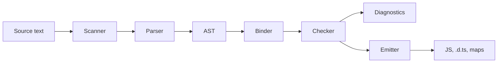

# TypeScript

[← Back to index](../README.md) · [⭐ Favorites](favorites.md)

74 questions · 0 favorites · [📚 Resources](#resources)

## Contents

**Basic**

- [1. What is TypeScript, and what does it compile to?](#1-what-is-typescript-and-what-does-it-compile-to)
- [2. What is structural typing, and how is it different from nominal typing?](#2-what-is-structural-typing-and-how-is-it-different-from-nominal-typing)
- [3. What is the difference between `any`, `unknown`, `never` and `void`?](#3-what-is-the-difference-between-any-unknown-never-and-void)
- [4. When should you write type annotations and when can you rely on inference?](#4-when-should-you-write-type-annotations-and-when-can-you-rely-on-inference)
- [5. What are the primitive types in TypeScript, and why should you avoid `String` and `Number`?](#5-what-are-the-primitive-types-in-typescript-and-why-should-you-avoid-string-and-number)
- [6. What is the difference between `interface` and `type`, and when do you use which?](#6-what-is-the-difference-between-interface-and-type-and-when-do-you-use-which)
- [7. What are union and intersection types?](#7-what-are-union-and-intersection-types)
- [8. What are literal types, and what does `as const` do?](#8-what-are-literal-types-and-what-does-as-const-do)
- [9. How do arrays, tuples and `readonly` arrays work in TypeScript?](#9-how-do-arrays-tuples-and-readonly-arrays-work-in-typescript)
- [10. Should you use `enum` or union types of string literals?](#10-should-you-use-enum-or-union-types-of-string-literals)
- [11. How do optional and default parameters work?](#11-how-do-optional-and-default-parameters-work)
- [12. How do you type functions, and what are function overloads?](#12-how-do-you-type-functions-and-what-are-function-overloads)
- [13. How do optional properties, `readonly` and index signatures work on object types?](#13-how-do-optional-properties-readonly-and-index-signatures-work-on-object-types)
- [14. What is a type assertion (`as`), and why is it unsafe?](#14-what-is-a-type-assertion-as-and-why-is-it-unsafe)
- [15. What does the non-null assertion operator `!` do, and when is it acceptable?](#15-what-does-the-non-null-assertion-operator--do-and-when-is-it-acceptable)
- [16. How does type narrowing work with `typeof`, `instanceof`, `in` and equality?](#16-how-does-type-narrowing-work-with-typeof-instanceof-in-and-equality)
- [17. What are discriminated unions, and how do you check them exhaustively?](#17-what-are-discriminated-unions-and-how-do-you-check-them-exhaustively)
- [18. How do classes work in TypeScript: access modifiers, `readonly`, `abstract` and parameter properties?](#18-how-do-classes-work-in-typescript-access-modifiers-readonly-abstract-and-parameter-properties)
- [19. What does `strict` mode turn on, and what are the most important flags?](#19-what-does-strict-mode-turn-on-and-what-are-the-most-important-flags)
- [20. How do you handle `null` and `undefined` safely: optional chaining, nullish coalescing and defaults?](#20-how-do-you-handle-null-and-undefined-safely-optional-chaining-nullish-coalescing-and-defaults)

**Intermediate**

- [21. \[Tech Lead\] How would you adopt TypeScript in an existing JavaScript codebase?](#21-tech-lead-how-would-you-adopt-typescript-in-an-existing-javascript-codebase)
- [22. \[Tech Lead\] Which tsconfig settings would you standardise for a team?](#22-tech-lead-which-tsconfig-settings-would-you-standardise-for-a-team)
- [23. \[Tech Lead\] What is your policy on `any`, and which typescript-eslint rules matter?](#23-tech-lead-what-is-your-policy-on-any-and-which-typescript-eslint-rules-matter)
- [24. \[Tech Lead\] How do you type an API boundary when TypeScript types disappear at runtime?](#24-tech-lead-how-do-you-type-an-api-boundary-when-typescript-types-disappear-at-runtime)
- [25. \[Tech Lead\] How do you share types between frontend and backend?](#25-tech-lead-how-do-you-share-types-between-frontend-and-backend)
- [26. \[Tech Lead\] How do you upgrade TypeScript and the type packages of dependencies safely?](#26-tech-lead-how-do-you-upgrade-typescript-and-the-type-packages-of-dependencies-safely)
- [27. \[Tech Lead\] What is on your TypeScript code review checklist?](#27-tech-lead-what-is-on-your-typescript-code-review-checklist)
- [28. \[Tech Lead\] How do you test types?](#28-tech-lead-how-do-you-test-types)
- [29. \[Tech Lead\] Should you use Result types or exceptions for error handling in TypeScript?](#29-tech-lead-should-you-use-result-types-or-exceptions-for-error-handling-in-typescript)
- [30. \[Tech Lead\] How do you teach TypeScript to a team and raise the level of the whole codebase?](#30-tech-lead-how-do-you-teach-typescript-to-a-team-and-raise-the-level-of-the-whole-codebase)
- [31. How do generics work in TypeScript: constraints, defaults and inference?](#31-how-do-generics-work-in-typescript-constraints-defaults-and-inference)
- [32. When do you use generics instead of overloads, and the other way round?](#32-when-do-you-use-generics-instead-of-overloads-and-the-other-way-round)
- [33. What are the most useful utility types in TypeScript?](#33-what-are-the-most-useful-utility-types-in-typescript)
- [34. How do `keyof`, `typeof` and indexed access types work together?](#34-how-do-keyof-typeof-and-indexed-access-types-work-together)
- [35. What are mapped types, and how does `as` key remapping work?](#35-what-are-mapped-types-and-how-does-as-key-remapping-work)
- [36. What are conditional types and `infer`?](#36-what-are-conditional-types-and-infer)
- [37. What are template literal types, and where are they useful?](#37-what-are-template-literal-types-and-where-are-they-useful)
- [38. How do you narrow `unknown` with type guards and assertion functions?](#38-how-do-you-narrow-unknown-with-type-guards-and-assertion-functions)
- [39. What does the `satisfies` operator do, and how is it different from a type annotation or `as`?](#39-what-does-the-satisfies-operator-do-and-how-is-it-different-from-a-type-annotation-or-as)
- [40. How do declaration merging, module augmentation, ambient declarations and `.d.ts` files work?](#40-how-do-declaration-merging-module-augmentation-ambient-declarations-and-dts-files-work)
- [41. How do you type `this` in TypeScript, and what is `ThisType`?](#41-how-do-you-type-this-in-typescript-and-what-is-thistype)
- [42. What is the difference between abstract classes and interfaces, and what does `implements` do?](#42-what-is-the-difference-between-abstract-classes-and-interfaces-and-what-does-implements-do)
- [43. How do you write mixins in TypeScript?](#43-how-do-you-write-mixins-in-typescript)
- [44. How do you type async code: `Promise`, `Awaited`, `Promise.all` and async generators?](#44-how-do-you-type-async-code-promise-awaited-promiseall-and-async-generators)
- [45. How do you type DOM events and DOM elements safely?](#45-how-do-you-type-dom-events-and-dom-elements-safely)
- [46. How do you type React props, state and hooks with TypeScript?](#46-how-do-you-type-react-props-state-and-hooks-with-typescript)
- [47. How do you type Express and NestJS handlers and DTOs?](#47-how-do-you-type-express-and-nestjs-handlers-and-dtos)
- [48. How does module resolution work: `node16`, `nodenext` and `bundler`, and what are the ESM/CJS pitfalls?](#48-how-does-module-resolution-work-node16-nodenext-and-bundler-and-what-are-the-esmcjs-pitfalls)
- [49. How do path aliases work in TypeScript, and what do they not do?](#49-how-do-path-aliases-work-in-typescript-and-what-do-they-not-do)
- [50. How do project references and monorepos work in TypeScript?](#50-how-do-project-references-and-monorepos-work-in-typescript)
- [51. What do `import type` and `verbatimModuleSyntax` do?](#51-what-do-import-type-and-verbatimmodulesyntax-do)
- [52. What are covariance, contravariance and bivariance, and what do `in` and `out` do?](#52-what-are-covariance-contravariance-and-bivariance-and-what-do-in-and-out-do)
- [53. What are excess property checks, and what is a "fresh" object literal?](#53-what-are-excess-property-checks-and-what-is-a-fresh-object-literal)
- [54. What are branded (opaque) types, and when do you use them?](#54-what-are-branded-opaque-types-and-when-do-you-use-them)
- [55. What is the difference between `const` and `readonly`, and how do you model immutability?](#55-what-is-the-difference-between-const-and-readonly-and-how-do-you-model-immutability)

**Advanced**

- [56. \[Tech Lead\] How do you keep TypeScript compile times under control in a large repo?](#56-tech-lead-how-do-you-keep-typescript-compile-times-under-control-in-a-large-repo)
- [57. \[Tech Lead\] How do you author a TypeScript library: declaration files, the `exports` map and dual ESM/CJS?](#57-tech-lead-how-do-you-author-a-typescript-library-declaration-files-the-exports-map-and-dual-esmcjs)
- [58. \[Tech Lead\] How do you decide how clever your types should be?](#58-tech-lead-how-do-you-decide-how-clever-your-types-should-be)
- [59. How is the type system "a program", and what are the pitfalls of recursive and distributive conditional types?](#59-how-is-the-type-system-a-program-and-what-are-the-pitfalls-of-recursive-and-distributive-conditional-types)
- [60. How do you build a type-safe event emitter with generics?](#60-how-do-you-build-a-type-safe-event-emitter-with-generics)
- [61. How do you make a builder or API enforce required steps at compile time?](#61-how-do-you-make-a-builder-or-api-enforce-required-steps-at-compile-time)
- [62. What are the limits of type-level computation, and what is "type instantiation is excessively deep"?](#62-what-are-the-limits-of-type-level-computation-and-what-is-type-instantiation-is-excessively-deep)
- [63. Where are the soundness holes in TypeScript, and how do you limit them?](#63-where-are-the-soundness-holes-in-typescript-and-how-do-you-limit-them)
- [64. What makes the TypeScript type checker slow, and how do you diagnose it?](#64-what-makes-the-typescript-type-checker-slow-and-how-do-you-diagnose-it)
- [65. How does the TypeScript compiler work, from source text to JavaScript?](#65-how-does-the-typescript-compiler-work-from-source-text-to-javascript)
- [66. What does declaration emit do, and what does `isolatedDeclarations` change?](#66-what-does-declaration-emit-do-and-what-does-isolateddeclarations-change)
- [67. How do decorators work in TypeScript, and what is the difference between standard and experimental decorators?](#67-how-do-decorators-work-in-typescript-and-what-is-the-difference-between-standard-and-experimental-decorators)
- [68. What are `using` declarations, and how do they manage resources?](#68-what-are-using-declarations-and-how-do-they-manage-resources)
- [69. How does control flow analysis narrow types, and where does it stop working?](#69-how-does-control-flow-analysis-narrow-types-and-where-does-it-stop-working)
- [70. How do you design the public types of a library: overloads vs generics, helpful errors and API stability?](#70-how-do-you-design-the-public-types-of-a-library-overloads-vs-generics-helpful-errors-and-api-stability)
- [71. Type challenge: how do you implement `DeepPartial` and `DeepReadonly`?](#71-type-challenge-how-do-you-implement-deeppartial-and-deepreadonly)
- [72. Type challenge: how do you re-implement `Pick`, `Omit`, `ReturnType`, `Awaited` and `Exclude`?](#72-type-challenge-how-do-you-re-implement-pick-omit-returntype-awaited-and-exclude)
- [73. Type challenge: how do you implement `UnionToIntersection`, tuple `Length`, `First`, `Last` and `Reverse`?](#73-type-challenge-how-do-you-implement-uniontointersection-tuple-length-first-last-and-reverse)
- [74. Type challenge: how do you type a `get(obj, "a.b.c")` function that returns the right type?](#74-type-challenge-how-do-you-type-a-getobj-abc-function-that-returns-the-right-type)

## Browse by module

| Module | Questions |
| --- | --- |
| Advanced Types (9) | [37](#37-what-are-template-literal-types-and-where-are-they-useful) · [52](#52-what-are-covariance-contravariance-and-bivariance-and-what-do-in-and-out-do) · [54](#54-what-are-branded-opaque-types-and-when-do-you-use-them) · [58](#58-tech-lead-how-do-you-decide-how-clever-your-types-should-be) · [59](#59-how-is-the-type-system-a-program-and-what-are-the-pitfalls-of-recursive-and-distributive-conditional-types) · [60](#60-how-do-you-build-a-type-safe-event-emitter-with-generics) · [61](#61-how-do-you-make-a-builder-or-api-enforce-required-steps-at-compile-time) · [62](#62-what-are-the-limits-of-type-level-computation-and-what-is-type-instantiation-is-excessively-deep) · [63](#63-where-are-the-soundness-holes-in-typescript-and-how-do-you-limit-them) |
| Compiler Internals & Performance (5) | [56](#56-tech-lead-how-do-you-keep-typescript-compile-times-under-control-in-a-large-repo) · [64](#64-what-makes-the-typescript-type-checker-slow-and-how-do-you-diagnose-it) · [65](#65-how-does-the-typescript-compiler-work-from-source-text-to-javascript) · [66](#66-what-does-declaration-emit-do-and-what-does-isolateddeclarations-change) · [69](#69-how-does-control-flow-analysis-narrow-types-and-where-does-it-stop-working) |
| Configuration & Strictness (3) | [19](#19-what-does-strict-mode-turn-on-and-what-are-the-most-important-flags) · [22](#22-tech-lead-which-tsconfig-settings-would-you-standardise-for-a-team) · [23](#23-tech-lead-what-is-your-policy-on-any-and-which-typescript-eslint-rules-matter) |
| Frameworks & Libraries (7) | [24](#24-tech-lead-how-do-you-type-an-api-boundary-when-typescript-types-disappear-at-runtime) · [25](#25-tech-lead-how-do-you-share-types-between-frontend-and-backend) · [45](#45-how-do-you-type-dom-events-and-dom-elements-safely) · [46](#46-how-do-you-type-react-props-state-and-hooks-with-typescript) · [47](#47-how-do-you-type-express-and-nestjs-handlers-and-dtos) · [67](#67-how-do-decorators-work-in-typescript-and-what-is-the-difference-between-standard-and-experimental-decorators) · [70](#70-how-do-you-design-the-public-types-of-a-library-overloads-vs-generics-helpful-errors-and-api-stability) |
| Functions & Classes (8) | [11](#11-how-do-optional-and-default-parameters-work) · [12](#12-how-do-you-type-functions-and-what-are-function-overloads) · [18](#18-how-do-classes-work-in-typescript-access-modifiers-readonly-abstract-and-parameter-properties) · [41](#41-how-do-you-type-this-in-typescript-and-what-is-thistype) · [42](#42-what-is-the-difference-between-abstract-classes-and-interfaces-and-what-does-implements-do) · [43](#43-how-do-you-write-mixins-in-typescript) · [44](#44-how-do-you-type-async-code-promise-awaited-promiseall-and-async-generators) · [68](#68-what-are-using-declarations-and-how-do-they-manage-resources) |
| Generics & Utility Types (6) | [31](#31-how-do-generics-work-in-typescript-constraints-defaults-and-inference) · [32](#32-when-do-you-use-generics-instead-of-overloads-and-the-other-way-round) · [33](#33-what-are-the-most-useful-utility-types-in-typescript) · [34](#34-how-do-keyof-typeof-and-indexed-access-types-work-together) · [35](#35-what-are-mapped-types-and-how-does-as-key-remapping-work) · [36](#36-what-are-conditional-types-and-infer) |
| Migration & Leadership (4) | [21](#21-tech-lead-how-would-you-adopt-typescript-in-an-existing-javascript-codebase) · [26](#26-tech-lead-how-do-you-upgrade-typescript-and-the-type-packages-of-dependencies-safely) · [27](#27-tech-lead-what-is-on-your-typescript-code-review-checklist) · [30](#30-tech-lead-how-do-you-teach-typescript-to-a-team-and-raise-the-level-of-the-whole-codebase) |
| Modules & Tooling (7) | [28](#28-tech-lead-how-do-you-test-types) · [40](#40-how-do-declaration-merging-module-augmentation-ambient-declarations-and-dts-files-work) · [48](#48-how-does-module-resolution-work-node16-nodenext-and-bundler-and-what-are-the-esmcjs-pitfalls) · [49](#49-how-do-path-aliases-work-in-typescript-and-what-do-they-not-do) · [50](#50-how-do-project-references-and-monorepos-work-in-typescript) · [51](#51-what-do-import-type-and-verbatimmodulesyntax-do) · [57](#57-tech-lead-how-do-you-author-a-typescript-library-declaration-files-the-exports-map-and-dual-esmcjs) |
| Narrowing & Safety (9) | [14](#14-what-is-a-type-assertion-as-and-why-is-it-unsafe) · [15](#15-what-does-the-non-null-assertion-operator--do-and-when-is-it-acceptable) · [16](#16-how-does-type-narrowing-work-with-typeof-instanceof-in-and-equality) · [17](#17-what-are-discriminated-unions-and-how-do-you-check-them-exhaustively) · [20](#20-how-do-you-handle-null-and-undefined-safely-optional-chaining-nullish-coalescing-and-defaults) · [29](#29-tech-lead-should-you-use-result-types-or-exceptions-for-error-handling-in-typescript) · [38](#38-how-do-you-narrow-unknown-with-type-guards-and-assertion-functions) · [39](#39-what-does-the-satisfies-operator-do-and-how-is-it-different-from-a-type-annotation-or-as) · [53](#53-what-are-excess-property-checks-and-what-is-a-fresh-object-literal) |
| Type Basics (12) | [1](#1-what-is-typescript-and-what-does-it-compile-to) · [2](#2-what-is-structural-typing-and-how-is-it-different-from-nominal-typing) · [3](#3-what-is-the-difference-between-any-unknown-never-and-void) · [4](#4-when-should-you-write-type-annotations-and-when-can-you-rely-on-inference) · [5](#5-what-are-the-primitive-types-in-typescript-and-why-should-you-avoid-string-and-number) · [6](#6-what-is-the-difference-between-interface-and-type-and-when-do-you-use-which) · [7](#7-what-are-union-and-intersection-types) · [8](#8-what-are-literal-types-and-what-does-as-const-do) · [9](#9-how-do-arrays-tuples-and-readonly-arrays-work-in-typescript) · [10](#10-should-you-use-enum-or-union-types-of-string-literals) · [13](#13-how-do-optional-properties-readonly-and-index-signatures-work-on-object-types) · [55](#55-what-is-the-difference-between-const-and-readonly-and-how-do-you-model-immutability) |
| Type Challenges (4) | [71](#71-type-challenge-how-do-you-implement-deeppartial-and-deepreadonly) · [72](#72-type-challenge-how-do-you-re-implement-pick-omit-returntype-awaited-and-exclude) · [73](#73-type-challenge-how-do-you-implement-uniontointersection-tuple-length-first-last-and-reverse) · [74](#74-type-challenge-how-do-you-type-a-getobj-abc-function-that-returns-the-right-type) |

## Basic

### 1. What is TypeScript, and what does it compile to?

**Short answer:** TypeScript is JavaScript plus a static type system. The compiler checks your types and then removes them, so the output is plain JavaScript. Types exist only at compile time. They do not exist at runtime.

TypeScript does two separate jobs. The first is **type checking**: finding bugs such as a wrong argument or a possibly missing value before the code runs. The second is **emitting JavaScript**: stripping the type syntax and, if you ask, lowering newer syntax to an older target. These jobs are independent. Tools like esbuild, swc and Babel can do only the second job, very fast, and `tsc` can do only the first with `--noEmit`.

Because types are erased, a type can never protect you from data that arrives at runtime, for example a JSON response from an API. You must validate that data yourself.

```ts
// Input: TypeScript
interface User {
  id: number;
  name: string;
}

function greet(user: User): string {
  return `Hello, ${user.name}`;
}

// Output after compiling (types are gone):
// function greet(user) {
//   return `Hello, ${user.name}`;
// }
console.log(greet({ id: 1, name: "Asha" })); // prints: Hello, Asha
```

The `interface` produces no JavaScript at all. Only features that need runtime code survive, such as `enum`, `namespace` and class parameter properties.

**Gotcha:** A passing `tsc` does not mean the program is correct at runtime. `JSON.parse` returns `any`, so a wrong shape from the server compiles fine and fails later.

**Interview tip:** Say "types are erased" early. Then mention that modern Node (22.6 and later) can strip types with `--experimental-strip-types`, which only works for erasable syntax, so `enum` and parameter properties are not allowed there.

_Module: Type Basics · Tags: fundamentals, compiler_

### 2. What is structural typing, and how is it different from nominal typing?

**Short answer:** TypeScript compares types by their shape, not by their name. If a value has all the required properties with compatible types, it fits, even if it was never declared as that type. Languages like Java and C# are nominal: the declared name must match.

This is often called "duck typing, checked at compile time". A function that needs `{ id: number }` accepts any object that has a numeric `id`. This fits JavaScript well, because JavaScript code passes plain objects around all the time. It also makes testing easy: a small fake object works as a mock if it has the right shape.

```ts
interface HasId {
  id: number;
}

class Order {
  constructor(public id: number, public total: number) {}
}

function printId(item: HasId): void {
  console.log(item.id);
}

printId(new Order(7, 99)); // prints: 7 (Order never says "implements HasId")
printId({ id: 8 });        // prints: 8

// Two different names, same shape: they are interchangeable
type UserId = { value: string };
type OrderId = { value: string };
const u: UserId = { value: "u1" };
const o: OrderId = u; // no error
```

The last lines show the downside. A `UserId` and an `OrderId` are the same type to the compiler, so you can mix them up. When that matters, use **branded types** (a separate question).

Also remember that classes with `private` or `protected` members behave nominally: two classes with the same private member declared separately are not compatible.

**Interview tip:** Mention both sides. Structural typing is flexible and great for mocks, but it needs branding when two things must not be confused, such as IDs and currencies.

_Module: Type Basics · Tags: fundamentals, type-system_

### 3. What is the difference between `any`, `unknown`, `never` and `void`?

**Short answer:** `any` turns off type checking. `unknown` is the safe "I do not know the type yet" and forces you to check before use. `never` is the type with no values, used for code that cannot finish normally. `void` means a function returns nothing useful.

| Type | Meaning | Can you use it freely? | Typical use |
| --- | --- | --- | --- |
| `any` | Anything, no checks | Yes, which is the danger | Quick migration, last resort |
| `unknown` | Anything, but checks required | No, narrow first | JSON, caught errors, external input |
| `never` | No possible value | Assignable to everything | Functions that always throw, exhaustive checks |
| `void` | No return value | Only `undefined` fits | Functions without return |

```ts
function useAny(x: any) {
  x.foo.bar(); // no error, may crash at runtime
}

function useUnknown(x: unknown) {
  // x.toUpperCase(); // error TS18046: 'x' is of type 'unknown'.
  if (typeof x === "string") {
    console.log(x.toUpperCase()); // fine after narrowing
  }
}

function fail(message: string): never {
  throw new Error(message); // never returns
}

function log(message: string): void {
  console.log(message); // returns undefined
}
```

`any` spreads. Anything you read from an `any` is also `any`, so one `any` can silently disable checking across many lines. `unknown` is the opposite: it is the top type that stays safe.

**Remember:** `void` is not the same as `undefined`. A callback typed to return `void` may still return a value, and the caller ignores it. That is why `[1, 2].forEach(n => arr.push(n))` compiles.

**Interview tip:** Say "prefer `unknown` over `any` for values you do not control, such as `catch (e)` and parsed JSON". With `useUnknownInCatchVariables` (part of `strict`), `e` is already `unknown`.

_Module: Type Basics · Tags: fundamentals, any, unknown_

### 4. When should you write type annotations and when can you rely on inference?

**Short answer:** Let TypeScript infer types for local variables and simple return values. Write annotations at boundaries: function parameters, exported function return types, and public APIs. Inference keeps code short. Annotations at the edges give clear contracts and better error messages.

TypeScript infers a type from the value you assign. `const n = 5` has the type `5` (a literal), while `let n = 5` has the type `number`. Function parameters cannot be inferred from the body, so they need annotations, unless the function is passed where a type is already expected (a "contextual type").

```ts
const price = 10;            // type: 10 (literal, because const)
let count = 0;               // type: number (widened, because let can change)
const names = ["a", "b"];    // type: string[]

// Parameters need annotations; the return type is inferred as number
function double(n: number) {
  return n * 2;
}

// Contextual typing: no annotation needed on `s`
const lengths = ["aa", "b"].map((s) => s.length); // number[]

// An annotation helps when inference is too wide
const empty = []; // implicit any[] that evolves; annotate to be safe
const ids: number[] = [];
```

Why annotate exported functions? An explicit return type stops an accidental change in the body from silently changing your public type. It also makes the compiler faster in big projects, because it does not need to work out the body to know the signature, and `isolatedDeclarations` requires it.

**Rules of thumb**
- Annotate: parameters, exported return types, empty arrays and objects, and values that start as `null`.
- Infer: local constants, results of `map` and `filter`, and simple returns.
- Do not annotate `const x: string = "a"`. It only adds noise.

**Interview tip:** The phrase "annotate the boundary, infer the inside" is a good summary. If asked about `satisfies`, say it checks a value against a type without widening the inferred type.

_Module: Type Basics · Tags: inference, fundamentals_

### 5. What are the primitive types in TypeScript, and why should you avoid `String` and `Number`?

**Short answer:** The primitives are `string`, `number`, `boolean`, `bigint`, `symbol`, `null` and `undefined`. Always use these lowercase names. The capitalized `String`, `Number` and `Boolean` are wrapper object types and almost never what you want.

JavaScript has two things with similar names: the primitive value `"abc"` and the wrapper object `new String("abc")`. The type `string` describes the primitive. The type `String` describes the wrapper interface, which primitives also satisfy, so it hides mistakes.

```ts
const a: string = "hi";
const b: String = "hi";      // allowed: primitives fit the wrapper type
const c: String = new String("hi");
// const d: string = new String("hi");
// error TS2322: Type 'String' is not assignable to type 'string'.
//   'string' is a primitive, but 'String' is a wrapper object.

const big: bigint = 9007199254740993n; // exact large integers
const id: symbol = Symbol("id");       // unique key
```

**Other points**
- `number` covers integers, floats, `NaN` and `Infinity`. There is no separate `int` type.
- `bigint` and `number` do not mix: `1n + 1` is an error. Convert on purpose.
- `object` means any non-primitive. `{}` means any non-null value (even `5`), which surprises people. `Object` is the wrapper interface, avoid it.
- `null` and `undefined` are separate types when `strictNullChecks` is on.

**Gotcha:** ESLint rule `@typescript-eslint/no-wrapper-object-types` flags the capitalized names. Turn it on.

**Interview tip:** Mention that `{}` is not "an empty object". Use `Record<string, never>` for a truly empty object, or `object` for any non-primitive.

_Module: Type Basics · Tags: primitives, fundamentals_

### 6. What is the difference between `interface` and `type`, and when do you use which?

**Short answer:** Both describe object shapes and are interchangeable for most uses. Interfaces can be extended and merged (declaration merging), and give clearer error messages for object shapes. Type aliases can name any type: unions, tuples, primitives, mapped and conditional types. A simple team rule is enough.

| Feature | `interface` | `type` |
| --- | --- | --- |
| Object shapes | Yes | Yes |
| Union, tuple, primitive aliases | No | Yes |
| Extend | `extends` | `&` intersection |
| Declaration merging | Yes | No (duplicate identifier error) |
| Mapped or conditional types | No | Yes |
| `implements` in a class | Yes | Yes, if it is an object type |

```ts
interface Animal {
  name: string;
}
interface Dog extends Animal {
  bark(): void;
}

type Id = string | number;               // only a type alias can do this
type Pair = [string, number];            // tuples too
type Cat = Animal & { lives: number };   // intersection

// Declaration merging: two interfaces with the same name are joined
interface Config {
  port: number;
}
interface Config {
  host: string;
}
const cfg: Config = { port: 80, host: "localhost" }; // needs both
```

A practical rule: use `interface` for public object contracts and class shapes, especially in libraries where users may augment them. Use `type` for unions, utility results and everything else. The most important thing is to be consistent and to enforce it with the ESLint rule `@typescript-eslint/consistent-type-definitions`.

**Gotcha:** The old claim "interfaces are always faster" is mostly about caching of `extends` checks. It matters in very large codebases only. Do not pick on speed alone.

**Interview tip:** Say that merging is a feature and a risk. It is how you augment library types, but a name clash can merge by accident.

_Module: Type Basics · Tags: interface, type-alias_

### 7. What are union and intersection types?

**Short answer:** A union `A | B` means a value is one of the types. An intersection `A & B` means a value has all of the properties of both. Think "or" for union and "and" for intersection.

With a union you can only use what is common to all members, until you narrow. With an intersection you can use everything from both. Unions model choices such as `"loading" | "done"`. Intersections combine pieces, for example adding an `id` to a base shape.

```ts
type Id = string | number;

function show(id: Id) {
  // id.toUpperCase(); // error TS2339: Property 'toUpperCase' does not exist on type 'number'.
  if (typeof id === "string") {
    console.log(id.toUpperCase()); // narrowed to string
  } else {
    console.log(id.toFixed(2));    // narrowed to number
  }
}

type WithId = { id: number };
type WithName = { name: string };
type Person = WithId & WithName;

const p: Person = { id: 1, name: "Asha" }; // needs both properties

// Intersection of incompatible primitives collapses to never
type Impossible = string & number; // never
```

**Gotcha:** Intersecting object types with the same property but different types gives that property the intersection of both types. `{ a: string } & { a: number }` has `a: never`, so no real value can be built. Interfaces with `extends` report such a conflict as an error, which is clearer.

**Rules of thumb**
- Use a union for "one of these".
- Use an intersection to add fields to a base type.
- If an intersection becomes long, switch to `interface extends` for better messages.

**Interview tip:** Ask yourself "what can I do with this value before narrowing?". For a union the answer is the common members only.

_Module: Type Basics · Tags: union, intersection_

### 8. What are literal types, and what does `as const` do?

**Short answer:** A literal type is a type with exactly one value, like `"GET"` or `42`. `as const` tells TypeScript to infer the narrowest literal types and to make the value deeply `readonly`. Together they let you build exact unions from plain data.

Without `as const`, TypeScript widens: an object property written as `"GET"` becomes `string`, because the property could be changed later. That can break calls that expect an exact literal.

```ts
type Method = "GET" | "POST";
function call(method: Method) {}

const req = { method: "GET" };
// call(req.method);
// error TS2345: Argument of type 'string' is not assignable to parameter of type 'Method'.

const req2 = { method: "GET" } as const;
call(req2.method); // ok: type is "GET", property is readonly

// Build a union from data: one source of truth
const ROLES = ["admin", "editor", "viewer"] as const;
type Role = (typeof ROLES)[number]; // "admin" | "editor" | "viewer"

const isRole = (s: string): s is Role => (ROLES as readonly string[]).includes(s);
```

The `ROLES` pattern is very useful. The array is available at runtime for loops and validation, and the union type is derived from it, so they can never drift apart.

`as const` is only a compile-time annotation. It does not freeze the object at runtime. Use `Object.freeze` for that.

**Gotcha:** `as const` makes arrays into readonly tuples, so a function that takes `string[]` will reject them. Accept `readonly string[]` in function parameters when you do not mutate.

**Interview tip:** Mention `const` type parameters (TypeScript 5.0) as the generic version of the same idea: `function f<const T>(x: T)` infers literals for T.

_Module: Type Basics · Tags: literal-types, as-const_

### 9. How do arrays, tuples and `readonly` arrays work in TypeScript?

**Short answer:** `T[]` (or `Array<T>`) is a list of any length where every item is `T`. A tuple like `[string, number]` has a fixed length and a type per position. `readonly T[]` forbids changing the array through that reference.

Use a tuple when position means something and the length is fixed, for example a `[lat, lng]` pair or the return of a custom hook (`[value, setValue]`). Use an array for a list of similar things. Tuples can have optional and rest elements, and labels for readability.

```ts
const scores: number[] = [10, 20];
const point: [number, number] = [1, 2];
const user: [id: number, name: string] = [1, "Asha"]; // labeled tuple

// point[2];  // error TS2493: Tuple type '[number, number]' of length '2' has no element at index '2'.
// const bad: [number, number] = [1, 2, 3]; // error: Source has 3 element(s) but target allows only 2

function total(values: readonly number[]): number {
  // values.push(1); // error TS2339: Property 'push' does not exist on type 'readonly number[]'.
  return values.reduce((a, b) => a + b, 0);
}

total(scores); // a mutable array can be passed where readonly is expected
```

A `readonly` array is a view. It does not stop someone else, who holds the mutable reference, from changing the data. It documents your intent and catches your own mistakes.

**Rules of thumb**
- Parameters that you do not change should be `readonly T[]`. This accepts both kinds of arrays.
- With `noUncheckedIndexedAccess` on, `scores[0]` has type `number | undefined`, which is safer.
- Tuples from `as const` are readonly and exact.

**Interview tip:** A good follow-up is "why is `[1, 2]` inferred as `number[]` and not a tuple?". Because arrays are mutable and usually grow. Use a type annotation or `as const` to get a tuple.

_Module: Type Basics · Tags: arrays, tuples, readonly_

### 10. Should you use `enum` or union types of string literals?

**Short answer:** In most new code prefer a union of string literals, or an `as const` object. Enums produce real runtime code, behave differently from the rest of the type system, and do not work with type stripping. Use enums only when you must match an existing codebase or need reverse mapping.

A string union is erased, so it costs nothing at runtime, and the value `"admin"` is also the plain string in JSON and logs. A regular `enum` becomes an object at runtime. Numeric enums are looser: before TypeScript 5.0, any number could be assigned to a numeric enum.

```ts
// Option 1: union of literals
type Role = "admin" | "user";

// Option 2: const object plus derived type (also gives runtime values)
const Status = { Active: "active", Blocked: "blocked" } as const;
type Status = (typeof Status)[keyof typeof Status]; // "active" | "blocked"

// Option 3: enum (emits runtime code)
enum Direction {
  Up = "UP",
  Down = "DOWN",
}
const d: Direction = Direction.Up;
// const e: Direction = "UP";
// error TS2322: Type '"UP"' is not assignable to type 'Direction'.
```

Notice the last error. A string enum is nominal-like: the plain string `"UP"` is not accepted. This is awkward for data that comes from JSON.

**Const enums** are inlined at compile time and leave no object. The caveats: they break with `isolatedModules` and with transpilers like esbuild or swc when used across files, and library authors should not export them. Many teams ban them. The `erasableSyntaxOnly` flag (TypeScript 5.8) also rejects all enums.

**Interview tip:** A short rule works well: "unions by default, `as const` object when I need the values at runtime, enums only for legacy". That shows you know the trade-off.

_Module: Type Basics · Tags: enum, union, const-enum_

### 11. How do optional and default parameters work?

**Short answer:** A parameter marked with `?` may be left out, and inside the function its type includes `undefined`. A parameter with a default value is also optional for the caller, and keeps its plain type inside. Optional parameters must come after required ones.

Use a default when you have a sensible fallback value. Use `?` when the absence itself matters and you want to check for it. Rest parameters (`...args`) collect the remaining arguments into an array.

```ts
function greet(name: string, greeting = "Hello"): string {
  return `${greeting}, ${name}`; // greeting is string here
}
greet("Asha");          // prints: Hello, Asha
greet("Asha", "Hi");    // prints: Hi, Asha

function area(width: number, height?: number): number {
  // height is number | undefined here
  return width * (height ?? width);
}
area(3);    // 9 (a square)
area(3, 2); // 6

function sum(...nums: number[]): number {
  return nums.reduce((a, b) => a + b, 0);
}
sum(1, 2, 3); // 6

// function bad(a?: number, b: number) {}
// error TS1016: A required parameter cannot follow an optional parameter.
```

A default value is only used when the argument is `undefined`. If the caller passes `null`, the default does not apply. If a function has many optional parameters, switch to one options object, which is easier to read and extend.

**Gotcha:** `x?: number` and `x: number | undefined` are different for callers. The first can be omitted, the second must be passed explicitly.

**Interview tip:** Mention options objects with defaults through destructuring: `function connect({ host = "localhost", port = 5432 }: Options = {})`. It is the normal style for functions with more than three arguments.

_Module: Functions & Classes · Tags: functions, parameters_

### 12. How do you type functions, and what are function overloads?

**Short answer:** You type a function by its parameters and return type. A function type looks like `(a: number) => string`. Overloads let one function name have several call signatures, with one implementation signature behind them that callers cannot see.

Overloads help when the return type depends on the argument type in a way a union cannot express. The compiler tries the overload signatures in order and picks the first that matches.

```ts
type Formatter = (value: number) => string;
const fmt: Formatter = (v) => v.toFixed(2); // v inferred as number

// Overloads: the first two are public, the third is the implementation
function parse(input: string): number;
function parse(input: string[]): number[];
function parse(input: string | string[]): number | number[] {
  return Array.isArray(input) ? input.map(Number) : Number(input);
}

const a = parse("5");        // type: number
const b = parse(["1", "2"]); // type: number[]
// parse(5);
// error TS2769: No overload matches this call.
```

The implementation signature is not callable from outside. It must be general enough to cover all overloads.

Overloads have costs: more code, worse error messages ("No overload matches"), and order sensitivity. Often a **generic** or a **union parameter** is simpler. A good test: if all overloads return the same type, you do not need overloads.

**Rules of thumb**
- Put the most specific overload first.
- Do not write an overload that only differs by one optional parameter. Use `?`.
- Use `this` as the first fake parameter to type `this`: `function f(this: Window)`.

**Interview tip:** Say when you avoid overloads. Libraries use them for ergonomic APIs, but app code usually can use a generic with a conditional return type or two separately named functions.

_Module: Functions & Classes · Tags: functions, overloads_

### 13. How do optional properties, `readonly` and index signatures work on object types?

**Short answer:** `name?: string` makes a property optional, so it can be missing or `undefined`. `readonly` stops reassignment of a property through that type. An index signature like `[key: string]: number` describes an object used as a dictionary with unknown keys.

```ts
interface User {
  readonly id: number; // cannot be reassigned
  name: string;
  nickname?: string;   // optional: string | undefined
}

const u: User = { id: 1, name: "Asha" };
// u.id = 2; // error TS2540: Cannot assign to 'id' because it is a read-only property.
console.log(u.nickname?.toUpperCase()); // prints: undefined

// Index signature: a dictionary
const stock: { [sku: string]: number } = { A1: 5, B2: 0 };
stock.C3 = 9;                 // any key is allowed
const n: number = stock.Z9;   // compiles, but at runtime it is undefined
```

The last line is a known hole: an index signature promises a `number` for every key, which is not true. Turn on `noUncheckedIndexedAccess`, and `stock.Z9` becomes `number | undefined`. Also consider `Map<string, number>` for real dictionaries, or `Record<"A1" | "B2", number>` when the keys are known.

`readonly` is shallow and compile-time only. A `readonly items: string[]` property still lets you call `push` on the array. Use `readonly string[]` for that.

**Gotcha:** With an index signature, all other known properties must be compatible with it. `{ [k: string]: number; name: string }` is an error.

**Interview tip:** Mention `exactOptionalPropertyTypes`. When on, `nickname?: string` means "missing or a string", and writing `nickname: undefined` is an error. This separates "absent" from "explicitly undefined".

_Module: Type Basics · Tags: objects, readonly, index-signature_

### 14. What is a type assertion (`as`), and why is it unsafe?

**Short answer:** `value as Type` tells the compiler "trust me, this is that type". It does not check or convert anything at runtime. If you are wrong, the program fails later in a confusing place. Prefer narrowing, type guards or validation. Use assertions only when you know something the compiler cannot.

An assertion changes only what the compiler believes. The compiler still blocks assertions between types that clearly do not overlap, but it allows narrowing a wide type to a more specific one, and `as unknown as T` can force anything.

```ts
const input = document.getElementById("email") as HTMLInputElement; // OK if you know the element
// at runtime it could be null or a different element: no check happens

const data = JSON.parse('{"id": "oops"}') as { id: number };
console.log(data.id + 1); // prints: oops1  (type says number, runtime says string)

// const n = "5" as number;
// error TS2352: Conversion of type 'string' to type 'number' may be a mistake.
const forced = "5" as unknown as number; // double assertion: compiles, still a lie
```

The `JSON.parse` line is the classic bug. The assertion hides bad input. A better way is to validate with a schema library such as zod and let the type come from the validation.

Compare with **type annotations** (`const x: T = value`), which the compiler really checks, and with the **`satisfies`** operator, which checks without changing the type.

**Common mistakes**
- Asserting API responses instead of validating them.
- Using `as any` to silence an error that points to a real design issue.
- Asserting an empty object: `{} as User` gives you a `User` with no properties.

**Interview tip:** Say "an assertion is a promise from me to the compiler, and a promise can be broken". Then name your alternatives: type guards, `unknown`, schema validation, and `satisfies`.

_Module: Narrowing & Safety · Tags: type-assertion, safety_

### 15. What does the non-null assertion operator `!` do, and when is it acceptable?

**Short answer:** `value!` tells the compiler that the value is not `null` or `undefined`. It is erased and does nothing at runtime. If the value is actually missing, you get a normal runtime crash. Use it sparingly, and prefer a real check.

It is a special type assertion that removes `null` and `undefined` from a type. It is common in tests and in places where you have an invariant the type system cannot see.

```ts
const items = new Map<string, number>([["a", 1]]);

const bad = items.get("b")!; // compiles, value is undefined at runtime
console.log(bad.toFixed(1)); // TypeError: Cannot read properties of undefined

// ✅ good: handle the missing case
const value = items.get("b");
if (value === undefined) {
  throw new Error("Missing item b"); // fails early with a clear message
}
console.log(value.toFixed(1)); // value is number here
```

Better options:
- Narrow with `if`, or use `??` for a default.
- Use `?.` when missing is fine.
- Write a small `assertDefined` helper that throws with a clear message, so failures are explained.
- In classes, use the definite assignment assertion `field!: string` only when a framework sets the field after construction (for example an injected dependency).

**Gotcha:** The lint rule `@typescript-eslint/no-non-null-assertion` is in the `strict` preset. Many teams allow `!` only in test files.

**Interview tip:** Say that each `!` is a possible crash that the compiler cannot see. Interviewers like it when you also describe the safer replacement: a check that throws a descriptive error.

_Module: Narrowing & Safety · Tags: non-null, safety_

### 16. How does type narrowing work with `typeof`, `instanceof`, `in` and equality?

**Short answer:** Narrowing means the compiler makes a wide type more specific inside a branch, based on a check you wrote. The common checks are `typeof`, `instanceof`, the `in` operator, equality (`===`), truthiness and `Array.isArray`.

The compiler reads your `if`, `switch`, `&&` and early `return` statements (this is called control flow analysis) and keeps track of the type at each line.

```ts
function describe(x: string | number | Date | string[] | null) {
  if (x === null) return "nothing";             // equality removes null
  if (typeof x === "string") return x.trim();   // string
  if (typeof x === "number") return x.toFixed(); // number
  if (x instanceof Date) return x.toISOString(); // Date
  return x.join(",");                            // string[] (only one left)
}

type Fish = { swim(): void };
type Bird = { fly(): void };
function move(pet: Fish | Bird) {
  if ("swim" in pet) {
    pet.swim(); // Fish
  } else {
    pet.fly();  // Bird
  }
}

function len(s?: string) {
  if (s) return s.length; // truthiness removes undefined (and "")
  return 0;
}
```

In the first function the last line works because every other member was removed one by one. The same idea powers exhaustive checks.

**Gotchas**
- Truthiness narrowing also removes `0`, `""` and `NaN`. For a number that may be `0`, check `x !== undefined`.
- Narrowing is lost inside callbacks for `let` variables that are reassigned, and it does not carry across function calls.
- `typeof null` is `"object"`, so `typeof x === "object"` still leaves `null` in the type.

**Interview tip:** If you want to impress, say "control flow analysis", and then mention user-defined type guards for cases where the built-in checks are not enough.

_Module: Narrowing & Safety · Tags: narrowing, control-flow_

### 17. What are discriminated unions, and how do you check them exhaustively?

**Short answer:** A discriminated union is a union of object types that share one property with a literal value, such as `kind`. Checking that property narrows the whole object. Adding a `never` check in the default branch makes the compiler fail when a new variant is added but not handled.

This is the standard way to model state in TypeScript: loading, success, error. Each state carries only the data that makes sense for it, so impossible states cannot be written, for example "loading with an error message".

```ts
type Result =
  | { kind: "loading" }
  | { kind: "ok"; data: string[] }
  | { kind: "error"; message: string };

function assertNever(x: never): never {
  throw new Error(`Unhandled case: ${JSON.stringify(x)}`);
}

function render(r: Result): string {
  switch (r.kind) {
    case "loading":
      return "Loading...";
    case "ok":
      return r.data.join(", "); // r is the ok variant
    case "error":
      return r.message;
    default:
      return assertNever(r); // r is never if all cases are handled
  }
}
```

If someone adds `{ kind: "empty" }` to `Result` and forgets the `switch`, the `default` line fails with: Argument of type '{ kind: "empty"; }' is not assignable to parameter of type 'never' (TS2345).

If a new variant is added and one `switch` is forgotten, the build breaks at exactly that place. This is one of the biggest safety wins in TypeScript.

A lighter option: with an explicit return type and `strict`, a `switch` that misses a case gives "Function lacks ending return statement" (TS2366). The `never` check gives a better message and also covers functions that return `void`.

**Interview tip:** Compare it with optional fields: `{ loading: boolean; data?: ...; error?: ... }` allows invalid combinations. Discriminated unions make illegal states unrepresentable. Also mention the ESLint rule `@typescript-eslint/switch-exhaustiveness-check`.

_Module: Narrowing & Safety · Tags: discriminated-union, exhaustiveness_

### 18. How do classes work in TypeScript: access modifiers, `readonly`, `abstract` and parameter properties?

**Short answer:** TypeScript adds `public`, `private` and `protected` modifiers, `readonly` fields, `abstract` classes and shorthand "parameter properties" to JavaScript classes. The modifiers are checked only at compile time, except the JavaScript `#private` fields, which are enforced at runtime.

| Modifier | Who can access it |
| --- | --- |
| `public` (default) | Everyone |
| `protected` | The class and its subclasses |
| `private` | Only the class (compile-time only) |
| `#name` | Only the class (real runtime privacy) |
| `readonly` | Can be set only in the constructor or at declaration |

```ts
abstract class Shape {
  // parameter property: declares and assigns the field in one step
  constructor(protected readonly name: string) {}

  abstract area(): number; // subclasses must implement

  describe(): string {
    return `${this.name} with area ${this.area()}`;
  }
}

class Circle extends Shape {
  #secret = 42; // truly private at runtime
  constructor(private radius: number) {
    super("circle");
  }
  area(): number {
    return Math.PI * this.radius ** 2;
  }
}

const c = new Circle(2);
console.log(c.describe()); // prints: circle with area 12.566370614359172
// c.radius;      // error TS2341: Property 'radius' is private and only accessible within class 'Circle'.
// new Shape("x"); // error TS2511: Cannot create an instance of an abstract class.
```

`private` is erased, so `(c as any).radius` works at runtime. Use `#radius` when privacy must be real, for example in library code that holds secrets.

**Gotcha:** Parameter properties and enums are not "erasable" syntax. With `--experimental-strip-types` or `erasableSyntaxOnly` (TypeScript 5.8) they are an error.

**Interview tip:** Mention that TypeScript prefers composition and interfaces. Inheritance is fine for a shared base like in NestJS or error classes, but most code is simpler with functions and plain objects.

_Module: Functions & Classes · Tags: classes, access-modifiers_

### 19. What does `strict` mode turn on, and what are the most important flags?

**Short answer:** `"strict": true` switches on a group of safety flags at once. The most important are `strictNullChecks` (null and undefined are separate types) and `noImplicitAny` (no silent `any`). New projects should always start with `strict` on.

| Flag in `strict` | What it prevents |
| --- | --- |
| `noImplicitAny` | Parameters and values that silently become `any` |
| `strictNullChecks` | Using a value that may be `null` or `undefined` |
| `strictFunctionTypes` | Unsafe function parameter assignments (contravariance) |
| `strictBindCallApply` | Wrong arguments to `bind`, `call`, `apply` |
| `strictPropertyInitialization` | Class fields never assigned in the constructor |
| `noImplicitThis` | `this` with an implicit `any` type |
| `useUnknownInCatchVariables` | Treating `catch (e)` as `any` |
| `alwaysStrict` | Emits `"use strict"` |
| `strictBuiltinIteratorReturn` | Unsafe `IteratorResult` return type (added in 5.6) |

```ts
// strictNullChecks
function len(s: string | null) {
  // return s.length; // error TS18047: 's' is possibly 'null'.
  return s?.length ?? 0;
}

// noImplicitAny
// function add(a, b) { return a + b; }
// error TS7006: Parameter 'a' implicitly has an 'any' type.

// strictPropertyInitialization
class Service {
  // url: string; // error TS2564: Property 'url' has no initializer and is not definitely assigned in the constructor.
  url = "http://localhost";
}
```

Strict mode may add new flags in future TypeScript versions, so an upgrade can show new errors. That is the price of "free" safety, and a reason to pin the version and upgrade on purpose.

**Not in `strict`:** `noUncheckedIndexedAccess`, `exactOptionalPropertyTypes`, `noImplicitReturns`, `noFallthroughCasesInSwitch` and `noImplicitOverride`. A good team config turns several of these on as well.

**Interview tip:** If asked "which one flag matters most?", answer `strictNullChecks`. Without it, `null` can hide in every type, and the famous "billion dollar mistake" comes back.

_Module: Configuration & Strictness · Tags: strict, tsconfig_

### 20. How do you handle `null` and `undefined` safely: optional chaining, nullish coalescing and defaults?

**Short answer:** Use optional chaining `?.` to stop safely when something is missing, nullish coalescing `??` to give a default only for `null` or `undefined`, and narrowing to check the rest. With `strictNullChecks`, the compiler forces you to deal with missing values.

`?.` returns `undefined` if the left side is `null` or `undefined`, instead of throwing. `??` uses the right side only for `null` or `undefined`. The older `||` also replaces `0`, `""` and `false`, which is often a bug.

```ts
interface Profile {
  address?: { city?: string };
  retries?: number;
}

function city(p: Profile): string {
  return p.address?.city ?? "unknown"; // string
}

const p: Profile = { retries: 0 };
console.log(p.retries || 3); // prints: 3  (❌ bad: 0 is treated as missing)
console.log(p.retries ?? 3); // prints: 0  (✅ good)

// Optional call and optional index
function first(fn?: () => number, list?: number[]) {
  console.log(fn?.());    // undefined if fn is missing
  console.log(list?.[0]); // undefined if list is missing
}
first(); // prints: undefined, then undefined

// Nullish assignment
let cache: Map<string, number> | undefined;
cache ??= new Map(); // creates the map only if missing
```

The compiler knows the result of `a?.b` includes `undefined`, so you must still handle it. Do not follow it with `!`.

**Gotcha:** Long chains such as `a?.b?.c?.d` are a design smell. They often mean the data model has too many optional levels. Model the shape better, or validate input once at the edge.

**Interview tip:** The `0` versus `""` difference between `||` and `??` is a favourite quick question. Mention also that `??=` needs ES2021 syntax or a transpiler.

_Module: Narrowing & Safety · Tags: null-safety, optional-chaining_

## Intermediate

### 21. [Tech Lead] How would you adopt TypeScript in an existing JavaScript codebase?

**Short answer:** Migrate in small safe steps, never in a big bang. Add TypeScript next to the JavaScript with `allowJs`, convert file by file starting at the leaves, keep the build green on every merge, and tighten strictness over time with a ratchet that forbids new problems while old ones are paid down.

#### A step-by-step plan

1. **Set up the tooling.** Add `typescript`, a `tsconfig.json` with `allowJs: true`, `noEmit: true`, and run `tsc` in CI. At first it checks nothing strict, so it should pass.
2. **Check JavaScript with JSDoc.** Add `checkJs: true` (or `// @ts-check` per file) to get type errors in JS files without renaming them. This is a cheap way to find real bugs early.
3. **Convert from the leaves.** Start with utilities, constants and models that many files import but that import little. Then move up. Types you add at the leaves help every caller.
4. **Write the shared types first.** API responses, domain models and config shapes. These give the most value.
5. **Use `unknown` and `// @ts-expect-error`, not `any`, for unfinished spots.** `@ts-expect-error` fails the build when the error is later fixed, so the suppression cannot go stale.
6. **Ratchet strictness.** Start with `strict: false`, then enable flags one by one (`noImplicitAny`, then `strictNullChecks`). Use a rule that no new file may violate the target. Track the count of errors or `any` per week on a dashboard.

```json
{
  "compilerOptions": {
    "allowJs": true,
    "checkJs": false,
    "noEmit": true,
    "strict": false,
    "noImplicitAny": true
  },
  "include": ["src"]
}
```

For the strict flag that causes the most errors, `strictNullChecks`, a common trick is a second tsconfig (`tsconfig.strict.json`) that lists only the already-clean folders and grows each sprint. CI runs both.

**Risks to manage**
- Developers feel slower for a few weeks. Pair on the first conversions and write a short style guide.
- A conversion PR should only add types, not change behaviour, so reviews stay simple.
- Do not freeze feature work. Convert the files you touch ("boy scout rule") plus a small weekly slice.

**Interview tip:** Interviewers want a plan with metrics and a rollback story. Say how you will measure progress (percent of files converted, number of `any`), and how you protect delivery (small PRs, green CI at every step).

_Module: Migration & Leadership · Tags: tech-lead, migration, allowjs_

### 22. [Tech Lead] Which tsconfig settings would you standardise for a team?

**Short answer:** Start from `strict: true`, then add `noUncheckedIndexedAccess`, `exactOptionalPropertyTypes` (if the team accepts the friction), `noImplicitOverride`, `isolatedModules`, `verbatimModuleSyntax` and `skipLibCheck`. Share the base config in one package so every project extends the same rules.

| Setting | What it does | Why a lead cares |
| --- | --- | --- |
| `strict` | Core safety flags | Non-negotiable for new code |
| `noUncheckedIndexedAccess` | `arr[i]` and index signatures include `undefined` | Catches real out-of-range bugs |
| `exactOptionalPropertyTypes` | `a?: string` does not allow `undefined` | Separates "missing" from "undefined", noisy with some libraries |
| `noImplicitOverride` | Requires the `override` keyword | Safer inheritance refactors |
| `noFallthroughCasesInSwitch` | Flags missing `break` | Cheap bug catcher |
| `isolatedModules` | Each file must be safe to transpile alone | Required for esbuild, swc, Babel |
| `verbatimModuleSyntax` | Imports and exports are kept exactly as written; type imports must use `import type` | Predictable emit, fewer side effect surprises |
| `skipLibCheck` | Does not type-check `.d.ts` files | Large speed gain, hides errors in dependencies |
| `forceConsistentCasingInFileNames` | Same file name casing everywhere | Avoids macOS versus Linux CI failures |

```json
{
  "compilerOptions": {
    "strict": true,
    "noUncheckedIndexedAccess": true,
    "noImplicitOverride": true,
    "noFallthroughCasesInSwitch": true,
    "isolatedModules": true,
    "verbatimModuleSyntax": true,
    "skipLibCheck": true,
    "forceConsistentCasingInFileNames": true
  }
}
```

**How to decide**
- Put the shared options in a `tsconfig.base.json` and let each package `extends` it and set only `module`, `target`, `lib` and paths.
- Pick `module` and `moduleResolution` by runtime: `nodenext` for Node libraries and services, `bundler` for apps built with Vite or webpack.
- Try new flags on a branch first and count errors. If a flag adds hundreds of errors, enable it for new code only.

**Gotcha:** `exactOptionalPropertyTypes` is the flag teams most often drop, because many libraries pass `undefined` explicitly. That is a fair decision. Write it down so it is a choice, not an accident.

**Interview tip:** Explain that the config is a team contract. A lead standardises it once, in one place, and reviews changes to it like production code.

_Module: Configuration & Strictness · Tags: tech-lead, tsconfig, strict_

### 23. [Tech Lead] What is your policy on `any`, and which typescript-eslint rules matter?

**Short answer:** Make `any` rare and visible. Ban it by default, allow it with an explanation, and prefer `unknown`. Use the `typescript-eslint` strict and type-checked presets, and enable the handful of rules that catch real bugs: no floating promises, no misused promises, no unsafe member access and exhaustive switches.

`any` is contagious. One `any` return type makes every value derived from it `any`, and the compiler stops protecting that whole chain. You can't ban it completely (some dynamic code needs it), but every use should be a decision.

**Rules that give the most value**
- `@typescript-eslint/no-explicit-any`: forbids writing `any`.
- `@typescript-eslint/no-unsafe-assignment`, `no-unsafe-member-access`, `no-unsafe-call`, `no-unsafe-return`, `no-unsafe-argument`: catch an `any` that leaked in from elsewhere (for example `JSON.parse`). These need type information.
- `@typescript-eslint/no-floating-promises`: a promise that is never awaited or handled. This is the most common async bug.
- `@typescript-eslint/no-misused-promises`: passing an async function where a sync callback is expected, such as in `if (asyncFn())`.
- `@typescript-eslint/switch-exhaustiveness-check`: forces all union cases.
- `@typescript-eslint/consistent-type-imports`: `import type` for types.
- `@typescript-eslint/ban-ts-comment`: require a description for `@ts-expect-error` and forbid `@ts-ignore`.
- `@typescript-eslint/no-non-null-assertion`: discourages `!`.

```ts
declare const text: string;

// ❌ bad: any leaks out and nobody sees it
const raw = JSON.parse(text);          // any
const total: number = raw.items.length; // unchecked

// ✅ good: unknown forces a check (or a schema parse)
const parsed: unknown = JSON.parse(text);
if (typeof parsed === "object" && parsed !== null && "items" in parsed) {
  // narrow further or hand it to a schema validator
}

// When any is truly needed, say why and keep it small
// eslint-disable-next-line @typescript-eslint/no-explicit-any -- third-party typing is wrong
const legacy = window as any;
```

Use the `strictTypeChecked` preset for new code and `recommendedTypeChecked` for old code, then tighten. Type-aware rules are slower, so run them in CI and on changed files in the editor.

**Gotcha:** `@ts-ignore` hides every error on the next line, including future ones. `@ts-expect-error` fails if the error disappears, so it is the better tool.

**Interview tip:** Show that your policy is practical: ban by lint, allow with a written reason, track the count of suppressions, and review them every quarter.

_Module: Configuration & Strictness · Tags: tech-lead, eslint, any_

### 24. [Tech Lead] How do you type an API boundary when TypeScript types disappear at runtime?

**Short answer:** Treat every input from outside your process as `unknown` and validate it at the edge with a runtime schema, for example zod or valibot. Then infer the TypeScript type from the schema, so the type and the check are the same thing and cannot drift apart.

Types are erased, so `const user = (await res.json()) as User` proves nothing. If the server changes a field, the code compiles and fails far away from the cause. A trust boundary is any place where data enters: HTTP bodies, query strings, environment variables, message queues, files, local storage and third-party APIs.

```typescript
import { z } from "zod";

// One definition gives the runtime check and the static type
const UserSchema = z.object({
  id: z.number().int(),
  email: z.string().email(),
  role: z.enum(["admin", "user"]),
});
type User = z.infer<typeof UserSchema>; // { id: number; email: string; role: "admin" | "user" }

async function fetchUser(id: number): Promise<User> {
  const res = await fetch(`/api/users/${id}`);
  const body: unknown = await res.json();
  return UserSchema.parse(body); // throws a descriptive error if the shape is wrong
}
```

The same idea works on the server. In NestJS you can validate with `class-validator` DTOs and a `ValidationPipe`, or with a zod pipe. In Express, validate in middleware before the handler runs.

**Where to put the boundary**
1. Parse at the edge, once. Inside the app, pass the trusted typed value.
2. Fail with a clear 400 for client input, and log and alert for upstream data that breaks its contract.
3. For internal services, share the schema (or generate it from OpenAPI) so both sides agree.
4. Strip unknown keys by default to avoid mass-assignment problems.

**Trade-offs:** Validation costs CPU on hot paths, and schemas add a dependency. Valibot has a smaller bundle for the browser. For very hot paths you can validate only in non-production or sample responses.

**Interview tip:** Say the sentence "types are a compile-time promise, schemas are a runtime check", then describe `unknown` plus parse as the pattern. This is a strong signal that you have been burned by `as User`.

_Module: Frameworks & Libraries · Tags: tech-lead, validation, zod, trust-boundary_

### 25. [Tech Lead] How do you share types between frontend and backend?

**Short answer:** Keep one source of truth for the contract and generate or import everything else from it. In a TypeScript monorepo, share a package with schemas and types. Across languages or teams, generate types from an OpenAPI spec. With tRPC, the server router type itself is imported by the client.

| Approach | How it works | Good for | Watch out for |
| --- | --- | --- | --- |
| Shared package in a monorepo (Nx, pnpm workspace) | A `libs/contracts` package with zod schemas and inferred types | Full-stack TypeScript teams | Versioning, tight coupling of releases |
| OpenAPI and code generation | Backend publishes a spec; tools like `openapi-typescript` generate types and clients | Mixed languages, public APIs | Generated code in review, keeping the spec accurate |
| tRPC | The client imports `typeof appRouter` as a type, no codegen | Internal full-stack TypeScript apps | Couples client to server, not for public APIs |
| GraphQL codegen | Types from the schema and operations | GraphQL APIs | Build step and tooling cost |
| Hand-copied types | Duplicate interfaces on each side | Nothing | They drift and cause production bugs |

```typescript
// libs/contracts/src/order.ts  (shared by the Nest API and the React app)
import { z } from "zod";

export const CreateOrder = z.object({
  items: z.array(z.object({ sku: z.string(), qty: z.number().int().positive() })),
});
export type CreateOrderDto = z.infer<typeof CreateOrder>;
```

**Rules that keep it healthy**
- Share contracts (DTOs, enums, error codes), not domain logic or database entities.
- Use `import type` so the frontend does not bundle server code by accident.
- Check API compatibility in CI. With OpenAPI, compare the old and new spec and fail on breaking changes.
- Mark shared types with a version or use additive changes only, because the web app may run an older bundle than the API.

**Interview tip:** The key trade-off is coupling versus safety. In a monorepo with one deploy, a shared package is the simplest. When clients are mobile apps or external partners, you need a published, versioned spec.

_Module: Frameworks & Libraries · Tags: tech-lead, monorepo, openapi, trpc_

### 26. [Tech Lead] How do you upgrade TypeScript and the type packages of dependencies safely?

**Short answer:** Upgrade often, in small steps, on a branch, with CI as the safety net. Read the release notes for breaking changes, fix new errors in one dedicated pull request, and handle `@types/*` packages together with the library they describe. Pin the TypeScript version so builds are the same everywhere.

TypeScript does not follow semantic versioning in the usual sense. A minor release like 5.4 to 5.5 can add new checks that turn working code into errors, because the goal is to find more bugs. Reading the "breaking changes" section of the release notes is therefore part of the job.

**Process**
1. Pin the version exactly in `package.json` (`"typescript": "5.9.3"`, no caret), and use the same version in the editor via the workspace setting.
2. Create a branch, bump the version, run `tsc --noEmit` and list the new errors.
3. Fix them in a separate PR, or suppress with a tracked `@ts-expect-error` where the fix is large.
4. Check that `typescript-eslint`, your framework (Angular, Nest) and tools support the new version. Most declare a supported range.
5. Roll out. Because the compiler only checks, there is no runtime effect, so rollback is a one-line revert.

**Handling `@types`**
- Keep the `@types/node` major version the same as your Node runtime.
- Keep `@types/react` in line with the React version. Duplicate copies of `@types/react` in a monorepo cause confusing JSX errors, so force one version with `pnpm.overrides` or yarn `resolutions`.
- Prefer libraries that ship their own types.
- When a library's types are wrong, patch it locally with module augmentation instead of `any`.

```bash
npx tsc --noEmit | tee errors.txt         # collect the new errors
npx tsc --version                         # confirm the version used by CI
npm ls typescript                         # find duplicate or nested copies
```

**Gotcha:** Different TypeScript versions in the editor and in CI is a classic source of "works on my machine". Check that VS Code uses the workspace version.

**Interview tip:** Say that you upgrade quarterly so each jump is small. A two-year-old TypeScript version makes the next upgrade a project instead of a chore.

_Module: Migration & Leadership · Tags: tech-lead, upgrade, dependencies_

### 27. [Tech Lead] What is on your TypeScript code review checklist?

**Short answer:** I look for places where the types lie or hide risk: `any`, assertions, non-null `!`, unchecked boundaries, loose public types and clever types that nobody can read. Linters catch the mechanical part, so the review focuses on design and meaning.

**Checklist**
- **Escape hatches.** Every `any`, `as`, `!`, `@ts-expect-error` needs a reason. Ask whether a type guard, `unknown` or a schema would remove it.
- **Boundaries.** Is data from HTTP, queues, storage or env parsed and validated, or just asserted?
- **Make illegal states unrepresentable.** Use discriminated unions instead of several optional fields and boolean flags.
- **Public API types.** Exported functions have explicit parameter and return types. Parameters that are not mutated use `readonly`. Return types are not wider than needed.
- **Narrow where it helps.** Literal unions beat plain `string` for status, role and event names.
- **Generics earn their place.** A type parameter should appear at least twice (input and output). A generic used once is usually just `unknown` or a plain type.
- **Errors.** Are failures typed and handled? Are `catch` blocks treating the error as `unknown`?
- **Async.** No floating promises. No `async` function passed to an API that ignores the promise.
- **Imports.** `import type` for types, no deep imports across package boundaries.
- **Readability.** Can a teammate understand the type in a minute? If not, name the pieces or simplify.

```ts
// ❌ review comment: three optional fields allow impossible states
interface Request1 {
  loading: boolean;
  data?: string[];
  error?: string;
}

// ✅ suggestion: a union says exactly what can exist
type Request2 =
  | { status: "loading" }
  | { status: "success"; data: string[] }
  | { status: "failure"; error: string };
```

Automate what you can: ESLint with type-aware rules, `tsc --noEmit` in CI, a PR template with 4 or 5 lines, and a check that fails on new `any` or `@ts-ignore`. Reviewers should spend their energy on design, not on spacing.

**Interview tip:** A good answer ends with the cultural side. Explain why a type is wrong with a short example in the comment, so juniors learn the reasoning.

_Module: Migration & Leadership · Tags: tech-lead, code-review, quality_

### 28. [Tech Lead] How do you test types?

**Short answer:** Write type tests the same way as unit tests: small files that assert what a type should be and what should fail to compile. Use helper types such as `Expect<Equal<A, B>>`, `@ts-expect-error` for negative cases, or tools like `tsd`, `expect-type` and Vitest's `expectTypeOf`. Run them in CI with `tsc`.

Type tests matter for shared libraries and tricky helper types, because a refactor can quietly widen a type to `any` and nothing at runtime changes. A normal unit test would still pass.

```ts
// Tiny, dependency-free helpers
type Equal<A, B> =
  (<T>() => T extends A ? 1 : 2) extends (<T>() => T extends B ? 1 : 2) ? true : false;
type Expect<T extends true> = T;

type Last<T extends unknown[]> = T extends [...unknown[], infer L] ? L : never;

// Positive tests: compile only when the types are equal
type _t1 = Expect<Equal<Last<[1, 2, 3]>, 3>>;
type _t2 = Expect<Equal<Last<[]>, never>>;

// Negative test: this line must be an error, or @ts-expect-error itself errors
// @ts-expect-error: a string is not a valid element
const bad: Last<[number]> = "x";

// type _t3 = Expect<Equal<Last<[1, 2]>, 1>>;
// error TS2344: Type 'false' does not satisfy the constraint 'true'.
```

The odd `Equal` form is on purpose. A simple `A extends B` check treats `any` as equal to everything. The function-comparison trick distinguishes `any`, `readonly` and intersections correctly.

**How to run them**
- Put them in `*.test-d.ts` files, included in a `tsconfig` used only by `tsc --noEmit` in CI.
- With Vitest, `expectTypeOf(value).toEqualTypeOf<Expected>()` plus `vitest --typecheck`.
- With `tsd`, files contain `expectType<T>(value)` and `expectError(...)`.

**Gotcha:** Type tests never run, they only compile. A test that is not included in the `tsconfig` used by CI proves nothing, so check that a deliberate failure goes red.

**Interview tip:** Mention that you also test the public declaration output, for example by compiling a small consumer project against the packed library.

_Module: Modules & Tooling · Tags: tech-lead, testing, type-tests_

### 29. [Tech Lead] Should you use Result types or exceptions for error handling in TypeScript?

**Short answer:** Use exceptions for unexpected failures and programmer errors, and a Result type for expected failures that callers must handle, such as validation errors or "not found". TypeScript does not track thrown errors in function types, so a Result type is the way to make failures visible to the compiler.

In TypeScript, `function f(): User` says nothing about what it may throw. Callers can forget `try/catch` and the compiler is silent. Also `catch (e)` gives you `unknown`, so you must check what you caught.

```ts
type Result<T, E> = { ok: true; value: T } | { ok: false; error: E };

type ParseError = { code: "EMPTY" } | { code: "NOT_A_NUMBER"; input: string };

function parseAge(input: string): Result<number, ParseError> {
  if (input.trim() === "") return { ok: false, error: { code: "EMPTY" } };
  const n = Number(input);
  if (Number.isNaN(n)) return { ok: false, error: { code: "NOT_A_NUMBER", input } };
  return { ok: true, value: n };
}

const r = parseAge("42");
if (r.ok) {
  console.log(r.value + 1); // prints: 43 (value exists only when ok is true)
} else {
  console.log(r.error.code); // error exists only here
}

// Catching a thrown error safely
try {
  JSON.parse("{");
} catch (e) {
  const message = e instanceof Error ? e.message : String(e);
  console.log(message.length > 0); // prints: true
}
```

| Situation | Better choice |
| --- | --- |
| Input validation, parse, lookup that may be empty | Result (or `T \| undefined`) |
| Network or database down, bug, broken invariant | Throw, handle at a boundary (HTTP filter, job runner) |
| Library with many call sites | Result for domain errors, exceptions for bugs |

**Trade-offs:** Result types make every call site longer and do not compose with `async` as nicely. Libraries such as `neverthrow` or `effect` give helpers like `map` and `andThen`, but add a dependency and a style the whole team must learn. In a NestJS service, throwing domain exceptions that a filter turns into HTTP codes is perfectly fine.

**Interview tip:** Avoid being dogmatic. Say that exceptions suit "this should not happen", Results suit "this will sometimes happen", and you pick one convention per layer and write it down.

_Module: Narrowing & Safety · Tags: tech-lead, error-handling, result_

### 30. [Tech Lead] How do you teach TypeScript to a team and raise the level of the whole codebase?

**Short answer:** Teach a few core ideas well, make the safe path the easy path with tooling, and learn from real code in reviews. People learn types best from their own pull requests, not from slides. Standards and lint rules keep quality steady after the training is over.

**A practical plan**
1. **Start with a short list of principles.** Types are erased. Prefer inference inside and annotations at the edges. `unknown` over `any`. Model states with unions. Validate at the boundary.
2. **Run small workshops with real code.** Take a bug from your own system and show how a better type would have prevented it. Short sessions of 45 minutes work better than a full day.
3. **Write a one-page style guide.** For example: `type` for unions and `interface` for object contracts, no `enum`, no `any` without a comment, error handling convention, and file naming.
4. **Let tools teach.** Strict `tsconfig`, type-aware ESLint rules and pre-commit checks give instant feedback. Error messages become the teacher.
5. **Pair and review.** Pair juniors with seniors on tricky typings. In reviews explain the reason, not just the fix.
6. **Provide safe building blocks.** Shared helpers such as `assertNever`, `Result`, a typed API client and branded ID types. People reuse them instead of inventing their own.
7. **Set a type complexity budget.** Show that clear and simple beats clever.
8. **Measure.** Count `any` and suppressions, build time, and bugs of the "undefined is not a function" kind.

```ts
// A tiny teaching example: same bug, two designs
function discount(price: number, code?: string) {
  if (code === "VIP") return price * 0.8;
  return price;
}
console.log(discount(100, "VIP")); // prints: 80

// Typed codes turn typos into compile errors
type Code = "VIP" | "STAFF";
function discount2(price: number, code?: Code) {
  return code === "VIP" ? price * 0.8 : price;
}
// discount2(100, "vip");
// error TS2345: Argument of type '"vip"' is not assignable to parameter of type 'Code'.
```

**Gotchas**
- Do not teach advanced type tricks first. They scare people and create unreadable code.
- Do not let one expert own all typing work. Rotate ownership.

**Interview tip:** Interviewers want to hear that you scale yourself: documentation, tools and shared patterns, plus honest handling of "we do not understand this type" moments in the team.

_Module: Migration & Leadership · Tags: tech-lead, mentoring, team-practices_

### 31. How do generics work in TypeScript: constraints, defaults and inference?

**Short answer:** A generic is a type parameter, a placeholder like `T` that is filled in at the call site. It lets one function or type work for many types while keeping the relationship between input and output. A constraint (`T extends X`) limits what T can be, and a default (`T = string`) is used when nothing is given.

Think of a generic as a function for types. `first<T>(items: T[]): T | undefined` says: whatever type the array holds, that is the type you get back. TypeScript usually infers T from the arguments, so you do not write it.

```ts
function first<T>(items: T[]): T | undefined {
  return items[0];
}
const n = first([1, 2, 3]);   // n: number | undefined (T inferred as number)
const s = first(["a", "b"]);  // s: string | undefined

// Constraint: T must have a numeric length
function longest<T extends { length: number }>(a: T, b: T): T {
  return a.length >= b.length ? a : b;
}
longest("abc", "de");  // ok: strings have length
longest([1, 2], [3]);  // ok: arrays too
// longest(1, 2);
// error TS2345: Argument of type 'number' is not assignable to parameter of type '{ length: number; }'.

// Constraint with keyof: the key must exist on the object
function pluck<T, K extends keyof T>(obj: T, key: K): T[K] {
  return obj[key];
}
const age = pluck({ name: "Asha", age: 30 }, "age"); // number

// Default type parameter
interface ApiResponse<T = unknown> {
  data: T;
  status: number;
}
const res: ApiResponse = { data: "anything", status: 200 }; // T is unknown
```

When two arguments share one `T`, TypeScript gathers candidates and picks one that fits all. `pair(1, "a")` with `pair<T>(a: T, b: T)` fails, because the first argument fixes `T` as `number`.

**Rules of thumb**
- A type parameter should appear at least twice (in the input and the output, or in two inputs). If it appears once, you probably do not need a generic.
- Name them well when there are several: `TInput`, `TResult`. A single `T` is fine for one.
- Use constraints to say what you need, not more.

**Interview tip:** A classic follow-up is "write a generic `pluck` or `groupBy`". The `K extends keyof T` pattern is the one to know by heart.

_Module: Generics & Utility Types · Tags: generics, inference, constraints_

### 32. When do you use generics instead of overloads, and the other way round?

**Short answer:** Prefer a generic when the output type is a simple function of the input type, such as "returns the same type" or "array of the same element". Prefer overloads when the output depends on the input in a way that needs a few distinct cases, because overloads need no type assertion inside the implementation.

Generics scale to any type. Overloads list a fixed set of cases. A generic with a conditional return type looks neat from outside, but the implementation usually needs an `as` cast, because TypeScript cannot prove that the branches match the conditional type.

```ts
// Generic is perfect: same type in, same type out
function identity<T>(x: T): T {
  return x;
}

// Conditional return type: nice for callers, but needs a cast inside
type Out<T> = T extends string ? number : string;
function convert<T extends string | number>(x: T): Out<T> {
  return (typeof x === "string" ? x.length : String(x)) as Out<T>; // unsafe cast
}

// Overloads: each case is checked on its own, no cast needed
function convert2(x: string): number;
function convert2(x: number): string;
function convert2(x: string | number): number | string {
  return typeof x === "string" ? x.length : String(x);
}

const a = convert("abc");  // number
const b = convert2(10);    // string
```

| Situation | Choose |
| --- | --- |
| Return is the same or a simple wrapper of the input type | Generic |
| Two or three clear input cases with different outputs | Overloads |
| Many possible input types, output computed by a type function | Generic with conditional type (accept one cast) |
| Optional parameter changes the return type | Overloads |

**Gotchas**
- Overloads are tried in order and the error says only "No overload matches this call", which is hard to read.
- A union-typed argument (`string | number`) does not match either overload above unless you add a third overload for the union.
- Do not write overloads where a union parameter and a union return type would be just as good.

**Interview tip:** Say that the cast in a conditional-return function is a hidden unsafe spot. Library authors accept it so that callers get precise types, and cover it with type tests.

_Module: Generics & Utility Types · Tags: generics, overloads_

### 33. What are the most useful utility types in TypeScript?

**Short answer:** Utility types are built-in generic helpers that transform other types. The ones you use daily are `Partial`, `Required`, `Readonly`, `Pick`, `Omit`, `Record`, `ReturnType`, `Parameters`, `Awaited` and `NonNullable`.

| Utility | What it does | Example result |
| --- | --- | --- |
| `Partial<T>` | All properties optional | update payloads |
| `Required<T>` | All properties required | after applying defaults |
| `Readonly<T>` | All properties readonly | frozen config |
| `Pick<T, K>` | Keep only keys K | `Pick<User, "id" \| "name">` |
| `Omit<T, K>` | Remove keys K | `Omit<User, "password">` |
| `Record<K, V>` | Object with keys K and values V | lookup tables |
| `ReturnType<F>` | What a function returns | derive from a function |
| `Parameters<F>` | Tuple of parameter types | wrappers, decorators |
| `Awaited<T>` | Unwrap a Promise (recursively) | result of `await` |
| `NonNullable<T>` | Remove `null` and `undefined` | after a check |

```ts
interface User {
  id: number;
  name: string;
  password: string;
  nickname?: string;
}

type PublicUser = Omit<User, "password">;            // id, name, nickname?
type UserUpdate = Partial<Pick<User, "name" | "nickname">>;
type RolePermissions = Record<"admin" | "user", string[]>;

const perms: RolePermissions = { admin: ["*"], user: ["read"] };

async function loadUser(id: number) {
  return { id, name: "Asha", roles: ["admin"] };
}
type Loaded = Awaited<ReturnType<typeof loadUser>>; // { id: number; name: string; roles: string[] }

type Args = Parameters<(a: string, b: number) => void>; // [a: string, b: number]
type Clean = NonNullable<string | null | undefined>;    // string
```

The `ReturnType<typeof fn>` pattern keeps types in sync with code: change the function and the type follows, with no duplicate interface to maintain.

**Gotchas**
- `Omit` does not check that the key exists. `Omit<User, "pasword">` (typo) compiles and removes nothing. A stricter version is `Pick<T, Exclude<keyof T, K>>`.
- `Partial` is shallow. Nested objects stay required.
- `Readonly` is shallow and compile-time only.
- `Omit` on a union type flattens it. Use a distributive version for unions.

**Interview tip:** Pick two or three of these and show how they combine. "A PATCH body is `Partial<Omit<User, "id">>`" is a short and convincing example.

_Module: Generics & Utility Types · Tags: utility-types, mapped-types_

### 34. How do `keyof`, `typeof` and indexed access types work together?

**Short answer:** `keyof T` gives the union of the property names of T. `typeof value` (in a type position) gives the type of a runtime value. `T[K]` (indexed access) gives the type of property K of T. Combined, they let you derive types from real data so nothing is written twice.

```ts
const config = {
  host: "localhost",
  port: 5432,
  ssl: false,
};

type Config = typeof config;          // { host: string; port: number; ssl: boolean }
type ConfigKey = keyof Config;        // "host" | "port" | "ssl"
type Port = Config["port"];           // number
type Values = Config[keyof Config];   // string | number | boolean

// Arrays: index with number
const colors = ["red", "green"] as const;
type Color = (typeof colors)[number]; // "red" | "green"

// Safe getter
function getValue<T, K extends keyof T>(obj: T, key: K): T[K] {
  return obj[key];
}
getValue(config, "port");   // number
// getValue(config, "user");
// error TS2345: Argument of type '"user"' is not assignable to parameter of type '"port" | "host" | "ssl"'.
```

**Details worth knowing**
- `typeof` in a type position is different from the runtime `typeof` operator. Only the type-position one is erased.
- `keyof` on a type with a string index signature gives `string | number`, because JavaScript converts numeric keys to strings.
- `keyof` of a union is the keys common to all members. `keyof (A | B)` is `keyof A & keyof B`.
- For a class instance type, `keyof` lists public members only.
- `keyof typeof obj` is very common for lookup objects: `type Status = keyof typeof STATUS_LABELS`.

**Gotcha:** `typeof config` gives the declared, widened type unless the value is `as const`. If you want the literal values, write `as const` first.

**Interview tip:** The line `type X = (typeof arr)[number]` is a favourite. It turns a list of constants into a union and keeps runtime and types in step.

_Module: Generics & Utility Types · Tags: keyof, typeof, indexed-access_

### 35. What are mapped types, and how does `as` key remapping work?

**Short answer:** A mapped type builds a new object type by looping over keys: `{ [K in keyof T]: ... }`. You can change the value type, add or remove `readonly` and `?` with `+` and `-`, and since TypeScript 4.1 rename or filter keys with `as`.

Most built-in utility types are mapped types. `Partial<T>` is `{ [K in keyof T]?: T[K] }`. Knowing this makes it easy to write your own.

```ts
interface User {
  id: number;
  name: string;
  email: string;
}

// Change values: every property becomes a validator function
type Validators<T> = { [K in keyof T]: (value: T[K]) => boolean };

// Remove modifiers: -readonly and -? remove them
type Mutable<T> = { -readonly [K in keyof T]: T[K] };
type Complete<T> = { [K in keyof T]-?: T[K] };

// Rename keys with a template literal: id -> getId
type Getters<T> = {
  [K in keyof T as `get${Capitalize<string & K>}`]: () => T[K];
};
type UserGetters = Getters<User>;
// { getId: () => number; getName: () => string; getEmail: () => string }

// Filter keys: mapping to never removes the key
type WithoutId<T> = { [K in keyof T as K extends "id" ? never : K]: T[K] };
type NoId = WithoutId<User>; // { name: string; email: string }

const ok: Validators<User> = {
  id: (v) => v > 0,
  name: (v) => v.length > 0,
  email: (v) => v.includes("@"),
};
```

Mapped types that use `keyof T` directly (a "homomorphic" mapped type) keep the modifiers of the original properties. That is why `Partial` does not lose `readonly`.

A mapped type over a union of keys, such as `{ [K in "a" | "b"]: number }`, is how `Record` works.

**Gotcha:** `string & K` is needed in `Capitalize<string & K>` because keys can also be `number` or `symbol`, and `Capitalize` accepts only strings.

**Interview tip:** If asked to implement `Partial` or `Readonly`, write the mapped type and mention `-?` and `-readonly`. That shows you know modifiers.

_Module: Generics & Utility Types · Tags: mapped-types, key-remapping_

### 36. What are conditional types and `infer`?

**Short answer:** A conditional type chooses between two types based on a check: `T extends U ? X : Y`. With `infer` you can capture a part of the matched type into a new type variable, so you can extract things like an array element or a function's return type.

It is like an `if` statement for types. The check `T extends U` asks "can T be assigned to U?". Inside the true branch you may use `infer R` to name a piece of T.

```ts
type IsString<T> = T extends string ? true : false;
type A = IsString<"hi">;  // true
type B = IsString<42>;    // false

// infer: pull out the element type of an array
type ElementOf<T> = T extends (infer E)[] ? E : never;
type C = ElementOf<string[]>; // string
type D = ElementOf<number>;   // never

// infer: the resolved value of a promise
type Unwrap<T> = T extends Promise<infer R> ? R : T;
type E = Unwrap<Promise<number>>; // number

// How ReturnType works (simplified)
type MyReturnType<F> = F extends (...args: never[]) => infer R ? R : never;
type F1 = MyReturnType<() => string>; // string

// Practical: the payload type of an event by name
type Events = { click: { x: number }; key: { code: string } };
type Payload<N extends keyof Events> = Events[N];
```

**Distribution:** when the checked type is a naked type parameter and you pass a union, the condition is applied to each member separately. `IsString<string | number>` gives `boolean` (that is `true | false`), not `false`. Wrap both sides in a tuple, `[T] extends [string]`, to turn this off. The advanced section covers this in more detail.

**Rules of thumb**
- Use conditional types in shared helpers, rarely in application code.
- Remember that an unresolved conditional type on a generic stays deferred inside the function, so you cannot call methods on it.
- Prefer overloads when a conditional type would need casts.

**Interview tip:** Show that you can read `T extends (infer E)[] ? E : never` aloud: "if T is an array of something, give me that something, otherwise never".

_Module: Generics & Utility Types · Tags: conditional-types, infer_

### 37. What are template literal types, and where are they useful?

**Short answer:** Template literal types build string types from other string types using the same backtick syntax as JavaScript, for example `` `on${Capitalize<Event>}` ``. They generate unions of exact strings, and they can also parse strings at the type level using `infer`. They arrived in TypeScript 4.1.

They are useful for typed event names, CSS-like values, route parameters, i18n keys and key remapping in mapped types.

```ts
type Event = "click" | "focus";
type Handler = `on${Capitalize<Event>}`; // "onClick" | "onFocus"

type Axis = "x" | "y";
type Size = "sm" | "lg";
type Utility = `${Axis}-${Size}`; // "x-sm" | "x-lg" | "y-sm" | "y-lg"  (cross product)

// Parse route parameters from a string
type RouteParams<S extends string> =
  S extends `${string}:${infer P}/${infer Rest}`
    ? P | RouteParams<`/${Rest}`>
    : S extends `${string}:${infer P}`
      ? P
      : never;

type Params = RouteParams<"/users/:id/posts/:postId">; // "id" | "postId"

function buildUrl<S extends string>(path: S, params: Record<RouteParams<S>, string>): string {
  return Object.entries<string>(params).reduce(
    (url, [key, value]) => url.replace(`:${key}`, value),
    path as string,
  );
}
console.log(buildUrl("/users/:id", { id: "7" })); // prints: /users/7
// buildUrl("/users/:id", { name: "x" });
// error TS2353: Object literal may only specify known properties, and 'name' does not exist in type 'Record<"id", string>'.
```

The built-in string helpers are `Uppercase`, `Lowercase`, `Capitalize` and `Uncapitalize`.

**Gotchas**
- Unions multiply. Two unions of 100 members each make 10,000 types, which can slow down the compiler or hit a limit (about 100,000 members).
- Type-level parsing is neat but fragile. Use it for small, well-defined formats.
- The strings are checked only where literal types are known. A plain `string` variable does not match `` `on${string}` `` unless it is narrowed.

**Interview tip:** Mention a real use: typed route params in a router or typed i18n keys like `"errors.login.invalid"`. This shows the feature is not just a trick.

_Module: Advanced Types · Tags: template-literal-types, string-types_

### 38. How do you narrow `unknown` with type guards and assertion functions?

**Short answer:** A user-defined type guard is a function whose return type is `x is T`. If it returns true, TypeScript narrows `x` to `T` in that branch. An assertion function returns `asserts x is T` and narrows for the rest of the scope, or throws. Both turn an `unknown` value into a checked type.

You write the check yourself, so the compiler trusts you. A wrong guard (one that returns true for the wrong values) breaks safety, so keep guards small and test them.

```ts
interface User {
  id: number;
  name: string;
}

function isUser(value: unknown): value is User {
  return (
    typeof value === "object" &&
    value !== null &&
    typeof (value as Record<string, unknown>).id === "number" &&
    typeof (value as Record<string, unknown>).name === "string"
  );
}

function handle(input: unknown) {
  if (isUser(input)) {
    console.log(input.name.toUpperCase()); // input: User
  }
}

// Assertion function: narrows after the call, or throws
function assertIsString(value: unknown): asserts value is string {
  if (typeof value !== "string") throw new TypeError("Expected a string");
}

function shout(x: unknown) {
  assertIsString(x);
  return x.toUpperCase(); // x: string from here on
}

// TypeScript 5.5 infers type predicates from simple filters
const raw: (number | undefined)[] = [1, undefined, 3];
const nums = raw.filter((n) => n !== undefined); // number[] in 5.5 and later
```

Before TypeScript 5.5 the last line gave `(number | undefined)[]` and you had to write `(n): n is number => n !== undefined`.

**Gotchas**
- Guards can lie. `function isString(x: unknown): x is number { return true }` compiles.
- For anything bigger than a few fields, use a schema library instead of hand-written guards.
- An assertion function must be called through a name with an explicit type annotation, or you get error TS2775.

**Interview tip:** Compare the options: `typeof` and `in` for simple cases, type guards for reuse, assertion functions for "validate or throw" at the start of a function, schemas for external data.

_Module: Narrowing & Safety · Tags: type-guards, unknown, assertion-functions_

### 39. What does the `satisfies` operator do, and how is it different from a type annotation or `as`?

**Short answer:** `value satisfies Type` (TypeScript 4.9) checks that a value fits the type but keeps the more precise inferred type of the value. A type annotation checks and then widens to the annotated type. `as` does not check properly at all.

Use it for config objects and lookup tables: you want typos in keys and wrong values to be errors, and you still want to know the exact keys and literal values afterwards.

```ts
type Route = { path: string; auth?: boolean };

// Annotation: checked, but the exact keys are forgotten
const routes1: Record<string, Route> = {
  home: { path: "/" },
  admin: { path: "/admin", auth: true },
};
routes1.contact; // no error, although "contact" does not exist

// satisfies: checked, and the keys are kept
const routes2 = {
  home: { path: "/" },
  admin: { path: "/admin", auth: true },
} satisfies Record<string, Route>;

routes2.home.path;  // ok
// routes2.contact;
// error TS2339: Property 'contact' does not exist on type '{ home: { path: string; }; admin: { path: string; auth: true; }; }'.

// The check still applies, a typo is caught:

// const bad = { home: { pth: "/" } } satisfies Record<string, Route>;
// error TS2561: Object literal may only specify known properties, but 'pth' does not exist in type 'Route'. Did you mean to write 'path'?

// Common pairing: satisfies with as const keeps literals
const methods = ["GET", "POST"] as const satisfies readonly string[];
type Method = (typeof methods)[number]; // "GET" | "POST"
```

| Form | Checks the value? | Resulting type |
| --- | --- | --- |
| `const x: T = v` | Yes | `T` (wide) |
| `v as T` | Only loosely | `T` |
| `v satisfies T` | Yes | The inferred type of `v` (narrow) |

**Gotcha:** `satisfies` does not change the value or convert it. It also does not make a property `readonly`. Add `as const` for that.

**Interview tip:** Say it solves the old dilemma "I want a type check and I want inference". Config objects in Vite, Nx or routing tables are the usual examples.

_Module: Narrowing & Safety · Tags: satisfies, type-checking_

### 40. How do declaration merging, module augmentation, ambient declarations and `.d.ts` files work?

**Short answer:** A `.d.ts` file contains only type information, no code. Ambient declarations (`declare`) tell TypeScript that something exists at runtime, such as a global or an untyped package. Declaration merging joins several declarations of the same name. Module augmentation uses this to add to a type that comes from another module.

**Four tools**
- **`.d.ts` files** describe JavaScript that has no types. TypeScript reads them but never emits them.
- **`declare`** statements say "this exists, trust me": `declare const VERSION: string;`.
- **Declaration merging** combines interfaces of the same name, namespaces and classes. Type aliases cannot merge.
- **Module augmentation** reopens a module with `declare module "name"` inside a file that has its own import or export.

```ts
// global.d.ts or any module: add a property to the global Window
export {};
declare global {
  interface Window {
    appVersion: string;
  }
}
window.appVersion = "1.2.0"; // typed now

// Interfaces with the same name merge
interface Settings {
  theme: string;
}
interface Settings {
  language: string;
}
const s: Settings = { theme: "dark", language: "en" }; // both are required
```

```typescript
// types/express.d.ts: add a field to Express's Request
import "express";

declare module "express-serve-static-core" {
  interface Request {
    user?: { id: string; role: "admin" | "user" };
  }
}
```

```typescript
// types/untyped-lib.d.ts: give a type to a package without types
declare module "legacy-chart-lib" {
  export function draw(el: HTMLElement, data: number[]): void;
}
```

**Common mistakes**
- Forgetting that the augmentation file must be included by `tsconfig` (`include` or `typeRoots`), otherwise the types do not apply.
- A file without any `import` or `export` is a global script. A `declare module "x"` in such a file declares a new module instead of augmenting.
- Scattering `declare global` all over the project. Keep them in one `types/` folder.

**Interview tip:** The Express `Request.user` augmentation is the standard example. Mention that it is only a type promise: your middleware must really set `req.user`.

_Module: Modules & Tooling · Tags: declaration-files, augmentation, ambient_

### 41. How do you type `this` in TypeScript, and what is `ThisType`?

**Short answer:** You can declare the type of `this` as a fake first parameter: `function f(this: Window, ...)`. With `noImplicitThis` (part of `strict`), TypeScript reports a `this` whose type is unknown. `ThisType<T>` is a marker used in object literals to set the type of `this` inside their methods, and it is used by libraries like Vue 2 options and builders.

`this` in JavaScript depends on how a function is called, so it is easy to lose. Arrow functions take `this` from the surrounding scope, so they avoid most problems in callbacks.

```ts
interface Counter {
  count: number;
  inc(this: Counter): void;
}

const counter: Counter = {
  count: 0,
  inc() {
    this.count++;
  },
};
counter.inc(); // ok

const detached = counter.inc;
// detached();
// error TS2684: The 'this' context of type 'void' is not assignable to method's 'this' of type 'Counter'.

// ThisType: methods in "methods" see the data and the methods as this
type ObjectDescriptor<D, M> = {
  data: D;
  methods: M & ThisType<D & M>;
};

function makeObject<D, M>(desc: ObjectDescriptor<D, M>): D & M {
  return { ...desc.data, ...desc.methods } as D & M;
}

const point = makeObject({
  data: { x: 0, y: 0 },
  methods: {
    moveBy(dx: number, dy: number) {
      this.x += dx; // this: { x: number; y: number } & the methods
      this.y += dy;
    },
  },
});
point.moveBy(2, 3);
console.log(point.x, point.y); // prints: 2 3
```

`ThisType<T>` is a marker interface with no members. It only works with `noImplicitThis` on and in an object literal that is contextually typed by a type containing `ThisType`.

**Gotcha:** The `this` parameter is erased from the output. It never takes up an argument position, so `counter.inc()` takes no arguments.

**Interview tip:** Mention the classic bug: passing `obj.method` as a callback loses `this`. Fix it with an arrow function, `.bind`, or declaring the method as an arrow property.

_Module: Functions & Classes · Tags: this, thistype_

### 42. What is the difference between abstract classes and interfaces, and what does `implements` do?

**Short answer:** An interface is only a type. It has no runtime code and a class can implement many of them. An abstract class is a real class: it can hold shared code and state, cannot be instantiated, and a class can extend only one. `implements` only checks that a class has the required shape. It does not inherit anything.

| Feature | Interface | Abstract class |
| --- | --- | --- |
| Exists at runtime | No | Yes |
| Shared implementation | No | Yes |
| Constructor and state | No | Yes |
| Multiple per class | Yes | No (single `extends`) |
| Works with `instanceof` | No | Yes |

```ts
interface Logger {
  log(message: string): void;
}

abstract class Repository<T> {
  protected items: T[] = []; // shared state

  add(item: T): void {
    this.items.push(item);
  }

  abstract validate(item: T): boolean; // each subclass decides
}

class UserRepository extends Repository<string> implements Logger {
  validate(item: string): boolean {
    return item.length > 0;
  }
  log(message: string): void {
    console.log(`[users] ${message}`);
  }
}

const repo = new UserRepository();
repo.add("asha");
repo.log("added"); // prints: [users] added
```

`implements` is a safety net. If you forget a method or change its type, the class itself reports the error. But it does not add the members: with `implements Logger` you must still write `log` yourself.

**When to use which**
- Interface: a contract with several possible implementations, mocks in tests, dependency injection by shape.
- Abstract class: a template method pattern with shared logic and some steps left to subclasses.
- In NestJS, interfaces disappear at runtime, so DI tokens need a class or a string/symbol token. That is why you see abstract classes used as injection tokens.

**Gotcha:** Because TypeScript is structural, a class does not have to say `implements`. The keyword only adds an early error check.

**Interview tip:** Prefer composition. If the abstract class only shares two helper methods, a plain function is often simpler.

_Module: Functions & Classes · Tags: abstract-class, interface, implements_

### 43. How do you write mixins in TypeScript?

**Short answer:** A mixin is a function that takes a class and returns a new class that extends it with extra behaviour. In TypeScript the pattern uses a constructor type like `new (...args: any[]) => object` so that the mixin accepts any class and the result keeps the original type plus the new members.

Mixins are a way to share behaviour without deep inheritance, since JavaScript classes have only one parent. You can stack several: `Timestamped(Activatable(User))`.

```ts
type Constructor<T = object> = new (...args: any[]) => T;

function Timestamped<TBase extends Constructor>(Base: TBase) {
  return class extends Base {
    createdAt = new Date(0).toISOString();
  };
}

function Activatable<TBase extends Constructor>(Base: TBase) {
  return class extends Base {
    active = false;
    activate() {
      this.active = true;
    }
  };
}

class User {
  constructor(public name: string) {}
}

const SmartUser = Activatable(Timestamped(User));
const u = new SmartUser("Asha");
u.activate();
console.log(u.name, u.active, u.createdAt); // prints: Asha true 1970-01-01T00:00:00.000Z
```

The type of `u` includes `name` from `User`, `createdAt` and `active` from the mixins. The `any[]` in the constructor type is required by TypeScript for mixin classes (rule: "a mixin class must have a constructor with a single rest parameter of type any[]").

**Trade-offs**
- Good: reuse across unrelated classes, small focused pieces.
- Bad: harder to read, name clashes between mixins are silent, error messages are long, and some tools (declaration emit with private members) struggle with anonymous classes.
- Often a plain object with functions, composition, or dependency injection is simpler and easier to test.

**Gotcha:** Exporting a class made by a mixin with `declaration: true` can fail with an error about a private or protected member in an exported anonymous class type. Give the result an explicit interface type to avoid it.

**Interview tip:** Say that you know the pattern but prefer composition in most application code. That shows judgement, not only trivia.

_Module: Functions & Classes · Tags: mixins, classes_

### 44. How do you type async code: `Promise`, `Awaited`, `Promise.all` and async generators?

**Short answer:** An `async` function always returns `Promise<T>`, where T is the type of the value you return. `Awaited<T>` unwraps a promise type, `Promise.all` keeps the type of each position in a tuple, and `async function*` produces an `AsyncGenerator` that you read with `for await`.

You normally write the inner type and let TypeScript wrap it: `async function f(): Promise<number>` returns a number inside, never `Promise.resolve` by hand.

```ts
interface User {
  id: number;
  name: string;
}

async function getUser(id: number): Promise<User> {
  return { id, name: "Asha" }; // returns User, caller receives Promise<User>
}

async function getCount(): Promise<number> {
  return 3;
}

async function main() {
  // Promise.all keeps a tuple: [User, number]
  const [user, count] = await Promise.all([getUser(1), getCount()]);
  console.log(user.name, count); // prints: Asha 3

  // allSettled gives a union per item
  const results = await Promise.allSettled([getUser(2), getCount()]);
  for (const r of results) {
    if (r.status === "fulfilled") console.log("ok", r.value);
    else console.log("failed", r.reason); // reason is any
  }
}

type Loaded = Awaited<ReturnType<typeof getUser>>; // User

// Async generator: yields pages one by one
async function* pages(total: number): AsyncGenerator<number[], void, undefined> {
  for (let p = 1; p <= total; p++) {
    yield [p * 10, p * 10 + 1];
  }
}

async function readPages() {
  for await (const page of pages(2)) {
    console.log(page); // prints: [10, 11] then [20, 21]
  }
}
main().then(readPages);
```

`AsyncGenerator<Yield, Return, Next>` has three type parameters: the type of the values yielded, the type returned at the end, and the type that can be sent in with `next()`.

**Gotchas**
- `Awaited<Promise<Promise<number>>>` is `number`. Promises flatten, so `Promise<Promise<T>>` is never a real thing.
- A callback typed `() => void` may be async, and the returned promise is silently ignored. This is a source of unhandled rejections. The lint rule `no-misused-promises` catches it.
- Rejection reasons are `any` in `Promise.catch` and `allSettled`. Treat them as `unknown`.
- Returning `Promise<void>` from an async function that has no return is correct. Do not write `Promise<undefined>`.

**Interview tip:** Show the tuple behaviour of `Promise.all`. It is a good example of how TypeScript variadic tuple types keep positions typed.

_Module: Functions & Classes · Tags: async, promise, generators_

### 45. How do you type DOM events and DOM elements safely?

**Short answer:** Use the DOM lib types: `addEventListener` infers the event type from the event name, and `querySelector` returns `Element | null`, so you must narrow or pass a type argument. Use `event.currentTarget` for the element you attached the handler to, because `event.target` can be any child.

The `lib.dom.d.ts` file maps event names to event types (`"click"` to `MouseEvent`, `"input"` to `Event`, `"keydown"` to `KeyboardEvent`). That map is `HTMLElementEventMap`.

```ts
const button = document.querySelector("button"); // HTMLButtonElement | null (tag name overload)

button?.addEventListener("click", (e) => {
  console.log(e.clientX); // e: MouseEvent, inferred from "click"
});

// A plain id selector only gives Element | null, whose listeners get a generic Event
const saveButton = document.querySelector("#save");
saveButton?.addEventListener("click", (e) => {
  // e.clientX; // error TS2339: Property 'clientX' does not exist on type 'Event'.
  console.log(e.type);
});

// Ask for a specific element type with a type argument (still a lie if wrong)
const input = document.querySelector<HTMLInputElement>("#email");
if (input) {
  input.addEventListener("input", (e) => {
    const target = e.target as HTMLInputElement; // target is EventTarget | null
    console.log(target.value);
  });
}

// Safer: check at runtime
const el = document.getElementById("name");
if (el instanceof HTMLInputElement) {
  console.log(el.value.trim()); // el: HTMLInputElement
}

// Custom events: describe the detail
interface CartEventMap {
  "cart:add": CustomEvent<{ sku: string }>;
}
declare global {
  interface HTMLElementEventMap extends CartEventMap {}
}
document.body.addEventListener("cart:add", (e) => {
  console.log(e.detail.sku); // typed as string
});
```

**Key points**
- `getElementById` returns `HTMLElement | null`, not the specific type. Use `instanceof` for a check that is real at runtime.
- `event.target` is `EventTarget | null`; `event.currentTarget` is the element with the listener, but its type is also loose in some cases. Narrow if you need element properties.
- For `FormData`, `form.elements`, `files` and similar, the types come from the same lib file. Include `"dom"` in `lib`. For Node-only code, leave `dom` out so you cannot use `window` by mistake.

**Gotcha:** Writing `as HTMLInputElement` hides the possibility that the element is missing or a different element. `instanceof` checks it for real.

**Interview tip:** If asked about React, say the same events are wrapped as `React.ChangeEvent<HTMLInputElement>`, `React.MouseEvent` and so on, with `currentTarget` typed properly.

_Module: Frameworks & Libraries · Tags: dom, events_

### 46. How do you type React props, state and hooks with TypeScript?

**Short answer:** Describe props with a `type` or `interface` and annotate the function's parameter. Let `useState` infer from the initial value, and give it an explicit generic when the initial value is `null` or empty. Type event handlers with `React.ChangeEvent` and friends. Prefer discriminated unions for props that change shape.

For a deeper look at hooks themselves see the React topic; this answer is about the types.

```tsx
import { useState, useRef, type ReactNode } from "react";

interface ButtonProps {
  label: string;
  onClick: (id: number) => void;
  variant?: "primary" | "danger"; // literal union beats string
  children?: ReactNode;
}

export function Button({ label, onClick, variant = "primary" }: ButtonProps) {
  return <button className={variant} onClick={() => onClick(1)}>{label}</button>;
}

export function Search() {
  const [query, setQuery] = useState("");                 // string, inferred
  const [user, setUser] = useState<{ name: string } | null>(null); // explicit: starts as null
  const inputRef = useRef<HTMLInputElement>(null);          // RefObject to a DOM node

  return (
    <input
      ref={inputRef}
      value={query}
      onChange={(e: React.ChangeEvent<HTMLInputElement>) => setQuery(e.target.value)}
    />
  );
}

// Props that depend on each other: a discriminated union
type LinkProps =
  | { as: "a"; href: string }
  | { as: "button"; onClick: () => void };

// Reuse the props of a built-in element
type InputProps = React.ComponentProps<"input"> & { label: string };
```

**Useful patterns**
- Generic components: `function List<T>({ items, render }: { items: T[]; render: (item: T) => ReactNode })`.
- `React.ComponentProps<typeof Comp>` and `ComponentPropsWithoutRef<"button">` extend existing components without re-typing.
- `useReducer` with a discriminated union of actions gives exhaustive reducers.
- Context: create it with `createContext<Value | null>(null)` and write a `useX()` hook that throws if the value is null. The consumers then get a non-null type.

**Gotchas**
- `React.FC` is no longer needed. It used to add implicit `children`, which it no longer does since React 18 types. Plain functions are simpler and work better with generics.
- `useState([])` infers `never[]`. Write `useState<Item[]>([])`.
- `any` event handlers hide real mistakes. Let inference work through the JSX attribute where possible.

**Interview tip:** Mention that the types for `children` are explicit: add `children: ReactNode` or use `PropsWithChildren`.

_Module: Frameworks & Libraries · Tags: react, tsx, hooks_

### 47. How do you type Express and NestJS handlers and DTOs?

**Short answer:** In Express, the `Request` generics (`Request<Params, ResBody, ReqBody, Query>`) describe the request, but they are only compile-time promises, so validate the body. In NestJS, DTO classes with `class-validator` decorators give both a runtime check, through `ValidationPipe`, and the static type.

The core problem is the same in both: HTTP input arrives as untyped data. Types describe what you expect. A validator proves it.

```typescript
// Express: typed handler plus validation at the edge
import express, { Request, Response } from "express";
import { z } from "zod";

const CreateUser = z.object({ name: z.string().min(1), age: z.number().int() });
type CreateUserBody = z.infer<typeof CreateUser>;

const app = express();
app.use(express.json());

app.post("/users", (req: Request<{}, {}, unknown>, res: Response) => {
  const parsed = CreateUser.safeParse(req.body);
  if (!parsed.success) return res.status(400).json(parsed.error.flatten());
  const body: CreateUserBody = parsed.data; // trusted from here
  res.status(201).json({ name: body.name });
});
```

```typescript
// NestJS: DTO class, validated by the global ValidationPipe
import { Body, Controller, Post } from "@nestjs/common";
import { IsInt, IsString, MinLength } from "class-validator";

export class CreateUserDto {
  @IsString() @MinLength(1) name!: string;
  @IsInt() age!: number;
}

@Controller("users")
export class UsersController {
  @Post()
  create(@Body() dto: CreateUserDto) {
    // With ValidationPipe({ whitelist: true, transform: true }) the dto is checked
    return { name: dto.name };
  }
}
```

**Points to remember**
- A Nest DTO must be a **class**, not an interface, because decorators and metadata need a runtime value. The interface type disappears at runtime, so `ValidationPipe` would have nothing to validate against.
- The `!` on DTO fields (definite assignment) is accepted here because the framework fills the fields.
- Enable `whitelist: true` to drop unknown properties and `transform: true` to convert plain objects into class instances and query strings into numbers.
- Return types: type your responses too, with response DTOs, so you do not leak a database entity with fields like `passwordHash`.
- Augment `Request` once for `req.user`, rather than casting in every handler.

**Interview tip:** Compare class-validator (decorators, Nest idiom) and zod (one schema, type inferred, works outside Nest). Either is fine; the point is that validation exists.

_Module: Frameworks & Libraries · Tags: express, nestjs, dto_

### 48. How does module resolution work: `node16`, `nodenext` and `bundler`, and what are the ESM/CJS pitfalls?

**Short answer:** `moduleResolution` tells TypeScript how to find the file behind an import. Use `nodenext` (or `node16`) when the code runs directly in Node, because it follows Node's real ESM and CJS rules. Use `bundler` when a tool like Vite, webpack or esbuild resolves imports. The old `node` (also called `node10`) is outdated.

Under `nodenext`, the file's module format depends on the nearest `package.json`: `"type": "module"` makes `.js` files ESM, and `.mts` and `.cts` force ESM or CJS. In ESM code, relative imports must include the real file extension.

| Setting | `module` | Relative import extension | Reads `exports` map | Use for |
| --- | --- | --- | --- | --- |
| `nodenext` | `nodenext` | Required in ESM (`./a.js`) | Yes | Node services and libraries |
| `bundler` | `esnext` or `preserve` | Optional | Yes | Apps built with Vite, webpack, esbuild |
| `node10` (`node`) | `commonjs` | Optional | No | Legacy only |

```typescript
// Under "module": "nodenext" in an ESM package (type: module)
// import { helper } from "./helper";
// error TS2835: Relative import paths need explicit file extensions in ECMAScript imports ...
import { helper } from "./helper.js";   // ok: write .js even though the source file is helper.ts
```

**Common pitfalls**
- Writing `.ts` in an import path. This is only allowed with `allowImportingTsExtensions` (with `noEmit`) or `rewriteRelativeImportExtensions` (TypeScript 5.7).
- Mixing a library's ESM and CJS types: the same package may be seen as two different types by two files (the dual package hazard).
- `esModuleInterop` and `allowSyntheticDefaultImports` affect `import fs from "fs"` versus `import * as fs`. New projects should leave `esModuleInterop` on.
- A CommonJS file that loads an ESM-only dependency crashes with `ERR_REQUIRE_ESM` on older Node. Node 22.12 and later can `require()` ES modules that have no top-level await, and TypeScript 5.8 models this under `nodenext`. Check your Node version before relying on it.
- With `module: "preserve"` (TypeScript 5.4), TypeScript keeps import and export syntax as written, a good match for bundlers.

**Gotcha:** The compiler does not rewrite import paths in the output. Whatever extension you write in the source is what Node sees.

**Interview tip:** State the rule in one line: "`nodenext` for code Node runs, `bundler` for code a bundler runs, and never `node10` in new projects".

_Module: Modules & Tooling · Tags: module-resolution, esm, commonjs_

### 49. How do path aliases work in TypeScript, and what do they not do?

**Short answer:** `paths` in `tsconfig.json` lets you write imports like `@app/utils` instead of long relative paths. It only affects type checking. TypeScript does not rewrite the paths in emitted JavaScript, so the runtime or the bundler needs the same aliases configured separately.

This is the most common surprise: the code compiles, the editor is happy, and the app fails at runtime with "Cannot find module '@app/utils'".

```json
{
  "compilerOptions": {
    "baseUrl": ".",
    "paths": {
      "@app/*": ["src/*"],
      "@shared/*": ["libs/shared/src/*"]
    }
  }
}
```

```ts
// import { formatDate } from "@app/utils/date";
// The compiler resolves it using paths. Node does not know what @app is.
```

**How to make the runtime agree**

| Runtime | How to resolve aliases |
| --- | --- |
| Vite | `resolve.alias` or the `vite-tsconfig-paths` plugin |
| webpack | `resolve.alias` or `tsconfig-paths-webpack-plugin` |
| Jest | `moduleNameMapper` |
| Node with `tsc` output | A package `imports` field (`#utils/*`), or a tool like `tsc-alias`, or `tsconfig-paths` at start-up |
| Nx | The `paths` in `tsconfig.base.json` are maintained by generators and used by the plugins |

**Recommendations**
- In a monorepo prefer real packages with names (workspaces) over aliases to other folders. The package boundary is then enforced by the package manager.
- For code that runs in Node, consider the standard `imports` field in `package.json` (`"#utils/*": "./src/utils/*.js"`), which Node and TypeScript both understand.
- Since TypeScript 4.1 `baseUrl` is not required for `paths`. Use it only if you want bare imports from a root folder.
- Keep alias names consistent with the folder names, so people can find the file.

**Gotcha:** Aliases can hide circular dependencies and make it easy to import across module boundaries. Use an ESLint rule (for example Nx's `enforce-module-boundaries`) to restrict who can import what.

**Interview tip:** Say plainly: "`paths` is for the type checker, not the emitter". Interviewers ask this to see if you have shipped aliases to production.

_Module: Modules & Tooling · Tags: paths, aliases, tsconfig_

### 50. How do project references and monorepos work in TypeScript?

**Short answer:** Project references split a codebase into several `tsconfig` projects that depend on each other. With `composite: true` and `references`, `tsc --build` compiles them in dependency order and skips unchanged ones. Editors also use the built declaration files of referenced projects, which speeds up large repos.

Each referenced project emits `.d.ts` files, and consumers read those instead of re-checking the source. That gives clear boundaries, parallel builds and faster incremental checks.

```json
// packages/core/tsconfig.json
{
  "compilerOptions": {
    "composite": true,
    "declaration": true,
    "outDir": "dist",
    "rootDir": "src"
  },
  "include": ["src"]
}
```

```json
// packages/api/tsconfig.json
{
  "compilerOptions": { "composite": true, "outDir": "dist", "rootDir": "src" },
  "include": ["src"],
  "references": [{ "path": "../core" }]
}
```

```bash
tsc -b                 # build all referenced projects in order, only what changed
tsc -b --watch
tsc -b --clean
```

**Where it fits in a monorepo**
- **Plain workspaces (pnpm, npm, yarn):** each package has its own `tsconfig` and references its dependencies. A root `tsconfig.json` with `files: []` and `references` to all packages lets `tsc -b` build everything.
- **Nx:** generators set `paths` or package links and project graphs. Nx caches task results itself, so you may not need `tsc -b`, but you can still use `composite` projects for faster editors. Nx also offers a "TS solution style" setup based on workspaces and references.
- **Turborepo:** run a `typecheck` or `build` task per package, cached by inputs.

**Trade-offs**
- Pros: faster rebuilds, enforced boundaries, smaller type-check scope.
- Cons: more config files to maintain, the need to build before checking dependents, and `composite` rules (every file must be matched by `include`, `declaration` must be on).

**Gotcha:** Editing a referenced project and seeing stale types in the app usually means it needs a rebuild (`tsc -b`) or the editor needs "Go to source definition" enabled, since the editor reads `.d.ts` output of the referenced project.

**Interview tip:** Explain the "why": a large single project re-checks too much. References make the dependency graph explicit so the compiler can do less work.

_Module: Modules & Tooling · Tags: project-references, monorepo, composite_

### 51. What do `import type` and `verbatimModuleSyntax` do?

**Short answer:** `import type { X }` imports something only for the type system and is always removed from the output. `verbatimModuleSyntax` (TypeScript 5.0) makes the rules simple: imports and exports without the `type` keyword are kept exactly as written, and the ones with `type` are removed. The compiler then reports an error when you import a type without marking it.

Why do we need this? A transpiler such as esbuild or swc handles one file at a time. It cannot see whether `import { User } from "./user"` refers to a type (which must be dropped) or a value (which must be kept). Marking types explicitly removes the guessing and avoids accidental side-effect imports.

```typescript
// user.ts
export interface User {
  id: number;
}
export const defaultUser: User = { id: 0 };

// app.ts with "verbatimModuleSyntax": true
import { defaultUser, type User } from "./user"; // inline type modifier

// import { User } from "./user";
// error TS1484: 'User' is a type and must be imported using a type-only import when 'verbatimModuleSyntax' is enabled.

const u: User = defaultUser;

// Also valid, removes the whole import:
// import type { User } from "./user";
```

**What it replaces**
- `importsNotUsedAsValues` and `preserveValueImports` (deprecated) did parts of this job.
- `isolatedModules` checks that each file can be transpiled on its own. `verbatimModuleSyntax` is stricter and implies the same safety for imports.
- `consistent-type-imports` in typescript-eslint can autofix imports to `import type`.

**Benefits**
- Output matches input, so debugging is simple.
- Type-only imports never run the other module's code, which helps break accidental import cycles and keeps server code out of the browser bundle.
- Works with esbuild, swc, Babel and Node's type stripping.

**Gotcha:** `verbatimModuleSyntax` cannot be used when compiling to CommonJS with ES import syntax in source (it reports an error because `import x from` would not be kept as written). Use `import x = require()` or switch to ESM output.

**Interview tip:** Link it to the bigger point: TypeScript is moving to a world where transpilers handle one file at a time, so the language asks you to be explicit.

_Module: Modules & Tooling · Tags: import-type, verbatim-module-syntax, isolated-modules_

### 52. What are covariance, contravariance and bivariance, and what do `in` and `out` do?

**Short answer:** Variance describes how subtyping of parts affects subtyping of the whole. Covariant means "same direction": if `Dog` is a subtype of `Animal`, then `Producer<Dog>` is a subtype of `Producer<Animal>`. Contravariant means "reversed", which is how function parameters should behave. Bivariant accepts both directions and is unsound. TypeScript 4.7 added `in` and `out` annotations to state variance on type parameters.

Think of a `Dog` as a more specific `Animal`. A function that handles any `Animal` can safely be used where a function for `Dog` is needed (it can handle dogs too). The reverse is not safe.

```ts
class Animal { name = "animal"; }
class Dog extends Animal { bark() {} }

// Return types are covariant
declare let getDog: () => Dog;
let getAnimal: () => Animal = getDog; // ok

// Parameters are contravariant (with strictFunctionTypes)
declare let feedAnimal: (a: Animal) => void;
let feedDog: (d: Dog) => void = feedAnimal; // ok: handles any animal
declare let feedDog2: (d: Dog) => void;
// let feedAnimal2: (a: Animal) => void = feedDog2;
// error TS2322: Type '(d: Dog) => void' is not assignable to type '(a: Animal) => void'.

// Method syntax stays bivariant, even in strict mode
interface Handler {
  handle(a: Animal): void;     // method: bivariant (unsound but convenient)
  handleProp: (a: Animal) => void; // property: strict
}
const h: Handler = { handle: (d: Dog) => d.bark(), handleProp: (a) => {} }; // compiles

// Variance annotations (TypeScript 4.7)
interface Source<out T> { get(): T }          // only produces T
interface Sink<in T> { put(value: T): void }  // only consumes T

// Array covariance: allowed, but unsound
const dogs: Dog[] = [new Dog()];
const animals: Animal[] = dogs; // allowed (covariant)
animals.push(new Animal());     // compiles, dogs[1] is now not a Dog
```

**Array covariance is the famous hole.** `Dog[]` is assignable to `Animal[]`, because reading is safe, but then `animals.push(new Animal())` puts a non-dog into a dog array. The last three lines of the example show it.

**Why methods stay bivariant:** it keeps common patterns like `Array<T>` and DOM event handlers working. `strictFunctionTypes` applies only to function-typed properties, not to methods.

**Rules of thumb**
- Producers (reading, returning) are covariant. Consumers (writing, parameters) are contravariant. Both reading and writing makes the type invariant.
- `in`/`out` annotations help the compiler skip structural checks (faster) and catch mistakes in your declaration.

**Interview tip:** Use the array example to explain that TypeScript chooses practicality over soundness in places.

_Module: Advanced Types · Tags: variance, soundness_

### 53. What are excess property checks, and what is a "fresh" object literal?

**Short answer:** When you assign an object literal directly to a typed target, TypeScript reports any properties that the target does not declare. This check applies only to "fresh" object literals. If the object first goes into a variable, the check is skipped, because structural typing allows extra properties.

The check exists to catch typos like `colour` instead of `color`. It looks inconsistent at first, but the rule is simple: a literal you write inline is certainly meant to be exactly that shape, while an existing object might legitimately have more fields.

```ts
interface Options {
  color: string;
  size?: number;
}

// const a: Options = { color: "red", sise: 10 };
// error TS2353: Object literal may only specify known properties, and 'sise' does not exist in type 'Options'.

const extra = { color: "red", sise: 10 }; // not fresh once it is in a variable
const b: Options = extra;                 // compiles: extra properties are fine

function paint(o: Options) {}
paint({ color: "red", sise: 10 } as Options); // an assertion silences the check
paint(extra);                                  // ok

// Weak type detection: all-optional types need at least one matching property
interface Flags { debug?: boolean }
const flags = { verbose: true };
// const f: Flags = flags;
// error TS2559: Type '{ verbose: boolean; }' has no properties in common with type 'Flags'.
```

**Consequences**
- The check does not apply to spreads or to generics where the target is a type parameter.
- A union target is checked against the combined properties of the members, which can allow mixing of fields from different members unless the union is discriminated.
- For stricter data, use a runtime check or `Exact`-style helper types. TypeScript has no built-in exact object type.

**Gotcha:** This is why `{ ...base, typo: 1 }` assigned to a type does not always error: spread results are checked less strictly than plain literals.

**Interview tip:** The one-line summary is: "extra properties are an error only on fresh literals". Add that it is a typo catcher, not a real exactness guarantee.

_Module: Narrowing & Safety · Tags: excess-property-checks, objects_

### 54. What are branded (opaque) types, and when do you use them?

**Short answer:** A branded type adds a fake property to a base type so that two types with the same structure become incompatible. It simulates nominal typing: a `UserId` is a string, but an `OrderId` is not accepted where a `UserId` is required. The brand exists only in the type, with no runtime cost.

TypeScript is structural, so two ids that are both `string` can be passed in the wrong order and nobody notices. Brands stop that class of bug for ids, currencies, units and validated values (an `Email` that went through validation).

```ts
declare const brand: unique symbol;
type Brand<T, B extends string> = T & { readonly [brand]: B };

type UserId = Brand<string, "UserId">;
type OrderId = Brand<string, "OrderId">;

// The only places that create the brand: a cast, or a validating constructor
const asUserId = (s: string) => s as UserId;
const asOrderId = (s: string) => s as OrderId;

function loadOrder(user: UserId, order: OrderId): string {
  return `${user}/${order}`;
}

const u = asUserId("u-1");
const o = asOrderId("o-9");
console.log(loadOrder(u, o)); // prints: u-1/o-9
// loadOrder(o, u);
// error TS2345: Argument of type 'OrderId' is not assignable to parameter of type 'UserId'.
// loadOrder("u-1", "o-9");
// error TS2345: Argument of type 'string' is not assignable to parameter of type 'UserId'.

// A validated brand: parse once, trust everywhere
type Email = Brand<string, "Email">;
function parseEmail(s: string): Email | null {
  return s.includes("@") ? (s as Email) : null;
}
```

At runtime `u` is a plain string. A brand cannot protect against someone writing `"x" as UserId`. The idea is that a cast is only allowed in one small module, and the rest of the code gets the brand from there.

**Where it pays off**
- IDs from different tables or services.
- Units: `Meters`, `Seconds`, `Cents` (money bugs are expensive).
- "Already validated" values: `SanitizedHtml`, `NonEmptyString`, `PositiveInt`.
- Zod has `.brand<"UserId">()` to create brands from a schema.

**Gotcha:** Branded values lose the brand when you use string methods that return `string`, for example `id.toUpperCase()`. That is by design.

**Interview tip:** Tie it to structural typing: "branding is how I get nominal safety where mixing two strings would be a production bug".

_Module: Advanced Types · Tags: branded-types, nominal_

### 55. What is the difference between `const` and `readonly`, and how do you model immutability?

**Short answer:** `const` is a JavaScript feature that stops reassigning the variable. `readonly` is a TypeScript feature that stops changing a property or array element through that type. Neither makes an object deeply immutable at runtime. For real runtime immutability use `Object.freeze` or immutable updates.

`const user = { name: "Asha" }` forbids `user = other`, but you can still write `user.name = "Bo"`. `readonly` closes that gap at compile time, but only shallowly and only for code that goes through that type.

```ts
const config = { port: 80, tags: ["a"] };
config.port = 81; // allowed: const does not freeze

interface Frozen {
  readonly port: number;
  readonly tags: readonly string[];
}
const f: Frozen = { port: 80, tags: ["a"] };
// f.port = 81;
// error TS2540: Cannot assign to 'port' because it is a read-only property.
// f.tags.push("b");
// error TS2339: Property 'push' does not exist on type 'readonly string[]'.

// readonly is compile-time only, and mutable aliases still work
const mutable: { port: number } = f; // allowed: readonly props are assignable to mutable ones
mutable.port = 99;
console.log(f.port); // prints: 99

// Deep readonly with a recursive mapped type
type DeepReadonly<T> = T extends (infer U)[]
  ? readonly DeepReadonly<U>[]
  : T extends object
    ? { readonly [K in keyof T]: DeepReadonly<T[K]> }
    : T;

// Runtime freeze (shallow)
const frozen = Object.freeze({ port: 80 });
// frozen.port = 81; // error in TS, and ignored or TypeError in strict mode at runtime
```

The middle example is a known soundness hole. TypeScript allows assigning a `readonly` property object to a mutable type.

**Patterns for immutability**
- Use `readonly` parameters (`readonly string[]`, `Readonly<Config>`) to promise you do not mutate your inputs.
- Use `as const` for constant data and literal types.
- Update with spreads, `map` and `filter`, or `structuredClone`. Libraries like Immer help with deeply nested updates (Redux Toolkit uses it).
- `ReadonlyMap` and `ReadonlySet` exist for collections.
- In TypeScript 5.x, `Array.prototype.toSorted`, `toReversed` and `with` (ES2023) give non-mutating versions of array operations. Set `lib` to `es2023` to use them.

**Gotcha:** `Readonly<T>` is shallow, so nested objects are still mutable. Write a deep version, or use `as const`, when you need that.

**Interview tip:** The short line is: "`const` protects the binding, `readonly` protects the property, and `Object.freeze` protects the value at runtime".

_Module: Type Basics · Tags: readonly, const, immutability_

## Advanced

### 56. [Tech Lead] How do you keep TypeScript compile times under control in a large repo?

**Short answer:** Separate type checking from transpiling, check only what changed, and keep types simple. Use esbuild, swc or Vite to transpile quickly, run `tsc --noEmit` for type checks, enable `incremental`, split big repos with project references or Nx caching, and set `skipLibCheck`.

First measure. Run `tsc --extendedDiagnostics` to see time for parse, bind, check and emit, and the number of files and types. If check time is the problem, use `--generateTrace` to find the slow files and types.

**Levers, in order of effort**
1. **`skipLibCheck: true`.** Skips checking `.d.ts` files in `node_modules`. Often a large win.
2. **Narrow `include`.** Do not let a project pull in test files, build output or the whole repo by accident. Check with `tsc --listFiles`.
3. **`incremental` and `.tsbuildinfo`.** Reuse the previous result. Cache the file in CI.
4. **Transpile with a fast tool.** Vite, esbuild, swc and `tsx` do not type check. Run `tsc --noEmit` in parallel or in CI.
5. **Project references (`composite`, `tsc -b`).** Each package builds once, in order, and only when its inputs change. Editors also benefit.
6. **Task caching and affected builds.** Nx or Turborepo skip work for unchanged projects and share a remote cache.
7. **Simplify types.** Add explicit return types on exported functions, avoid huge unions, deep recursion and very large mapped types.
8. **Use a newer compiler.** TypeScript 5.x gets steady speed-ups. A native port of the compiler (Project Corsa, announced in 2025) targets a much larger speed-up. Check its status before relying on it.

```json
{
  "compilerOptions": {
    "incremental": true,
    "skipLibCheck": true,
    "noEmit": true,
    "tsBuildInfoFile": ".cache/tsbuildinfo"
  },
  "include": ["src"],
  "exclude": ["**/*.spec.ts", "dist"]
}
```

```bash
tsc --noEmit --extendedDiagnostics   # shows Check time, Types, Instantiations
tsc --noEmit --generateTrace trace/  # open trace/ in chrome://tracing or Perfetto
```

**Gotcha:** `skipLibCheck` can hide a real conflict between two versions of a library's types. If you see odd errors in app code, try turning it off once.

**Interview tip:** Lead with "measure first". Then explain the split: swc or esbuild for speed in dev and build, `tsc` for correctness in CI and pre-merge.

_Module: Compiler Internals & Performance · Tags: tech-lead, performance, project-references, incremental_

### 57. [Tech Lead] How do you author a TypeScript library: declaration files, the `exports` map and dual ESM/CJS?

**Short answer:** Ship compiled JavaScript plus `.d.ts` declaration files, describe entry points in the `exports` field of `package.json` with a `types` condition first, and decide whether you support ESM only or both ESM and CommonJS. Test the published package the way a consumer would, not only inside the repo.

`tsc` creates `.d.ts` files with `declaration: true`. Consumers use those for types and never see your source. The `exports` map replaces the old `main` and `types` fields and also blocks deep imports into your internals.

```json
{
  "name": "@acme/money",
  "type": "module",
  "exports": {
    ".": {
      "import": {
        "types": "./dist/index.d.ts",
        "default": "./dist/index.js"
      },
      "require": {
        "types": "./dist/index.d.cts",
        "default": "./dist/index.cjs"
      }
    }
  },
  "files": ["dist"]
}
```

**Decisions and pitfalls**
- **ESM only** is the simplest and the modern default. Node 22.12 and later can `require()` ES modules without a flag in many cases, so more consumers can use it. Check your minimum Node version before choosing.
- **Dual packages** need two builds (tools like tsup or unbuild help) and two declaration files. Types for ESM and CJS must each be correct, because a `.d.ts` is read as ESM or CJS by its package scope.
- **The `types` condition must come first** inside each block, or TypeScript may pick the wrong file.
- Use `import type` and `verbatimModuleSyntax` so type-only imports do not appear in output.
- Avoid exporting `const enum`. Declaration files cannot inline it for consumers using `isolatedModules`.
- Keep `dependencies` small. Put framework packages in `peerDependencies`.
- Run `publint` and `@arethetypeswrong/cli` (attw) in CI. They find broken exports, wrong type resolution and mixed-module problems.
- Add `sideEffects: false` if tree shaking is expected.

**Gotcha:** A package can pass its own tests and still be broken for consumers, because the repo uses path aliases and source files while consumers use only `dist` and the `exports` map. Test by installing the packed tarball (`npm pack`) into a small sample project.

**Interview tip:** Mention `attw`. It shows you know the module-resolution traps are real and checked by tools.

_Module: Modules & Tooling · Tags: tech-lead, library, esm, exports_

### 58. [Tech Lead] How do you decide how clever your types should be?

**Short answer:** Spend a small, deliberate "type complexity budget". Clever types are worth it in shared libraries and core abstractions that many people use. They are not worth it in application code that few people touch. If a type needs a long comment to be understood, it probably costs more than it saves.

Advanced types (conditional, recursive, mapped, template literal) can give great autocomplete and catch many bugs. They also slow down the compiler, produce unreadable errors, and can only be maintained by the one person who wrote them.

**Questions to ask before adding one**
1. **Who benefits?** A utility used in 200 places can justify complexity. A one-off cannot.
2. **How many bugs does it prevent?** Compare with a simple runtime check plus a test.
3. **What do errors look like?** Try a wrong call and read the message. If it fills the screen, users will give up and add `as any`.
4. **Can a new team member change it?** If only one person can, it is a bus-factor risk.
5. **What does it cost the compiler?** Check `--extendedDiagnostics` before and after.
6. **Is there a simpler equivalent?** Overloads or a small union often do the same job.

```ts
// Hard to read, hard to debug
type Paths<T> = T extends object
  ? { [K in keyof T & string]: T[K] extends object ? K | `${K}.${Paths<T[K]>}` : K }[keyof T & string]
  : never;

// Simpler for most app code: a plain union of the keys you really use
type SettingKey = "theme" | "language" | "notifications.email";
```

**Rules of thumb**
- Keep app code at the level of interfaces, unions, generics with constraints and utility types.
- Put advanced types behind a well-named, documented, tested helper in a shared library.
- Test them (see the testing types question) and keep the error messages in mind.
- Prefer a runtime schema when a type would need to replicate a lot of logic.

**Interview tip:** This question checks judgement. Show that you enjoy the type system but treat it like any code: it must be readable, tested and worth its cost.

_Module: Advanced Types · Tags: tech-lead, complexity, maintainability_

### 59. How is the type system "a program", and what are the pitfalls of recursive and distributive conditional types?

**Short answer:** Conditional types, `infer`, mapped types and recursion together make the type system a small functional language that runs at compile time. The two classic traps are distribution (a conditional type applies to each member of a union separately) and `never` (an empty union makes a distributive type return `never`).

In this "language", a generic type is a function, a union is a set, `extends` is a pattern match, and recursion replaces loops.

```ts
type Equal<A, B> = (<T>() => T extends A ? 1 : 2) extends (<T>() => T extends B ? 1 : 2) ? true : false;
type Expect<T extends true> = T;

// Distribution: a naked type parameter splits a union
type ToArray<T> = T extends unknown ? T[] : never;
type A = ToArray<string | number>; // string[] | number[]
type _a = Expect<Equal<A, string[] | number[]>>;

// Wrap in a tuple to stop distribution
type ToArrayWhole<T> = [T] extends [unknown] ? T[] : never;
type B = ToArrayWhole<string | number>; // (string | number)[]
type _b = Expect<Equal<B, (string | number)[]>>;

// never is an empty union: distribution gives never
type C = ToArray<never>; // never
type _c = Expect<Equal<C, never>>;

// So test for never with a tuple wrapper
type IsNever<T> = [T] extends [never] ? true : false;
type _d = Expect<Equal<IsNever<never>, true>>;

// Recursion: flatten any depth of arrays
type Flatten<T> = T extends readonly (infer U)[] ? Flatten<U> : T;
type D = Flatten<number[][][]>; // number
type _e = Expect<Equal<D, number>>;
```

Built-ins use this too: `Exclude<"a" | "b", "a">` is `"b"` because `Exclude` distributes.

**Pitfalls**
- Distribution only happens when the checked type is a naked type parameter. `T[] extends ...` or `[T] extends ...` does not distribute.
- `boolean` is the union `true | false`, so `IsString<boolean>`-style helpers can return a union.
- Inside a generic function a conditional type stays unresolved, so you cannot use the value as if you knew which branch was taken.
- Deep recursion hits the compiler's depth limit (see the instantiation depth question). Write recursion in tail form with an accumulator.
- Error messages for recursive types are long. Keep helpers small and test them.

**Interview tip:** Say "distributive over naked type parameters, and never is the empty union". These two sentences answer most trick questions about conditional types.

_Module: Advanced Types · Tags: conditional-types, recursion, distribution_

### 60. How do you build a type-safe event emitter with generics?

**Short answer:** Describe all events in one map type, `{ eventName: payloadType }`, and make the class generic over that map. Methods take a key `K extends keyof Events` and a payload of type `Events[K]`, so the handler and the emitted value are linked to the event name. Wrong names and wrong payloads become compile errors.

The core trick is the link between two parameters through the shared type parameter `K`. When you call `emit("login", ...)`, K becomes `"login"`, and the second parameter becomes `Events["login"]`.

```ts
type Handler<P> = (payload: P) => void;

class Emitter<Events extends { [K in keyof Events]: unknown }> {
  private handlers = new Map<keyof Events, Set<Handler<never>>>();

  on<K extends keyof Events>(event: K, handler: Handler<Events[K]>): () => void {
    const set = this.handlers.get(event) ?? new Set<Handler<never>>();
    set.add(handler as Handler<never>); // one contained cast
    this.handlers.set(event, set);
    return () => set.delete(handler as Handler<never>); // unsubscribe function
  }

  emit<K extends keyof Events>(event: K, payload: Events[K]): void {
    this.handlers.get(event)?.forEach((h) => (h as Handler<Events[K]>)(payload));
  }
}

interface AppEvents {
  login: { userId: string };
  logout: undefined;
}

const bus = new Emitter<AppEvents>();
const off = bus.on("login", (p) => console.log("hello", p.userId)); // p is typed
bus.emit("login", { userId: "u1" }); // prints: hello u1
off();
bus.emit("login", { userId: "u2" }); // prints nothing: unsubscribed
bus.on("logout", () => console.log("bye"));
bus.emit("logout", undefined);       // prints: bye
// bus.emit("login", { id: 1 });
// error TS2353: Object literal may only specify known properties, and 'id' does not exist in type '{ userId: string; }'.
// bus.emit("nope", 1);
// error TS2345: Argument of type '"nope"' is not assignable to parameter of type 'keyof AppEvents'.
```

The constraint `{ [K in keyof Events]: unknown }` lets you pass an `interface` such as `AppEvents`. The simpler `Record<string, unknown>` rejects interfaces because they have no index signature.

**Design notes**
- The private storage cannot be fully typed per key, so there is one small cast inside, and the public API stays safe. This is a common trade-off in library code.
- Return an unsubscribe function from `on`. It avoids needing the same function reference to call `off`.
- Events with no payload can use `undefined` or `void` as the payload type.

**Interview tip:** Point out where the unsafety is hidden (the cast in the storage) and why callers cannot see it. That shows you understand that internal casts are acceptable when the public types are precise.

_Module: Advanced Types · Tags: generics, event-emitter, design_

### 61. How do you make a builder or API enforce required steps at compile time?

**Short answer:** Track what is still missing in a type parameter. Each method returns a new builder type with that item removed from the "missing" set. The `build()` method declares `this: Builder<never>`, so it can only be called when nothing is missing. The type parameter is a "phantom": it carries information but no runtime value.

This is the same idea as a state machine in the type system. It is useful for request builders, query builders and configuration objects where leaving out a step is a bug.

```ts
type Fields = "url" | "method";

class RequestBuilder<Missing extends string = Fields> {
  declare private readonly _missing: Missing; // phantom: makes the type parameter matter
  private constructor(private readonly data: Record<string, string>) {}

  static create(): RequestBuilder {
    return new RequestBuilder({});
  }
  url(url: string): RequestBuilder<Exclude<Missing, "url">> {
    return new RequestBuilder({ ...this.data, url });
  }
  method(method: "GET" | "POST"): RequestBuilder<Exclude<Missing, "method">> {
    return new RequestBuilder({ ...this.data, method });
  }
  build(this: RequestBuilder<never>): string {
    return `${this.data.method} ${this.data.url}`;
  }
}

const ok = RequestBuilder.create().url("/users").method("GET").build(); // "GET /users"
const bad = RequestBuilder.create().url("/users").build();
// error TS2684: The 'this' context of type 'RequestBuilder<"method">' is not assignable to method's 'this' of type 'RequestBuilder<never>'.
```

Without the phantom field the compiler sees that `Missing` is unused, treats all builders as the same type, and the check passes silently. That is a good gotcha to remember.

**Why `never`?** `RequestBuilder<"method">` is not assignable to `RequestBuilder<never>`, but `RequestBuilder<never>` is what remains after every required step is done.

**Trade-offs**
- Great autocomplete and early errors, but the error text mentions `this` contexts, which can confuse users.
- The order of calls is free. If order matters, return different classes for each step instead.
- Do not over-use this. For two fields, an options object with required properties is simpler: `build({ url, method })`.

**Interview tip:** Mention the alternative (an options object) first, then explain the builder as the answer for fluent APIs where steps are discovered gradually, such as query builders.

_Module: Advanced Types · Tags: builder, generics, phantom-types_

### 62. What are the limits of type-level computation, and what is "type instantiation is excessively deep"?

**Short answer:** The compiler stops runaway type recursion with error TS2589, "Type instantiation is excessively deep and possibly infinite". Ordinary recursive types fail after very few levels (often well under a hundred). Tail-recursive conditional types, supported since TypeScript 4.5, can go about a thousand levels. Type-level arithmetic is therefore possible but only for small numbers.

Type-level numbers are built from tuple lengths, because TypeScript can read `T["length"]` as a number literal and can spread tuples.

```ts
type BuildTuple<N extends number, T extends unknown[] = []> =
  T["length"] extends N ? T : BuildTuple<N, [...T, unknown]>; // tail position, so it is optimised

type Add<A extends number, B extends number> =
  [...BuildTuple<A>, ...BuildTuple<B>]["length"];

type Seven = Add<3, 4>;
const s: Seven = 7; // Seven is the literal type 7

type T999 = BuildTuple<999>["length"]; // ok
// type T1000 = BuildTuple<1000>["length"];
// error TS2589: Type instantiation is excessively deep and possibly infinite.

// Non tail-recursive: the recursive call is wrapped inside a tuple
type Copy<T> = T extends [infer H, ...infer R] ? [H, ...Copy<R>] : [];
type Fifty = Copy<BuildTuple<50>>; // ok
// type Hundred = Copy<BuildTuple<100>>;
// error TS2589: Type instantiation is excessively deep and possibly infinite.
```

Tested with TypeScript 5.9: the first call failed at 1000 levels and the second at 100 levels. Treat these as rough numbers, since they depend on the shape of the type and can change between versions.

**How to stay under the limits**
- Write recursion in tail form: pass an accumulator and put the recursive call alone in the branch.
- Process big unions or lists in chunks.
- Keep type-level arithmetic for small things, like tuple lengths or ranges of 0 to 20. For real arithmetic, use runtime code.
- Template literal unions also have a limit of about 100,000 members, with error TS2590.

**Gotcha:** `// @ts-ignore` on a TS2589 error hides it, but the result becomes `any`, and the checker may be slow. Fix the type instead.

**Interview tip:** The honest answer is "you can, but should not". Show that you know the limit exists, the tail-recursion workaround, and that runtime code is a better place for logic.

_Module: Advanced Types · Tags: recursion-limit, tail-recursion, ts2589_

### 63. Where are the soundness holes in TypeScript, and how do you limit them?

**Short answer:** TypeScript is deliberately not fully sound. The main holes are `any`, type assertions, array and method bivariance, index signatures, non-null assertions, mutable aliases of `readonly` data, and narrowing that is not invalidated by function calls. You reduce the risk with strict flags, lint rules, `unknown` and validation at boundaries.

The design goal is to be useful for JavaScript code, not to prove it correct. Knowing the holes tells you where bugs hide.

```ts
// 1. any and assertions
const n = JSON.parse("1") as string; // compiles, n is really a number

// 2. Array covariance
class Animal {}
class Dog extends Animal { bark() {} }
const dogs: Dog[] = [new Dog()];
const animals: Animal[] = dogs;
animals.push(new Animal()); // compiles; dogs now holds a non-Dog

// 3. Index signatures promise a value for every key
const stock: Record<string, number> = { a: 1 };
const missing: number = stock.zzz; // compiles; at runtime undefined

// 4. Narrowing survives function calls that change the value
function reset(o: { x: string | number }) { o.x = 0; }
function f(o: { x: string | number }) {
  if (typeof o.x === "string") {
    reset(o);
    console.log(o.x.toUpperCase()); // compiles; crashes at runtime
  }
}

// 5. Method bivariance and Object.keys
const keys: string[] = Object.keys({ a: 1 }); // string[] and not ("a")[], on purpose
```

| Hole | How to limit it |
| --- | --- |
| `any` | `noImplicitAny`, lint `no-explicit-any` and `no-unsafe-*` |
| Assertions and `!` | Lint rules, type guards, schema validation |
| Array covariance | Use `readonly T[]` for parameters you do not change |
| Index signatures | `noUncheckedIndexedAccess`, use `Map` |
| Method bivariance | Declare callbacks as function properties so `strictFunctionTypes` applies |
| Narrowing lost by calls | Copy the value to a `const` before the check |
| `JSON.parse`, `fetch().json()` | Return `unknown` and parse with a schema |

**Remember:** `strictFunctionTypes` and `strictNullChecks` close two of the largest holes. Turn them on first.

**Interview tip:** Say that TypeScript trades soundness for usability on purpose, and that a lead's job is to place runtime checks at the boundaries where the compile-time promise ends.

_Module: Advanced Types · Tags: soundness, type-safety, strictness_

### 64. What makes the TypeScript type checker slow, and how do you diagnose it?

**Short answer:** Slow checking usually comes from expensive types, not from many lines. The usual causes are huge unions, deep or unbounded recursion, big intersections, complex generic inference, and missing annotations on exported functions. Measure with `--extendedDiagnostics`, then use `--generateTrace` to find the files and types that cost the most.

**Step 1: get the numbers.**

```bash
tsc --noEmit --extendedDiagnostics
```

Typical lines, shortened from a real run:

```text
Files:                          8
Types:                      14347
Instantiations:              3051
Memory used:               78148K
Parse time:                 0.07s
Bind time:                  0.04s
Check time:                 0.23s
```

Read it like this: high **Parse time** means too many files (check `include`, `exclude`, `--listFiles`); high **Check time** means expensive types; large **Instantiations** or **Types** counts point at generic-heavy code; high **Memory** can mean huge unions.

**Step 2: trace it.**

```bash
tsc --noEmit --generateTrace ./trace
npx @typescript/analyze-trace ./trace   # lists the hot spots and slow files
```

You can also open `trace/trace.json` in Perfetto or `chrome://tracing`.

**Common causes and fixes**
- Unions with thousands of members, or template literal cross products. Split them or use `string`.
- Intersections of many object types. Use `interface extends`, which is cached by name.
- Unannotated exported functions whose return type must be inferred from a long body. Add return types.
- Heavy libraries with complex types (ORMs, schema builders, big JSX libraries). Isolate them in one package with project references.
- Deep recursive conditional types. Rewrite in tail form or simplify.
- Too many `@types/*` packages included globally. Set `types: []` and list only what you need.
- Re-declared large generics in hot paths. Use a named `interface` or alias once.

```json
{ "compilerOptions": { "skipLibCheck": true, "types": ["node"], "incremental": true } }
```

**Gotcha:** Checking time in the editor (tsserver) can differ from CLI time, because the editor checks one file and its dependencies on demand. Profile both when users complain about slow autocomplete.

**Interview tip:** Name the process: measure, find the hot type, simplify, measure again. Interviewers prefer this over a list of flags.

_Module: Compiler Internals & Performance · Tags: performance, diagnostics, generatetrace_

### 65. How does the TypeScript compiler work, from source text to JavaScript?

**Short answer:** The compiler pipeline has five main steps. The scanner turns text into tokens, the parser builds a syntax tree (AST), the binder creates symbols and scopes, the checker works out types and reports errors, and the emitter writes JavaScript, declaration files and source maps. The checker is by far the most expensive step.



Read it left to right: the text becomes an AST, the AST gets symbols, the checker uses both to produce errors and types, and the emitter produces files.

| Step | Job |
| --- | --- |
| Scanner | Splits characters into tokens such as identifiers, keywords and strings |
| Parser | Builds the AST for each file. It keeps going after syntax errors |
| Binder | Creates symbols for declarations, links names to scopes and builds the control flow graph |
| Checker | Resolves types, checks assignability, infers generics, narrows with control flow, reports errors |
| Emitter | Applies transforms that remove types and lower syntax, then prints files |

**Related pieces**
- A **Program** is the set of source files plus options. Module resolution decides which files are loaded.
- The **language service** (tsserver) reuses the same parts for editors: completion, rename and quick fixes.
- The checker is **lazy**: it checks a type only when something asks for it. That is why editors feel fast, and why `tsc` must walk everything.
- Type checking and emit are independent. Tools like swc and esbuild only parse and emit, so they ignore types completely. That is why `tsc --noEmit` is still needed in CI.
- A native port of the compiler written in Go was announced in 2025 (project name Corsa). The pipeline idea stays the same. I would check the current status before quoting numbers.

**Gotcha:** Because emit does not need type information (except for a few features like `const enum` and declaration output), the compiler can emit JavaScript even when type errors exist, unless `noEmitOnError` is on.

**Interview tip:** Draw the five steps and say which one is slow. Then connect it to practice: "transpile with swc, check with tsc".

_Module: Compiler Internals & Performance · Tags: compiler, ast, internals_

### 66. What does declaration emit do, and what does `isolatedDeclarations` change?

**Short answer:** Declaration emit creates `.d.ts` files that describe your public API. Normally this needs the full type checker, because inferred types must be written out. With `isolatedDeclarations` (TypeScript 5.5) every exported item must have explicit types, so each file's declaration can be generated by looking at that file only. That allows fast, parallel `.d.ts` generation by tools other than `tsc`.

In a large monorepo, producing declarations is often the slowest step, because the checker must understand the whole dependency graph. If exports are annotated, a simple tool can copy the annotations into a `.d.ts`.

```ts
// api.ts with "isolatedDeclarations": true
export function add(a: number, b: number) {
  return a + b;
}
// error TS9007: Function must have an explicit return type annotation with --isolatedDeclarations.

export function add2(a: number, b: number): number {
  return a + b;
}
export const config: { port: number } = { port: 80 };
export const makeId = (n: number): string => `id-${n}`;

// The generated .d.ts (checked with tsc 5.9):
// export declare function add2(a: number, b: number): number;
// export declare const config: { port: number };
// export declare const makeId: (n: number) => string;
```

**What you must annotate:** return types of exported functions, types of exported variables and class members, and anything the declaration needs that cannot be seen locally. Simple literals and some obvious cases do not need annotations.

**Benefits**
- Faster builds in large repos, since other tools can emit `.d.ts` in parallel.
- Clearer public API: annotated signatures do not change by accident when the body changes.
- Fewer circular type inference problems.

**Costs**
- More typing for exported code. Internal code is not affected.
- You must adopt it in packages that are meant to be published or consumed through project references.

**Related flags:** `declaration`, `emitDeclarationOnly` (only `.d.ts`, good with a separate transpiler), `declarationMap` (go-to-definition into source), and `stripInternal` (hide `@internal` items).

**Interview tip:** Connect it to the earlier question about compile times. The rule "annotate exported return types" was good style before, and now it is also a performance feature.

_Module: Compiler Internals & Performance · Tags: declaration, isolated-declarations, tooling_

### 67. How do decorators work in TypeScript, and what is the difference between standard and experimental decorators?

**Short answer:** A decorator is a function that wraps or replaces a class, method, property or accessor. TypeScript 5.0 supports the standard (ECMAScript stage 3) decorators by default. The older `experimentalDecorators` flag keeps the previous behaviour, which Angular, NestJS and TypeORM still need together with `emitDecoratorMetadata`. The two systems are not compatible.

| | Standard (5.0 and later) | Experimental |
| --- | --- | --- |
| Flag | none | `experimentalDecorators` |
| Signature | `(value, context)` | `(target, key, descriptor)` |
| Parameter decorators | Not supported | Supported |
| Reflected metadata (`design:paramtypes`) | Not available | `emitDecoratorMetadata` |
| Used by | New code, small libraries | NestJS, Angular, TypeORM, class-validator |

```ts
// Standard decorator: a method decorator that logs calls
function logged<This, Args extends unknown[], Return>(
  method: (this: This, ...args: Args) => Return,
  context: ClassMethodDecoratorContext<This, (this: This, ...args: Args) => Return>,
) {
  const name = String(context.name);
  return function (this: This, ...args: Args): Return {
    console.log(`call ${name}(${args.join(", ")})`);
    return method.call(this, ...args);
  };
}

class Calculator {
  @logged
  add(a: number, b: number): number {
    return a + b;
  }
}

console.log(new Calculator().add(2, 3));
// prints: call add(2, 3)
// prints: 5
```

**What metadata means.** With `emitDecoratorMetadata`, the compiler writes the type of each decorated parameter into the output (for example `design:paramtypes`), so Nest can find which class to inject, and `ValidationPipe` knows the DTO class. Types such as interfaces become `Object` because they do not exist at runtime. That is why Nest DTOs and injection tokens must be classes.

**Tooling gotcha:** esbuild does not support `emitDecoratorMetadata`, so a Nest project built or tested with plain esbuild or Vite loses injection metadata. Use `tsc`, swc (with its decorator metadata option) or the Nest CLI setup. This is a frequent reason why "tests pass in tsc but fail in Vitest".

**Interview tip:** Say which side you are on: new standalone code can use standard decorators, but a Nest or Angular codebase stays on experimental decorators until the framework moves. Never mix the two in one project.

_Module: Frameworks & Libraries · Tags: decorators, metadata, nestjs_

### 68. What are `using` declarations, and how do they manage resources?

**Short answer:** `using` (TypeScript 5.2) declares a variable that is disposed automatically when the block ends, like `try/finally` or Python's `with`. The object provides a `[Symbol.dispose]()` method (or `[Symbol.asyncDispose]()` with `await using`). Disposal runs in reverse order, even if an error is thrown.

Without it you write `try { ... } finally { handle.close() }` around every file handle, lock, connection or timer. With `using`, cleanup is declared next to the acquisition and cannot be forgotten.

```ts
class TempFile {
  constructor(public name: string) {
    console.log("open", name);
  }
  [Symbol.dispose](): void {
    console.log("close", this.name);
  }
}

function work(fail: boolean): void {
  using a = new TempFile("a.tmp");
  using b = new TempFile("b.tmp");
  console.log("working");
  if (fail) throw new Error("boom");
}

try {
  work(true);
} catch (e) {
  console.log("caught", (e as Error).message);
}
// prints: open a.tmp
// prints: open b.tmp
// prints: working
// prints: close b.tmp   (reverse order)
// prints: close a.tmp
// prints: caught boom

async function query() {
  // await using conn = await pool.connect(); // calls conn[Symbol.asyncDispose]() at the end
}
```

I compiled and ran this example with `tsc` targeting ES2022 (the compiler lowers `using`) and Node.

**Details**
- Add `"lib": ["esnext.disposable"]` (or `esnext`) so `Symbol.dispose` is known.
- Older runtimes do not have `Symbol.dispose`. Node 20 and later defines it. In browsers check support or add a polyfill.
- `DisposableStack` and `AsyncDisposableStack` help with several resources and cleanup callbacks.
- If both the body and a disposer throw, the errors are combined into a `SuppressedError`.
- Use it for locks, transactions, temporary files, test setup, spans in tracing code and subscriptions.

**Gotcha:** A `using` variable is `const`. You cannot reassign it, and the value must be an object with the dispose method (or `null` or `undefined`).

**Interview tip:** Compare it with `try/finally` and with Go's `defer`. It is a good example of TypeScript adopting an ECMAScript feature early and lowering it for older targets.

_Module: Functions & Classes · Tags: using, resource-management, ts-5.2_

### 69. How does control flow analysis narrow types, and where does it stop working?

**Short answer:** The binder builds a control flow graph of your function: branches, loops, returns and assignments. The checker walks that graph backwards from each use of a variable and combines what it learns along each path. That is how a variable can have one declared type and a narrower type at each line.

For each reference the checker asks: "what could have happened to this variable on the way here?". Checks like `typeof x === "string"`, assignments, `return`, `throw` and `switch` cases refine the type. Paths that join (after an `if/else`) combine their results into a union.

```ts
function f(x: string | number | null) {
  if (x === null) return;          // path ends here
  // x: string | number
  if (typeof x === "string") {
    x.toUpperCase();               // x: string
  } else {
    x.toFixed();                   // x: number
  }
  // x: string | number again, the two paths join
}

let value: string | number = "a";  // declared: string | number
value.toUpperCase();               // narrowed by assignment to string
value = 5;
value.toFixed();                   // narrowed to number

// Aliased conditions (TypeScript 4.4)
function g(x: string | undefined) {
  const hasValue = x !== undefined;
  if (hasValue) x.length;          // works: the const condition is tracked
}

// Narrowing is lost inside callbacks for let variables that are reassigned
function h(x: string | undefined) {
  let y = x;
  if (y !== undefined) {
    [1].forEach(() => {
      // y.length; // error TS18048: 'y' is possibly 'undefined'.
    });
  }
  y = undefined;
}
```

**Where it stops**
- Function calls do not invalidate narrowing of object properties (a soundness hole). Calls that you expect to change a value are assumed to be harmless.
- Callbacks cannot rely on narrowing of `let` or parameters that are reassigned later. Since TypeScript 5.4, narrowing is kept in closures created after the last assignment.
- Complex expressions, destructuring of unions and `Array.prototype.filter` need type predicates. TypeScript 5.5 infers some of them.
- Very large functions with many branches can make analysis slow. The checker has limits for loops and unions.

**Remember:** Assignment narrowing uses the declared type as a ceiling. You can narrow to a member of the declared union, but not to something outside it.

**Interview tip:** Use the phrase "control flow graph built by the binder, walked by the checker". It shows you know why narrowing works at all, and not just that it works.

_Module: Compiler Internals & Performance · Tags: control-flow, narrowing, internals_

### 70. How do you design the public types of a library: overloads vs generics, helpful errors and API stability?

**Short answer:** Public types are part of your API contract, so keep them small, precise and stable. Prefer generics that infer from the call site, use overloads only for truly different shapes, protect inference with `NoInfer` and `const` type parameters, and design error messages deliberately, since users read them more than your docs.

**Principles**
1. **Make the common call need no type arguments.** Users should write `createStore(initial)`, not `createStore<State>(initial)`.
2. **Infer from one place.** If a parameter should not drive inference, mark it with `NoInfer<T>` (TypeScript 5.4).
3. **Use `const` type parameters** (5.0) to keep literal types of tuples and objects without asking the user to write `as const`.
4. **Return precise types, accept wide ones.** Take `readonly string[]` and return the exact result type.
5. **Do not leak internals.** Export a few named types, not helper types with long conditional bodies.
6. **Treat type changes as breaking changes.** Making a return type narrower is fine. Making a parameter type narrower breaks callers.

```ts
// NoInfer: the default must be one of the options, and must not widen T
function pickOne<T extends string>(options: T[], fallback: NoInfer<T>): T {
  return options[0] ?? fallback;
}
pickOne(["small", "large"], "small");
// pickOne(["small", "large"], "huge");
// error TS2345: Argument of type '"huge"' is not assignable to parameter of type '"small" | "large"'.

// const type parameter (5.0): literals are kept without "as const"
function defineRoutes<const T extends readonly { path: string }[]>(routes: T): T {
  return routes;
}
const r = defineRoutes([{ path: "/" }, { path: "/users" }]);
type Paths = (typeof r)[number]["path"]; // "/" | "/users"

// Error-friendly types: a readable message instead of a cryptic failure
type RequireId<T> = "id" extends keyof T ? T : { error: "Type must have an id property" };
function save<T extends { id: unknown }>(item: RequireId<T>): void {}
```

**Overloads or generics?** Use a generic when the output follows the input smoothly. Use overloads for a handful of distinct shapes (for example "callback style" versus "promise style"). Put the most specific overload first, and keep the list short.

**Tools for quality**
- Type tests (see the testing types question) for every public helper.
- `@arethetypeswrong/cli` and `publint` for package metadata.
- Mark old APIs with `@deprecated` JSDoc, which editors show as a strike-through.
- Keep `.d.ts` output readable. Run `tsc --declaration` and read it once.

**Interview tip:** The line "users should not need to write a type argument in the common case" is a strong design principle to quote.

_Module: Frameworks & Libraries · Tags: library-design, generics, api-design_

### 71. Type challenge: how do you implement `DeepPartial` and `DeepReadonly`?

**Short answer:** Write a recursive mapped type: map over the keys, and for each value that is an object, apply the same type again. Handle functions and arrays on purpose, because a naive version breaks them. `Partial` and `Readonly` from the standard library are shallow, so nested objects stay unchanged.

The key idea is "if the value is an object, recurse, otherwise stop". Functions are objects too, so they need a separate branch, or you would map over their (empty) keys and lose the call signature.

```ts
type Equal<A, B> = (<T>() => T extends A ? 1 : 2) extends (<T>() => T extends B ? 1 : 2) ? true : false;
type Expect<T extends true> = T;

type DeepPartial<T> = T extends (...args: never[]) => unknown
  ? T // keep functions as they are
  : T extends readonly (infer U)[]
    ? DeepPartial<U>[]
    : T extends object
      ? { [K in keyof T]?: DeepPartial<T[K]> }
      : T;

type DeepReadonly<T> = T extends (...args: never[]) => unknown
  ? T
  : T extends readonly (infer U)[]
    ? readonly DeepReadonly<U>[]
    : T extends object
      ? { readonly [K in keyof T]: DeepReadonly<T[K]> }
      : T;

interface Config {
  server: { host: string; port: number };
  tags: string[];
  onStart: () => void;
}

type PartialConfig = DeepPartial<Config>;
const c: PartialConfig = { server: { port: 80 } }; // host is optional now

type _1 = Expect<Equal<PartialConfig["server"], { host?: string; port?: number } | undefined>>;
type _2 = Expect<Equal<DeepReadonly<Config>["tags"], readonly string[]>>;
type _3 = Expect<Equal<DeepReadonly<Config>["onStart"], () => void>>;

declare const ro: DeepReadonly<Config>;
// ro.server.port = 1;
// error TS2540: Cannot assign to 'port' because it is a read-only property.
```

All three `Expect` lines compile with tsc 5.9, which proves the types are what the comments say.

**Details**
- `PartialConfig["server"]` includes `undefined` because the property is optional.
- Arrays are mapped through `U[]`, so a `string[]` stays an array. A mapped type applied to an array type directly also works in modern TypeScript (homomorphic mapped types keep arrays), but the explicit branch is clearer.
- `Date`, `Map` and `Set` are objects too. A deep version will map their keys, which is wrong. Add branches for them when they appear in your data.

**Gotcha:** Deep types are expensive on large types. In real code, pick the few properties that need to be optional.

**Interview tip:** Begin with the shallow `Partial` definition, then say "now make it recursive and guard functions and arrays". The order shows the thinking.

_Module: Type Challenges · Tags: type-challenge, mapped-types, recursion_

### 72. Type challenge: how do you re-implement `Pick`, `Omit`, `ReturnType`, `Awaited` and `Exclude`?

**Short answer:** `Pick` is a mapped type over chosen keys. `Exclude` is a distributive conditional type. `Omit` is `Pick` of the keys left after `Exclude`. `ReturnType` uses `infer` on the return position of a function. `Awaited` unwraps promises recursively with `infer`.

Writing these from memory is a standard interview exercise. They use only the four tools you already know: mapped types, indexed access, conditional types and `infer`.

```ts
type Equal<A, B> = (<T>() => T extends A ? 1 : 2) extends (<T>() => T extends B ? 1 : 2) ? true : false;
type Expect<T extends true> = T;

type MyPick<T, K extends keyof T> = { [P in K]: T[P] };

type MyExclude<T, U> = T extends U ? never : T;

type MyOmit<T, K extends keyof T> = MyPick<T, MyExclude<keyof T, K>>;

type MyReturnType<F extends (...args: never[]) => unknown> =
  F extends (...args: never[]) => infer R ? R : never;

type MyAwaited<T> = T extends PromiseLike<infer U> ? MyAwaited<U> : T;

interface Todo {
  title: string;
  done: boolean;
  due?: Date;
}

type _1 = Expect<Equal<MyPick<Todo, "title" | "done">, { title: string; done: boolean }>>;
type _2 = Expect<Equal<MyOmit<Todo, "due">, { title: string; done: boolean }>>;
type _3 = Expect<Equal<MyExclude<"a" | "b" | "c", "a">, "b" | "c">>;
type _4 = Expect<Equal<MyReturnType<() => Promise<number>>, Promise<number>>>;
type _5 = Expect<Equal<MyAwaited<Promise<Promise<string>>>, string>>;
type _6 = Expect<Equal<MyAwaited<number>, number>>;
```

**Why each one works**
- `MyPick`: `[P in K]` loops only over the chosen keys. Because `K extends keyof T`, the lookup `T[P]` is always valid. A typo in `K` is an error. Standard `Omit` has no such check on `K`.
- `MyExclude`: a naked `T` distributes over the union, so each member is tested separately and the matching ones become `never`, which disappears from a union.
- `MyOmit`: take all the keys, remove the unwanted ones, then pick what remains.
- `MyReturnType`: the pattern `(...args: never[]) => infer R` matches any function. Using `never[]` for the parameters accepts all parameter lists.
- `MyAwaited`: if T looks like a promise, unwrap one level and repeat. The real `Awaited` also handles objects with a `then` method and edge cases.

**Gotcha:** The real `Omit<T, K>` accepts any `K extends keyof any`, so a misspelled key is silently ignored. Our `MyOmit` is stricter on purpose. Use the strict form in your own code if you prefer early errors.

**Interview tip:** Run the checks out loud: "Pick is a mapped type, Exclude is a distributive conditional, Omit is built from both". Short, accurate statements work better than long derivations.

_Module: Type Challenges · Tags: type-challenge, utility-types, infer_

### 73. Type challenge: how do you implement `UnionToIntersection`, tuple `Length`, `First`, `Last` and `Reverse`?

**Short answer:** Tuple helpers use pattern matching with `infer` and spread: `T extends [infer H, ...infer R]`. `Length` reads `T["length"]`. `UnionToIntersection` is the famous one: it puts the union in a function parameter position (contravariant), and `infer` then produces the intersection.

```ts
type Equal<A, B> = (<T>() => T extends A ? 1 : 2) extends (<T>() => T extends B ? 1 : 2) ? true : false;
type Expect<T extends true> = T;

type Length<T extends readonly unknown[]> = T["length"];

type First<T extends unknown[]> = T extends [infer H, ...unknown[]] ? H : never;

type Last<T extends unknown[]> = T extends [...unknown[], infer L] ? L : never;

type Reverse<T extends unknown[]> = T extends [infer H, ...infer R] ? [...Reverse<R>, H] : [];

// Union to intersection: A | B  ->  A & B
type UnionToIntersection<U> =
  (U extends unknown ? (arg: U) => void : never) extends (arg: infer I) => void ? I : never;

type _1 = Expect<Equal<Length<[1, 2, 3]>, 3>>;
type _2 = Expect<Equal<First<["a", "b"]>, "a">>;
type _3 = Expect<Equal<First<[]>, never>>;
type _4 = Expect<Equal<Last<[1, 2, 3]>, 3>>;
type _5 = Expect<Equal<Reverse<[1, 2, 3]>, [3, 2, 1]>>;
type _6 = Expect<Equal<UnionToIntersection<{ a: 1 } | { b: 2 }>, { a: 1 } & { b: 2 }>>;
```

**How `UnionToIntersection` works, step by step**
1. The first conditional distributes over the union and turns each member into a function: `((arg: A) => void) | ((arg: B) => void)`.
2. The second step asks TypeScript for a single `I` such that this union of functions matches `(arg: I) => void`.
3. A function parameter is contravariant. For both functions to accept the argument, `I` must be a subtype of both `A` and `B`, which is `A & B`. So `infer` produces the intersection.

**Related questions you may get**
- `IsUnion<T>`: compare `T` with `[T] extends [UnionToIntersection<T>]`, a common trick. Check it with tests before using it.
- `Push` and `Concat` for tuples: `[...T, U]` and `[...A, ...B]`.
- `Includes`, `Flatten` and `Join` follow the same pattern-and-recurse style.

**Gotcha:** `UnionToIntersection` on primitives collapses to `never`, for example `string | number`, because `string & number` is empty. It is meant for object types, typically for merging function overloads or event maps.

**Interview tip:** If you only remember one thing, remember the sentence "contravariant position turns union into intersection". It explains why the trick works.

_Module: Type Challenges · Tags: type-challenge, tuples, unions_

### 74. Type challenge: how do you type a `get(obj, "a.b.c")` function that returns the right type?

**Short answer:** Build two helper types. One finds all valid dotted paths of an object type (`Paths<T>`), and one finds the type at a given path (`PathValue<T, P>`). Both use template literal types and recursion. The function then accepts only valid paths and returns the exact value type.

This is a realistic problem. Libraries such as lodash `get`, form libraries (React Hook Form) and config readers need it. It combines mapped types, template literals, `infer` and recursion.

```ts
type Equal<A, B> = (<T>() => T extends A ? 1 : 2) extends (<T>() => T extends B ? 1 : 2) ? true : false;
type Expect<T extends true> = T;

type Paths<T> = T extends object
  ? { [K in keyof T & string]: T[K] extends object ? K | `${K}.${Paths<T[K]>}` : K }[keyof T & string]
  : never;

type PathValue<T, P extends string> = P extends `${infer Head}.${infer Tail}`
  ? Head extends keyof T
    ? PathValue<T[Head], Tail>
    : never
  : P extends keyof T
    ? T[P]
    : never;

function get<T, P extends Paths<T>>(obj: T, path: P): PathValue<T, P> {
  return path
    .split(".")
    .reduce<unknown>((acc, key) => (acc as Record<string, unknown>)[key], obj) as PathValue<T, P>;
}

const settings = {
  user: { name: "Asha", address: { city: "Pune" } },
  retries: 3,
};

const city = get(settings, "user.address.city"); // type: string
const retries = get(settings, "retries");        // type: number
console.log(city, retries);                       // prints: Pune 3
// get(settings, "user.phone");
// error TS2345: Argument of type '"user.phone"' is not assignable to parameter of type '"user" | "user.address.city" | "retries" | "user.name" | "user.address"'.

type S = typeof settings;
type _1 = Expect<Equal<PathValue<S, "user.address.city">, string>>;
type _2 = Expect<Equal<Paths<S>, "user" | "retries" | "user.name" | "user.address" | "user.address.city">>;
```

**How it works**
- `Paths` loops over the keys. For a nested object it produces the key itself and every `key.subpath`. The outer `[keyof T & string]` turns the mapped object into a union of its values.
- `PathValue` splits the string at the first dot with a template literal pattern, looks up the head, and recurses on the tail.
- Inside the function there is one cast, because the compiler cannot prove that a runtime `reduce` produces the computed type. The public signature stays precise.

**Limits and trade-offs**
- Arrays and optional properties need extra branches (`number` indexes, `undefined` handling).
- Recursive types over a big object are slow and can hit depth limits (see the instantiation depth question). Libraries often limit the depth with a counter.
- Error messages list the whole union of paths, which is long for large objects.

**Interview tip:** Start by saying you would split the problem in two: all valid paths, and the type at a path. Interviewers care more about the decomposition than about the final code.

_Module: Type Challenges · Tags: type-challenge, template-literal-types, recursion_

---

## Resources

Where to read more at the source. Official docs and references come first.

**Official docs**

- [TypeScript documentation](https://www.typescriptlang.org/docs/) — Handbook, reference and release notes from the TypeScript team. _(beginner)_
- [The TypeScript Handbook](https://www.typescriptlang.org/docs/handbook/intro.html) — The core guide to the type system, from everyday types to generics. _(beginner)_
- [Migrating from JavaScript](https://www.typescriptlang.org/docs/handbook/migrating-from-javascript.html) — A step-by-step approach to adopting TypeScript in a JS codebase. _(intermediate)_
- [typescript-eslint](https://typescript-eslint.io/) — Linting rules and configs for TypeScript projects. _(intermediate)_
- [Zod](https://zod.dev) — Runtime validation with TypeScript type inference. _(intermediate)_

**Reference**

- [TSConfig reference](https://www.typescriptlang.org/tsconfig/) — Every compiler option explained, with defaults and examples. _(intermediate)_
- [TypeScript release notes](https://www.typescriptlang.org/docs/handbook/release-notes/overview.html) — What each version added, with examples. _(intermediate)_
- [TypeScript performance wiki](https://github.com/microsoft/TypeScript/wiki/Performance) — Diagnosing slow type checking and keeping builds fast. _(advanced)_

**Book**

- [Effective TypeScript](https://effectivetypescript.com/) — 62 specific ways to improve your TypeScript, with a companion blog. _(intermediate)_
- [TypeScript Deep Dive](https://basarat.gitbook.io/typescript/) — Free book with practical explanations of language features. _(intermediate)_

**Tool**

- [TypeScript Playground](https://www.typescriptlang.org/play) — Try types in the browser and see the emitted JavaScript and errors. _(beginner)_

**Repository**

- [Type Challenges](https://github.com/type-challenges/type-challenges) — A collection of type-level exercises from easy to extreme. _(advanced)_
- [DefinitelyTyped](https://github.com/DefinitelyTyped/DefinitelyTyped) — Type definitions for JavaScript libraries. _(intermediate)_
