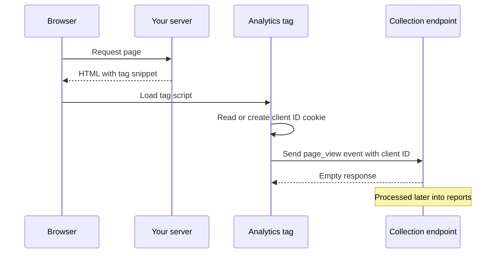
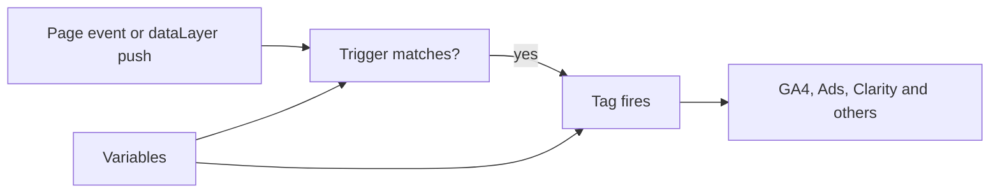
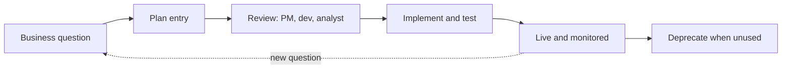
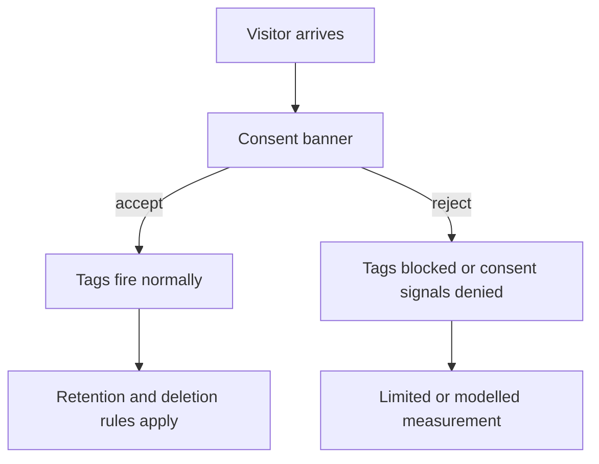
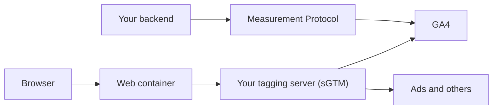
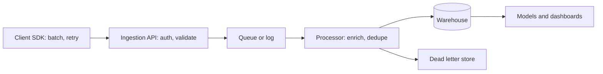
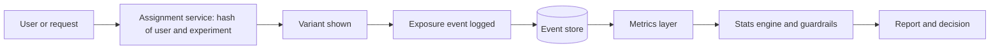

# Web Analytics

[← Back to index](../README.md) · [⭐ Favorites](favorites.md)

63 questions · 0 favorites · [📚 Resources](#resources)

## Contents

**Basic**

- [1. What is web analytics, and what questions does it answer?](#1-what-is-web-analytics-and-what-questions-does-it-answer)
- [2. Which key metrics matter in web analytics, and how are they commonly misread?](#2-which-key-metrics-matter-in-web-analytics-and-how-are-they-commonly-misread)
- [3. How does web tracking work: page tags, cookies and collection requests?](#3-how-does-web-tracking-work-page-tags-cookies-and-collection-requests)
- [4. How is the GA4 data model different from Universal Analytics?](#4-how-is-the-ga4-data-model-different-from-universal-analytics)
- [5. What are the GA4 event categories: automatic, enhanced measurement, recommended and custom?](#5-what-are-the-ga4-event-categories-automatic-enhanced-measurement-recommended-and-custom)
- [6. What are key events (conversions) in GA4 and how do you choose them?](#6-what-are-key-events-conversions-in-ga4-and-how-do-you-choose-them)
- [7. What is the difference between dimensions and metrics, and what are scopes?](#7-what-is-the-difference-between-dimensions-and-metrics-and-what-are-scopes)
- [8. What is the difference between GA4 standard reports and Explorations?](#8-what-is-the-difference-between-ga4-standard-reports-and-explorations)
- [9. What is Google Tag Manager: containers, tags, triggers and variables?](#9-what-is-google-tag-manager-containers-tags-triggers-and-variables)
- [10. What is the data layer, and how does Preview mode help you debug GTM?](#10-what-is-the-data-layer-and-how-does-preview-mode-help-you-debug-gtm)
- [11. Why use Google Tag Manager instead of hard-coding gtag.js?](#11-why-use-google-tag-manager-instead-of-hard-coding-gtagjs)
- [12. What are UTM parameters, and how do source, medium and campaign work?](#12-what-are-utm-parameters-and-how-do-source-medium-and-campaign-work)
- [13. What is Microsoft Clarity, and how is it different from Google Analytics?](#13-what-is-microsoft-clarity-and-how-is-it-different-from-google-analytics)
- [14. What is the difference between quantitative and qualitative analytics?](#14-what-is-the-difference-between-quantitative-and-qualitative-analytics)
- [15. What is the difference between first-party and third-party cookies in analytics?](#15-what-is-the-difference-between-first-party-and-third-party-cookies-in-analytics)
- [16. What are sampling and data thresholds in analytics, at a concept level?](#16-what-are-sampling-and-data-thresholds-in-analytics-at-a-concept-level)

**Intermediate**

- [17. \[Tech Lead\] How do you design and govern a tracking plan?](#17-tech-lead-how-do-you-design-and-govern-a-tracking-plan)
- [18. \[Tech Lead\] How do you implement analytics in a React SPA so it stays maintainable?](#18-tech-lead-how-do-you-implement-analytics-in-a-react-spa-so-it-stays-maintainable)
- [19. \[Tech Lead\] How do you ensure data quality and test tracking?](#19-tech-lead-how-do-you-ensure-data-quality-and-test-tracking)
- [20. \[Tech Lead\] How do you handle privacy, consent and compliance as a product team?](#20-tech-lead-how-do-you-handle-privacy-consent-and-compliance-as-a-product-team)
- [21. \[Tech Lead\] How do tags affect performance, and how do you keep Core Web Vitals healthy?](#21-tech-lead-how-do-tags-affect-performance-and-how-do-you-keep-core-web-vitals-healthy)
- [22. \[Tech Lead\] How do you align product, marketing and engineering on metrics?](#22-tech-lead-how-do-you-align-product-marketing-and-engineering-on-metrics)
- [23. \[Tech Lead\] How do you run A/B tests properly?](#23-tech-lead-how-do-you-run-ab-tests-properly)
- [24. \[Tech Lead\] How do you use analytics to prioritise work and measure feature success?](#24-tech-lead-how-do-you-use-analytics-to-prioritise-work-and-measure-feature-success)
- [25. \[Tech Lead\] How do you choose an analytics vendor strategy and handle data export?](#25-tech-lead-how-do-you-choose-an-analytics-vendor-strategy-and-handle-data-export)
- [26. \[Tech Lead\] How do you explain analytics results to stakeholders?](#26-tech-lead-how-do-you-explain-analytics-results-to-stakeholders)
- [27. How do you implement GA4 with gtag.js in a React single page app, including page views on route change?](#27-how-do-you-implement-ga4-with-gtagjs-in-a-react-single-page-app-including-page-views-on-route-change)
- [28. What is the difference between history change triggers in GTM and router hooks for SPA page views?](#28-what-is-the-difference-between-history-change-triggers-in-gtm-and-router-hooks-for-spa-page-views)
- [29. How does the dataLayer work in depth: push order, variables and ecommerce objects?](#29-how-does-the-datalayer-work-in-depth-push-order-variables-and-ecommerce-objects)
- [30. Which GTM triggers do you use most, and what are their pitfalls?](#30-which-gtm-triggers-do-you-use-most-and-what-are-their-pitfalls)
- [31. What variable types does GTM offer, and when is custom JavaScript a bad idea?](#31-what-variable-types-does-gtm-offer-and-when-is-custom-javascript-a-bad-idea)
- [32. How do you handle tag sequencing, consent-aware firing, workspaces, versions and safe publishing in GTM?](#32-how-do-you-handle-tag-sequencing-consent-aware-firing-workspaces-versions-and-safe-publishing-in-gtm)
- [33. How do custom dimensions, custom metrics, user_id and user properties work in GA4?](#33-how-do-custom-dimensions-custom-metrics-user_id-and-user-properties-work-in-ga4)
- [34. How does cross-domain tracking work in GA4, and what are referral exclusions?](#34-how-does-cross-domain-tracking-work-in-ga4-and-what-are-referral-exclusions)
- [35. How would you design GA4 events and a funnel for a resume builder?](#35-how-would-you-design-ga4-events-and-a-funnel-for-a-resume-builder)
- [36. How does GA4 attribution work, and what are default channel groupings?](#36-how-does-ga4-attribution-work-and-what-are-default-channel-groupings)
- [37. How do you debug missing or wrong GA4 data?](#37-how-do-you-debug-missing-or-wrong-ga4-data)
- [38. How do you filter internal traffic and bots in GA4?](#38-how-do-you-filter-internal-traffic-and-bots-in-ga4)
- [39. How do data retention, thresholds and sampling work in GA4 Explorations?](#39-how-do-data-retention-thresholds-and-sampling-work-in-ga4-explorations)
- [40. How do you query the GA4 BigQuery export with SQL, including unnesting event_params?](#40-how-do-you-query-the-ga4-bigquery-export-with-sql-including-unnesting-event_params)
- [41. What is Consent Mode v2, and how do cookieless pings and modelling work at a concept level?](#41-what-is-consent-mode-v2-and-how-do-cookieless-pings-and-modelling-work-at-a-concept-level)
- [42. How do server-side GTM and the Measurement Protocol work?](#42-how-do-server-side-gtm-and-the-measurement-protocol-work)
- [43. How do you use Microsoft Clarity in practice: install, mask, filter and read signals?](#43-how-do-you-use-microsoft-clarity-in-practice-install-mask-filter-and-read-signals)
- [44. How do you combine Clarity and GA4 for a UX investigation?](#44-how-do-you-combine-clarity-and-ga4-for-a-ux-investigation)
- [45. How do you run a funnel analysis and investigate drop-off?](#45-how-do-you-run-a-funnel-analysis-and-investigate-drop-off)
- [46. How do cohort and retention analysis work?](#46-how-do-cohort-and-retention-analysis-work)
- [47. What are the basics of A/B testing tools and statistics: significance, power and peeking?](#47-what-are-the-basics-of-ab-testing-tools-and-statistics-significance-power-and-peeking)
- [48. How is Core Web Vitals field data collected, and how do analytics tools report performance?](#48-how-is-core-web-vitals-field-data-collected-and-how-do-analytics-tools-report-performance)
- [49. How do ad blockers, ITP and cookie lifetimes affect analytics data?](#49-how-do-ad-blockers-itp-and-cookie-lifetimes-affect-analytics-data)

**Advanced**

- [50. How would you build an event pipeline end to end, and how does it compare with GA4?](#50-how-would-you-build-an-event-pipeline-end-to-end-and-how-does-it-compare-with-ga4)
- [51. How does identity resolution work, and what are its privacy implications?](#51-how-does-identity-resolution-work-and-what-are-its-privacy-implications)
- [52. What are the attribution models, and what pitfalls do they have?](#52-what-are-the-attribution-models-and-what-pitfalls-do-they-have)
- [53. How would you design an experimentation platform at a high level?](#53-how-would-you-design-an-experimentation-platform-at-a-high-level)
- [54. What statistical pitfalls should you watch for in analytics and A/B tests?](#54-what-statistical-pitfalls-should-you-watch-for-in-analytics-and-ab-tests)
- [55. How would you model analytics events in a data warehouse, including sessionisation with SQL?](#55-how-would-you-model-analytics-events-in-a-data-warehouse-including-sessionisation-with-sql)
- [56. What does privacy engineering for analytics involve?](#56-what-does-privacy-engineering-for-analytics-involve)
- [57. How do you measure browser performance and errors (RUM and error tracking) next to analytics?](#57-how-do-you-measure-browser-performance-and-errors-rum-and-error-tracking-next-to-analytics)
- [58. How would you track analytics for AI features?](#58-how-would-you-track-analytics-for-ai-features)
- [59. How do you make tracking reliable on flaky networks and when the page closes?](#59-how-do-you-make-tracking-reliable-on-flaky-networks-and-when-the-page-closes)
- [60. How do you migrate from Universal Analytics or another tool to GA4?](#60-how-do-you-migrate-from-universal-analytics-or-another-tool-to-ga4)
- [61. Interview scenario: GA4 shows 30 percent fewer purchases than the database. How do you investigate?](#61-interview-scenario-ga4-shows-30-percent-fewer-purchases-than-the-database-how-do-you-investigate)
- [62. Interview scenario: bounce rate suddenly dropped to nearly zero. What happened?](#62-interview-scenario-bounce-rate-suddenly-dropped-to-nearly-zero-what-happened)
- [63. Interview scenario: design analytics for a signup funnel.](#63-interview-scenario-design-analytics-for-a-signup-funnel)

## Browse by module

| Module | Questions |
| --- | --- |
| Analytics Fundamentals (6) | [1](#1-what-is-web-analytics-and-what-questions-does-it-answer) · [2](#2-which-key-metrics-matter-in-web-analytics-and-how-are-they-commonly-misread) · [3](#3-how-does-web-tracking-work-page-tags-cookies-and-collection-requests) · [12](#12-what-are-utm-parameters-and-how-do-source-medium-and-campaign-work) · [14](#14-what-is-the-difference-between-quantitative-and-qualitative-analytics) · [58](#58-how-would-you-track-analytics-for-ai-features) |
| Clarity & Behaviour Analytics (3) | [13](#13-what-is-microsoft-clarity-and-how-is-it-different-from-google-analytics) · [43](#43-how-do-you-use-microsoft-clarity-in-practice-install-mask-filter-and-read-signals) · [44](#44-how-do-you-combine-clarity-and-ga4-for-a-ux-investigation) |
| Data & Reporting (9) | [16](#16-what-are-sampling-and-data-thresholds-in-analytics-at-a-concept-level) · [24](#24-tech-lead-how-do-you-use-analytics-to-prioritise-work-and-measure-feature-success) · [25](#25-tech-lead-how-do-you-choose-an-analytics-vendor-strategy-and-handle-data-export) · [39](#39-how-do-data-retention-thresholds-and-sampling-work-in-ga4-explorations) · [40](#40-how-do-you-query-the-ga4-bigquery-export-with-sql-including-unnesting-event_params) · [45](#45-how-do-you-run-a-funnel-analysis-and-investigate-drop-off) · [46](#46-how-do-cohort-and-retention-analysis-work) · [50](#50-how-would-you-build-an-event-pipeline-end-to-end-and-how-does-it-compare-with-ga4) · [55](#55-how-would-you-model-analytics-events-in-a-data-warehouse-including-sessionisation-with-sql) |
| Experimentation & Statistics (4) | [23](#23-tech-lead-how-do-you-run-ab-tests-properly) · [47](#47-what-are-the-basics-of-ab-testing-tools-and-statistics-significance-power-and-peeking) · [53](#53-how-would-you-design-an-experimentation-platform-at-a-high-level) · [54](#54-what-statistical-pitfalls-should-you-watch-for-in-analytics-and-ab-tests) |
| Google Analytics 4 (12) | [4](#4-how-is-the-ga4-data-model-different-from-universal-analytics) · [5](#5-what-are-the-ga4-event-categories-automatic-enhanced-measurement-recommended-and-custom) · [6](#6-what-are-key-events-conversions-in-ga4-and-how-do-you-choose-them) · [7](#7-what-is-the-difference-between-dimensions-and-metrics-and-what-are-scopes) · [8](#8-what-is-the-difference-between-ga4-standard-reports-and-explorations) · [33](#33-how-do-custom-dimensions-custom-metrics-user_id-and-user-properties-work-in-ga4) · [34](#34-how-does-cross-domain-tracking-work-in-ga4-and-what-are-referral-exclusions) · [35](#35-how-would-you-design-ga4-events-and-a-funnel-for-a-resume-builder) · [36](#36-how-does-ga4-attribution-work-and-what-are-default-channel-groupings) · [38](#38-how-do-you-filter-internal-traffic-and-bots-in-ga4) · [52](#52-what-are-the-attribution-models-and-what-pitfalls-do-they-have) · [60](#60-how-do-you-migrate-from-universal-analytics-or-another-tool-to-ga4) |
| Governance & Leadership (4) | [17](#17-tech-lead-how-do-you-design-and-govern-a-tracking-plan) · [22](#22-tech-lead-how-do-you-align-product-marketing-and-engineering-on-metrics) · [26](#26-tech-lead-how-do-you-explain-analytics-results-to-stakeholders) · [63](#63-interview-scenario-design-analytics-for-a-signup-funnel) |
| Implementation & Debugging (11) | [18](#18-tech-lead-how-do-you-implement-analytics-in-a-react-spa-so-it-stays-maintainable) · [19](#19-tech-lead-how-do-you-ensure-data-quality-and-test-tracking) · [21](#21-tech-lead-how-do-tags-affect-performance-and-how-do-you-keep-core-web-vitals-healthy) · [27](#27-how-do-you-implement-ga4-with-gtagjs-in-a-react-single-page-app-including-page-views-on-route-change) · [37](#37-how-do-you-debug-missing-or-wrong-ga4-data) · [42](#42-how-do-server-side-gtm-and-the-measurement-protocol-work) · [48](#48-how-is-core-web-vitals-field-data-collected-and-how-do-analytics-tools-report-performance) · [57](#57-how-do-you-measure-browser-performance-and-errors-rum-and-error-tracking-next-to-analytics) · [59](#59-how-do-you-make-tracking-reliable-on-flaky-networks-and-when-the-page-closes) · [61](#61-interview-scenario-ga4-shows-30-percent-fewer-purchases-than-the-database-how-do-you-investigate) · [62](#62-interview-scenario-bounce-rate-suddenly-dropped-to-nearly-zero-what-happened) |
| Privacy & Consent (6) | [15](#15-what-is-the-difference-between-first-party-and-third-party-cookies-in-analytics) · [20](#20-tech-lead-how-do-you-handle-privacy-consent-and-compliance-as-a-product-team) · [41](#41-what-is-consent-mode-v2-and-how-do-cookieless-pings-and-modelling-work-at-a-concept-level) · [49](#49-how-do-ad-blockers-itp-and-cookie-lifetimes-affect-analytics-data) · [51](#51-how-does-identity-resolution-work-and-what-are-its-privacy-implications) · [56](#56-what-does-privacy-engineering-for-analytics-involve) |
| Tag Manager & Data Layer (8) | [9](#9-what-is-google-tag-manager-containers-tags-triggers-and-variables) · [10](#10-what-is-the-data-layer-and-how-does-preview-mode-help-you-debug-gtm) · [11](#11-why-use-google-tag-manager-instead-of-hard-coding-gtagjs) · [28](#28-what-is-the-difference-between-history-change-triggers-in-gtm-and-router-hooks-for-spa-page-views) · [29](#29-how-does-the-datalayer-work-in-depth-push-order-variables-and-ecommerce-objects) · [30](#30-which-gtm-triggers-do-you-use-most-and-what-are-their-pitfalls) · [31](#31-what-variable-types-does-gtm-offer-and-when-is-custom-javascript-a-bad-idea) · [32](#32-how-do-you-handle-tag-sequencing-consent-aware-firing-workspaces-versions-and-safe-publishing-in-gtm) |

## Basic

### 1. What is web analytics, and what questions does it answer?

**Short answer:** Web analytics is collecting and analysing data about how people find and use your site or app, so you can make better product and marketing decisions. It answers "what happened", and with some extra work "why", but it does not tell you what to build by itself.

Think of it as a shop with a door counter and a camera. You learn how many people came in, where they walked and where they left without buying.

The main questions fall into four groups:

| Group | Example question | Typical data |
| --- | --- | --- |
| Acquisition | Where do visitors come from? | Source, medium, campaign |
| Behaviour | What do they do? Where do they get stuck? | Events, pages, funnels |
| Outcome | Do they sign up, pay, download? | Conversions, revenue |
| Retention | Do they come back? | Cohorts, returning users |

For a resume builder, a good question is "Of the people who pick a template, how many download a resume within seven days, and which channel brings the best ones?" A weak question is "How many page views did we get?", because it does not lead to an action.

Analytics has limits. It is sampled or modelled in places, blocked by some browsers, and it only sees what you tracked. It shows behaviour, not intent. Use it together with user research and experiments.

**Gotcha:** Data without a question becomes a dashboard nobody reads. Start from a decision ("should we simplify the signup form?") and then decide what to measure.

**Interview tip:** Say that analytics is a decision tool. Mention one concrete decision you changed because of data, and one time the data was wrong or misleading and how you found out.

_Module: Analytics Fundamentals · Tags: fundamentals, metrics_

### 2. Which key metrics matter in web analytics, and how are they commonly misread?

**Short answer:** The core metrics are users, sessions, engagement, conversion and retention. Most mistakes come from comparing numbers that are defined differently, or from trusting totals without looking at segments.

| Metric | Meaning | Common misreading |
| --- | --- | --- |
| Users | Distinct people, really distinct browsers or devices | One person on phone and laptop counts twice |
| Sessions | A group of events from one user in a time window | Session length rules differ between tools |
| Engagement rate | Share of sessions that were "engaged" in GA4 | It is not the same as the old bounce rate |
| Conversion rate | Conversions divided by sessions or users | Denominator changes the answer |
| Retention | Share of users who return after day N | Averages hide new versus old cohorts |

In GA4 an engaged session is one that lasted longer than 10 seconds by default, or had a key event, or had at least two page or screen views. Bounce rate in GA4 is simply the opposite of engagement rate. It is not the same formula as Universal Analytics, so you cannot compare old and new bounce rates.

Always ask: what is the denominator, and which time window? A conversion rate "per session" falls when you add cheap traffic, even if revenue grows.

**Common mistakes**
- Treating users as people. They are cookies or app instances.
- Comparing the average of a skewed number (like session duration) instead of the median.
- Reading one week of data and calling it a trend.
- Celebrating total traffic when the conversion rate drops.

**Interview tip:** Show you know that a metric is a definition plus a denominator. Interviewers like it when you say "I would first check how this number is calculated".

_Module: Analytics Fundamentals · Tags: metrics, kpi_

### 3. How does web tracking work: page tags, cookies and collection requests?

**Short answer:** A small script (the tag) runs in the page, reads or creates an anonymous identifier stored in a first-party cookie, and sends events as HTTP requests to a collection endpoint. The vendor's servers then process the events into reports.



Read the diagram top to bottom. The tag does the work in the browser. The server of the vendor only receives requests.

Key parts:
- **Tag or SDK:** JavaScript for the web, an SDK for mobile apps.
- **Client ID:** a random value saved in a cookie. It lets the tool connect events from the same browser. It is not a login.
- **Request:** the tag sends a request, often a GET or POST to a `collect` path, with event name and parameters. You can see it in the browser network tab.
- **Processing:** the vendor adds fields such as country (from IP), device and channel, then stores the data.

If the cookie is cleared or blocked, the next visit looks like a new user. If the tag fails to load, nothing is sent at all.

**Gotcha:** Data collection is client side, so it is lost when scripts are blocked, the page closes early, or consent is denied.

**Interview tip:** Explain this flow in 30 seconds. It sets up every later debugging answer, because each step is a place where data can be lost.

_Module: Analytics Fundamentals · Tags: tracking, cookies, client-id_

### 4. How is the GA4 data model different from Universal Analytics?

**Short answer:** In GA4 every interaction is an event with parameters. There are no hit types such as pageview, event or transaction, and sessions are derived from events. Universal Analytics (UA) used hit types and a category, action, label structure. UA stopped processing data in 2023, so GA4 is the current product.

| Idea | Universal Analytics | GA4 |
| --- | --- | --- |
| Unit of data | Hit (pageview, event, transaction) | Event |
| Event shape | Category, action, label, value | Name plus up to many parameters |
| Session | Defined and stored in the tool | Derived from the `session_start` event and `ga_session_id` |
| Users | Mostly cookie based | Client ID, optional user ID, signals |
| Bounce rate | Single page session | Opposite of engagement rate |
| Data export | Paid feature | BigQuery export available |

Example: in UA a "template picked" action needed a category, action and label. In GA4 you send one event named `template_selected` with parameters like `template_id` and `category`.

```js
// GA4 event with parameters
gtag('event', 'template_selected', {
  template_id: 'modern-02',
  category: 'ats-friendly',
});
```

Parameters are free-form until you register them as custom dimensions or metrics (see the custom dimensions question). Only registered parameters show in standard reports and Explorations, although all of them are in the BigQuery export.

**Gotcha:** Metrics with the same name, such as "users" or "bounce rate", do not match UA. Do not compare them as if they did.

**Interview tip:** Say "events with parameters, sessions derived" and mention that you plan the parameters before launch, because custom definitions are not retroactive.

_Module: Google Analytics 4 · Tags: ga4, data-model_

### 5. What are the GA4 event categories: automatic, enhanced measurement, recommended and custom?

**Short answer:** GA4 has four kinds of events. Automatically collected events come with the tag, enhanced measurement events are optional toggles in the data stream, recommended events have names and parameters Google defines, and custom events are anything you invent.

| Category | Examples | Who sets it up |
| --- | --- | --- |
| Automatically collected | `first_visit`, `session_start`, `page_view` | Nothing to do |
| Enhanced measurement | scroll, outbound click, site search, file download, video | Toggle in the stream settings |
| Recommended | `login`, `sign_up`, `purchase`, `add_to_cart` | You implement, using Google's names |
| Custom | `template_selected`, `resume_downloaded` | You design and implement |

Prefer a recommended event when one fits. Standard reports, ecommerce reports and some features expect those names and parameters. Use custom events only for things that have no recommended equivalent.

Enhanced measurement can surprise you. For example, the file download event fires for common file extensions on links. If your resume download is generated by JavaScript and not a plain link, that event will not fire, and you need your own `resume_downloaded` event. In a single page app, enhanced measurement can also record page views from history changes, which can double count if you also send your own (see the SPA question).

**Gotcha:** Event names are case sensitive. `Sign_Up` and `sign_up` are two events. Reserved names and prefixes exist, so check the current event reference in the Google documentation.

**Interview tip:** Mention that you check the official recommended event list before inventing a name, then record every custom event in a tracking plan.

_Module: Google Analytics 4 · Tags: ga4, events_

### 6. What are key events (conversions) in GA4 and how do you choose them?

**Short answer:** A key event is an event you mark as important for the business, such as `sign_up` or `purchase`. GA4 used to call these "conversions". Google renamed the idea to key events in 2024, and "conversion" now often refers to key events used in Google Ads. Check the current terms in the docs.

How to choose them:
- Pick few. Three to six key events is usual for one product.
- Choose outcomes, not clicks. `resume_downloaded` is better than `button_clicked`.
- Include micro steps if they predict outcomes, for example `template_selected`.
- Make sure each one can be counted reliably, ideally from a server confirmed action.

For a resume builder the list might be: `sign_up`, `resume_downloaded`, `purchase` (or `subscription_started`).

Counting method matters. An event can be counted once per event or once per session. Check the current setting in the key event options. If a user downloads five resumes, you may want one count for the funnel but all five for volume.

Key events also feed Google Ads bidding, so a wrong key event can waste ad budget by teaching the bidder to find the wrong people.

**Common mistakes**
- Marking page views of a thank-you page as the conversion, so a refresh counts twice.
- Marking too many events, so nothing stands out.
- Changing the definition without noting the date. Trends then break.

**Interview tip:** Link every key event to a business goal and an owner. Say that you annotate changes so the team can explain a jump in the numbers later.

_Module: Google Analytics 4 · Tags: ga4, conversions, key-events_

### 7. What is the difference between dimensions and metrics, and what are scopes?

**Short answer:** A dimension is an attribute you group by, such as country or page path. A metric is a number you measure, such as event count or users. Scope says what level the attribute belongs to: event, session or user.

Think of a spreadsheet. Dimensions are the row labels. Metrics are the numbers in the cells.

| Example | Type | Scope |
| --- | --- | --- |
| Page path | Dimension | Event |
| Session source / medium | Dimension | Session |
| User first source | Dimension | User |
| Event count | Metric | Event |
| Active users | Metric | User |

Scope causes real bugs. If you register a custom dimension at event scope but try to segment users by it, the numbers do not behave as you expect. Some combinations of dimension and metric are not compatible, and the report shows an error or a zero. The Google documentation has a dimensions and metrics explorer that shows which fields work together.

Example: a user property such as `plan = pro` is user scoped. It stays on the user across events. A parameter such as `template_id` is event scoped. It describes just that one event.

```js
// user scope: describes the person from now on
gtag('set', 'user_properties', { plan: 'pro' });
// event scope: describes only this event
gtag('event', 'template_selected', { template_id: 'modern-02' });
```

**Gotcha:** A custom dimension only collects data from the day you register it. It is not retroactive.

**Interview tip:** If asked "why is my report empty", mention incompatible scopes as a cause alongside missing registration.

_Module: Google Analytics 4 · Tags: ga4, dimensions, metrics_

### 8. What is the difference between GA4 standard reports and Explorations?

**Short answer:** Standard reports are fixed, fast, pre-aggregated views for everyday questions. Explorations are a flexible workspace where you build funnels, paths, segment overlaps and free-form tables. Explorations are more powerful but more limited by sampling, thresholds and row limits.

| Feature | Standard reports | Explorations |
| --- | --- | --- |
| Purpose | Regular monitoring | Deep investigation |
| Flexibility | Low, some customisation | High |
| Speed | Fast | Slower on large data |
| Sampling | Rarely | Possible on large queries |
| Sharing | Easy | Shareable, but needs care |

Useful exploration types:
- **Funnel exploration:** step by step drop-off, open or closed funnel.
- **Path exploration:** what users do after or before an event.
- **Free form:** a pivot table with segments and filters.
- **Segment overlap and user lifetime:** compare groups.

A good habit is to build in the Explorations, then move the valuable view to a saved report, a dashboard (for example in Looker Studio), or SQL on the BigQuery export for a stable definition.

**Gotcha:** Explorations have data retention settings. Event level data used there is kept for a limited period that you set in the property settings, so very old behavioural drill-downs may not be available. Check the current maximum in the docs.

**Interview tip:** Say you prototype in Explorations and then freeze the metric definition in one governed place, so the whole company reads the same number.

_Module: Google Analytics 4 · Tags: ga4, reports, explorations_

### 9. What is Google Tag Manager: containers, tags, triggers and variables?

**Short answer:** Google Tag Manager (GTM) is a tool that lets you manage tracking scripts without changing site code every time. You add one container snippet to the site, and then configure tags, triggers and variables in the GTM web interface.

| Concept | What it is | Example |
| --- | --- | --- |
| Container | The bundle of config loaded by one snippet | One per site or app |
| Tag | A piece of work to run | Send a GA4 event |
| Trigger | The condition that fires a tag | Click on a button, custom event |
| Variable | A value tags and triggers read | Page path, data layer value |

The flow is simple: something happens, a trigger matches, the tag fires, and variables supply the data.



Read it left to right. Variables feed both the trigger check and the tag content.

Changes are made in a workspace, tested in preview mode, saved as a version and then published. This gives you history and a way to roll back.

**Gotcha:** GTM is powerful. Anyone with publish rights can run arbitrary JavaScript on your site through a custom HTML tag. That is a security and performance risk, so limit access and review changes.

**Interview tip:** Describe GTM as a delivery mechanism and a place for rules, not a replacement for a clean tracking design.

_Module: Tag Manager & Data Layer · Tags: gtm, tags, triggers_

### 10. What is the data layer, and how does Preview mode help you debug GTM?

**Short answer:** The data layer is a JavaScript array named `dataLayer` where your code puts structured information for GTM to read. Preview mode (Tag Assistant) shows, step by step, which events happened, which tags fired and what the variables contained.

Your code pushes plain objects. GTM reads them in order. A push with an `event` key creates a custom event that triggers can match.

```js
window.dataLayer = window.dataLayer || [];
window.dataLayer.push({
  event: 'resume_downloaded', // used by a Custom Event trigger
  format: 'pdf',
  template_id: 'modern-02',
});
```

In GTM you create a Custom Event trigger for `resume_downloaded`, data layer variables for `format` and `template_id`, and a GA4 event tag that uses them.

In Preview mode you open your site, and a panel lists every event in order, such as Container Loaded, DOM Ready, Window Loaded and your custom events. For each one you can see:
- tags that fired and tags that did not fire, with the reason,
- variable values at that moment,
- the data layer state.

Using this panel is the fastest way to find out why a tag did not fire, for example because the trigger condition did not match or a variable was undefined.

**Gotcha:** The data layer is read at the time of each event. If you push the data after the event that needs it, the variable is empty. Push data first, or in the same object as the event.

**Interview tip:** Say that the data layer is the contract between developers and the tagging tool, so DOM scraping in GTM is a last resort.

_Module: Tag Manager & Data Layer · Tags: gtm, datalayer, debugging_

### 11. Why use Google Tag Manager instead of hard-coding gtag.js?

**Short answer:** GTM lets non-developers add and change tags without a code release and gives you versioning and preview. Hard-coded gtag gives you fewer moving parts, less overhead and full control in code review. The right choice depends on who owns tracking and how many tools you use.

| Question | GTM | Hard-coded gtag |
| --- | --- | --- |
| Change speed | Fast, no deploy | Needs a code release |
| Reviewed in Git | Not by default | Yes |
| Multiple vendors | Easy | More code |
| Risk of misuse | Higher, arbitrary scripts | Lower |
| Performance | Extra container script | Lean |
| Testing in CI | Harder | Easier |

Use GTM when marketing runs many tags (ads, pixels, Clarity, GA4) and needs to move quickly. Use hard-coded or a thin code layer when the team is mostly engineers, tracking is small, and quality and reviews matter most.

A common middle path works well: engineers push clean events to the data layer from code, reviewed in Git, and GTM only maps those events to vendors. Then the contract is in code and distribution is in GTM.

**Gotcha:** With GTM, tracking logic can live in a UI where nobody reviews it. Use workspaces, version notes and approvals, and export the container JSON to Git on a schedule.

**Interview tip:** Avoid saying GTM is always better. Show that you weigh speed against control, and describe the data layer contract as the compromise.

_Module: Tag Manager & Data Layer · Tags: gtm, gtag, trade-offs_

### 12. What are UTM parameters, and how do source, medium and campaign work?

**Short answer:** UTM parameters are tags you add to a link URL, such as `utm_source` and `utm_medium`, so analytics knows which campaign sent a visitor. Source says where, medium says the type of channel, and campaign says which initiative.

Example link:

```text
https://app.example.com/?utm_source=newsletter&utm_medium=email&utm_campaign=spring_launch
```

| Parameter | Meaning | Example |
| --- | --- | --- |
| `utm_source` | The sender | `google`, `newsletter`, `linkedin` |
| `utm_medium` | The channel type | `cpc`, `email`, `social` |
| `utm_campaign` | The named campaign | `spring_launch` |
| `utm_content` | Which ad or link variant | `hero_button` |
| `utm_term` | Paid keyword | `resume_builder` |

GA4 also reads `gclid` automatically for Google Ads when auto-tagging is on. Do not tag Google Ads links by hand if auto-tagging is enabled, because they can conflict.

Rules that keep data clean:
- Use lowercase only. `Email` and `email` are different values.
- Agree on a fixed list of mediums so channel groups work.
- Never put personal data in UTMs. They show in URLs, logs and referrers.
- Do not use UTMs on internal links. They start a new session and overwrite the real source.

**Gotcha:** Typos produce an "unassigned" channel in reports. Use a shared builder sheet or a small validator.

**Interview tip:** Mention internal-link UTMs as a classic mistake. It shows you have seen real data.

_Module: Analytics Fundamentals · Tags: utm, attribution, campaigns_

### 13. What is Microsoft Clarity, and how is it different from Google Analytics?

**Short answer:** Microsoft Clarity is a free behaviour analytics tool that shows how people use pages: session recordings, heatmaps and signals of frustration. Google Analytics counts and attributes events. Clarity lets you watch what happened. They answer different questions and work well together.

| Feature | Google Analytics 4 | Microsoft Clarity |
| --- | --- | --- |
| Main output | Numbers, funnels, attribution | Recordings, heatmaps |
| Question | How many? Which channel? | What exactly did the user do? |
| Event model | Events with parameters | Mostly automatic interaction capture |
| Frustration signals | No | Rage clicks, dead clicks, quick backs |
| Best for | Measuring and reporting | Investigating and explaining |

Useful Clarity terms:
- **Rage click:** many fast clicks in one spot, often a sign something looks clickable but does not respond.
- **Dead click:** a click that causes nothing visible.
- **Excessive scrolling and quick back:** signs of confusion.
- **Heatmap:** an overlay of clicks or scroll depth on a page.

Example: GA4 shows that 60 percent of people leave the template page. Clarity recordings reveal that on mobile the "Next" button sits under a cookie banner. The number told you where, the recording told you why.

Check current free-plan limits and data retention in the official Clarity documentation, since they can change.

**Gotcha:** Recordings may capture sensitive text. You must configure masking and respect consent (see the Clarity practice question).

**Interview tip:** Present them as a pair: GA4 finds the problem, Clarity helps to understand it, an experiment proves the fix.

_Module: Clarity & Behaviour Analytics · Tags: clarity, heatmaps, session-recordings_

### 14. What is the difference between quantitative and qualitative analytics?

**Short answer:** Quantitative analytics measures how many and how much, with numbers. Qualitative analytics explains why, with observations, recordings, interviews and open feedback. Good product decisions use both.

| Type | Tools | Answers | Weakness |
| --- | --- | --- | --- |
| Quantitative | GA4, product analytics, SQL | How many users drop at step 3? | Does not say why |
| Qualitative | Clarity, interviews, surveys, usability tests | Why do they drop? | Small samples, can mislead |

A simple loop:
1. Use numbers to find a problem (funnel step with high drop-off).
2. Use qualitative tools to form a hypothesis (recordings, user calls).
3. Run an A/B test to check the fix (quantitative again).
4. Roll out and monitor.

Be careful with qualitative samples. Watching ten recordings can show you real bugs, but it cannot tell you how common the issue is. Go back to the numbers to size it, for example by filtering Clarity sessions by the same segment and comparing with GA4.

Another example: a survey says users want more templates. Analytics shows 80 percent of downloads use only three templates. The two together suggest quality over quantity.

**Gotcha:** Do not treat a vivid recording as proof. One strange session is a story, not a statistic.

**Interview tip:** Describe the loop above. It shows you use methods in order instead of picking a favourite tool.

_Module: Analytics Fundamentals · Tags: quantitative, qualitative, research_

### 15. What is the difference between first-party and third-party cookies in analytics?

**Short answer:** A first-party cookie is set by the site the user is visiting (or its own domain). A third-party cookie is set by another domain loaded in the page, such as an ad network. Browsers block or limit third-party cookies, so modern analytics relies on first-party cookies.

GA4 sets its cookies (like `_ga`) on your own domain through JavaScript, so they are first-party in the technical sense. The data still goes to Google's servers. Being first-party does not mean the tracking is exempt from consent laws.

| Cookie type | Set by | Browser treatment | Typical use |
| --- | --- | --- | --- |
| First-party | Your domain | Allowed, but lifetime may be capped | Client ID, session |
| Third-party | Another domain | Blocked in Safari and Firefox by default | Ad tracking, cross-site |

Some browsers (Safari with ITP) cap the lifetime of cookies written by JavaScript. This shortens how long a returning visitor is recognised, so returning users may be counted as new. Server-set first-party cookies can last longer, which is one reason teams use server-side tagging.

Regarding consent: in the EU the ePrivacy rules cover storing or reading information on the device, not only cookies. That includes local storage and similar. In general terms, analytics cookies need consent in many cases. This is not legal advice, so involve your legal team.

**Gotcha:** "First-party" is a technical label, not a legal one.

**Interview tip:** Show you separate three things: where a cookie is set, how long the browser lets it live, and whether the law needs consent.

_Module: Privacy & Consent · Tags: cookies, privacy, first-party_

### 16. What are sampling and data thresholds in analytics, at a concept level?

**Short answer:** Sampling means a report is calculated from a subset of the data to be faster, then scaled up. Thresholds mean the tool hides rows when counts are small, to protect privacy. Both make numbers approximate or missing, and you should know when they apply.

Why tools do it:
- **Sampling** saves compute on big queries, mostly in flexible reports like Explorations. The tool shows an indicator when the data was sampled.
- **Thresholds** can apply when Google signals or demographic data is in use. Rows with very few users are withheld so that individuals cannot be identified.

Related effects in GA4:
- High cardinality dimensions (such as page URL with random IDs) can group extra values into an "(other)" row.
- Some reports use modelled data to fill gaps from denied consent.

How to cope:
- Narrow the date range or reduce dimensions to avoid sampling.
- Use the BigQuery export for exact event counts.
- Do not use a report with thresholds for small segment decisions.
- Check the current limits in the official documentation because they change.

```text
Exploration shows a shield or percentage icon -> data is sampled or thresholded
```

**Gotcha:** Two reports can disagree by a few percent only because one is sampled and the other is not. Check this before filing a bug.

**Interview tip:** A strong answer says that for money or compliance numbers you use unsampled sources such as BigQuery or the database, and use GA4 for trends.

_Module: Data & Reporting · Tags: sampling, thresholds, data-quality_

## Intermediate

### 17. [Tech Lead] How do you design and govern a tracking plan?

**Short answer:** A tracking plan is a living document that lists every event, its parameters, when it fires, who owns it and which business question it serves. You govern it like an API: naming rules, review for every change, versioning and a clear owner.

What goes in the plan:
- **Event name** in a fixed style, for example `snake_case`, verb in past tense: `template_selected`.
- **Trigger description:** exactly when it fires, and where in the code.
- **Parameters:** name, type, allowed values, example, and whether it is required.
- **Destinations:** GA4, Clarity, warehouse.
- **Owner and status:** proposed, live, deprecated.
- **Question it answers.** If there is none, do not track it.



Read it as a loop: nothing gets tracked without a question, and unused events are retired.

Naming conventions that save pain: lowercase, one word order (`object_action`), no spaces, no PII, one shared parameter dictionary (`template_id` means the same thing everywhere), and reserved GA4 names avoided.

Treat the plan as code: keep it in the repository as JSON or YAML, so a CI check and TypeScript types can be generated from it. Changes go through a pull request, which gives history and review for free.

**Gotcha:** A spreadsheet that nobody enforces drifts within weeks. The plan must be connected to code and tests.

**Interview tip:** Say "the tracking plan is a contract, with an owner and a change process". It shows you lead analytics like engineering, not like a one-off task.

_Module: Governance & Leadership · Tags: tech-lead, tracking-plan, governance_

### 18. [Tech Lead] How do you implement analytics in a React SPA so it stays maintainable?

**Short answer:** Put one analytics layer between your components and the vendors. Components call typed functions like `track('resume_downloaded', {...})`. The layer handles consent, validation, queueing and the vendor calls. No component should call `gtag` or `dataLayer.push` directly.

Benefits: you can change vendors, test with a fake, add consent rules in one place, and enforce the tracking plan with types.

```ts
// analytics/events.ts: the plan as types
export type AnalyticsEvents = {
  template_selected: { template_id: string; category: string };
  resume_downloaded: { template_id: string; format: 'pdf' | 'docx' };
  sign_up: { method: 'email' | 'google' };
};

// analytics/track.ts
type Sink = (name: string, params: object) => void;
const sinks: Sink[] = [(n, p) => (window as any).dataLayer?.push({ event: n, ...p })];

export function track<K extends keyof AnalyticsEvents>(
  name: K,
  params: AnalyticsEvents[K],
) {
  if (!hasConsent('analytics')) return; // one place for consent
  sinks.forEach((s) => s(name, params));
}
declare function hasConsent(kind: string): boolean;
```

```tsx
// a component only knows the typed function
<button onClick={() => track('resume_downloaded', { template_id: id, format: 'pdf' })}>
  Download
</button>
```

Other parts of the layer:
- A `usePageView` hook that sends a view on route change.
- Declarative tracking for simple clicks, if you have many (a `data-track` attribute handled centrally).
- A test sink that records events so unit tests can assert on them.

**Gotcha:** Do not track inside render or effects with unstable dependencies. This causes duplicate events. Track from event handlers and from route changes.

**Interview tip:** Mention that typed events make a wrong parameter a compile error, so QA starts before the code runs.

_Module: Implementation & Debugging · Tags: tech-lead, react, architecture_

### 19. [Tech Lead] How do you ensure data quality and test tracking?

**Short answer:** Test tracking in layers: types and unit tests for event shapes, automated browser tests for the critical events, manual checks in debug tools before release, and monitoring in production to catch broken tags quickly.

| Layer | What it catches | Tool |
| --- | --- | --- |
| Types and schema | Wrong names or parameters | TypeScript, a plan validator in CI |
| Unit test | Handler calls `track` with right data | Jest or Vitest with a fake sink |
| End-to-end | Event really reaches the network | Playwright, intercept the `collect` request |
| Manual QA | GTM triggers, consent behaviour | GTM Preview, GA4 DebugView |
| Production | Sudden drops, spikes, nulls | Alerts on daily event counts |

A good monitoring plan:
- Alert when a key event count drops by a large share compared with the same weekday last week.
- Watch for `(not set)` growth in important dimensions.
- Keep a test property or a separate GTM environment for staging, so test traffic never pollutes production.
- Compare analytics totals to a source of truth, such as orders in the database, each week.

In CI, a short script can check that every `track()` call uses an event in the plan. Failing the build for an unknown event is cheap and effective.

**Common mistakes**
- Testing only the happy path and skipping consent-denied and ad-blocked cases.
- Releasing the app and the GTM container in the wrong order.
- Having no owner for the alerts.

**Interview tip:** Say you treat tracking as a feature with acceptance criteria and a definition of done, not as a task after release.

_Module: Implementation & Debugging · Tags: tech-lead, data-quality, testing_

### 20. [Tech Lead] How do you handle privacy, consent and compliance as a product team?

**Short answer:** Collect only what you need, never send personal data to analytics tools, ask for consent where the law requires it and make the tags respect the answer. Keep retention short and have a way to delete data on request. Work with legal advice. This answer is general information, not legal advice.

Principles in plain words:
- **Data minimisation:** if you cannot name the decision a field supports, do not collect it.
- **No PII in analytics:** no emails, names, phone numbers, CV text, or IDs that can be reversed. This applies to URLs and page titles too, for example `/profile?email=...`.
- **Consent:** in the EU and UK, most analytics and advertising needs prior consent. Use a consent management platform (CMP) and connect it to GTM and Consent Mode.
- **Retention:** set the shortest retention that serves your needs and check it in the property settings.
- **Deletion and access requests:** know where a user's data lives (analytics, warehouse, support tools) and how to remove it.
- **Vendors:** keep a list of processors and the data they receive.



For a resume builder this matters a lot: resumes contain names, addresses and work history. Analytics events must carry template IDs and counts, never resume content.

**Gotcha:** Developers often leak PII through error messages, URLs and custom dimensions. Add automated scans for email patterns in outgoing events.

**Interview tip:** Show shared ownership: product defines purpose, engineering enforces it in code, legal confirms the rules.

_Module: Privacy & Consent · Tags: tech-lead, privacy, consent_

### 21. [Tech Lead] How do tags affect performance, and how do you keep Core Web Vitals healthy?

**Short answer:** Every tag adds network requests and JavaScript work, which can hurt loading and interaction metrics. Keep the tag count small, load scripts asynchronously and late, audit the GTM container regularly, and consider server-side tagging to move work off the device.

Core Web Vitals are Largest Contentful Paint (LCP, loading), Interaction to Next Paint (INP, responsiveness) and Cumulative Layout Shift (CLS, stability). Tags mostly hurt INP through long main-thread tasks, and LCP through competing requests. Banners and widgets injected late can hurt CLS.

Practical rules:
- Load the GA4 and GTM scripts with `async`. Never block rendering.
- Delay non-essential tags (chat widgets, heatmaps) until after the page is interactive, or after first user input.
- Remove tags nobody uses. A yearly container clean-up usually finds many.
- Avoid custom HTML tags with heavy scripts. Prefer official templates.
- Reserve space for banners to avoid layout shift.
- Measure before and after with field data (real users), not only lab runs.

| Option | Idea | Trade-off |
| --- | --- | --- |
| Client-side tags | Simple | More work on user device |
| Server-side GTM | Browser sends one request, server forwards | Hosting cost and complexity |
| Web Worker offload | Run tag code off main thread | Setup effort and compatibility |

Check the current list of tag template and consent features in the docs before choosing.

**Gotcha:** Server-side tagging reduces browser work, but it does not remove consent duties.

**Interview tip:** Quote the trade-off: measurement has a performance cost, so each tag must justify itself with a decision it supports.

_Module: Implementation & Debugging · Tags: tech-lead, performance, core-web-vitals_

### 22. [Tech Lead] How do you align product, marketing and engineering on metrics?

**Short answer:** Agree on a small set of shared metrics with written definitions, one owner and one source of truth. Start from a north star metric that reflects delivered customer value, add a few supporting KPIs, and guard against vanity metrics.

Steps I would take:
1. **Pick the north star.** For a resume builder it could be "resumes downloaded by users who then apply for jobs", or a simpler proxy like weekly users who download a resume. It must reflect value, not just activity.
2. **Break it into drivers:** visits, signup rate, template selection, completion rate, return rate.
3. **Define each metric in writing:** numerator, denominator, time window, exclusions, and the system it comes from.
4. **Name an owner** who answers questions about each number.
5. **Review on a schedule,** weekly for operations, monthly for strategy.

| Good metric | Vanity metric |
| --- | --- |
| Activation rate within 7 days | Total registered users |
| Download completion rate | Page views |
| Retained users after 30 days | App downloads |

Each team sees a different side. Marketing cares about acquisition cost and channel quality. Product cares about activation and retention. Engineering cares about reliability and speed that drive both. A shared dashboard with the same definitions stops arguments about whose number is right.

**Gotcha:** If two dashboards show different totals for the same name, trust drops quickly. Publish the definition next to the number.

**Interview tip:** Say that a metric without an owner and a definition is an opinion. Also mention guardrail metrics, such as page speed, so a growth push does not damage quality.

_Module: Governance & Leadership · Tags: tech-lead, metrics, kpi_

### 23. [Tech Lead] How do you run A/B tests properly?

**Short answer:** Start with a hypothesis and one primary metric, compute the sample size before you start, randomise properly, run for full weekly cycles, check for sample ratio mismatch, and do not stop early just because the result looks good.

Checklist:
- **Hypothesis:** "Showing a progress bar will raise signup completion by at least 2 percentage points because people see how short the form is."
- **Primary metric and guardrails:** signup rate is primary. Guardrails such as page load time and support tickets must not get worse.
- **Sample size:** depends on the baseline rate, the smallest effect worth detecting, significance (often 5 percent) and power (often 80 percent). Decide it up front.
- **Duration:** include at least one or two full weeks to cover weekday patterns. Do not stop at the first day.
- **Randomisation unit:** usually user, kept stable across visits.
- **SRM check:** compare the actual split with the planned one.
- **One decision rule,** written before the test.

Pitfalls to name:
- **Peeking:** checking daily and stopping on the first significant result inflates false positives.
- **Novelty effect:** a new design gets extra clicks at first, then settles.
- **Many metrics:** if you check 20 metrics, one will look significant by luck.
- **Interaction:** two tests on the same page can influence each other.

A test that shows no significant difference is still a result. It says the change did not matter at that size.

**Gotcha:** Statistical significance is not business significance. A tiny lift may not repay the maintenance cost.

**Interview tip:** Mention SRM and peeking. Most candidates only mention significance, so these two stand out.

_Module: Experimentation & Statistics · Tags: tech-lead, ab-testing, statistics_

### 24. [Tech Lead] How do you use analytics to prioritise work and measure feature success?

**Short answer:** Before building, define the success metric and the target. After release, compare against that target and a baseline, and decide whether to keep, improve or remove the feature. Use funnels and drop-offs to find where the biggest user pain is.

A simple process:
1. **Find the problem.** Use a funnel to see the largest drop (for example, 45 percent leave at template selection).
2. **Size the opportunity.** If you fix half of that drop, how many more downloads per month?
3. **Compare options** with a simple score: expected impact, confidence, effort.
4. **Define success** before building: "template selection to editor start rises from 55 to 62 percent in four weeks".
5. **Ship behind a flag** and, where traffic allows, test it.
6. **Review** after the agreed period and write down what you learned.

Also measure feature adoption: how many eligible users used the feature, how often, and whether those users retain better. Be careful with correlation. Users who use a feature may be your most active users anyway. An experiment or a before-and-after with a control group is better evidence.

Do not forget the cost side. A feature used by 1 percent of users that needs a lot of maintenance may be a candidate to remove.

**Common mistakes**
- Shipping with no success metric, then arguing about whether it worked.
- Measuring the launch week only.
- Ignoring segments such as mobile versus desktop.

**Interview tip:** Say "no feature without a success metric and a review date". It shows ownership of outcomes, not only delivery.

_Module: Data & Reporting · Tags: tech-lead, product, prioritisation_

### 25. [Tech Lead] How do you choose an analytics vendor strategy and handle data export?

**Short answer:** Choose based on the questions you must answer, the privacy rules you face and the skills you have. Use GA4 for marketing and acquisition, a product analytics tool for in-product behaviour, and a warehouse as the source of truth. Always keep an export path so you are not locked in.

| Option | Strength | Watch out for |
| --- | --- | --- |
| GA4 | Free to start, ads integration, acquisition | Complex model, sampling in the UI, privacy review |
| Mixpanel, Amplitude | Strong funnels, cohorts, user-level analysis | Cost grows with volume, needs governance |
| PostHog | Open source, self-host or cloud, analytics plus flags and replay | You run and tune it if self-hosting |
| Matomo | Self-host, strong data ownership | Operations effort, fewer ad integrations |
| Warehouse (BigQuery and similar) | Full control, SQL, joins with business data | Needs data engineering skills |

Decision factors: data residency and privacy needs, volume, who will use it (marketers or product analysts), integration with ad platforms, cost, and the skills in the team. Check current pricing and free tiers in vendor documentation. They change.

GA4 offers a BigQuery export of raw events, which is the main way to avoid UI limits. In the warehouse you can join events with orders and subscriptions, build stable metric definitions, and keep data longer than the UI allows. The export has its own cost and daily or streaming options. Check current details.

Plan for exit: keep your event schema vendor neutral, store a copy of raw events, and avoid vendor-specific logic in components.

**Gotcha:** Running two tools without a clear split makes numbers disagree and nobody trusts either. Say which tool answers which question.

**Interview tip:** Say "own the event schema, rent the tool". It signals strategy.

_Module: Data & Reporting · Tags: tech-lead, vendors, bigquery_

### 26. [Tech Lead] How do you explain analytics results to stakeholders?

**Short answer:** Lead with the decision and the answer, show one clear chart, state how confident you are and why, and say what you recommend. Avoid dumping dashboards or tool jargon.

A simple structure:
1. **Answer first:** "Signup completion fell from 38 to 31 percent after the form change."
2. **Evidence:** one chart with a baseline and clear labels. Show the date of the change.
3. **Confidence:** sample size, whether it is statistically supported, known data issues such as consent loss.
4. **Cause or hypothesis:** what you checked and ruled out (traffic mix, tracking bug, seasonality).
5. **Recommendation and next step:** revert, test a variant, or investigate further, with an owner and a date.

Tips for different audiences:
- **Executives:** impact on money and goals, in a few sentences.
- **Marketing:** channel and campaign level, with comparable periods.
- **Engineering:** exact event names, release dates, segments affected.

Be honest about uncertainty. Say "the data suggests", not "the data proves". Explain that numbers from analytics tools are estimates because of blocking, consent and sampling. If the number matters for money, say you checked it against the database.

Mistakes to avoid: showing averages without distribution, comparing a holiday week with a normal week, and hiding a tracking issue that you found.

**Gotcha:** Telling a story without checking data quality first can send the team in the wrong direction. State your data checks.

**Interview tip:** Give an example where you changed a stakeholder's mind with one chart. Keep it short and concrete.

_Module: Governance & Leadership · Tags: tech-lead, communication, reporting_

### 27. How do you implement GA4 with gtag.js in a React single page app, including page views on route change?

**Short answer:** Load gtag.js once, turn off the automatic page view in the config, and send a `page_view` event yourself whenever the route changes. In a single page app (SPA) the browser does not load a new page on navigation, so without this you only count the first page.

Add the script once (in `index.html`), with `send_page_view` disabled:

```html
<script async src="https://www.googletagmanager.com/gtag/js?id=G-XXXXXXX"></script>
<script>
  window.dataLayer = window.dataLayer || [];
  function gtag(){ dataLayer.push(arguments); }
  gtag('js', new Date());
  gtag('config', 'G-XXXXXXX', { send_page_view: false });
</script>
```

Then a hook sends a view on each route change (React Router example):

```tsx
import { useEffect } from 'react';
import { useLocation } from 'react-router-dom';

declare function gtag(...args: unknown[]): void;

export function usePageViews() {
  const { pathname, search } = useLocation();
  useEffect(() => {
    gtag('event', 'page_view', {
      page_path: pathname + search,
      page_location: window.location.href,
      page_title: document.title,
    });
  }, [pathname, search]);
}
```

Call `usePageViews()` once, in a component inside the router, such as the app layout.

**Gotchas**
- **Double counting:** GA4 enhanced measurement can also record page views on history changes. If you send your own, turn off "Page changes based on browser history events" in the stream settings, or do not send your own. Choose one.
- **React StrictMode** runs effects twice in development only. Do not judge counts in dev.
- **Page title:** it may not have updated yet when the effect runs. Set the title before the call.
- Remove query parameters that contain personal data from `page_location`.

**Interview tip:** Say "one source of page views". Naming the double counting risk shows real experience.

_Module: Implementation & Debugging · Tags: ga4, gtag, react, spa_

### 28. What is the difference between history change triggers in GTM and router hooks for SPA page views?

**Short answer:** A GTM History Change trigger listens to the browser history API from outside your code and fires a tag. A router hook inside the app pushes an explicit event to the data layer. The hook is more reliable and testable; the history trigger needs no code change but can mis-fire.

| Approach | Pros | Cons |
| --- | --- | --- |
| GTM History Change trigger | No code change, quick | Fires on hash or query changes you may not want, page title timing, hard to test in CI |
| Router hook pushes event | Exact control, typed, testable | Needs a developer |

Router hook version:

```tsx
import { useEffect } from 'react';
import { useLocation } from 'react-router-dom';

export function useVirtualPageView() {
  const location = useLocation();
  useEffect(() => {
    window.dataLayer = window.dataLayer || [];
    window.dataLayer.push({
      event: 'virtual_page_view',
      page_path: location.pathname,
      page_title: document.title,
    });
  }, [location.pathname]);
}
```

In GTM you create a Custom Event trigger for `virtual_page_view` and a GA4 event tag named `page_view` using the data layer variables. Make sure the automatic page view on the GA4 configuration is not firing a second time on history changes.

Problems with the history trigger: the variables for page URL can still hold the old value when the tag fires, redirects fire several events, and a modal that changes the URL hash may be counted as a page.

For Next.js, use the router events (or `usePathname` and `useSearchParams` in the App Router) in a client component. Check the current Next.js docs for the supported hooks.

**Gotcha:** Whichever you pick, test with GTM Preview and watch the network tab to confirm exactly one `page_view` per navigation.

**Interview tip:** Recommend explicit events from code and use the history trigger only as a quick fix.

_Module: Tag Manager & Data Layer · Tags: gtm, spa, page-view_

### 29. How does the dataLayer work in depth: push order, variables and ecommerce objects?

**Short answer:** `dataLayer` is an array that GTM watches. Each `push` merges its keys into GTM's internal data model, and a push containing an `event` key also fires the matching triggers. Order matters, because a trigger sees the model as it is at that moment.

Rules that matter:
- Keys from earlier pushes stay in the model until you overwrite them. This is useful for page-level values, and dangerous for stale event values.
- The GTM snippet reads items pushed before it loaded, in order.
- Never reassign `window.dataLayer = [...]` after GTM loads. This breaks the connection. Always use `push`.
- Nested objects are merged recursively, but arrays are replaced.

Ecommerce data should be cleared before each push so old items do not leak into the next event:

```js
window.dataLayer = window.dataLayer || [];
dataLayer.push({ ecommerce: null }); // clear the previous ecommerce object
dataLayer.push({
  event: 'purchase',
  ecommerce: {
    transaction_id: 'T-1042',
    value: 9.99,
    currency: 'USD',
    items: [{ item_id: 'pro-monthly', item_name: 'Pro plan', price: 9.99, quantity: 1 }],
  },
});
```

In GTM you read these through a Data Layer Variable, for example `ecommerce.items`. The GA4 event tag can send the `ecommerce` object directly with the "send ecommerce data" option.

Think of the data layer as a message bus plus a small shared state. Prefer small, flat, well-named keys with stable types (a number stays a number).

**Gotcha:** Pushing the event before the data (`event` first, details in a second push) means the tag fires with empty variables. Put everything in the same push.

**Interview tip:** Mention clearing the ecommerce object and never reassigning `dataLayer`. These are classic bugs.

_Module: Tag Manager & Data Layer · Tags: gtm, datalayer, ecommerce_

### 30. Which GTM triggers do you use most, and what are their pitfalls?

**Short answer:** Custom Event triggers on data layer pushes are the most reliable. Click, form, scroll, visibility and history triggers are useful when you cannot change the code, but each has traps with dynamic or React pages.

| Trigger | Use | Pitfall |
| --- | --- | --- |
| Custom Event | Fire on a `dataLayer` event name | Name must match exactly; case sensitive |
| Click (all or links only) | Track buttons and links | Click target may be a child element; use "Click Element matches CSS selector" |
| Form Submission | Classic form submits | Does not work for AJAX or React forms without a real submit; often fires before validation passes |
| Scroll Depth | 25, 50, 75, 90 percent | Page height changes in SPAs; double fires |
| Element Visibility | When an element appears | Needs a stable selector; can fire repeatedly |
| History Change | SPA navigation | See the SPA question; mis-fires on hash changes |
| Timer | Time on page | Keeps running in background tabs |
| Page View, DOM Ready, Window Loaded | Basic timing | Use DOM Ready only when you need elements |

A better approach for React apps: let the component push a custom event in its handler, because the code knows exactly when the action succeeded. For example, push `sign_up` only after the server confirms the account, not on the button click.

```js
// in the success handler of the signup request
window.dataLayer.push({ event: 'sign_up', method: 'email' });
```

**Gotcha:** CSS class names generated by build tools (hashed class names) change on every release and silently break click triggers. Use `data-` attributes if you must use DOM triggers.

**Interview tip:** Say "success event from code, not click on the button". It shows you track outcomes.

_Module: Tag Manager & Data Layer · Tags: gtm, triggers_

### 31. What variable types does GTM offer, and when is custom JavaScript a bad idea?

**Short answer:** GTM variables supply values to tags and triggers: data layer variables, DOM element values, constants, lookup tables, URL parts, cookies, and custom JavaScript. Use built-in types first. Custom JavaScript is flexible but runs on every evaluation, is hard to test and can break silently.

| Variable | Typical use |
| --- | --- |
| Data Layer Variable | Read a value pushed by the code |
| Constant | GA4 measurement ID, so it is defined once |
| Lookup Table | Map one value to another, for example hostname to measurement ID |
| RegEx Table | Pattern based mapping, like path to page group |
| URL variable | Parts of the URL, such as a query parameter |
| 1st-party Cookie | Read a cookie value |
| DOM Element | Text or attribute of an element; fragile |
| Custom JavaScript | A function that returns a value |

Example of a small custom JavaScript variable that removes an email from a URL before it is sent:

```js
function () {
  // returns the page URL with the email query parameter hidden
  return {{Page URL}}.replace(/([?&]email=)[^&]+/, '$1redacted');
}
```

When to avoid it: when a Lookup Table or the data layer can do the job; when the logic needs tests; when it reads DOM that changes often. Custom JavaScript runs in the browser on the main thread, so heavy code costs performance.

Good habits: name variables with a consistent prefix (for example `dlv - template_id`), use constants for IDs, and document every custom JavaScript variable with the reason it exists.

**Gotcha:** GTM custom JavaScript variables must use older JavaScript syntax in many cases (ES5 style), so modern syntax can fail. Check current GTM support in the docs.

**Interview tip:** Say that logic belongs in the codebase, and GTM should map values, not compute business rules.

_Module: Tag Manager & Data Layer · Tags: gtm, variables_

### 32. How do you handle tag sequencing, consent-aware firing, workspaces, versions and safe publishing in GTM?

**Short answer:** Use tag sequencing when one tag must fire before another, use consent settings so tags only fire when allowed, and manage changes through workspaces, versions and environments with review before you publish.

**Tag sequencing:** set a setup tag that must fire before the main tag (for example, set user properties, then fire the event). You can also stop the main tag if the setup fails. Use it sparingly. A data layer event order is often a cleaner fix.

**Consent-aware firing:** each tag can require consent types, such as `analytics_storage` or `ad_storage`. Built-in Google tags check consent mode themselves. For other vendors, add "additional consent checks" so the tag only fires after the user agrees.

**Change management**

| Feature | Use |
| --- | --- |
| Workspaces | Parallel work by several people without clashing |
| Versions | A frozen snapshot you can publish or roll back |
| Environments | Separate containers for dev, staging and live |
| Roles and approvals | Limit who can publish (on supported plans) |
| Version notes | Say what and why |

A safe publish process:
1. Make changes in a workspace and give the version a clear name.
2. Test with Preview on staging and then on production in preview mode.
3. Have a second person review the changes list.
4. Publish at a low-traffic time and watch the real-time reports.
5. Keep the previous version ready for rollback.

Export the container JSON now and then and commit it to Git, so you have an audit trail outside GTM.

**Gotcha:** Two people editing the same tag in different workspaces creates merge conflicts. Keep workspaces short-lived.

**Interview tip:** Say that GTM publishing is a production deployment and treat it the same way: review, test, rollback.

_Module: Tag Manager & Data Layer · Tags: gtm, consent, publishing_

### 33. How do custom dimensions, custom metrics, user_id and user properties work in GA4?

**Short answer:** Event parameters and user properties are collected freely, but to use them in reports you must register them as custom dimensions or metrics in the property. `user_id` is a special field you set for logged-in users so GA can recognise them across devices.

Steps:
1. Send the parameter with events (`template_id`).
2. In Admin, create a custom dimension with scope Event, the same parameter name, and a clear display name.
3. Wait for data to appear. It is not retroactive and can take a day.

```js
// event scoped parameter
gtag('event', 'template_selected', { template_id: 'modern-02' });
// user scoped property
gtag('set', 'user_properties', { plan: 'pro' });
// user id after login, using a non-personal internal id
gtag('config', 'G-XXXXXXX', { user_id: 'u_8f3a91' });
```

Custom metrics work in the same way for numbers, such as `pages_in_resume`.

| Item | Scope | Example |
| --- | --- | --- |
| Event parameter | Event | `template_id` |
| User property | User | `plan` |
| Item parameter | Item (ecommerce) | `item_color` |

Notes:
- There are limits on the number of custom definitions per property. Check the current numbers in the docs, and plan the use of slots.
- The user ID must be an internal identifier, never an email address or anything personal.
- Avoid high cardinality parameters (such as random IDs) as dimensions, because reports group the extra values into "(other)".
- Set `user_id` only after login and stop sending it after logout.

**Gotcha:** Typos in the parameter name register nothing, silently. Copy the name from the tracking plan.

**Interview tip:** Mention that registering a custom dimension is a data governance step: it consumes a limited slot and goes into the plan.

_Module: Google Analytics 4 · Tags: ga4, custom-dimensions, user-id_

### 34. How does cross-domain tracking work in GA4, and what are referral exclusions?

**Short answer:** When a user moves between domains you own, GA4 passes the client ID in a URL parameter (`_gl`) so the session continues. Without it, the second domain starts a new session and shows the first domain as a referrer. Referral exclusions (unwanted referrals) tell GA not to treat certain domains as new traffic sources.

Typical case: a marketing site on `www.example.com` and the app on `app.example.com` (a subdomain, which shares cookies automatically in most setups) or on `example-app.io` (a different domain, which needs configuration). Another is a third-party payment page that sends the user back.

Setup in GA4:
- In the data stream, open "Configure tag settings" and then "Configure your domains". Add all domains that should be linked.
- Make sure every domain uses the same measurement ID.
- Links and forms between those domains get the `_gl` parameter added by the tag when the user clicks.
- For payment providers that you do not control, add their domain under "List unwanted referrals" so the return does not start a new session labelled as referral.

```text
Before: user -> shop.example.com (session 1) -> pay.provider.com -> shop.example.com (new session, source: pay.provider.com)
After : same session; payment domain excluded from referrals
```

**Common mistakes**
- Using JavaScript redirects that drop the `_gl` parameter.
- Forgetting a domain, so one hop breaks the chain.
- Conflicts with strict ad blockers and ITP, which can strip parameters.

How to check: click through in a browser with the network tab open and look for the `_gl` parameter and the same `client_id`/`cid` on both domains.

**Interview tip:** Mention that the symptom is "self-referrals" and a high count of new sessions after checkout. This is the exact thing interviewers test.

_Module: Google Analytics 4 · Tags: ga4, cross-domain, referrals_

### 35. How would you design GA4 events and a funnel for a resume builder?

**Short answer:** Model the user journey as a small set of clear events: view, template choice, editing progress, signup, download, payment. Use recommended event names where they fit, and custom events for product-specific steps, with consistent parameters.

Journey and events:

| Step | Event | Key parameters |
| --- | --- | --- |
| Lands on site | `page_view` | page path, source |
| Opens templates | `view_item_list` | `item_list_name` |
| Picks a template | `select_item` or `template_selected` | `template_id` |
| Starts building | `resume_started` | `template_id` |
| Signs up | `sign_up` | `method` |
| Downloads | `resume_downloaded` | `format`, `template_id` |
| Starts checkout | `begin_checkout` | `value`, `currency`, `items` |
| Pays | `purchase` | `transaction_id`, `value`, `currency` |

Use the recommended ecommerce events when you sell something, because the ecommerce reports then work out of the box. Treat a template as an item, with `item_id` and `item_name`.

```js
gtag('event', 'resume_downloaded', {
  template_id: 'modern-02',
  format: 'pdf',
  sections_count: 5, // register as custom metric if you need it
});
```

Funnel: in Explorations create a funnel with the steps `template_selected`, `sign_up`, `resume_downloaded`, `purchase`. Decide between open and closed funnels. A closed funnel counts only users who enter at the first step.

Design points: fire `purchase` only from a confirmed server payment, include a unique `transaction_id` so retries do not double count, and send `download` after the file is actually generated.

**Gotcha:** Events fired on button click before success overcount. Fire on success.

**Interview tip:** Name the question each event answers. Events without a question are noise.

_Module: Google Analytics 4 · Tags: ga4, funnel, ecommerce_

### 36. How does GA4 attribution work, and what are default channel groupings?

**Short answer:** Attribution decides which touchpoint gets credit for a conversion. GA4 offers data-driven attribution by default and last click models, and it groups traffic into default channel groups like Organic Search, Paid Search, Direct and Email based on source and medium rules.

Common models:
- **Last click:** all credit to the final touchpoint.
- **First click:** all credit to the first one.
- **Data-driven:** credit split by a model trained on your conversion paths. Needs enough data.
- Other rule based models have been removed or changed over time, so check what is available now.

Default channel group logic (simplified):

| Channel | Rule idea |
| --- | --- |
| Direct | No source information, source is "(direct)" |
| Organic Search | Source is a known search engine and medium is organic |
| Paid Search | Medium is cpc or ppc on a search source |
| Email | Medium contains email |
| Referral | Medium is referral |
| Organic Social | Source is a known social site and medium is social |
| Unassigned | Nothing matched, usually caused by bad UTMs |

GA4 has session scoped and user scoped source fields. "First user source" is for acquisition, "session source" is for what drove one visit. Mixing them in one report causes confusion.

You can set the reporting attribution model and lookback windows in the property settings. This changes how conversions are credited in reports and also what gets sent to Ads.

**Gotcha:** Direct traffic is a bucket for "unknown". A lot of it is dark social, privacy blockers, or untagged links, not people typing your URL.

**Interview tip:** Say "attribution is a model, not a fact". Then talk about using a holdout test to check what a channel truly adds.

_Module: Google Analytics 4 · Tags: ga4, attribution, channels_

### 37. How do you debug missing or wrong GA4 data?

**Short answer:** Follow the data path in order: is the tag loaded, does the event fire, does the request leave the browser and succeed, does it arrive in DebugView, does it appear in reports after processing. The first broken step is your cause.

Tools:
- **Browser network tab:** filter for `collect` or `g/collect`. Check the status and the query parameters (`en` is the event name, `tid` the measurement ID).
- **GTM Preview (Tag Assistant):** which tags fired, which not, and why.
- **GA4 DebugView:** a live stream of events from a debug-enabled device (use the debug mode flag or the Tag Assistant).
- **Realtime report:** quick check, but not for details.

```js
// enable debug for this browser
gtag('config', 'G-XXXXXXX', { debug_mode: true });
```

Common reasons data is missing:

| Symptom | Likely cause |
| --- | --- |
| No requests at all | Tag not on the page, blocked by ad blocker, consent denied, script error |
| Request sent, no data in reports | Wrong measurement ID, internal traffic filter, processing delay |
| Event in DebugView but missing in reports | Not registered as dimension, filter, or still processing |
| Duplicated events | Two tags (hard-coded plus GTM), history change plus manual page view |
| Parameter shows as not set | Parameter name typo, or not registered as custom dimension |
| Lower than the database | Consent, blockers, failed requests on unload |

Isolate with a clean browser profile, without extensions, and in a private window to rule out blockers.

**Gotcha:** Standard reports can take many hours to process. Use DebugView and Realtime for immediate checks.

**Interview tip:** Walk through the path step by step. Interviewers want a method, not a guess.

_Module: Implementation & Debugging · Tags: ga4, debugging, tag-assistant_

### 38. How do you filter internal traffic and bots in GA4?

**Short answer:** Define your office or VPN IP ranges as internal traffic, mark that traffic with a traffic type, then activate a data filter that excludes it. GA4 excludes known bots and spiders automatically, but suspicious traffic still needs checking in the reports.

Steps for internal traffic:
1. In the web stream tag settings, define internal traffic rules (match IP address equals, or range).
2. The tag then adds `traffic_type=internal` to events.
3. In Data Settings, Data Filters, create or use the internal traffic filter. Start in testing state, check that data is marked, then switch it to active.

A filter that is active drops the data permanently, and it cannot be recovered. This is why testing mode exists.

Developers work from home on changing IPs. Alternatives:
- Send a `debug` or `internal_user` flag from the app for staff accounts, and filter on it.
- Use a separate GA4 property or a separate GTM environment for staging and development.
- Block tracking in non-production builds at the code level.

Bots: look for patterns such as sessions with one event and zero engagement, strange countries, a single user agent hitting many pages, or very regular timing. You can exclude these by creating segments, and fix at the source with server rules or a bot management service. Not all bot traffic runs JavaScript, so tag-based analytics sees only part of it.

**Gotcha:** Filters apply only to new data. Past data stays as it was.

**Interview tip:** Say you separate environments first. This prevents most internal pollution without any filter.

_Module: Google Analytics 4 · Tags: ga4, filters, bots_

### 39. How do data retention, thresholds and sampling work in GA4 Explorations?

**Short answer:** GA4 keeps event-level data for a period you set in the property (the choices are short, a few months to a couple of years, so check the current options). After that period, Explorations that need event-level detail cannot look further back, though standard aggregated reports remain. Large Exploration queries can be sampled, and small counts can be hidden by thresholds.

What is affected by what:

| Limit | Applies to | Effect |
| --- | --- | --- |
| Event data retention | Explorations, user-level data | Older detail is gone; reports with aggregated data stay |
| Sampling | Large Exploration queries | Results are estimates from a subset |
| Thresholds | Reports when signals or demographics are on | Rows with few users are hidden |
| Cardinality | Dimensions with many unique values | Extra values grouped as "(other)" |
| Quota and row limits | API and large tables | Truncated results |

What to do:
- Set event data retention to the longest allowed value if your privacy policy allows it. The default is often the shorter option, so it is a common thing to miss.
- Reduce the date range or number of dimensions to avoid sampling. The data quality icon in the report shows the state.
- Turn off Google signals if thresholding hurts decisions and you do not need the features it enables.
- For exact long-term analysis, use the BigQuery export, which stores raw events beyond the UI window.

```text
Rule of thumb
UI for exploring and trends, BigQuery for exact numbers and history.
```

**Gotcha:** Changing the retention setting does not bring back data that is already deleted.

**Interview tip:** Mention that retention is a privacy choice and an analysis choice at once, so you decide it deliberately with legal input.

_Module: Data & Reporting · Tags: ga4, retention, sampling_

### 40. How do you query the GA4 BigQuery export with SQL, including unnesting event_params?

**Short answer:** The GA4 export has one row per event in a table named `events_YYYYMMDD`. Event parameters are stored as a repeated record (`event_params`) of key and value pairs, so you extract a value with a subquery on `UNNEST(event_params)`.

This is a read-only example. I could not run it here because it needs a BigQuery project, so check column names against the current export schema in the docs.

```sql
-- Downloads per template for the last 7 days (GA4 export, standard SQL)
SELECT
  (SELECT value.string_value
     FROM UNNEST(event_params) WHERE key = 'template_id') AS template_id,
  COUNT(*) AS downloads,
  COUNT(DISTINCT user_pseudo_id) AS users
FROM `my-project.analytics_123456789.events_*`
WHERE event_name = 'resume_downloaded'
  AND _TABLE_SUFFIX BETWEEN
      FORMAT_DATE('%Y%m%d', DATE_SUB(CURRENT_DATE(), INTERVAL 7 DAY))
      AND FORMAT_DATE('%Y%m%d', CURRENT_DATE())
GROUP BY template_id
ORDER BY downloads DESC;
```

Points to know:
- `user_pseudo_id` is the client-level ID. `user_id` is set only if you send it.
- Values are in `string_value`, `int_value`, `float_value` or `double_value`, depending on the type you sent.
- `event_timestamp` is in microseconds since the epoch.
- Use `_TABLE_SUFFIX` to limit the tables scanned. BigQuery charges by data scanned, so filter dates first and select only the columns you need.
- Daily tables are exported once a day, and an intraday table can receive streaming data if enabled. Check current options and costs.

Sessions are not a column. You build them from `ga_session_id` in the parameters together with `user_pseudo_id`.

**Gotcha:** BigQuery numbers can differ a little from the GA4 UI, because of modelling, thresholds and different user counting.

**Interview tip:** Say that you use the export for stable KPIs and joins with business data, and the UI for quick exploration.

_Module: Data & Reporting · Tags: bigquery, sql, ga4_

### 41. What is Consent Mode v2, and how do cookieless pings and modelling work at a concept level?

**Short answer:** Consent Mode lets Google tags adjust their behaviour to the user's consent choices. When consent is denied, tags do not use cookies for those purposes, and may send limited, cookieless pings. Google can then use these signals to model some of the missing behaviour. Version 2 added two signals for advertising: `ad_user_data` and `ad_personalization`.

The four main consent types:

| Type | Controls |
| --- | --- |
| `analytics_storage` | Analytics cookies and identifiers |
| `ad_storage` | Advertising cookies |
| `ad_user_data` | Sending user data to Google for ads |
| `ad_personalization` | Personalised advertising |

You set defaults before any tag loads, then update after the user chooses:

```js
window.dataLayer = window.dataLayer || [];
function gtag(){ dataLayer.push(arguments); }

// 1. default: denied (set BEFORE the GA/GTM tag runs)
gtag('consent', 'default', {
  analytics_storage: 'denied',
  ad_storage: 'denied',
  ad_user_data: 'denied',
  ad_personalization: 'denied',
  wait_for_update: 500, // ms to wait for the banner
});

// 2. update when the user accepts analytics only
gtag('consent', 'update', { analytics_storage: 'granted' });
```

Two implementation modes exist: basic (tags are blocked until consent, so no pings at all) and advanced (tags load and send cookieless pings with consent signals). Which is allowed for you is a legal and policy decision.

Modelling: GA4 can estimate behaviour for denied users when the property meets data volume requirements. Modelled data is an estimate, and some reports and the BigQuery export may not include it in the same way. Check the current documentation.

In the EU, Google requires consent signals for advertising features in the EEA. This is general information, not legal advice.

**Gotcha:** If the default is set after the tag loads, the tag has already started without consent. Order matters.

**Interview tip:** Explain that Consent Mode does not collect consent. A consent banner (CMP) does. Consent Mode only passes the answer to Google tags.

_Module: Privacy & Consent · Tags: consent-mode, gdpr, ga4_

### 42. How do server-side GTM and the Measurement Protocol work?

**Short answer:** Server-side GTM runs a tagging server that you host. The browser sends events to your own endpoint, and the server forwards them to vendors. The Measurement Protocol is a separate HTTP API that lets your backend send events to GA4 directly, for example a confirmed payment.



Why teams use server-side tagging:
- Fewer scripts in the browser, which helps performance.
- First-party endpoint on your domain, which can extend cookie lifetimes and reduce blocking.
- Control: you can drop or hash fields before they go to vendors.

Costs: you host and monitor the server (for example on Cloud Run), pay for compute, and maintain it. It does not remove consent obligations.

Measurement Protocol request shape (read only example, replace placeholders; do not use real secrets in code):

```text
POST https://www.google-analytics.com/mp/collect?measurement_id=G-XXXXXXX&api_secret=SECRET
Content-Type: application/json

{
  "client_id": "1234567890.1700000000",
  "events": [
    { "name": "purchase",
      "params": { "transaction_id": "T-1042", "value": 9.99, "currency": "USD" } }
  ]
}
```

Rules: use the same `client_id` as the browser to join with the web session, keep the API secret on the server, and use a validation endpoint while testing. The Measurement Protocol is meant to add to client-side tracking, not replace it, and it has limits on attribution data. Check the current docs.

**Gotcha:** Sending a purchase from both the browser and the server causes duplicates. Use a unique `transaction_id` and choose one source.

**Interview tip:** Say server-side is for control and data quality, not a free pass around privacy.

_Module: Implementation & Debugging · Tags: server-side, measurement-protocol, gtm_

### 43. How do you use Microsoft Clarity in practice: install, mask, filter and read signals?

**Short answer:** Install the Clarity snippet (directly or through GTM), respect consent, mask sensitive content, then use filters and frustration signals to find sessions worth watching. Treat recordings as personal data.

Install: Clarity gives you a small script with your project ID. Add it to the page, or create a GTM custom HTML tag that fires after consent.

```js
// shape of the Clarity snippet (project id is a placeholder)
(function(c,l,a,r,i,t,y){
  c[a]=c[a]||function(){(c[a].q=c[a].q||[]).push(arguments)};
  t=l.createElement(r);t.async=1;t.src="https://www.clarity.ms/tag/"+i;
  y=l.getElementsByTagName(r)[0];y.parentNode.insertBefore(t,y);
})(window, document, "clarity", "script", "YOUR_PROJECT_ID");
```

Custom tags and events, to find sessions faster:

```js
clarity("set", "plan", "pro");               // custom tag: filter sessions by plan
clarity("event", "resume_downloaded");       // custom event
clarity("consent");                          // tell Clarity consent was given (check current API)
```

Masking: Clarity has masking modes in the project settings (strict, balanced, relaxed). You can mask specific elements with the `data-clarity-mask="True"` attribute. For a resume builder, mask all form fields and the resume preview, because they contain personal data. Check the current masking options in the docs.

Using it well:
- Filter by rage clicks, dead clicks, device, country, or a custom tag.
- Watch 10 to 20 sessions for one problem, not random ones.
- Use the heatmaps for scroll depth and clicks per page.
- Check Clarity's own impact on performance, as it adds a script and data capture.

**Gotcha:** Masking is not retroactive. A session recorded before you changed the setting may contain visible text.

**Interview tip:** Say you decided masking before launch with the legal team, and that recordings follow the same consent as analytics.

_Module: Clarity & Behaviour Analytics · Tags: clarity, privacy, session-recordings_

### 44. How do you combine Clarity and GA4 for a UX investigation?

**Short answer:** Use GA4 to find where and how big the problem is, then use Clarity to see why. Link the two with shared tags (like a template ID or experiment variant) so you can jump from a number to the matching recordings.

A worked method:
1. **Find it in GA4.** A funnel shows 40 percent of mobile users leave after `template_selected`.
2. **Segment it.** Compare device, browser, source. Say it is Android Chrome from paid social.
3. **Watch it in Clarity.** Filter recordings by the same device, page and a custom tag, then watch a set of them. Look for rage clicks, dead clicks, layout shifts and form errors.
4. **Form a hypothesis.** "The sticky Next button is hidden behind the cookie banner on small screens."
5. **Test the fix.** Ship a change or run an A/B test, and compare the GA4 funnel again.

Linking: Clarity has an integration with Google Analytics that lets you see the GA4 link in Clarity (check current setup steps). You can also send the same IDs to both tools with custom tags, for example:

```js
clarity("set", "variant", "checkout_b");
gtag('event', 'experiment_view', { experiment_id: 'checkout', variant: 'b' });
```

Limits to remember: Clarity records only users who allow it and whose browsers load the script; counts will not match GA4 exactly; and Clarity data retention is limited, so save insights (screenshots, notes) in your own documents.

**Gotcha:** Do not let recordings override numbers. If only one user had the problem, it is a story, not a priority.

**Interview tip:** Give the example of "numbers locate, recordings explain, experiments confirm".

_Module: Clarity & Behaviour Analytics · Tags: clarity, ga4, ux_

### 45. How do you run a funnel analysis and investigate drop-off?

**Short answer:** Define ordered steps, count users who reach each one, compute the step conversion and the overall conversion, then segment the biggest drop to find out who leaves and why. Check data quality first, because a missing event looks like a drop.

I ran this small example in Python on sample events. Each user must reach the steps in order.

```python
events = [("u1","visit",1),("u1","template_selected",2),("u1","sign_up",3),("u1","resume_downloaded",4),
          ("u2","visit",1),("u2","template_selected",2),("u2","sign_up",5),
          ("u3","visit",1),("u3","template_selected",3),
          ("u4","visit",1),("u5","visit",1),("u5","sign_up",2),("u5","template_selected",4)]
steps = ["visit","template_selected","sign_up","resume_downloaded"]
by_user = {}
for u, e, t in events: by_user.setdefault(u, []).append((t, e))
reached = [0] * len(steps)
for evs in by_user.values():
    i = 0
    for t, e in sorted(evs):                 # walk the user's events in time order
        if i < len(steps) and e == steps[i]: i += 1
    for k in range(i): reached[k] += 1       # reached steps 0..i-1
for k, s in enumerate(steps):
    step = reached[k] / reached[k-1] if k else 1
    print(f"{s:18} users={reached[k]} step={step:.0%} overall={reached[k]/reached[0]:.0%}")
# prints:
# visit              users=5 step=100% overall=100%
# template_selected  users=4 step=80% overall=80%
# sign_up            users=2 step=50% overall=40%
# resume_downloaded  users=1 step=50% overall=20%
```

User u5 signed up before choosing a template, so in this strict order they stop at the template step.

Investigation method:
1. Verify tracking at each step (is the sign-up event really firing for all methods?).
2. Find the largest relative drop (here sign-up, 50 percent).
3. Segment by device, source, country, new versus returning.
4. Look at qualitative data (recordings, errors, support tickets).
5. Check timing: are people leaving quickly (confusion) or slowly (hesitation)?
6. Form a hypothesis and test.

**Gotcha:** Open and closed funnels give different numbers. State which one you used and the time window.

**Interview tip:** Mention checking the tracking first. It is the most common real cause of a sudden "drop".

_Module: Data & Reporting · Tags: funnel, conversion, analysis_

### 46. How do cohort and retention analysis work?

**Short answer:** A cohort is a group of users who share a starting point, such as the week they signed up. Retention analysis shows what share of each cohort comes back after one day, one week, one month. It separates real improvement from the effect of mixing old and new users.

Example table (percent of users active):

| Signup week | Week 0 | Week 1 | Week 2 | Week 3 |
| --- | --- | --- | --- | --- |
| Jan 1 | 100 | 32 | 22 | 18 |
| Jan 8 | 100 | 35 | 25 | 20 |
| Jan 15 | 100 | 41 | 30 | 26 |

Reading it: each row is a cohort. The curve should flatten at some level, which shows a loyal core. Newer cohorts higher than older ones suggest the product improved.

Choose the return event carefully. "Any visit" is easy but weak. "Created or downloaded a resume" is closer to value. A resume builder has a natural low frequency (people need a resume rarely), so weekly retention may be low by design. Use a window that fits the product, and consider "return within 30 or 90 days" or "returns for a second job application".

In GA4 you can use the Cohort exploration and the retention overview report. For exact definitions use SQL on the export.

**Common mistakes**
- Comparing a mature cohort with a fresh one at different ages.
- Counting returns of anonymous users who clear cookies as new users, so retention looks worse.
- Using averages across all users, which hides trends.

**Interview tip:** Say that retention is the best test of real value. Acquisition can be bought, retention cannot.

_Module: Data & Reporting · Tags: cohort, retention, analysis_

### 47. What are the basics of A/B testing tools and statistics: significance, power and peeking?

**Short answer:** In an A/B test you compare a metric between two randomly assigned groups. The p-value tells you how surprising the difference would be if there were no true difference. Power is the chance to detect an effect that is really there. Peeking at results and stopping early inflates false positives.

Key terms in simple words:
- **Significance level (alpha):** the false alarm rate you accept, often 5 percent.
- **Power:** chance to detect the minimum effect you care about, often 80 percent.
- **Minimum detectable effect:** the smallest change worth acting on.
- **Sample size:** depends on baseline rate, effect size, alpha and power.

I ran this with Python's standard library. It checks the split, compares two conversion rates and estimates sample size.

```python
import math
from statistics import NormalDist
def ztest(ca, na, cb, nb):
    pa, pb = ca/na, cb/nb; p = (ca+cb)/(na+nb)
    se = math.sqrt(p*(1-p)*(1/na+1/nb)); z = (pb-pa)/se
    return pa, pb, z, 2*(1-NormalDist().cdf(abs(z)))
def sample_size(base, mde, alpha=0.05, power=0.8):
    za = NormalDist().inv_cdf(1-alpha/2); zb = NormalDist().inv_cdf(power)
    p2 = base + mde
    return math.ceil((za+zb)**2 * (base*(1-base) + p2*(1-p2)) / mde**2)
print(ztest(500, 5000, 570, 5000))      # A=10.0% B=11.4% z=2.26 p=0.0235
print(sample_size(0.10, 0.01))          # 14749 users per arm for 10% -> 11%
```

Output: A converts at 10.0 percent, B at 11.4 percent, z is 2.26 and p is about 0.024. For a lift from 10 to 11 percent you need about 14,749 users per group.

Tools: Google Optimize was shut down in 2023. Today teams use tools such as Optimizely, VWO, Statsig, GrowthBook or an in-house setup with GA4 or a warehouse. Check current options.

**Gotcha:** Peeking each day and stopping at the first p below 0.05 gives far more false winners than 5 percent. Fix the sample size first, or use a sequential method designed for it.

**Interview tip:** Explain p-value in plain words and mention power. Most people only mention significance.

_Module: Experimentation & Statistics · Tags: ab-testing, statistics, power_

### 48. How is Core Web Vitals field data collected, and how do analytics tools report performance?

**Short answer:** Field data comes from real users' browsers, collected by Chrome (the CrUX dataset) and by Real User Monitoring (RUM) scripts you add. Lab tools like Lighthouse test one run on one machine. Analytics tools can store the web vitals you send as events.

Metrics in the Core Web Vitals set: Largest Contentful Paint (LCP), Interaction to Next Paint (INP) and Cumulative Layout Shift (CLS). The thresholds Google uses to rate "good" are published and may change, so check web.dev.

Sending vitals from the browser to GA4 with the open source `web-vitals` library:

```ts
import { onLCP, onINP, onCLS, type Metric } from 'web-vitals';

declare function gtag(...args: unknown[]): void;

function send(m: Metric) {
  gtag('event', m.name, {
    value: Math.round(m.name === 'CLS' ? m.value * 1000 : m.value),
    metric_id: m.id,        // lets you remove duplicates
    metric_rating: m.rating, // good, needs-improvement, poor
  });
}
onLCP(send); onINP(send); onCLS(send);
```

Where to look:

| Source | Type | Good for |
| --- | --- | --- |
| Lighthouse, WebPageTest | Lab | Debugging and CI checks |
| CrUX, Search Console report | Field (Chrome users) | What Google sees at 75th percentile |
| Your RUM events | Field | Your own segments, releases, routes |

Use the 75th percentile, not the average, because averages hide the slow tail. Segment by device and network. In an SPA, soft navigations may not be reported the same way as full page loads, so check the current library and browser support.

**Gotcha:** Adding a heavy analytics tag can itself worsen INP. Measure with and without it.

**Interview tip:** Say lab data helps you fix, field data tells you if you actually fixed it for users.

_Module: Implementation & Debugging · Tags: core-web-vitals, rum, performance_

### 49. How do ad blockers, ITP and cookie lifetimes affect analytics data?

**Short answer:** Ad blockers can stop analytics scripts or requests, and browsers like Safari limit the lifetime of cookies set by JavaScript. The result is missing sessions, returning users counted as new, and weaker attribution. You can reduce the loss, but not remove it.

| Cause | Effect | Mitigation |
| --- | --- | --- |
| Ad and tracker blockers | Tag blocked, no events | Server-side tagging on your own domain, accept some loss |
| Safari ITP | JavaScript cookies expire quickly (a few days up to about 7) | Server-set first-party cookies |
| Firefox and Brave tracking protection | Third-party and known tracker requests blocked | First-party endpoint |
| Consent denied | No cookies or events | Consent Mode modelling |
| Link decoration cleaning | Click IDs stripped from URLs | Capture on landing, server-side |
| Private mode | Short-lived storage | Nothing to fix |

Effects you may see: lower user counts than server logs, more "new users", more "direct" traffic, and a gap between your database and the analytics numbers.

Ways to measure the gap:
- Compare analytics sessions with server access logs or CDN counts for the same period.
- Compare analytics purchases with database orders. The ratio tells you your capture rate.
- Break the gap down by browser. A larger gap in Safari or Firefox points to cookie and blocker effects.

Remember that circumventing a user's explicit choice to block tracking can be an ethical and legal problem. A first-party setup is fine for the data you are allowed to collect, but it must still follow consent.

**Gotcha:** Do not promise exact numbers. Say that analytics shows direction and relative change, and the database shows the exact business totals.

**Interview tip:** Quote the measurable gap with an example (for example, analytics sees 85 percent of orders) and say how you track it over time.

_Module: Privacy & Consent · Tags: ad-blockers, itp, data-quality_

## Advanced

### 50. How would you build an event pipeline end to end, and how does it compare with GA4?

**Short answer:** A custom pipeline has a client SDK that batches events, an ingestion endpoint that validates them, a queue, a stream or batch processor, and a warehouse. You gain control of schema, identity and privacy. You pay in engineering time and operations.



Read it left to right. Bad events go to the dead letter store, so nothing is silently lost.

Design points:
- **Event envelope:** `event_id` (unique, for deduplication), `name`, `ts_client`, `ts_server`, `anonymous_id`, `user_id`, `schema_version`, and `props`.
- **Client:** batch events, flush on size, time and page hide, retry with backoff, cap the queue size.
- **Ingestion:** check schema, reject unknown events, reject PII patterns, add the server time and a coarse location.
- **Processing:** deduplicate by `event_id`, parse the user agent, drop bots, enrich with plan or account data.
- **Warehouse:** an append-only events table, plus derived session and user tables.

| Need | GA4 | Own pipeline |
| --- | --- | --- |
| Time to start | Hours | Weeks to months |
| Schema control | Limited by GA model | Full |
| Raw data | Via BigQuery export | Native |
| Ads integration | Built in | Custom |
| Cost | Mostly free tool, pay for export and queries | Infrastructure and people |

Many teams use both: GA4 for marketing, and a pipeline or a product analytics tool for deep product questions. Buy where you can, build where the data is a core asset.

**Gotcha:** Without an `event_id`, retries create duplicates. Idempotency is the first thing to design.

**Interview tip:** Mention exactly-once as a goal reached by at-least-once delivery plus deduplication.

_Module: Data & Reporting · Tags: pipeline, architecture, warehouse_

### 51. How does identity resolution work, and what are its privacy implications?

**Short answer:** Identity resolution links the events of one person across anonymous visits, logins and devices. Typically an anonymous ID is created in the browser, and when the person logs in, you connect it to a user ID. The more you link, the more useful and the more sensitive the data becomes.

Common model:
1. Visitor arrives. The tool assigns an `anonymous_id` (cookie).
2. After login or signup, you call an identify step with a stable internal `user_id`.
3. The warehouse maps all events for that anonymous ID to the user ID, including earlier ones (backfilled stitching).
4. On another device, the same `user_id` connects the second anonymous ID too.

```text
anon_A (phone)  --login-->  user_42  <--login--  anon_B (laptop)
events before login are stitched to user_42 in the model
```

Hard cases:
- **Shared devices:** two people use one browser, and merges are wrong.
- **One person, many accounts:** merging users is destructive. Decide the rules in advance.
- **Cleared cookies:** the same person appears as new until login.
- **Late identification:** a person buys without ever logging in. Use an email hash captured at checkout, with care.

GA4 has "reporting identity" settings (blended, observed, device based) that choose how user IDs and device IDs combine in reports. Check the current names in the docs.

Privacy points:
- Stitching creates a profile, so tell users in your privacy notice.
- Use internal IDs, not emails. Hashing an email is pseudonymous, not anonymous, because it can be matched.
- Deletion must remove both the user ID mapping and the linked events.
- Respect consent: if analytics is denied, do not link identities.

**Gotcha:** Merging profiles cannot be undone cleanly. Keep the merge log.

**Interview tip:** Say you collect the minimum identifiers needed to answer the question and design deletion before you design stitching.

_Module: Privacy & Consent · Tags: identity, privacy, cross-device_

### 52. What are the attribution models, and what pitfalls do they have?

**Short answer:** Attribution splits credit for a conversion across the touchpoints that came before it. Simple rules (first click, last click, linear, position based, time decay) are easy to explain. Data-driven models estimate each touchpoint's contribution from data. All of them describe correlation, not cause.

| Model | Credit rule | Bias |
| --- | --- | --- |
| Last click | Final touchpoint gets everything | Favours bottom funnel, such as brand search and email |
| First click | First touchpoint gets everything | Favours awareness channels |
| Linear | Equal share | Ignores importance |
| Time decay | More credit nearer the conversion | Favours late touches |
| Position based | Most credit to first and last | Arbitrary weights |
| Data-driven | Learned from conversion paths | Needs volume, not transparent |

Here is a small example. A user clicks a social ad, then a search ad, then an email, then buys. Last click gives all credit to email. Linear gives each one a third. The channel budgets you set will differ.

Pitfalls:
- **Correlation, not cause:** people who already intended to buy search for your brand. Brand search gets credit it did not create. Use holdout or geo tests to measure incrementality.
- **View-through and cross-device gaps:** many touches are invisible.
- **Lookback windows:** a short window loses long consideration journeys.
- **Consent and blockers:** the missing touches are not random.
- **Platform self-reporting:** each ad platform credits itself, so the totals add up to more than reality.
- **Direct traffic** hides untracked sources.

Practical approach: use one agreed model for reporting, check it against incrementality tests, and look at several models side by side before shifting big budgets.

**Gotcha:** Changing the model changes history in reports. Note the date.

**Interview tip:** Say "attribution tells you who is standing near the sale, experiments tell you who caused it".

_Module: Google Analytics 4 · Tags: attribution, marketing, models_

### 53. How would you design an experimentation platform at a high level?

**Short answer:** An experimentation platform needs stable random assignment, exposure logging, a metrics layer, a stats engine and guardrails. The key idea: assign users deterministically, log when they were actually exposed, and analyse only people who were exposed.



Components:
- **Assignment:** hash `user_id + experiment_key` into a bucket from 0 to 9999, then map ranges to variants. It is stateless, stable and fast. Use salt per experiment so tests do not correlate.
- **Exposure logging:** record an event when the variant is really shown, not when it is assigned. Users who never reach the page should not count.
- **Metrics layer:** one governed definition of each metric (numerator, denominator, window).
- **Stats engine:** fixed-horizon tests or sequential methods, checks such as sample ratio mismatch, multiple comparison control.
- **Guardrails and kill switch:** stop automatically if error rate or latency rises.
- **Mutual exclusion:** layers or namespaces so related tests do not overlap.

CUPED, in plain words: use each user's behaviour before the test as a predictor of their behaviour during the test, and subtract the part you could already predict. What remains is noise-reduced, so you reach the same confidence with fewer users. It works only when pre-experiment data exists and correlates with the metric.

A simple assignment function:

```ts
import { createHash } from 'node:crypto';
export function bucket(userId: string, experiment: string, buckets = 10000): number {
  const h = createHash('sha256').update(`${experiment}:${userId}`).digest();
  return h.readUInt32BE(0) % buckets; // stable for the same input
}
```

**Gotcha:** Assigning on a cookie that can be cleared makes a user switch variants. Prefer user ID after login.

**Interview tip:** Say "exposure, not assignment". It shows you understand the biggest source of diluted results.

_Module: Experimentation & Statistics · Tags: experimentation, architecture, cuped_

### 54. What statistical pitfalls should you watch for in analytics and A/B tests?

**Short answer:** The main traps are multiple comparisons, sample ratio mismatch, Simpson's paradox, survivorship bias and peeking. All of them produce confident but wrong conclusions.

| Pitfall | What happens | Defence |
| --- | --- | --- |
| Multiple comparisons | Test 20 metrics, one looks significant by luck | One primary metric, correct for many tests |
| Sample ratio mismatch (SRM) | Actual split differs from the planned split | Check the split before reading results |
| Simpson's paradox | A trend in each group reverses in the total | Segment, look at the mix |
| Survivorship bias | Analysing only users who stayed | Include everyone who started |
| Peeking | Stopping at the first significant result | Fixed sample or sequential method |
| Novelty effect | Early lift fades | Run longer, look at later cohorts |

I ran an SRM check in Python. With a 50/50 plan, 5000 versus 5050 is fine, but 5000 versus 5400 is not.

```python
import math
from statistics import NormalDist
def srm(na, nb, ratio=0.5):
    n = na + nb; exp_a = n * ratio; exp_b = n - exp_a
    chi2 = (na - exp_a)**2 / exp_a + (nb - exp_b)**2 / exp_b
    p = 2 * (1 - NormalDist().cdf(math.sqrt(chi2)))  # chi-square, 1 degree of freedom
    return chi2, p
print(srm(5000, 5050))  # chi2=0.25 p=0.618 -> fine
print(srm(5000, 5400))  # chi2=15.38 p=0.00009 -> SRM, do not trust the result
```

An SRM usually means a bug: a redirect that loses users in one variant, a tracking event that fires differently, bots, or a bad assignment. Fix it and rerun. Do not "adjust" the numbers.

Simpson's paradox example: variant B converts better on both mobile and desktop, but worse overall, because B received more of the lower-converting mobile traffic. The segment mix, not the design, drove the total.

**Gotcha:** A p-value does not tell you the probability that the variant is better. It says how rare the data would be if there were no difference.

**Interview tip:** Offer SRM as your first check. It signals real experience.

_Module: Experimentation & Statistics · Tags: statistics, srm, pitfalls_

### 55. How would you model analytics events in a data warehouse, including sessionisation with SQL?

**Short answer:** Keep a raw append-only events table, then build derived tables: sessions, users and daily metrics. Sessions are created in SQL with window functions: find the gap since the previous event for the same user, start a new session when the gap exceeds a limit (often 30 minutes), then number the sessions with a running sum.

I ran this in SQLite, which supports window functions. Timestamps are in seconds and the gap limit is 1800 seconds.

```sql
CREATE TABLE events(user_id TEXT, ts INTEGER, name TEXT);
INSERT INTO events VALUES
('u1',0,'page_view'),('u1',60,'click'),('u1',2000,'page_view'),('u1',2100,'purchase'),
('u2',10,'page_view'),('u2',5000,'page_view');

WITH gaps AS (
  SELECT *, ts - LAG(ts) OVER (PARTITION BY user_id ORDER BY ts) AS gap FROM events),
flagged AS (
  SELECT *, CASE WHEN gap IS NULL OR gap > 1800 THEN 1 ELSE 0 END AS new_session FROM gaps),
sessions AS (
  SELECT *, SUM(new_session) OVER (PARTITION BY user_id ORDER BY ts) AS session_no FROM flagged)
SELECT user_id, session_no, COUNT(*) AS events, MIN(ts) AS start, MAX(ts)-MIN(ts) AS duration
FROM sessions GROUP BY user_id, session_no ORDER BY user_id, session_no;
```

```text
user_id  session_no  events  start  duration
u1       1           2       0      60
u1       2           2       2000   100
u2       1           1       10     0
u2       2           1       5000   0
```

User u1 has a gap of 1,940 seconds between two events, so a second session starts. The same idea works in BigQuery or Postgres.

Modelling tips:
- Partition the events table by date and cluster by event name and user to cut cost.
- Store the raw parameters as JSON or a repeated field, but build typed columns for the common ones.
- Build the models incrementally (only new days) and test them (not null, unique `event_id`).
- Keep one definition of a session. GA4's own sessions differ slightly because they also use session IDs and the 30 minute inactivity rule plus other conditions, so expect small differences.

**Gotcha:** Sort order ties. Two events with the same timestamp need a tiebreaker, such as an event sequence number.

**Interview tip:** Offer the LAG, flag and running SUM pattern. It is a very common SQL interview technique.

_Module: Data & Reporting · Tags: sql, warehouse, sessionisation_

### 56. What does privacy engineering for analytics involve?

**Short answer:** It means building privacy into the system: a consent architecture the code actually obeys, automatic detection of personal data, pseudonymisation, data residency choices, and automated retention and deletion. Legal rules vary by country, so involve legal advice.

Building blocks:
- **Consent architecture:** one consent state object, stored and versioned. The analytics layer reads it before every send. Tags and SDKs listen for changes. Record the consent proof (what, when, which banner version).
- **PII detection:** scan outgoing events and URLs for patterns such as emails, phone numbers and long digit strings. Block or redact in the client layer and again on the server.
- **Pseudonymisation:** replace direct identifiers by internal IDs or salted hashes. A hash of an email is still personal data if the email can be guessed or matched.
- **Data residency:** choose regions for the property, the warehouse and the tagging server, based on your legal needs.
- **Retention automation:** table expiry in the warehouse, short retention in the tool, scheduled deletion jobs, and proof that they ran.
- **Subject requests:** a list of every system with user data, and a tested process to find and delete one user's data.

A tiny redaction helper for URLs:

```ts
const EMAIL = /[\w.+-]+@[\w-]+\.[\w.]+/g;
export function redact(url: string): string {
  return url.replace(EMAIL, '[email]');
}
// redact('/done?email=a.b@example.com') -> '/done?email=[email]'
```

Review it with a data protection officer where you have one. Keep records of what you collect and why.

**Gotcha:** Free text fields (search boxes, feedback) and error messages are the usual leaks.

**Interview tip:** Say you treat privacy requirements like security requirements: design, automate, test, audit.

_Module: Privacy & Consent · Tags: privacy, pii, retention_

### 57. How do you measure browser performance and errors (RUM and error tracking) next to analytics?

**Short answer:** Analytics tells you what users do, RUM tells you how fast and smooth it felt, and error tracking tells you what broke. Join them with shared identifiers such as release version, route and session ID, so you can say "users who hit this error converted 40 percent less".

What to collect:
- **RUM:** Core Web Vitals, navigation timing, long tasks and API latency per route.
- **Errors:** uncaught exceptions, unhandled promise rejections, failed network calls, with release version and a stack trace (source maps uploaded privately).
- **Analytics:** business events and funnels.

Wiring errors to analytics:

```ts
window.addEventListener('error', (e) => {
  track('client_error', { message: String(e.message).slice(0, 100), route: location.pathname });
});
window.addEventListener('unhandledrejection', () => {
  track('client_error', { message: 'unhandled_rejection', route: location.pathname });
});
declare function track(name: string, params: Record<string, unknown>): void;
```

Keep error messages short and free of personal data. For detail use a dedicated tool (for example Sentry or Datadog RUM), and send only an error ID or count to analytics.

Useful questions this answers:
- Did the new release raise errors on the checkout route?
- Is a drop in conversion linked to slow LCP on mobile?
- Which browser versions have the highest error rates?

| Signal | Tool type | Sampling note |
| --- | --- | --- |
| Behaviour | Analytics | Usually all events |
| Performance | RUM | Often sampled |
| Errors | Error tracker | Deduplicated and grouped |

**Gotcha:** Too many error events can hit analytics quotas and costs. Group and sample them.

**Interview tip:** Connect to your observability background. Say that analytics, RUM and tracing share the release and session IDs.

_Module: Implementation & Debugging · Tags: rum, error-tracking, observability_

### 58. How would you track analytics for AI features?

**Short answer:** Track usage, outcome and quality. Usage shows who uses the feature. Outcome shows if it helped the user's goal. Quality uses signals such as ratings, edits and retries. Never send prompts or generated personal content to analytics.

Useful events for an AI resume suggestion feature:

| Event | Parameters |
| --- | --- |
| `ai_suggestion_requested` | `feature`, `section_type` |
| `ai_suggestion_shown` | `latency_ms`, `model_version` |
| `ai_suggestion_accepted` | `edited` (true or false) |
| `ai_suggestion_rejected` | `reason_code` |
| `ai_feedback` | `rating` (up or down) |

Quality signals that do not need the text: acceptance rate, edit distance bucket, regenerate rate, time to accept, abandonment after a suggestion, and error or timeout rate.

Good practice:
- Log `model_version` and `prompt_version` so you can compare releases.
- Keep prompts and outputs out of analytics. If you need them for evaluation, store them in a separate, access-controlled system with consent and retention rules.
- Add cost per request and latency as guardrails.
- Run A/B tests for prompt or model changes, with acceptance and downstream conversion as metrics.

**Gotcha:** A high acceptance rate can mean users trust the output, or only that accepting is the easiest button. Pair it with later outcomes such as downloads and returns.

**Interview tip:** Say "measure the outcome, not just the clicks, and keep the content out of analytics".

_Module: Analytics Fundamentals · Tags: ai, product-analytics, feedback_

### 59. How do you make tracking reliable on flaky networks and when the page closes?

**Short answer:** Use `navigator.sendBeacon` or `fetch` with `keepalive: true` for events sent while the page is closing, listen to `visibilitychange` instead of `unload`, and keep a small persistent queue with retries for offline periods. Always include an event ID to deduplicate.

Why `unload` is a poor choice: it is unreliable on mobile and blocks the browser back/forward cache in many cases. The `visibilitychange` event to `hidden` is the recommended moment to flush.

```ts
const queue: object[] = [];

export function enqueue(event: object) {
  queue.push({ ...event, event_id: crypto.randomUUID(), ts: Date.now() });
}

function flush() {
  if (queue.length === 0) return;
  const body = JSON.stringify(queue.splice(0, queue.length));
  // sendBeacon survives page close; returns false if the browser refused it
  const ok = navigator.sendBeacon('/collect', body);
  if (!ok) {
    fetch('/collect', { method: 'POST', body, keepalive: true }); // fallback
  }
}

document.addEventListener('visibilitychange', () => {
  if (document.visibilityState === 'hidden') flush();
});
setInterval(flush, 5000); // also flush on a timer
```

Reliability checklist:
- **Batching:** fewer requests, but flush by time too.
- **Retries with backoff** for network errors and server errors, with a maximum.
- **Persistence:** store unsent events in `localStorage` or IndexedDB, with a size cap, and send them on the next visit. Check that storage use fits the consent rules.
- **Idempotency:** the server drops events with a repeated `event_id`.
- **Size limits:** beacon and keepalive payloads have size limits (about 64 KB in many browsers), so split large batches.
- **Critical events** such as purchases should come from the server, not from the browser.

**Gotcha:** Clicking a link that leaves the page can cancel a normal request. Use a beacon, or `keepalive`.

**Interview tip:** Mention bfcache and `visibilitychange`. It shows modern knowledge.

_Module: Implementation & Debugging · Tags: reliability, sendbeacon, offline_

### 60. How do you migrate from Universal Analytics or another tool to GA4?

**Short answer:** Map what you actually use, not every old report. Redesign the events in the GA4 model, run both tools in parallel where possible, validate against a source of truth, and keep exports of old data, because history does not carry over. Universal Analytics stopped processing data in 2023 and old data access ended later, so this is now mostly about older setups or moves between tools.

Plan:
1. **Inventory:** list reports, goals, dashboards and who uses them. Drop unused ones.
2. **Define questions and KPIs** instead of porting each goal.
3. **Map the model:** UA categories, actions and labels become event names and parameters. Goals become key events. Views become data streams or filters.
4. **Build the tracking plan** and implement it with the data layer and GTM.
5. **Run in parallel** for a few weeks to compare, and expect differences in users, sessions and bounce rate because the definitions differ.
6. **Backfill and archive:** export old data to BigQuery or files before you lose access. Warehouse data from the old tool can be joined to GA4 data by date in reporting, but metrics will not line up exactly.
7. **Cut over and communicate** the date and the definition changes.
8. **Retire the old tags.**

| Old thing | GA4 equivalent |
| --- | --- |
| Pageview hit | `page_view` event |
| Event category, action, label | Event name plus parameters |
| Goal | Key event |
| View filters | Data filters, streams |
| Custom dimension | Custom dimension (event or user scope) |

You cannot import old history as if it were GA4 events. Report year-over-year comparisons with a clear note about the change.

**Gotcha:** Do not compare UA and GA4 numbers one to one. They measure differently.

**Interview tip:** Say you treat a migration as a chance to remove noise and write the tracking plan, not as a copy job.

_Module: Google Analytics 4 · Tags: migration, universal-analytics, ga4_

### 61. Interview scenario: GA4 shows 30 percent fewer purchases than the database. How do you investigate?

**Short answer:** First quantify and compare the exact definition. Then check each place a purchase can be lost: consent, blockers, the confirmation page flow, duplicate or missing events, payment redirects, and filters. The usual causes are consent and blockers, which are expected, plus implementation bugs, which you must fix.

A structured approach:
1. **Align the definitions.** Same time zone, same period, same currency, same statuses (do refunds, failed payments and test orders appear in the database?). Match by `transaction_id`.
2. **Find which orders are missing.** Export order IDs from the database and from the GA4 export, then diff them. Look for patterns: browser, payment method, country, device, new versus returning.
3. **Check the trigger.** Does the `purchase` event fire on the thank-you page or after the API confirms? A redirect from a payment provider may lose the page, or the user closes the tab before the tag runs.
4. **Check consent.** What share of users deny analytics? That share is an expected gap.
5. **Check blockers and Safari.** If the gap is bigger there, it is likely blockers.
6. **Check for filters and thresholds,** internal traffic filters, and session or cross-domain problems from payment domains.
7. **Fix and monitor.** Send the purchase from the server with the Measurement Protocol, keep the browser event, and use `transaction_id` for deduplication. Set a weekly report that tracks the ratio.

A typical outcome: 10 to 15 percent loss from consent and blockers, and the rest from a redirect that skipped the tag. Do not promise 100 percent. Agree with finance that the database is the truth for revenue and analytics is for behaviour.

```text
capture_rate = analytics_purchases / database_purchases   (watch it weekly)
```

**Gotcha:** A sudden step change in the ratio usually means a release or container change. Check the dates.

**Interview tip:** Start with "what exactly is being compared". Interviewers like the definition check first.

_Module: Implementation & Debugging · Tags: scenario, data-quality, ecommerce_

### 62. Interview scenario: bounce rate suddenly dropped to nearly zero. What happened?

**Short answer:** A sudden drop to nearly zero is almost always a tracking change, not a behaviour change. Look for an extra event firing on every page that counts as engagement, a duplicate tag, or a change in the session definition. In GA4 bounce rate is the opposite of engagement rate, so anything that makes sessions look engaged lowers it.

Steps:
1. **Find the date** of the step change in the trend. Compare with release, GTM publish and consent banner change dates.
2. **Check the event counts** by name for that day. A new event with a high count per session, or `page_view` doubled, is a clue.
3. **Check the engagement rules.** A session is engaged if it lasts over the engaged-time threshold (10 seconds by default), has a key event, or has two or more page views. A new automatic page view on load (for example an SPA that sends two views) turns every single-page visit into an engaged session.
4. **Check key events.** If someone marked a very common event as a key event, every session becomes engaged.
5. **Look for a second tag** from a duplicate GTM publish or a hard-coded tag added again.
6. **Verify with the network tab:** do you see two `page_view` requests on load?

```text
symptom: events per session doubled, bounce rate near 0
cause  : history-change page view and manual page view both fire
fix    : keep one source and annotate the date in GA4
```

Fix the cause, annotate the data, and note that the period in between is not comparable. Consider excluding it from trend charts.

**Gotcha:** Do not celebrate. Better numbers that arrive suddenly need an explanation first.

**Interview tip:** Say "a sudden change is a tracking suspect before it is a user suspect". Then show the checks.

_Module: Implementation & Debugging · Tags: scenario, debugging, bounce-rate_

### 63. Interview scenario: design analytics for a signup funnel.

**Short answer:** Start with the decisions the team must make, define the funnel steps and one success metric, write a small tracking plan, implement success events from the code, add quality checks and consent handling, and agree on a review routine.

Step by step:
1. **Goal and question.** "Why do only 38 percent of visitors who start signup finish, and where do we lose them?" Success metric: signup completion rate within one session.
2. **Funnel steps.**

| Step | Event | Parameters |
| --- | --- | --- |
| Sees signup form | `signup_form_viewed` | `entry_point` |
| Starts typing | `signup_started` | `method` |
| Submits | `signup_submitted` | `method` |
| Error | `signup_error` | `field`, `error_code` |
| Success | `sign_up` | `method` |

3. **Instrumentation.** Fire `sign_up` after the server confirms. Send the error codes, not the typed values. Never send email or name. Use an internal `user_id` after success.
4. **Segments to compare:** device, source, new versus returning, method (email or Google).
5. **Qualitative layer:** Clarity recordings filtered by `signup_error` sessions, with all form fields masked.
6. **Data quality:** test in staging, validate event names with the plan checker, compare the `sign_up` count with new accounts in the database each week.
7. **Experiments:** pick the largest drop and test one change, with a guardrail such as page load time.
8. **Consent:** respect the banner choice, the funnel will undercount denied users. Say so in the report.
9. **Review:** weekly funnel check and a monthly review of the plan.

Mention trade-offs: more events give more detail but more maintenance and more privacy risk. A minimal set that answers the question beats a large set that nobody uses.

**Gotcha:** If sign-up has several methods (email, Google, Apple), make sure all of them send the same final event.

**Interview tip:** Walk through question, plan, implementation, quality, decision. Structure beats detail in design questions.

_Module: Governance & Leadership · Tags: scenario, funnel, design_

---

## Resources

Where to read more at the source. Official docs and references come first.

**Official docs**

- [Google Analytics Help Center](https://support.google.com/analytics/) — GA4 concepts, reports and setup guides. _(beginner)_
- [GA4 developer guide (gtag.js)](https://developers.google.com/analytics/devguides/collection/ga4) — Sending events, user properties and ecommerce from code. _(intermediate)_
- [GA4 Measurement Protocol](https://developers.google.com/analytics/devguides/collection/protocol/ga4) — Send events from servers. _(advanced)_
- [Google Tag Manager Help](https://support.google.com/tagmanager/) — Containers, tags, triggers, variables and publishing. _(beginner)_
- [Tag Manager developer guide: the data layer](https://developers.google.com/tag-platform/tag-manager/datalayer) — How dataLayer pushes work. _(intermediate)_
- [Consent mode overview](https://developers.google.com/tag-platform/security/guides/consent) — Consent signals and basic vs advanced mode. _(intermediate)_
- [Microsoft Clarity documentation](https://learn.microsoft.com/en-us/clarity/) — Heatmaps, recordings, masking and the client API. _(beginner)_

**Reference**

- [GA4 recommended events](https://developers.google.com/analytics/devguides/collection/ga4/reference/events) — Event names and parameters to reuse before inventing your own. _(intermediate)_
- [GA4 BigQuery export schema](https://support.google.com/analytics/answer/7029846) — Event table fields and nested parameters. _(advanced)_
- [GDPR (EUR-Lex)](https://eur-lex.europa.eu/eli/reg/2016/679/oj) — The regulation text; read the principles and consent articles. _(advanced)_

**Book**

- [Trustworthy Online Controlled Experiments](https://experimentguide.com/) — The standard book on A/B testing at scale (Kohavi, Tang, Xu). _(advanced)_

**Article**

- [web.dev: Web Vitals](https://web.dev/articles/vitals) — LCP, INP and CLS and how to measure them in the field. _(intermediate)_
- [Evan Miller: How not to run an A/B test](https://www.evanmiller.org/how-not-to-run-an-ab-test.html) — Why peeking at results breaks significance. _(intermediate)_
