# WebSockets & Real-time

[← Back to index](../README.md) · [⭐ Favorites](favorites.md)

65 questions · 0 favorites · [📚 Resources](#resources)

## Contents

**Basic**

- [1. Why do we need real-time communication, and what are the options?](#1-why-do-we-need-real-time-communication-and-what-are-the-options)
- [2. How does the WebSocket handshake work?](#2-how-does-the-websocket-handshake-work)
- [3. What is the difference between ws:// and wss://?](#3-what-is-the-difference-between-ws-and-wss)
- [4. What are WebSocket frames, opcodes, and message types?](#4-what-are-websocket-frames-opcodes-and-message-types)
- [5. Why are client-to-server WebSocket frames masked?](#5-why-are-client-to-server-websocket-frames-masked)
- [6. How do ping and pong frames detect dead connections?](#6-how-do-ping-and-pong-frames-detect-dead-connections)
- [7. What are WebSocket close codes and how do you close a connection cleanly?](#7-what-are-websocket-close-codes-and-how-do-you-close-a-connection-cleanly)
- [8. How does the browser WebSocket API work?](#8-how-does-the-browser-websocket-api-work)
- [9. What are subprotocols and which message formats do real-time systems use?](#9-what-are-subprotocols-and-which-message-formats-do-real-time-systems-use)
- [10. How should a client reconnect after a WebSocket drops?](#10-how-should-a-client-reconnect-after-a-websocket-drops)
- [11. How do Server-Sent Events (SSE) work?](#11-how-do-server-sent-events-sse-work)
- [12. How does long polling work, and when is it still useful?](#12-how-does-long-polling-work-and-when-is-it-still-useful)
- [13. How do WebSockets compare with HTTP/2 streams and gRPC streaming?](#13-how-do-websockets-compare-with-http2-streams-and-grpc-streaming)
- [14. What does Socket.IO add on top of WebSockets, and what does it cost?](#14-what-does-socketio-add-on-top-of-websockets-and-what-does-it-cost)
- [15. When should you use WebSockets, and when should you not?](#15-when-should-you-use-websockets-and-when-should-you-not)
- [16. Do the same-origin policy and CORS apply to WebSockets?](#16-do-the-same-origin-policy-and-cors-apply-to-websockets)

**Intermediate**

- [17. \[Tech Lead\] How do you choose the transport for a real-time feature?](#17-tech-lead-how-do-you-choose-the-transport-for-a-real-time-feature)
- [18. \[Tech Lead\] How do you design a real-time feature end to end, such as chat or live status?](#18-tech-lead-how-do-you-design-a-real-time-feature-end-to-end-such-as-chat-or-live-status)
- [19. \[Tech Lead\] How do you scale WebSocket servers horizontally?](#19-tech-lead-how-do-you-scale-websocket-servers-horizontally)
- [20. \[Tech Lead\] How do load balancers, proxies and ingress affect WebSockets, and how do you tune idle timeouts?](#20-tech-lead-how-do-load-balancers-proxies-and-ingress-affect-websockets-and-how-do-you-tune-idle-timeouts)
- [21. \[Tech Lead\] How do you do capacity planning for WebSocket connections?](#21-tech-lead-how-do-you-do-capacity-planning-for-websocket-connections)
- [22. \[Tech Lead\] How do you do rolling deployments without dropping every connection?](#22-tech-lead-how-do-you-do-rolling-deployments-without-dropping-every-connection)
- [23. \[Tech Lead\] What do you monitor in a real-time system?](#23-tech-lead-what-do-you-monitor-in-a-real-time-system)
- [24. \[Tech Lead\] What is your security review checklist for a WebSocket service?](#24-tech-lead-what-is-your-security-review-checklist-for-a-websocket-service)
- [25. \[Tech Lead\] How do you test real-time features?](#25-tech-lead-how-do-you-test-real-time-features)
- [26. \[Tech Lead\] What are the cost and operations trade-offs, and when would you buy a managed service?](#26-tech-lead-what-are-the-cost-and-operations-trade-offs-and-when-would-you-buy-a-managed-service)
- [27. How do you authenticate a WebSocket connection?](#27-how-do-you-authenticate-a-websocket-connection)
- [28. How do you authorise actions and channel access over a WebSocket?](#28-how-do-you-authorise-actions-and-channel-access-over-a-websocket)
- [29. What is cross-site WebSocket hijacking and how do you prevent it?](#29-what-is-cross-site-websocket-hijacking-and-how-do-you-prevent-it)
- [30. How do you rate limit and protect a WebSocket service from abuse?](#30-how-do-you-rate-limit-and-protect-a-websocket-service-from-abuse)
- [31. How do you handle backpressure and slow consumers in WebSockets?](#31-how-do-you-handle-backpressure-and-slow-consumers-in-websockets)
- [32. What delivery guarantees do WebSockets give, and how do you handle ordering?](#32-what-delivery-guarantees-do-websockets-give-and-how-do-you-handle-ordering)
- [33. How do acknowledgements, idempotency and de-duplication work in real-time messaging?](#33-how-do-acknowledgements-idempotency-and-de-duplication-work-in-real-time-messaging)
- [34. How do you resume after a reconnect without losing or repeating messages?](#34-how-do-you-resume-after-a-reconnect-without-losing-or-repeating-messages)
- [35. How do you build presence and typing indicators?](#35-how-do-you-build-presence-and-typing-indicators)
- [36. How do rooms, channels and subscriptions work?](#36-how-do-rooms-channels-and-subscriptions-work)
- [37. How do you broadcast efficiently to many connections?](#37-how-do-you-broadcast-efficiently-to-many-connections)
- [38. How do you build a WebSocket server in Node.js with the `ws` library?](#38-how-do-you-build-a-websocket-server-in-nodejs-with-the-ws-library)
- [39. How do you structure a WebSocket server in Go?](#39-how-do-you-structure-a-websocket-server-in-go)
- [40. How do you write a robust `useWebSocket` hook in React?](#40-how-do-you-write-a-robust-usewebsocket-hook-in-react)
- [41. How do you combine WebSocket updates with React Query, Redux or other client state?](#41-how-do-you-combine-websocket-updates-with-react-query-redux-or-other-client-state)
- [42. What are the details and limits of implementing SSE?](#42-what-are-the-details-and-limits-of-implementing-sse)
- [43. Can WebSockets run over HTTP/2 and HTTP/3?](#43-can-websockets-run-over-http2-and-http3)
- [44. When should you use permessage-deflate compression?](#44-when-should-you-use-permessage-deflate-compression)
- [45. How do you handle large payloads and chunking over WebSockets?](#45-how-do-you-handle-large-payloads-and-chunking-over-websockets)
- [46. How do you design binary protocols and evolve their schema safely?](#46-how-do-you-design-binary-protocols-and-evolve-their-schema-safely)
- [47. How do GraphQL subscriptions and gRPC streaming compare with plain WebSockets?](#47-how-do-graphql-subscriptions-and-grpc-streaming-compare-with-plain-websockets)
- [48. How do you configure NGINX, Envoy and ingress for WebSocket upgrades and timeouts?](#48-how-do-you-configure-nginx-envoy-and-ingress-for-websocket-upgrades-and-timeouts)
- [49. What Kubernetes settings matter for WebSocket workloads?](#49-what-kubernetes-settings-matter-for-websocket-workloads)

**Advanced**

- [50. How would you design a presence service for millions of users?](#50-how-would-you-design-a-presence-service-for-millions-of-users)
- [51. How would you design chat with history, read receipts and offline delivery?](#51-how-would-you-design-chat-with-history-read-receipts-and-offline-delivery)
- [52. How would you design a live-updates feed for one million concurrent connections?](#52-how-would-you-design-a-live-updates-feed-for-one-million-concurrent-connections)
- [53. How does collaborative editing work, and how do OT and CRDTs differ?](#53-how-does-collaborative-editing-work-and-how-do-ot-and-crdts-differ)
- [54. Which TCP-level behaviours cause WebSocket problems, and how do you handle them?](#54-which-tcp-level-behaviours-cause-websocket-problems-and-how-do-you-handle-them)
- [55. How do you handle mobile devices, battery and flaky networks?](#55-how-do-you-handle-mobile-devices-battery-and-flaky-networks)
- [56. How do you do real-time messaging on constrained or intermittent links, such as aircraft and satellite?](#56-how-do-you-do-real-time-messaging-on-constrained-or-intermittent-links-such-as-aircraft-and-satellite)
- [57. How do MQTT, WebSockets and AMQP compare for device messaging?](#57-how-do-mqtt-websockets-and-amqp-compare-for-device-messaging)
- [58. How do you prevent a thundering herd when many clients reconnect?](#58-how-do-you-prevent-a-thundering-herd-when-many-clients-reconnect)
- [59. How do you achieve zero-downtime deployments for stateful connections?](#59-how-do-you-achieve-zero-downtime-deployments-for-stateful-connections)
- [60. How do you debug WebSocket problems in practice?](#60-how-do-you-debug-websocket-problems-in-practice)
- [61. How do you load test a WebSocket service, and what do you measure?](#61-how-do-you-load-test-a-websocket-service-and-what-do-you-measure)
- [62. What are the deeper security risks of WebSockets and how do you defend against them?](#62-what-are-the-deeper-security-risks-of-websockets-and-how-do-you-defend-against-them)
- [63. Interview scenario: connections drop after exactly 60 seconds in production. What do you do?](#63-interview-scenario-connections-drop-after-exactly-60-seconds-in-production-what-do-you-do)
- [64. Interview scenario: messages arrive out of order. How do you find and fix it?](#64-interview-scenario-messages-arrive-out-of-order-how-do-you-find-and-fix-it)
- [65. Interview scenario: server memory keeps growing as more users connect. How do you investigate?](#65-interview-scenario-server-memory-keeps-growing-as-more-users-connect-how-do-you-investigate)

## Browse by module

| Module | Questions |
| --- | --- |
| Client Patterns (6) | [8](#8-how-does-the-browser-websocket-api-work) · [10](#10-how-should-a-client-reconnect-after-a-websocket-drops) · [14](#14-what-does-socketio-add-on-top-of-websockets-and-what-does-it-cost) · [40](#40-how-do-you-write-a-robust-usewebsocket-hook-in-react) · [41](#41-how-do-you-combine-websocket-updates-with-react-query-redux-or-other-client-state) · [55](#55-how-do-you-handle-mobile-devices-battery-and-flaky-networks) |
| Real-time Basics (4) | [1](#1-why-do-we-need-real-time-communication-and-what-are-the-options) · [13](#13-how-do-websockets-compare-with-http2-streams-and-grpc-streaming) · [15](#15-when-should-you-use-websockets-and-when-should-you-not) · [47](#47-how-do-graphql-subscriptions-and-grpc-streaming-compare-with-plain-websockets) |
| Real-time Design (8) | [17](#17-tech-lead-how-do-you-choose-the-transport-for-a-real-time-feature) · [18](#18-tech-lead-how-do-you-design-a-real-time-feature-end-to-end-such-as-chat-or-live-status) · [26](#26-tech-lead-what-are-the-cost-and-operations-trade-offs-and-when-would-you-buy-a-managed-service) · [35](#35-how-do-you-build-presence-and-typing-indicators) · [50](#50-how-would-you-design-a-presence-service-for-millions-of-users) · [51](#51-how-would-you-design-chat-with-history-read-receipts-and-offline-delivery) · [52](#52-how-would-you-design-a-live-updates-feed-for-one-million-concurrent-connections) · [53](#53-how-does-collaborative-editing-work-and-how-do-ot-and-crdts-differ) |
| Reliability & Delivery (9) | [25](#25-tech-lead-how-do-you-test-real-time-features) · [31](#31-how-do-you-handle-backpressure-and-slow-consumers-in-websockets) · [32](#32-what-delivery-guarantees-do-websockets-give-and-how-do-you-handle-ordering) · [33](#33-how-do-acknowledgements-idempotency-and-de-duplication-work-in-real-time-messaging) · [34](#34-how-do-you-resume-after-a-reconnect-without-losing-or-repeating-messages) · [54](#54-which-tcp-level-behaviours-cause-websocket-problems-and-how-do-you-handle-them) · [56](#56-how-do-you-do-real-time-messaging-on-constrained-or-intermittent-links-such-as-aircraft-and-satellite) · [57](#57-how-do-mqtt-websockets-and-amqp-compare-for-device-messaging) · [64](#64-interview-scenario-messages-arrive-out-of-order-how-do-you-find-and-fix-it) |
| Scaling & Operations (12) | [19](#19-tech-lead-how-do-you-scale-websocket-servers-horizontally) · [20](#20-tech-lead-how-do-load-balancers-proxies-and-ingress-affect-websockets-and-how-do-you-tune-idle-timeouts) · [21](#21-tech-lead-how-do-you-do-capacity-planning-for-websocket-connections) · [22](#22-tech-lead-how-do-you-do-rolling-deployments-without-dropping-every-connection) · [23](#23-tech-lead-what-do-you-monitor-in-a-real-time-system) · [48](#48-how-do-you-configure-nginx-envoy-and-ingress-for-websocket-upgrades-and-timeouts) · [49](#49-what-kubernetes-settings-matter-for-websocket-workloads) · [58](#58-how-do-you-prevent-a-thundering-herd-when-many-clients-reconnect) · [59](#59-how-do-you-achieve-zero-downtime-deployments-for-stateful-connections) · [60](#60-how-do-you-debug-websocket-problems-in-practice) · [61](#61-how-do-you-load-test-a-websocket-service-and-what-do-you-measure) · [63](#63-interview-scenario-connections-drop-after-exactly-60-seconds-in-production-what-do-you-do) |
| Security (7) | [16](#16-do-the-same-origin-policy-and-cors-apply-to-websockets) · [24](#24-tech-lead-what-is-your-security-review-checklist-for-a-websocket-service) · [27](#27-how-do-you-authenticate-a-websocket-connection) · [28](#28-how-do-you-authorise-actions-and-channel-access-over-a-websocket) · [29](#29-what-is-cross-site-websocket-hijacking-and-how-do-you-prevent-it) · [30](#30-how-do-you-rate-limit-and-protect-a-websocket-service-from-abuse) · [62](#62-what-are-the-deeper-security-risks-of-websockets-and-how-do-you-defend-against-them) |
| Server Implementation (5) | [36](#36-how-do-rooms-channels-and-subscriptions-work) · [37](#37-how-do-you-broadcast-efficiently-to-many-connections) · [38](#38-how-do-you-build-a-websocket-server-in-nodejs-with-the-ws-library) · [39](#39-how-do-you-structure-a-websocket-server-in-go) · [65](#65-interview-scenario-server-memory-keeps-growing-as-more-users-connect-how-do-you-investigate) |
| SSE & Alternatives (3) | [11](#11-how-do-server-sent-events-sse-work) · [12](#12-how-does-long-polling-work-and-when-is-it-still-useful) · [42](#42-what-are-the-details-and-limits-of-implementing-sse) |
| WebSocket Protocol (11) | [2](#2-how-does-the-websocket-handshake-work) · [3](#3-what-is-the-difference-between-ws-and-wss) · [4](#4-what-are-websocket-frames-opcodes-and-message-types) · [5](#5-why-are-client-to-server-websocket-frames-masked) · [6](#6-how-do-ping-and-pong-frames-detect-dead-connections) · [7](#7-what-are-websocket-close-codes-and-how-do-you-close-a-connection-cleanly) · [9](#9-what-are-subprotocols-and-which-message-formats-do-real-time-systems-use) · [43](#43-can-websockets-run-over-http2-and-http3) · [44](#44-when-should-you-use-permessage-deflate-compression) · [45](#45-how-do-you-handle-large-payloads-and-chunking-over-websockets) · [46](#46-how-do-you-design-binary-protocols-and-evolve-their-schema-safely) |

## Basic

### 1. Why do we need real-time communication, and what are the options?

**Short answer:** Plain HTTP is request and response: the client must ask before the server can answer. Real-time features (chat, live status, notifications) need the server to push data the moment it changes. The main options are polling, long polling, Server-Sent Events, WebSockets and, newer, WebTransport.

Think of a restaurant. Polling is you asking the waiter every minute "is my food ready?". Long polling is the waiter saying "wait here, I will tell you when it is ready", then you ask again. SSE is a one-way speaker that announces orders. A WebSocket is a phone line where both sides can talk at any time.

| Option | How it works | Direction | Good for | Cost |
| --- | --- | --- | --- | --- |
| Polling | Client asks every N seconds | Client to server | Rare updates, simple | Wasted requests, delay up to N seconds |
| Long polling | Server holds the request until there is news | Server to client | Fallback, old proxies | One request per event, reconnect gap |
| SSE | One open HTTP response streams events | Server to client | Notifications, live feeds | Text only, one direction |
| WebSocket | HTTP upgrade, then framed messages | Both ways | Chat, games, collaboration | You build reconnect, auth, scaling |
| WebTransport | Streams and datagrams over HTTP/3 (QUIC) | Both ways | Low latency, unreliable data | Newer, limited support, needs HTTP/3 |

**Remember:** WebTransport is a concept to mention, not the default. Browser and server support is still uneven, so most teams use WebSockets or SSE today.

**Rules of thumb**
- If only the server talks, start with SSE.
- If both sides talk often and latency matters, use WebSockets.
- If updates are rare (once a minute), polling is fine and the simplest to run.

**Interview tip:** Do not say "WebSockets are always better". Say you pick the simplest transport that meets the need, because every long-lived connection costs memory, deploy care and monitoring.

_Module: Real-time Basics · Tags: websockets, real-time, sse_

### 2. How does the WebSocket handshake work?

**Short answer:** A WebSocket starts as a normal HTTP/1.1 GET request with `Upgrade: websocket`. If the server agrees, it replies `101 Switching Protocols`, and the same TCP connection then carries WebSocket frames instead of HTTP.

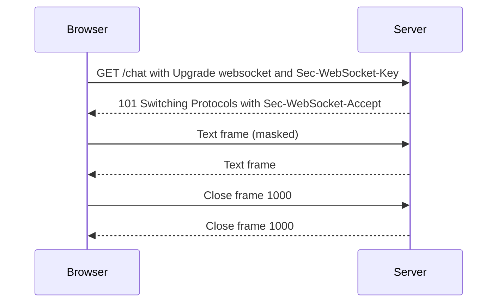

The key parts of the request:
- `Upgrade: websocket` and `Connection: Upgrade` ask to switch protocol.
- `Sec-WebSocket-Version: 13` is the only version in use.
- `Sec-WebSocket-Key` is a random base64 value from the client.
- `Origin` is added by browsers. `Sec-WebSocket-Protocol` is optional (subprotocols).

The server proves it understood the upgrade. It appends a fixed GUID (`258EAFA5-E914-47DA-95CA-C5AB0DC85B11`) to the key, hashes it with SHA-1 and sends it base64-encoded as `Sec-WebSocket-Accept`. This is not security. It only stops a normal HTTP server or cache from being tricked into thinking it is a WebSocket server.

I ran a tiny Node server with only `http` and `crypto`. For the sample key from the RFC the answer was:

```text
[raw] status 101 accept s3pPLMBiTxaQ9kYGzzhZRbK+xOo=
```

```js
import crypto from 'node:crypto';
const GUID = '258EAFA5-E914-47DA-95CA-C5AB0DC85B11';
const accept = (key) => crypto.createHash('sha1').update(key + GUID).digest('base64');
console.log(accept('dGhlIHNhbXBsZSBub25jZQ=='));
// prints: s3pPLMBiTxaQ9kYGzzhZRbK+xOo=
```

**Gotcha:** Proxies must pass the `Upgrade` and `Connection` headers. Many "WebSocket works locally but not in production" bugs are a proxy that drops them.

**Interview tip:** Mention that the handshake is also your best place to authenticate and check `Origin`, because after the 101 you are no longer in HTTP.

_Module: WebSocket Protocol · Tags: websockets, http-upgrade, handshake_

### 3. What is the difference between ws:// and wss://?

**Short answer:** `ws://` is WebSocket over plain TCP, like `http://`. `wss://` is WebSocket over TLS, like `https://`. Use `wss://` in production, always.

The URL scheme only changes the transport underneath. With `wss://` the client first does a TLS handshake, then sends the HTTP upgrade request inside the encrypted channel. Default ports match HTTP: 80 for `ws://` and 443 for `wss://`.

| Point | `ws://` | `wss://` |
| --- | --- | --- |
| Encrypted | No | Yes (TLS) |
| Default port | 80 | 443 |
| Works from an https page | Blocked by browsers (mixed content) | Yes |
| Passes corporate proxies | Often broken by inspecting proxies | Much more reliable |
| Use | Local development | Everything else |

Two practical reasons beyond privacy:
- A page loaded over `https://` cannot open `ws://` (mixed content rule).
- Some old proxies mangle unknown upgrade traffic on port 80. Inside TLS they cannot see it, so it just works.

In Kubernetes you normally terminate TLS at the ingress or gateway. The pod then speaks plain `ws` inside the cluster, and the client still uses `wss://`. If you need encryption inside the cluster too, use mTLS from a service mesh.

```ts
// Build the URL from the page so you never hard-code the wrong scheme
const scheme = location.protocol === 'https:' ? 'wss' : 'ws';
const socket = new WebSocket(`${scheme}://${location.host}/ws`);
```

**Interview tip:** Say that TLS termination at the ingress costs CPU per new connection but almost nothing per message, which matters in capacity planning.

_Module: WebSocket Protocol · Tags: websockets, tls, security_

### 4. What are WebSocket frames, opcodes, and message types?

**Short answer:** After the handshake, data travels in frames. Each frame has an opcode that says what it is: text, binary, continuation, close, ping or pong. A message can be split across several frames (fragmentation), and the last one has the FIN bit set.

| Opcode | Meaning |
| --- | --- |
| 0x0 | Continuation of a fragmented message |
| 0x1 | Text frame (UTF-8) |
| 0x2 | Binary frame |
| 0x8 | Close |
| 0x9 | Ping |
| 0xA | Pong |

The frame header is small: 2 bytes for payloads up to 125 bytes, 4 bytes up to 65,535 bytes, and 10 bytes for bigger ones. Compare that with hundreds of bytes of HTTP headers on every request. That is why WebSockets are cheap for many small messages.

Text frames must be valid UTF-8. Binary frames can carry anything (protobuf, images, audio). In the browser, `event.data` is a string for text and a `Blob` or `ArrayBuffer` for binary, depending on `binaryType`.

Fragmentation lets a sender start a large message before it knows the whole size. Control frames (ping, pong, close) can be sent in between the fragments, but they cannot be fragmented themselves and have at most 125 bytes of payload. Most application code never sees fragments: libraries reassemble them into one message.

My demo server printed what it saw for a client message `hello`:

```text
[server] frame op=1 fin=true masked=true len=5
[server] message: hello
```

**Gotcha:** Servers set a maximum message size. If you send a 50 MB message you will usually get close code 1009 (message too big), not an error you can see in the payload.

**Interview tip:** Say that WebSocket is message-oriented, unlike raw TCP which is a byte stream. You send and receive whole messages, not arbitrary chunks.

_Module: WebSocket Protocol · Tags: websockets, frames, opcodes_

### 5. Why are client-to-server WebSocket frames masked?

**Short answer:** Every frame from client to server is XORed with a random 4-byte key that is sent in the frame. This is not encryption. It protects badly written proxies and caches from being fooled by attacker-chosen bytes that look like HTTP.

Without masking, a malicious page could craft WebSocket data that looks like an HTTP request. A transparent proxy that does not understand the upgrade might treat it as a real request and poison its cache. Masking with a fresh unpredictable key stops the attacker from controlling the exact bytes on the wire.

Rules:
- Client to server frames must be masked. A server must close the connection (code 1002) if they are not.
- Server to client frames must not be masked.
- The key is random for every frame.

The masking is simple: byte `i` of the payload is XORed with byte `i mod 4` of the key. Doing it twice gives the original back. I ran this with the RFC example key:

```js
const mask = Buffer.from([0x37, 0xfa, 0x21, 0x3d]);
const payload = Buffer.from('Hello');
const masked = Buffer.from(payload.map((b, i) => b ^ mask[i % 4]));
console.log(masked.toString('hex'));
// prints: 7f9f4d5158
console.log(Buffer.from(masked.map((b, i) => b ^ mask[i % 4])).toString());
// prints: Hello
```

**Common mistakes**
- Thinking masking gives confidentiality. It does not. Use `wss://`.
- Forgetting that a hand-written client (Go, Python) must mask. Libraries do this for you.

**Interview tip:** A good one-liner is "masking is about protecting intermediaries, not hiding data". It shows you know the reason, not just the rule.

_Module: WebSocket Protocol · Tags: websockets, masking, security_

### 6. How do ping and pong frames detect dead connections?

**Short answer:** Ping and pong are control frames. One side sends a ping, and the peer must answer with a pong carrying the same payload. If no pong arrives in time, you treat the connection as dead and close it. This also keeps idle timeouts on proxies from firing.

A connection can die silently. If a phone leaves Wi-Fi or a NAT drops its entry, no FIN or RST reaches you, and TCP may take minutes or hours to notice. A heartbeat finds this in seconds.

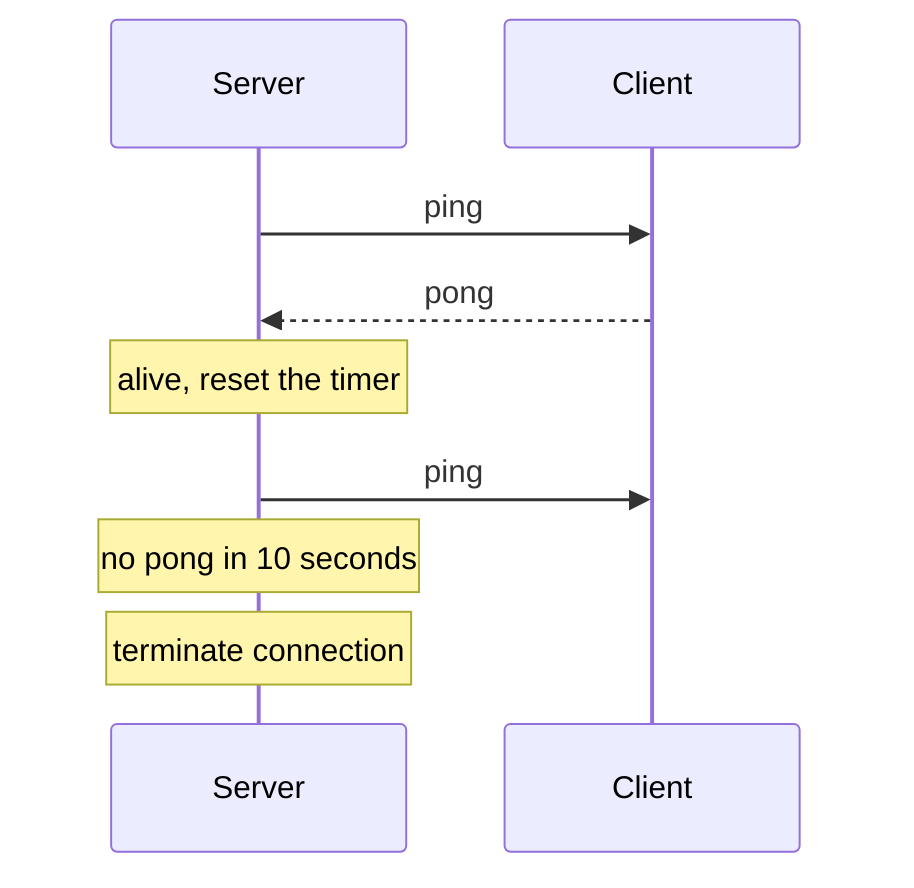

In my local test the server sent a ping with payload `hb`, and the built-in Node client answered automatically:

```text
[server] pong received payload= hb
```

Browsers answer pings for you, but JavaScript in the page cannot send protocol-level pings or see them. So for browser clients the server does the pinging, and if you want the client to detect a dead server, you add an application-level heartbeat message.

```js
// Server-side pattern with the ws library (read-only sketch)
// wss.on('connection', (ws) => { ws.isAlive = true; ws.on('pong', () => (ws.isAlive = true)); });
// setInterval(() => wss.clients.forEach((ws) => {
//   if (!ws.isAlive) return ws.terminate();   // dead: free the resources
//   ws.isAlive = false; ws.ping();
// }), 30000);
```

**Gotchas**
- Heartbeat interval must be shorter than the smallest idle timeout in the path (load balancer, ingress). 25 to 30 seconds is common.
- Ping every client at the same instant and you create a spike. Add jitter.

**Interview tip:** Mention both layers: protocol ping/pong from server, plus an app-level "ping" message from the client so it can detect a stuck server.

_Module: WebSocket Protocol · Tags: websockets, heartbeat, ping-pong_

### 7. What are WebSocket close codes and how do you close a connection cleanly?

**Short answer:** A clean close is a handshake: one side sends a close frame with a 2-byte status code and an optional reason, the other echoes a close frame, and then TCP is closed. The code tells the peer why, so it can decide whether to reconnect.

| Code | Meaning | Client should |
| --- | --- | --- |
| 1000 | Normal closure | Not reconnect (or reconnect if needed) |
| 1001 | Going away (server shutdown, page navigation) | Reconnect with backoff |
| 1002 | Protocol error | Fix the bug |
| 1006 | Abnormal, no close frame (never sent on the wire) | Reconnect with backoff |
| 1008 | Policy violation (for example auth failed) | Re-authenticate, do not loop |
| 1009 | Message too big | Fix the message |
| 1011 | Server internal error | Reconnect with backoff |
| 1012, 1013 | Service restart, try again later | Reconnect after a delay |
| 4000 to 4999 | Private use by your app | Your own rules |

1005 and 1006 are reserved: they are only reported locally ("no status" and "abnormal") and are never sent in a frame. A 1006 means the connection broke without a close handshake, for example a network drop or a proxy timeout.

My demo server closed with 1000 and the reason `done`. The built-in client reported:

```text
[client] close code 1000 reason done wasClean true readyState 3
```

```ts
// Use app-specific codes so the client knows what to do
const AUTH_EXPIRED = 4401;
socket.onclose = (e) => {
  if (e.code === AUTH_EXPIRED) return refreshTokenThenReconnect();
  if (e.code === 1008) return showLoginScreen();
  scheduleReconnectWithBackoff();
};
```

**Gotcha:** The close reason is limited to 123 bytes, and browsers throw if you pass a code outside 1000 or 3000 to 4999 to `close()`.

**Interview tip:** Say you define a small table of 4xxx codes (token expired, kicked, rate limited) so the client can react correctly instead of reconnecting blindly.

_Module: WebSocket Protocol · Tags: websockets, close-codes, shutdown_

### 8. How does the browser WebSocket API work?

**Short answer:** You create `new WebSocket(url)`, then react to four events: `open`, `message`, `error` and `close`. You send with `send()`, close with `close()`, and check `readyState` and `bufferedAmount` to know the state and how much data is waiting to be sent.

```ts
const ws = new WebSocket('wss://api.example.com/ws');
ws.binaryType = 'arraybuffer';          // binary frames arrive as ArrayBuffer

ws.addEventListener('open', () => ws.send(JSON.stringify({ type: 'hello' })));
ws.addEventListener('message', (e) => console.log(JSON.parse(e.data)));
ws.addEventListener('close', (e) => console.log(e.code, e.reason, e.wasClean));
ws.addEventListener('error', () => { /* no details by design */ });
```

| `readyState` | Name | Meaning |
| --- | --- | --- |
| 0 | CONNECTING | Handshake in progress |
| 1 | OPEN | You can send |
| 2 | CLOSING | Close started |
| 3 | CLOSED | Done or failed |

Important details:
- `send()` while CONNECTING throws. While CLOSING or CLOSED it silently drops the data.
- `send()` does not wait. It queues the data. `bufferedAmount` is the number of bytes queued but not yet sent to the network. If it keeps growing, the connection is slower than you produce data.
- The `error` event gives no reason, for security reasons. Look at the `close` event code instead.
- There is no built-in reconnect, no heartbeat you can control, and no custom headers. You cannot set an `Authorization` header from the browser API.
- Binary data can be `ArrayBuffer`, `Blob` or typed arrays.

The same API exists in Node 22 and later as a global client, which I used to test my server. That is handy for integration tests.

**Common mistakes**
- Calling `send()` right after construction (it throws, wait for `open`).
- Using `onmessage =` in two places, so one overwrites the other. Use `addEventListener`.

**Interview tip:** The two facts interviewers like: "no custom headers from the browser" and "bufferedAmount is how you see backpressure".

_Module: Client Patterns · Tags: websockets, browser-api, react_

### 9. What are subprotocols and which message formats do real-time systems use?

**Short answer:** WebSocket only moves frames; it does not say what is inside. A subprotocol, negotiated in the handshake with `Sec-WebSocket-Protocol`, names the message rules both sides agree on. The payload format is your choice: JSON for simplicity, or a binary format like Protocol Buffers or MessagePack for size and speed.

The client lists protocols it supports, and the server picks one:

```text
GET /ws HTTP/1.1
Sec-WebSocket-Protocol: orders.v2, orders.v1

HTTP/1.1 101 Switching Protocols
Sec-WebSocket-Protocol: orders.v2
```

In JavaScript, `new WebSocket(url, ['orders.v2', 'orders.v1'])` and then `ws.protocol` tells you which one was selected. If the server picks none that you offered, the browser fails the connection. Subprotocols are also a place to version your protocol.

| Format | Size | Speed | Human readable | Schema | Notes |
| --- | --- | --- | --- | --- | --- |
| JSON | Large | OK | Yes | Optional | Easy to debug in devtools |
| MessagePack | Smaller | Fast | No | None | Like JSON, but binary |
| Protobuf | Smallest | Fast | No | Required (`.proto`) | Safe evolution with field numbers |
| Custom binary | Smallest | Fastest | No | Yours | Hard to maintain |

Standard subprotocols also exist, such as `graphql-transport-ws` for GraphQL subscriptions and `mqtt` for MQTT over WebSocket.

Whatever the format, use an envelope: `{ "type": "order.updated", "id": "...", "seq": 42, "data": { } }`. A `type` field lets you route, an `id` lets you de-duplicate, and `seq` lets you resume.

**Gotcha:** Choosing protobuf for a small internal dashboard costs you debuggability for little gain. Choose binary when message volume or battery life makes size matter.

**Interview tip:** Say you would start with JSON plus a version in the subprotocol, and move hot paths to binary only when you measured a problem.

_Module: WebSocket Protocol · Tags: websockets, subprotocol, protobuf, json_

### 10. How should a client reconnect after a WebSocket drops?

**Short answer:** Reconnect automatically with exponential backoff and jitter (random delay), then re-authenticate, resubscribe, and ask the server to resume from the last message you saw. Never reconnect in a tight loop.

WebSockets do not reconnect by themselves (SSE does). Networks fail all the time, so reconnect logic is part of the feature, not an extra.

Steps for a good client:
1. Detect the drop: the `close` event, or a missed heartbeat.
2. Wait: base delay doubled each attempt, capped (for example 30 seconds), with randomness.
3. Open a new connection and authenticate (with a fresh token).
4. Resubscribe to the channels you had.
5. Send the last received sequence number so the server can replay, or fetch a snapshot.
6. On success, reset the attempt counter.

"Full jitter" picks a random delay between zero and the cap. Without it, 100,000 clients that lost the same server retry at the same instants and flatten it again. I ran full jitter with a base of 500 ms and a 30 s cap:

```js
const delay = (n) => Math.floor(Math.random() * Math.min(30000, 500 * 2 ** n));
// attempts 0..8 gave (one run, seeded): 0 131 1511 1834 4262 3503 1411 20365 20378   (ms)
```

Do not retry for every close code. A 1008 or a 4401 (auth) needs a new token or a login, not a retry. Also stop retrying while the tab is hidden for a long time, or while `navigator.onLine` is false, and retry when the `online` event fires.

**Common mistakes**
- Fixed 1 second retry (a reconnect storm after a deploy).
- Not resetting the counter after a stable connection.
- Resubscribing but forgetting to resync missed data.

**Interview tip:** Mention "jitter" and "resume from the last sequence number" in the same breath. Those two ideas mark the difference between a demo and a production client.

_Module: Client Patterns · Tags: websockets, reconnect, backoff_

### 11. How do Server-Sent Events (SSE) work?

**Short answer:** SSE is a long-lived HTTP response with `Content-Type: text/event-stream`. The server writes events as text, and the browser's `EventSource` parses them, reconnects automatically after a drop, and sends the `Last-Event-ID` header so the server can continue where it stopped.

The wire format is plain text. Each event is a few lines ending with a blank line:

```text
id: 4
event: tick
data: {"n":4}

```

Fields: `data` (the payload, can repeat for multiple lines), `event` (a name, default is `message`), `id` (sets the last event id), `retry` (milliseconds before reconnecting). A line starting with `:` is a comment, often used as a heartbeat.

```ts
const es = new EventSource('/api/orders/stream', { withCredentials: true });
es.addEventListener('tick', (e) => console.log(JSON.parse((e as MessageEvent).data)));
es.onerror = () => { /* browser retries by itself while readyState is CONNECTING */ };
```

I ran a Node `http` server that streams ticks. A client reconnecting with `Last-Event-ID: 3` received events 4, 5 and 6, and the server ended the response:

```text
[sse] content-type text/event-stream
id: 4
event: tick
data: {"n":4}
```

Why teams like SSE: it is plain HTTP, so it works with normal auth cookies, proxies, HTTP/2 and logging. Reconnect and resume come free.

Limits:
- One direction only. The client sends data with normal `fetch` calls.
- Text only (use base64 for binary, or pick WebSockets).
- `EventSource` cannot set custom headers, so use cookies or fetch-based libraries.
- On HTTP/1.1 browsers allow about 6 connections per host, so many tabs can block each other. HTTP/2 fixes this.

**Gotcha:** Proxies that buffer responses will hold your events back. Send `Cache-Control: no-cache` and disable buffering on the proxy (for NGINX, `proxy_buffering off`).

**Interview tip:** Say "for notifications and live dashboards I would try SSE first, because reconnect and resume are built into the standard".

_Module: SSE & Alternatives · Tags: sse, eventsource, http_

### 12. How does long polling work, and when is it still useful?

**Short answer:** In long polling, the client sends a normal HTTP request, and the server does not answer until it has new data or a timeout passes. When the client gets the answer, it immediately sends the next request. It works everywhere because it is just HTTP.

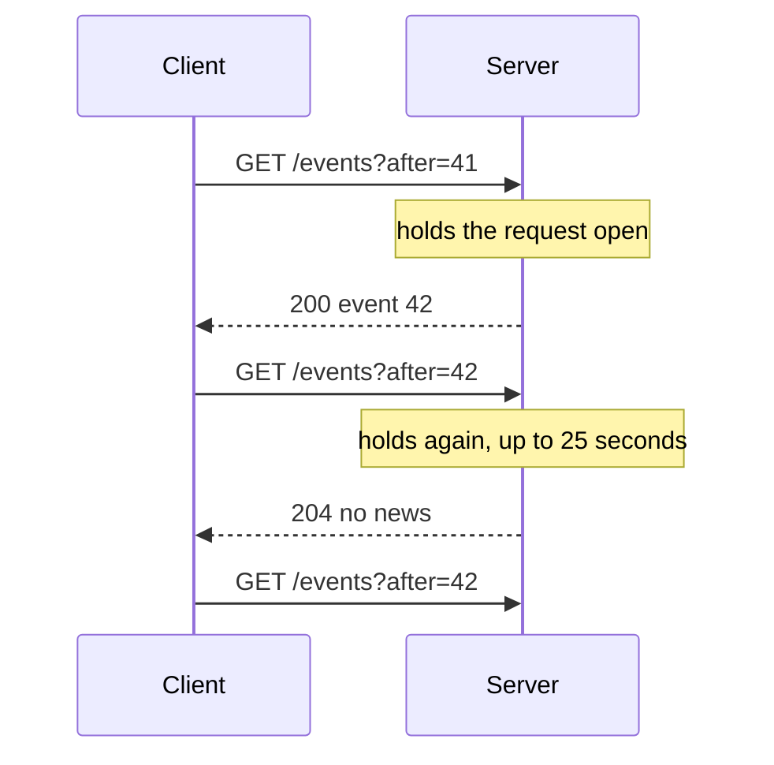

I ran a local server that waits 200 ms before answering. The client call returned after the wait with the event:

```text
[poll] { event: 'order-shipped' } after>=200ms: true
```

A good long polling endpoint:
- Takes a cursor (`after=42`) so no event is lost between two requests.
- Times out before any proxy does (20 to 30 seconds), returning an empty answer.
- Returns many events at once if several arrived.

| Point | Long polling | WebSocket |
| --- | --- | --- |
| Setup | Any HTTP stack | Needs upgrade support |
| Overhead | Full HTTP headers per event | Tiny frames |
| Latency | Gap between response and next request | Immediate |
| Server cost | Many short-lived requests | Many long-lived connections |

When it is still useful: strict corporate proxies that block upgrades, serverless functions that cannot hold a socket, and as the fallback inside libraries like Socket.IO. For anything with frequent events, it is wasteful.

**Gotcha:** Without a cursor, events that arrive between two polls are lost.

**Interview tip:** Call it "the fallback that works everywhere", and explain the cursor. That shows you know the real failure case.

_Module: SSE & Alternatives · Tags: long-polling, http, fallback_

### 13. How do WebSockets compare with HTTP/2 streams and gRPC streaming?

**Short answer:** HTTP/2 multiplexes many request and response streams on one connection, and gRPC builds typed streaming RPC on top of it. WebSockets are a separate message channel on one connection. The browser can use WebSockets directly, but not gRPC streaming without a proxy (gRPC-Web supports only server streaming).

| Point | WebSocket | gRPC streaming | SSE over HTTP/2 |
| --- | --- | --- | --- |
| Transport | Upgraded HTTP/1.1 connection | HTTP/2 | HTTP/1.1 or HTTP/2 |
| Direction | Both ways | Server, client or both | Server to client |
| Message format | Anything (text or binary) | Protobuf with a schema | Text |
| Browser support | Native | Needs gRPC-Web and a proxy (Envoy) | Native |
| Typing and codegen | None | Strong | None |
| Best for | Browser real-time, chat | Service to service, mobile, devices | Notifications |

Points to explain in an interview:
- gRPC gives you contracts, deadlines, cancellation, status codes and load-balancing hooks. With WebSockets you build these yourself.
- gRPC runs well in Go services, where bidirectional streaming is a first-class feature.
- A browser cannot do bidirectional gRPC streaming. If your front end is React in the browser, WebSockets or SSE are the practical choices.
- HTTP/2 streams are cheap, but a stream is still attached to a long-lived connection, so deploys and load balancing have the same issues.

A common architecture: browsers use WebSockets or SSE to a gateway service, and inside the cluster services talk with gRPC streams or a message broker.

**Gotcha:** Layer 7 load balancers must understand HTTP/2 to balance gRPC streams. A layer 4 balancer pins all streams of one client to one pod.

**Interview tip:** Say "WebSocket for the browser edge, gRPC between services". It is a simple rule that is usually right.

_Module: Real-time Basics · Tags: websockets, grpc, http2_

### 14. What does Socket.IO add on top of WebSockets, and what does it cost?

**Short answer:** Socket.IO is a library with its own protocol on top of WebSocket (and long polling). It adds named events, rooms, acknowledgements, automatic reconnection and fallback. The cost is a custom protocol: a plain WebSocket client cannot talk to a Socket.IO server, and you carry extra overhead and a library dependency.

What you get:
- Named events with payloads, instead of parsing your own envelope.
- Rooms and namespaces to group clients, and `io.to(room).emit(...)`.
- Acknowledgements: `socket.emit('save', data, (reply) => { ... })`.
- Automatic reconnection with backoff, and heartbeat built in.
- Fallback to HTTP long polling if the upgrade fails, then upgrade later.
- An adapter model (for example Redis) to broadcast across several servers.
- Optional "connection state recovery" to resume after a short disconnect (Socket.IO v4.6 and later).

What it costs:
- It is not the WebSocket protocol. Go clients, mobile apps and gateways need a Socket.IO client library for their language.
- Every packet has extra framing, and the polling start adds requests.
- With polling enabled, a load balancer needs sticky sessions, because the polling requests must reach the same server. Setting `transports: ['websocket']` removes this need.
- A big client library in the bundle.

| Need | Plain `ws` | Socket.IO |
| --- | --- | --- |
| Quick chat or prototype | More work | Fast |
| Interop with Go, devices, other clients | Easy | Painful |
| Strict control of protocol and size | Yes | No |
| Rooms and acks out of the box | No | Yes |

**Common mistakes**
- Running several Socket.IO pods behind a balancer without sticky sessions or the adapter, then seeing random "session ID unknown" errors.

**Interview tip:** Be balanced: "I would use it for a fast start in a Node-only stack, but choose plain WebSockets or a managed service when other languages or devices must connect."

_Module: Client Patterns · Tags: socket-io, websockets, libraries_

### 15. When should you use WebSockets, and when should you not?

**Short answer:** Use WebSockets when both sides send messages often and low latency matters: chat, collaborative editing, multiplayer, live trading screens, device control. Do not use them for occasional updates, simple downloads, or when SSE or plain polling is enough.

Good fits:
- Chat and presence.
- Collaborative editing (cursors, changes).
- Live operational dashboards with commands back (control rooms, fleet screens).
- Multiplayer games.
- Device and aircraft telemetry gateways where the gateway keeps a session.

Poor fits:
- A notification badge that changes a few times a day (SSE or push notifications).
- Status of a long job (polling the job, or SSE).
- File upload and download (plain HTTP handles ranges, caching and resume).
- Public read-only data that a CDN can cache.
- Very constrained or flaky links where a message broker with store-and-forward (such as MQTT) fits better.

| Question to ask | If yes | If no |
| --- | --- | --- |
| Does the client send frequent messages? | WebSocket | SSE plus normal HTTP |
| Is update rate under once per 30 seconds? | Polling or SSE | WebSocket or SSE |
| Do you need caching or CDN? | HTTP | WebSocket possible |
| Can the network drop for minutes? | Broker with queues | Either |

The hidden cost: a WebSocket is a stateful connection. You must handle auth expiry, reconnect, deploys, load balancer timeouts, backpressure and monitoring. HTTP requests give you these almost for free.

**Gotcha:** "We might need it later" is not a reason. Moving from SSE to WebSockets is easier than operating WebSockets you did not need.

**Interview tip:** Answer with a decision rule and one example on each side. It sounds like judgement, not a feature list.

_Module: Real-time Basics · Tags: websockets, use-cases, trade-offs_

### 16. Do the same-origin policy and CORS apply to WebSockets?

**Short answer:** No. Browsers do not apply CORS to WebSocket handshakes, and the same-origin policy does not block a page from opening a WebSocket to any host. The browser sends an `Origin` header, and it is the server's job to check it. Without that check, cross-site WebSocket hijacking is possible.

With `fetch`, the browser blocks reading a cross-origin response unless the server allows it with CORS headers. A WebSocket handshake is different. Any page on any site can run `new WebSocket('wss://bank.example.com/ws')`. The browser will attach the user's cookies for that host, just like a normal request. The handshake is not blocked, and the page can read and write messages if the server accepts.

So the defence is on the server:
- Check `Origin` against an allow-list during the upgrade, and reject others with `403`.
- Do not rely only on cookies. Use a token or a one-time ticket that an attacker's page cannot get.
- Treat a missing `Origin` as non-browser (a script or device) and apply your normal token rules.

```js
// Node, in the http 'upgrade' event
const allowed = new Set(['https://app.example.com']);
const ok = (origin) => allowed.has(origin);
console.log(ok('https://app.example.com'), ok('https://evil.example.net'), ok(undefined));
// prints: true false false
```

`Origin` can be forged by non-browser clients, so it only protects against browser-based attacks. It does not replace authentication.

**Gotcha:** `SameSite=Lax` or `Strict` cookies reduce the risk, but do not rely on them alone. Some setups use `SameSite=None`, and subdomains count as same-site.

**Interview tip:** Say "CORS does not protect WebSockets, so I verify Origin and I never rely on cookies alone". This is a very common security question.

_Module: Security · Tags: websockets, cors, origin, security_

## Intermediate

### 17. [Tech Lead] How do you choose the transport for a real-time feature?

**Short answer:** I choose by the data flow, the client types, the network and the operations cost, not by fashion. I start from the simplest option that meets the latency need: plain HTTP polling, then SSE, then WebSockets, then a broker protocol like MQTT for unreliable links.

My decision framework, as questions:
1. **Direction.** Does the client send frequent messages, or only receive? Receive-only points to SSE.
2. **Frequency and latency.** Once a minute is polling. Under a second and bursty is SSE or WebSockets.
3. **Payload.** Binary or very small messages at high rate point to WebSockets.
4. **Clients.** Browsers only (SSE or WebSockets), or devices and mobile (MQTT, gRPC, WebSockets)?
5. **Network.** Stable data centre links, or intermittent links such as aircraft and satellite, where store-and-forward matters?
6. **Infrastructure.** Does the platform (ingress, gateway, WAF, corporate proxies) support upgrades and long idle times?
7. **Delivery needs.** Must messages survive disconnects? Then you need sequence numbers, replay or a broker with queues.
8. **Team and cost.** Who will run it at 3 am? Is a managed service cheaper than the on-call load?

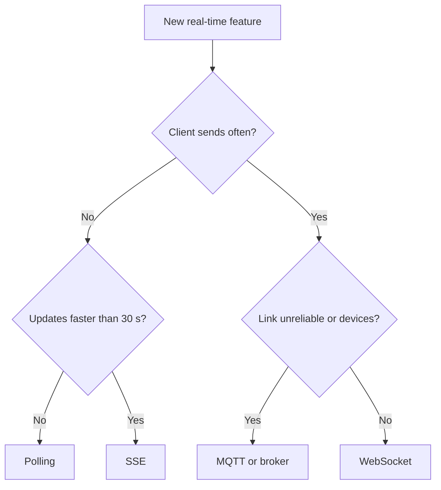

Read it from the top: most features end at polling or SSE, and only the two-way, high-frequency ones need WebSockets.

I write the decision down as a short design note with the rejected options and the reasons. In a review, that stops a debate about technology preferences and lets us reverse the decision later with evidence.

**Common mistakes**
- Choosing WebSockets "for real-time" when the feature is a notification badge.
- Ignoring the corporate proxy or ingress that will cut idle connections.

**Interview tip:** Tell a short story: "We replaced a WebSocket status feed with SSE and removed our custom reconnect code, and the on-call pages for stuck connections stopped."

_Module: Real-time Design · Tags: tech-lead, websockets, sse, decision_

### 18. [Tech Lead] How do you design a real-time feature end to end, such as chat or live status?

**Short answer:** I split it into a connection layer that only holds sockets, a message layer that decides who receives what, and a durable layer that stores truth. The connection layer is stateless enough to scale and restart. The database or event log is the source of truth, and the socket is only a fast delivery path.

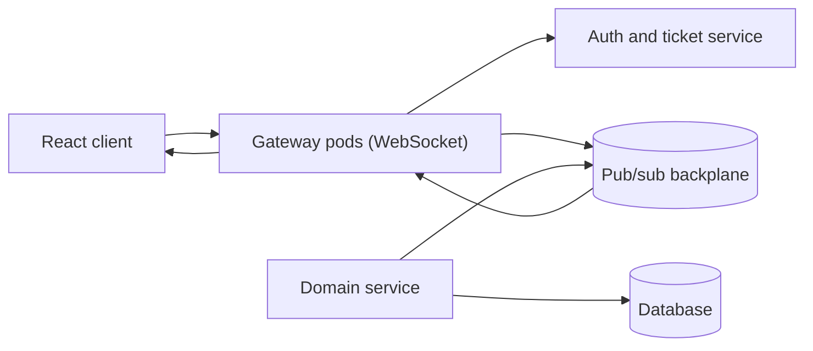

The client connects to the gateway, which checks a short-lived ticket. A domain service writes to the database first, then publishes an event to the backplane. Gateways subscribed to that channel push it to their connected clients.

Decisions to make for each feature:

| Feature | Delivery | Needs history | Notes |
| --- | --- | --- | --- |
| Chat | At-least-once, ordered per room | Yes | Store messages, ids, read receipts |
| Live status | Latest value wins | No | Send snapshot, then changes |
| Notifications | At-least-once | Yes, short | Unread count from the database |
| Collaborative editing | Ordered, convergent | Yes | OT or CRDT |

Principles I apply:
- **Write first, publish second.** If the socket dies, the user still sees the data on reload.
- **Snapshot plus deltas.** On connect, the client fetches the current state over HTTP, then applies live events with a sequence number. This handles gaps.
- **Subscriptions are explicit.** The client asks for channels, and the server checks permission for each.
- **Bounded everything.** Message size, queue per connection, rate per user.
- **Fallback.** If the socket is down, the screen still works with polling.

**Gotcha:** Publishing before the database commit lets users see events for data that then rolls back. Use an outbox pattern when you need strict consistency.

**Interview tip:** Walk through "what happens when the client is offline for two minutes" to show you designed for gaps, not only for the happy path.

_Module: Real-time Design · Tags: tech-lead, design, chat, notifications_

### 19. [Tech Lead] How do you scale WebSocket servers horizontally?

**Short answer:** One server holds a limited number of connections, so you run many and connect them with a pub/sub backplane (Redis, NATS or Kafka). Any service publishes an event to a channel, and every gateway that has a subscriber for it forwards it. You do not need sticky sessions for raw WebSockets, because one connection stays on one server for its whole life.

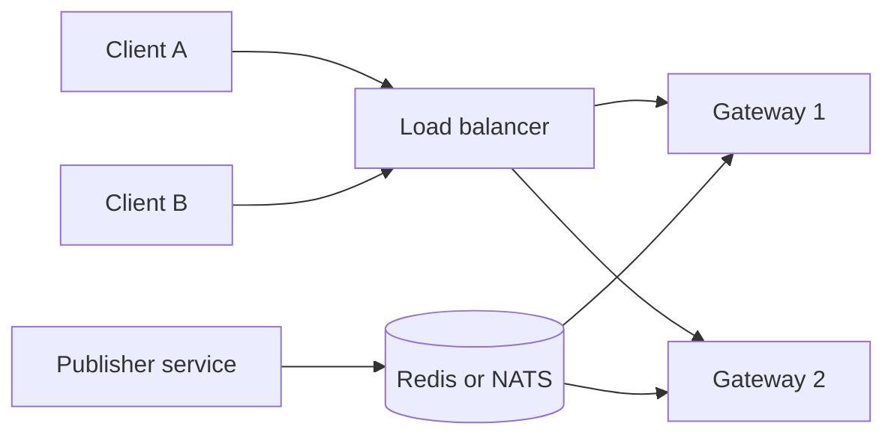

Client A may be on Gateway 1 and client B on Gateway 2. When a service publishes to `room:42`, both gateways receive it and each forwards it to its own local members.

| Backplane | Strength | Weakness | Use for |
| --- | --- | --- | --- |
| Redis pub/sub | Simple, fast | No persistence, at-most-once | Presence, chat fan-out, live status |
| Redis Streams | Persistence, replay | More work | Resume after reconnect |
| NATS | Very fast, light | Core NATS is at-most-once (JetStream adds persistence) | Many small messages |
| Kafka | Durable, replayable | Heavy, high latency for tiny messages | Event sourcing, analytics, not per-socket fan-out |

Key design points:
- **Fan-out cost.** A message to a room of 10,000 means 10,000 socket writes. Batch, and avoid per-message JSON encoding for each client (encode once, send the same bytes).
- **Subscribe per channel, not per connection.** A gateway subscribes to `room:42` once if it has at least one local member, and unsubscribes when the last one leaves.
- **Sticky sessions** are needed only for transports that use several requests (Socket.IO with polling, SockJS). Plain WebSockets do not need them.
- **Sharding.** To go bigger, shard channels or users across backplane nodes with consistent hashing.
- **Direct messages.** Keep a registry (user id to gateway) in Redis with a TTL to route one-to-one messages.

**Gotcha:** Redis pub/sub drops messages for subscribers that are disconnected. Pair it with a sequence number and a replay store.

**Interview tip:** Ask about the delivery guarantee you need before choosing the backplane. That question alone shows seniority.

_Module: Scaling & Operations · Tags: tech-lead, scaling, pub-sub, redis_

### 20. [Tech Lead] How do load balancers, proxies and ingress affect WebSockets, and how do you tune idle timeouts?

**Short answer:** Every hop between client and pod can close an idle connection. The lowest idle timeout in the path wins. You need each hop to allow the upgrade, set the timeouts above your heartbeat interval, and not buffer or retry the stream.

The classic production bug: connections drop after exactly 60 seconds. NGINX closes a proxied connection when no data flows for `proxy_read_timeout`, whose default is 60 seconds. Browser, ingress, cloud gateway, service mesh and pod each add their own timer.

NGINX configuration for WebSockets:

```nginx
map $http_upgrade $connection_upgrade {
    default upgrade;
    ''      close;
}
server {
    location /ws {
        proxy_pass http://gateway:8080;
        proxy_http_version 1.1;                       # upgrade needs HTTP/1.1 to the upstream
        proxy_set_header Upgrade $http_upgrade;
        proxy_set_header Connection $connection_upgrade;
        proxy_read_timeout 3600s;                     # longer than your heartbeat gap
        proxy_send_timeout 3600s;
    }
}
```

The same ideas in Kubernetes with the community NGINX ingress controller, using annotations (check the version you run, since the project has announced retirement and many teams are moving to the Gateway API):

```yaml
metadata:
  annotations:
    nginx.ingress.kubernetes.io/proxy-read-timeout: "3600"
    nginx.ingress.kubernetes.io/proxy-send-timeout: "3600"
```

| Hop | What to check |
| --- | --- |
| CDN or WAF | Does it proxy WebSockets? Does it have a maximum duration? |
| Cloud load balancer (Azure Application Gateway, Azure Load Balancer) | Idle timeout setting, WebSocket support enabled |
| Ingress | Read and send timeouts, upgrade headers |
| Service mesh sidecar | Route timeout, idle timeout, retries off |
| App | Ping interval below the smallest timeout |

I design with a rule: heartbeat every 25 to 30 seconds, and every timeout above 2 times that. Then I test with a connection that sends nothing for 10 minutes.

**Gotcha:** Retries and "max request duration" settings on a mesh or gateway can cut a healthy WebSocket without any log line on your app.

**Interview tip:** Say "I list every hop and its timeout in a table in the runbook". It is simple and it fixes this class of incident for good.

_Module: Scaling & Operations · Tags: tech-lead, nginx, ingress, timeouts_

### 21. [Tech Lead] How do you do capacity planning for WebSocket connections?

**Short answer:** I measure instead of guessing. I load test one pod to find memory per connection, CPU per message and file descriptor limits, then multiply by peak connections plus headroom for a reconnect storm. The numbers depend heavily on runtime and message rate.

What limits connections on one machine:
- **File descriptors.** Each socket is one. Raise `ulimit -n` (and the container limits), far above your target.
- **Memory.** Per connection you pay for kernel socket buffers, library buffers, and per-connection state (user, subscriptions, queues). Go stacks start small, and Node objects are on the heap. Typical idle connections cost from a few KB to tens of KB, but your queues and message buffers can cost much more. Measure.
- **CPU.** TLS handshakes are the heavy part when many clients connect at once. Steady-state messages are cheap, but fan-out multiplies it.
- **Garbage collection.** Many small allocations per message cause GC pauses that delay heartbeats. Reuse buffers, and encode a broadcast once.
- **Ports.** A load balancer talking to one backend IP is limited by ephemeral ports (about 28,000 by default per destination), so watch it at high scale.
- **Network.** Bandwidth is messages per second times fan-out times size.

A simple sizing method:
1. Define peak concurrent connections, messages per second per connection, and the average fan-out.
2. Load test one pod at 10%, 50%, 100% of a target, and record RSS memory, CPU, event loop lag (Node) or goroutines (Go), and p99 delivery latency.
3. Pick a safe per-pod number at 60% of the point where latency degrades.
4. Pods needed = peak connections divided by the safe number, plus one extra for rolling deploys and N+1 for failure.
5. Plan for a reconnect storm: after a deploy, every client reconnects within seconds, so TLS CPU can be 10 times the steady load.

**Rules of thumb**
- Set pod memory limits with room for slow-consumer queues.
- Set a connection limit per pod and stop accepting (readiness fails) above it.
- Autoscale on connections and memory, not only CPU.

**Interview tip:** Quote your method, not a magic number. "I do not know yet, I would measure memory per connection at three load levels" is a strong answer.

_Module: Scaling & Operations · Tags: tech-lead, capacity, performance, memory_

### 22. [Tech Lead] How do you do rolling deployments without dropping every connection?

**Short answer:** Drain connections gradually. On shutdown the pod stops accepting new connections, tells clients to reconnect elsewhere with jittered delays, waits a bounded time, then exits. A rollout that restarts pods one batch at a time, with enough surge capacity, prevents a reconnect storm.

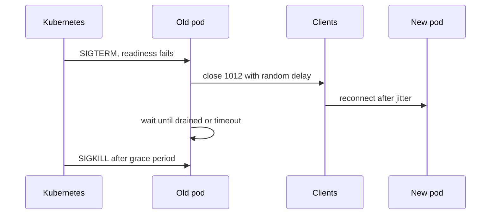

The steps in the pod:
1. **Readiness fails first** so the load balancer sends no new connections. A `preStop` sleep of a few seconds gives endpoints time to update.
2. **Send close frames in batches**, not all at once. For example close 5% of connections each second, using code 1012 (service restart) or an app code. Add random jitter so clients do not reconnect together.
3. **Keep serving** while draining, and finish in-flight writes.
4. **Exit** when connections reach zero or at the deadline.

Kubernetes settings that matter:

```yaml
spec:
  terminationGracePeriodSeconds: 120   # long enough for the drain
  containers:
    - name: gateway
      lifecycle:
        preStop:
          exec:
            command: ["sleep", "5"]    # let endpoints update first
  # Deployment strategy:
  # maxUnavailable: 0, maxSurge: 25%
```

Other rules:
- `maxUnavailable: 0` with surge keeps capacity during the rollout.
- Roll slowly enough that the new pods are not overwhelmed. If you have 20 pods, roll one or two at a time and watch the connect rate.
- Clients must tolerate it: backoff with jitter, and resume from the last sequence number so users do not see gaps.

**Gotcha:** If the grace period is shorter than your drain, Kubernetes sends SIGKILL and clients get 1006 without a close frame.

**Interview tip:** Mention a pod disruption budget and node drains too. Cluster upgrades cause the same drain events as your deploys.

_Module: Scaling & Operations · Tags: tech-lead, deployments, kubernetes, drain_

### 23. [Tech Lead] What do you monitor in a real-time system?

**Short answer:** I monitor connection health, message flow, delivery latency and client experience. CPU and memory alone tell you little, because a real-time system can look healthy while users see stale data.

Core signals:

| Area | Metric | Why |
| --- | --- | --- |
| Connections | Current open, connect and disconnect rate, by close code | Spot drops, deploy effects, auth failures |
| Connections | Handshake failures by status | Origin or auth rejections, proxy trouble |
| Reconnects | Reconnect rate and attempts per client | Storms, flaky network |
| Messages | In and out per second, per type, bytes | Load, fan-out size |
| Latency | End-to-end delivery p50, p95, p99 | The user-visible number |
| Backpressure | Queue depth, bytes buffered, dropped messages, slow consumers closed | Memory risk |
| Backplane | Publish lag, Redis or NATS latency, subscription count | Fan-out health |
| Runtime | Goroutines, event loop lag, GC pause, heap, file descriptors | Capacity |
| Business | Active users, delivery failures | Product view |

How I get delivery latency: the publisher adds a timestamp to the event, and the gateway records the difference when it writes to the socket. For true end-to-end, a synthetic client in each region sends a probe message and measures the round trip.

Practical rules:
- Log with a connection id and a correlation id on every message, and a user id hash, never the payload.
- Keep metric labels low-cardinality: close code, message type, region. Never user id.
- Alert on symptoms: disconnect rate spike, p99 latency, queue growth, synthetic probe failure. Page on user impact, not on a single pod.
- Dashboards show the deploy markers, so you can link a reconnect spike to a rollout.

**Common mistakes**
- Counting only open connections. A stable count can hide a loop of disconnect and reconnect.
- Tracing every message. Sample instead.

**Interview tip:** Name the synthetic probe. It catches broken proxies and expired certificates that no server metric shows.

_Module: Scaling & Operations · Tags: tech-lead, observability, metrics, datadog_

### 24. [Tech Lead] What is your security review checklist for a WebSocket service?

**Short answer:** I review who can connect, what they can see, how much they can send, and what happens when the connection lives longer than the login. The goal is to apply the same controls as for an HTTP API, because a WebSocket skips many of the protections HTTP gives for free.

Checklist:
1. **Transport.** `wss://` only, modern TLS, no plain `ws` outside local development.
2. **Authentication at connect.** A short-lived token or one-time ticket, not a long-lived token in the URL.
3. **Origin check.** An allow-list on the upgrade request to stop cross-site WebSocket hijacking.
4. **Authorisation per action.** Check permission when subscribing to a channel and when handling each command, not only at connect.
5. **Token expiry.** Close or refresh when the token expires (for example code 4401). Revoke on logout.
6. **Input validation.** Parse and validate every message with a schema. Reject unknown types. Never trust client-supplied user ids.
7. **Limits.** Maximum message size, messages per second per connection, connections per user and per IP, subscriptions per connection, queue size per connection.
8. **Handshake timeouts.** Close connections that do not authenticate within a few seconds, to resist slow-open abuse.
9. **Privacy.** No PII in URLs or logs. Minimise personal data in broadcast messages.
10. **Output safety.** Escape user content in the UI (XSS applies to chat messages).
11. **Dependencies.** Keep the WebSocket library updated and pin versions.
12. **Operations.** Alerts on auth failures and rate-limit hits, and a way to kick a user or block a client quickly.

For the review itself I run a short threat model: "what can a logged-in user do to another user, what can an anonymous user do to the server, and what can a malicious website do through a victim's browser?".

**Gotcha:** The most common finding is authorisation checked at connect but not on each message. A user who loses access to a room still receives messages until they disconnect.

**Interview tip:** Use the phrase "defence in depth": edge limits, app limits, and per-user limits all active together.

_Module: Security · Tags: tech-lead, security, review, checklist_

### 25. [Tech Lead] How do you test real-time features?

**Short answer:** I test in layers: unit tests for message handling logic, integration tests with real sockets, load tests for capacity, and chaos tests for failure behaviour. Real-time bugs live in timing, ordering and reconnects, so these must be tested on purpose.

| Layer | What it checks | How |
| --- | --- | --- |
| Unit | Reducers, protocol parsing, sequence and de-duplication logic | Plain functions, no sockets |
| Component | React hook behaviour with a fake WebSocket | Mock class that you control with fake timers |
| Integration | Handshake, auth, authorisation, message flow, close codes | Start the server on a random port, use a real client |
| Contract | Message schema compatibility between versions | Shared schema, golden files |
| Load | Connections, message rate, latency, memory | k6, Artillery, custom Go client |
| Chaos | Kill a pod, drop the network, delay the backplane | Chaos tools, tc/netem, manual deploys |
| Soak | Leaks over hours | Long run, watch memory |

A fake socket for front-end tests keeps them fast and deterministic:

```ts
class FakeSocket {
  static last: FakeSocket;
  onmessage: ((e: { data: string }) => void) | null = null;
  onclose: ((e: { code: number }) => void) | null = null;
  constructor(public url: string) { FakeSocket.last = this; }
  send = (_: string) => {};
  close = () => {};
  emit = (obj: unknown) => this.onmessage?.({ data: JSON.stringify(obj) });
}
// in a test: vi.stubGlobal('WebSocket', FakeSocket); FakeSocket.last.emit({ type: 'order.updated' });
```

Key scenarios to automate:
- Reconnect after a close code, with backoff using fake timers.
- Messages arriving out of order or duplicated.
- Auth expiry in the middle of a session.
- A slow client that does not read.
- Rolling restart while clients are connected: no more than N seconds of missing data.

**Interview tip:** Say you run the integration tests against a real server in CI on a random port. Mocks hide the very bugs real-time systems have.

_Module: Reliability & Delivery · Tags: tech-lead, testing, load-testing, chaos_

### 26. [Tech Lead] What are the cost and operations trade-offs, and when would you buy a managed service?

**Short answer:** Running WebSockets yourself gives control and low per-message cost, but you take on scaling, deploys, security and on-call. Managed services (Azure Web PubSub or SignalR Service, Ably, Pusher) remove the connection layer for a fee per connection and message. I buy when real-time is not my product's core and my team is small.

| Option | You run | Strengths | Weaknesses |
| --- | --- | --- | --- |
| Self-hosted gateway (Go or Node) | Everything | Full control, cheapest at scale, fits Kubernetes | Operations burden, build all reliability |
| Azure SignalR Service or Web PubSub | Business logic only | Fits Azure, scales, managed auth | Pricing per unit, vendor protocol, limits |
| Ably or Pusher | Business logic only | Global edge, history, presence, SDKs | Cost at high volume, data leaves your cloud |
| Broker (MQTT, NATS) with WebSocket | Broker | Good for devices | Still need a gateway for browsers |

How I decide:
- **Team and time.** A small team shipping a product feature in a quarter should buy.
- **Scale and unit cost.** Work out cost per million messages and per connection-hour at your forecast, and compare it to the engineering time for the DIY version.
- **Data rules.** Aircraft, health or customer data may not be allowed to pass through a third party. This can decide it.
- **Lock-in.** Hide the vendor behind a small interface (publish, subscribe, presence) so you can move.
- **Reliability.** Check the SLA, regional coverage and how reconnect and history work.
- **Skills.** Do we want to be experts in connection scaling?

A hybrid works well: managed service for browser clients, self-hosted broker for device traffic, with a bridge.

**Gotcha:** Costs of managed services are often dominated by message count with large fan-out, such as broadcasting to 100,000 viewers. Model fan-out before you sign.

**Interview tip:** End with how you would reduce risk: a time-boxed prototype on the managed service, with the vendor behind an interface.

_Module: Real-time Design · Tags: tech-lead, build-vs-buy, managed-services_

### 27. How do you authenticate a WebSocket connection?

**Short answer:** Authenticate during the handshake or immediately after it. The best patterns are a session cookie (with an Origin check) or a short-lived, single-use ticket that the client gets from your normal HTTP API and sends once. Avoid long-lived tokens in the URL.

The browser WebSocket API cannot set an `Authorization` header. That limits your choices:

| Pattern | How | Pros | Cons |
| --- | --- | --- | --- |
| Session cookie | Browser sends the cookie on the handshake | Simple, HttpOnly | Needs Origin check (CSWSH), same-site setups |
| Token in query string | `wss://host/ws?token=...` | Easy | URLs end up in proxy and access logs and history |
| First-message auth | Connect, then send `{type:"auth", token}` within 5 seconds | No token in URL | Unauthenticated sockets exist briefly |
| Short-lived ticket | `POST /ws-ticket` returns a random id valid 30 seconds and single use | Safe in URL, easy to revoke | One more request and a ticket store |
| Subprotocol trick | Token in `Sec-WebSocket-Protocol` | Works from browsers | Abuses a header, can be logged |

My default is the ticket:

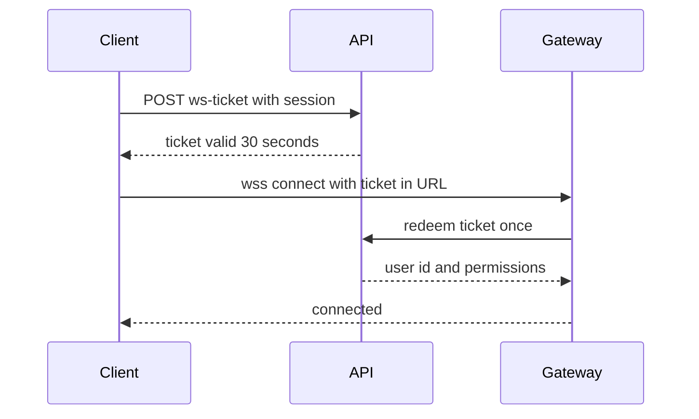

The ticket is useless after one use or 30 seconds, so a leaked URL in a log is harmless.

Also handle the life of the session. Tokens expire while sockets stay open, so store the expiry in the connection state. Either close with a code like 4401 when it expires, or accept a `{type:"refresh", token}` message and swap the identity. Close the socket on logout.

**Common mistakes**
- Putting the long-lived access token in the URL.
- Authenticating once and never again.
- Letting unauthenticated sockets stay open forever. Close them after a short deadline.

**Interview tip:** Mention "no custom headers from browsers" first, then the ticket pattern. It shows you know why the problem exists.

_Module: Security · Tags: websockets, authentication, tokens_

### 28. How do you authorise actions and channel access over a WebSocket?

**Short answer:** Authentication says who the user is. Authorisation says what they may do. Check it on every subscribe and every command, using the identity stored on the server for that connection, never an id sent by the client. Re-check when permissions change.

A socket is one long conversation, so there is no request boundary where middleware runs automatically. You must build the checkpoint yourself.

```ts
// Server-side handler (sketch)
type Conn = { userId: string; roles: Set<string>; subs: Set<string> };

async function onMessage(conn: Conn, msg: { type: string; channel?: string }) {
  if (msg.type === 'subscribe') {
    // ❌ bad: trusting a userId sent in the message
    // ✅ good: decide with conn.userId stored at authentication time
    if (!(await canRead(conn.userId, msg.channel!))) return send(conn, { type: 'error', code: 'forbidden' });
    conn.subs.add(msg.channel!);
  }
}
```

Practical rules:
- **Channel names are not secrets.** `orders:123` must be checked for this user. Better, derive channels on the server (`user:<id>`) so the client cannot ask for others.
- **Check on publish too.** Can this user send to this channel, and with this message type?
- **Permission changes.** When a user is removed from a room, push the change to the gateway so it drops their subscription. Use a short permission cache TTL or an event.
- **Least data.** Send only the fields this user may see. Do not broadcast a full record and rely on the client to hide fields.
- **Deny by default.** Unknown message types return an error and count against a rate limit.
- **Multi-tenant.** Include the tenant id in every channel name, and enforce it at the subscribe check.

| Check | When |
| --- | --- |
| Identity | Handshake (and on refresh) |
| Channel read | On subscribe, and on permission change events |
| Command | On each message |
| Tenant boundary | Everywhere |

**Gotcha:** Checking at connect only, then sending everything to that socket, is the top finding in WebSocket reviews. A removed user keeps receiving data until they disconnect.

**Interview tip:** Say that IDOR (insecure direct object reference) happens on sockets as easily as on REST, via channel names and ids.

_Module: Security · Tags: websockets, authorization, channels_

### 29. What is cross-site WebSocket hijacking and how do you prevent it?

**Short answer:** Cross-site WebSocket hijacking (CSWSH) is CSRF for WebSockets. A malicious page opens a WebSocket to your server from the victim's browser, the browser attaches the victim's cookies, and if the server only checks the cookie, the attacker's page can read and send messages as the victim. Prevent it with an Origin allow-list and by not relying on cookies alone.

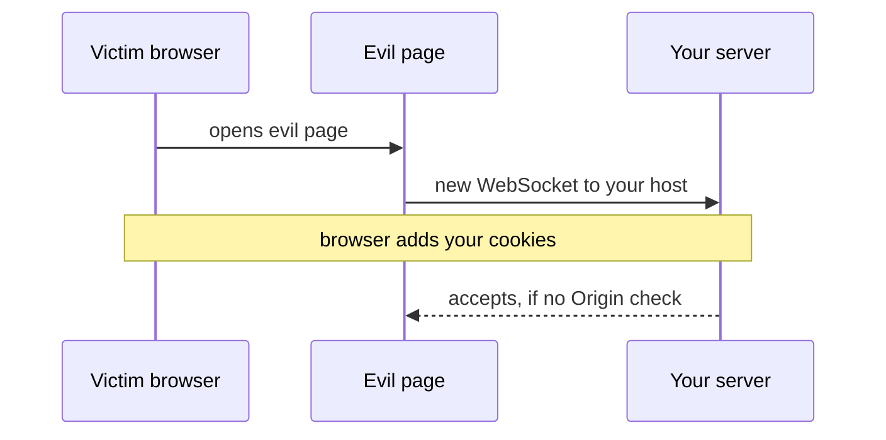

Why it works: WebSocket handshakes are not covered by CORS. The browser sends `Origin: https://evil.example.net` but does not block the connection.

Defences, in order of strength:
1. **Check `Origin`** in the upgrade handler against an exact allow-list. Reject with 403.
2. **Use a ticket or token** obtained through a normal authenticated, CORS-protected request. An attacker's page cannot read it.
3. **Cookie attributes.** `SameSite=Lax` or `Strict` stops the cookie being sent from a cross-site page in most browsers. Treat it as a second layer.
4. **CSRF token** sent in the first message.

```js
// Node http 'upgrade' handler (sketch)
server.on('upgrade', (req, socket) => {
  const origin = req.headers.origin;
  if (!ALLOWED_ORIGINS.has(origin)) {
    socket.write('HTTP/1.1 403 Forbidden\r\n\r\n');
    return socket.destroy();
  }
  // ...continue with ticket check and the upgrade
});
```

**Common mistakes**
- Checking with `origin.includes('example.com')`, which accepts `example.com.evil.net`. Compare exact values.
- Allowing `null` or missing origins for browser traffic. A missing origin should only be allowed for known non-browser clients that use their own credentials.

**Interview tip:** The phrase "CSWSH is CSRF without CORS protection" is short and correct.

_Module: Security · Tags: websockets, cswsh, origin, csrf_

### 30. How do you rate limit and protect a WebSocket service from abuse?

**Short answer:** Limit at three levels: the connection (how many and how fast they open), the message (size and rate per connection), and the user (total across connections). Close abusive connections with a clear code, and put the first line of defence at the edge.

| Level | Limit | Typical action |
| --- | --- | --- |
| Handshake | New connections per IP and per user per minute | 429 on upgrade |
| Concurrent | Open connections per user and per IP | Reject or close oldest |
| Message size | Maximum bytes per message | Close 1009 |
| Message rate | Messages per second per connection (token bucket) | Drop, then close 1008 or 4429 |
| Subscriptions | Maximum channels per connection | Error message |
| Pre-auth | Seconds allowed before authenticating | Close |
| Queue | Maximum bytes waiting to send | Close slow consumer |

A token bucket is the usual tool. It allows short bursts, but limits the average:

```ts
class Bucket {
  private tokens: number;
  private last = Date.now();
  constructor(private rate: number, private burst: number) { this.tokens = burst; }
  take(): boolean {
    const now = Date.now();
    this.tokens = Math.min(this.burst, this.tokens + ((now - this.last) / 1000) * this.rate);
    this.last = now;
    if (this.tokens < 1) return false;
    this.tokens -= 1;
    return true;
  }
}
// const b = new Bucket(10, 20);   10 messages per second, burst of 20
// if (!b.take()) close(conn, 4429, 'rate limited');
```

Behind many pods, keep the per-user count in Redis, or accept that each pod enforces its own share.

Edge protection:
- A WAF or API gateway for handshake rate and IP reputation.
- Short deadlines for the handshake, header size limits and a maximum number of pending upgrades (slowloris style attacks hold connections open without finishing).
- Cheap work first: check the size and the token before parsing JSON or hitting the database.

**Gotcha:** Limiting only by IP punishes users behind one corporate NAT, and does not stop an attacker with many IPs. Combine IP and user limits.

**Interview tip:** Say that the limit must be cheap to evaluate, because the attack target is your CPU.

_Module: Security · Tags: websockets, rate-limiting, abuse, dos_

### 31. How do you handle backpressure and slow consumers in WebSockets?

**Short answer:** If you send faster than a client can receive, data piles up in memory. You need a bounded buffer per connection and a policy: drop old messages, collapse updates, or disconnect the slow client. Never let a queue grow without a limit.

Writing to a socket does not wait for the client. The data goes into the library's buffer and the kernel's send buffer. A phone on a bad network reads slowly, and your process keeps the backlog. With 10,000 slow clients, that becomes a memory leak that ends in an out-of-memory kill.

Where to look:
- Browser: `ws.bufferedAmount` shows bytes not yet sent. Pause sending when it is high.
- Node `ws`: `ws.bufferedAmount` on the server, and the send callback.
- Go: a slow `Write` blocks, so use a per-connection channel with a fixed size.

```js
// Node, server side: drop or close slow consumers (sketch)
const MAX_BUFFERED = 1_000_000;     // 1 MB
function sendSafe(ws, data) {
  if (ws.bufferedAmount > MAX_BUFFERED) {
    ws.close(1013, 'slow consumer');    // try again later
    return false;
  }
  ws.send(data);
  return true;
}
```

Policies, depending on the data:

| Data | Policy |
| --- | --- |
| Latest value (price, status) | Keep only the newest, drop older (conflation) |
| Event stream with order (chat) | Bounded queue, then disconnect, client resyncs on reconnect |
| Telemetry | Drop oldest samples, count the drops |
| Commands | Reject with an error to the sender |

I ran the "bounded queue, drop oldest" idea with a limit of 3 and the inputs 1 to 5. The queue kept `3,4,5`.

Disconnecting is acceptable only if resume works. The client reconnects, sends its last sequence number, and gets a snapshot or a replay.

**Gotcha:** One slow client must not slow the others. In a broadcast loop, never `await` each client in order. Use per-client queues.

**Interview tip:** Give the three words: bound, drop, disconnect. And add that you export a "slow consumer" metric.

_Module: Reliability & Delivery · Tags: websockets, backpressure, slow-consumer, memory_

### 32. What delivery guarantees do WebSockets give, and how do you handle ordering?

**Short answer:** A single WebSocket connection is TCP, so messages arrive in order and without gaps while the connection lives. But there is no guarantee across connections, and when the connection drops, messages in flight are lost. So the application must add sequence numbers and acknowledgements to get at-least-once delivery.

| Guarantee | Meaning | How |
| --- | --- | --- |
| At-most-once | Send once, may be lost | Plain `send()` |
| At-least-once | Retry until acknowledged, may duplicate | Ack, resend, client de-duplicates |
| Exactly-once | Processed one time | Really at-least-once plus idempotent handling |

Where order breaks:
- **Reconnect.** The new connection can overtake or miss messages from the old one.
- **Multiple servers.** Two gateways deliver two events to the same user at slightly different times.
- **Multiple publishers.** Without one writer per entity, the order at the backplane is undefined.
- **Async handlers.** `await` in a message handler can let message 2 finish before message 1.

Fixes:
- Give each message a per-stream **sequence number** (`seq`) assigned by one writer, such as the database or a partition leader.
- The client keeps `lastSeq`. If it sees `seq` greater than `lastSeq + 1`, there is a gap, so it asks for a replay. If it sees a number it has already seen, it ignores it.
- For "latest value" data, ordering matters less: send a version number and ignore older versions.
- Process messages for one connection or one entity in a single queue, in order.

```ts
function apply(state: { lastSeq: number }, m: { seq: number }) {
  if (m.seq <= state.lastSeq) return 'duplicate';
  if (m.seq > state.lastSeq + 1) return 'gap: request replay';
  state.lastSeq = m.seq;
  return 'ok';
}
```

**Interview tip:** Say "TCP orders bytes on one connection, it does not give delivery across reconnects". That sentence separates seniors from juniors.

_Module: Reliability & Delivery · Tags: websockets, delivery, ordering, at-least-once_

### 33. How do acknowledgements, idempotency and de-duplication work in real-time messaging?

**Short answer:** An acknowledgement (ack) tells the sender that a message was received, so it can stop resending. Because acks can be lost, the same message can arrive twice. Give each message a unique id, and make the receiver idempotent: handling it twice has the same effect as once.

Typical flow for a client command, such as "send chat message":
1. Client creates a message with a client-generated id (a UUID) and sends it.
2. Server stores it, using the id as a unique key, and replies `{type:"ack", id}`.
3. If no ack arrives within a timeout, the client resends with the same id.
4. If the server sees an id twice, it returns the earlier result and does not insert again.

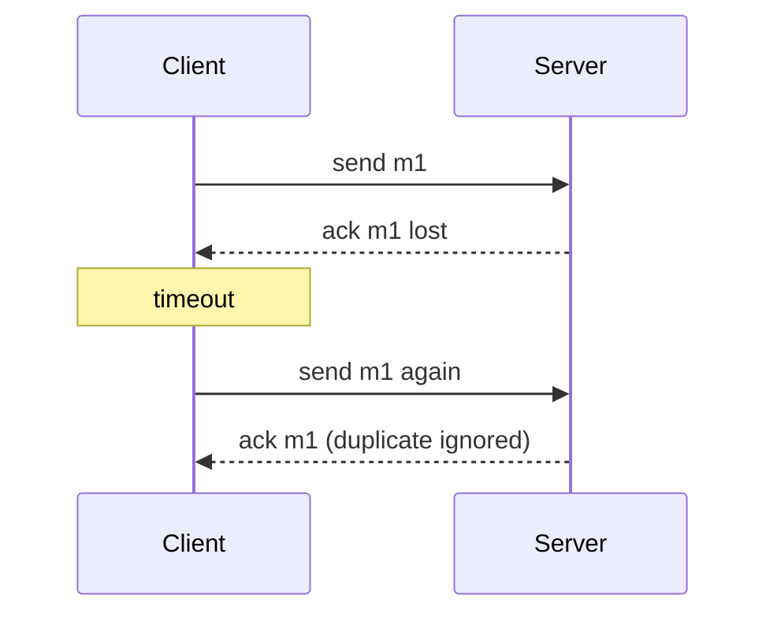

Server de-duplication, in order of strength:
- A database unique constraint on `(user_id, client_message_id)`.
- A Redis key with a TTL (`SET key 1 NX EX 600`) for short windows.
- An in-memory set per connection for the receiving client, limited in size.

I ran a small receiver that remembers ids:

```js
const seen = new Set();
const handle = (m) => (seen.has(m.id) ? 'duplicate ignored' : (seen.add(m.id), 'processed'));
console.log(handle({ id: 'm1' }), handle({ id: 'm1' }));
// prints: processed duplicate ignored
```

Direction matters:
- **Client to server:** client retries with the same id.
- **Server to client:** the server cannot know what the browser rendered. Usually the client sends the last received `seq` (a cumulative ack), and the server resends from there.

| Ack style | Detail | Cost |
| --- | --- | --- |
| Per message | Ack each id | Chatty |
| Cumulative | "I have everything up to 42" | Cheap, common |
| Batched | Ack every N messages or ms | Balanced |

**Gotcha:** Idempotency must also cover side effects such as sending an email or charging a card. Pass the same id downstream.

**Interview tip:** Say "exactly-once delivery does not exist, exactly-once effect does, through at-least-once plus idempotency".

_Module: Reliability & Delivery · Tags: websockets, idempotency, acknowledgements, deduplication_

### 34. How do you resume after a reconnect without losing or repeating messages?

**Short answer:** Give every message a sequence number per stream, keep a replay buffer on the server, and let the client send its last seen number when it reconnects. If the gap is too old for the buffer, the server tells the client to reload a snapshot and continue with deltas.

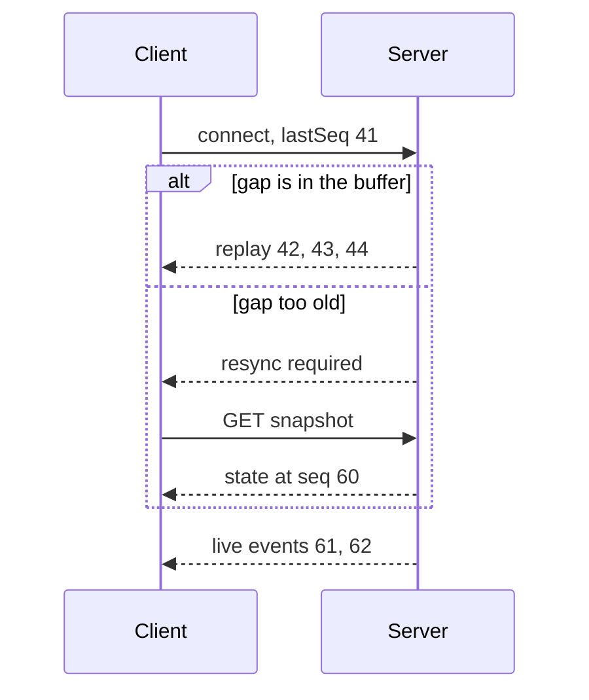

Replay buffer choices:

| Store | Good for | Notes |
| --- | --- | --- |
| In memory ring buffer | Short gaps (seconds to minutes) | Lost on pod restart, so the client reconnects to another pod with no history |
| Redis Streams | Shared across pods | Trim by length or time |
| Database or event log | Long gaps, audit, chat history | Query by `seq > lastSeq` |
| Snapshot only | Dashboards where only latest matters | Simplest |

I ran a ring buffer that keeps the last 3 messages after 5 pushes. A client asking since seq 3 got messages 4 and 5. A client asking since seq 1 got `resync: true` because seq 2 was already trimmed:

```js
// {"resync":false,"msgs":[{"seq":4,"d":"d"},{"seq":5,"d":"e"}]}
// {"resync":true}
```

Design points:
- **Snapshot plus deltas.** Always be able to build the full state from a snapshot that carries its own `seq`. Then apply events with a higher `seq`.
- **Subscribe before you snapshot** (or buffer live events during the snapshot) so nothing falls into the gap.
- The sequence must come from one writer per stream. Do not use each gateway's own counter.
- **Client side.** Keep `lastSeq` in memory (and in storage if you want resume after a page reload).

SSE does this natively with `Last-Event-ID`. With WebSockets you build it.

**Gotcha:** If a pod restart loses the in-memory buffer, clients get a full resync at once, a thundering herd on your snapshot endpoint. Cache snapshots and add jitter.

**Interview tip:** The line "snapshot plus deltas with a sequence number" answers most "how do you not lose updates" questions.

_Module: Reliability & Delivery · Tags: websockets, resume, sequence-numbers, replay_

### 35. How do you build presence and typing indicators?

**Short answer:** Presence ("who is online") is soft state with an expiry. Each connection refreshes a short TTL key while it is alive, and the key vanishes by itself if the client disappears. Typing indicators are even lighter: they are ephemeral events, never stored, with a timeout on the client.

Why not just use connect and disconnect events? Disconnects are not reliable. A crashed pod or a dropped network sends no close frame, so users stay "online" forever. A TTL fixes this: no heartbeat, no presence.

A common design with Redis:
1. On connect, the gateway sets `presence:user:42 = <gateway id>` with a 60 second TTL.
2. Every 20 to 30 seconds the gateway refreshes the TTL for each active user (use pipelines or batch refresh).
3. When the last connection of a user closes cleanly, delete the key. If it does not, the TTL expires.
4. To tell friends, publish a `presence.changed` event only when the state really changes, and debounce it so a quick reconnect does not flicker.

A user can have several devices. Keep a count or a set of connection ids, and say "online" while the set is non-empty.

Typing indicators:
- Client sends `{type:"typing", room}` at most once every 2 to 3 seconds while typing.
- The server forwards it to the room without storing it.
- The receiving UI shows "Asha is typing" and clears it after about 5 seconds without a new event, or when the message arrives.

| Item | Stored? | Delivery | Expiry |
| --- | --- | --- | --- |
| Presence | Yes, in a fast store | At-most-once events, truth in the store | TTL |
| Typing | No | Fire and forget | Client timer |
| Read position | Yes, in the database | At-least-once | None |

**Gotcha:** Broadcasting presence to everyone in a big room multiplies traffic. Send presence only for the visible list, or sample it.

**Interview tip:** Use the phrase "presence is a lease, not an event". It makes the TTL idea easy to remember.

_Module: Real-time Design · Tags: websockets, presence, heartbeat, ttl_

### 36. How do rooms, channels and subscriptions work?

**Short answer:** A channel (or room) is a named group. The server keeps a map from channel name to the set of connections subscribed. A publish to the channel loops over that set. Across several servers, each server subscribes to the channel on the backplane only while it has local members.

```js
// In-memory registry (sketch, one process)
const rooms = new Map();                       // channel -> Set of connections

function join(conn, channel) {
  if (!rooms.has(channel)) rooms.set(channel, new Set());
  rooms.get(channel).add(conn);
  conn.channels.add(channel);                  // so we can clean up on close
}
function leave(conn, channel) {
  const set = rooms.get(channel);
  set?.delete(conn);
  if (set && set.size === 0) rooms.delete(channel);   // free memory, unsubscribe backplane
}
function onClose(conn) { for (const ch of conn.channels) leave(conn, ch); }
```

Design decisions:
- **Naming.** Use a clear scheme: `tenant:<id>:order:<id>`, `user:<id>`. Easy to authorise, easy to shard.
- **Who decides subscriptions?** Server-driven (the server subscribes you to `user:<id>`) is safest. Client-driven needs a permission check.
- **Limits.** A maximum number of channels per connection, and a maximum channel name length.
- **Cleanup.** Always remove the connection from all sets on close. Forgotten entries are a classic memory leak.
- **Wildcards.** `orders.*` patterns are useful but expensive to match at scale. Avoid them on hot paths.

| Scope | Where the map lives | Note |
| --- | --- | --- |
| One process | A Map in memory | Fast, simplest |
| Many gateways | Local map plus backplane subscription | Standard pattern |
| Huge rooms | Sharded channels, such as `room:42:shard:3` | Spread fan-out |

Subscription management also means keeping the client's view in sync. On reconnect the client sends its list of channels (or the server restores it from the session), and the replay logic from the resume question applies per channel.

**Gotcha:** Per-connection subscription state is lost when a pod dies. The client must resubscribe after every reconnect.

**Interview tip:** Say you track "channel to connections" and "connection to channels" together, so both publish and cleanup are fast.

_Module: Server Implementation · Tags: websockets, rooms, pub-sub, subscriptions_

### 37. How do you broadcast efficiently to many connections?

**Short answer:** Serialise the message once, send the same bytes to every subscriber, write without waiting for each client, and use per-connection queues so slow clients do not block the loop. For very large rooms, shard the fan-out across workers or servers.

Common waste in a broadcast loop:
- Calling `JSON.stringify` for every client. Do it once.
- Awaiting each send in sequence. One slow client delays everyone.
- Copying the payload per client. Share the buffer.
- Sending tiny messages individually. Batch updates in a short window.

```js
// Node (sketch): encode once, send to all open sockets
function broadcast(clients, event) {
  const payload = JSON.stringify(event);            // 1. one encode
  for (const ws of clients) {
    if (ws.readyState !== 1) continue;              // 2. skip closed sockets
    if (ws.bufferedAmount > 1_000_000) { ws.terminate(); continue; }   // 3. protect memory
    ws.send(payload);                               // 4. no await, same string
  }
}
```

Other techniques:

| Technique | What it does | When |
| --- | --- | --- |
| Batching | Combine events in 20 to 100 ms windows | High-rate updates (cursors, prices) |
| Conflation | Keep only the latest value per key | State feeds |
| Delta updates | Send changes, not full objects | Big objects |
| Compression | Compress once for all (see permessage-deflate trade-offs) | Large text |
| Sharding | Several workers each own part of the room | Rooms with 100,000 or more members |
| Per-user views | Group users by what they may see, encode once per group | Mixed permissions |

In Go, give every connection a buffered channel and one writer goroutine. The broadcast loop does a non-blocking send (`select` with `default`) and treats a full channel as a slow consumer.

Keep your main loop short. In Node, a 50 ms broadcast loop blocks the event loop for 50 ms and delays heartbeats. Chunk very large loops with `setImmediate`.

**Gotcha:** Per-client personalised encoding is the hidden cost. If every client needs a different message, fan-out is CPU, not network.

**Interview tip:** Quote the order: encode once, never block on one client, bound the queue, batch, shard.

_Module: Server Implementation · Tags: websockets, broadcast, fan-out, performance_

### 38. How do you build a WebSocket server in Node.js with the `ws` library?

**Short answer:** Create an HTTP server, handle its `upgrade` event yourself (so you can authenticate and check Origin before accepting), and pass accepted requests to a `WebSocketServer` created with `noServer: true`. Then handle `connection`, `message`, `close` and `error` on each socket, plus a ping interval.

This is read-only code for the `ws` package, which was not installed here. I did test the underlying handshake and frame behaviour with a hand-written server using only `http` and `crypto`.

```js
import http from 'node:http';
import { WebSocketServer } from 'ws';

const server = http.createServer();
const wss = new WebSocketServer({ noServer: true, maxPayload: 64 * 1024 });  // 64 KB limit

server.on('upgrade', async (req, socket, head) => {
  const user = await checkTicketAndOrigin(req);          // your auth and Origin check
  if (!user) { socket.write('HTTP/1.1 401 Unauthorized\r\n\r\n'); return socket.destroy(); }
  wss.handleUpgrade(req, socket, head, (ws) => {
    ws.user = user; ws.isAlive = true;
    wss.emit('connection', ws, req);
  });
});

wss.on('connection', (ws) => {
  ws.on('pong', () => { ws.isAlive = true; });
  ws.on('message', (data, isBinary) => {
    let msg;
    try { msg = JSON.parse(data.toString()); } catch { return ws.close(1003, 'bad json'); }
    // validate msg.type, check permissions, then handle
  });
  ws.on('error', (err) => console.error('socket error', err.code));
  ws.on('close', () => cleanup(ws));
});

setInterval(() => wss.clients.forEach((ws) => {
  if (!ws.isAlive) return ws.terminate();
  ws.isAlive = false; ws.ping();
}), 30000);
server.listen(8080);
```

Key points:
- `noServer` plus `handleUpgrade` lets you reject before the upgrade, with a real HTTP status code.
- Set `maxPayload`. Without a sensible limit, one client can send huge messages.
- Handle `error` on every socket, or an unhandled `error` event can crash the process.
- Keep the message handler fast. Heavy CPU work blocks the single event loop, and that delays pings and every other user.
- `message` data is a `Buffer` (`isBinary` tells you the frame type).
- By default, `ws` does not enable permessage-deflate on the server, which is a safe default for memory.

**Gotcha:** `ws.send()` when the socket is not open throws or calls back with an error. Check `readyState`, or pass a callback.

**Interview tip:** Mention the upgrade handler first. It shows you know where authentication and Origin checks belong.

_Module: Server Implementation · Tags: websockets, nodejs, ws_

### 39. How do you structure a WebSocket server in Go?

**Short answer:** Use one goroutine to read and one to write per connection (read pump and write pump). The write pump owns all writes and gets messages from a buffered channel. This respects the rule that most libraries allow only one concurrent writer and one concurrent reader per connection.

This is read-only code for `github.com/gorilla/websocket`, which is not installed here. The `coder/websocket` library (formerly nhooyr) is another good choice, and it allows concurrent writes.

```go
package main

import (
	"net/http"
	"time"

	"github.com/gorilla/websocket"
)

const (
	writeWait  = 10 * time.Second
	pongWait   = 60 * time.Second
	pingPeriod = pongWait * 9 / 10
)

type Client struct {
	conn *websocket.Conn
	send chan []byte // bounded: a full channel means a slow consumer
}

var upgrader = websocket.Upgrader{
	ReadBufferSize: 1024, WriteBufferSize: 1024,
	CheckOrigin: func(r *http.Request) bool { return r.Header.Get("Origin") == "https://app.example.com" },
}

func (c *Client) readPump() {
	defer c.conn.Close()
	c.conn.SetReadLimit(64 * 1024)
	c.conn.SetReadDeadline(time.Now().Add(pongWait))
	c.conn.SetPongHandler(func(string) error {
		return c.conn.SetReadDeadline(time.Now().Add(pongWait)) // alive: extend deadline
	})
	for {
		_, msg, err := c.conn.ReadMessage()
		if err != nil {
			return // close or timeout: let defer clean up
		}
		_ = msg // validate, authorise, handle
	}
}

func (c *Client) writePump() {
	ticker := time.NewTicker(pingPeriod)
	defer func() { ticker.Stop(); c.conn.Close() }()
	for {
		select {
		case msg, ok := <-c.send:
			c.conn.SetWriteDeadline(time.Now().Add(writeWait))
			if !ok {
				c.conn.WriteMessage(websocket.CloseMessage, nil)
				return
			}
			if err := c.conn.WriteMessage(websocket.TextMessage, msg); err != nil {
				return
			}
		case <-ticker.C:
			c.conn.SetWriteDeadline(time.Now().Add(writeWait))
			if err := c.conn.WriteMessage(websocket.PingMessage, nil); err != nil {
				return
			}
		}
	}
}

func serveWS(w http.ResponseWriter, r *http.Request) {
	conn, err := upgrader.Upgrade(w, r, nil)
	if err != nil {
		return // Upgrade already wrote an HTTP error
	}
	c := &Client{conn: conn, send: make(chan []byte, 256)}
	go c.writePump()
	c.readPump() // runs in this goroutine, blocks until the connection ends
}
```

Why this shape:
- **Single writer.** Only `writePump` writes, so there are no concurrent write panics. Other code puts messages on `send`.
- **Read deadline plus pong handler** detects dead peers. The ping period must be shorter than the pong wait.
- **Bounded channel.** Broadcast code does `select { case c.send <- m: default: close(c.send) }` to drop slow clients.
- **Cleanup.** When either pump ends, close the connection and remove the client from rooms.
- For shutdown, pass a `context` and close connections with code 1001 when it is cancelled.

**Gotcha:** The default `CheckOrigin` in gorilla rejects cross-origin requests only when an Origin header differs from the host. Write your own allow-list for production.

**Interview tip:** The phrase "one reader, one writer, bounded channel" shows you know the concurrency rule.

_Module: Server Implementation · Tags: websockets, golang, concurrency, goroutines_

### 40. How do you write a robust `useWebSocket` hook in React?

**Short answer:** Open the socket in `useEffect`, close it in the cleanup function, keep the socket in a ref, store received data in state, and keep callbacks fresh without reconnecting. In React 18 development, StrictMode mounts the component twice, so the cleanup must be correct or you will see two connections.

This is browser code and is read-only here.

```tsx
import { useEffect, useRef, useState, useCallback } from 'react';

export function useWebSocket(url: string, onMessage: (data: unknown) => void) {
  const wsRef = useRef<WebSocket | null>(null);
  const handlerRef = useRef(onMessage);
  const [status, setStatus] = useState<'connecting' | 'open' | 'closed'>('connecting');

  useEffect(() => { handlerRef.current = onMessage; }, [onMessage]); // always the latest handler

  useEffect(() => {
    let closedByUs = false;
    let attempt = 0;
    let timer: ReturnType<typeof setTimeout>;

    const connect = () => {
      const ws = new WebSocket(url);
      wsRef.current = ws;
      ws.onopen = () => { attempt = 0; setStatus('open'); };
      ws.onmessage = (e) => handlerRef.current(JSON.parse(e.data));
      ws.onclose = () => {
        setStatus('closed');
        if (closedByUs) return;                       // do not reconnect after cleanup
        const wait = Math.random() * Math.min(30000, 500 * 2 ** attempt++);
        timer = setTimeout(connect, wait);
      };
    };
    connect();

    return () => { closedByUs = true; clearTimeout(timer); wsRef.current?.close(1000); };
  }, [url]);

  const send = useCallback((msg: unknown) => {
    if (wsRef.current?.readyState === WebSocket.OPEN) wsRef.current.send(JSON.stringify(msg));
  }, []);

  return { status, send };
}
```

What the code handles:
- **Cleanup.** The flag stops reconnecting after unmount, and the timer is cleared.
- **StrictMode.** In development React mounts, unmounts and mounts again. The first socket is closed by cleanup, so only one stays. Seeing one extra connect and close in dev is normal, not a bug.
- **Stale closure.** If `onMessage` were used directly inside `onmessage`, it would capture old state. The handler ref always points at the latest function.
- **State versus refs.** The socket and attempt counter are refs or locals, because changing them must not re-render. Only `status` and the data you show go in state.
- **Dependency on `url`.** A changing url (for example a new ticket each time) reconnects. Get the ticket inside `connect`, not in the url prop, if you want stable connections.

**Common mistakes**
- Opening the socket in the component body (a new socket on every render).
- Creating a socket per component instead of one shared connection through a context or a store.

**Interview tip:** For a bigger app I would create one connection in a provider and let components subscribe to channels, not open a socket per component.

_Module: Client Patterns · Tags: react, hooks, websockets, strict-mode_

### 41. How do you combine WebSocket updates with React Query, Redux or other client state?

**Short answer:** Treat the socket as an event source that updates the same cache your screens already read. With React Query, either patch the cached data with `setQueryData` or call `invalidateQueries` to refetch. Keep one place that maps socket events to cache updates.

Two common ways:

| Approach | How | Use when |
| --- | --- | --- |
| Patch the cache | `queryClient.setQueryData(key, updater)` with the event | Small, frequent events where you know the shape |
| Invalidate and refetch | `queryClient.invalidateQueries({ queryKey })` | Complex data, low event rate, simplicity |

```tsx
// One subscriber, mounted once near the app root (browser code, read-only)
function useOrderEvents(client: QueryClient) {
  useWebSocket('/ws', (msg: any) => {
    switch (msg.type) {
      case 'order.updated':
        client.setQueryData(['orders', msg.order.id], msg.order);         // patch one item
        client.invalidateQueries({ queryKey: ['orders', 'list'] });       // refetch the list
        break;
      case 'order.deleted':
        client.removeQueries({ queryKey: ['orders', msg.id] });
        break;
    }
  });
}
```

Why this works well: components keep using `useQuery`, and they re-render when the cache changes. There is no second source of truth. HTTP stays the way to load data, the socket only keeps it fresh. If the socket is down, polling (`refetchInterval`) or refetch-on-reconnect brings the cache up to date.

Tips:
- On reconnect, invalidate the queries that might have missed events, or use the sequence number to decide.
- With Redux or Zustand, dispatch actions from the socket handler, the same single-subscriber idea.
- Throttle state updates when events come very fast (for example batch within `requestAnimationFrame`), to avoid re-render storms.
- Keep message handling out of components. A plain module with `handleEvent(msg)` is easy to unit test.
- Be careful with optimistic updates: reconcile them with the echo from the server using the client message id.

**Gotcha:** Patching the cache from a stale event can overwrite newer data. Compare `version` or `seq` before writing.

**Interview tip:** Say "the socket does not replace the data layer, it feeds it". Interviewers like that separation.

_Module: Client Patterns · Tags: react, react-query, state, websockets_

### 42. What are the details and limits of implementing SSE?

**Short answer:** An SSE endpoint sets `Content-Type: text/event-stream`, disables caching and buffering, writes `data:` lines followed by a blank line, and sends a comment or event regularly to keep the connection alive. Its limits are text only, one direction, and per-browser connection limits on HTTP/1.1.

Server in Node, tested locally with a built-in client:

```js
import http from 'node:http';

http.createServer((req, res) => {
  res.writeHead(200, {
    'Content-Type': 'text/event-stream',
    'Cache-Control': 'no-cache',
    'X-Accel-Buffering': 'no',            // ask NGINX not to buffer this response
  });
  let id = Number(req.headers['last-event-id'] ?? 0);   // resume point after reconnect
  res.write('retry: 3000\n\n');                          // reconnect delay in ms
  const timer = setInterval(() => {
    id += 1;
    res.write(`id: ${id}\nevent: tick\ndata: {"n":${id}}\n\n`);
  }, 1000);
  const beat = setInterval(() => res.write(': keep-alive\n\n'), 15000);
  req.on('close', () => { clearInterval(timer); clearInterval(beat); });   // always clean up
}).listen(8080, '127.0.0.1');
```

My local run with `Last-Event-ID: 3` returned events 4, 5, 6 with `content-type text/event-stream`, as expected.

Limits and details:
- **Six connections per host on HTTP/1.1.** Browsers share a small pool per domain, so several tabs with SSE can starve normal requests. HTTP/2 multiplexes streams, and the default limit is about 100 concurrent streams.
- **No binary.** Only UTF-8 text. Use base64 or WebSockets.
- **No custom headers with `EventSource`.** Use cookies, or a fetch-based client library for tokens.
- **Auto reconnect and `Last-Event-ID`** are built in, but your server must support the replay.
- **Proxies.** Buffering, compression and idle timeouts break streams. Set `proxy_buffering off`, and a read timeout above your keep-alive comment period.
- **One request per stream, not per tab** if you can share it between tabs (a SharedWorker or BroadcastChannel leader).

**Gotcha:** Not cleaning up on `req.on('close')` leaves timers running for dead clients. That is a memory and CPU leak.

**Interview tip:** Say "SSE over HTTP/2 removes the six-connection problem" to show you know the limit and its fix.

_Module: SSE & Alternatives · Tags: sse, http, limits, proxies_

### 43. Can WebSockets run over HTTP/2 and HTTP/3?

**Short answer:** Yes, in concept. RFC 8441 defines WebSockets over HTTP/2 using an extended CONNECT request, and RFC 9220 does the same for HTTP/3. One WebSocket then becomes one stream on a shared connection, instead of its own TCP connection. Support depends on browser, server and proxy, so many systems still use HTTP/1.1 upgrade.

How it differs from the classic way:

| Point | HTTP/1.1 upgrade | Over HTTP/2 or HTTP/3 |
| --- | --- | --- |
| Handshake | `GET` with `Upgrade: websocket`, answer `101` | `CONNECT` with `:protocol = websocket`, answer `200` |
| Connection | One TCP connection per WebSocket | A stream inside a shared connection |
| Many sockets to one host | Many TCP connections | One connection, many streams |
| Head-of-line blocking | TCP level, per socket | HTTP/2: TCP level shared. HTTP/3: per stream, no shared TCP blocking |
| Frames | Same WebSocket frames | Same WebSocket frames |

Benefits: fewer connections to one host (good for tabs and proxies), and with HTTP/3 a lost packet does not stall every stream.

Practical points:
- The server must advertise support (the setting `SETTINGS_ENABLE_CONNECT_PROTOCOL` in HTTP/2).
- Your application code usually does not change. The library or proxy hides the difference.
- Many load balancers still downgrade WebSocket traffic to HTTP/1.1 to the upstream, and that works fine.
- The browser chooses the protocol. A browser may use HTTP/2 WebSockets only where it is supported by the browser and server. Check the current support tables before relying on it.
- WebTransport is the newer option designed for HTTP/3, with streams and unreliable datagrams, but it is not a drop-in replacement.

Because the exact support differs by version, I treat this as "know it exists and what it solves". In production most teams use HTTP/1.1 upgrade today and test the rest in staging.

**Gotcha:** Putting a proxy in front that speaks HTTP/2 to the browser and HTTP/1.1 to your app is normal. Make sure it translates the upgrade correctly, or WebSocket connections fail only for some clients.

**Interview tip:** Name both RFC numbers (8441 and 9220) only if asked. The key idea is multiplexing many sockets on one connection.

_Module: WebSocket Protocol · Tags: websockets, http2, http3, protocol_

### 44. When should you use permessage-deflate compression?

**Short answer:** permessage-deflate (RFC 7692) compresses each message with zlib, negotiated in the handshake. It saves bandwidth on large text messages such as JSON, but costs CPU and memory per connection, so it is usually a poor trade for many small messages or for servers with many connections.

How it is negotiated:

```text
Client: Sec-WebSocket-Extensions: permessage-deflate; client_max_window_bits
Server: Sec-WebSocket-Extensions: permessage-deflate
```

Each connection then keeps a compression state. With "context takeover" the compressor remembers earlier messages and compresses repeated text better, but uses more memory. Without it (`no_context_takeover`), each message is compressed alone.

| Factor | Compression helps | Compression hurts |
| --- | --- | --- |
| Message size | Large JSON (several KB or more) | Tiny messages (under about 200 bytes) |
| Data | Repetitive text | Already compressed data (images, protobuf) |
| Connections | A few thousand | Hundreds of thousands (memory) |
| CPU | Spare CPU | Busy gateways, TLS heavy |
| Network | Metered or slow mobile links | Fast internal links |

Other points:
- **Security.** Compression plus secrets in the same stream can leak information (CRIME and BREACH style attacks). Do not mix attacker-controlled text with secrets in compressed messages.
- **Library defaults.** The Node `ws` library does not enable it by default on the server, and its docs warn about memory use and fragmentation. Browsers usually offer it.
- **Alternatives.** Send smaller messages first: deltas instead of full objects, short field names agreed in a schema, or binary formats like protobuf. These often beat compression and cost less.
- **Broadcast.** If many clients receive the same message, compressing once and sharing the compressed bytes is only possible if all settings match. Per-connection compression repeats the work for each client.

**Interview tip:** Say you would measure bytes and CPU with and without it in a load test, and that deltas and binary encoding are usually the first fix.

_Module: WebSocket Protocol · Tags: websockets, compression, performance, memory_

### 45. How do you handle large payloads and chunking over WebSockets?

**Short answer:** Avoid large payloads on WebSockets. Send a small message with a reference, and move the bulk data over HTTP, where range requests, caching, resumable uploads and CDNs exist. If you must stream big data, split it into chunks with ids and sizes, and watch backpressure.

Why large messages hurt:
- One big message blocks that connection's queue. Pings and other messages wait behind it (head-of-line blocking within the socket).
- Servers must buffer the whole message before delivering it (libraries allow a `maxPayload`). Big messages raise memory use and close code 1009 appears when the limit is exceeded.
- Retries and resume are not built in. A failed 50 MB message starts over.
- Compression and parsing time grow.

Better patterns:
1. **Reference pattern.** Send `{type:"report.ready", url:"/reports/42"}`. The client fetches the file by HTTP, with auth and caching.
2. **Presigned upload.** The client uploads straight to object storage, then sends a small "upload done" message.
3. **Chunking.** For binary streaming, use frames of 16 to 64 KB with a header:

```ts
type Chunk = { id: string; index: number; total: number; bytes: ArrayBuffer };
// Sender: send a chunk only when socket.bufferedAmount is small
async function sendChunks(ws: WebSocket, id: string, data: Uint8Array, size = 32 * 1024) {
  const total = Math.ceil(data.length / size);
  for (let i = 0; i < total; i++) {
    while (ws.bufferedAmount > 256 * 1024) await new Promise((r) => setTimeout(r, 20)); // backpressure
    ws.send(encodeChunk(id, i, total, data.subarray(i * size, (i + 1) * size)));
  }
}
```

The receiver collects chunks by `id`, checks `index`, discards after a timeout, and verifies a checksum. Limit the number of unfinished transfers per connection.

WebSocket fragmentation (continuation frames) is a protocol feature and invisible to your code. Application chunking is a separate layer that you control and can resume.

**Interview tip:** The shortest good answer: "Keep sockets for small, frequent messages and use HTTP for big files".

_Module: WebSocket Protocol · Tags: websockets, large-messages, chunking, uploads_

### 46. How do you design binary protocols and evolve their schema safely?

**Short answer:** Pick a format with explicit field identity, such as Protocol Buffers, and follow the compatibility rules: only add optional fields, never reuse or change field numbers, and ignore unknown fields. Negotiate the protocol version in the handshake, and support old and new clients together during a rollout.

Why this matters more for sockets than for REST: clients stay connected for hours and update later. After a deploy, the server meets old clients that still send the old format. Mobile apps and embedded devices (an aircraft unit) can lag by months.

Safe evolution rules (Protobuf):

```proto
message OrderUpdated {
  string order_id = 1;
  string status = 2;
  reserved 3;                     // field 3 was removed: never reuse the number
  reserved "legacy_flag";
  int64 updated_at_ms = 4;        // new optional field: old clients ignore it
}
```

| Change | Safe? |
| --- | --- |
| Add a field with a new number | Yes |
| Remove a field | Yes, if you reserve its number and name |
| Rename a field | Yes on the wire (names are not sent), but breaks JSON mapping |
| Change a field type | Usually no |
| Reuse a number | No, never |
| Make a field required | Avoid `required` (removed in proto3) |

Process and practice:
- Put the version in the subprotocol (`orders.v2`), and keep v1 until usage drops to zero. Measure the share of clients on each version.
- Use an **envelope** with `type` and `version`, then a payload. Unknown types are logged and ignored, not fatal.
- Keep one schema repository, and run a compatibility check (such as `buf breaking`) in CI.
- Generate TypeScript and Go code from the same `.proto`, so the React app and the Go service always agree.
- For JSON, apply the same rules: add fields, ignore unknown ones, never change meaning.
- Include a way to force upgrade: a close code like 4426 ("upgrade required") that the client shows as a prompt.

**Gotcha:** A hand-made binary layout with fixed byte offsets is compact but very hard to evolve. Use it only when profiling proves you need it.

**Interview tip:** Mention "reserved" and "unknown fields are ignored". Those two words show real experience.

_Module: WebSocket Protocol · Tags: websockets, protobuf, schema-evolution, versioning_

### 47. How do GraphQL subscriptions and gRPC streaming compare with plain WebSockets?

**Short answer:** GraphQL subscriptions let a client subscribe to events using a GraphQL query, usually delivered over WebSockets with the `graphql-transport-ws` protocol. gRPC streaming gives typed streams between services over HTTP/2. Plain WebSockets give a raw channel where you define everything.

| Point | Plain WebSocket | GraphQL subscription | gRPC streaming |
| --- | --- | --- | --- |
| Contract | Your own messages | GraphQL schema | `.proto` service |
| Client chooses fields | No | Yes | No (fixed messages) |
| Transport | WebSocket | Usually WebSocket (SSE is also possible) | HTTP/2 |
| Browser | Native | Native via WebSocket | Needs gRPC-Web and a proxy, no bidirectional |
| Reconnect, resume | You build | Client library reconnects, you resume | You build (deadlines and cancel exist) |
| Best for | Chat, custom protocols | UI that already uses GraphQL | Service to service, devices |

GraphQL subscriptions:
- The client sends `subscription { orderUpdated(id: "42") { id status } }`, and the server pushes results for each event.
- Good fit if your front end already uses GraphQL and you want one schema for queries, mutations and live updates.
- Costs: you still run long-lived connections, and filtering and authorisation per subscription must be designed. Each subscription runs resolvers per event, which can be expensive at large fan-out.
- Subscriptions need a pub/sub backend to work across servers, just like WebSockets.

gRPC streaming:
- Four kinds: unary, server stream, client stream, bidirectional stream.
- In Go it is a natural way to stream telemetry between services, with deadlines, cancellation, metadata and status codes.
- Balance it at layer 7 (Envoy or a service mesh), or all streams of one client pin to one pod.

My rule: browser to gateway uses WebSockets or SSE (or GraphQL subscriptions if the stack is GraphQL). Service to service uses gRPC streams or a broker. Devices on weak links use MQTT.

**Interview tip:** Say "GraphQL subscriptions are a query language on top of the same transport problems, they do not remove them".

_Module: Real-time Basics · Tags: graphql, grpc, subscriptions, websockets_

### 48. How do you configure NGINX, Envoy and ingress for WebSocket upgrades and timeouts?

**Short answer:** Each proxy must forward the `Upgrade` and `Connection` headers, use HTTP/1.1 to the upstream where needed, and have idle and stream timeouts longer than your heartbeat. Configure a timeout per route for WebSocket paths instead of raising it for everything.

NGINX (the key lines):

```nginx
location /ws {
    proxy_pass http://gateway;
    proxy_http_version 1.1;
    proxy_set_header Upgrade $http_upgrade;
    proxy_set_header Connection "upgrade";
    proxy_read_timeout 3600s;
    proxy_buffering off;
}
```

Envoy (HTTP connection manager and route):

```yaml
http_filters:
  - name: envoy.filters.http.router
    typed_config:
      "@type": type.googleapis.com/envoy.extensions.filters.http.router.v3.Router
upgrade_configs:
  - upgrade_type: websocket          # allow the upgrade on this listener
route_config:
  virtual_hosts:
    - name: app
      domains: ["*"]
      routes:
        - match: { prefix: "/ws" }
          route:
            cluster: gateway
            timeout: 0s              # disable the route timeout for long-lived streams
            idle_timeout: 3600s      # close if nothing flows for an hour
```

Kubernetes ingress (community NGINX controller annotations, read-only; verify for your version, and note the project's announced retirement):

```yaml
metadata:
  annotations:
    nginx.ingress.kubernetes.io/proxy-read-timeout: "3600"
    nginx.ingress.kubernetes.io/proxy-send-timeout: "3600"
```

| Concern | Setting to look for |
| --- | --- |
| Upgrade headers | `Upgrade` and `Connection` forwarded, `upgrade_configs` in Envoy |
| Idle timeout | `proxy_read_timeout`, Envoy `idle_timeout`, cloud gateway idle setting |
| Max connection age | CDN, gateway or mesh limits |
| Retries | Disable for upgrade routes |
| Buffering | Off for streams and SSE |
| Request size | Large frames need enough header and body limits |

After configuring, test it: connect, stay silent for longer than the timeout, and confirm the connection survives (with your heartbeat running). Also test through the real public path, including the CDN or WAF, not only inside the cluster.

**Gotcha:** The default Envoy route timeout (15 seconds) can close WebSocket connections that stay open without finishing a "request". Set it explicitly for those routes.

**Interview tip:** Say you keep a table of every hop and its timeout. It is the quickest answer to "why do connections drop at exactly N seconds".

_Module: Scaling & Operations · Tags: nginx, envoy, ingress, configuration_

### 49. What Kubernetes settings matter for WebSocket workloads?

**Short answer:** Four things: readiness probes that reflect real capacity, a `preStop` hook and a long `terminationGracePeriodSeconds` for draining, session affinity only when the transport needs it, and resource limits sized for connection memory. Add a PodDisruptionBudget so node upgrades do not evict everything at once.

```yaml
apiVersion: apps/v1
kind: Deployment
metadata:
  name: ws-gateway
spec:
  replicas: 6
  strategy:
    rollingUpdate: { maxUnavailable: 0, maxSurge: 25% }
  template:
    spec:
      terminationGracePeriodSeconds: 120
      containers:
        - name: gateway
          image: registry.example.com/ws-gateway:1.4.0
          ports: [{ containerPort: 8080 }]
          readinessProbe:
            httpGet: { path: /ready, port: 8080 }   # fails when draining or over the connection cap
            periodSeconds: 5
          lifecycle:
            preStop:
              exec: { command: ["sleep", "5"] }    # let endpoint removal propagate
          resources:
            requests: { cpu: "500m", memory: "1Gi" }
            limits: { memory: "2Gi" }
---
apiVersion: policy/v1
kind: PodDisruptionBudget
metadata:
  name: ws-gateway
spec:
  minAvailable: 80%
  selector:
    matchLabels: { app: ws-gateway }
```

| Setting | Why it matters here |
| --- | --- |
| Readiness | Fail when draining or at the connection cap, so new sockets go elsewhere |
| Liveness | Keep it light. Do not kill a busy pod only because the event loop is slow |
| `preStop` and grace period | Give time to send close frames and let clients reconnect with jitter |
| Session affinity | Needed only for Socket.IO polling or similar. `sessionAffinity: ClientIP` on the Service, or cookie affinity at the ingress |
| HPA | Scale on connections or memory, not only CPU. Scale up early, scale down slowly |
| Memory limit | Include queue buffers, and set a connection cap below the limit |
| Anti-affinity or topology spread | Spread pods over nodes and zones so one failure drops fewer sockets |
| `ulimit` / file descriptors | Container default is usually enough, but check at high connection counts |

Scale-down is where WebSocket systems hurt. When the HPA removes a pod, all its clients must reconnect. Use a long stabilisation window for scale-down, and drain, so the shrink is gradual.

**Gotcha:** `ClientIP` affinity breaks down behind NAT or a proxy that hides the client address, and it spreads load unevenly.

**Interview tip:** Mention "readiness is how you shed load": at the connection cap, a pod marks itself unready for new traffic but keeps serving existing sockets.

_Module: Scaling & Operations · Tags: kubernetes, readiness, graceful-shutdown, affinity_

## Advanced

### 50. How would you design a presence service for millions of users?

**Short answer:** Presence is a large set of leases. Each gateway reports its connected users to a fast store with a short TTL, a presence service answers "is user X online" from that store, and changes are published to interested subscribers only. The design goal is to limit write amplification, because heartbeats times users is a huge number.

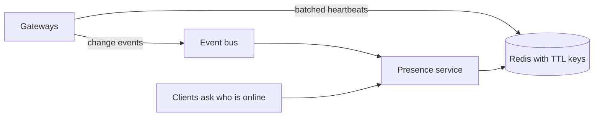

Core design:
- **State.** `presence:{user}` holds a set of connection ids with a TTL of about 2 to 3 times the heartbeat interval.
- **Heartbeat cost.** One million users with a 30 second refresh is about 33,000 writes per second. Gateways batch refreshes in a pipeline, one call per few hundred users. Shard the store by user id.
- **Status changes.** Publish only transitions (offline to online, online to offline), debounced by a few seconds so quick reconnects do not flicker.
- **Who needs to know?** Do not broadcast to everyone. Subscribers are the user's contacts who are online now, or clients viewing a list. Use subscription on `presence:user:{id}` only for visible users, and fetch the batch state for a page.
- **Multi-device.** A user is online while any connection exists. Keep per-device entries.
- **Gateway crash.** Keys expire after the TTL. A crashed gateway's users go offline within about one TTL. To speed it up, keep a per-gateway lease and remove all users of an expired gateway.
- **Last seen.** Write it to the database on the offline transition only, not on every heartbeat.

| Design choice | Option A | Option B |
| --- | --- | --- |
| Accuracy | Short TTL (more writes, quick detection) | Long TTL (fewer writes, slower) |
| Fan-out | Push to all contacts (expensive) | Pull on demand, push for visible only |
| Consistency | Single region store | Per-region store, accept stale cross-region state |

Trade-off to say out loud: presence does not need to be exact. Seconds of delay are fine, and stale state is better than a store melting under writes.

**Gotcha:** Showing presence for huge groups (10,000 members) is rarely useful. Show a count, or only the first few online users.

**Interview tip:** Open with "presence is a lease with a TTL", then talk about batching and who gets notified. That structure covers the scoring points.

_Module: Real-time Design · Tags: presence, design, redis, scaling_

### 51. How would you design chat with history, read receipts and offline delivery?

**Short answer:** Make the database the source of truth and the socket a fast path. A message is accepted, stored with a per-conversation sequence number, then fanned out to online members over WebSockets. Offline users get it from history when they return, plus a push notification. Read receipts are small position updates per user per conversation, not per message.

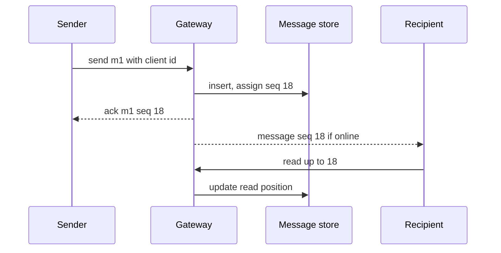

Key decisions:
- **Identifiers.** The client creates a message id for de-duplication on retry. The server assigns `seq` per conversation, which orders messages and drives resume.
- **Ordering.** One writer per conversation: partition by conversation id so inserts are serialised.
- **Storage.** A table keyed by `(conversation_id, seq)`, queried by range for pagination (`seq < cursor LIMIT 50`). Cassandra-style or SQL both work; choose what your team operates.
- **Offline delivery.** On connect, the client sends `lastSeq` per conversation (or a global cursor) and fetches missing messages by HTTP. Send a mobile push notification (APNs or FCM) for users with no live connection, with a minimal payload.
- **Read receipts.** Store `last_read_seq` per `(user, conversation)`. Send a receipt event at most every second or two. "Delivered" is when the client acked the seq, "read" is when the user viewed it. Do not store one row per message per reader in large groups.
- **Group size.** Small groups: push every event. Huge channels: send a "new messages" hint and let the client fetch.
- **Unread counts.** Compute as `latest_seq - last_read_seq`, cached.
- **Edits and deletes** are events with their own seq, applied by the client.

| Concern | Choice |
| --- | --- |
| Delivery | At-least-once with client-side de-duplication |
| History | Database, paginated by seq |
| Online fan-out | Backplane topic per conversation |
| Offline | Push notification plus fetch on connect |
| Receipts | Last read position, throttled |

**Gotcha:** Sending the message to recipients before it is stored can show a message that later fails to save. Store first.

**Interview tip:** Draw the "send, store, ack, fan-out" sequence and say the socket never holds the only copy.

_Module: Real-time Design · Tags: chat, design, offline, read-receipts_

### 52. How would you design a live-updates feed for one million concurrent connections?

**Short answer:** Split the system into stateless publishers, a durable log, a sharded backplane, and many gateway pods that each hold about 30,000 to 100,000 connections (a number you must measure). Shard users across gateways and channels across the backplane, bound every queue, and assume reconnect storms will happen.

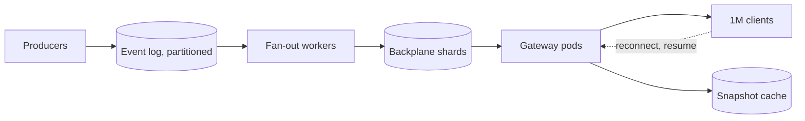

Numbers to reason with. With 1,000,000 connections and 50,000 per pod you need at least 20 pods, plus headroom, so about 30. If every user gets 1 message per second, that is 1,000,000 socket writes per second across the fleet, about 33,000 per pod, which is fine for Go and workable for Node with batching.

Design points:
- **Connection layer.** Stateless gateway pods. A load balancer spreads new connections evenly by least connections. Connection cap per pod, enforced by readiness.
- **Routing.** Subscribe each gateway only to channels it has members for. A per-user channel (`user:{id}`) for personal events, and shared channels (`topic:{id}`) for common ones.
- **Backplane.** Shard by channel with consistent hashing. One Redis instance does not do 1M fan-out events per second, so use a cluster, or NATS, with several nodes.
- **Producers.** Write to the log first, and let fan-out workers publish. Producers never talk to gateways directly.
- **Back-pressure.** Per-connection bounded queues. Conflate state feeds (keep latest), drop or disconnect slow clients.
- **Reconnect protection.** Jittered backoff, snapshot cache with a short TTL, connect rate limits per pod, and slow rollouts.
- **Data size.** Send deltas, binary formats, and batch in small windows.
- **Regions.** Put gateways near users, with regional backplanes, and replicate events between regions.
- **Observability.** Per-pod connections, queue depth, publish lag and p99 delivery latency.

| Risk | Mitigation |
| --- | --- |
| One hot channel (a celebrity) | Shard the channel, or tier fan-out (relay gateways) |
| Memory growth | Queue limits, pod memory limits and caps |
| Reconnect storm | Jitter, snapshot cache, rate limits |
| Backplane failure | Clients resync from snapshots when it recovers |

**Interview tip:** Start by asking numbers: message rate, fan-out, size, latency target and loss tolerance. Then show the arithmetic.

_Module: Real-time Design · Tags: scaling, design, fan-out, backpressure_

### 53. How does collaborative editing work, and how do OT and CRDTs differ?

**Short answer:** In collaborative editing, several people change the same document at once, and everyone must end up with the same result. Operational Transformation (OT) uses a central server that transforms concurrent operations against each other. CRDTs (conflict-free replicated data types) give each change a structure that merges automatically in any order, with no central ordering.

Take the text `cat`. User A inserts `s` at the end. User B, at the same time, inserts `h` at the start. Both operations were made against `cat`. If A applies B's operation without care, the position of A's insert is wrong, because the text moved by one. The system must adjust it, so that both users end with `hcats`.

| Point | OT | CRDT |
| --- | --- | --- |
| Idea | Transform an operation against operations that happened concurrently | Make operations commutative using unique ids per element |
| Server | Central server decides order | Optional; peers can merge directly |
| Offline editing | Harder | Natural |
| Complexity | Hard to get right (transform functions), small data | Simpler convergence logic, larger metadata |
| Memory | Small documents | Metadata grows (tombstones), needs compaction |
| Used in | Classic Google Docs style editors | Many newer libraries, such as Yjs and Automerge |

How CRDT text works in plain words: every character gets a unique id (such as a site id and a counter) and a position relative to neighbours. An insert says "put this character after character X". Deletes keep a "tombstone", so concurrent operations still find their reference. Merging is just applying all operations in any order.

The WebSocket part is simple: send operations (small), keep a version vector or revision, and resync on reconnect. The hard part is the algorithm, so use a library instead of writing your own.

Practical guidance:
- Use a proven library (Yjs, Automerge) and a WebSocket provider for it.
- Persist document updates in a log and compact occasionally.
- Presence and cursors are separate ephemeral messages.
- Authorise per document, and limit update size and rate.

**Gotcha:** Offline editing lasting days creates large merges. Plan for snapshots and size limits.

**Interview tip:** Do not claim to implement OT from scratch. Say what the trade-off is and that you would pick a library.

_Module: Real-time Design · Tags: collaboration, ot, crdt, consistency_

### 54. Which TCP-level behaviours cause WebSocket problems, and how do you handle them?

**Short answer:** WebSockets inherit TCP's weaknesses. A connection can be half-open (one side thinks it is alive, the other is gone), NAT and firewall devices forget idle connections, and mobile clients switch networks and change IP addresses. Application-level heartbeats are the reliable fix, because OS keepalive defaults are far too slow.

| Problem | What happens | Fix |
| --- | --- | --- |
| Half-open connection | Peer crashed or lost power, no FIN or RST sent. Your writes seem to succeed for a while | Ping with a deadline, terminate if no pong |
| NAT or firewall idle timeout | Device drops the mapping after a period of silence (often between 30 seconds and a few minutes). Next packet is dropped or reset | Heartbeat shorter than the timeout |
| Network switch (Wi-Fi to mobile) | Old TCP connection dies silently as the IP changes | Detect fast, reconnect and resume |
| Proxy idle timeout | Looks like a drop at a fixed time (for example 60 s) | Heartbeat, raise timeout |
| Slow detection | Linux TCP keepalive starts after 2 hours of idle by default | Do not rely on it |
| Unacked data | Retransmission can take minutes before TCP gives up | `TCP_USER_TIMEOUT` (Linux) or write deadlines |

TCP keepalive can be tuned per socket (idle time, interval, number of probes), but it is still less useful than an application heartbeat, because it runs below proxies and TLS terminators. A load balancer may answer keepalive probes on behalf of a dead backend.

I ran a local test where the server destroyed the socket after 1 second with no close frame, the way a proxy timeout looks. The client saw:

```text
code 1006 wasClean false after ms ~ 1000
```

Heartbeat settings I would use:
- Server ping every 20 to 30 seconds, with a pong deadline of 10 seconds.
- Client sends an app-level ping and expects a reply in the same window, so it can detect a dead server.
- Both add jitter so heartbeats do not synchronise.

Write deadlines matter too. In Go, `SetWriteDeadline` prevents a goroutine from blocking forever on a dead peer. In Node, a `terminate()` after a missed pong frees the socket.

**Gotcha:** `navigator.onLine` only says whether the device has a network interface, not whether your server is reachable.

**Interview tip:** Say "TCP will not tell you quickly that the peer is gone, so I do not wait for it".

_Module: Reliability & Delivery · Tags: tcp, half-open, nat, keepalive_

### 55. How do you handle mobile devices, battery and flaky networks?

**Short answer:** Mobile networks drop, switch and sleep. Keep connections only while the app is in use, make reconnect and resume fast and cheap, reduce wake-ups, and use push notifications (APNs, FCM) when the app is in the background. A WebSocket is a foreground tool on phones.

Challenges:
- **Background limits.** iOS and Android suspend background apps and close their sockets. You cannot hold a WebSocket reliably in the background.
- **Radio cost.** Each wake of the mobile radio costs battery. Frequent small messages keep it active.
- **Network changes.** Switching from Wi-Fi to cellular breaks TCP connections, often without a close.
- **Slow and lossy links.** Packet loss and high latency make handshakes slow.
- **Captive portals and proxies** that block upgrades.

Practices:
1. **Connect on foreground, disconnect on background.** In a browser use the `visibilitychange` event; in native apps use lifecycle callbacks. Close with 1000 after a short grace period.
2. **Push for background.** Send a data or notification push with a minimal payload. When the app opens, it connects and catches up through resume.
3. **Fast resume.** Send the last seq on reconnect and fetch deltas, not the whole state. Cache the last snapshot on the device.
4. **Adaptive heartbeats.** Longer interval in the background or on cellular, but below the NAT timeout.
5. **Batch and coalesce.** Combine updates, drop obsolete ones (latest position only), compress with binary formats.
6. **Network awareness.** Listen for online and offline events and network type changes; reconnect at once when the network returns, with jitter.
7. **Smaller handshakes.** TLS session resumption and HTTP keep-alive reduce reconnect cost.
8. **Show state to the user.** "Reconnecting..." with the age of data, and keep working offline with an outbox that retries.

| Situation | Behaviour |
| --- | --- |
| App in foreground | Live socket |
| App in background | Close socket, use push |
| Network lost | Queue outgoing messages, show offline state |
| Network returns | Reconnect with jitter, resume, flush the outbox |

**Gotcha:** A reconnect loop that never backs off can drain a battery in hours.

**Interview tip:** Say "on mobile the socket is an optimisation, push and sync are the guarantee".

_Module: Client Patterns · Tags: mobile, battery, reconnect, push-notifications_

### 56. How do you do real-time messaging on constrained or intermittent links, such as aircraft and satellite?

**Short answer:** Assume the link is down more often than you expect. Put a broker or queue on both sides, store messages locally until the link returns, send only deltas, and design every message to be idempotent and ordered by a sequence number. Real-time then means "as soon as the link allows", with no loss.

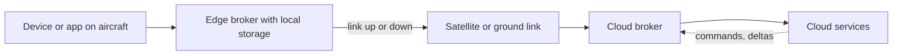

Traits of such links: high latency (hundreds of milliseconds on geostationary satellite), low and variable bandwidth, long outages (tunnels, coverage gaps, ground stations), and cost per megabyte. A plain browser WebSocket directly to the cloud over this link fails often and reconnects badly.

Design principles:
1. **Store-and-forward.** Producers write to a local durable queue at the edge. A forwarder sends when the link is up and deletes after acknowledgement.
2. **At-least-once plus idempotency.** Messages have ids and sequence numbers. Duplicates after a retry are safe.
3. **Delta sync.** Send only what changed, using version numbers or hashes. After a long outage, exchange a summary (last seq per stream) and fill the gap.
4. **Prioritise.** Safety or status messages go first, bulk telemetry later, and old samples can be thinned (keep one per minute).
5. **Compact formats.** Binary encoding (protobuf, CBOR) and compression save bytes. Batch small messages in one transmission.
6. **Expiry.** Some messages lose value with time. Give them a TTL and drop them rather than send stale data.
7. **Short, resumable sessions.** Keep connections cheap to rebuild (session resume), with long keepalive and backoff tuned to the link.
8. **Edge autonomy.** The cabin or local system must work with no cloud connection. The cloud is eventually consistent.
9. **Security.** Mutual TLS and per-device identity, with certificate rotation that survives long offline periods.

| Choice | Use when |
| --- | --- |
| WebSocket directly | Stable link, browser or gateway session |
| MQTT with persistent sessions | Devices, unreliable links, many topics |
| Local queue plus HTTPS batch upload | Very bad links, bulk data |
| AMQP broker | Enterprise routing, between data centres |

**Gotcha:** An unbounded local queue fills storage during a long outage. Define limits and a drop policy per message class.

**Interview tip:** Say "the design is eventually consistent with a clear priority and expiry policy", and mention idempotency. It shows you understand the real constraint.

_Module: Reliability & Delivery · Tags: intermittent-connectivity, store-and-forward, edge, aircraft_

### 57. How do MQTT, WebSockets and AMQP compare for device messaging?

**Short answer:** MQTT is a light publish and subscribe protocol designed for unreliable networks and small devices, with delivery levels, retained messages and a last will. WebSockets are a general channel with no delivery rules. AMQP is a richer enterprise messaging protocol with queues and routing, usually between servers.

MQTT concepts:
- **Topics** are hierarchical strings like `fleet/ac-123/status`. Subscribers use wildcards: `+` for one level and `#` for the rest.
- **QoS levels** per message:
  - QoS 0: at most once, no ack. Fastest, may be lost.
  - QoS 1: at least once, acknowledged, may duplicate.
  - QoS 2: exactly once for the broker hop, using a four-step handshake. Slower and more state.
- **Retained message.** The broker stores the last message of a topic and gives it to new subscribers at once. Good for "current state".
- **Last will and testament (LWT).** The device registers a message that the broker publishes if the device disconnects without a clean goodbye. This is how presence works in MQTT.
- **Persistent sessions.** With a persistent session, the broker keeps subscriptions and queued QoS 1 and 2 messages while the client is offline (MQTT 5 calls it session expiry).
- **Keep alive.** The client pings within an interval, and the broker detects dead clients.

| Point | MQTT | WebSocket | AMQP |
| --- | --- | --- | --- |
| Model | Pub/sub with topics | Raw bidirectional channel | Queues, exchanges, routing |
| Delivery rules | QoS 0, 1, 2 | None, you build | Acks, durable queues, transactions |
| Overhead | Very small header (2 bytes minimum) | Small frames | Heavier |
| Offline clients | Persistent sessions, queued messages | Nothing | Queues hold messages |
| Browser | Over WebSocket | Native | Not directly |
| Best for | Devices, telemetry, flaky links | Browser real-time | Service to service workflows |

MQTT can run over WebSockets (subprotocol `mqtt`), so a browser can speak to an MQTT broker, which is a neat way to share one topic model between devices and web dashboards.

Trade-offs: topic design and access control (ACL per topic) must be planned, a broker is stateful infrastructure that needs clustering, and QoS 2 is rarely needed (QoS 1 plus idempotent handlers is the usual choice).

**Gotcha:** Subscribers on the same wildcard topic can create fan-out surprises. Keep the topic tree meaningful and limit wildcards.

**Interview tip:** Mention LWT and retained messages. They solve presence and "current value" without custom code.

_Module: Reliability & Delivery · Tags: mqtt, amqp, websockets, iot_

### 58. How do you prevent a thundering herd when many clients reconnect?

**Short answer:** Spread the reconnects in time and cheapen each reconnect. Clients use exponential backoff with full jitter, the server tells clients when to come back, expensive work behind the connection is cached or limited, and rollouts are slow enough that the fleet is never asked to reconnect all at once.

A herd happens after a deploy, a load balancer restart, a network blip, or a backend outage. All clients drop at the same time and, without jitter, return at the same times: after 1 second, 2 seconds, 4 seconds. Each wave is as large as the first, and a recovering system falls over again.

Defences:
1. **Client side.** Exponential backoff with full jitter (random between 0 and the cap). A minimum initial random delay on the first retry, for example 0 to 5 seconds, helps mass drops. Reset the backoff only after a stable connection.
2. **Server-directed delay.** On shutdown, the close frame carries a hint (code 1012, or a message `{retryAfterMs}`), and the delay is random per client. For overload, send `Retry-After` on the handshake reject (503).
3. **Cheaper reconnects.** Cache the auth result (ticket validation) and snapshot data for a few seconds. Avoid per-connect database queries. Use TLS session resumption.
4. **Admission control.** Limit new connections per second per pod. Over the limit, reject quickly with 503 and `Retry-After`, never accept and then stall.
5. **Gradual drain.** Close a few percent of connections per second during a deploy (see the zero-downtime question).
6. **Capacity for reconnect.** Size TLS and auth capacity for several times the steady rate, or use autoscaling that reacts in seconds.
7. **Protect dependencies.** Circuit breakers and bulkheads on the auth service and database, so the herd does not take down shared systems.

```ts
// Server: tell the client when to come back, with a random delay
function shedLoad(ws: { close(code: number, reason: string): void }, maxDelayMs = 60_000) {
  const retryAfter = Math.floor(Math.random() * maxDelayMs);
  ws.close(1013, JSON.stringify({ retryAfterMs: retryAfter }));   // 1013 = try again later
}
```

Also test it: kill a pod holding 20% of connections in staging and watch the reconnect rate, auth latency and snapshot load.

**Gotcha:** Jitter added only to the maximum delay still synchronises the first retry. Randomise the whole range.

**Interview tip:** Use the sentence "spread it out, make it cheap, and cap the rate".

_Module: Scaling & Operations · Tags: reconnect-storm, jitter, resilience, load_

### 59. How do you achieve zero-downtime deployments for stateful connections?

**Short answer:** You cannot move a live TCP connection to a new pod, so zero downtime means zero visible downtime: clients reconnect quickly and resume without gaps. Combine gradual draining, resume with sequence numbers, backward compatible protocol versions, and a rollout strategy that keeps capacity high.

Elements:
1. **Resume makes reconnects invisible.** Clients keep `lastSeq` and fetch missed events, so a reconnect costs a second, with no lost data.
2. **State outside the pod.** Subscriptions can be restored from the client, and presence and sessions live in Redis or the database. A new pod has everything it needs.
3. **Gradual drain.** Old pods fail readiness, then close connections in batches with jitter over 30 to 120 seconds.
4. **Capacity first.** Surge new pods before removing old ones (`maxSurge`, `maxUnavailable: 0`), so reconnecting clients have a place to go.
5. **Protocol compatibility.** New server versions must accept old clients and old versions of messages. Deploy server first, clients later. Use version negotiation.
6. **Strategies.**

| Strategy | How | Notes |
| --- | --- | --- |
| Rolling | Replace pods in batches | Default, simple, mixed versions during the roll |
| Blue-green | Start new fleet, move new connections, drain old | Easy rollback, double capacity temporarily |
| Canary | Send a small share of new connections to the new version | Safe for protocol changes |

7. **Rollback.** Keep the old fleet until the new one has run for a while. If you roll back, clients reconnect again, so rate-limit that too.
8. **Database changes** use expand and contract, so old and new pods run together.
9. **Observability during deploy.** Watch reconnect rate, handshake errors, resume gap size and p99 latency. Pause the rollout automatically if they pass a threshold.

Clients can help: show "reconnecting" only after 2 seconds of failure, so a quick resume is invisible to users.

For truly stateful designs (one connection owns in-memory game state), you need handover: persist state on drain, and the new pod loads it when the user returns. Keep such state to a minimum.

**Gotcha:** A rollout that restarts all pods in quick succession (high `maxUnavailable`) turns into a reconnect storm.

**Interview tip:** Say "zero downtime does not mean zero disconnects, it means no visible loss". It shows realism.

_Module: Scaling & Operations · Tags: deployments, graceful-shutdown, blue-green, resume_

### 60. How do you debug WebSocket problems in practice?

**Short answer:** Start where the problem is visible and go inward: browser devtools for frames and close codes, a command line client to test the server without the browser, proxy and server logs with a correlation id, and packet captures only as a last step.

Tools and what they show:

| Tool | Use |
| --- | --- |
| Browser devtools, Network tab, WS filter | Handshake headers, status 101, each frame with direction and size, close code and reason |
| `wscat` or `websocat` | Connect from the terminal, send messages, test auth and headers (custom headers possible) |
| `curl` with upgrade headers | See the raw handshake response (`curl -i` with `Connection: Upgrade` and `Upgrade: websocket`) |
| Server logs | Connection id, user, close code, duration, bytes, last message type |
| Proxy and ingress logs | Status of the upgrade, timeouts (look for 499, 502, 504, and timing) |
| Metrics | Disconnect rate by code, handshake failures, queue depth |
| `tcpdump` or Wireshark | Last resort: see TCP resets, retransmissions, who closed first (Wireshark can decode WebSocket frames, but TLS needs keys or an unencrypted capture) |

Debug steps for "it does not connect":
1. Look at the handshake in devtools. 101 means success. 400, 401, 403 point to auth or Origin. 426 or 200 usually means a proxy did not pass the upgrade. 502 or 504 means the upstream or a timeout.
2. Reproduce with `wscat` against the pod directly, then through the ingress, then through the public URL. The hop where it breaks is the culprit.

For "it drops": record the time between connect and close. Equal intervals (30, 60, 120 seconds) point to an idle timeout somewhere. Random intervals point to network or pod restarts. Check the close code: 1006 means no close frame (network or proxy), 1001 or 1012 means the server asked.

Logging rules:
- Create a connection id at upgrade, and a correlation id for each message. Put both in every log line, and return them in an error message so users can report them.
- Never log message bodies or tokens by default. Add a sampled debug mode for one user id.

I tested the first step locally with the raw handshake (status 101 and the Accept header), which is the same view you get from `curl -i` or devtools.

**Interview tip:** Say you bisect the path (pod, ingress, public URL). It is quick and it always finds the broken hop.

_Module: Scaling & Operations · Tags: debugging, devtools, wscat, tcpdump_

### 61. How do you load test a WebSocket service, and what do you measure?

**Short answer:** Simulate realistic clients, not just many sockets: connect with auth, subscribe, send and receive at a realistic rate, reconnect, and stay idle. Ramp up gradually, then run a soak, and measure connections, delivery latency percentiles, errors, and server memory and CPU.

Tools:

| Tool | Notes |
| --- | --- |
| k6 | Scripts in JavaScript, has a WebSocket module, good for scenarios and thresholds |
| Artillery | YAML scenarios, WebSocket engine, simple to start |
| Custom Go client | Best for 100,000 or more connections, you control behaviour, uses little memory per client |
| Distributed generators | Many machines or pods, because one machine has port and descriptor limits |

Plan the test around these scenarios:
1. **Connection ramp.** Open N connections at a rate. Watch handshake latency and failures.
2. **Steady state.** Hold connections with a message mix (for example 1 message per user every 10 seconds, plus broadcasts).
3. **Fan-out.** One publisher to a room of 10,000. Measure the spread of arrival times.
4. **Churn.** Clients connect and disconnect continuously.
5. **Reconnect storm.** Drop 30% of connections at once.
6. **Slow consumers.** Some clients read slowly, to test backpressure.
7. **Soak.** Hours at steady load, to find leaks.

What to measure:
- Connections: success rate, time to connect, number open.
- Latency: from publish timestamp to receive timestamp, as p50, p95, p99 (use clocks from the same machine or synchronised clocks).
- Throughput: messages per second in and out.
- Errors: close codes, timeouts, dropped messages, duplicates, gaps in sequence numbers.
- Server: CPU, memory per connection (RSS divided by connections), GC pauses or event loop lag, file descriptors, network.
- Dependencies: Redis or NATS latency, database load.

Practical points:
- Raise limits on the generator machines (descriptors, ephemeral ports), or you test your laptop.
- Use the same path as production: TLS, ingress, and proxy.
- Define pass criteria before the run, for example "p99 under 500 ms at 100,000 connections with memory under 70%".

```js
// k6 sketch (read-only, k6 not installed here)
import ws from 'k6/ws';
export default function () {
  ws.connect('wss://staging.example.com/ws?ticket=...', {}, (socket) => {
    socket.on('open', () => socket.send(JSON.stringify({ type: 'subscribe', channel: 'room:1' })));
    socket.on('message', (m) => { /* record latency from m.sentAt */ });
    socket.setTimeout(() => socket.close(), 60000);
  });
}
```

**Interview tip:** Say "I measure what the user sees (delivery latency percentiles), then look at the server limits".

_Module: Scaling & Operations · Tags: load-testing, k6, artillery, performance_

### 62. What are the deeper security risks of WebSockets and how do you defend against them?

**Short answer:** Beyond authentication and Origin checks, defend against resource exhaustion (huge messages, slow handshakes, many connections), malformed or hostile input, tokens that outlive their validity, and leaking data through broadcast. Use limits at every layer, validate every message, and close fast on violations.

Risks and defences:

| Risk | What it is | Defence |
| --- | --- | --- |
| Oversized messages | A client sends a very large frame to exhaust memory | `maxPayload`, close with 1009, reject at the proxy |
| Slow handshake (slowloris style) | Many half-open upgrade requests hold sockets | Handshake timeout, header size limit, per-IP limits, connection cap at the edge |
| Many connections | One user opens thousands | Per-user and per-IP caps, evict oldest |
| Message floods | High rate of tiny messages | Token bucket per connection, close with 4429 |
| Protocol violations | Unmasked client frames, invalid UTF-8, bad opcodes, oversized control frames | Use a well-maintained library, close with 1002 or 1007 |
| Frame or message injection | Attacker-controlled data forwarded raw to others, or injected into JSON strings | Parse and validate with a schema, build outgoing messages from typed data, never concatenate strings |
| Cross-site hijacking | Malicious page uses the victim's cookies | Origin allow-list, tickets |
| Auth expiry | Token valid at connect but expired or revoked later | Store expiry, close or refresh, handle revocation events |
| Data leakage | Sending a full object to all subscribers | Per-user projection, authorise per channel |
| Stored XSS | Chat message rendered as HTML | Escape on render, never use `dangerouslySetInnerHTML` with message data |
| Dependency flaws | Known CVEs in WebSocket libraries | Pin and update, dependency scanning in CI |
| Replay | Captured messages replayed | `wss`, nonces or sequence checks for sensitive commands |

Defence in depth:
1. Edge: WAF, TLS, connection and rate limits.
2. Gateway: auth, Origin, size, rate, subscriptions limits.
3. Application: schema validation and authorisation for every message.
4. Monitoring: alerts for auth failures, rate-limit closures, odd close code spikes.

Revocation deserves a design. Short token lifetimes (5 to 15 minutes) with refresh messages, plus a revoke channel: when a user is blocked, publish `revoke:user:42` and gateways drop that user's sockets within seconds.

**Common mistakes**
- Trusting a role or user id in the message body.
- Logging full messages, including tokens or personal data.

**Interview tip:** Group the answer as: limits (size, rate, count), identity (auth, Origin, expiry), and content (validation, escaping, projection).

_Module: Security · Tags: security, dos, frame-injection, token-expiry_

### 63. Interview scenario: connections drop after exactly 60 seconds in production. What do you do?

**Short answer:** A fixed interval means an idle timeout. Something in the path closes connections that carry no data for 60 seconds. The NGINX default `proxy_read_timeout` is 60 seconds, so that is the first suspect. Add a heartbeat below the timeout and raise the timeout on that route.

My process:
1. **Confirm the pattern.** In the browser devtools, look at the time between the 101 and the close. Check the close code. Code 1006 with a fixed time means a hop cut the connection without a close frame.
2. **Bisect the path.** Connect with `wscat` directly to the pod (port-forward), then via the service, then via the ingress, then the public URL. The first path where it drops at 60 seconds shows the culprit. Local tests work because there is no proxy.
3. **List every hop and its timeout.** CDN or WAF, cloud load balancer, ingress controller, service mesh sidecar, and the app server.
4. **Look at logs.** The ingress log shows the request ending at about 60 seconds (often a 499 or a completed request with a long duration).
5. **Fix in layers.**
   - Send a ping or app heartbeat every 25 seconds. It keeps the connection busy and also detects dead peers.
   - Raise the timeout for the WebSocket path (`proxy_read_timeout 3600s` or the ingress annotation).
   - Check other hops, such as a cloud gateway idle timeout, and fix them too.
6. **Verify.** Hold a quiet connection for 10 minutes in staging and in production, and add a synthetic probe that does this continuously.
7. **Prevent.** Document hop timeouts in the runbook and add a test that fails if a connection with a heartbeat dies before 5 minutes.

I reproduced the client-side symptom locally: a server that destroyed the socket after a fixed delay produced `code 1006 wasClean false` on the built-in client at exactly that delay.

Root cause examples:
- NGINX or ingress `proxy_read_timeout` left at 60 seconds.
- A cloud load balancer idle timeout shorter than the heartbeat.
- A mesh route timeout (for example 15 or 60 seconds) applied to the upgraded stream.

**Gotcha:** Raising timeouts alone hides dead connections. Keep the heartbeat anyway.

**Interview tip:** The structure "pattern, bisect, list hops, fix, verify" shows a method, which matters more than guessing the right setting.

_Module: Scaling & Operations · Tags: scenario, timeouts, troubleshooting, nginx_

### 64. Interview scenario: messages arrive out of order. How do you find and fix it?

**Short answer:** First find where order is lost: the publisher, the backplane, the gateway or the client. Then add a per-stream sequence number assigned by one writer, and make the client apply messages by sequence, buffering or resyncing on gaps. A single TCP connection keeps order, so the loss almost always comes from concurrency elsewhere.

Where out-of-order delivery comes from:

| Source | Why |
| --- | --- |
| Concurrent handlers | `await` or worker pools let message 2 finish before message 1 |
| Several publishers | Two services publish for the same entity without one clock |
| Multiple backplane paths | Different partitions or channels for related events |
| Retries | A retried message arrives after a newer one |
| Reconnect | Replayed events mix with live events |
| Multiple connections | The same user has two sockets (two tabs or a reconnect overlap) |

Investigation:
1. Add a `seq` and a timestamp to the events, and log them at the publisher, the gateway and the client.
2. Find the first hop where the order is wrong.
3. Reproduce with a test that sends events quickly while delaying some handlers.

Fixes:
- **One writer per stream.** Assign `seq` from the database sequence, a partition leader, or an atomic counter per stream. Partition the bus by stream id, so one stream always flows through one ordered partition.
- **Serialise processing per stream.** Use a per-key queue (in Go, one goroutine per stream key, or a keyed worker; in Node, chain promises per key).
- **Client logic.** Keep `lastSeq`. A lower number is ignored, a higher-than-expected number triggers buffering for a short time and then a replay request or resync.
- **For "latest state" data,** send a version and drop older versions. Order does not matter then.
- **After reconnect,** finish the replay before applying live events, or buffer live events until replay ends.

```ts
function apply(state: { lastSeq: number }, m: { seq: number }) {
  if (m.seq <= state.lastSeq) return 'ignore';                    // old or duplicate
  if (m.seq > state.lastSeq + 1) return 'gap: buffer or resync';
  state.lastSeq = m.seq;
  return 'apply';
}
```

**Interview tip:** Say "TCP keeps order on one connection, so I look for concurrency before and after the socket". Then name the sequence number fix.

_Module: Reliability & Delivery · Tags: scenario, ordering, sequence-numbers, concurrency_

### 65. Interview scenario: server memory keeps growing as more users connect. How do you investigate?

**Short answer:** Separate expected memory per connection from a leak. Check whether memory returns to baseline when users leave. If it does not, find what holds references: forgotten room entries, listeners, timers, unbounded queues, or large buffers. Use heap snapshots in Node or pprof in Go.

Step by step:
1. **Plot memory against open connections.** A straight line with connections is normal cost per connection. Memory that stays high after connections drop is a leak. A step pattern after deploys points to caches.
2. **Check the usual suspects.**

| Suspect | Symptom | Fix |
| --- | --- | --- |
| Connection not removed from rooms or maps on close | Map sizes grow forever | Clean up in one `close` handler, and test it |
| Event listeners or timers per connection never cleared | Timers and listeners count grows | Clear intervals on close, use `once` or `AbortController` |
| Unbounded send queues for slow clients | Memory spike with a few bad clients | Bound the queue, close slow consumers |
| Large per-connection buffers or compression state | High memory per connection | Lower buffer sizes, disable permessage-deflate |
| Closures holding big objects | Heap snapshot shows retained closures | Do not capture large objects in per-connection callbacks |
| Per-user caches without eviction | Cache size grows | Use LRU and TTL |
| Goroutine leaks (Go) | Goroutine count grows | Ensure both pumps exit, use contexts |
| Half-open connections never closed | Sockets stay in the registry | Heartbeat and terminate |

3. **Take evidence.**
   - Node: heap snapshots before and after, compare retained size by constructor (Chrome devtools or `--heapsnapshot-signal`), and watch `process.memoryUsage()`.
   - Go: `net/http/pprof` heap and goroutine profiles, and count goroutines (a leak is usually two per dead connection).
   - Expose gauges for open connections, room sizes, queue bytes and timers.
4. **Reproduce.** A load test that connects and disconnects 100,000 clients, then checks memory after a GC.
5. **Fix and guard.** Add a test that connects and closes N clients and asserts the registries are empty. Add alerts on the ratio of memory to connections.

A quick sanity check for design: if each user also has a 1 MB queue allowance, 100,000 users mean 100 GB in the worst case. Set per-connection and per-pod limits.

**Gotcha:** Containers killed by the memory limit (OOMKilled) look like random restarts, and they trigger reconnect storms. Alert on them.

**Interview tip:** Say "I first prove it is a leak by dropping the connections and watching if memory returns, then I use heap snapshots to find the owner".

_Module: Server Implementation · Tags: scenario, memory-leak, profiling, backpressure_

---

## Resources

Where to read more at the source. Official docs and references come first.

**Official docs**

- [MDN: The WebSocket API](https://developer.mozilla.org/en-US/docs/Web/API/WebSockets_API) — The browser API, events and examples. _(beginner)_
- [MDN: Using server-sent events](https://developer.mozilla.org/en-US/docs/Web/API/Server-sent_events/Using_server-sent_events) — EventSource, the event stream format and reconnection. _(beginner)_
- [Socket.IO (repository and docs links)](https://github.com/socketio/socket.io) — Rooms, acknowledgements, adapters and connection recovery. _(intermediate)_
- [NGINX: WebSocket proxying](https://nginx.org/en/docs/http/websocket.html) — Upgrade headers and timeouts behind NGINX. _(intermediate)_

**Reference**

- [RFC 6455: The WebSocket Protocol](https://datatracker.ietf.org/doc/html/rfc6455) — The handshake, framing, masking and close codes. _(advanced)_
- [HTML spec: Server-sent events](https://html.spec.whatwg.org/multipage/server-sent-events.html) — The exact SSE format and Last-Event-ID rules. _(advanced)_
- [OWASP: Cross-site WebSocket hijacking](https://owasp.org/www-project-web-security-testing-guide/latest/4-Web_Application_Security_Testing/11-Client-side_Testing/10-Testing_WebSockets) — Testing WebSockets for origin, auth and input issues. _(advanced)_
- [MQTT specification](https://mqtt.org/mqtt-specification/) — QoS levels, retained messages and last will. _(advanced)_

**Tutorial**

- [MDN: Writing WebSocket servers](https://developer.mozilla.org/en-US/docs/Web/API/WebSockets_API/Writing_WebSocket_servers) — The handshake and frame format, step by step. _(intermediate)_

**Article**

- [AWS: Exponential backoff and jitter](https://aws.amazon.com/blogs/architecture/exponential-backoff-and-jitter/) — Why jitter prevents reconnect storms. _(intermediate)_
- [CRDT resources](https://crdt.tech/) — Learn conflict-free replicated data types for collaborative editing. _(advanced)_

**Repository**

- [ws (Node.js)](https://github.com/websockets/ws) — The standard Node WebSocket library: server, client, backpressure. _(intermediate)_
- [gorilla/websocket](https://github.com/gorilla/websocket) — Go WebSocket library with the chat example (read and write pumps). _(intermediate)_
- [coder/websocket](https://github.com/coder/websocket) — A minimal, context-aware Go WebSocket library. _(intermediate)_
